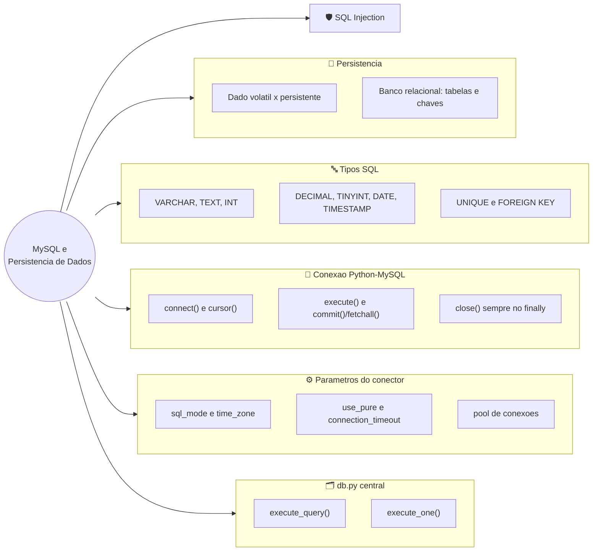
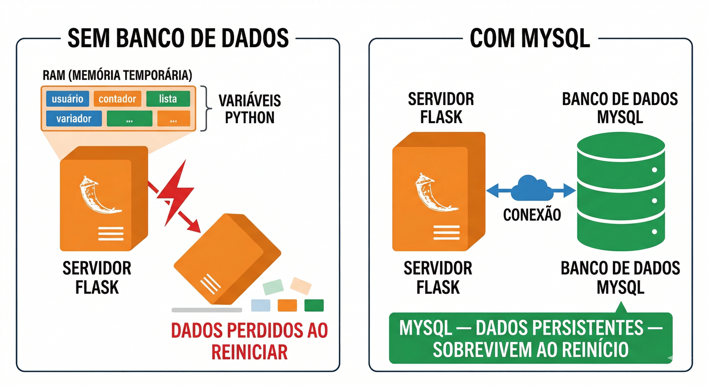
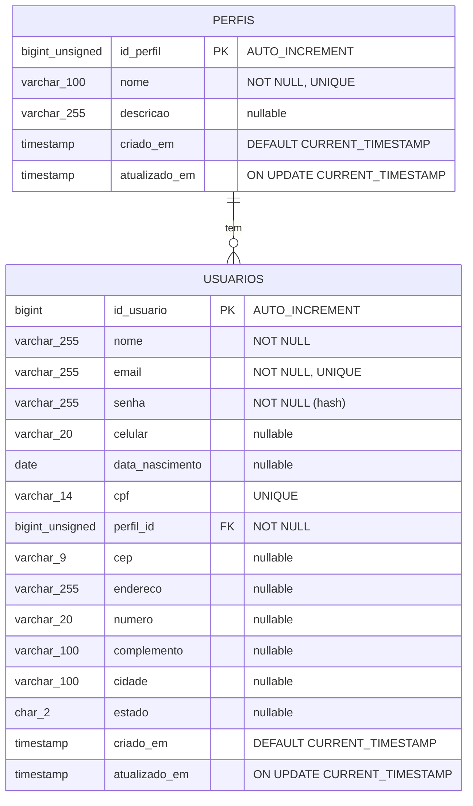
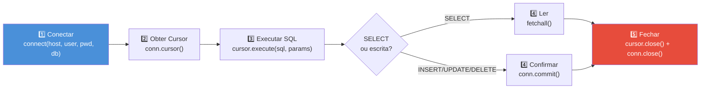
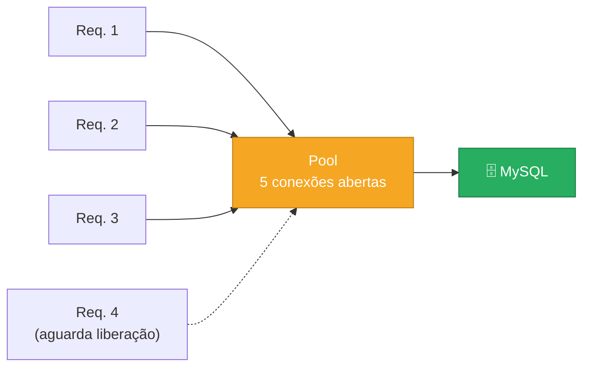
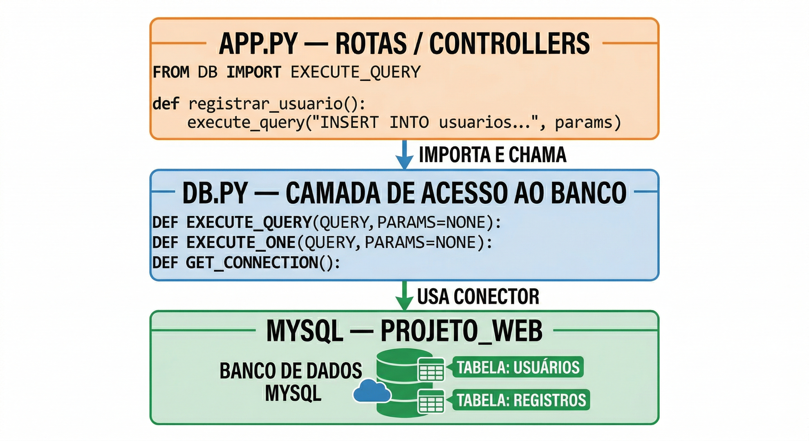
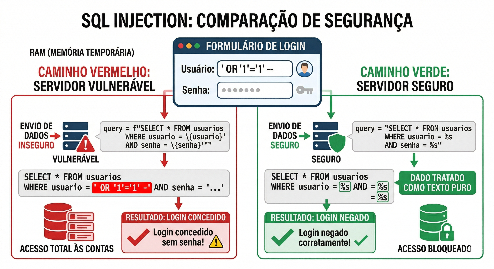
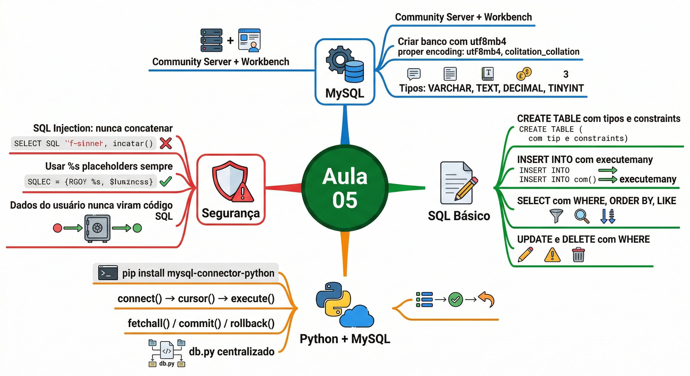

# Tópico 05 — Conexão MySQL e Python

**Disciplina:** Programação para Internet (ILP951)
**Professor:** Ronan Adriel Zenatti · ronan.zenatti@cps.sp.gov.br
**Fatec Jahu — 2º Semestre/2026**

> **Pré-requisitos:** Tópico 04 concluído — formulários GET/POST funcionando, padrão PRG aplicado.

---

## 🎯 Objetivos do Tópico

Ao final deste tópico você deverá ser capaz de:

- Explicar a diferença entre dado volátil e dado persistente, e por que um banco de dados relacional é a solução correta para sistemas web.
- Escolher o tipo de coluna SQL adequado para cada tipo de dado (`VARCHAR`, `TEXT`, `INT`, `BIGINT`, `DECIMAL`, `TINYINT`, `DATE`, `TIMESTAMP`).
- Criar duas tabelas relacionadas (`perfis` e `usuarios`) com chave primária, `UNIQUE` e chave estrangeira (`FOREIGN KEY`), e juntá-las com um `JOIN` simples.
- Instalar e configurar o MySQL Community Server e criar um banco de dados pelo MySQL Workbench.
- Conectar uma aplicação Python ao MySQL com `mysql-connector-python`, seguindo o ciclo conectar → cursor → executar → confirmar/ler → fechar.
- Configurar parâmetros de conexão robustos (`sql_mode`, `time_zone`, `use_pure`, timeout, pool de conexões).
- Centralizar o acesso ao banco em um módulo `db.py` reutilizável por toda a aplicação.
- Executar os comandos SQL fundamentais (`SELECT`, `INSERT`, `UPDATE`, `DELETE`) e identificar por que a concatenação de strings em SQL é perigosa.

Até aqui, todos os dados do sistema existiam apenas enquanto a aplicação estava rodando — listas Python que desapareciam ao reiniciar o servidor. Hoje isso muda permanentemente. Você vai instalar e configurar o MySQL, entender como bancos de dados relacionais funcionam e por que são a escolha certa para sistemas web, conectar o Python ao banco usando a biblioteca `mysql-connector-python`, criar a primeira tabela via script Python, e executar os primeiros comandos SQL diretamente do código. Ao final deste tópico, os dados cadastrados pelo seu sistema sobreviverão a qualquer reinicialização do servidor — pela primeira vez, sua aplicação terá memória permanente.

---

## 🗺️ Mapa Mental do Tópico



---

## Parte 1 — Persistência de dados: o problema que o banco resolve

### Dados voláteis versus dados persistentes

Quando o servidor Flask é encerrado — seja porque você fechou o terminal, o computador foi reiniciado, ou houve uma queda de energia — toda informação armazenada em variáveis Python simplesmente desaparece. Isso é chamado de **dado volátil**: existe apenas enquanto o programa está em execução na memória RAM. Para desenvolvimento e testes é aceitável, mas para um sistema real é inviável. Imagine um sistema de vendas que perde todos os pedidos cada vez que o servidor é reiniciado.

A solução profissional é gravar os dados em um **sistema de armazenamento persistente** que mantém as informações independentemente do estado do servidor. Arquivos de texto são uma opção simples, mas ineficientes para buscas e completamente inadequados para múltiplos usuários simultâneos. A solução correta para sistemas web é o **banco de dados relacional**.



### O que é um banco de dados relacional

Um **banco de dados relacional** organiza os dados em **tabelas** — estruturas bidimensionais compostas por linhas (registros) e colunas (atributos). As tabelas se relacionam entre si por meio de **chaves**, permitindo consultas que cruzam dados de múltiplas fontes com eficiência. Toda essa estrutura é governada pela linguagem **SQL** (Structured Query Language), criada nos anos 1970 e ainda hoje o padrão universal para bancos de dados.

A analogia mais próxima de uma tabela de banco de dados é uma planilha Excel: cada aba seria uma tabela, cada linha seria um registro (um produto, um cliente), e cada coluna seria um atributo (nome, preço, data). A diferença fundamental está em quatro capacidades: **integridade** (o banco garante que os dados seguem as regras definidas), **relacionamentos** (tabelas se conectam por chaves), **concorrência** (múltiplos usuários acessam e modificam dados simultaneamente sem conflito), e **performance** (consultas complexas em milhões de registros em milissegundos).

### Onde o MySQL se encaixa na arquitetura

O MySQL se posiciona como a camada de persistência que sustenta o servidor Flask. O diagrama abaixo mostra exatamente como os três componentes se comunicam:


O Flask atua como intermediário: recebe a requisição do navegador, consulta o MySQL, e usa os dados retornados para renderizar o HTML via Jinja2. O navegador nunca se comunica diretamente com o banco — toda interação passa pelo código Python.

### 🔎 Verifique seu Entendimento

Um app de mobilidade urbana registra cada corrida de bike-sharing (usuário, estação de saída, estação de chegada, horário) em uma lista Python dentro do `app.py`.

**Desafio:** Explique, em termos de dado volátil versus persistente, o que acontece com o histórico de corridas se o servidor Flask reiniciar sem um banco de dados, e por que isso é inaceitável para um app desse tipo em produção.

> 💬 Tente por conta própria antes de seguir. A solução comentada está no gabarito deste tópico (link na última seção da página).

---

## Parte 2 — Tipos de dados SQL essenciais

Antes de criar a primeira tabela, é fundamental entender os tipos de dados disponíveis no MySQL, pois cada coluna deve ter um tipo declarado. Isso garante integridade e permite ao banco otimizar armazenamento e consultas.

Para texto curto (nomes, e-mails, títulos) usa-se `VARCHAR(n)`, onde `n` é o tamanho máximo em caracteres — por exemplo, `VARCHAR(255)` para um e-mail. Para textos de tamanho sempre igual, como a sigla do estado (`SP`), usa-se `CHAR(n)`. Para textos longos sem limite fixo (descrições, conteúdo de artigos) usa-se `TEXT`. Para números inteiros (quantidades, IDs, idades) usa-se `INT`, ou `BIGINT` quando o intervalo precisa ser maior (é o tipo dos nossos IDs); `UNSIGNED` indica que só há valores positivos. Para valores decimais com precisão controlada (preços, medidas) usa-se `DECIMAL(p, d)`, onde `p` é o total de dígitos e `d` quantos ficam após a vírgula — `DECIMAL(10, 2)` suporta valores como `99999999.99`. Para valores verdadeiro/falso usa-se `TINYINT(1)`, onde `1` significa verdadeiro e `0` significa falso. Para datas e horas usa-se `DATE` (só a data, como um aniversário), `DATETIME` ou `TIMESTAMP` — este último pode ser preenchido automaticamente com a data e hora atuais. Além do tipo, cada coluna pode ganhar **restrições**: `NOT NULL` (obrigatória), `UNIQUE` (sem valores repetidos, como o e-mail) e `DEFAULT` (valor padrão).

O diagrama de entidade abaixo mostra as duas tabelas que vamos criar e como elas se ligam. `PERFIS` é a tabela **auxiliar**: cada linha é um papel (Administrador, Gerente, Usuário). `USUARIOS` é a principal, e cada usuário aponta para **um** perfil pela coluna `perfil_id`. Um mesmo perfil pode ser dado a **muitos** usuários (uma relação "um para muitos", ou 1:N):



Os campos `id_perfil` e `id_usuario`, com `AUTO_INCREMENT` e `PRIMARY KEY`, são especiais: o banco gera automaticamente um número único para cada novo registro, garantindo que nenhum usuário tenha o mesmo ID jamais. Já `perfil_id` é uma **chave estrangeira** (`FK`): ela só aceita números que existam em `perfis.id_perfil`, e é assim que o banco impede um usuário de apontar para um perfil inexistente. Para a mesma ideia de tipos com valores monetários (`DECIMAL`) e texto longo (`TEXT`), veja o [material de apoio com a tabela `produto`](apoio/Aula_05_apoio_produto.md).

### 🔎 Verifique seu Entendimento

Uma cooperativa quer uma tabela `ponto_coleta` para pontos de coleta seletiva: nome do ponto, endereço, quantos quilos de material já foram coletados, se o ponto está ativo, e quando foi cadastrado.

**Desafio:** Para cada um desses cinco atributos, escolha o tipo SQL mais adequado entre `VARCHAR(n)`, `TEXT`, `INT`, `DECIMAL(p,d)`, `TINYINT(1)` e `TIMESTAMP`, justificando a escolha de `quilos coletados` especificamente (por que não `INT`?).

> 💬 Tente por conta própria antes de seguir. A solução comentada está no gabarito deste tópico (link na última seção da página).

---

## Parte 3 — Instalando e configurando o MySQL

### Instalação do MySQL Community Server

Acesse **dev.mysql.com/downloads/mysql** e baixe o **MySQL Community Server** para Windows. Durante a instalação, selecione a opção **"Server only"** para instalar apenas o servidor. O **MySQL Workbench** (interface gráfica) será instalado separadamente, via `winget`, na próxima seção, na versão indicada para a melhor compatibilidade com o `mariadb`.

Na tela de configuração de senha, defina uma senha para o usuário `root`. **Anote essa senha em um lugar seguro** — ela será necessária em todos os momentos que você precisar conectar ao banco. Mantenha a porta padrão **3306** sem alteração.

Após a instalação, abra um novo terminal e verifique:

```
mysql --version
```

A resposta esperada é algo como `mysql  Ver 8.0.xx for Win64`. Se o comando não for reconhecido, execute pelo MySQL Command Line Client instalado no menu Iniciar.

### MySQL Workbench

O **MySQL Workbench** é a ferramenta gráfica oficial para administrar instâncias MySQL. Com ele você cria bancos e tabelas, escreve e executa queries SQL, e visualiza dados em grade sem precisar usar o terminal.

Instale o Workbench pelo **winget** (gerenciador de pacotes do Windows), na versão **8.0.47**, que tem a melhor compatibilidade com o `mariadb`. Abra o PowerShell e execute:

```powershell
winget install -e --id Oracle.MySQLWorkbench -v "8.0.47"
```

O `-e` exige correspondência exata do pacote e o `-v` fixa a versão. Não instale a versão mais recente (a 26.x): ela não é a que usamos nesta disciplina. Ao terminar, procure **MySQL Workbench** no menu Iniciar para confirmar que foi instalado.

Abra o Workbench, clique em **"Local instance MySQL80"** e insira a senha do `root` quando solicitado.

### Criando o banco de dados do projeto

No Workbench, abra um novo editor SQL (ícone de folha com raio) e execute o seguinte código com `Ctrl+Enter`:

```sql
-- Cria o banco de dados do projeto
-- IF NOT EXISTS: não gera erro se o banco já existir
CREATE DATABASE IF NOT EXISTS projeto_web
    CHARACTER SET utf8mb4
    COLLATE utf8mb4_unicode_ci;
-- CHARACTER SET utf8mb4: suporte completo a acentos, cedilha e emojis
-- COLLATE utf8mb4_unicode_ci: ordenação case-insensitive (João = joão)

-- Seleciona o banco para uso nas próximas queries
USE projeto_web;
```

O banco `projeto_web` deve aparecer no painel Navigator. Clique com o botão direito nele e selecione **"Set as Default Schema"** para que o Workbench o utilize automaticamente.

### 🔎 Verifique seu Entendimento

Uma organizadora de campeonatos de e-sports de 2026 precisa de um banco próprio, separado de qualquer outro projeto na mesma instância MySQL, chamado `campeonatos_esports`, também com suporte completo a acentos e emojis (nomes de times costumam usar caracteres especiais).

**Desafio:** Escreva o comando `CREATE DATABASE` completo para esse cenário, incluindo `IF NOT EXISTS`, `CHARACTER SET` e `COLLATE`, seguindo exatamente o padrão desta seção.

> 💬 Tente por conta própria antes de seguir. A solução comentada está no gabarito deste tópico (link na última seção da página).

---

## Parte 4 — Conectando Python ao MySQL

### Instalando o conector

Com o ambiente virtual ativo, instale a biblioteca oficial:

```
pip install mysql-connector-python
pip freeze > requirements.txt
```

### O ciclo de vida de uma conexão

Toda operação com banco de dados em Python segue o mesmo ciclo de cinco etapas. Entender esse ciclo é essencial para evitar os dois erros mais comuns: esquecer de fechar a conexão (o que esgota o pool de conexões do banco) e esquecer de chamar `commit()` após operações de escrita (o que faz os dados parecerem salvos mas não estarem).



O **cursor** é o objeto que executa as queries SQL — pense nele como um ponteiro que navega pelos resultados de um `SELECT` ou confirma a execução de um `INSERT`. Sempre abra o cursor, use-o, e feche tanto o cursor quanto a conexão, preferencialmente usando `try/finally` para garantir o fechamento mesmo em caso de erro.

### Parâmetros importantes do MySQL Connector

O `mysql-connector-python` aceita muito mais do que `host`, `user`, `password` e `database`. Entender os parâmetros abaixo é essencial para conexões robustas, corretas e seguras — do desenvolvimento local até a nuvem.

#### `sql_mode` — Modo de validação SQL

O MySQL pode operar em diferentes níveis de rigor na validação dos dados. Sem o modo estrito, ele aceita silenciosamente datas inválidas (`0000-00-00`), trunca textos longos sem aviso e arredonda decimais sem gerar erro. Com o modo estrito, qualquer dado inválido causa um erro explícito, forçando o código a tratar os problemas na origem:

```python
'sql_mode': (
    'STRICT_TRANS_TABLES,NO_ZERO_IN_DATE,NO_ZERO_DATE,'
    'ERROR_FOR_DIVISION_BY_ZERO,NO_ENGINE_SUBSTITUTION'
)
```

Cada flag ativa uma regra independente:

| Flag | O que faz sem ela | O que faz com ela |
|---|---|---|
| `STRICT_TRANS_TABLES` | Dados inválidos são corrigidos silenciosamente (VARCHAR truncado, DECIMAL arredondado, NOT NULL vira `0`) | Qualquer dado inválido gera erro e aborta o INSERT/UPDATE — é a flag mais importante |
| `NO_ZERO_IN_DATE` | Aceita datas com mês ou dia zero, como `2026-00-15` ou `2026-04-00` | Rejeita datas com mês ou dia zerado, que são malformadas e causam bugs difíceis de rastrear |
| `NO_ZERO_DATE` | Aceita `0000-00-00` como data válida (valor "vazio" legado do MySQL antigo) | Rejeita `0000-00-00` — datas devem ser reais ou `NULL` |
| `ERROR_FOR_DIVISION_BY_ZERO` | Uma divisão por zero em SQL (`10 / 0`) retorna `NULL` silenciosamente | Uma divisão por zero gera erro — torna o bug visível em vez de propagar `NULL` pelo sistema |
| `NO_ENGINE_SUBSTITUTION` | Se o storage engine pedido não existir, o MySQL troca por outro sem avisar | Se o engine não existir, gera erro — evita criar tabelas com engine diferente do esperado sem perceber |

O MySQL 8.0 já usa modo estrito por padrão no servidor, mas declarar explicitamente garante comportamento idêntico independentemente da versão do servidor ou da configuração da máquina de produção.

#### `time_zone` — Fuso horário da sessão

Controla o fuso horário que o MySQL usa em funções como `NOW()` e `CURRENT_TIMESTAMP`, e em colunas `DATETIME` e `TIMESTAMP`. Sem configurar, o servidor usa o fuso do sistema operacional — o que causa inconsistências em servidores em nuvem (geralmente UTC) versus máquinas de desenvolvimento (horário local):

```python
'time_zone': '-03:00'   # Horário de Brasília (BRT, sem horário de verão)
# ou
'time_zone': '+00:00'   # UTC — recomendado para produção e ambientes em nuvem
```

> **Regra prática:** Use `'+00:00'` em produção e armazene tudo em UTC. Converta para o fuso do usuário apenas na camada de interface.

#### `use_pure` — Python puro vs extensão C

O conector tem dois modos internos: a extensão C (mais rápida, padrão quando instalada) e a implementação em Python puro (mais compatível). Normalmente o conector escolhe automaticamente.

**Porém:** se você configurou tudo corretamente, a conexão funciona perfeitamente no Workbench, mas o código Python continua falhando com erros como `Authentication plugin 'caching_sha2_password' is not supported` ou `Lost connection to MySQL server`, a causa provável é uma **incompatibilidade entre a extensão C instalada e a versão do MySQL Server**. Nesses casos, forçar `use_pure=True` resolve o problema:

```python
'use_pure': True   # força a implementação em Python puro
```

O desempenho com `use_pure=True` é ligeiramente menor que a extensão C, mas a diferença é irrelevante para aplicações de pequeno e médio porte. É preferível ter a conexão funcionando de forma confiável a otimizar algo que nem está funcionando.

#### Tratamento de Falhas e Tempo

```python
'connection_timeout': 10,    # segundos para desistir de uma conexão que não responde
'autocommit':         False,  # False = exige commit() explícito (recomendado)
```

Sem `connection_timeout`, um servidor MySQL lento ou inacessível deixa a aplicação travada indefinidamente aguardando resposta. Com `10` segundos, o código recebe um erro em tempo razoável e pode apresentar uma mensagem amigável ao usuário em vez de congelar.

`autocommit=False` (padrão) significa que toda operação de escrita (`INSERT`, `UPDATE`, `DELETE`) precisa de um `commit()` explícito para ser efetivada no banco. Isso dá controle preciso sobre transações: se uma etapa de uma operação composta falhar, você pode chamar `rollback()` e desfazer tudo que havia sido escrito até ali.

#### Pool de Conexões — Essencial para Aplicações Web

Em uma aplicação web, cada requisição HTTP que acessa o banco precisa de uma conexão. Sem pool, cada requisição abre uma nova conexão TCP com o MySQL (alguns milissegundos de handshake e autenticação) e a fecha ao terminar. Com 50 usuários simultâneos, isso representa 50 pares de abertura/fechamento por segundo — um desperdício crescente de recursos do servidor.

Um **pool de conexões** cria um conjunto fixo de conexões antecipadamente e as **reutiliza** entre as requisições. Quando uma requisição termina, a conexão volta ao pool em vez de ser fisicamente fechada:



```python
'pool_name':          'webapp_pool',  # nome identificador do pool
'pool_size':          5,              # conexões abertas permanentemente (típico: 3–10)
'pool_reset_session': True,           # limpa variáveis de sessão ao reutilizar conexão
```

> **Atenção:** `pool_size` define o máximo de conexões simultâneas ao banco. Se todas estiverem ocupadas e uma nova requisição chegar, ela aguarda uma ser liberada. Aumentar `pool_size` indefinidamente consome memória e conexões no servidor MySQL. Para a maioria das aplicações web de pequeno a médio porte, `5` é suficiente.

> **Como o pool funciona com `conn.close()`:** quando você chama `conn.close()` em uma conexão do pool, ela **não é fisicamente fechada** — é devolvida ao pool para reutilização. O código de fechamento permanece idêntico; o pool gerencia o ciclo de vida por baixo dos panos.

#### Segurança — SSL/TLS

Em produção, especialmente com banco em servidor remoto, a conexão deve ser criptografada para evitar que credenciais e dados trafeguem em texto claro pela rede:

```python
'ssl_disabled':    False,                        # False = usa SSL quando disponível
'ssl_verify_cert': True,                         # verifica o certificado do servidor
'ssl_ca':          '/caminho/para/ca-cert.pem',  # certificado da autoridade certificadora
```

Para desenvolvimento local, SSL é opcional (banco e aplicação estão na mesma máquina). Para qualquer ambiente de produção ou banco em nuvem, SSL deve ser **obrigatório**.

### Exemplo completo com todos os parâmetros — Azure Database for MySQL

> **Este exemplo não é testável em sala** — depende de um recurso provisionado na nuvem Microsoft Azure. Serve como referência de como seria uma conexão de produção real com todos os parâmetros configurados corretamente, por isso ele é apresentado de uma vez, sem a divisão em incrementos que usamos nos exemplos que você de fato executa.

O Azure Database for MySQL é um serviço de banco de dados gerenciado. Ele exige SSL, usa credenciais no formato `usuario@servidor`, e tipicamente opera em UTC. Este é o exemplo de uma configuração completa para esse ambiente:

```python
# conexao_azure.py — Exemplo de referência (não testável localmente)
# Demonstra como todos os parâmetros se combinam em um cenário de produção real.

import mysql.connector
from mysql.connector import Error, pooling

AZURE_CONFIG = {
    # —— Identificação do servidor ——————————————————————————————
    'host':     'meu-servidor.mysql.database.azure.com',
    'port':     3306,
    'user':     'adminuser@meu-servidor',   # formato obrigatório no Azure
    'password': 'SenhaForte@2026!',
    'database': 'projeto_web',

    # —— Codificação —————————————————————————————————————————————
    'charset':  'utf8mb4',

    # —— Comportamento SQL ———————————————————————————————————————
    'sql_mode': (
        'STRICT_TRANS_TABLES,NO_ZERO_IN_DATE,NO_ZERO_DATE,'
        'ERROR_FOR_DIVISION_BY_ZERO,NO_ENGINE_SUBSTITUTION'
    ),
    'time_zone':   '+00:00',   # UTC — padrão recomendado para nuvem

    # —— Compatibilidade —————————————————————————————————————————
    'use_pure':    True,       # recomendado em ambientes de nuvem

    # —— Tempo e falhas ——————————————————————————————————————————
    'connection_timeout': 30,  # nuvem pode ter latência maior que local
    'autocommit':         False,

    # —— SSL (obrigatório no Azure) ——————————————————————————————
    'ssl_disabled':    False,
    'ssl_verify_cert': True,
    'ssl_ca':          'DigiCertGlobalRootG2.crt.pem',  # baixado do portal Azure
}

# Pool para uso em produção — mais conexões para suportar maior tráfego
pool = pooling.MySQLConnectionPool(
    pool_name='azure_pool',
    pool_size=10,
    pool_reset_session=True,
    **AZURE_CONFIG
)

try:
    conn = pool.get_connection()
    cursor = conn.cursor(dictionary=True)
    cursor.execute('SELECT VERSION() AS versao')
    resultado = cursor.fetchone()
    print(f"Conectado ao Azure MySQL: {resultado['versao']}")
except Error as e:
    print(f'Erro ao conectar ao Azure: {e}')
finally:
    if 'cursor' in locals():
        cursor.close()
    if 'conn' in locals():
        conn.close()   # devolve ao pool, não fecha fisicamente
```

A estrutura do código é idêntica à conexão local — o que muda são os parâmetros de configuração. Essa é exatamente a vantagem de centralizar tudo no `db.py`: para migrar do ambiente local para o Azure, você altera apenas o dicionário de configuração, sem tocar em nenhuma rota do `app.py`.

### Exemplo prático 1 — Script de setup do banco

Vamos criar `db_setup.py`, que será executado **uma única vez** para preparar a estrutura inicial e inserir dados de exemplo. Em vez de escrever o script inteiro de uma vez, vamos montá-lo por partes, testando cada uma no terminal antes de seguir.

**Passo 1 — só conectar.** Crie `db_setup.py` na raiz do projeto com apenas a conexão e o fechamento, para confirmar que as credenciais estão certas antes de criar qualquer coisa:

```python
# db_setup.py — Script de configuração inicial do banco de dados
# Execute com: python db_setup.py

import mysql.connector
from mysql.connector import Error

CONFIGURACAO = {
    'host':               'localhost',
    'user':               'root',
    'password':           'SUA_SENHA_AQUI',  # substitua pela sua senha do MySQL
    'database':           'projeto_web',
    'charset':            'utf8mb4',
    'sql_mode':           ('STRICT_TRANS_TABLES,NO_ZERO_IN_DATE,NO_ZERO_DATE,'
                           'ERROR_FOR_DIVISION_BY_ZERO,NO_ENGINE_SUBSTITUTION'),
    'time_zone':          '-03:00',   # Horário de Brasília
    'use_pure':           True,       # Python puro — compatível com todos os ambientes
    'connection_timeout': 10,         # desiste após 10s sem resposta
    'autocommit':         False,      # exige commit() explícito
}

try:
    conn = mysql.connector.connect(**CONFIGURACAO)
    # O ** "desempacota" o dicionário como argumentos nomeados
    cursor = conn.cursor()
    print('✅ Conectado ao MySQL com sucesso!')

except Error as e:
    print(f'❌ Erro MySQL: {e}')
    print('   Verifique: senha correta? MySQL rodando? Banco "projeto_web" criado?')

finally:
    # finally SEMPRE executa — garante que a conexão seja fechada mesmo com erro
    if 'cursor' in locals() and cursor:
        cursor.close()
    if 'conn' in locals() and conn.is_connected():
        conn.close()
    print('🔌 Conexão encerrada.')
```

Rode `python db_setup.py` no terminal. Se aparecer `✅ Conectado ao MySQL com sucesso!` seguido de `🔌 Conexão encerrada.`, as credenciais estão corretas e podemos seguir. Se aparecer um erro, ajuste a senha em `CONFIGURACAO` antes de continuar.

**Passo 2 — criar a tabela `perfis`.** Adicione o `CREATE TABLE` logo após a mensagem de conexão bem-sucedida, ainda dentro do `try`. Começamos por `perfis` porque ela é a tabela **auxiliar**: guarda os papéis que um usuário pode ter (Administrador, Gerente...), e a tabela `usuarios` vai apontar para ela. Quem é apontado precisa existir **antes** de quem aponta:

```python
    # Tabela auxiliar: os perfis (papéis) que um usuário pode assumir
    cursor.execute('''
        CREATE TABLE IF NOT EXISTS perfis (
            id_perfil     BIGINT UNSIGNED AUTO_INCREMENT PRIMARY KEY,
            nome          VARCHAR(100) NOT NULL UNIQUE,
            descricao     VARCHAR(255),
            criado_em     TIMESTAMP DEFAULT CURRENT_TIMESTAMP,
            atualizado_em TIMESTAMP DEFAULT CURRENT_TIMESTAMP ON UPDATE CURRENT_TIMESTAMP
        ) CHARACTER SET utf8mb4 COLLATE utf8mb4_unicode_ci
    ''')
    # BIGINT UNSIGNED: inteiro grande, só positivos (um id nunca é negativo)
    # AUTO_INCREMENT + PRIMARY KEY: o MySQL gera o id (1, 2, 3, ...) e garante que ele é único
    # UNIQUE: não pode haver dois perfis com o mesmo nome — o banco recusa a duplicata
    # descricao não tem NOT NULL: é opcional (aceita NULL)
    # ON UPDATE CURRENT_TIMESTAMP: o MySQL atualiza esta coluna sozinho a cada alteração da linha

    conn.commit()
    print('✅ Tabela "perfis" criada (ou já existia).')
```

Rode `python db_setup.py`. No Workbench, atualize o painel Navigator (botão direito → Refresh All), confirme que `perfis` aparece dentro de `projeto_web` e rode `DESCRIBE perfis;` para ver as colunas, os tipos e a chave primária.

**Passo 3 — criar a tabela `usuarios`.** Adicione logo depois do `commit` anterior:

```python
    # Tabela principal: os usuários do sistema, cada um com um perfil
    cursor.execute('''
        CREATE TABLE IF NOT EXISTS usuarios (
            id_usuario      BIGINT AUTO_INCREMENT PRIMARY KEY,
            nome            VARCHAR(255) NOT NULL,
            email           VARCHAR(255) NOT NULL UNIQUE,
            senha           VARCHAR(255) NOT NULL,
            celular         VARCHAR(20),
            data_nascimento DATE,
            cpf             VARCHAR(14) UNIQUE,
            perfil_id       BIGINT UNSIGNED NOT NULL,
            cep             VARCHAR(9),
            endereco        VARCHAR(255),
            numero          VARCHAR(20),
            complemento     VARCHAR(100),
            cidade          VARCHAR(100),
            estado          CHAR(2),
            criado_em       TIMESTAMP DEFAULT CURRENT_TIMESTAMP,
            atualizado_em   TIMESTAMP DEFAULT CURRENT_TIMESTAMP ON UPDATE CURRENT_TIMESTAMP,
            CONSTRAINT fk_usuarios_perfil
                FOREIGN KEY (perfil_id) REFERENCES perfis (id_perfil)
                ON DELETE RESTRICT
        ) CHARACTER SET utf8mb4 COLLATE utf8mb4_unicode_ci
    ''')
    # email e cpf UNIQUE: dois usuários não podem ter o mesmo e-mail ou o mesmo CPF
    # senha VARCHAR(255): guarda o HASH da senha (veja o quadro abaixo), nunca a senha digitada
    # cpf VARCHAR(14) e cep VARCHAR(9): cabem com a pontuação ('000.000.000-00' e '00000-000')
    # DATE: só a data, sem hora (ideal para data de nascimento)
    # CHAR(2): tamanho fixo, a sigla do estado ('SP')
    # perfil_id é do mesmo tipo de perfis.id_perfil (BIGINT UNSIGNED): a FOREIGN KEY exige isso
    # ON DELETE RESTRICT: o banco NÃO deixa apagar um perfil que ainda tem usuários

    conn.commit()
    print('✅ Tabela "usuarios" criada (ou já existia).')
```

Rode de novo e atualize o Navigator: agora existem duas tabelas. A linha `FOREIGN KEY (perfil_id) REFERENCES perfis (id_perfil)` é a **chave estrangeira**: ela amarra cada usuário a um perfil que **existe**. Você pode conferir o que o MySQL guardou com `SHOW CREATE TABLE usuarios;` no Workbench.

> 🔐 **Por que a coluna `senha` é `VARCHAR(255)`, se uma senha tem poucos caracteres?** Porque o banco nunca guarda a senha em si: guarda o **hash** dela, uma sequência longa e embaralhada calculada por uma função sem volta (você vai gerar um no Passo 5). Se alguém copiar o banco, não encontra as senhas, só os hashes. Quem confere a senha no login compara o hash do que foi digitado com o hash guardado. O Tópico 06 aprofunda isso.

**Passo 4 — popular a tabela `perfis`.** Antes de inserir usuários, precisamos dos perfis que eles vão receber. Verifique se a tabela já tem dados (para não duplicar a cada execução do script) e insira os três perfis iniciais:

```python
    # Insere os perfis iniciais apenas se a tabela estiver vazia
    cursor.execute('SELECT COUNT(*) FROM perfis')
    total_perfis = cursor.fetchone()[0]
    # fetchone() retorna a próxima linha do resultado como tupla; [0] pega o valor

    if total_perfis == 0:
        perfis_exemplo = [
            ('Administrador', 'Acesso total ao sistema, inclusive à gestão de usuários e perfis'),
            ('Gerente',       'Gerencia cadastros e consulta relatórios, sem administrar perfis'),
            ('Usuário',       'Acesso básico: consulta e atualiza os próprios dados'),
        ]
        cursor.executemany(
            'INSERT INTO perfis (nome, descricao) VALUES (%s, %s)',
            perfis_exemplo
        )
        # executemany: insere múltiplos registros com eficiência
        # %s são placeholders — NUNCA use f-strings ou concatenação em SQL
        # O conector trata cada %s como dado puro, nunca como código SQL
        conn.commit()
        print(f'✅ {len(perfis_exemplo)} perfis inseridos.')
    else:
        print(f'ℹ️  Tabela perfis já contém {total_perfis} registro(s).')
```

Rode `python db_setup.py`: aparece `✅ 3 perfis inseridos.`. Rode de novo: a mensagem muda para `ℹ️ Tabela perfis já contém 3 registro(s).`, porque a verificação evita duplicar os dados. No Workbench, `SELECT * FROM perfis;` mostra os três perfis, com `id_perfil` 1, 2 e 3 (nesta ordem, gerados pelo `AUTO_INCREMENT`).

**Passo 5 — inserir os usuários de exemplo.** O mesmo padrão (verificar, depois inserir), agora com a senha transformada em hash. O Flask já instalou o Werkzeug, que traz a função pronta. Acrescente o `import` no topo do arquivo:

```python
from werkzeug.security import generate_password_hash
```

E, dentro do `try`, logo depois do bloco dos perfis:

```python
    # Insere usuários de exemplo apenas se a tabela estiver vazia
    cursor.execute('SELECT COUNT(*) FROM usuarios')
    total_usuarios = cursor.fetchone()[0]

    if total_usuarios == 0:
        # Todos os usuários de exemplo usam a senha "Senha@123"; no banco vai só o hash dela.
        # (Num cadastro real, cada senha gera um hash próprio: aqui um só basta, são dados de teste.)
        senha_hash = generate_password_hash('Senha@123')

        usuarios_exemplo = [
            # nome, email, senha, celular, data_nascimento, cpf, perfil_id, cep, endereco, numero, complemento, cidade, estado
            ('Ana Beatriz Lima',     'ana.lima@exemplo.com.br',        senha_hash, '(14) 99811-2030', '1988-03-14',
             '526.018.159-06', 1, '17201-000', 'Rua das Acácias',    '120',  'Sala 2',  'Jaú',   'SP'),
            ('Carlos Eduardo Souza', 'carlos.souza@exemplo.com.br',    senha_hash, '(14) 99722-4050', '1991-07-22',
             '083.016.613-05', 2, '17202-100', 'Avenida Brasil',     '455',  None,      'Jaú',   'SP'),
            ('Mariana Oliveira',     'mariana.oliveira@exemplo.com.br', senha_hash, '(14) 99633-8870', '1999-11-05',
             '186.091.390-34', 3, '17210-300', 'Rua XV de Novembro', '88',   'Apto 31', 'Jaú',   'SP'),
            ('Rafael Santos',        'rafael.santos@exemplo.com.br',   senha_hash, '(14) 3622-1144',  '2002-01-30',
             '996.030.824-30', 3, '17010-120', 'Rua Quinze de Agosto', '1500', None,    'Bauru', 'SP'),
            ('Juliana Ferreira',     'juliana.ferreira@exemplo.com.br', senha_hash, None,              '1995-09-18',
             '628.194.821-12', 3, None,        None,                 None,   None,      None,    None),
        ]
        cursor.executemany(
            'INSERT INTO usuarios (nome, email, senha, celular, data_nascimento, cpf, perfil_id, '
            'cep, endereco, numero, complemento, cidade, estado) '
            'VALUES (%s, %s, %s, %s, %s, %s, %s, %s, %s, %s, %s, %s, %s)',
            usuarios_exemplo
        )
        # None vira NULL no banco: é como se representa "não informado" nas colunas opcionais
        # perfil_id 1, 2 e 3 são os ids dos perfis inseridos no Passo 4
        conn.commit()
        print(f'✅ {len(usuarios_exemplo)} usuários inseridos.')
    else:
        print(f'ℹ️  Tabela usuarios já contém {total_usuarios} registro(s).')
```

Rode `python db_setup.py`: aparece `✅ 5 usuários inseridos.`. Rode uma segunda vez e a mensagem muda para `ℹ️ Tabela usuarios já contém 5 registro(s).`. Repare que a última usuária, Juliana, tem várias colunas `NULL`: o banco aceita porque essas colunas não foram declaradas `NOT NULL`.

**Consolidação — `db_setup.py` completo:**

```python
# db_setup.py — Script de configuração inicial do banco de dados
# Execute com: python db_setup.py
# Cria as tabelas perfis e usuarios e insere dados de exemplo para testes.

import mysql.connector
from mysql.connector import Error
from werkzeug.security import generate_password_hash

CONFIGURACAO = {
    'host':               'localhost',
    'user':               'root',
    'password':           'SUA_SENHA_AQUI',  # substitua pela sua senha do MySQL
    'database':           'projeto_web',
    'charset':            'utf8mb4',
    'sql_mode':           ('STRICT_TRANS_TABLES,NO_ZERO_IN_DATE,NO_ZERO_DATE,'
                           'ERROR_FOR_DIVISION_BY_ZERO,NO_ENGINE_SUBSTITUTION'),
    'time_zone':          '-03:00',   # Horário de Brasília
    'use_pure':           True,       # Python puro — compatível com todos os ambientes
    'connection_timeout': 10,         # desiste após 10s sem resposta
    'autocommit':         False,      # exige commit() explícito
}

try:
    # Passo 1: estabelece a conexão
    conn = mysql.connector.connect(**CONFIGURACAO)
    # O ** "desempacota" o dicionário como argumentos nomeados
    cursor = conn.cursor()
    print('✅ Conectado ao MySQL com sucesso!')

    # Passo 2: tabela auxiliar (precisa existir antes de quem aponta para ela)
    cursor.execute('''
        CREATE TABLE IF NOT EXISTS perfis (
            id_perfil     BIGINT UNSIGNED AUTO_INCREMENT PRIMARY KEY,
            nome          VARCHAR(100) NOT NULL UNIQUE,
            descricao     VARCHAR(255),
            criado_em     TIMESTAMP DEFAULT CURRENT_TIMESTAMP,
            atualizado_em TIMESTAMP DEFAULT CURRENT_TIMESTAMP ON UPDATE CURRENT_TIMESTAMP
        ) CHARACTER SET utf8mb4 COLLATE utf8mb4_unicode_ci
    ''')
    conn.commit()
    print('✅ Tabela "perfis" criada (ou já existia).')

    # Passo 3: tabela principal, com a chave estrangeira para perfis
    cursor.execute('''
        CREATE TABLE IF NOT EXISTS usuarios (
            id_usuario      BIGINT AUTO_INCREMENT PRIMARY KEY,
            nome            VARCHAR(255) NOT NULL,
            email           VARCHAR(255) NOT NULL UNIQUE,
            senha           VARCHAR(255) NOT NULL,
            celular         VARCHAR(20),
            data_nascimento DATE,
            cpf             VARCHAR(14) UNIQUE,
            perfil_id       BIGINT UNSIGNED NOT NULL,
            cep             VARCHAR(9),
            endereco        VARCHAR(255),
            numero          VARCHAR(20),
            complemento     VARCHAR(100),
            cidade          VARCHAR(100),
            estado          CHAR(2),
            criado_em       TIMESTAMP DEFAULT CURRENT_TIMESTAMP,
            atualizado_em   TIMESTAMP DEFAULT CURRENT_TIMESTAMP ON UPDATE CURRENT_TIMESTAMP,
            CONSTRAINT fk_usuarios_perfil
                FOREIGN KEY (perfil_id) REFERENCES perfis (id_perfil)
                ON DELETE RESTRICT
        ) CHARACTER SET utf8mb4 COLLATE utf8mb4_unicode_ci
    ''')
    conn.commit()
    print('✅ Tabela "usuarios" criada (ou já existia).')

    # Passo 4: perfis iniciais, apenas se a tabela estiver vazia
    cursor.execute('SELECT COUNT(*) FROM perfis')
    total_perfis = cursor.fetchone()[0]

    if total_perfis == 0:
        perfis_exemplo = [
            ('Administrador', 'Acesso total ao sistema, inclusive à gestão de usuários e perfis'),
            ('Gerente',       'Gerencia cadastros e consulta relatórios, sem administrar perfis'),
            ('Usuário',       'Acesso básico: consulta e atualiza os próprios dados'),
        ]
        cursor.executemany(
            'INSERT INTO perfis (nome, descricao) VALUES (%s, %s)',
            perfis_exemplo
        )
        conn.commit()
        print(f'✅ {len(perfis_exemplo)} perfis inseridos.')
    else:
        print(f'ℹ️  Tabela perfis já contém {total_perfis} registro(s).')

    # Passo 5: usuários de exemplo, apenas se a tabela estiver vazia
    cursor.execute('SELECT COUNT(*) FROM usuarios')
    total_usuarios = cursor.fetchone()[0]

    if total_usuarios == 0:
        # Senha de todos os usuários de exemplo: "Senha@123" (no banco vai só o hash)
        senha_hash = generate_password_hash('Senha@123')

        usuarios_exemplo = [
            # nome, email, senha, celular, data_nascimento, cpf, perfil_id, cep, endereco, numero, complemento, cidade, estado
            ('Ana Beatriz Lima',     'ana.lima@exemplo.com.br',        senha_hash, '(14) 99811-2030', '1988-03-14',
             '526.018.159-06', 1, '17201-000', 'Rua das Acácias',    '120',  'Sala 2',  'Jaú',   'SP'),
            ('Carlos Eduardo Souza', 'carlos.souza@exemplo.com.br',    senha_hash, '(14) 99722-4050', '1991-07-22',
             '083.016.613-05', 2, '17202-100', 'Avenida Brasil',     '455',  None,      'Jaú',   'SP'),
            ('Mariana Oliveira',     'mariana.oliveira@exemplo.com.br', senha_hash, '(14) 99633-8870', '1999-11-05',
             '186.091.390-34', 3, '17210-300', 'Rua XV de Novembro', '88',   'Apto 31', 'Jaú',   'SP'),
            ('Rafael Santos',        'rafael.santos@exemplo.com.br',   senha_hash, '(14) 3622-1144',  '2002-01-30',
             '996.030.824-30', 3, '17010-120', 'Rua Quinze de Agosto', '1500', None,    'Bauru', 'SP'),
            ('Juliana Ferreira',     'juliana.ferreira@exemplo.com.br', senha_hash, None,              '1995-09-18',
             '628.194.821-12', 3, None,        None,                 None,   None,      None,    None),
        ]
        cursor.executemany(
            'INSERT INTO usuarios (nome, email, senha, celular, data_nascimento, cpf, perfil_id, '
            'cep, endereco, numero, complemento, cidade, estado) '
            'VALUES (%s, %s, %s, %s, %s, %s, %s, %s, %s, %s, %s, %s, %s)',
            usuarios_exemplo
        )
        conn.commit()
        print(f'✅ {len(usuarios_exemplo)} usuários inseridos.')
    else:
        print(f'ℹ️  Tabela usuarios já contém {total_usuarios} registro(s).')

except Error as e:
    print(f'❌ Erro MySQL: {e}')
    print('   Verifique: senha correta? MySQL rodando? Banco "projeto_web" criado?')

finally:
    # finally SEMPRE executa — garante que a conexão seja fechada mesmo com erro
    if 'cursor' in locals() and cursor:
        cursor.close()
    if 'conn' in locals() and conn.is_connected():
        conn.close()
    print('🔌 Conexão encerrada.')
```

No Workbench, clique com o botão direito em `usuarios` → **"Select Rows"**: os cinco usuários aparecem, com a coluna `senha` cheia de texto embaralhado (o hash). Reinicie o servidor, desligue o computador — os dados continuam lá.


> ⚠️ A imagem acima ainda não está disponível em `docs/imgs/`. Ela será adicionada em um passo posterior — o link já fica pronto para quando o arquivo existir.

### 🔎 Verifique seu Entendimento

Um painel de créditos de uso de IA generativa, hospedado na nuvem, precisa de uma conexão MySQL com fuso horário em UTC e com um pool de 8 conexões (o app espera tráfego maior que o normal de um sistema acadêmico).

**Desafio:** Escreva o dicionário de parâmetros com `time_zone`, `pool_name` e `pool_size` corretos para esse cenário, seguindo o padrão das seções "time_zone" e "Pool de Conexões" desta parte.

> 💬 Tente por conta própria antes de seguir. A solução comentada está no gabarito deste tópico (link na última seção da página).

---

## Parte 5 — Centralizando a conexão com db.py

Se as credenciais e a lógica de conexão estivessem repetidas em cada rota do `app.py`, para mudar a senha ou o banco você precisaria editar dezenas de lugares. Além disso, o código de cada rota ficaria poluído com detalhes de infraestrutura. A solução é criar um módulo dedicado `db.py` que encapsula tudo e expõe uma interface simples para o resto do sistema. Vamos construí-lo também em incrementos.

**Passo 1 — parâmetros e pool.** Comece só com a configuração e a criação do pool, sem nenhuma função ainda:

```python
# db.py — Módulo central de acesso ao banco de dados
# Qualquer arquivo que precise do banco importa apenas este módulo

import mysql.connector
from mysql.connector import Error, pooling

# Parâmetros de conexão — editados apenas aqui, usados em todo o sistema
_DB_PARAMS = {
    'host':               'localhost',
    'user':               'root',
    'password':           'SUA_SENHA_AQUI',
    'database':           'projeto_web',
    'charset':            'utf8mb4',
    'sql_mode':           ('STRICT_TRANS_TABLES,NO_ZERO_IN_DATE,NO_ZERO_DATE,'
                           'ERROR_FOR_DIVISION_BY_ZERO,NO_ENGINE_SUBSTITUTION'),
    'time_zone':          '-03:00',   # Horário de Brasília
    'use_pure':           True,       # Python puro — compatível com todos os ambientes
    'connection_timeout': 10,         # desiste após 10s sem resposta
    'autocommit':         False,      # exige commit() explícito
}

# Pool criado uma única vez quando o módulo é carregado pela primeira vez.
# conn.close() devolve a conexão ao pool — não fecha fisicamente.
_pool = pooling.MySQLConnectionPool(
    pool_name='webapp_pool',
    pool_size=5,           # conexões abertas permanentemente
    pool_reset_session=True,
    **_DB_PARAMS
)
```

Salve `db.py` e rode `python -c "import db; print('db.py carregado com sucesso')"` no terminal. Se aparecer a mensagem sem erro, o pool foi criado corretamente — o módulo já é importável, mesmo sem nenhuma função útil ainda.

**Passo 2 — `get_connection()`.** Adicione a função que pega uma conexão do pool:

```python
def get_connection():
    """Retorna uma conexão do pool. Levanta Exception em caso de falha."""
    try:
        return _pool.get_connection()
    except Error as e:
        raise Exception(f'Não foi possível obter conexão do pool: {e}')
```

Teste no terminal: `python -c "from db import get_connection; c = get_connection(); print(c.is_connected()); c.close()"`. Deve imprimir `True`.

**Passo 3 — `execute_query()`.** Esta é a função que o resto do sistema vai usar para todo `SELECT`, `INSERT`, `UPDATE` e `DELETE`:

```python
def execute_query(sql, params=None, fetch=False):
    """
    Executa uma query SQL de forma segura.

    Parâmetros:
        sql    — string SQL com %s como placeholders
        params — tupla ou lista com os valores dos placeholders
        fetch  — True para SELECT (retorna lista de dicts); False para INSERT/UPDATE/DELETE

    Retorna:
        fetch=True  — lista de dicionários (cada linha = {'coluna': valor})
        fetch=False — número de linhas afetadas
    """
    conn = get_connection()
    try:
        # dictionary=True: cada linha retorna como dicionário — usuario['nome'] em vez de usuario[0]
        cursor = conn.cursor(dictionary=True)
        cursor.execute(sql, params or ())

        if fetch:
            return cursor.fetchall()   # retorna todas as linhas
        else:
            conn.commit()              # confirma a transação
            return cursor.rowcount     # número de linhas afetadas

    except Error as e:
        conn.rollback()  # desfaz alterações parciais em caso de erro
        raise Exception(f'Erro ao executar query: {e}')
    finally:
        cursor.close()
        conn.close()   # devolve ao pool, não fecha fisicamente
```

Teste: `python -c "from db import execute_query; print(execute_query('SELECT id_usuario, nome, email FROM usuarios', fetch=True))"`. Deve imprimir a lista com os cinco usuários inseridos na Parte 4.

**Passo 4 — `execute_one()`.** Por fim, uma função de conveniência para quando você só precisa de uma linha (por exemplo, buscar um usuário por ID):

```python
def execute_one(sql, params=None):
    """
    Executa um SELECT e retorna apenas a primeira linha (ou None).
    Útil para buscar um registro por ID.
    """
    resultados = execute_query(sql, params, fetch=True)
    return resultados[0] if resultados else None
```



Com `db.py` pronto, o `app.py` para listar usuários fica assim:

```python
from flask import Flask, render_template, flash
from db import execute_query

app = Flask(__name__)
app.secret_key = 'chave-secreta-fatec-2026'


@app.route('/usuarios')
def lista_usuarios():
    try:
        # Toda a complexidade de conexão está em execute_query
        # O app.py só precisa saber o SQL e o que fazer com os dados
        usuarios = execute_query(
            'SELECT u.id_usuario, u.nome, u.email, p.nome AS perfil '
            'FROM usuarios u JOIN perfis p ON p.id_perfil = u.perfil_id '
            'ORDER BY u.nome',
            fetch=True
        )
    except Exception as e:
        flash(f'Erro ao carregar usuários: {e}', 'danger')
        usuarios = []

    return render_template('usuarios.html', usuarios=usuarios, total=len(usuarios))
```

Note que a consulta já usa o `JOIN` que você vai conhecer na Parte 6: a lista mostra o **nome** do perfil, e não o número. Agora crie `templates/usuarios.html`, reaproveitando o `base.html` do Tópico 03 e o `...` que você já conhece:

```html

Usuários — Sistema de Gestão


  <h2>Usuários</h2>
  <p class="text-muted">{{ total }} usuário(s) cadastrado(s)</p>

  <table class="table table-hover">
    <thead class="table-dark">
      <tr><th>#</th><th>Nome</th><th>E-mail</th><th>Perfil</th></tr>
    </thead>
    <tbody>
      
      <tr>
        <td>{{ usuario.id_usuario }}</td>
        <td>{{ usuario.nome }}</td>
        <td>{{ usuario.email }}</td>
        <td>{{ usuario.perfil }}</td>
      </tr>
      
      <tr><td colspan="4" class="text-center text-muted">Nenhum usuário cadastrado.</td></tr>
      
    </tbody>
  </table>

```

Salve e acesse `http://localhost:5000/usuarios`: a página agora lista os usuários que vieram do MySQL, não mais de uma lista fixa no Python. Repare que a coluna `senha` ficou de fora do `SELECT` de propósito: nenhuma tela precisa dela.

### 🔎 Verifique seu Entendimento

Um app de mobilidade urbana precisa de uma rota `/estacoes` que mostre só as estações de bike-sharing com pelo menos uma bicicleta livre.

**Desafio:** Escreva a chamada a `execute_query` (com `fetch=True`) que busca essas estações na tabela `estacao`, assumindo que ela tem uma coluna `bicicletas_livres`, seguindo exatamente o padrão usado na rota `/usuarios` desta seção.

> 💬 Tente por conta própria antes de seguir. A solução comentada está no gabarito deste tópico (link na última seção da página).

---

## Parte 6 — SQL fundamental no Workbench

Antes de avançar para o CRUD completo, é essencial dominar os comandos SQL que o Python vai executar por baixo dos panos. Execute cada bloco no Workbench (`Ctrl+Enter`) e observe o resultado na grade antes de passar para o próximo:

```sql
-- ─── SELECT ──────────────────────────────────────────────────────
SELECT * FROM usuarios;
SELECT nome, email, cidade FROM usuarios ORDER BY nome;
SELECT * FROM usuarios WHERE cidade = 'Jaú' AND perfil_id = 3;
SELECT nome, data_nascimento FROM usuarios
WHERE data_nascimento BETWEEN '1990-01-01' AND '1999-12-31';
SELECT nome FROM usuarios WHERE celular IS NULL;
```

Rode esse primeiro bloco e observe: cada `SELECT` muda o que aparece na grade de resultados, do jeito que a cláusula pede. Repare no último: para achar o que está **vazio** (`NULL`), o SQL pede `IS NULL`; escrever `celular = NULL` não funciona, porque `NULL` significa "desconhecido" e nada é igual a "desconhecido".

```sql
-- LIKE com % busca texto em qualquer posição
SELECT * FROM usuarios WHERE nome LIKE '%oliveira%';
SELECT * FROM usuarios WHERE email LIKE '%@exemplo.com.br';

-- Funções de agregação
SELECT COUNT(*)       AS total       FROM usuarios;
SELECT COUNT(celular) AS com_celular FROM usuarios;
SELECT MIN(data_nascimento) AS mais_velho, MAX(data_nascimento) AS mais_novo FROM usuarios;
```

Rode este segundo bloco: note que as funções de agregação (`COUNT`, `MIN`, `MAX`) devolvem uma única linha com o resultado calculado, diferente dos `SELECT` anteriores que devolviam várias linhas. Compare `COUNT(*)` (5, conta linhas) com `COUNT(celular)` (4, conta só as linhas em que `celular` **não** é `NULL`). As funções `AVG` e `SUM`, que somam e tiram médias de valores numéricos, aparecem no [material de apoio com a tabela `produto`](apoio/Aula_05_apoio_produto.md).

```sql
-- ─── JOIN: juntando usuarios e perfis ────────────────────────────
SELECT u.nome, u.email, p.nome AS perfil
FROM usuarios u
JOIN perfis p ON p.id_perfil = u.perfil_id
ORDER BY p.nome, u.nome;
```

Na tabela `usuarios`, a coluna `perfil_id` guarda só um **número** (1, 2 ou 3). O nome do perfil mora na tabela `perfis`. O `JOIN` junta as duas: `ON p.id_perfil = u.perfil_id` diz como as linhas se encontram (a chave estrangeira apontando para a chave primária), e `u` e `p` são apelidos curtos para as tabelas. Rode e veja os nomes dos perfis no lugar dos números. Esta é a consulta que a listagem de usuários vai usar nos próximos tópicos; o Tópico 08 aprofunda os relacionamentos.

```sql
-- ─── INSERT ──────────────────────────────────────────────────────
-- Só as colunas NOT NULL: as opcionais ficam NULL
INSERT INTO usuarios (nome, email, senha, perfil_id)
VALUES ('Teste Provisório', 'teste@exemplo.com.br', 'x', 3);
```

Rode o `INSERT` e depois repita `SELECT * FROM usuarios;`: o novo usuário aparece como um sexto registro, com um novo `id_usuario` gerado pelo `AUTO_INCREMENT` e as colunas opcionais `NULL`. Agora rode o **mesmo** `INSERT` outra vez e veja o banco recusar:

```
Error Code: 1062. Duplicate entry 'teste@exemplo.com.br' for key 'usuarios.email'
```

É o `UNIQUE` da coluna `email` trabalhando. Por fim, tente criar um usuário com um perfil que não existe:

```sql
INSERT INTO usuarios (nome, email, senha, perfil_id)
VALUES ('Outro Teste', 'outro@exemplo.com.br', 'x', 99);
```

```
Error Code: 1452. Cannot add or update a child row: a foreign key constraint fails
```

Quem barrou foi a **chave estrangeira**: não existe perfil 99 em `perfis`. As regras de integridade moram no banco, e ele as aplica mesmo que o código Python esqueça de conferir.

```sql
-- ─── UPDATE ──────────────────────────────────────────────────────
-- ATENÇÃO: sem WHERE o UPDATE afeta TODOS os registros!
UPDATE usuarios SET celular = '(14) 98888-7777' WHERE id_usuario = 5;
UPDATE usuarios SET perfil_id = 2 WHERE id_usuario = 4;
```

Rode os `UPDATE` e confira com um novo `SELECT` que só os usuários de `id_usuario` 5 e 4 mudaram: o `WHERE` é o que garante que a alteração fique restrita à linha certa. Rode também `SELECT id_usuario, nome, criado_em, atualizado_em FROM usuarios WHERE id_usuario = 4;`: a coluna `atualizado_em` foi atualizada sozinha pelo MySQL (`ON UPDATE CURRENT_TIMESTAMP`), e a `criado_em` continua com a data original.

```sql
-- ─── DELETE ──────────────────────────────────────────────────────
-- ATENÇÃO: sem WHERE o DELETE apaga TODOS os registros!
-- Sempre use WHERE com id específico (confira o id do 'Teste Provisório' na grade):
DELETE FROM usuarios WHERE id_usuario = 6;

-- E o que acontece ao tentar apagar um perfil que ainda tem usuários?
DELETE FROM perfis WHERE id_perfil = 3;
```

O primeiro `DELETE` remove o usuário de teste. O segundo **falha** com o erro `1451. Cannot delete or update a parent row`: é o `ON DELETE RESTRICT` que declaramos na chave estrangeira, protegendo o perfil `Usuário` enquanto houver usuários ligados a ele. Em tabelas que se relacionam, apagar a ponta "pai" exige antes cuidar das "filhas".

Cada um desses comandos SQL tem um equivalente direto em Python via `execute_query`. Praticar no Workbench antes de codificar no Python é uma estratégia fundamental: você vê o resultado imediatamente, sem a variável do código Python adicionando complexidade ao diagnóstico.

### 🔎 Verifique seu Entendimento

A tabela `ponto_coleta` da Parte 2 (nome, endereço, quilos coletados, ativo, cadastrado_em) já tem alguns registros.

**Desafio:** Escreva o `SELECT` que lista os pontos com mais de 100 quilos coletados, ordenados do maior para o menor volume, e o `UPDATE` que desativa (`ativo = 0`) um ponto específico pelo `id`, seguindo o padrão desta seção (incluindo o comentário de atenção sobre o `WHERE`).

> 💬 Tente por conta própria antes de seguir. A solução comentada está no gabarito deste tópico (link na última seção da página).

---

## Parte 7 — SQL Injection: o risco que você precisa conhecer desde o início

**SQL Injection** é a vulnerabilidade de segurança mais comum em sistemas web e uma das mais destrutivas. Ela ocorre quando dados do usuário são inseridos diretamente em uma string SQL por concatenação, permitindo que um atacante manipule a query:

```python
# ❌ CÓDIGO VULNERÁVEL — NUNCA faça isso
email = request.form['email']
sql = f"SELECT * FROM usuarios WHERE email='{email}'"
cursor.execute(sql)
# Se o atacante digitar: ' OR '1'='1' --
# A query vira: SELECT * FROM usuarios WHERE email='' OR '1'='1' --
# Como '1'='1' é sempre verdadeiro, TODOS os usuários são retornados
```

Variantes mais agressivas usam `'; DROP TABLE usuarios; --` para destruir tabelas inteiras com um único envio de formulário.



A solução é simples e inviolável: **sempre use queries parametrizadas com placeholders `%s`**. O conector MySQL trata os valores passados como dados puros — nunca os interpreta como código SQL:

```python
# ✅ CÓDIGO SEGURO — sempre assim, sem exceção
sql = "SELECT * FROM usuarios WHERE email = %s"
cursor.execute(sql, (email,))
# Mesmo que email contenha ' OR '1'='1', ele será tratado como texto literal
```

Repare que a consulta segura busca só pelo e-mail, e não compara a senha no SQL: como o banco guarda o **hash** da senha, quem confere a senha é o Python, depois de buscar o usuário (o login completo vem no Tópico 11). Esta é a regra mais importante deste tópico: **jamais concatene dados do usuário em strings SQL**. Repare que a função `execute_query` do `db.py`, construída na Parte 5, já força esse hábito: o parâmetro `params` é sempre passado separado do `sql`, nunca colado dentro da string.

### 🔎 Verifique seu Entendimento

Um sistema de venda de ingressos para shows de 2026 tem uma busca de eventos por nome, implementada com `sql = f"SELECT * FROM evento WHERE nome LIKE '%{termo}%'"` seguido de `cursor.execute(sql)`.

**Desafio:** Explique qual valor um atacante poderia digitar no campo de busca para que a query retorne todos os eventos independentemente do termo, e reescreva o trecho de código usando placeholder `%s` para eliminar a vulnerabilidade.

> 💬 Tente por conta própria antes de seguir. A solução comentada está no gabarito deste tópico (link na última seção da página).

---

## 🃏 Flashcards de Revisão

Tente responder mentalmente antes de clicar para revelar.

??? question "Qual a diferença entre dado volátil e dado persistente?"
    Dado **volátil** existe só enquanto o programa está rodando na memória RAM — some se o servidor reiniciar. Dado **persistente** é gravado em um armazenamento durável (como um banco de dados) e sobrevive a reinicializações, quedas de energia e reinícios do servidor.

??? question "Por que `DECIMAL(10, 2)` é melhor que `INT` ou tipos de ponto flutuante para armazenar preços?"
    `DECIMAL(p, d)` guarda um número exato de casas decimais sem os erros de arredondamento típicos de ponto flutuante binário — essencial para valores monetários. `INT` não suporta centavos, e `FLOAT`/`DOUBLE` podem introduzir imprecisões perigosas em cálculos financeiros.

??? question "Quais são as cinco etapas do ciclo de vida de uma conexão MySQL em Python?"
    1) Conectar (`connect()`), 2) obter o cursor (`conn.cursor()`), 3) executar o SQL (`cursor.execute()`), 4) confirmar a escrita (`conn.commit()`) ou ler o resultado (`fetchall()`), 5) fechar cursor e conexão — idealmente dentro de um `finally`.

??? question "Para que serve um pool de conexões, e o que `conn.close()` realmente faz quando a conexão vem de um pool?"
    O pool mantém um conjunto fixo de conexões abertas e reutilizáveis, evitando o custo de abrir/fechar uma conexão TCP a cada requisição. Quando a conexão vem de um pool, `conn.close()` não a fecha fisicamente — apenas a devolve ao pool para a próxima requisição reutilizar.

??? question "Por que centralizar o acesso ao banco em um módulo `db.py` em vez de repetir a conexão em cada rota?"
    Porque credenciais e configuração de conexão ficam em um único lugar — mudar a senha ou migrar de servidor exige editar um arquivo, não dezenas de rotas. Além disso, as rotas do `app.py` ficam livres de detalhes de infraestrutura, só chamando `execute_query`.

??? question "Por que `cursor.execute(sql, (email,))` é seguro contra SQL Injection, mas `f\"...{email}...\"` não é?"
    Com placeholders `%s` e uma tupla de parâmetros, o conector MySQL sempre trata os valores como **dados**, nunca como parte do comando SQL — mesmo que o valor contenha aspas ou palavras-chave SQL. Com f-string, o valor é colado na string antes de virar SQL, permitindo que um atacante injete código.

---

## ✅ Quiz de Fixação

<quiz>
Qual tipo SQL é mais adequado para armazenar o preço de um produto, como `1199.90`?
- [ ] INT
> Não. `INT` só armazena números inteiros — perderia os centavos.
- [x] DECIMAL(10, 2)
> Correto. `DECIMAL(p, d)` guarda um número exato de casas decimais, ideal para valores monetários.
- [ ] VARCHAR(10)
> Não. Armazenar preço como texto impede cálculos e ordenações numéricas corretas.
- [ ] TINYINT(1)
> Não. `TINYINT(1)` é usado para valores booleanos (0 ou 1), não para preços.
</quiz>

<quiz>
Sobre o ciclo de vida de uma conexão MySQL em Python, marque TODAS as afirmações corretas:
- [x] O cursor é o objeto usado para executar comandos SQL
> Sim — `cursor.execute(sql, params)` é como o comando chega ao banco.
- [x] `conn.commit()` é obrigatório após um INSERT, UPDATE ou DELETE para a alteração ser salva
> Sim — com `autocommit=False`, sem `commit()` a alteração fica pendente e pode ser perdida.
- [x] Fechar a conexão dentro de um bloco `finally` garante o fechamento mesmo se ocorrer um erro
> Sim — é exatamente por isso que `db.py` usa `try/except/finally`.
- [ ] `fetchall()` deve ser chamado após um INSERT para confirmar a escrita
> Não. `fetchall()` é para ler resultados de um `SELECT`; escritas usam `commit()`, não `fetchall()`.
</quiz>

<quiz>
Qual é a principal vantagem de um pool de conexões em uma aplicação web com muitos usuários simultâneos?
- [ ] Ele impede erros de sintaxe SQL
> Não. Erros de sintaxe SQL não têm relação com pool de conexões.
- [x] Ele reutiliza conexões já abertas, evitando o custo de abrir e fechar uma conexão a cada requisição
> Correto. Abrir uma conexão TCP nova a cada requisição é caro; o pool mantém conexões prontas para reuso.
- [ ] Ele criptografa automaticamente a senha do banco
> Não. Criptografia é responsabilidade de SSL/TLS (`ssl_disabled`, `ssl_ca`), um parâmetro separado.
- [ ] Ele elimina a necessidade de `commit()`
> Não. `commit()` continua sendo necessário para cada operação de escrita, com ou sem pool.
</quiz>

<quiz>
Por que o código `sql = f"SELECT * FROM usuarios WHERE email='{email}'"` seguido de `cursor.execute(sql)` é perigoso?
- [ ] Porque f-strings são mais lentas que concatenação com +
> Não é uma questão de performance — é uma questão de segurança.
- [x] Porque permite SQL Injection: um valor malicioso digitado pelo usuário pode alterar o comando SQL executado
> Correto. Sem placeholders, o valor do usuário vira parte literal do comando SQL, podendo ser manipulado por um atacante.
- [ ] Porque o Flask bloqueia f-strings dentro de rotas
> Não. O Flask não tem essa restrição; o problema é específico de como o SQL é montado.
- [ ] Porque MySQL não aceita aspas simples em nenhuma situação
> Não. MySQL aceita aspas simples normalmente — o problema é a falta de parametrização, não as aspas em si.
</quiz>

<quiz>
Qual das opções abaixo é a forma segura e correta de executar uma query com um valor vindo do usuário?
- [ ] `cursor.execute(f"SELECT * FROM usuarios WHERE id_usuario={id_usuario}")`
> Não. Concatenar o valor diretamente na string abre brecha para SQL Injection.
- [x] `cursor.execute("SELECT * FROM usuarios WHERE id_usuario = %s", (id_usuario,))`
> Correto. O placeholder `%s` com o valor passado separadamente garante que o dado nunca seja interpretado como código SQL.
- [ ] `cursor.execute("SELECT * FROM usuarios WHERE id_usuario = " + str(id_usuario))`
> Não. Concatenação com `+` tem exatamente o mesmo risco que a f-string.
- [ ] `cursor.execute("SELECT * FROM usuarios WHERE id_usuario = {}".format(id_usuario))`
> Não. `.format()` também concatena o valor diretamente na string SQL, sem proteção contra injection.
</quiz>

---

## 📝 Resumo

Hoje você conectou o Python ao mundo da persistência. Instalou e configurou o MySQL, criou o banco `projeto_web` e as tabelas relacionadas `perfis` e `usuarios` (com `UNIQUE` e `FOREIGN KEY`) via script Python com `executemany`, construído em incrementos pequenos e testados um a um, e viu a senha ser guardada como hash. Aprendeu o ciclo de vida de uma conexão (conectar → cursor → executar → commit/fetchall → fechar) e por que o `finally` é essencial.

Conheceu os parâmetros avançados do conector: `sql_mode` (valida os dados com rigor), `time_zone` (garante consistência de datas entre ambientes), `use_pure` (Python puro resolve incompatibilidades de autenticação quando tudo parece correto mas a conexão falha), `connection_timeout` (evita travamentos por servidor inacessível) e `autocommit=False` (exige `commit()` explícito para controle de transações).

Configurou um **pool de conexões** no `db.py` com `MySQLConnectionPool` — fundamental para aplicações web, onde reutilizar conexões existentes é muito mais eficiente do que abrir e fechar uma por requisição. Viu como esse mesmo padrão se aplica a bancos em nuvem, como o Azure Database for MySQL, com a adição de SSL e parâmetros específicos do ambiente.

Criou o módulo `db.py` que centraliza tudo e expõe `execute_query` e `execute_one`, substituindo os dados estáticos por dados reais do banco, e fez o primeiro `JOIN` entre `usuarios` e `perfis`. Aprendeu o que é SQL Injection, como funciona e por que placeholders `%s` eliminam completamente o risco.



No próximo tópico, o CRUD começa de verdade: você vai construir o **Create** do CRUD de **usuários**, conectando o formulário do Tópico 04 diretamente ao `INSERT INTO`, e o **Read** completo com filtros dinâmicos usando `WHERE 1=1` e `LIKE`. Metade do sistema ficará funcional de ponta a ponta.

---

## Parte 8 — Atividade do Tópico

Crie o `db_setup.py` adaptado para o domínio do seu sistema (produtos, livros, clientes, consultas, filmes — o que você escolheu). Defina a tabela principal com pelo menos seis colunas de tipos variados: `INT AUTO_INCREMENT PRIMARY KEY`, `VARCHAR(n)`, `TEXT`, `DECIMAL(10,2)`, `TINYINT(1)` e `TIMESTAMP DEFAULT CURRENT_TIMESTAMP`. Insira pelo menos cinco registros de exemplo representativos. Execute o script e confirme no Workbench. Crie o `db.py` com `execute_query` e `execute_one`. Atualize a rota de listagem no `app.py` para buscar dados do MySQL em vez da lista estática.

```
git add .
git commit -m "Tópico 05: MySQL conectado, tabela criada, listagem via banco real"
git push
```

---

## 📎 Material de Apoio

O banco deste tópico usa `perfis` e `usuarios`. Os recursos de SQL que dependem de preço, estoque e texto longo (`DECIMAL`, `TEXT`, `AVG`, `SUM`) estão no [Apoio ao Tópico 05 — a tabela `produto`](apoio/Aula_05_apoio_produto.md).

---

## 🏆 Conquista do Tópico

!!! success "Selo desbloqueado: 🔌 Integrador(a) de Dados"
    Você completou o Tópico 05. Sua aplicação agora tem memória permanente: os dados sobrevivem a qualquer reinicialização do servidor, e o acesso ao banco está centralizado em um módulo seguro contra SQL Injection. No próximo tópico, você une tudo: formulários do Tópico 04 gravando direto no banco, e o Read completo do CRUD.

---

## 🔗 Navegação

⬅️ [Tópico 04 — Formulários e HTTP](Aula_04_Formularios_e_HTTP.md) · ➡️ [Tópico 06 — CRUD: Inserção e Leitura](Aula_07_CRUD_Insercao_e_Leitura.md)

---

## Referências e Leitura Complementar

A documentação oficial do `mysql-connector-python` está em `dev.mysql.com/doc/connector-python/en`. O manual completo do MySQL 8.0 com todas as funções SQL está em `dev.mysql.com/doc/refman/8.0`. O guia definitivo sobre SQL Injection do OWASP está em `owasp.org/www-community/attacks/SQL_Injection`.

---

## 📋 Gabarito dos Exercícios

Os mini-desafios de "🔎 Verifique seu Entendimento" espalhados ao longo deste tópico têm as soluções comentadas reunidas em um único arquivo, organizado por bloco de conteúdo. Tente resolver cada desafio por conta própria antes de conferir.

➡️ [Gabarito — Tópico 05](gabaritos/Aula_05_gabarito.md)

---

*Fatec Jahu · ILP951 · Prof. Ronan Adriel Zenatti · 2026*
