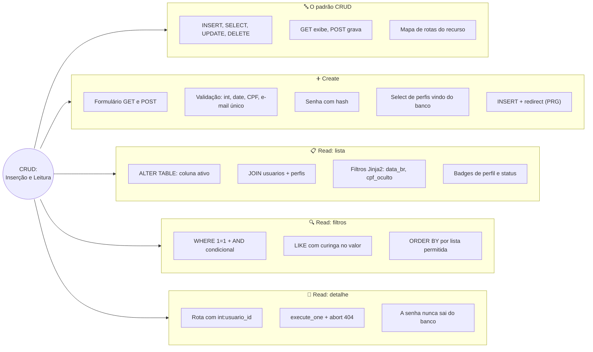
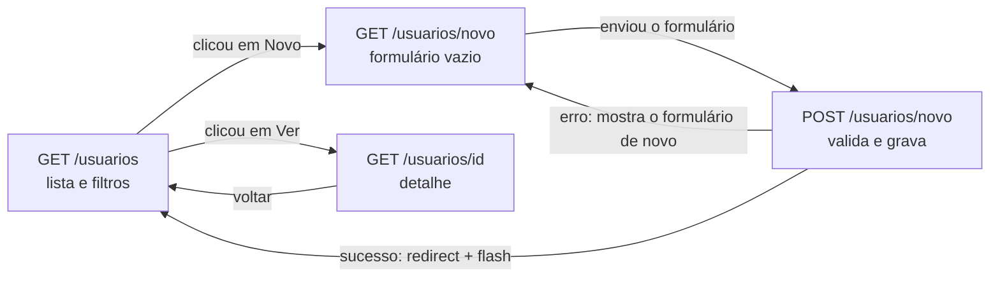
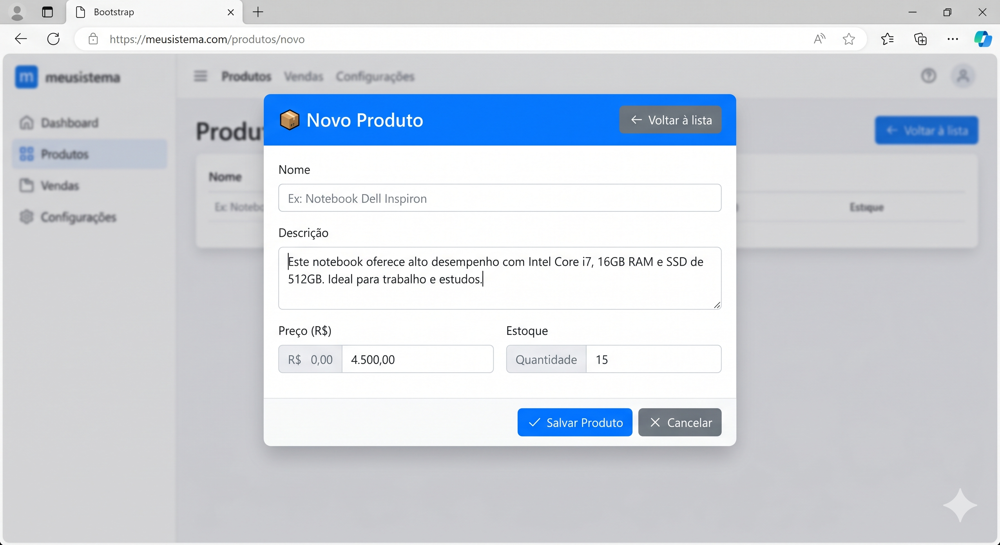
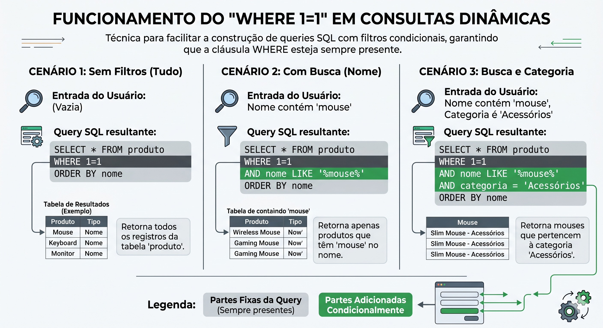
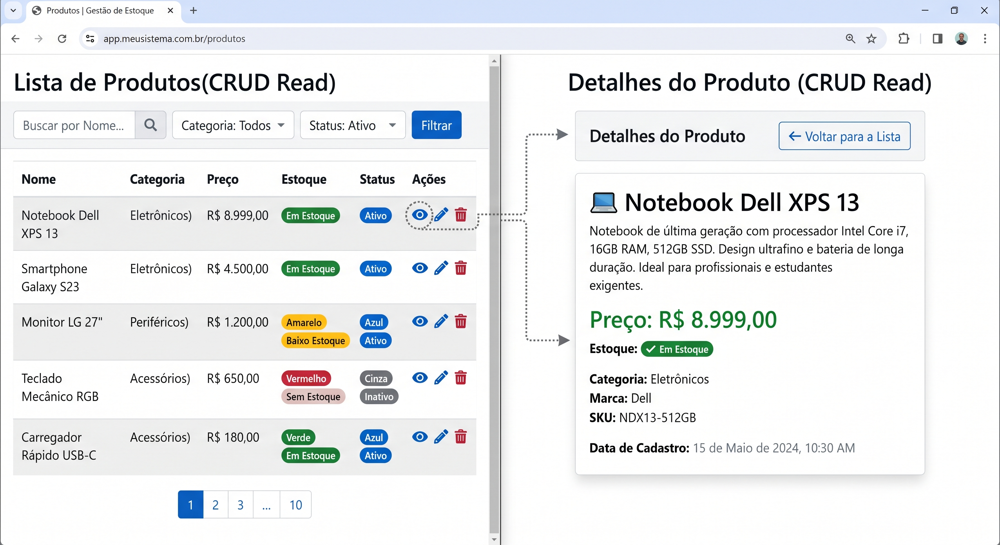

# Tópico 06 — CRUD: Inserção e Leitura

**Disciplina:** Programação para Internet (ILP951)
**Professor:** Ronan Adriel Zenatti · ronan.zenatti@cps.sp.gov.br
**Fatec Jahu — 2º Semestre/2026**

> **Pré-requisitos:** Tópico 05 concluído — MySQL conectado, tabelas `perfis` e `usuarios` criadas e populadas pelo `db_setup.py`, e `db.py` com `execute_query` e `execute_one`. O `base.html` do Tópico 03 e os formulários com validação no servidor e o padrão PRG do Tópico 04 também serão reaproveitados aqui.

---

## 🎯 Objetivos do Tópico

Ao final deste tópico você deverá ser capaz de:

- Explicar o que é CRUD e relacionar cada operação ao seu comando SQL, ao método HTTP e à rota Flask correspondente.
- Implementar o **Create**: um formulário que valida os dados no servidor e os grava com `INSERT` parametrizado.
- Converter e validar dados vindos de um formulário: inteiro (`int`), data (`date`), CPF, celular e CEP, além de e-mail e CPF que não podem se repetir.
- Gravar a senha como **hash** (`generate_password_hash`) e nunca em texto puro.
- Montar um `<select>` a partir de uma **tabela auxiliar** (`perfis`) e validar a escolha contra o banco.
- Aplicar o padrão PRG e as flash messages depois de gravar um registro, e recuperar o `id` gerado pelo banco com `lastrowid`.
- Evoluir uma tabela existente com `ALTER TABLE`, sem perder dados.
- Implementar o **Read**: listar registros com `JOIN`, formatar valores com filtros Jinja2 próprios e destacar o perfil e o status com badges.
- Montar filtros dinâmicos com `WHERE 1=1` e `LIKE`, sem abrir brecha para SQL Injection.
- Exibir o detalhe de um registro com rota parametrizada (`<int:...>`) e responder `404` quando ele não existe.

Até aqui, o seu sistema sabe guardar dados (Tópico 05) e sabe receber dados do usuário (Tópico 04), mas as duas pontas ainda não se encontram: o formulário de cadastro apenas imprimia no terminal, e a única forma de colocar um usuário no banco era escrevendo `INSERT` no Workbench. Hoje as pontas se encaixam. Você vai construir, de ponta a ponta, a **metade de leitura e criação** do CRUD de **usuários**: cadastrar um usuário pelo navegador (escolhendo o perfil dele entre os que existem na tabela `perfis`), vê-lo aparecer em uma lista com busca e filtros, e abrir a página de detalhes de cada um. No próximo tópico, vêm a edição e a exclusão.

---

## 🗺️ Mapa Mental do Tópico



---

## Parte 1 — O que é CRUD: o mapa de rotas de um recurso

### Quatro operações que todo sistema precisa

Quase todo sistema de informação, de um app de bike-sharing ao painel de uma loja virtual, faz as mesmas quatro coisas com seus dados: **cria** registros novos, **lê** (consulta) os que existem, **atualiza** os que mudaram e **remove** os que não servem mais. A sigla **CRUD** vem exatamente disso: **C**reate, **R**ead, **U**pdate, **D**elete. Cada letra tem um comando SQL que você já conheceu no Tópico 05 (Parte 6) e um método HTTP que você estudou no Tópico 04:

| Letra | Operação | Comando SQL | Método HTTP | A pergunta que ela responde |
|---|---|---|---|---|
| **C** | Create | `INSERT` | `POST` | "Quero guardar algo novo" |
| **R** | Read | `SELECT` | `GET` | "Quero ver o que existe" |
| **U** | Update | `UPDATE` | `POST` | "Quero corrigir algo que já existe" |
| **D** | Delete | `DELETE` (ou `UPDATE` de `ativo`) | `POST` | "Quero tirar algo do sistema" |

> **Por que Update e Delete usam POST e não PUT/DELETE?** APIs REST usam os verbos `PUT`, `PATCH` e `DELETE`, mas um formulário HTML só consegue enviar `GET` ou `POST`. Como o nosso sistema devolve páginas HTML geradas no servidor, **toda operação que altera dados chega por `POST`**, e `GET` fica reservado para quem apenas consulta, regra que você viu na Parte 2 do Tópico 04.

### As rotas do recurso "usuário"

Um **recurso** é a "coisa" que o CRUD manipula, aqui, o usuário. Antes de escrever qualquer código, vale desenhar o mapa de rotas do recurso inteiro, para saber onde cada peça vai se encaixar:

| Rota | Métodos | O que faz | Onde construímos |
|---|---|---|---|
| `/usuarios` | `GET` | Lista os usuários, com busca e filtros | Hoje (Partes 3 e 4) |
| `/usuarios/novo` | `GET`, `POST` | `GET` mostra o formulário; `POST` valida e grava | Hoje (Parte 2) |
| `/usuarios/<id>` | `GET` | Mostra os detalhes de um usuário | Hoje (Parte 5) |
| `/usuarios/<id>/editar` | `GET`, `POST` | `GET` mostra o formulário preenchido; `POST` atualiza | Tópico 07 |
| `/usuarios/<id>/excluir` | `POST` | Desativa ou apaga o usuário | Tópico 07 |

O fluxo do que construímos hoje se resume neste diagrama. Note que o `POST` com erro volta para o formulário, e o `POST` bem-sucedido **redireciona** para a lista, que é o padrão PRG:



Repare que `/usuarios/novo` e `/usuarios/<id>` convivem sem conflito: o Flask só trata o trecho final como `<id>` quando ele é um número inteiro (conversor `<int:...>`, Tópico 03), e `novo` não é.

### 🔎 Verifique seu Entendimento

Um assistente de estudos com IA generativa guarda o histórico de perguntas de cada estudante na tabela `pergunta`. O app precisa permitir: ver o histórico, salvar uma pergunta nova, corrigir o título de uma pergunta e excluir uma pergunta.

**Desafio:** Monte a tabela de rotas desse recurso, indicando para cada uma das quatro necessidades a letra do CRUD, o comando SQL, o método HTTP e uma rota Flask, no mesmo formato da tabela desta parte.

> 💬 Tente por conta própria antes de seguir. A solução comentada está no gabarito deste tópico (link na última seção da página).

---

## Parte 2 — Create: do formulário ao INSERT

Vamos conectar o formulário do Tópico 04 ao banco do Tópico 05. O caminho é: **GET** mostra o formulário → o usuário preenche e envia → **POST** valida → o servidor executa o `INSERT` → **redirect** para a lista com uma mensagem de sucesso.

<!-- IMAGEM PENDENTE: recapturar a tela do formulário "Novo Usuário" (a antiga Aula_06_img_01.png mostra o formulário de produto).

-->

Um princípio guia todo o formulário: **o que é `NOT NULL` no banco é obrigatório no formulário; o que aceita `NULL` é opcional**, mas, se for preenchido, precisa ser válido. Na tabela `usuarios`, são obrigatórios `nome`, `email`, `senha` e o perfil. CPF, celular, data de nascimento e endereço são opcionais.

### Passo 1 — `execute_insert()`: descobrir o `id` gerado

A função `execute_query` devolve apenas **quantas linhas foram afetadas**. Depois de um `INSERT`, porém, é muito útil saber **qual `id` o banco gerou** (o `AUTO_INCREMENT` do Tópico 05), por exemplo para mostrar "Usuário #12 cadastrado". O cursor guarda essa informação em `lastrowid`. Acrescente ao final do `db.py`:

```python
def execute_insert(sql, params=None):
    """
    Executa um INSERT e devolve o id gerado pelo AUTO_INCREMENT.
    Use no lugar de execute_query quando precisar saber qual id o banco criou.
    """
    conn = get_connection()
    cursor = None
    try:
        cursor = conn.cursor()
        cursor.execute(sql, params or ())
        conn.commit()
        return cursor.lastrowid   # id da linha recém-inserida
    except Error as e:
        conn.rollback()
        raise Exception(f'Erro ao executar INSERT: {e}')
    finally:
        if cursor:
            cursor.close()
        conn.close()   # devolve ao pool, não fecha fisicamente
```

Teste no terminal (com o ambiente virtual ativo):

```
python -c "from db import execute_insert; print(execute_insert('INSERT INTO usuarios (nome, email, senha, perfil_id) VALUES (%s, %s, %s, %s)', ('Usuário de teste', 'teste.insert@exemplo.com.br', 'x', 3)))"
```

O número impresso é o `id_usuario` do novo registro. Anote-o e, no Workbench, apague esse registro de teste (`DELETE FROM usuarios WHERE id_usuario = ...;`, com o seu número). Será o último `INSERT` escrito "à mão" neste tópico: daqui em diante, quem insere é o formulário.

### Passo 2 — as funções de apoio: `validacoes.py`

O formulário de usuário valida CPF, celular e CEP, e essas regras não pertencem ao `app.py`: são **funções puras** (recebem um texto, devolvem um resultado, não dependem do Flask nem do banco). Assim como o `db.py` concentra o acesso ao banco, vamos concentrá-las em um módulo `validacoes.py`, na raiz do projeto. Comece com a função que mantém só os dígitos e com os três formatadores:

```python
# validacoes.py — Funções puras de validação e formatação, usadas pelos formulários
import re


def so_digitos(texto):
    """Mantém só os dígitos: '123.456.789-09' -> '12345678909'."""
    return re.sub(r'\D', '', texto or '')
    # \D = "qualquer caractere que NÃO seja dígito"; re.sub troca todos por nada


def formatar_cpf(cpf):
    """'12345678909' -> '123.456.789-09' (cabe no VARCHAR(14) do banco)."""
    d = so_digitos(cpf)
    return f'{d[:3]}.{d[3:6]}.{d[6:9]}-{d[9:]}'


def formatar_celular(celular):
    """Devolve '(14) 99999-9999' ou '(14) 3333-4444'; None se não tiver 10 ou 11 dígitos."""
    d = so_digitos(celular)
    if len(d) == 11:
        return f'({d[:2]}) {d[2:7]}-{d[7:]}'
    if len(d) == 10:
        return f'({d[:2]}) {d[2:6]}-{d[6:]}'
    return None


def formatar_cep(cep):
    """'17201000' -> '17201-000'; None se não tiver 8 dígitos."""
    d = so_digitos(cep)
    return f'{d[:5]}-{d[5:]}' if len(d) == 8 else None
```

Teste cada uma no terminal. Repare que todas aceitam o dado "sujo", com ou sem pontuação, e devolvem o formato que será gravado no banco:

```
python -c "from validacoes import *; print(so_digitos('(14) 99811-2030')); print(formatar_celular('14998112030')); print(formatar_celular('123')); print(formatar_cep('17201000'))"
```

Agora a função mais interessante: validar um CPF. Os dois últimos dígitos de um CPF não são sorteados, são **calculados** a partir dos nove primeiros, e é por isso que dá para detectar um CPF digitado errado. Acrescente ao `validacoes.py`:

```python
def cpf_valido(cpf):
    """Confere os dois dígitos verificadores de um CPF (aceita com ou sem pontuação)."""
    d = so_digitos(cpf)
    if len(d) != 11 or d == d[0] * 11:
        return False   # tamanho errado ou todos os dígitos iguais (111.111.111-11)
    for tamanho in (9, 10):
        # 1º dígito: soma dos 9 primeiros × pesos 10..2; 2º dígito: dos 10 primeiros × pesos 11..2
        soma = sum(int(d[i]) * (tamanho + 1 - i) for i in range(tamanho))
        digito = (soma * 10) % 11 % 10
        if digito != int(d[tamanho]):
            return False
    return True
```

Teste com um CPF de exemplo do `db_setup.py` e com dois inválidos:

```
python -c "from validacoes import cpf_valido; print(cpf_valido('526.018.159-06'), cpf_valido('526.018.159-07'), cpf_valido('111.111.111-11'))"
```

O resultado deve ser `True False False`. Mudar um único dígito derruba a validação, e o CPF de dígitos repetidos, que passaria na conta, é barrado pela primeira linha.

> 💡 **Validar o formato não é provar que o CPF existe.** A conta dos dígitos só descarta erros de digitação. Saber se aquele CPF pertence mesmo a alguém exigiria consultar um serviço oficial.

### Passo 3 — a rota e o formulário mínimo

No `app.py`, garanta os imports que vamos usar ao longo do tópico e crie a rota que, por enquanto, só **mostra** o formulário:

```python
import re
from datetime import date

from flask import Flask, render_template, request, redirect, url_for, flash, abort
from werkzeug.security import generate_password_hash

from db import execute_query, execute_one, execute_insert
from validacoes import cpf_valido, formatar_cpf, formatar_celular, formatar_cep
```

```python
@app.route('/usuarios/novo', methods=['GET', 'POST'])
def usuario_novo():
    # Por enquanto, GET e POST fazem a mesma coisa: mostram o formulário
    return render_template('usuario_form.html', usuario={})
```

O `usuario={}` (dicionário vazio) existe para o template poder ler `usuario.nome` mesmo no primeiro acesso, quando ainda não há nada digitado. Agora crie `templates/usuario_form.html`, começando só com o campo Nome:

```html

Novo Usuário — Sistema de Gestão


<div class="row justify-content-center">
  <div class="col-lg-9">
    <div class="card shadow-sm">
      <div class="card-header bg-primary text-white d-flex justify-content-between align-items-center">
        <h4 class="mb-0">👤 Novo Usuário</h4>
        <a href="{{ url_for('lista_usuarios') }}" class="btn btn-light btn-sm">← Voltar à lista</a>
      </div>
      <div class="card-body">
        <form action="{{ url_for('usuario_novo') }}" method="post">

          <div class="mb-3">
            <label for="nome" class="form-label">Nome completo <span class="text-danger">*</span></label>
            <input type="text" class="form-control" id="nome" name="nome"
                   maxlength="255" placeholder="Ex.: Ana Beatriz Lima" required
                   value="{{ usuario.nome | default('') }}">
          </div>

          <div class="d-flex gap-2">
            <button type="submit" class="btn btn-primary">✔ Salvar usuário</button>
            <a href="{{ url_for('lista_usuarios') }}" class="btn btn-outline-secondary">✖ Cancelar</a>
          </div>

        </form>
      </div>
    </div>
  </div>
</div>

```

Salve, acesse `http://localhost:5000/usuarios/novo` e confira que o formulário aparece (a navbar e o rodapé vêm do `base.html`). Digite algo e clique em **Salvar usuário**: a página simplesmente recarrega vazia, porque a rota ainda não faz nada com o `POST`.

### Passo 4 — os demais campos

Um usuário tem e-mail, senha, dados pessoais, perfil e endereço. Vamos acrescentá-los em grupos, sempre **abaixo** do campo Nome e **acima** dos botões, recarregando a página a cada grupo. Primeiro os **dados de acesso**: e-mail e senha com confirmação.

```html
          <div class="mb-3">
            <label for="email" class="form-label">E-mail <span class="text-danger">*</span></label>
            <input type="email" class="form-control" id="email" name="email"
                   maxlength="255" placeholder="nome@dominio.com.br" required
                   value="{{ usuario.email | default('') }}">
          </div>

          <div class="row">
            <div class="col-md-6 mb-3">
              <label for="senha" class="form-label">Senha <span class="text-danger">*</span></label>
              <input type="password" class="form-control" id="senha" name="senha"
                     minlength="8" required autocomplete="new-password">
              <div class="form-text">Mínimo de 8 caracteres, com letras e números.</div>
            </div>
            <div class="col-md-6 mb-3">
              <label for="confirmar_senha" class="form-label">Confirmar senha <span class="text-danger">*</span></label>
              <input type="password" class="form-control" id="confirmar_senha" name="confirmar_senha"
                     minlength="8" required autocomplete="new-password">
            </div>
          </div>
```

Salve e recarregue. Os campos de senha mostram bolinhas, e repare que eles **não** têm `value`: uma senha nunca é devolvida ao formulário, nem quando a validação falha (o usuário digita de novo). Agora os **dados pessoais**, opcionais, em uma linha de três colunas:

```html
          <div class="row">
            <div class="col-md-4 mb-3">
              <label for="celular" class="form-label">Celular</label>
              <input type="tel" class="form-control" id="celular" name="celular"
                     maxlength="20" placeholder="(14) 99999-9999"
                     value="{{ usuario.celular | default('', true) }}">
            </div>
            <div class="col-md-4 mb-3">
              <label for="data_nascimento" class="form-label">Data de nascimento</label>
              <input type="date" class="form-control" id="data_nascimento" name="data_nascimento"
                     value="{{ usuario.data_nascimento | default('', true) }}">
            </div>
            <div class="col-md-4 mb-3">
              <label for="cpf" class="form-label">CPF</label>
              <input type="text" class="form-control" id="cpf" name="cpf"
                     maxlength="14" placeholder="000.000.000-00"
                     value="{{ usuario.cpf | default('', true) }}">
            </div>
          </div>
```

> 💡 **Por que `default('', true)`?** O filtro `default` normalmente só age quando a variável **não existe**. O segundo argumento `true` faz ele agir também quando o valor é **vazio ou `None`**. Isso importa porque um celular `NULL` no banco chega ao Python como `None`, e sem esse argumento o campo exibiria o texto "None". No primeiro acesso, como `usuario` é `{}`, a variável não existe, e o filtro devolve `''` de qualquer jeito.

O `type="date"` abre um seletor de calendário e envia a data sempre no formato `AAAA-MM-DD`, independentemente de como o navegador a mostra. Salve e recarregue. Agora o **perfil**, que é diferente de tudo o que você fez até aqui: as opções do `<select>` não são uma lista escrita no Python, vêm da **tabela `perfis`**. Se o professor cadastrar um perfil novo no banco, o formulário o mostra sem alterar uma linha de código. No `app.py`, antes da rota, crie uma função que busca as listas de que o formulário precisa:

```python
# Siglas dos estados aceitas pelo sistema — fonte única para o formulário e para a validação
UFS = ['AC', 'AL', 'AP', 'AM', 'BA', 'CE', 'DF', 'ES', 'GO', 'MA', 'MT', 'MS', 'MG', 'PA',
       'PB', 'PR', 'PE', 'PI', 'RJ', 'RN', 'RS', 'RO', 'RR', 'SC', 'SP', 'SE', 'TO']


def dados_apoio_form():
    """Listas de que o formulário precisa para montar os <select>: perfis (do banco) e UFs."""
    perfis = execute_query('SELECT id_perfil, nome FROM perfis ORDER BY nome', fetch=True)
    return {'perfis': perfis, 'ufs': UFS}
```

A função devolve um dicionário, e na rota ele é **desempacotado** com `**` (o mesmo `**` do `**CONFIGURACAO` no Tópico 05), de modo que cada chave vira um argumento do `render_template`. Daqui em diante, toda chamada a `render_template('usuario_form.html', ...)` deve levar o `**dados_apoio_form()`:

```python
    return render_template('usuario_form.html', usuario={}, **dados_apoio_form())
```

No template, o `<select>` do perfil:

```html
          <div class="mb-3">
            <label for="perfil_id" class="form-label">Perfil <span class="text-danger">*</span></label>
            <select class="form-select" id="perfil_id" name="perfil_id" required>
              <option value="">-- Selecione --</option>
              
                <option value="{{ p.id_perfil }}"
                        selected>{{ p.nome }}</option>
              
            </select>
          </div>
```

O `value` de cada opção é o `id_perfil` (o número que a chave estrangeira guarda) e o texto exibido é o `nome`. O `| string` nos dois lados da comparação existe porque, depois de um erro de validação, `usuario.perfil_id` pode ser o **texto** que veio do formulário (`'2'`), enquanto `p.id_perfil` é um **inteiro** vindo do banco (`2`), e `'2' == 2` é falso. Convertendo os dois para texto, o perfil escolhido continua selecionado.

Por fim, o **endereço**, também opcional. Acrescente depois do perfil:

```html
          <div class="row">
            <div class="col-md-3 mb-3">
              <label for="cep" class="form-label">CEP</label>
              <input type="text" class="form-control" id="cep" name="cep"
                     maxlength="9" placeholder="00000-000"
                     value="{{ usuario.cep | default('', true) }}">
            </div>
            <div class="col-md-6 mb-3">
              <label for="endereco" class="form-label">Endereço</label>
              <input type="text" class="form-control" id="endereco" name="endereco"
                     maxlength="255" value="{{ usuario.endereco | default('', true) }}">
            </div>
            <div class="col-md-3 mb-3">
              <label for="numero" class="form-label">Número</label>
              <input type="text" class="form-control" id="numero" name="numero"
                     maxlength="20" value="{{ usuario.numero | default('', true) }}">
            </div>
          </div>

          <div class="row">
            <div class="col-md-5 mb-3">
              <label for="complemento" class="form-label">Complemento</label>
              <input type="text" class="form-control" id="complemento" name="complemento"
                     maxlength="100" value="{{ usuario.complemento | default('', true) }}">
            </div>
            <div class="col-md-5 mb-3">
              <label for="cidade" class="form-label">Cidade</label>
              <input type="text" class="form-control" id="cidade" name="cidade"
                     maxlength="100" value="{{ usuario.cidade | default('', true) }}">
            </div>
            <div class="col-md-2 mb-3">
              <label for="estado" class="form-label">UF</label>
              <select class="form-select" id="estado" name="estado">
                <option value="">--</option>
                
                  <option value="{{ uf }}" selected>{{ uf }}</option>
                
              </select>
            </div>
          </div>
```

Salve e recarregue. Confira: o `<select>` de perfil lista **Administrador**, **Gerente** e **Usuário**, exatamente as linhas da tabela `perfis` (rode `INSERT INTO perfis (nome) VALUES ('Visitante');` no Workbench, recarregue, e o perfil novo aparece; depois apague-o com `DELETE FROM perfis WHERE nome = 'Visitante';`). Lembre-se, porém, da regra do Tópico 04: o navegador é só a primeira linha de defesa. A validação de verdade acontece no servidor.

### Passo 5 — receber o POST

Vamos fazer a rota enxergar o que foi enviado. Troque o corpo de `usuario_novo` por esta versão, que apenas **coleta** os campos e imprime no terminal:

```python
@app.route('/usuarios/novo', methods=['GET', 'POST'])
def usuario_novo():

    if request.method == 'POST':

        # ===== COLETA DOS DADOS =====
        nome        = request.form.get('nome', '').strip()
        email       = request.form.get('email', '').strip().lower()
        senha       = request.form.get('senha', '')            # sem strip: espaços podem fazer parte da senha
        confirmar   = request.form.get('confirmar_senha', '')
        celular_txt = request.form.get('celular', '').strip()
        nascimento  = request.form.get('data_nascimento', '').strip()
        cpf_txt     = request.form.get('cpf', '').strip()
        perfil_txt  = request.form.get('perfil_id', '')
        cep_txt     = request.form.get('cep', '').strip()
        endereco    = request.form.get('endereco', '').strip()
        numero      = request.form.get('numero', '').strip()
        complemento = request.form.get('complemento', '').strip()
        cidade      = request.form.get('cidade', '').strip()
        estado      = request.form.get('estado', '')

        print(f'Recebido: {nome} | {email} | {celular_txt} | {nascimento} | {cpf_txt} | {perfil_txt} | {cep_txt}')

    # Método GET (ou POST, por enquanto): exibe o formulário
    return render_template('usuario_form.html', usuario={}, **dados_apoio_form())
```

Repare nos nomes com sufixo `_txt`: tudo que vem de `request.form` é **texto**. O número do perfil e a data só existirão depois da conversão, e é por isso que o texto original carrega o sufixo. O `.lower()` no e-mail evita que `Ana@Exemplo.com` e `ana@exemplo.com` virem dois cadastros. Salve, preencha o formulário, envie e olhe o terminal: a linha `Recebido: ...` mostra exatamente o que o navegador mandou (note o `perfil_txt` como `'2'`, e a data como `1988-03-14`). A senha ficou de fora do `print` de propósito: **senha não vai para o terminal, nem para log**.

### Passo 6 — validar o nome e o e-mail

Entre a coleta e o `return`, crie a lista de erros e valide os dois primeiros campos. O padrão é o do Tópico 04: **acumular** todas as mensagens antes de mostrar qualquer uma. O e-mail ganha uma checagem extra: ele é `UNIQUE` no banco, então vale perguntar ao banco se já existe antes de tentar gravar.

```python
        # ===== VALIDAÇÃO E CONVERSÃO =====
        erros = []

        if not nome:
            erros.append('O nome é obrigatório.')
        elif len(nome) < 3:
            erros.append('O nome deve ter pelo menos 3 caracteres.')
        elif len(nome) > 255:
            erros.append('O nome pode ter no máximo 255 caracteres.')
            # 255 é o tamanho do VARCHAR(255): com sql_mode estrito o MySQL recusaria mais que isso

        if not email:
            erros.append('O e-mail é obrigatório.')
        elif len(email) > 255 or not re.fullmatch(r'[^@\s]+@[^@\s]+\.[^@\s]+', email):
            erros.append('Informe um e-mail válido, por exemplo nome@dominio.com.br.')
            # [^@\s]+ = um ou mais caracteres que não sejam "@" nem espaço
        elif execute_one('SELECT id_usuario FROM usuarios WHERE email = %s', (email,)):
            erros.append('Já existe um usuário cadastrado com este e-mail.')
            # execute_one devolve a linha encontrada (um dicionário, tratado como "verdadeiro") ou None
```

A cadeia `if / elif / elif` garante que cada campo mostre **uma** mensagem por vez: não adianta avisar "e-mail duplicado" de um texto que nem tem o formato de e-mail. Troque o `print` por `print(erros)`, salve e teste: cadastre um e-mail sem `@` (troque `type="email"` por `type="text"` no DevTools para o navegador deixar enviar) e depois `ana.lima@exemplo.com.br`, que já existe no banco.

> ⚠️ **A checagem com `SELECT` não é a proteção definitiva.** Entre o `SELECT` e o `INSERT`, outra pessoa poderia cadastrar o mesmo e-mail. Quem garante de verdade é o `UNIQUE` do banco, que recusa a duplicata (você viu o erro `1062` no Tópico 05). A checagem prévia serve para dar ao usuário uma mensagem clara em vez de um erro técnico.

### Passo 7 — validar a senha e gerar o hash

A senha é o campo que mais exige cuidado. Primeiro a validação: tamanho mínimo, letras e números, e a confirmação igual.

```python
        if len(senha) < 8:
            erros.append('A senha deve ter pelo menos 8 caracteres.')
        elif len(senha) > 128:
            erros.append('A senha pode ter no máximo 128 caracteres.')
        elif not (re.search(r'[A-Za-z]', senha) and re.search(r'\d', senha)):
            erros.append('A senha deve conter letras e números.')
        elif senha != confirmar:
            erros.append('A confirmação não confere com a senha.')
```

Agora o que fazer com ela depois de válida. **Nunca** se grava a senha digitada: se o banco vazar (por um backup esquecido, uma invasão, um colega curioso), todas as contas vazam junto, e como as pessoas reutilizam senhas, as contas delas em outros sites também. A solução é guardar um **hash**: o resultado de uma função matemática de **mão única**, que transforma a senha em uma sequência longa e embaralhada e não tem caminho de volta. Veja com os próprios olhos. No terminal:

```
python -c "from werkzeug.security import generate_password_hash as g, check_password_hash as c; h = g('Senha@123'); print(h); print(g('Senha@123')); print(c(h, 'Senha@123'), c(h, 'senha@123'))"
```

Observe três coisas. As duas primeiras linhas, geradas para a **mesma** senha, são **diferentes**: a função mistura um **sal** aleatório antes de calcular, de modo que duas pessoas com a mesma senha não deixam hashes iguais. O sal fica registrado dentro do próprio hash, e é por isso que a terceira linha, `check_password_hash`, consegue conferir uma senha mais tarde: ela refaz o cálculo com o mesmo sal e compara o resultado. Ela devolve `True` para a senha certa e `False` até para uma diferença de maiúscula. Esse é exatamente o mecanismo do login, que construímos no Tópico 11.

No `INSERT` que vem a seguir, quem entra no banco é `generate_password_hash(senha)`, e a variável `senha` com o texto puro morre na própria rota. Repare também que `VARCHAR(255)`, do Tópico 05, existe para caber esse hash longo.

### Passo 8 — validar celular, CPF e data de nascimento

Os três são opcionais: só validamos se o usuário preencheu. Em cada um, a variável começa com o **texto digitado**; se a conversão der certo, ela passa a guardar o valor convertido, e se falhar, o texto digitado permanece para repopular o formulário (o mesmo truque que o Tópico 04 usou).

```python
        celular = celular_txt   # se inválido, mantém o texto digitado para repopular o formulário
        if celular_txt:
            formatado = formatar_celular(celular_txt)
            if formatado is None:
                erros.append('Informe o celular com DDD (10 ou 11 dígitos).')
            else:
                celular = formatado

        cpf = cpf_txt
        if cpf_txt:
            if not cpf_valido(cpf_txt):
                erros.append('Informe um CPF válido.')
            else:
                cpf = formatar_cpf(cpf_txt)   # grava sempre no formato 000.000.000-00
                if execute_one('SELECT id_usuario FROM usuarios WHERE cpf = %s', (cpf,)):
                    erros.append('Já existe um usuário cadastrado com este CPF.')
```

A data tem uma conversão de verdade, do texto `'1988-03-14'` para um objeto `date` do Python, e as regras de negócio que fazem sentido: não pode estar no futuro, nem ser absurdamente antiga.

```python
        data_nasc = nascimento   # texto 'AAAA-MM-DD' vindo do <input type="date">
        if nascimento:
            try:
                valor_data = date.fromisoformat(nascimento)
                # converte '1988-03-14' em date(1988, 3, 14); levanta ValueError se não for uma data real
            except ValueError:
                erros.append('Informe uma data de nascimento válida.')
            else:
                # O else do try roda só se a conversão deu certo
                if valor_data > date.today():
                    erros.append('A data de nascimento não pode estar no futuro.')
                elif valor_data.year < 1900:
                    erros.append('A data de nascimento deve ser a partir de 1900.')
                else:
                    data_nasc = valor_data
```

Teste no terminal o que a conversão faz com datas impossíveis: `python -c "from datetime import date; print(date.fromisoformat('2026-02-30'))"` levanta um `ValueError`, exatamente o que o `except` captura.

### Passo 9 — validar o perfil contra o banco

O perfil chega como **texto** (`'2'`), e precisa virar um inteiro **e** corresponder a um perfil que existe. Mesmo que o `<select>` só ofereça as opções corretas, qualquer pessoa pode adulterar o valor pelo DevTools, então a conferência é no servidor, contra a lista que veio do banco:

```python
        perfil_id = perfil_txt   # se inválido, mantém o texto para repopular o formulário
        try:
            valor_perfil = int(perfil_txt)
        except ValueError:
            erros.append('Selecione um perfil.')
        else:
            ids_validos = {p['id_perfil'] for p in dados_apoio_form()['perfis']}
            # { ... for ... } é um "conjunto por compreensão": os ids existentes, sem repetição
            if valor_perfil in ids_validos:
                perfil_id = valor_perfil
            else:
                erros.append('Selecione um perfil válido.')
```

O `int('')` (nenhum perfil escolhido) também levanta `ValueError`, então o mesmo `except` cobre o "esqueci de escolher". E, se alguém forjar `perfil_id=99`, o `in ids_validos` barra antes mesmo de chegar ao banco, onde a chave estrangeira também recusaria (erro `1452`). Duas camadas de defesa: a aplicação dá a mensagem amigável, o banco garante a integridade.

### Passo 10 — validar o endereço

Os campos do endereço são opcionais, mas respeitam os tamanhos das colunas. O CEP ganha formatação e o estado é conferido contra a lista de siglas:

```python
        cep = cep_txt
        if cep_txt:
            formatado = formatar_cep(cep_txt)
            if formatado is None:
                erros.append('Informe um CEP com 8 dígitos.')
            else:
                cep = formatado

        # Texto livre: só confere o tamanho máximo de cada coluna do banco
        limites = {'endereço': (endereco, 255), 'número': (numero, 20),
                   'complemento': (complemento, 100), 'cidade': (cidade, 100)}
        for rotulo, (valor, maximo) in limites.items():
            if len(valor) > maximo:
                erros.append(f'O campo {rotulo} pode ter no máximo {maximo} caracteres.')

        if estado and estado not in UFS:
            erros.append('Selecione um estado válido.')
```

O dicionário `limites` evita repetir quatro `if` quase iguais: o `for` percorre cada par (valor, máximo) e gera a mensagem com o nome do campo. Troque o `print` por `print(erros, celular, cpf, data_nasc, perfil_id, cep)`, salve e teste: envie um CPF `111.111.111-11`, um celular `123`, uma data no futuro e o perfil alterado pelo DevTools para `99`. Observe no terminal as mensagens acumuladas na lista, e perceba que, nos campos inválidos, as variáveis continuam sendo o texto digitado, enquanto nos válidos já viraram o valor convertido (`date`, `int`, CPF formatado).

### Passo 11 — mostrar os erros ou gravar

Falta a decisão final. Substitua o `print` por este bloco, ainda dentro do `if request.method == 'POST':`:

```python
        # O que o usuário digitou, para repopular o formulário em caso de erro
        # (a senha fica de fora de propósito: nunca é devolvida à tela)
        usuario = {'nome': nome, 'email': email, 'celular': celular, 'data_nascimento': data_nasc,
                   'cpf': cpf, 'perfil_id': perfil_id, 'cep': cep, 'endereco': endereco,
                   'numero': numero, 'complemento': complemento, 'cidade': cidade, 'estado': estado}

        if erros:
            for erro in erros:
                flash(erro, 'danger')
            return render_template('usuario_form.html', usuario=usuario, **dados_apoio_form())

        # ===== GRAVAÇÃO =====
        try:
            novo_id = execute_insert(
                'INSERT INTO usuarios (nome, email, senha, celular, data_nascimento, cpf, perfil_id, '
                'cep, endereco, numero, complemento, cidade, estado) '
                'VALUES (%s, %s, %s, %s, %s, %s, %s, %s, %s, %s, %s, %s, %s)',
                (nome, email, generate_password_hash(senha), celular or None, data_nasc or None,
                 cpf or None, perfil_id, cep or None, endereco or None, numero or None,
                 complemento or None, cidade or None, estado or None)
            )
            # %s: placeholders, os valores vão separados — nunca concatenados (Tópico 05, Parte 7)
            # generate_password_hash(senha): no banco entra o hash, nunca a senha digitada
            # campo opcional vazio or None: texto vazio vira NULL no banco, em vez de uma string vazia
        except Exception as e:
            flash(f'Não foi possível salvar o usuário: {e}', 'danger')
            return render_template('usuario_form.html', usuario=usuario, **dados_apoio_form())

        flash(f'Usuário "{nome}" cadastrado com sucesso (código #{novo_id}).', 'success')
        return redirect(url_for('lista_usuarios'))
        # PRG: redirect depois do POST bem-sucedido (Tópico 04, Parte 6)
```

> ⚠️ Mostrar a mensagem bruta do erro do banco (`{e}`) ao usuário é aceitável **durante o desenvolvimento**, porque ajuda você a depurar. Em produção, o correto é registrar o erro em um log e exibir uma mensagem genérica, para não revelar detalhes internos do sistema.

Salve e faça os testes de verdade, nesta ordem:

1. Cadastre um usuário válido, com todos os campos. Você deve voltar para a lista com um alerta verde mostrando o **código** gerado.
2. Na lista, pressione **F5**. Nada é reenviado nem duplicado: é o PRG trabalhando.
3. Volte ao formulário, remova os atributos `required` e `minlength` pelo DevTools e envie com o nome vazio, o e-mail repetido e as senhas diferentes. Cada problema aparece em um alerta vermelho, e os campos mantêm o que você digitou (menos as senhas).
4. Cadastre outro usuário preenchendo só os campos obrigatórios. Os opcionais ficam `NULL`.
5. No Workbench, rode `SELECT id_usuario, nome, email, senha, cpf, celular FROM usuarios ORDER BY id_usuario DESC;` e confirme que o usuário do passo 1 está lá, com a coluna `senha` mostrando o **hash**, e o do passo 4 com as colunas opcionais como `NULL`.

**Consolidação — a rota `usuario_novo` completa:**

```python
@app.route('/usuarios/novo', methods=['GET', 'POST'])
def usuario_novo():

    if request.method == 'POST':

        # ===== COLETA DOS DADOS =====
        nome        = request.form.get('nome', '').strip()
        email       = request.form.get('email', '').strip().lower()
        senha       = request.form.get('senha', '')
        confirmar   = request.form.get('confirmar_senha', '')
        celular_txt = request.form.get('celular', '').strip()
        nascimento  = request.form.get('data_nascimento', '').strip()
        cpf_txt     = request.form.get('cpf', '').strip()
        perfil_txt  = request.form.get('perfil_id', '')
        cep_txt     = request.form.get('cep', '').strip()
        endereco    = request.form.get('endereco', '').strip()
        numero      = request.form.get('numero', '').strip()
        complemento = request.form.get('complemento', '').strip()
        cidade      = request.form.get('cidade', '').strip()
        estado      = request.form.get('estado', '')

        # ===== VALIDAÇÃO E CONVERSÃO =====
        erros = []

        if not nome:
            erros.append('O nome é obrigatório.')
        elif len(nome) < 3:
            erros.append('O nome deve ter pelo menos 3 caracteres.')
        elif len(nome) > 255:
            erros.append('O nome pode ter no máximo 255 caracteres.')

        if not email:
            erros.append('O e-mail é obrigatório.')
        elif len(email) > 255 or not re.fullmatch(r'[^@\s]+@[^@\s]+\.[^@\s]+', email):
            erros.append('Informe um e-mail válido, por exemplo nome@dominio.com.br.')
        elif execute_one('SELECT id_usuario FROM usuarios WHERE email = %s', (email,)):
            erros.append('Já existe um usuário cadastrado com este e-mail.')

        if len(senha) < 8:
            erros.append('A senha deve ter pelo menos 8 caracteres.')
        elif len(senha) > 128:
            erros.append('A senha pode ter no máximo 128 caracteres.')
        elif not (re.search(r'[A-Za-z]', senha) and re.search(r'\d', senha)):
            erros.append('A senha deve conter letras e números.')
        elif senha != confirmar:
            erros.append('A confirmação não confere com a senha.')

        celular = celular_txt   # se inválido, mantém o texto digitado para repopular
        if celular_txt:
            formatado = formatar_celular(celular_txt)
            if formatado is None:
                erros.append('Informe o celular com DDD (10 ou 11 dígitos).')
            else:
                celular = formatado

        cpf = cpf_txt
        if cpf_txt:
            if not cpf_valido(cpf_txt):
                erros.append('Informe um CPF válido.')
            else:
                cpf = formatar_cpf(cpf_txt)
                if execute_one('SELECT id_usuario FROM usuarios WHERE cpf = %s', (cpf,)):
                    erros.append('Já existe um usuário cadastrado com este CPF.')

        data_nasc = nascimento
        if nascimento:
            try:
                valor_data = date.fromisoformat(nascimento)
            except ValueError:
                erros.append('Informe uma data de nascimento válida.')
            else:
                if valor_data > date.today():
                    erros.append('A data de nascimento não pode estar no futuro.')
                elif valor_data.year < 1900:
                    erros.append('A data de nascimento deve ser a partir de 1900.')
                else:
                    data_nasc = valor_data

        perfil_id = perfil_txt
        try:
            valor_perfil = int(perfil_txt)
        except ValueError:
            erros.append('Selecione um perfil.')
        else:
            ids_validos = {p['id_perfil'] for p in dados_apoio_form()['perfis']}
            if valor_perfil in ids_validos:
                perfil_id = valor_perfil
            else:
                erros.append('Selecione um perfil válido.')

        cep = cep_txt
        if cep_txt:
            formatado = formatar_cep(cep_txt)
            if formatado is None:
                erros.append('Informe um CEP com 8 dígitos.')
            else:
                cep = formatado

        limites = {'endereço': (endereco, 255), 'número': (numero, 20),
                   'complemento': (complemento, 100), 'cidade': (cidade, 100)}
        for rotulo, (valor, maximo) in limites.items():
            if len(valor) > maximo:
                erros.append(f'O campo {rotulo} pode ter no máximo {maximo} caracteres.')

        if estado and estado not in UFS:
            erros.append('Selecione um estado válido.')

        # ===== ERROS OU GRAVAÇÃO =====
        usuario = {'nome': nome, 'email': email, 'celular': celular, 'data_nascimento': data_nasc,
                   'cpf': cpf, 'perfil_id': perfil_id, 'cep': cep, 'endereco': endereco,
                   'numero': numero, 'complemento': complemento, 'cidade': cidade, 'estado': estado}

        if erros:
            for erro in erros:
                flash(erro, 'danger')
            return render_template('usuario_form.html', usuario=usuario, **dados_apoio_form())

        try:
            novo_id = execute_insert(
                'INSERT INTO usuarios (nome, email, senha, celular, data_nascimento, cpf, perfil_id, '
                'cep, endereco, numero, complemento, cidade, estado) '
                'VALUES (%s, %s, %s, %s, %s, %s, %s, %s, %s, %s, %s, %s, %s)',
                (nome, email, generate_password_hash(senha), celular or None, data_nasc or None,
                 cpf or None, perfil_id, cep or None, endereco or None, numero or None,
                 complemento or None, cidade or None, estado or None)
            )
        except Exception as e:
            flash(f'Não foi possível salvar o usuário: {e}', 'danger')
            return render_template('usuario_form.html', usuario=usuario, **dados_apoio_form())

        flash(f'Usuário "{nome}" cadastrado com sucesso (código #{novo_id}).', 'success')
        return redirect(url_for('lista_usuarios'))

    # Método GET: exibe o formulário vazio
    return render_template('usuario_form.html', usuario={}, **dados_apoio_form())
```

E o `templates/usuario_form.html` completo, juntando os campos que você montou aos poucos:

```html

Novo Usuário — Sistema de Gestão


<div class="row justify-content-center">
  <div class="col-lg-9">
    <div class="card shadow-sm">
      <div class="card-header bg-primary text-white d-flex justify-content-between align-items-center">
        <h4 class="mb-0">👤 Novo Usuário</h4>
        <a href="{{ url_for('lista_usuarios') }}" class="btn btn-light btn-sm">← Voltar à lista</a>
      </div>
      <div class="card-body">
        <form action="{{ url_for('usuario_novo') }}" method="post">

          <div class="mb-3">
            <label for="nome" class="form-label">Nome completo <span class="text-danger">*</span></label>
            <input type="text" class="form-control" id="nome" name="nome"
                   maxlength="255" placeholder="Ex.: Ana Beatriz Lima" required
                   value="{{ usuario.nome | default('') }}">
          </div>

          <div class="mb-3">
            <label for="email" class="form-label">E-mail <span class="text-danger">*</span></label>
            <input type="email" class="form-control" id="email" name="email"
                   maxlength="255" placeholder="nome@dominio.com.br" required
                   value="{{ usuario.email | default('') }}">
          </div>

          <div class="row">
            <div class="col-md-6 mb-3">
              <label for="senha" class="form-label">Senha <span class="text-danger">*</span></label>
              <input type="password" class="form-control" id="senha" name="senha"
                     minlength="8" required autocomplete="new-password">
              <div class="form-text">Mínimo de 8 caracteres, com letras e números.</div>
            </div>
            <div class="col-md-6 mb-3">
              <label for="confirmar_senha" class="form-label">Confirmar senha <span class="text-danger">*</span></label>
              <input type="password" class="form-control" id="confirmar_senha" name="confirmar_senha"
                     minlength="8" required autocomplete="new-password">
            </div>
          </div>

          <div class="row">
            <div class="col-md-4 mb-3">
              <label for="celular" class="form-label">Celular</label>
              <input type="tel" class="form-control" id="celular" name="celular"
                     maxlength="20" placeholder="(14) 99999-9999"
                     value="{{ usuario.celular | default('', true) }}">
            </div>
            <div class="col-md-4 mb-3">
              <label for="data_nascimento" class="form-label">Data de nascimento</label>
              <input type="date" class="form-control" id="data_nascimento" name="data_nascimento"
                     value="{{ usuario.data_nascimento | default('', true) }}">
            </div>
            <div class="col-md-4 mb-3">
              <label for="cpf" class="form-label">CPF</label>
              <input type="text" class="form-control" id="cpf" name="cpf"
                     maxlength="14" placeholder="000.000.000-00"
                     value="{{ usuario.cpf | default('', true) }}">
            </div>
          </div>

          <div class="mb-3">
            <label for="perfil_id" class="form-label">Perfil <span class="text-danger">*</span></label>
            <select class="form-select" id="perfil_id" name="perfil_id" required>
              <option value="">-- Selecione --</option>
              
                <option value="{{ p.id_perfil }}"
                        selected>{{ p.nome }}</option>
              
            </select>
          </div>

          <div class="row">
            <div class="col-md-3 mb-3">
              <label for="cep" class="form-label">CEP</label>
              <input type="text" class="form-control" id="cep" name="cep"
                     maxlength="9" placeholder="00000-000"
                     value="{{ usuario.cep | default('', true) }}">
            </div>
            <div class="col-md-6 mb-3">
              <label for="endereco" class="form-label">Endereço</label>
              <input type="text" class="form-control" id="endereco" name="endereco"
                     maxlength="255" value="{{ usuario.endereco | default('', true) }}">
            </div>
            <div class="col-md-3 mb-3">
              <label for="numero" class="form-label">Número</label>
              <input type="text" class="form-control" id="numero" name="numero"
                     maxlength="20" value="{{ usuario.numero | default('', true) }}">
            </div>
          </div>

          <div class="row">
            <div class="col-md-5 mb-3">
              <label for="complemento" class="form-label">Complemento</label>
              <input type="text" class="form-control" id="complemento" name="complemento"
                     maxlength="100" value="{{ usuario.complemento | default('', true) }}">
            </div>
            <div class="col-md-5 mb-3">
              <label for="cidade" class="form-label">Cidade</label>
              <input type="text" class="form-control" id="cidade" name="cidade"
                     maxlength="100" value="{{ usuario.cidade | default('', true) }}">
            </div>
            <div class="col-md-2 mb-3">
              <label for="estado" class="form-label">UF</label>
              <select class="form-select" id="estado" name="estado">
                <option value="">--</option>
                
                  <option value="{{ uf }}" selected>{{ uf }}</option>
                
              </select>
            </div>
          </div>

          <div class="d-flex gap-2">
            <button type="submit" class="btn btn-primary">✔ Salvar usuário</button>
            <a href="{{ url_for('lista_usuarios') }}" class="btn btn-outline-secondary">✖ Cancelar</a>
          </div>

        </form>
      </div>
    </div>
  </div>
</div>

```

### 🔎 Verifique seu Entendimento

O app de bike-sharing de uma cidade precisa de um cadastro de estações. A tabela `estacao` tem as colunas `nome`, `bairro` e `capacidade` (quantas bicicletas a estação comporta, sempre pelo menos 1).

**Desafio:** Escreva a rota `/estacoes/nova` (`GET` e `POST`) que coleta os três campos com `.strip()`, valida que o nome e o bairro não estão vazios e que a capacidade é um inteiro maior ou igual a 1, grava com `execute_insert` e redireciona para `lista_estacoes` com uma flash de sucesso. Siga o padrão desta parte.

> 💬 Tente por conta própria antes de seguir. A solução comentada está no gabarito deste tópico (link na última seção da página).

---

## Parte 3 — Read (1): listando registros em uma tabela

A rota `/usuarios` do Tópico 05 já busca os usuários no banco, mas a página ainda é a tabela simples de quatro colunas. Vamos evoluí-la para uma tela de CRUD de verdade, um incremento por vez.

### Passo 1 — preparar a tabela: a coluna `ativo`

No tópico que vem, você vai poder **desativar** um usuário em vez de apagá-lo, e a lista precisará mostrar quem está ativo. A tabela criada no Tópico 05 não tem essa coluna. Em vez de apagar a tabela e perder os usuários, usamos o `ALTER TABLE`, que **altera a estrutura** de uma tabela existente. No Workbench, execute:

```sql
USE projeto_web;

-- Nova coluna: verdadeiro/falso, obrigatória, com valor padrão para as linhas que já existem
ALTER TABLE usuarios
    ADD COLUMN ativo TINYINT(1) NOT NULL DEFAULT 1 AFTER estado;
-- AFTER estado: posiciona a coluna logo depois de 'estado' (só estética)
-- DEFAULT 1: os usuários já cadastrados recebem 1 (ativo) automaticamente
```

Rode e, em seguida, confira o resultado:

```sql
SELECT id_usuario, nome, ativo FROM usuarios;
```

Todos os usuários aparecem com `ativo = 1`. Vamos desativar um deles, para a lista ter os dois casos:

```sql
UPDATE usuarios SET ativo = 0 WHERE id_usuario = 5;
```

> ⚠️ **O Workbench recusou o `UPDATE` com o erro 1175?** Ele vem com o modo *Safe Updates* ativado, que bloqueia `UPDATE` e `DELETE` cujo `WHERE` não use uma chave (como o `id_usuario`). É por isso que usamos `WHERE id_usuario ...` e não `WHERE nome LIKE ...`, e é uma proteção bem-vinda, lembra do aviso sobre o `WHERE` no Tópico 05?
>
> Se você recriar o banco do zero pelo `db_setup.py` do Tópico 05, acrescente `ativo TINYINT(1) NOT NULL DEFAULT 1` ao `CREATE TABLE` de `usuarios` (ou rode o `ALTER TABLE` de novo).

### Passo 2 — dois filtros Jinja2 só nossos: `data_br` e `cpf_oculto`

O MySQL devolve a data de nascimento como um objeto `date` do Python, que o Jinja2 imprimiria como `1988-03-14`. No Brasil, queremos `14/03/1988`. E o CPF, na lista, pede um cuidado: ele é um **dado pessoal** (LGPD), e uma tela que o mostra inteiro para qualquer um que passe por ela expõe mais do que precisa. Em vez de repetir essas conversões em cada template, vamos criar **filtros Jinja2 próprios**: funções Python registradas com `@app.template_filter`, que o template chama com o mesmo `|` dos filtros que você já conhece (`upper`, `default`...). Acrescente ao `app.py`, depois da lista `UFS`:

```python
@app.template_filter('data_br')
def formatar_data(valor):
    """Formata date/datetime no padrão brasileiro: 1988-03-14 -> 14/03/1988."""
    if not valor:
        return '—'     # coluna NULL (não informada): mostra um traço
    return valor.strftime('%d/%m/%Y')


@app.template_filter('cpf_oculto')
def ocultar_cpf(cpf):
    """Esconde os dígitos das pontas do CPF: 526.018.159-06 -> ***.018.159-**"""
    if not cpf:
        return '—'
    return '***.' + cpf[4:11] + '-**'
    # cpf[4:11] é o trecho do meio, '018.159' (o CPF gravado já vem com pontuação)
```

O nome do filtro (`'data_br'`) é o que você escreve depois do `|` no template, e o nome da função (`formatar_data`) é livre. Os dois tratam `None` (colunas opcionais `NULL`), porque a lista vai encontrar usuários sem data ou sem CPF.

### Passo 3 — a consulta com `JOIN` e as colunas da tabela

A tabela de usuários vai mostrar mais colunas que a do Tópico 05, e as páginas de detalhe e edição precisarão das mesmas colunas. Em vez de repetir uma `SELECT` enorme em cada rota, defina-a **uma vez**, no topo do `app.py`:

```python
# Colunas lidas pelas telas. A senha fica de fora DE PROPÓSITO: nenhuma tela precisa dela,
# e o que não é lido do banco não tem como vazar para a página (nem por um descuido no template).
SELECT_USUARIO = (
    'SELECT u.id_usuario, u.nome, u.email, u.celular, u.data_nascimento, u.cpf, u.perfil_id, '
    'u.cep, u.endereco, u.numero, u.complemento, u.cidade, u.estado, u.ativo, '
    'u.criado_em, u.atualizado_em, p.nome AS perfil, p.descricao AS perfil_descricao '
    'FROM usuarios u JOIN perfis p ON p.id_perfil = u.perfil_id'
)
```

E na rota `lista_usuarios`, use-a no lugar da consulta de quatro colunas do Tópico 05:

```python
@app.route('/usuarios')
def lista_usuarios():
    try:
        usuarios = execute_query(SELECT_USUARIO + ' ORDER BY u.nome', fetch=True)
    except Exception as e:
        flash(f'Erro ao carregar usuários: {e}', 'danger')
        usuarios = []

    return render_template('usuarios.html', usuarios=usuarios, total=len(usuarios))
```

> 💡 **Por que não `SELECT *`?** Porque `*` traria também a coluna `senha` (o hash) para dentro do Python e, de lá, para qualquer template. Listar as colunas é mais trabalhoso, mas faz a senha **nunca** sair do banco, a não ser na hora do login, que é uma rota própria.

Agora as colunas no `usuarios.html`. No `<thead>` e no `<tbody>`, troque a estrutura do Tópico 05 por esta (o `` e o `` continuam como estavam):

```html
          <th>#</th>
          <th>Nome</th>
          <th>CPF</th>
          <th>Cidade</th>
          <th>Nascimento</th>
          <th>Perfil</th>
```

```html
          <td>{{ usuario.id_usuario }}</td>
          <td>{{ usuario.nome }}<br><small class="text-muted">{{ usuario.email }}</small></td>
          <td>{{ usuario.cpf | cpf_oculto }}</td>
          <td>{{ usuario.cidade | default('—', true) }}/{{ usuario.estado }}</td>
          <td>{{ usuario.data_nascimento | data_br }}</td>
          <td>{{ usuario.perfil }}</td>
```

Salve e recarregue `http://localhost:5000/usuarios`: o CPF aparece como `***.018.159-**`, a data como `14/03/1988`, e a Juliana (sem cidade e sem celular) mostra traços, sem a palavra "None". Atualize o `colspan` do `` do `for` para `6` (o número de colunas). Note a diferença sutil entre mostrar `usuario.id_usuario` (identidade no banco, que não muda quando a ordem muda) e a posição na tela (`loop.index`, sempre 1, 2, 3...).

### Passo 4 — badges de perfil e de status

Um Administrador e um Usuário comum não deveriam ter a mesma aparência na lista. Troque a célula do perfil por **badges** do Bootstrap coloridos, decididos por `if / elif / else`, e acrescente a coluna de status:

```html
          <td>
            
              <span class="badge bg-danger">Administrador</span>
            
              <span class="badge bg-warning text-dark">Gerente</span>
            
              <span class="badge bg-info text-dark">{{ usuario.perfil }}</span>
            
          </td>
          <td>
            
              <span class="badge bg-primary">Ativo</span>
            
              <span class="badge bg-secondary">Inativo</span>
            
          </td>
```

No `<thead>`, acrescente `<th>Status</th>` depois de `Perfil` (e ajuste o `colspan` para `7`). Salve e recarregue: Ana aparece em vermelho, Carlos em amarelo, os demais em azul-claro e Juliana, a que você desativou no Passo 1, com o badge cinza **Inativo**. É o mesmo `if / elif / else` das faixas de classificação do Tópico 04, agora decidindo uma cor. O `else` final cobre qualquer perfil novo que alguém cadastrar na tabela `perfis`, com um badge padrão.

### Passo 5 — o botão "Novo usuário"

Por fim, ligue a lista ao formulário que você construiu na Parte 2. No topo do bloco `conteudo`, ao lado do título (troque o `<h2>Usuários</h2>` simples):

```html
  <div class="d-flex justify-content-between align-items-center mb-3">
    <h2>Usuários</h2>
    <a href="{{ url_for('usuario_novo') }}" class="btn btn-primary">➕ Novo usuário</a>
  </div>
```

Salve e clique no botão: você vai ao formulário, cadastra um usuário e volta à lista já com o novo registro. O ciclo **Create → Read** está completo. Como a rota `lista_usuarios` ainda não filtra por status, o usuário inativo também aparece; cuidaremos disso na Parte 4.

> 💡 O `` do `` que o Tópico 03 deixou na tabela ("Nenhum usuário cadastrado.") continua valendo como **estado vazio**: é a mensagem que o usuário vê quando a consulta não devolve nenhuma linha. Na Parte 4, com os filtros, você vai provocá-la de propósito.

### 🔎 Verifique seu Entendimento

Uma cooperativa de coleta seletiva quer a listagem dos pontos de coleta (`ponto_coleta`, com a coluna `quilos_coletados`) em uma tabela. Cada ponto deve exibir um badge: verde "Meta atingida" com 100 kg ou mais, amarelo "Em andamento" entre 0 e 100 kg, e cinza "Sem coletas" com 0 kg.

**Desafio:** Escreva o trecho do template (`<td>` com a estrutura `if / elif / else` e os badges Bootstrap) que decide o badge de cada `ponto`, seguindo o padrão do perfil desta parte.

> 💬 Tente por conta própria antes de seguir. A solução comentada está no gabarito deste tópico (link na última seção da página).

---

## Parte 4 — Read (2): filtros dinâmicos com WHERE 1=1 e LIKE

### O problema das combinações

Com 5 usuários, qualquer lista cabe na tela. Com 5 mil, quem administra o sistema precisa **buscar**. E quer buscar de várias formas: só pelo nome ou e-mail, só pelo perfil, pelos dois juntos, só os ativos, só os inativos... Cada filtro é **opcional**, e a consulta SQL muda conforme os filtros que o usuário preencheu. Escrever uma consulta pronta para cada combinação não funciona: com 3 filtros já seriam 8 consultas, com 4 filtros, 16.

A solução é **montar a consulta aos poucos**, acrescentando uma condição por filtro preenchido. Mas há um obstáculo: a primeira condição precisa de `WHERE`, e as seguintes, de `AND`. Como saber, no código, se a condição atual é a primeira? O truque clássico é começar a consulta com uma condição que **sempre é verdadeira**, `WHERE 1=1`. Depois dela, todo filtro entra com `AND`, sem exceção:

<!-- IMAGEM PENDENTE: a antiga Aula_06_img_02.png (diagrama do WHERE 1=1) usa a tabela produto; substituída pela tabela abaixo até haver uma versão com usuarios.

-->

| Cenário | O usuário preencheu | Consulta que o MySQL recebe |
|---|---|---|
| 1. Sem filtros | (nada) | `... WHERE 1=1 ORDER BY u.nome` |
| 2. Só a busca | nome ou e-mail contém `silva` | `... WHERE 1=1 AND (u.nome LIKE ... OR u.email LIKE ...) ORDER BY u.nome` |
| 3. Busca e perfil | `silva` e o perfil `Gerente` | `... WHERE 1=1 AND (u.nome LIKE ... OR u.email LIKE ...) AND u.perfil_id = ... ORDER BY u.nome` |

A parte fixa (`SELECT ... WHERE 1=1` e `ORDER BY`) nunca muda; cada filtro preenchido acrescenta **um** `AND` no meio. `1=1` não filtra nada (é sempre verdadeiro), então a consulta sem filtros devolve todos os registros, e cada `AND ...` acrescentado a **restringe** um pouco mais. Vamos construí-la em passos.

### Passo 1 — o formulário de busca (método GET)

Os filtros de uma listagem usam **GET**, e não POST: a URL resultante (`/usuarios?busca=silva`) pode ser copiada, favoritada e compartilhada, como você viu na Parte 8 do Tópico 04. Na rota, apenas **leia** os parâmetros e entregue-os ao template (a consulta ainda não muda). O perfil também precisa da lista de perfis, para montar o `<select>` do filtro:

```python
@app.route('/usuarios')
def lista_usuarios():
    busca  = request.args.get('busca', '').strip()
    perfil = request.args.get('perfil', type=int)
    # type=int converte para inteiro; se faltar ou não for um número, devolve None em vez de dar erro

    try:
        usuarios = execute_query(SELECT_USUARIO + ' ORDER BY u.nome', fetch=True)
    except Exception as e:
        flash(f'Erro ao carregar usuários: {e}', 'danger')
        usuarios = []

    return render_template('usuarios.html',
                           usuarios=usuarios,
                           total=len(usuarios),
                           perfis=dados_apoio_form()['perfis'],
                           busca=busca,
                           perfil=perfil)
```

No `usuarios.html`, logo abaixo do cabeçalho da página e acima da tabela, o formulário (os campos já vêm preenchidos com o que o usuário digitou, para não "esquecer" a busca após enviar):

```html
  <form method="get" action="{{ url_for('lista_usuarios') }}" class="row g-2 align-items-end mb-4">
    <div class="col-md-5">
      <label for="busca" class="form-label">Buscar por nome ou e-mail</label>
      <input type="text" class="form-control" id="busca" name="busca"
             placeholder="Ex.: silva" value="{{ busca }}">
    </div>
    <div class="col-md-4">
      <label for="perfil" class="form-label">Perfil</label>
      <select class="form-select" id="perfil" name="perfil">
        <option value="">Todos</option>
        
          <option value="{{ p.id_perfil }}" selected>{{ p.nome }}</option>
        
      </select>
    </div>
    <div class="col-md-3 d-flex gap-2">
      <button type="submit" class="btn btn-primary">🔍 Filtrar</button>
      <a href="{{ url_for('lista_usuarios') }}" class="btn btn-outline-secondary">Limpar</a>
    </div>
  </form>

  <p class="text-muted">{{ total }} usuário(s) encontrado(s)</p>
```

Salve, digite `oliveira` na busca, escolha um perfil e clique em **Filtrar**. Observe duas coisas: a URL agora é algo como `/usuarios?busca=oliveira&perfil=3` e os campos continuam preenchidos, **mas a lista não mudou**. A rota lê os filtros e ainda os ignora. É o que resolvemos agora.

### Passo 2 — a base da consulta com `WHERE 1=1`

Troque a consulta fixa por uma montada em duas variáveis: o texto SQL (`sql`) e a lista de valores dos placeholders (`params`). Por enquanto, sem nenhum filtro aplicado:

```python
    sql = SELECT_USUARIO + ' WHERE 1=1'
    params = []

    sql += ' ORDER BY u.nome'

    try:
        usuarios = execute_query(sql, params, fetch=True)
    except Exception as e:
        flash(f'Erro ao carregar usuários: {e}', 'danger')
        usuarios = []
```

Salve e recarregue. A lista continua mostrando **todos** os usuários, inclusive os inativos. O importante é que a consulta já está no formato "base + filtros + ordenação".

### Passo 3 — o filtro de busca com `LIKE`

Para cada filtro, o padrão é o mesmo: **se o usuário preencheu, acrescente um `AND` e o valor**. Entre a base e o `ORDER BY`:

```python
    if busca:
        sql += ' AND (u.nome LIKE %s OR u.email LIKE %s)'
        params.extend([f'%{busca}%', f'%{busca}%'])
```

Três detalhes que merecem atenção:

- O `LIKE` usa o curinga `%` ("qualquer sequência de caracteres"): `'%silva%'` encontra "Ana Silva", "Silvana Souza" e qualquer nome ou e-mail que **contenha** "silva". Repare **onde** os `%` estão: dentro do **valor** (`f'%{busca}%'`) e não no texto do SQL. O SQL só tem o placeholder `%s`. É isso que mantém a consulta segura: o que o usuário digitou continua sendo apenas dado, nunca código SQL (Tópico 05, Parte 7).
- A busca olha **dois** campos, e por isso a condição está entre **parênteses**: `AND (nome LIKE ... OR email LIKE ...)`. Sem eles, o `OR` se misturaria com os `AND` dos próximos filtros e o resultado seria outro (o `AND` é avaliado antes do `OR`). Como são dois placeholders, o valor vai duas vezes em `params`, na mesma ordem.
- Já o `LIKE` do MySQL ignora maiúsculas e minúsculas com o `COLLATE utf8mb4_unicode_ci` que definimos no banco, então "OLIVEIRA" e "oliveira" encontram o mesmo usuário.

Salve, busque `oliveira` e confira que só a Mariana aparece. Busque `exemplo` e veja que todos os usuários aparecem, porque o e-mail de todos contém "exemplo".

### Passo 4 — o filtro de perfil

Mesmo padrão, agora com igualdade (`=`), já que o perfil vem de uma lista fechada, e com o inteiro que o `type=int` já converteu:

```python
    if perfil:
        sql += ' AND u.perfil_id = %s'
        params.append(perfil)
```

Salve e teste as três situações: só a busca, só o perfil e os dois juntos. A consulta que o MySQL recebe muda a cada combinação, mas **o seu código não mudou**: é a vantagem do `WHERE 1=1`. Acompanhe a montagem: com `busca = 'silva'` e `perfil = 3`, o SQL final termina em `WHERE 1=1 AND (u.nome LIKE %s OR u.email LIKE %s) AND u.perfil_id = %s ORDER BY u.nome` e `params` é `['%silva%', '%silva%', 3]`.

### Passo 5 — o filtro de status (ativos e inativos)

Agora o `ativo` criado no começo da Parte 3 ganha utilidade. A lista precisa saber mostrar ativos, inativos ou todos. O padrão é **ativos**, que é o que quem administra espera ver. Leia o parâmetro junto dos outros, validando o valor:

```python
    status = request.args.get('status', 'ativo')
    if status not in ('ativo', 'inativo', 'todos'):
        status = 'ativo'
```

E acrescente as condições à consulta. Repare que aqui **não há placeholder**: o texto que entra no SQL (`u.ativo = 1`) é uma constante escolhida pelo **nosso** código; o que o usuário envia só decide qual das alternativas vale.

```python
    if status == 'ativo':
        sql += ' AND u.ativo = 1'
    elif status == 'inativo':
        sql += ' AND u.ativo = 0'
    # status == 'todos': não acrescenta condição nenhuma
```

No `render_template`, acrescente `status=status`, e no formulário do template, um terceiro `<select>`:

```html
    <div class="col-md-2">
      <label for="status" class="form-label">Status</label>
      <select class="form-select" id="status" name="status">
        <option value="ativo"   selected>Ativos</option>
        <option value="inativo" selected>Inativos</option>
        <option value="todos"   selected>Todos</option>
      </select>
    </div>
```

(Ajuste as larguras de coluna do formulário para somarem 12 no Bootstrap; o resultado final está na consolidação.) Recarregue: a Juliana, desativada na Parte 3, some da lista padrão e só aparece em **Inativos** e **Todos**.

### Passo 6 — ordenação com uma lista de valores permitidos

O usuário também quer ordenar a lista: por nome, mais recentes, mais velhos primeiro. Surge uma pergunta: **posso usar `%s` para o nome da coluna do `ORDER BY`?** Não. Placeholders só substituem **valores** (textos e números). Nomes de colunas, tabelas e palavras como `ASC`/`DESC` fazem parte da **estrutura** do SQL, e o conector as trataria como texto entre aspas, quebrando a consulta. Concatenar o que o usuário digitou nessa posição reabriria a porta do SQL Injection.

A solução é uma **lista de valores permitidos** (*allowlist*): um dicionário em que a chave é o que vem da URL e o valor é o SQL fixo, escrito por nós. Defina-o no topo do `app.py`:

```python
# Ordenações permitidas na listagem: a chave vem da URL, o valor é o SQL fixo
ORDENACOES = {
    'nome':       'u.nome ASC',
    'email':      'u.email ASC',
    'perfil':     'p.nome ASC, u.nome ASC',
    'recentes':   'u.criado_em DESC',
    'nascimento': 'u.data_nascimento ASC',
}
```

Na rota, leia a opção e troque o `ORDER BY u.nome` fixo por uma busca no dicionário:

```python
    ordem = request.args.get('ordem', 'nome')

    sql += ' ORDER BY ' + ORDENACOES.get(ordem, ORDENACOES['nome'])
```

O `.get(ordem, ORDENACOES['nome'])` devolve o SQL da opção escolhida **ou, se a chave não existir** (um valor inventado na URL), a ordenação padrão. Nada do que o usuário digitar chega ao SQL, só um dos cinco textos que nós escrevemos. No template, mais um `<select>` com `name="ordem"` (veja na consolidação) e `ordem=ordem` no `render_template`.

### Passo 7 — o experimento: tente quebrar a busca

Agora uma demonstração prática do que a parametrização garante. No campo de busca, digite exatamente isto e clique em **Filtrar**:

```
' OR '1'='1
```

Se o `LIKE` estivesse montado por concatenação, esse texto transformaria a consulta em "todos os usuários". Com o `%s`, o MySQL procura, literalmente, nomes ou e-mails que **contenham** `' OR '1'='1`, e não encontra nenhum: a lista mostra "Nenhum usuário encontrado". Tente também, na URL, `?ordem=nome;DROP TABLE usuarios`: a ordenação cai no padrão e a tabela segue intacta. Mesmo princípio, duas defesas diferentes: parâmetro para valores, lista permitida para estrutura.

**Consolidação — a rota `lista_usuarios` completa:**

```python
@app.route('/usuarios')
def lista_usuarios():
    busca  = request.args.get('busca', '').strip()
    perfil = request.args.get('perfil', type=int)
    status = request.args.get('status', 'ativo')
    ordem  = request.args.get('ordem', 'nome')

    if status not in ('ativo', 'inativo', 'todos'):
        status = 'ativo'

    # Base da consulta: WHERE 1=1 é sempre verdadeiro, então todo filtro entra com AND
    sql = SELECT_USUARIO + ' WHERE 1=1'
    params = []

    if busca:
        sql += ' AND (u.nome LIKE %s OR u.email LIKE %s)'
        params.extend([f'%{busca}%', f'%{busca}%'])   # os curingas vão no VALOR, nunca no texto do SQL

    if perfil:
        sql += ' AND u.perfil_id = %s'
        params.append(perfil)

    if status == 'ativo':
        sql += ' AND u.ativo = 1'
    elif status == 'inativo':
        sql += ' AND u.ativo = 0'

    # ORDER BY não aceita placeholder: usa só textos do dicionário ORDENACOES
    sql += ' ORDER BY ' + ORDENACOES.get(ordem, ORDENACOES['nome'])

    try:
        usuarios = execute_query(sql, params, fetch=True)
    except Exception as e:
        flash(f'Erro ao carregar usuários: {e}', 'danger')
        usuarios = []

    return render_template('usuarios.html',
                           usuarios=usuarios,
                           total=len(usuarios),
                           perfis=dados_apoio_form()['perfis'],
                           busca=busca,
                           perfil=perfil,
                           status=status,
                           ordem=ordem)
```

E o `templates/usuarios.html` completo neste ponto (formulário de filtros + tabela):

```html

Usuários — Sistema de Gestão



  <div class="d-flex justify-content-between align-items-center mb-3">
    <h2>Usuários</h2>
    <a href="{{ url_for('usuario_novo') }}" class="btn btn-primary">➕ Novo usuário</a>
  </div>

  <form method="get" action="{{ url_for('lista_usuarios') }}" class="row g-2 align-items-end mb-4">
    <div class="col-md-3">
      <label for="busca" class="form-label">Buscar por nome ou e-mail</label>
      <input type="text" class="form-control" id="busca" name="busca"
             placeholder="Ex.: silva" value="{{ busca }}">
    </div>
    <div class="col-md-2">
      <label for="perfil" class="form-label">Perfil</label>
      <select class="form-select" id="perfil" name="perfil">
        <option value="">Todos</option>
        
          <option value="{{ p.id_perfil }}" selected>{{ p.nome }}</option>
        
      </select>
    </div>
    <div class="col-md-2">
      <label for="status" class="form-label">Status</label>
      <select class="form-select" id="status" name="status">
        <option value="ativo"   selected>Ativos</option>
        <option value="inativo" selected>Inativos</option>
        <option value="todos"   selected>Todos</option>
      </select>
    </div>
    <div class="col-md-2">
      <label for="ordem" class="form-label">Ordenar por</label>
      <select class="form-select" id="ordem" name="ordem">
        <option value="nome"       selected>Nome (A–Z)</option>
        <option value="email"      selected>E-mail (A–Z)</option>
        <option value="perfil"     selected>Perfil</option>
        <option value="recentes"   selected>Mais recentes</option>
        <option value="nascimento" selected>Mais velhos primeiro</option>
      </select>
    </div>
    <div class="col-md-3 d-flex gap-2">
      <button type="submit" class="btn btn-primary">🔍 Filtrar</button>
      <a href="{{ url_for('lista_usuarios') }}" class="btn btn-outline-secondary">Limpar</a>
    </div>
  </form>

  <p class="text-muted">{{ total }} usuário(s) encontrado(s)</p>

  
  <div class="table-responsive">
    <table class="table table-hover align-middle">
      <thead class="table-dark">
        <tr>
          <th>#</th>
          <th>Nome</th>
          <th>CPF</th>
          <th>Cidade</th>
          <th>Nascimento</th>
          <th>Perfil</th>
          <th>Status</th>
        </tr>
      </thead>
      <tbody>
        
        <tr>
          <td>{{ usuario.id_usuario }}</td>
          <td>{{ usuario.nome }}<br><small class="text-muted">{{ usuario.email }}</small></td>
          <td>{{ usuario.cpf | cpf_oculto }}</td>
          <td>{{ usuario.cidade | default('—', true) }}/{{ usuario.estado }}</td>
          <td>{{ usuario.data_nascimento | data_br }}</td>
          <td>
            
              <span class="badge bg-danger">Administrador</span>
            
              <span class="badge bg-warning text-dark">Gerente</span>
            
              <span class="badge bg-info text-dark">{{ usuario.perfil }}</span>
            
          </td>
          <td>
            
              <span class="badge bg-primary">Ativo</span>
            
              <span class="badge bg-secondary">Inativo</span>
            
          </td>
        </tr>
        
      </tbody>
    </table>
  </div>
  
    <div class="alert alert-info">Nenhum usuário encontrado com esses filtros.</div>
  


```

(Esta versão troca o `` do Tópico 03 por um `` em volta da tabela inteira: assim, quando não há resultados, a página mostra um aviso no lugar da tabela vazia, em vez de uma tabela com uma única linha.)

### 🔎 Verifique seu Entendimento

Uma plataforma de ingressos para shows e e-sports de 2026 tem a tabela `evento` (`nome`, `cidade`, `data_evento`, `esgotado`, onde `esgotado` é `0` ou `1`). A página `/eventos` deve aceitar três filtros opcionais pela URL: `busca` (parte do nome), `cidade` (igual) e `disponiveis=1` (só eventos não esgotados).

**Desafio:** Escreva a rota `lista_eventos` que monta a consulta com `WHERE 1=1`, acrescentando um `AND` por filtro preenchido, usa `params` para os valores e ordena por `data_evento`. Siga o padrão desta parte.

> 💬 Tente por conta própria antes de seguir. A solução comentada está no gabarito deste tópico (link na última seção da página).

---

## Parte 5 — Read (3): o detalhe de um registro

### Uma URL para cada usuário

A lista mostra o essencial; a página de **detalhes** mostra tudo sobre **um** usuário, com uma URL própria (`/usuarios/3`), que pode ser compartilhada. Para isso você já tem os ingredientes: a rota com conversor `<int:...>` (Tópico 03) e o `execute_one` (Tópico 05).

<!-- IMAGEM PENDENTE: recapturar lista de usuários + página de detalhes (a antiga Aula_06_img_03.png mostra produtos).

-->

### Passo 1 — a rota do detalhe

```python
@app.route('/usuarios/<int:usuario_id>')
def usuario_detalhe(usuario_id):
    usuario = execute_one(SELECT_USUARIO + ' WHERE u.id_usuario = %s', (usuario_id,))
    return render_template('usuario_detalhe.html', usuario=usuario)
```

O `<int:usuario_id>` captura o trecho da URL, **converte para inteiro** e entrega à função como argumento. Como `/usuarios/abc` não é um inteiro, o Flask já responde `404` sozinho nesse caso. O `execute_one` devolve o usuário (um dicionário) ou `None` se o `id` não existir. Repare que a consulta reaproveita o `SELECT_USUARIO` (e, com ele, o `JOIN` com `perfis` e a ausência da senha).

### Passo 2 — o template de detalhes

Crie `templates/usuario_detalhe.html`:

```html

{{ usuario.nome }} — Sistema de Gestão


<div class="row justify-content-center">
  <div class="col-lg-8">
    <div class="card shadow-sm">
      <div class="card-header d-flex justify-content-between align-items-center">
        <h4 class="mb-0">Detalhes do Usuário</h4>
        <a href="{{ url_for('lista_usuarios') }}" class="btn btn-outline-primary btn-sm">← Voltar à lista</a>
      </div>
      <div class="card-body">
        <h3>👤 {{ usuario.nome }}</h3>

        <p class="text-muted">
          
            <span class="badge bg-danger">Administrador</span>
          
            <span class="badge bg-warning text-dark">Gerente</span>
          
            <span class="badge bg-info text-dark">{{ usuario.perfil }}</span>
          
          {{ usuario.perfil_descricao | default('', true) }}
        </p>

        <ul class="list-unstyled mb-0">
          <li><strong>E-mail:</strong> {{ usuario.email }}</li>
          <li><strong>Celular:</strong> {{ usuario.celular | default('Não informado', true) }}</li>
          <li><strong>CPF:</strong> {{ usuario.cpf | default('Não informado', true) }}</li>
          <li><strong>Nascimento:</strong> {{ usuario.data_nascimento | data_br }}</li>
          <li><strong>Endereço:</strong>
            
              {{ usuario.endereco }}, {{ usuario.numero }}
               — {{ usuario.complemento }}
              <br>{{ usuario.cidade | default('', true) }}/{{ usuario.estado }}
               · CEP {{ usuario.cep }}
            
              <em>Não informado.</em>
            
          </li>
          <li><strong>Status:</strong>
            
              <span class="badge bg-primary">Ativo</span>
            
              <span class="badge bg-secondary">Inativo</span>
            
          </li>
          <li><strong>Cadastrado em:</strong> {{ usuario.criado_em.strftime('%d/%m/%Y às %H:%M') }}</li>
          <li><strong>Última alteração:</strong> {{ usuario.atualizado_em.strftime('%d/%m/%Y às %H:%M') }}</li>
        </ul>
      </div>
    </div>
  </div>
</div>

```

Acesse `http://localhost:5000/usuarios/1` e veja o detalhe da primeira usuária. Repare em três cuidados: as colunas opcionais `NULL` viram o texto "Não informado" (o `default(..., true)` e o `` tratam `None`), as datas e horas, que o conector devolve como objetos `date` e `datetime` do Python, são formatadas direto no template (o filtro `data_br` ou o método `strftime`), e **a senha não aparece em lugar nenhum**: ela nem foi lida do banco.

Agora tente `http://localhost:5000/usuarios/99999`, um `id` que não existe. Em vez de uma página, você vê um **erro 500 (Internal Server Error)**: como `execute_one` devolveu `None`, o `strftime` do template tentou trabalhar com um valor que não existe e a renderização quebrou. Um `id` inexistente não é um defeito do servidor, é um pedido por algo que não está lá, e precisamos tratá-lo como tal.

### Passo 3 — responder 404 quando o usuário não existe

Uma URL que aponta para algo que não existe deve responder com o status HTTP **404 Not Found** (Tópico 04, Parte 1). No Flask, a função `abort` interrompe a requisição com o código indicado. Acrescente a checagem entre o `execute_one` e o `render_template`:

```python
    if usuario is None:
        abort(404)
```

Salve e acesse `/usuarios/99999` de novo: agora o Flask responde com um 404 limpo, em vez de quebrar. Para que esse 404 combine com o resto do sistema, registre um **tratador de erro** que renderiza uma página própria:

```python
@app.errorhandler(404)
def pagina_nao_encontrada(erro):
    return render_template('404.html'), 404
    # O segundo valor da tupla é o status HTTP: a página é amigável, mas o código continua 404
```

E crie `templates/404.html`:

```html

Página não encontrada — Sistema de Gestão


<div class="text-center py-5">
  <h1 class="display-1">404</h1>
  <p class="lead">Não encontramos o que você procurava.</p>
  <a href="{{ url_for('lista_usuarios') }}" class="btn btn-primary">← Voltar à lista de usuários</a>
</div>

```

Salve e teste `/usuarios/99999`, `/usuarios/abc` e `/rota-que-nao-existe`: as três mostram a mesma página amigável.

### Passo 4 — ligar a lista ao detalhe

Falta o caminho de clique. No `usuarios.html`, acrescente o cabeçalho `<th>Ações</th>` ao final do `<thead>` e, ao final de cada linha do `<tbody>`, a célula com o link, usando `url_for` com o argumento que preenche o `<int:usuario_id>`:

```html
          <td>
            <a href="{{ url_for('usuario_detalhe', usuario_id=usuario.id_usuario) }}"
               class="btn btn-sm btn-outline-primary">👁 Ver</a>
          </td>
```

Salve, recarregue a lista e clique em **Ver** em alguns usuários (use o filtro **Todos** para ver também o inativo). Perceba que o `url_for('usuario_detalhe', usuario_id=usuario.id_usuario)` gerou `/usuarios/3`, `/usuarios/5`... sem você escrever nenhuma URL à mão. Atualize o `colspan` do estado vazio para o novo número de colunas. É a coluna **Ações** que, no próximo tópico, vai ganhar os botões de editar e excluir.

### 🔎 Verifique seu Entendimento

O assistente de estudos com IA guarda as conversas na tabela `conversa` (`id`, `titulo`, `resumo`, `criada_em`). Cada conversa deve ter a própria página em `/conversas/<id>`.

**Desafio:** Escreva a rota `conversa_detalhe`, usando o conversor de inteiro, `execute_one` e `abort(404)` quando a conversa não existir, renderizando `conversa_detalhe.html`. Explique também o que o Flask faz sozinho quando alguém acessa `/conversas/abc`.

> 💬 Tente por conta própria antes de seguir. A solução comentada está no gabarito deste tópico (link na última seção da página).

---

## 🃏 Flashcards de Revisão

Tente responder mentalmente antes de clicar para revelar.

??? question "O que significa a sigla CRUD, e qual comando SQL corresponde a cada letra?"
    **C**reate → `INSERT`, **R**ead → `SELECT`, **U**pdate → `UPDATE`, **D**elete → `DELETE` (ou um `UPDATE` que desativa o registro). Em um sistema com páginas HTML, o Read usa `GET`, e as outras três operações chegam por `POST`.

??? question "Por que a rota faz `redirect` depois de um `INSERT` bem-sucedido, em vez de renderizar uma página?"
    Pelo padrão PRG (Post-Redirect-Get): se a rota renderizasse a página direto, um F5 reenviaria o formulário e o registro seria inserido de novo. Com o `redirect`, o navegador faz um `GET` na nova URL e o F5 apenas recarrega esse `GET`.

??? question "Para que serve `cursor.lastrowid` e por que `execute_insert` existe ao lado de `execute_query`?"
    `lastrowid` devolve o `id` gerado pelo `AUTO_INCREMENT` no último `INSERT`. `execute_query` só devolve quantas linhas foram afetadas, por isso `execute_insert` foi criada para quando o código precisa saber qual `id` o banco atribuiu ao novo registro.

??? question "Por que a senha é gravada como hash, e não como o texto digitado?"
    Porque, se o banco vazar, quem o copiar encontra só hashes: sequências embaralhadas, geradas por uma função de mão única (`generate_password_hash`), que não permitem recuperar a senha. O hash inclui um sal aleatório, então senhas iguais geram hashes diferentes, e `check_password_hash` refaz o cálculo para conferir a senha no login.

??? question "Por que o `<select>` de perfil é montado a partir da tabela `perfis`, e por que o servidor valida o perfil mesmo assim?"
    Montar o `<select>` a partir do banco faz o formulário acompanhar a tabela: um perfil novo aparece sem mexer no código. O servidor valida de novo porque o valor enviado pode ser adulterado pelo DevTools; ele converte para `int` e confere se o id existe na lista de perfis. A chave estrangeira do banco ainda é a última barreira.

??? question "Por que `WHERE 1=1` e por que os curingas do `LIKE` ficam no valor, e não no SQL?"
    `1=1` é sempre verdadeiro e dá à consulta um `WHERE` fixo, para que cada filtro preenchido entre com `AND ...` sem descobrir se é o primeiro. Os curingas `%` ficam dentro do **valor** (`f'%{busca}%'`) e o SQL só traz o placeholder `%s`, para o que o usuário digitou continuar sendo apenas dado. O `ORDER BY`, que não aceita placeholder, usa uma lista de valores permitidos (`ORDENACOES`).

---

## ✅ Quiz de Fixação

<quiz>
Qual alternativa associa corretamente cada operação do CRUD ao seu comando SQL?
- [ ] Create → `SELECT`, Read → `INSERT`, Update → `DELETE`, Delete → `UPDATE`
> Não. Os comandos estão trocados: Create é `INSERT` e Read é `SELECT`.
- [ ] Create → `UPDATE`, Read → `SELECT`, Update → `INSERT`, Delete → `DELETE`
> Não. Create é `INSERT` e Update é `UPDATE`; as duas estão invertidas.
- [x] Create → `INSERT`, Read → `SELECT`, Update → `UPDATE`, Delete → `DELETE`
> Correto. Cada letra do CRUD tem um comando SQL próprio: `INSERT`, `SELECT`, `UPDATE` e `DELETE`.
- [ ] Create → `INSERT`, Read → `GET`, Update → `POST`, Delete → `DROP`
> Não. `GET` e `POST` são métodos HTTP, não comandos SQL, e `DROP` apaga tabelas inteiras, não registros.
</quiz>

<quiz>
Sobre o fluxo de cadastro (Create) construído neste tópico, marque TODAS as afirmações corretas:
- [x] O formulário é exibido por `GET` e os dados são gravados por `POST`, na mesma URL
> Sim — a rota `/usuarios/novo` aceita `GET` (mostra o formulário) e `POST` (valida e grava).
- [x] A validação no servidor continua obrigatória mesmo com `required` nos campos HTML
> Sim — o navegador é só a primeira linha de defesa; os atributos HTML podem ser removidos pelo DevTools.
- [x] Depois do `INSERT` bem-sucedido, a rota faz `redirect`, evitando o reenvio do formulário com F5
> Sim — é o padrão PRG: o F5 passa a recarregar um `GET`, e não reenviar o `POST`.
- [x] No banco entra o hash da senha, gerado por `generate_password_hash`, e nunca o texto digitado
> Sim — assim, um vazamento do banco não entrega as senhas.
- [ ] O `commit()` é dispensável porque o `execute_insert` usa `autocommit=True`
> Não. O `db.py` configura `autocommit=False`; é o `conn.commit()` dentro de `execute_insert` que efetiva a gravação.
</quiz>

<quiz>
Para que serve `WHERE 1=1` ao montar uma consulta com filtros opcionais?
- [ ] Faz o MySQL usar índices e acelera a consulta
> Não. `1=1` não tem efeito de desempenho; é apenas uma condição sempre verdadeira.
- [x] Dá à consulta um `WHERE` sempre presente, de modo que cada filtro opcional possa ser acrescentado com `AND`
> Correto. Sem ele, o código precisaria decidir se o filtro atual é o primeiro (`WHERE`) ou não (`AND`).
- [ ] Impede ataques de SQL Injection nos filtros
> Não. Quem protege contra SQL Injection são os placeholders `%s` com os valores em `params`.
- [ ] Obriga o usuário a preencher pelo menos um filtro
> Não. Sem nenhum filtro, `1=1` é verdadeiro para todas as linhas e a consulta devolve tudo.
</quiz>

<quiz>
Qual é a forma segura de acrescentar o filtro de nome com `LIKE` a uma consulta?
- [ ] `sql += f" AND nome LIKE '%{busca}%'"`
> Não. A f-string cola o texto do usuário dentro do SQL, abrindo a porta para SQL Injection.
- [ ] `sql += " AND nome LIKE '%" + busca + "%'"`
> Não. Concatenar com `+` tem exatamente o mesmo risco que a f-string.
- [x] `sql += ' AND nome LIKE %s'` seguido de `params.append(f'%{busca}%')`
> Correto. O SQL só tem o placeholder, e os curingas `%` vão dentro do valor, que o conector trata como dado puro.
- [ ] `sql += ' AND nome LIKE {}'.format(busca)`
> Não. `.format()` também insere o texto do usuário diretamente no SQL.
</quiz>

<quiz>
Por que o critério de ordenação (`ORDER BY`) não pode ser passado ao MySQL por meio de um placeholder `%s`, e o que usamos no lugar?
- [ ] Porque `ORDER BY` só funciona em tabelas pequenas; usamos `LIMIT`
> Não. `ORDER BY` funciona em qualquer tabela; a questão é como o critério chega ao SQL.
- [x] Porque placeholders só substituem valores, e não nomes de colunas; usamos um dicionário de ordenações permitidas
> Correto. A chave vem da URL, mas o texto que entra no SQL é sempre um dos escritos pelo próprio código.
- [ ] Porque o conector MySQL proíbe mais de um `%s` por consulta
> Não. Uma consulta pode ter quantos placeholders forem necessários, como no `INSERT` com treze valores.
- [ ] Porque `ORDER BY` exige sempre o `COLLATE utf8mb4_unicode_ci`
> Não. O `COLLATE` define como os textos são comparados, e não como a ordenação é escolhida.
</quiz>

---

## 📝 Resumo

Hoje o seu sistema ganhou as duas primeiras letras do **CRUD** de usuários. No **Create**, você ligou o formulário do Tópico 04 ao MySQL do Tópico 05: `GET` mostra o formulário, `POST` valida no servidor (inteiro, data, CPF pelos dígitos verificadores, e-mail e CPF que não podem se repetir, perfil conferido contra a tabela `perfis`), grava com um `INSERT` parametrizado, recupera o `id` gerado com `lastrowid` e redireciona com uma flash message, seguindo o padrão PRG. A senha nunca chegou ao banco: no lugar dela foi o **hash**. O `<select>` de perfil foi montado a partir da tabela auxiliar, e as regras de formatação foram para o módulo `validacoes.py`. No caminho, você evoluiu a tabela com `ALTER TABLE` sem perder dados.

No **Read**, transformou a listagem em uma tela completa: `JOIN` entre `usuarios` e `perfis`, tabela Bootstrap com badges, filtros Jinja2 próprios (`data_br` e `cpf_oculto`) e **filtros dinâmicos** montados com `WHERE 1=1`, acrescentando um `AND` por filtro preenchido. Viu por que os curingas do `LIKE` vão no valor, e não no SQL, e por que a ordenação usa uma lista de valores permitidos: duas defesas diferentes contra SQL Injection, uma para valores e outra para a estrutura da consulta. Por fim, criou a página de detalhe de cada usuário, com rota `<int:usuario_id>`, `execute_one` e `abort(404)`, e com uma `SELECT` que deixa a senha de fora.

No próximo tópico, o CRUD fecha o ciclo: você vai construir o **Update** (reaproveitando este mesmo formulário para editar) e o **Delete**, com exclusão lógica, exclusão física e uma janela de confirmação, e vai entender por que excluir **nunca** pode ser um link `GET`.

---

## Parte 6 — Atividade do Tópico

Aplique o **Create** e o **Read** ao domínio do **seu** sistema (produtos, livros, consultas, filmes, o que você escolheu no Tópico 05), seguindo o mesmo caminho do CRUD de usuários. Reaproveite a tabela criada pelo `db_setup.py` e:

1. Acrescente ao banco, com `ALTER TABLE`, uma coluna nova (uma categoria, um status, um campo opcional) ao seu domínio.
2. Crie a rota de cadastro (`GET` e `POST`) com formulário Bootstrap, validação no servidor de **todos** os campos (incluindo um campo numérico ou de data convertido com `int`, `Decimal` ou `date`, e uma lista de opções), `INSERT` parametrizado, flash message e redirect.
3. Evolua a listagem com ao menos **dois filtros** opcionais montados com `WHERE 1=1` e uma ordenação por lista de valores permitidos.
4. Crie a página de detalhe com rota `<int:...>` e resposta `404` para registros inexistentes.
5. Teste o que acontece se você digitar `' OR '1'='1` na busca.

```
git add .
git commit -m "Tópico 06: CRUD Create e Read com filtros dinâmicos e página de detalhe"
git push
```

---

## 📎 Material de Apoio

O CRUD deste tópico usa usuários e perfis. As técnicas que dependem de dinheiro, estoque e uma categoria fixa (converter `Decimal` e `int`, formatar moeda com um filtro próprio, badges por faixa de estoque e `ALTER TABLE` para criar uma categoria) estão no [Apoio aos Tópicos 06 e 07 — o CRUD com a tabela `produto`](apoio/Aula_07_apoio_produtos.md). Vale a leitura se o domínio do seu sistema envolver valores monetários.

---

## 🏆 Conquista do Tópico

!!! success "Selo desbloqueado: 📝 Escriba de Dados"
    Você completou o Tópico 06. O seu sistema agora grava e consulta dados de ponta a ponta, com validação no servidor, senha protegida por hash, filtros seguros e uma URL para cada registro. No próximo tópico, o CRUD se completa: editar e excluir, as duas operações em que um descuido apaga dados de verdade.

---

## 🔗 Navegação

⬅️ [Tópico 05 — Conexão MySQL e Python](Aula_05_Conexao_MySQL_e_Python.md) · ➡️ [Tópico 07 — CRUD: Edição e Exclusão](Aula_08_CRUD_Edicao_e_Exclusao.md)

---

## Referências e Leitura Complementar

A documentação do Flask sobre rotas, conversores de URL e tratamento de erros está em `flask.palletsprojects.com`. As funções de hash de senha do Werkzeug (`generate_password_hash` e `check_password_hash`) estão em `werkzeug.palletsprojects.com`, na seção *Utilities*. O módulo `datetime` do Python está documentado em `docs.python.org/pt-br/3/library/datetime.html`. O manual do MySQL sobre `ALTER TABLE`, `JOIN` e sobre o operador `LIKE` está em `dev.mysql.com/doc/refman/8.0`. O guia do OWASP sobre prevenção de SQL Injection e sobre armazenamento de senhas está em `cheatsheetseries.owasp.org`.

---

## 📋 Gabarito dos Exercícios

Os mini-desafios de "🔎 Verifique seu Entendimento" espalhados ao longo deste tópico têm as soluções comentadas reunidas em um único arquivo, organizado por bloco de conteúdo. Tente resolver cada desafio por conta própria antes de conferir.

➡️ [Gabarito — Tópico 06](gabaritos/Aula_07_gabarito.md)

---

*Fatec Jahu · ILP951 · Prof. Ronan Adriel Zenatti · 2026*
