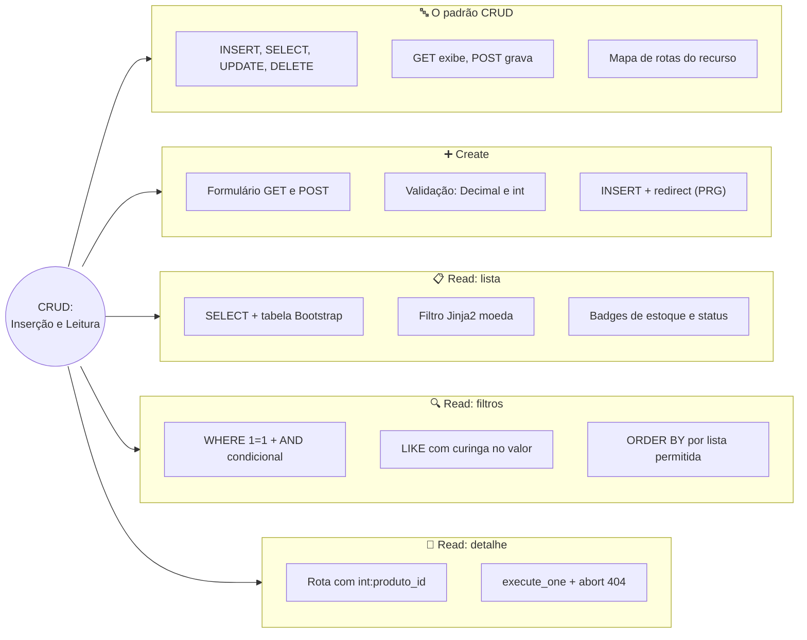
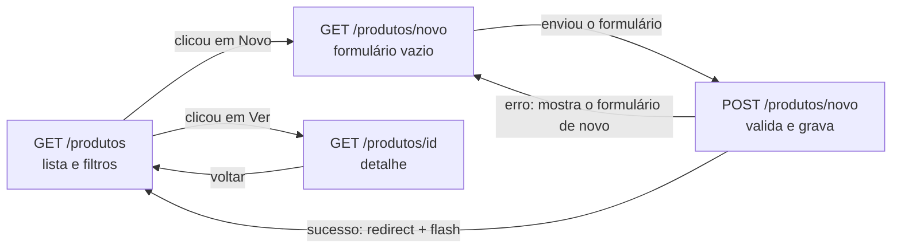
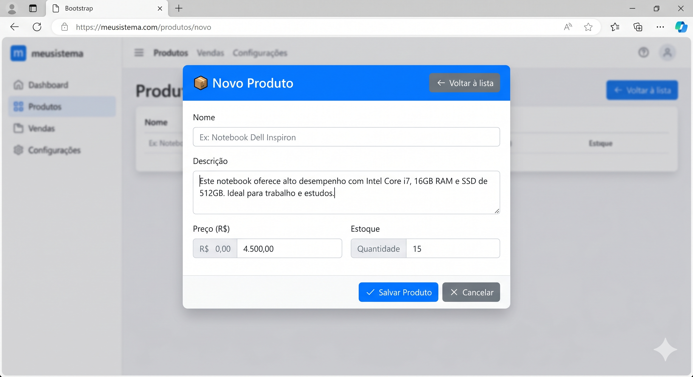
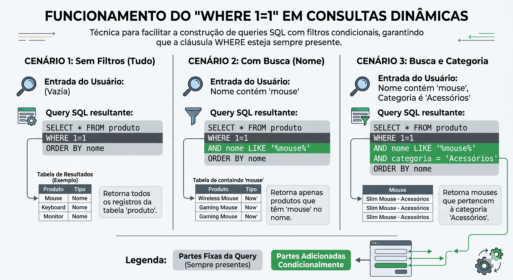
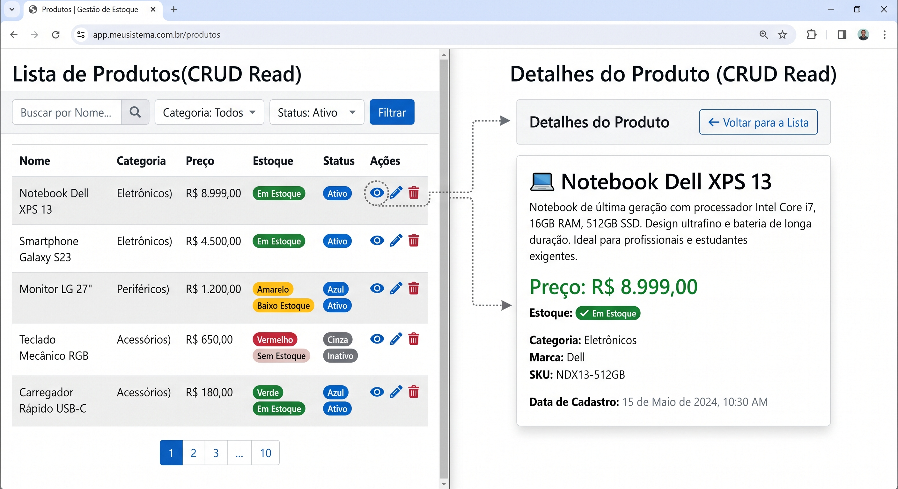

# Tópico 07 — CRUD: Inserção e Leitura

**Disciplina:** Programação para Internet (ILP951)
**Professor:** Ronan Adriel Zenatti · ronan.zenatti@cps.sp.gov.br
**Fatec Jahu — 2º Semestre/2026**

> **Pré-requisitos:** Tópico 05 concluído — MySQL conectado, tabela `produto` populada e `db.py` com `execute_query` e `execute_one`. Os formulários com validação no servidor e o padrão PRG do Tópico 04 também serão reaproveitados aqui.

---

## 🎯 Objetivos do Tópico

Ao final deste tópico você deverá ser capaz de:

- Explicar o que é CRUD e relacionar cada operação ao seu comando SQL, ao método HTTP e à rota Flask correspondente.
- Implementar o **Create**: um formulário que valida os dados no servidor e os grava com `INSERT` parametrizado.
- Converter e validar números (`Decimal` para preço, `int` para estoque) vindos de um formulário.
- Aplicar o padrão PRG e as flash messages depois de gravar um registro, e recuperar o `id` gerado pelo banco com `lastrowid`.
- Implementar o **Read**: listar registros em uma tabela Bootstrap e formatar valores com um filtro Jinja2 próprio.
- Montar filtros dinâmicos com `WHERE 1=1` e `LIKE`, sem abrir brecha para SQL Injection.
- Exibir o detalhe de um registro com rota parametrizada (`<int:...>`) e responder `404` quando ele não existe.

Até aqui, o seu sistema sabe guardar dados (Tópico 05) e sabe receber dados do usuário (Tópico 04), mas as duas pontas ainda não se encontram: o formulário de cadastro apenas imprimia no terminal, e a única forma de colocar um produto no banco era escrevendo `INSERT` no Workbench. Hoje as pontas se encaixam. Você vai construir, de ponta a ponta, a **metade de leitura e criação** do CRUD: cadastrar um produto pelo navegador, vê-lo aparecer em uma lista com busca e filtros, e abrir a página de detalhes de cada um. No próximo tópico, vêm a edição e a exclusão.

---

## 🗺️ Mapa Mental do Tópico



---

## Parte 1 — O que é CRUD: o mapa de rotas de um recurso

### Quatro operações que todo sistema precisa

Quase todo sistema de informação, de um app de bike-sharing ao painel de uma loja virtual, faz as mesmas quatro coisas com seus dados: **cria** registros novos, **lê** (consulta) os que existem, **atualiza** os que mudaram e **remove** os que não servem mais. A sigla **CRUD** vem exatamente disso: **C**reate, **R**ead, **U**pdate, **D**elete. Cada letra tem um comando SQL que você já conheceu no Tópico 05 (Parte 6) e um método HTTP que você estudou no Tópico 04:

| Letra | Operação | Comando SQL | Método HTTP | A pergunta que ela responde |
|---|---|---|---|---|
| **C** | Create | `INSERT` | `POST` | "Quero guardar algo novo" |
| **R** | Read | `SELECT` | `GET` | "Quero ver o que existe" |
| **U** | Update | `UPDATE` | `POST` | "Quero corrigir algo que já existe" |
| **D** | Delete | `DELETE` (ou `UPDATE` de `ativo`) | `POST` | "Quero tirar algo do sistema" |

> **Por que Update e Delete usam POST e não PUT/DELETE?** APIs REST usam os verbos `PUT`, `PATCH` e `DELETE`, mas um formulário HTML só consegue enviar `GET` ou `POST`. Como o nosso sistema devolve páginas HTML geradas no servidor, **toda operação que altera dados chega por `POST`**, e `GET` fica reservado para quem apenas consulta, regra que você viu na Parte 2 do Tópico 04.

### As rotas do recurso "produto"

Um **recurso** é a "coisa" que o CRUD manipula, aqui, o produto. Antes de escrever qualquer código, vale desenhar o mapa de rotas do recurso inteiro, para saber onde cada peça vai se encaixar:

| Rota | Métodos | O que faz | Onde construímos |
|---|---|---|---|
| `/produtos` | `GET` | Lista os produtos, com busca e filtros | Hoje (Partes 3 e 4) |
| `/produtos/novo` | `GET`, `POST` | `GET` mostra o formulário; `POST` valida e grava | Hoje (Parte 2) |
| `/produtos/<id>` | `GET` | Mostra os detalhes de um produto | Hoje (Parte 5) |
| `/produtos/<id>/editar` | `GET`, `POST` | `GET` mostra o formulário preenchido; `POST` atualiza | Tópico 08 |
| `/produtos/<id>/excluir` | `POST` | Desativa ou apaga o produto | Tópico 08 |

O fluxo do que construímos hoje se resume neste diagrama. Note que o `POST` com erro volta para o formulário, e o `POST` bem-sucedido **redireciona** para a lista, que é o padrão PRG:



Repare que `/produtos/novo` e `/produtos/<id>` convivem sem conflito: o Flask só trata o trecho final como `<id>` quando ele é um número inteiro (conversor `<int:...>`, Tópico 03), e `novo` não é.

### 🔎 Verifique seu Entendimento

Um assistente de estudos com IA generativa guarda o histórico de perguntas de cada estudante na tabela `pergunta`. O app precisa permitir: ver o histórico, salvar uma pergunta nova, corrigir o título de uma pergunta e excluir uma pergunta.

**Desafio:** Monte a tabela de rotas desse recurso, indicando para cada uma das quatro necessidades a letra do CRUD, o comando SQL, o método HTTP e uma rota Flask, no mesmo formato da tabela desta parte.

> 💬 Tente por conta própria antes de seguir. A solução comentada está no gabarito deste tópico (link na última seção da página).

---

## Parte 2 — Create: do formulário ao INSERT

Vamos conectar o formulário do Tópico 04 ao banco do Tópico 05. O caminho é: **GET** mostra o formulário → o usuário preenche e envia → **POST** valida → o servidor executa o `INSERT` → **redirect** para a lista com uma mensagem de sucesso.



### Passo 1 — preparar a tabela: a coluna `categoria`

O nosso formulário vai pedir a **categoria** do produto (para filtrar por ela mais adiante), mas a tabela criada no Tópico 05 não tem essa coluna. Em vez de apagar a tabela e perder os dados, usamos o `ALTER TABLE`, que **altera a estrutura** de uma tabela existente. No Workbench, execute:

```sql
USE projeto_web;

-- Nova coluna: texto curto, obrigatório, com valor padrão para as linhas que já existem
ALTER TABLE produto
    ADD COLUMN categoria VARCHAR(50) NOT NULL DEFAULT 'Outros' AFTER descricao;
-- AFTER descricao: posiciona a coluna logo depois de 'descricao' (só estética)
-- DEFAULT 'Outros': as linhas já cadastradas recebem este valor automaticamente
```

Rode e, em seguida, confira o resultado:

```sql
SELECT id, nome, categoria FROM produto;
```

Todos os produtos aparecem com `Outros`. Vamos categorizá-los. Confira os `id` na grade e ajuste os números abaixo se os seus forem diferentes:

```sql
UPDATE produto SET categoria = 'Computadores' WHERE id = 1;
UPDATE produto SET categoria = 'Periféricos'  WHERE id IN (2, 3, 4);
UPDATE produto SET categoria = 'Áudio'        WHERE id = 5;
```

Rode o `SELECT` de novo e confirme as categorias.

> ⚠️ **O Workbench recusou o `UPDATE` com o erro 1175?** Ele vem com o modo *Safe Updates* ativado, que bloqueia `UPDATE` e `DELETE` cujo `WHERE` não use uma chave (como o `id`). É por isso que usamos `WHERE id ...` e não `WHERE nome LIKE ...`, e é uma proteção bem-vinda, lembra do aviso sobre o `WHERE` no Tópico 05?
>
> Se você recriar o banco do zero pelo `db_setup.py` do Tópico 05, acrescente `categoria VARCHAR(50) NOT NULL DEFAULT 'Outros'` ao `CREATE TABLE` (ou rode o `ALTER TABLE` de novo).

### Passo 2 — `execute_insert()`: descobrir o `id` gerado

A função `execute_query` devolve apenas **quantas linhas foram afetadas**. Depois de um `INSERT`, porém, é muito útil saber **qual `id` o banco gerou** (o `AUTO_INCREMENT` do Tópico 05), por exemplo para mostrar "Produto #12 cadastrado". O cursor guarda essa informação em `lastrowid`. Acrescente ao final do `db.py`:

```python
def execute_insert(sql, params=None):
    """
    Executa um INSERT e devolve o id gerado pelo AUTO_INCREMENT.
    Use no lugar de execute_query quando precisar saber qual id o banco criou.
    """
    conn = get_connection()
    cursor = None
    try:
        cursor = conn.cursor()
        cursor.execute(sql, params or ())
        conn.commit()
        return cursor.lastrowid   # id da linha recém-inserida
    except Error as e:
        conn.rollback()
        raise Exception(f'Erro ao executar INSERT: {e}')
    finally:
        if cursor:
            cursor.close()
        conn.close()   # devolve ao pool, não fecha fisicamente
```

Teste no terminal (com o ambiente virtual ativo):

```
python -c "from db import execute_insert; print(execute_insert('INSERT INTO produto (nome, preco) VALUES (%s, %s)', ('Produto de teste', 1.00)))"
```

O número impresso é o `id` do novo registro. Anote-o e, no Workbench, apague esse registro de teste (`DELETE FROM produto WHERE id = ...;`, com o seu número). Será o último `INSERT` escrito "à mão" neste tópico: daqui em diante, quem insere é o formulário.

### Passo 3 — a rota e o formulário mínimo

No `app.py`, garanta os imports que vamos usar ao longo do tópico e crie a rota que, por enquanto, só **mostra** o formulário:

```python
from decimal import Decimal, InvalidOperation

from flask import Flask, render_template, request, redirect, url_for, flash, abort
from db import execute_query, execute_one, execute_insert
```

```python
@app.route('/produtos/novo', methods=['GET', 'POST'])
def produto_novo():
    # Por enquanto, GET e POST fazem a mesma coisa: mostram o formulário
    return render_template('produto_form.html', produto={})
```

O `produto={}` (dicionário vazio) existe para o template poder ler `produto.nome` mesmo no primeiro acesso, quando ainda não há nada digitado. Agora crie `templates/produto_form.html`, começando só com o campo Nome:

```html

Novo Produto — Sistema de Gestão


<div class="row justify-content-center">
  <div class="col-lg-8">
    <div class="card shadow-sm">
      <div class="card-header bg-primary text-white d-flex justify-content-between align-items-center">
        <h4 class="mb-0">📦 Novo Produto</h4>
        <a href="{{ url_for('lista_produtos') }}" class="btn btn-light btn-sm">← Voltar à lista</a>
      </div>
      <div class="card-body">
        <form action="{{ url_for('produto_novo') }}" method="post">

          <div class="mb-3">
            <label for="nome" class="form-label">Nome <span class="text-danger">*</span></label>
            <input type="text" class="form-control" id="nome" name="nome"
                   maxlength="200" placeholder="Ex.: Notebook Dell Inspiron" required
                   value="{{ produto.nome | default('') }}">
          </div>

          <div class="d-flex gap-2">
            <button type="submit" class="btn btn-primary">✔ Salvar produto</button>
            <a href="{{ url_for('lista_produtos') }}" class="btn btn-outline-secondary">✖ Cancelar</a>
          </div>

        </form>
      </div>
    </div>
  </div>
</div>

```

Salve, acesse `http://localhost:5000/produtos/novo` e confira que o formulário aparece (a navbar e o rodapé vêm do `base.html`). Digite algo e clique em **Salvar produto**: a página simplesmente recarrega vazia, porque a rota ainda não faz nada com o `POST`.

### Passo 4 — os demais campos

Um produto tem descrição, preço, estoque e categoria. Para a categoria usaremos uma lista única, que servirá ao formulário **e** à validação. No topo do `app.py`, logo depois de `app.secret_key = ...`, defina:

```python
# Categorias aceitas pelo sistema — fonte única para o formulário e para a validação
CATEGORIAS = ['Computadores', 'Periféricos', 'Áudio', 'Acessórios', 'Outros']
```

Na rota, passe a lista ao template (daqui em diante, toda chamada a `render_template('produto_form.html', ...)` deve receber também `categorias=CATEGORIAS`):

```python
    return render_template('produto_form.html', produto={}, categorias=CATEGORIAS)
```

No template, logo **abaixo** do campo Nome e **acima** dos botões, adicione os demais campos, um bloco por vez. Primeiro a descrição (opcional, por isso sem `required`):

```html
          <div class="mb-3">
            <label for="descricao" class="form-label">Descrição</label>
            <textarea class="form-control" id="descricao" name="descricao"
                      rows="3">{{ produto.descricao | default('', true) }}</textarea>
          </div>
```

> 💡 **Por que `default('', true)`?** O filtro `default` normalmente só age quando a variável **não existe**. O segundo argumento `true` faz ele agir também quando o valor é **vazio ou `None`**. Isso importa porque uma descrição `NULL` no banco chega ao Python como `None`, e sem esse argumento o campo exibiria o texto "None". No primeiro acesso, como `produto` é `{}`, a variável não existe, e o filtro devolve `''` de qualquer jeito.

Salve, recarregue e veja o campo de descrição aparecer. Agora, em uma linha com três colunas, o preço (com o prefixo `R$`), o estoque e a categoria:

```html
          <div class="row">
            <div class="col-md-4 mb-3">
              <label for="preco" class="form-label">Preço <span class="text-danger">*</span></label>
              <div class="input-group">
                <span class="input-group-text">R$</span>
                <input type="number" class="form-control" id="preco" name="preco"
                       step="0.01" min="0.01" placeholder="0,00" required
                       value="{{ produto.preco | default('') }}">
              </div>
            </div>
            <div class="col-md-4 mb-3">
              <label for="estoque" class="form-label">Estoque <span class="text-danger">*</span></label>
              <input type="number" class="form-control" id="estoque" name="estoque"
                     min="0" step="1" required
                     value="{{ produto.estoque | default(0) }}">
            </div>
            <div class="col-md-4 mb-3">
              <label for="categoria" class="form-label">Categoria <span class="text-danger">*</span></label>
              <select class="form-select" id="categoria" name="categoria" required>
                <option value="">-- Selecione --</option>
                
                  <option value="{{ c }}" selected>{{ c }}</option>
                
              </select>
            </div>
          </div>
```

Salve e recarregue. Observe: o campo de estoque já vem com `0`, as opções do `<select>` são geradas pelo `for` a partir de `CATEGORIAS` (altere a lista no Python, recarregue, e o formulário muda sozinho), e os campos numéricos recusam letras. Lembre-se, porém, da regra do Tópico 04: o navegador é só a primeira linha de defesa. A validação de verdade acontece no servidor.

### Passo 5 — receber o POST

Vamos fazer a rota enxergar o que foi enviado. Troque o corpo de `produto_novo` por esta versão, que apenas **coleta** os campos e imprime no terminal:

```python
@app.route('/produtos/novo', methods=['GET', 'POST'])
def produto_novo():

    if request.method == 'POST':

        # ===== COLETA DOS DADOS =====
        nome        = request.form.get('nome', '').strip()
        descricao   = request.form.get('descricao', '').strip()
        preco_txt   = request.form.get('preco', '').strip()
        estoque_txt = request.form.get('estoque', '').strip()
        categoria   = request.form.get('categoria', '')

        print(f'Recebido: {nome} | {preco_txt} | {estoque_txt} | {categoria}')

    # Método GET (ou POST, por enquanto): exibe o formulário
    return render_template('produto_form.html', produto={}, categorias=CATEGORIAS)
```

Repare nos nomes `preco_txt` e `estoque_txt`: tudo que vem de `request.form` é **texto**. O número só existirá depois da conversão, e é por isso que o texto original carrega o sufixo `_txt`. Salve, preencha o formulário, envie e olhe o terminal: a linha `Recebido: ...` mostra exatamente o que o navegador mandou.

### Passo 6 — validar o nome e a categoria

Entre a coleta e o `return`, crie a lista de erros e valide os dois campos de texto. O padrão é o do Tópico 04: **acumular** todas as mensagens antes de mostrar qualquer uma.

```python
        # ===== VALIDAÇÃO E CONVERSÃO =====
        erros = []

        if not nome:
            erros.append('O nome é obrigatório.')
        elif len(nome) < 3:
            erros.append('O nome deve ter pelo menos 3 caracteres.')
        elif len(nome) > 200:
            erros.append('O nome pode ter no máximo 200 caracteres.')
            # 200 é o tamanho do VARCHAR(200): com sql_mode estrito o MySQL recusaria mais que isso

        if categoria not in CATEGORIAS:
            erros.append('Selecione uma categoria válida.')
            # Compara com a lista permitida: um valor adulterado pelo DevTools também é barrado
```

### Passo 7 — validar e converter o preço

O preço é o campo mais delicado. Ele precisa virar um número, e não pode ser um `float`: lembra do flashcard do Tópico 05 sobre `DECIMAL`? Números de ponto flutuante binário erram em casas decimais (`0.1 + 0.2` dá `0.30000000000000004`), o que é inaceitável para dinheiro. O Python tem o tipo `Decimal` para isso (já importado no Passo 3). Acrescente, logo depois da validação do nome:

```python
        preco = preco_txt   # se a conversão falhar, mantém o texto digitado para repopular o formulário
        try:
            valor = Decimal(preco_txt.replace(',', '.'))
            # replace: quem digita "449,90" (vírgula brasileira) também é aceito
        except InvalidOperation:
            erros.append('Informe um preço válido, por exemplo 199.90.')
        else:
            # O else do try roda só se a conversão deu certo
            if not valor.is_finite() or valor <= 0:
                # Decimal("NaN") e Decimal("Infinity") também "convertem" sem erro, por isso is_finite()
                erros.append('O preço deve ser um número maior que zero.')
            elif valor > Decimal('99999999.99'):
                erros.append('O preço máximo permitido é 99999999.99.')
                # DECIMAL(10, 2) comporta no máximo 8 dígitos antes da vírgula
            else:
                preco = valor.quantize(Decimal('0.01'))
                # quantize: arredonda para 2 casas decimais, o formato do DECIMAL(10, 2)
```

### Passo 8 — validar e converter o estoque

O estoque segue o mesmo raciocínio, agora com `int`:

```python
        estoque = estoque_txt
        try:
            valor_estoque = int(estoque_txt)
        except ValueError:
            erros.append('O estoque deve ser um número inteiro.')
        else:
            if valor_estoque < 0:
                erros.append('O estoque não pode ser negativo.')
            elif valor_estoque > 1000000:
                erros.append('O estoque máximo permitido é 1.000.000.')
            else:
                estoque = valor_estoque
```

Troque o `print` do Passo 5 por `print(erros, preco, estoque)`, salve e teste: envie o formulário com o estoque `-3` (apague o atributo `min` pelo DevTools para o navegador deixar enviar) e depois com preço `abc` (troque o `type="number"` por `type="text"` no DevTools). Observe no terminal as mensagens acumuladas na lista, e perceba que, nos campos inválidos, `preco` e `estoque` continuam sendo o texto digitado, enquanto nos válidos já viraram `Decimal` e `int`.

### Passo 9 — mostrar os erros ou gravar

Falta a decisão final. Substitua o `print` por este bloco, ainda dentro do `if request.method == 'POST':`:

```python
        # O que o usuário digitou, para repopular o formulário em caso de erro
        produto = {'nome': nome, 'descricao': descricao, 'preco': preco,
                   'estoque': estoque, 'categoria': categoria}

        if erros:
            for erro in erros:
                flash(erro, 'danger')
            return render_template('produto_form.html', produto=produto, categorias=CATEGORIAS)

        # ===== GRAVAÇÃO =====
        try:
            novo_id = execute_insert(
                'INSERT INTO produto (nome, descricao, preco, estoque, categoria) '
                'VALUES (%s, %s, %s, %s, %s)',
                (nome, descricao or None, preco, estoque, categoria)
            )
            # %s: placeholders, os valores vão separados — nunca concatenados (Tópico 05, Parte 7)
            # descricao or None: texto vazio vira NULL no banco, em vez de uma string vazia
        except Exception as e:
            flash(f'Não foi possível salvar o produto: {e}', 'danger')
            return render_template('produto_form.html', produto=produto, categorias=CATEGORIAS)

        flash(f'Produto "{nome}" cadastrado com sucesso (código #{novo_id}).', 'success')
        return redirect(url_for('lista_produtos'))
        # PRG: redirect depois do POST bem-sucedido (Tópico 04, Parte 6)
```

> ⚠️ Mostrar a mensagem bruta do erro do banco (`{e}`) ao usuário é aceitável **durante o desenvolvimento**, porque ajuda você a depurar. Em produção, o correto é registrar o erro em um log e exibir uma mensagem genérica, para não revelar detalhes internos do sistema.

Salve e faça os testes de verdade, nesta ordem:

1. Cadastre um produto válido. Você deve voltar para a lista com um alerta verde mostrando o **código** gerado.
2. Na lista, pressione **F5**. Nada é reenviado nem duplicado: é o PRG trabalhando.
3. Volte ao formulário, remova os atributos `required` e `min` pelo DevTools e envie com o nome vazio, o preço em branco e o estoque `-1`. Cada problema aparece em um alerta vermelho, e os campos mantêm o que você digitou.
4. No Workbench, rode `SELECT * FROM produto ORDER BY id DESC;` e confirme que o produto do passo 1 está lá, com a `descricao` como `NULL` se você a deixou vazia.

**Consolidação — a rota `produto_novo` completa:**

```python
@app.route('/produtos/novo', methods=['GET', 'POST'])
def produto_novo():

    if request.method == 'POST':

        # ===== COLETA DOS DADOS =====
        nome        = request.form.get('nome', '').strip()
        descricao   = request.form.get('descricao', '').strip()
        preco_txt   = request.form.get('preco', '').strip()
        estoque_txt = request.form.get('estoque', '').strip()
        categoria   = request.form.get('categoria', '')

        # ===== VALIDAÇÃO E CONVERSÃO =====
        erros = []

        if not nome:
            erros.append('O nome é obrigatório.')
        elif len(nome) < 3:
            erros.append('O nome deve ter pelo menos 3 caracteres.')
        elif len(nome) > 200:
            erros.append('O nome pode ter no máximo 200 caracteres.')

        if categoria not in CATEGORIAS:
            erros.append('Selecione uma categoria válida.')

        preco = preco_txt   # se a conversão falhar, mantém o texto digitado para repopular
        try:
            valor = Decimal(preco_txt.replace(',', '.'))
        except InvalidOperation:
            erros.append('Informe um preço válido, por exemplo 199.90.')
        else:
            if not valor.is_finite() or valor <= 0:
                erros.append('O preço deve ser um número maior que zero.')
            elif valor > Decimal('99999999.99'):
                erros.append('O preço máximo permitido é 99999999.99.')
            else:
                preco = valor.quantize(Decimal('0.01'))

        estoque = estoque_txt
        try:
            valor_estoque = int(estoque_txt)
        except ValueError:
            erros.append('O estoque deve ser um número inteiro.')
        else:
            if valor_estoque < 0:
                erros.append('O estoque não pode ser negativo.')
            elif valor_estoque > 1000000:
                erros.append('O estoque máximo permitido é 1.000.000.')
            else:
                estoque = valor_estoque

        # ===== ERROS OU GRAVAÇÃO =====
        produto = {'nome': nome, 'descricao': descricao, 'preco': preco,
                   'estoque': estoque, 'categoria': categoria}

        if erros:
            for erro in erros:
                flash(erro, 'danger')
            return render_template('produto_form.html', produto=produto, categorias=CATEGORIAS)

        try:
            novo_id = execute_insert(
                'INSERT INTO produto (nome, descricao, preco, estoque, categoria) '
                'VALUES (%s, %s, %s, %s, %s)',
                (nome, descricao or None, preco, estoque, categoria)
            )
        except Exception as e:
            flash(f'Não foi possível salvar o produto: {e}', 'danger')
            return render_template('produto_form.html', produto=produto, categorias=CATEGORIAS)

        flash(f'Produto "{nome}" cadastrado com sucesso (código #{novo_id}).', 'success')
        return redirect(url_for('lista_produtos'))

    # Método GET: exibe o formulário vazio
    return render_template('produto_form.html', produto={}, categorias=CATEGORIAS)
```

E o `templates/produto_form.html` completo, juntando os campos que você montou aos poucos:

```html

Novo Produto — Sistema de Gestão


<div class="row justify-content-center">
  <div class="col-lg-8">
    <div class="card shadow-sm">
      <div class="card-header bg-primary text-white d-flex justify-content-between align-items-center">
        <h4 class="mb-0">📦 Novo Produto</h4>
        <a href="{{ url_for('lista_produtos') }}" class="btn btn-light btn-sm">← Voltar à lista</a>
      </div>
      <div class="card-body">
        <form action="{{ url_for('produto_novo') }}" method="post">

          <div class="mb-3">
            <label for="nome" class="form-label">Nome <span class="text-danger">*</span></label>
            <input type="text" class="form-control" id="nome" name="nome"
                   maxlength="200" placeholder="Ex.: Notebook Dell Inspiron" required
                   value="{{ produto.nome | default('') }}">
          </div>

          <div class="mb-3">
            <label for="descricao" class="form-label">Descrição</label>
            <textarea class="form-control" id="descricao" name="descricao"
                      rows="3">{{ produto.descricao | default('', true) }}</textarea>
          </div>

          <div class="row">
            <div class="col-md-4 mb-3">
              <label for="preco" class="form-label">Preço <span class="text-danger">*</span></label>
              <div class="input-group">
                <span class="input-group-text">R$</span>
                <input type="number" class="form-control" id="preco" name="preco"
                       step="0.01" min="0.01" placeholder="0,00" required
                       value="{{ produto.preco | default('') }}">
              </div>
            </div>
            <div class="col-md-4 mb-3">
              <label for="estoque" class="form-label">Estoque <span class="text-danger">*</span></label>
              <input type="number" class="form-control" id="estoque" name="estoque"
                     min="0" step="1" required
                     value="{{ produto.estoque | default(0) }}">
            </div>
            <div class="col-md-4 mb-3">
              <label for="categoria" class="form-label">Categoria <span class="text-danger">*</span></label>
              <select class="form-select" id="categoria" name="categoria" required>
                <option value="">-- Selecione --</option>
                
                  <option value="{{ c }}" selected>{{ c }}</option>
                
              </select>
            </div>
          </div>

          <div class="d-flex gap-2">
            <button type="submit" class="btn btn-primary">✔ Salvar produto</button>
            <a href="{{ url_for('lista_produtos') }}" class="btn btn-outline-secondary">✖ Cancelar</a>
          </div>

        </form>
      </div>
    </div>
  </div>
</div>

```

### 🔎 Verifique seu Entendimento

O app de bike-sharing de uma cidade precisa de um cadastro de estações. A tabela `estacao` tem as colunas `nome`, `bairro` e `capacidade` (quantas bicicletas a estação comporta, sempre pelo menos 1).

**Desafio:** Escreva a rota `/estacoes/nova` (`GET` e `POST`) que coleta os três campos com `.strip()`, valida que o nome e o bairro não estão vazios e que a capacidade é um inteiro maior ou igual a 1, grava com `execute_insert` e redireciona para `lista_estacoes` com uma flash de sucesso. Siga o padrão desta parte.

> 💬 Tente por conta própria antes de seguir. A solução comentada está no gabarito deste tópico (link na última seção da página).

---

## Parte 3 — Read (1): listando registros em uma tabela

A rota `/produtos` do Tópico 05 já busca os produtos no banco, mas a página ainda é a tabela simples do Tópico 03. Vamos evoluí-la para uma tela de CRUD de verdade, um incremento por vez.

### Passo 1 — um filtro Jinja2 só nosso: `moeda`

Hoje o preço aparece como `R$ 3499.90`, com ponto decimal e sem separador de milhar. No Brasil, queremos `R$ 3.499,90`. Em vez de repetir uma conversão em cada template, vamos criar um **filtro Jinja2 próprio**: uma função Python registrada com `@app.template_filter`, que o template chama com o mesmo `|` dos filtros que você já conhece (`upper`, `default`...). Acrescente ao `app.py`, depois da lista `CATEGORIAS`:

```python
@app.template_filter('moeda')
def formatar_moeda(valor):
    """Formata um número como moeda brasileira: 4500.5 -> R$ 4.500,50"""
    texto = f'{valor:,.2f}'                                   # 4,500.50 (padrão americano)
    texto = texto.replace(',', 'X').replace('.', ',').replace('X', '.')
    # Troca em três passos, para o ponto e a vírgula não se atropelarem
    return f'R$ {texto}'
```

No `templates/produtos.html`, troque a célula do preço:

```html
          <td>{{ produto.preco | moeda }}</td>
```

Salve e recarregue `http://localhost:5000/produtos`: o notebook agora aparece como `R$ 3.499,90`. O nome do filtro (`'moeda'`) é o que você escreve depois do `|` no template, e o nome da função (`formatar_moeda`) é livre.

### Passo 2 — colunas de identificação e categoria

Em um CRUD, mostrar o `id` e a categoria ajuda a distinguir os registros. No `<thead>`, acrescente os cabeçalhos; no `<tbody>`, as células correspondentes (e troque o `loop.index` pelo `id` real do banco):

```html
          <th>#</th>
          <th>Nome</th>
          <th>Categoria</th>
          <th>Preço</th>
```

```html
          <td>{{ produto.id }}</td>
          <td>{{ produto.nome }}</td>
          <td>{{ produto.categoria }}</td>
          <td>{{ produto.preco | moeda }}</td>
```

Salve, recarregue e confira as colunas. Note a diferença sutil entre `loop.index` (posição na tela, sempre 1, 2, 3...) e `produto.id` (identidade no banco, que não muda quando a ordem muda).

### Passo 3 — badges de estoque e de status

Um estoque de `3` unidades e um de `300` não deveriam ter a mesma aparência. Troque a célula de estoque, que usava `<td class="table-danger">`, por **badges** do Bootstrap coloridos por faixa, e faça o mesmo com o status:

```html
          <td>
            
              <span class="badge bg-danger">Sem estoque</span>
            
              <span class="badge bg-warning text-dark">Estoque baixo ({{ produto.estoque }})</span>
            
              <span class="badge bg-success">Em estoque ({{ produto.estoque }})</span>
            
          </td>
          <td>
            
              <span class="badge bg-primary">Ativo</span>
            
              <span class="badge bg-secondary">Inativo</span>
            
          </td>
```

Salve e recarregue: o Teclado (estoque 3) aparece em amarelo, e qualquer produto com estoque 0 aparece em vermelho. Altere um estoque no formulário de cadastro, ou direto no Workbench pelo `id`, para ver as três cores. É o mesmo `if / elif / else` das faixas de classificação do Tópico 04, agora decidindo uma cor.

### Passo 4 — o botão "Novo produto"

Por fim, ligue a lista ao formulário que você construiu na Parte 2. No topo do bloco `conteudo`, ao lado do título:

```html
  <div class="d-flex justify-content-between align-items-center mb-3">
    <h2>Produtos</h2>
    <a href="{{ url_for('produto_novo') }}" class="btn btn-primary">➕ Novo produto</a>
  </div>
```

Salve e clique no botão: você vai ao formulário, cadastra um produto e volta à lista já com o novo registro. O ciclo **Create → Read** está completo. Como a rota `lista_produtos` ainda filtra por `WHERE ativo = 1` e ordena por nome, o produto aparece na posição alfabética dele.

> 💡 O `` do `` que o Tópico 03 deixou na tabela ("Nenhum produto cadastrado.") continua valendo como **estado vazio**: é a mensagem que o usuário vê quando a consulta não devolve nenhuma linha. Na Parte 4, com os filtros, você vai provocá-la de propósito.

### 🔎 Verifique seu Entendimento

Uma cooperativa de coleta seletiva quer a listagem dos pontos de coleta (`ponto_coleta`, com a coluna `quilos_coletados`) em uma tabela. Cada ponto deve exibir um badge: verde "Meta atingida" com 100 kg ou mais, amarelo "Em andamento" entre 0 e 100 kg, e cinza "Sem coletas" com 0 kg.

**Desafio:** Escreva o trecho do template (`<td>` com a estrutura `if / elif / else` e os badges Bootstrap) que decide o badge de cada `ponto`, seguindo o padrão do estoque desta parte.

> 💬 Tente por conta própria antes de seguir. A solução comentada está no gabarito deste tópico (link na última seção da página).

---

## Parte 4 — Read (2): filtros dinâmicos com WHERE 1=1 e LIKE

### O problema das combinações

Com 5 produtos, qualquer lista cabe na tela. Com 5 mil, o usuário precisa **buscar**. E ele quer buscar de várias formas: só pelo nome, só pela categoria, pelos dois juntos, só os ativos, só os inativos... Cada filtro é **opcional**, e a consulta SQL muda conforme os filtros que o usuário preencheu. Escrever uma consulta pronta para cada combinação não funciona: com 3 filtros já seriam 8 consultas, com 4 filtros, 16.

A solução é **montar a consulta aos poucos**, acrescentando uma condição por filtro preenchido. Mas há um obstáculo: a primeira condição precisa de `WHERE`, e as seguintes, de `AND`. Como saber, no código, se a condição atual é a primeira? O truque clássico é começar a consulta com uma condição que **sempre é verdadeira**, `WHERE 1=1`. Depois dela, todo filtro entra com `AND`, sem exceção:



`1=1` não filtra nada (é sempre verdadeiro), então a consulta sem filtros devolve todos os registros, e cada `AND ...` acrescentado a **restringe** um pouco mais. Vamos construí-la em passos.

### Passo 1 — o formulário de busca (método GET)

Os filtros de uma listagem usam **GET**, e não POST: a URL resultante (`/produtos?busca=mouse`) pode ser copiada, favoritada e compartilhada, como você viu na Parte 8 do Tópico 04. Na rota, apenas **leia** os parâmetros e entregue-os ao template (a consulta ainda não muda):

```python
@app.route('/produtos')
def lista_produtos():
    busca     = request.args.get('busca', '').strip()
    categoria = request.args.get('categoria', '')

    try:
        produtos = execute_query(
            'SELECT * FROM produto WHERE ativo = 1 ORDER BY nome',
            fetch=True
        )
    except Exception as e:
        flash(f'Erro ao carregar produtos: {e}', 'danger')
        produtos = []

    return render_template('produtos.html',
                           produtos=produtos,
                           total=len(produtos),
                           categorias=CATEGORIAS,
                           busca=busca,
                           categoria=categoria)
```

No `produtos.html`, logo abaixo do cabeçalho da página e acima da tabela, o formulário (os campos já vêm preenchidos com o que o usuário digitou, para não "esquecer" a busca após enviar):

```html
  <form method="get" action="{{ url_for('lista_produtos') }}" class="row g-2 align-items-end mb-4">
    <div class="col-md-5">
      <label for="busca" class="form-label">Buscar por nome</label>
      <input type="text" class="form-control" id="busca" name="busca"
             placeholder="Ex.: mouse" value="{{ busca }}">
    </div>
    <div class="col-md-4">
      <label for="categoria" class="form-label">Categoria</label>
      <select class="form-select" id="categoria" name="categoria">
        <option value="">Todas</option>
        
          <option value="{{ c }}" selected>{{ c }}</option>
        
      </select>
    </div>
    <div class="col-md-3 d-flex gap-2">
      <button type="submit" class="btn btn-primary">🔍 Filtrar</button>
      <a href="{{ url_for('lista_produtos') }}" class="btn btn-outline-secondary">Limpar</a>
    </div>
  </form>

  <p class="text-muted">{{ total }} produto(s) encontrado(s)</p>
```

Salve, digite `mouse` na busca, escolha uma categoria e clique em **Filtrar**. Observe duas coisas: a URL agora é algo como `/produtos?busca=mouse&categoria=Perif%C3%A9ricos` (o `%C3%A9` é o `é` codificado) e os campos continuam preenchidos, **mas a lista não mudou**. A rota lê os filtros e ainda os ignora. É o que resolvemos agora.

### Passo 2 — a base da consulta com `WHERE 1=1`

Troque a consulta fixa por uma montada em duas variáveis: o texto SQL (`sql`) e a lista de valores dos placeholders (`params`). Por enquanto, sem nenhum filtro aplicado:

```python
    sql = 'SELECT * FROM produto WHERE 1=1'
    params = []

    sql += ' ORDER BY nome'

    try:
        produtos = execute_query(sql, params, fetch=True)
    except Exception as e:
        flash(f'Erro ao carregar produtos: {e}', 'danger')
        produtos = []
```

Salve e recarregue. A lista agora mostra **todos** os produtos, inclusive os inativos, porque tiramos o `WHERE ativo = 1`. Cuidaremos do status em breve. O importante é que a consulta já está no formato "base + filtros + ordenação".

### Passo 3 — o filtro de nome com `LIKE`

Para cada filtro, o padrão é o mesmo: **se o usuário preencheu, acrescente um `AND` e o valor**. Entre a base e o `ORDER BY`:

```python
    if busca:
        sql += ' AND nome LIKE %s'
        params.append(f'%{busca}%')
```

Dois detalhes que merecem atenção:

- O `LIKE` usa o curinga `%` ("qualquer sequência de caracteres"): `'%mouse%'` encontra "Mouse Logitech", "Pad Mouse Gamer" e qualquer nome que **contenha** "mouse". Repare **onde** os `%` estão: dentro do **valor** (`f'%{busca}%'`) e não no texto do SQL. O SQL só tem o placeholder `%s`. É isso que mantém a consulta segura: o que o usuário digitou continua sendo apenas dado, nunca código SQL (Tópico 05, Parte 7).
- Já o `LIKE` do MySQL ignora maiúsculas e minúsculas com o `COLLATE utf8mb4_unicode_ci` que definimos no banco, então "MOUSE" e "mouse" encontram o mesmo produto.

Salve, busque `mouse` e confira que só o Mouse Logitech aparece. Busque `a` e veja que todo nome com a letra "a" é listado.

### Passo 4 — o filtro de categoria

Mesmo padrão, agora com igualdade (`=`), já que a categoria vem de uma lista fechada:

```python
    if categoria:
        sql += ' AND categoria = %s'
        params.append(categoria)
```

Salve e teste as três situações: só a busca, só a categoria e os dois juntos. A consulta que o MySQL recebe muda a cada combinação, mas **o seu código não mudou**: é a vantagem do `WHERE 1=1`. Acompanhe a montagem: com `busca = 'mouse'` e `categoria = 'Periféricos'`, o SQL final é `SELECT * FROM produto WHERE 1=1 AND nome LIKE %s AND categoria = %s ORDER BY nome` e `params` é `['%mouse%', 'Periféricos']`.

### Passo 5 — o filtro de status (ativos e inativos)

No próximo tópico, vamos "desativar" produtos em vez de apagá-los, então a lista precisa saber mostrar ativos, inativos ou todos. O padrão é **ativos**, que era o comportamento original. Leia o parâmetro junto dos outros, validando o valor:

```python
    status = request.args.get('status', 'ativo')
    if status not in ('ativo', 'inativo', 'todos'):
        status = 'ativo'
```

E acrescente as condições à consulta. Repare que aqui **não há placeholder**: o texto que entra no SQL (`ativo = 1`) é uma constante escolhida pelo **nosso** código; o que o usuário envia só decide qual das alternativas vale.

```python
    if status == 'ativo':
        sql += ' AND ativo = 1'
    elif status == 'inativo':
        sql += ' AND ativo = 0'
    # status == 'todos': não acrescenta condição nenhuma
```

No `render_template`, acrescente `status=status`, e no formulário do template, um terceiro `<select>`:

```html
    <div class="col-md-2">
      <label for="status" class="form-label">Status</label>
      <select class="form-select" id="status" name="status">
        <option value="ativo"   selected>Ativos</option>
        <option value="inativo" selected>Inativos</option>
        <option value="todos"   selected>Todos</option>
      </select>
    </div>
```

(Ajuste as larguras de coluna do formulário para somarem 12 no Bootstrap; o resultado final está na consolidação.) Para ver o filtro funcionar, desative um produto no Workbench com `UPDATE produto SET ativo = 0 WHERE id = 4;`, recarregue: ele some da lista padrão e só aparece em **Inativos** e **Todos**.

### Passo 6 — ordenação com uma lista de valores permitidos

O usuário também quer ordenar a lista: menor preço, maior preço, mais recentes. Surge uma pergunta: **posso usar `%s` para o nome da coluna do `ORDER BY`?** Não. Placeholders só substituem **valores** (textos e números). Nomes de colunas, tabelas e palavras como `ASC`/`DESC` fazem parte da **estrutura** do SQL, e o conector as trataria como texto entre aspas, quebrando a consulta. Concatenar o que o usuário digitou nessa posição reabriria a porta do SQL Injection.

A solução é uma **lista de valores permitidos** (*allowlist*): um dicionário em que a chave é o que vem da URL e o valor é o SQL fixo, escrito por nós. Defina-o no topo do `app.py`:

```python
# Ordenações permitidas na listagem: a chave vem da URL, o valor é o SQL fixo
ORDENACOES = {
    'nome':       'nome ASC',
    'preco_asc':  'preco ASC',
    'preco_desc': 'preco DESC',
    'recentes':   'criado_em DESC',
    'estoque':    'estoque ASC',
}
```

Na rota, leia a opção e troque o `ORDER BY nome` fixo por uma busca no dicionário:

```python
    ordem = request.args.get('ordem', 'nome')

    sql += ' ORDER BY ' + ORDENACOES.get(ordem, ORDENACOES['nome'])
```

O `.get(ordem, ORDENACOES['nome'])` devolve o SQL da opção escolhida **ou, se a chave não existir** (um valor inventado na URL), a ordenação padrão. Nada do que o usuário digitar chega ao SQL, só um dos cinco textos que nós escrevemos. No template, mais um `<select>` com `name="ordem"` (veja na consolidação) e `ordem=ordem` no `render_template`.

### Passo 7 — o experimento: tente quebrar a busca

Agora uma demonstração prática do que a parametrização garante. No campo de busca, digite exatamente isto e clique em **Filtrar**:

```
' OR '1'='1
```

Se o `LIKE` estivesse montado por concatenação, esse texto transformaria a consulta em "todos os produtos". Com o `%s`, o MySQL procura, literalmente, nomes que **contenham** `' OR '1'='1`, e não encontra nenhum: a lista mostra "Nenhum produto encontrado". Tente também, na URL, `?ordem=nome;DROP TABLE produto`: a ordenação cai no padrão e a tabela segue intacta. Mesmo princípio, duas defesas diferentes: parâmetro para valores, lista permitida para estrutura.

**Consolidação — a rota `lista_produtos` completa:**

```python
@app.route('/produtos')
def lista_produtos():
    busca     = request.args.get('busca', '').strip()
    categoria = request.args.get('categoria', '')
    status    = request.args.get('status', 'ativo')
    ordem     = request.args.get('ordem', 'nome')

    if status not in ('ativo', 'inativo', 'todos'):
        status = 'ativo'

    # Base da consulta: WHERE 1=1 é sempre verdadeiro, então todo filtro entra com AND
    sql = 'SELECT * FROM produto WHERE 1=1'
    params = []

    if busca:
        sql += ' AND nome LIKE %s'
        params.append(f'%{busca}%')      # os curingas vão no VALOR, nunca no texto do SQL

    if categoria:
        sql += ' AND categoria = %s'
        params.append(categoria)

    if status == 'ativo':
        sql += ' AND ativo = 1'
    elif status == 'inativo':
        sql += ' AND ativo = 0'

    # ORDER BY não aceita placeholder: usa só textos do dicionário ORDENACOES
    sql += ' ORDER BY ' + ORDENACOES.get(ordem, ORDENACOES['nome'])

    try:
        produtos = execute_query(sql, params, fetch=True)
    except Exception as e:
        flash(f'Erro ao carregar produtos: {e}', 'danger')
        produtos = []

    return render_template('produtos.html',
                           produtos=produtos,
                           total=len(produtos),
                           categorias=CATEGORIAS,
                           busca=busca,
                           categoria=categoria,
                           status=status,
                           ordem=ordem)
```

E o `templates/produtos.html` completo neste ponto (formulário de filtros + tabela):

```html

Produtos — Sistema de Gestão



  <div class="d-flex justify-content-between align-items-center mb-3">
    <h2>Produtos</h2>
    <a href="{{ url_for('produto_novo') }}" class="btn btn-primary">➕ Novo produto</a>
  </div>

  <form method="get" action="{{ url_for('lista_produtos') }}" class="row g-2 align-items-end mb-4">
    <div class="col-md-3">
      <label for="busca" class="form-label">Buscar por nome</label>
      <input type="text" class="form-control" id="busca" name="busca"
             placeholder="Ex.: mouse" value="{{ busca }}">
    </div>
    <div class="col-md-2">
      <label for="categoria" class="form-label">Categoria</label>
      <select class="form-select" id="categoria" name="categoria">
        <option value="">Todas</option>
        
          <option value="{{ c }}" selected>{{ c }}</option>
        
      </select>
    </div>
    <div class="col-md-2">
      <label for="status" class="form-label">Status</label>
      <select class="form-select" id="status" name="status">
        <option value="ativo"   selected>Ativos</option>
        <option value="inativo" selected>Inativos</option>
        <option value="todos"   selected>Todos</option>
      </select>
    </div>
    <div class="col-md-2">
      <label for="ordem" class="form-label">Ordenar por</label>
      <select class="form-select" id="ordem" name="ordem">
        <option value="nome"       selected>Nome (A–Z)</option>
        <option value="preco_asc"  selected>Menor preço</option>
        <option value="preco_desc" selected>Maior preço</option>
        <option value="recentes"   selected>Mais recentes</option>
        <option value="estoque"    selected>Menor estoque</option>
      </select>
    </div>
    <div class="col-md-3 d-flex gap-2">
      <button type="submit" class="btn btn-primary">🔍 Filtrar</button>
      <a href="{{ url_for('lista_produtos') }}" class="btn btn-outline-secondary">Limpar</a>
    </div>
  </form>

  <p class="text-muted">{{ total }} produto(s) encontrado(s)</p>

  
  <div class="table-responsive">
    <table class="table table-hover align-middle">
      <thead class="table-dark">
        <tr>
          <th>#</th>
          <th>Nome</th>
          <th>Categoria</th>
          <th>Preço</th>
          <th>Estoque</th>
          <th>Status</th>
        </tr>
      </thead>
      <tbody>
        
        <tr>
          <td>{{ produto.id }}</td>
          <td>{{ produto.nome }}</td>
          <td>{{ produto.categoria }}</td>
          <td>{{ produto.preco | moeda }}</td>
          <td>
            
              <span class="badge bg-danger">Sem estoque</span>
            
              <span class="badge bg-warning text-dark">Estoque baixo ({{ produto.estoque }})</span>
            
              <span class="badge bg-success">Em estoque ({{ produto.estoque }})</span>
            
          </td>
          <td>
            
              <span class="badge bg-primary">Ativo</span>
            
              <span class="badge bg-secondary">Inativo</span>
            
          </td>
        </tr>
        
      </tbody>
    </table>
  </div>
  
    <div class="alert alert-info">Nenhum produto encontrado com esses filtros.</div>
  


```

(Esta versão troca o `` do Tópico 03 por um `` em volta da tabela inteira: assim, quando não há resultados, a página mostra um aviso no lugar da tabela vazia, em vez de uma tabela com uma única linha.)

### 🔎 Verifique seu Entendimento

Uma plataforma de ingressos para shows e e-sports de 2026 tem a tabela `evento` (`nome`, `cidade`, `data_evento`, `esgotado`, onde `esgotado` é `0` ou `1`). A página `/eventos` deve aceitar três filtros opcionais pela URL: `busca` (parte do nome), `cidade` (igual) e `disponiveis=1` (só eventos não esgotados).

**Desafio:** Escreva a rota `lista_eventos` que monta a consulta com `WHERE 1=1`, acrescentando um `AND` por filtro preenchido, usa `params` para os valores e ordena por `data_evento`. Siga o padrão desta parte.

> 💬 Tente por conta própria antes de seguir. A solução comentada está no gabarito deste tópico (link na última seção da página).

---

## Parte 5 — Read (3): o detalhe de um registro

### Uma URL para cada produto

A lista mostra o essencial; a página de **detalhes** mostra tudo sobre **um** produto, com uma URL própria (`/produtos/3`), que pode ser compartilhada. Para isso você já tem os ingredientes: a rota com conversor `<int:...>` (Tópico 03) e o `execute_one` (Tópico 05).



### Passo 1 — a rota do detalhe

```python
@app.route('/produtos/<int:produto_id>')
def produto_detalhe(produto_id):
    produto = execute_one('SELECT * FROM produto WHERE id = %s', (produto_id,))
    return render_template('produto_detalhe.html', produto=produto)
```

O `<int:produto_id>` captura o trecho da URL, **converte para inteiro** e entrega à função como argumento. Como `/produtos/abc` não é um inteiro, o Flask já responde `404` sozinho nesse caso. O `execute_one` devolve o produto (um dicionário) ou `None` se o `id` não existir.

### Passo 2 — o template de detalhes

Crie `templates/produto_detalhe.html`:

```html

{{ produto.nome }} — Sistema de Gestão


<div class="row justify-content-center">
  <div class="col-lg-8">
    <div class="card shadow-sm">
      <div class="card-header d-flex justify-content-between align-items-center">
        <h4 class="mb-0">Detalhes do Produto</h4>
        <a href="{{ url_for('lista_produtos') }}" class="btn btn-outline-primary btn-sm">← Voltar à lista</a>
      </div>
      <div class="card-body">
        <h3>📦 {{ produto.nome }}</h3>

        <p class="text-muted">
          {{ produto.descricao }}<em>Sem descrição.</em>
        </p>

        <p class="fs-2 text-success fw-bold">{{ produto.preco | moeda }}</p>

        <ul class="list-unstyled mb-0">
          <li><strong>Estoque:</strong>
            
              <span class="badge bg-danger">Sem estoque</span>
            
              <span class="badge bg-warning text-dark">Estoque baixo — {{ produto.estoque }} un.</span>
            
              <span class="badge bg-success">Em estoque — {{ produto.estoque }} un.</span>
            
          </li>
          <li><strong>Categoria:</strong> {{ produto.categoria }}</li>
          <li><strong>Status:</strong>
            
              <span class="badge bg-primary">Ativo</span>
            
              <span class="badge bg-secondary">Inativo</span>
            
          </li>
          <li><strong>Cadastrado em:</strong> {{ produto.criado_em.strftime('%d/%m/%Y às %H:%M') }}</li>
        </ul>
      </div>
    </div>
  </div>
</div>

```

Acesse `http://localhost:5000/produtos/1` e veja o detalhe do primeiro produto. Repare em dois cuidados: a descrição `NULL` vira o texto "Sem descrição" (o `` trata `None` como falso) e a data, que o conector devolve como objeto `datetime` do Python, é formatada com o método `strftime`, chamado direto no template.

Agora tente `http://localhost:5000/produtos/99999`, um `id` que não existe. Em vez de uma página, você vê um **erro 500 (Internal Server Error)**: como `execute_one` devolveu `None`, o filtro `moeda` e o `strftime` do template tentaram trabalhar com um valor que não existe e a renderização quebrou. Um `id` inexistente não é um defeito do servidor, é um pedido por algo que não está lá, e precisamos tratá-lo como tal.

### Passo 3 — responder 404 quando o produto não existe

Uma URL que aponta para algo que não existe deve responder com o status HTTP **404 Not Found** (Tópico 04, Parte 1). No Flask, a função `abort` interrompe a requisição com o código indicado. Acrescente a checagem entre o `execute_one` e o `render_template`:

```python
    if produto is None:
        abort(404)
```

Salve e acesse `/produtos/99999` de novo: agora o Flask responde com um 404 limpo, em vez de quebrar. Para que esse 404 combine com o resto do sistema, registre um **tratador de erro** que renderiza uma página própria:

```python
@app.errorhandler(404)
def pagina_nao_encontrada(erro):
    return render_template('404.html'), 404
    # O segundo valor da tupla é o status HTTP: a página é amigável, mas o código continua 404
```

E crie `templates/404.html`:

```html

Página não encontrada — Sistema de Gestão


<div class="text-center py-5">
  <h1 class="display-1">404</h1>
  <p class="lead">Não encontramos o que você procurava.</p>
  <a href="{{ url_for('lista_produtos') }}" class="btn btn-primary">← Voltar à lista de produtos</a>
</div>

```

Salve e teste `/produtos/99999`, `/produtos/abc` e `/rota-que-nao-existe`: as três mostram a mesma página amigável.

### Passo 4 — ligar a lista ao detalhe

Falta o caminho de clique. No `produtos.html`, acrescente o cabeçalho `<th>Ações</th>` ao final do `<thead>` e, ao final de cada linha do `<tbody>`, a célula com o link, usando `url_for` com o argumento que preenche o `<int:produto_id>`:

```html
          <td>
            <a href="{{ url_for('produto_detalhe', produto_id=produto.id) }}"
               class="btn btn-sm btn-outline-primary">👁 Ver</a>
          </td>
```

Salve, recarregue a lista e clique em **Ver** em alguns produtos. Perceba que o `url_for('produto_detalhe', produto_id=produto.id)` gerou `/produtos/3`, `/produtos/5`... sem você escrever nenhuma URL à mão. É a coluna **Ações** que, no próximo tópico, vai ganhar os botões de editar e excluir.

### 🔎 Verifique seu Entendimento

O assistente de estudos com IA guarda as conversas na tabela `conversa` (`id`, `titulo`, `resumo`, `criada_em`). Cada conversa deve ter a própria página em `/conversas/<id>`.

**Desafio:** Escreva a rota `conversa_detalhe`, usando o conversor de inteiro, `execute_one` e `abort(404)` quando a conversa não existir, renderizando `conversa_detalhe.html`. Explique também o que o Flask faz sozinho quando alguém acessa `/conversas/abc`.

> 💬 Tente por conta própria antes de seguir. A solução comentada está no gabarito deste tópico (link na última seção da página).

---

## 🃏 Flashcards de Revisão

Tente responder mentalmente antes de clicar para revelar.

??? question "O que significa a sigla CRUD, e qual comando SQL corresponde a cada letra?"
    **C**reate → `INSERT`, **R**ead → `SELECT`, **U**pdate → `UPDATE`, **D**elete → `DELETE` (ou um `UPDATE` que desativa o registro). Em um sistema com páginas HTML, o Read usa `GET`, e as outras três operações chegam por `POST`.

??? question "Por que a rota faz `redirect` depois de um `INSERT` bem-sucedido, em vez de renderizar uma página?"
    Pelo padrão PRG (Post-Redirect-Get): se a rota renderizasse a página direto, um F5 reenviaria o formulário e o registro seria inserido de novo. Com o `redirect`, o navegador faz um `GET` na nova URL e o F5 apenas recarrega esse `GET`.

??? question "Para que serve `cursor.lastrowid` e por que `execute_insert` existe ao lado de `execute_query`?"
    `lastrowid` devolve o `id` gerado pelo `AUTO_INCREMENT` no último `INSERT`. `execute_query` só devolve quantas linhas foram afetadas, por isso `execute_insert` foi criada para quando o código precisa saber qual `id` o banco atribuiu ao novo registro.

??? question "Por que usar `WHERE 1=1` ao montar uma consulta com filtros opcionais?"
    Porque `1=1` é sempre verdadeiro e dá à consulta um `WHERE` fixo. Assim, cada filtro preenchido é acrescentado com `AND ...` sem precisar descobrir se ele é o primeiro (que exigiria `WHERE`) ou não (que exigiria `AND`).

??? question "Em `LIKE`, onde ficam os curingas `%` e por que isso importa para a segurança?"
    Ficam dentro do **valor** passado em `params` (`f'%{busca}%'`), e o texto do SQL só traz o placeholder `%s`. Assim, o que o usuário digitou continua sendo apenas dado, e nunca é interpretado como parte do comando SQL.

??? question "Por que o critério do `ORDER BY` não pode ser passado com `%s`, e qual é a solução?"
    Placeholders só substituem **valores**; nomes de coluna e palavras como `ASC` e `DESC` fazem parte da estrutura do SQL. A solução é uma lista de valores permitidos (um dicionário `ORDENACOES`): a chave vem da URL, mas o texto que entra no SQL é sempre um dos que o próprio código escreveu.

---

## ✅ Quiz de Fixação

<quiz>
Qual alternativa associa corretamente cada operação do CRUD ao seu comando SQL?
- [ ] Create → `SELECT`, Read → `INSERT`, Update → `DELETE`, Delete → `UPDATE`
> Não. Os comandos estão trocados: Create é `INSERT` e Read é `SELECT`.
- [ ] Create → `UPDATE`, Read → `SELECT`, Update → `INSERT`, Delete → `DELETE`
> Não. Create é `INSERT` e Update é `UPDATE`; as duas estão invertidas.
- [x] Create → `INSERT`, Read → `SELECT`, Update → `UPDATE`, Delete → `DELETE`
> Correto. Cada letra do CRUD tem um comando SQL próprio: `INSERT`, `SELECT`, `UPDATE` e `DELETE`.
- [ ] Create → `INSERT`, Read → `GET`, Update → `POST`, Delete → `DROP`
> Não. `GET` e `POST` são métodos HTTP, não comandos SQL, e `DROP` apaga tabelas inteiras, não registros.
</quiz>

<quiz>
Sobre o fluxo de cadastro (Create) construído neste tópico, marque TODAS as afirmações corretas:
- [x] O formulário é exibido por `GET` e os dados são gravados por `POST`, na mesma URL
> Sim — a rota `/produtos/novo` aceita `GET` (mostra o formulário) e `POST` (valida e grava).
- [x] A validação no servidor continua obrigatória mesmo com `required` nos campos HTML
> Sim — o navegador é só a primeira linha de defesa; os atributos HTML podem ser removidos pelo DevTools.
- [x] Depois do `INSERT` bem-sucedido, a rota faz `redirect`, evitando o reenvio do formulário com F5
> Sim — é o padrão PRG: o F5 passa a recarregar um `GET`, e não reenviar o `POST`.
- [ ] O `commit()` é dispensável porque o `execute_insert` usa `autocommit=True`
> Não. O `db.py` configura `autocommit=False`; é o `conn.commit()` dentro de `execute_insert` que efetiva a gravação.
</quiz>

<quiz>
Para que serve `WHERE 1=1` ao montar uma consulta com filtros opcionais?
- [ ] Faz o MySQL usar índices e acelera a consulta
> Não. `1=1` não tem efeito de desempenho; é apenas uma condição sempre verdadeira.
- [x] Dá à consulta um `WHERE` sempre presente, de modo que cada filtro opcional possa ser acrescentado com `AND`
> Correto. Sem ele, o código precisaria decidir se o filtro atual é o primeiro (`WHERE`) ou não (`AND`).
- [ ] Impede ataques de SQL Injection nos filtros
> Não. Quem protege contra SQL Injection são os placeholders `%s` com os valores em `params`.
- [ ] Obriga o usuário a preencher pelo menos um filtro
> Não. Sem nenhum filtro, `1=1` é verdadeiro para todas as linhas e a consulta devolve tudo.
</quiz>

<quiz>
Qual é a forma segura de acrescentar o filtro de nome com `LIKE` a uma consulta?
- [ ] `sql += f" AND nome LIKE '%{busca}%'"`
> Não. A f-string cola o texto do usuário dentro do SQL, abrindo a porta para SQL Injection.
- [ ] `sql += " AND nome LIKE '%" + busca + "%'"`
> Não. Concatenar com `+` tem exatamente o mesmo risco que a f-string.
- [x] `sql += ' AND nome LIKE %s'` seguido de `params.append(f'%{busca}%')`
> Correto. O SQL só tem o placeholder, e os curingas `%` vão dentro do valor, que o conector trata como dado puro.
- [ ] `sql += ' AND nome LIKE {}'.format(busca)`
> Não. `.format()` também insere o texto do usuário diretamente no SQL.
</quiz>

<quiz>
Por que o critério de ordenação (`ORDER BY`) não pode ser passado ao MySQL por meio de um placeholder `%s`, e o que usamos no lugar?
- [ ] Porque `ORDER BY` só funciona em tabelas pequenas; usamos `LIMIT`
> Não. `ORDER BY` funciona em qualquer tabela; a questão é como o critério chega ao SQL.
- [x] Porque placeholders só substituem valores, e não nomes de colunas; usamos um dicionário de ordenações permitidas
> Correto. A chave vem da URL, mas o texto que entra no SQL é sempre um dos escritos pelo próprio código.
- [ ] Porque o conector MySQL proíbe mais de um `%s` por consulta
> Não. Uma consulta pode ter quantos placeholders forem necessários, como no `INSERT` com cinco valores.
- [ ] Porque `ORDER BY` exige sempre o `COLLATE utf8mb4_unicode_ci`
> Não. O `COLLATE` define como os textos são comparados, e não como a ordenação é escolhida.
</quiz>

---

## 📝 Resumo

Hoje o seu sistema ganhou as duas primeiras letras do **CRUD**. No **Create**, você ligou o formulário do Tópico 04 ao MySQL do Tópico 05: `GET` mostra o formulário, `POST` valida no servidor (com `Decimal` para o preço e `int` para o estoque), grava com um `INSERT` parametrizado, recupera o `id` gerado com `lastrowid` e redireciona com uma flash message, seguindo o padrão PRG. No caminho, você evoluiu a tabela com `ALTER TABLE` sem perder dados.

No **Read**, transformou a listagem em uma tela completa: tabela Bootstrap com badges, um filtro Jinja2 próprio (`moeda`) e **filtros dinâmicos** montados com `WHERE 1=1`, acrescentando um `AND` por filtro preenchido. Viu por que os curingas do `LIKE` vão no valor, e não no SQL, e por que a ordenação usa uma lista de valores permitidos: duas defesas diferentes contra SQL Injection, uma para valores e outra para a estrutura da consulta. Por fim, criou a página de detalhe de cada produto, com rota `<int:produto_id>`, `execute_one` e `abort(404)`.

No próximo tópico, o CRUD fecha o ciclo: você vai construir o **Update** (reaproveitando este mesmo formulário para editar) e o **Delete**, com exclusão lógica, exclusão física e uma janela de confirmação, e vai entender por que excluir **nunca** pode ser um link `GET`.

---

## Parte 6 — Atividade do Tópico

Aplique o **Create** e o **Read** ao domínio do **seu** sistema (produtos, livros, consultas, filmes, o que você escolheu no Tópico 05). Reaproveite a tabela criada pelo `db_setup.py` e:

1. Acrescente ao banco, com `ALTER TABLE`, uma coluna de categoria (ou equivalente) ao seu domínio.
2. Crie a rota de cadastro (`GET` e `POST`) com formulário Bootstrap, validação no servidor de **todos** os campos (incluindo um campo numérico convertido com `Decimal` ou `int`), `INSERT` parametrizado, flash message e redirect.
3. Evolua a listagem com ao menos **dois filtros** opcionais montados com `WHERE 1=1` e uma ordenação por lista de valores permitidos.
4. Crie a página de detalhe com rota `<int:...>` e resposta `404` para registros inexistentes.
5. Teste o que acontece se você digitar `' OR '1'='1` na busca.

```
git add .
git commit -m "Tópico 07: CRUD Create e Read com filtros dinâmicos e página de detalhe"
git push
```

---

## 🏆 Conquista do Tópico

!!! success "Selo desbloqueado: 📝 Escriba de Dados"
    Você completou o Tópico 07. O seu sistema agora grava e consulta dados de ponta a ponta, com validação no servidor, filtros seguros e uma URL para cada registro. No próximo tópico, o CRUD se completa: editar e excluir, as duas operações em que um descuido apaga dados de verdade.

---

## 🔗 Navegação

⬅️ [Tópico 05 — Conexão MySQL e Python](Aula_05_Conexao_MySQL_e_Python.md) · ➡️ [Tópico 08 — CRUD: Edição e Exclusão](Aula_08_CRUD_Edicao_e_Exclusao.md)

---

## Referências e Leitura Complementar

A documentação do Flask sobre rotas, conversores de URL e tratamento de erros está em `flask.palletsprojects.com`. O módulo `decimal` do Python está documentado em `docs.python.org/pt-br/3/library/decimal.html`. O manual do MySQL sobre `ALTER TABLE` e sobre o operador `LIKE` está em `dev.mysql.com/doc/refman/8.0`. O guia do OWASP sobre prevenção de SQL Injection está em `cheatsheetseries.owasp.org`.

---

## 📋 Gabarito dos Exercícios

Os mini-desafios de "🔎 Verifique seu Entendimento" espalhados ao longo deste tópico têm as soluções comentadas reunidas em um único arquivo, organizado por bloco de conteúdo. Tente resolver cada desafio por conta própria antes de conferir.

➡️ [Gabarito — Tópico 07](gabaritos/Aula_07_gabarito.md)

---

*Fatec Jahu · ILP951 · Prof. Ronan Adriel Zenatti · 2026*
