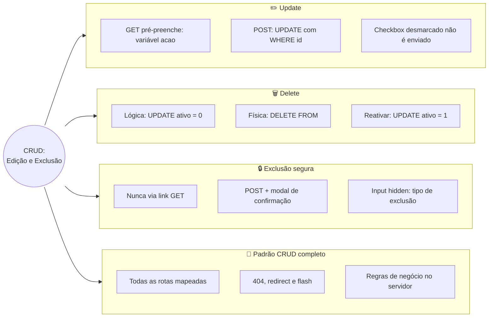
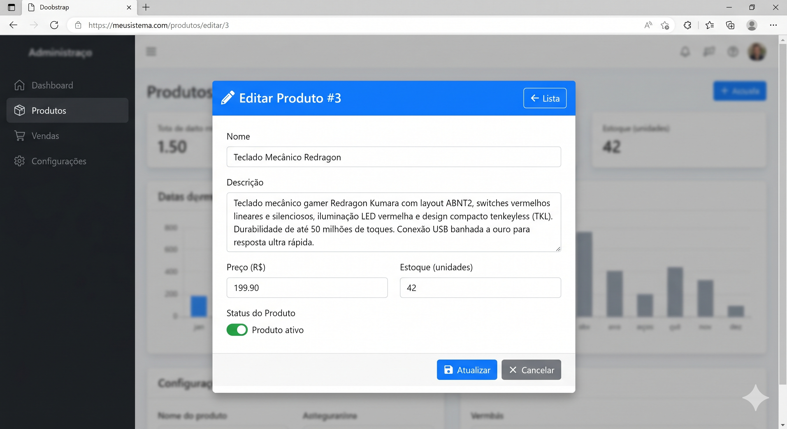
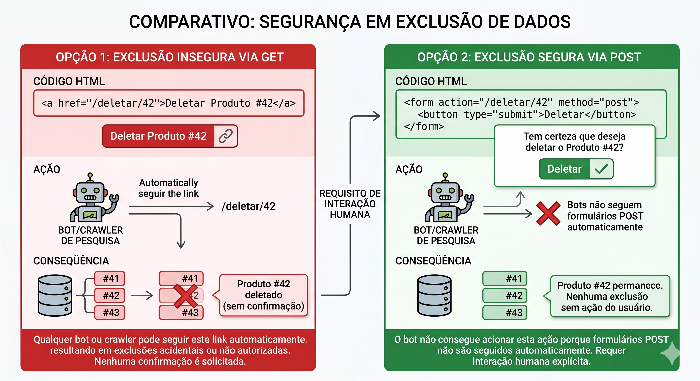
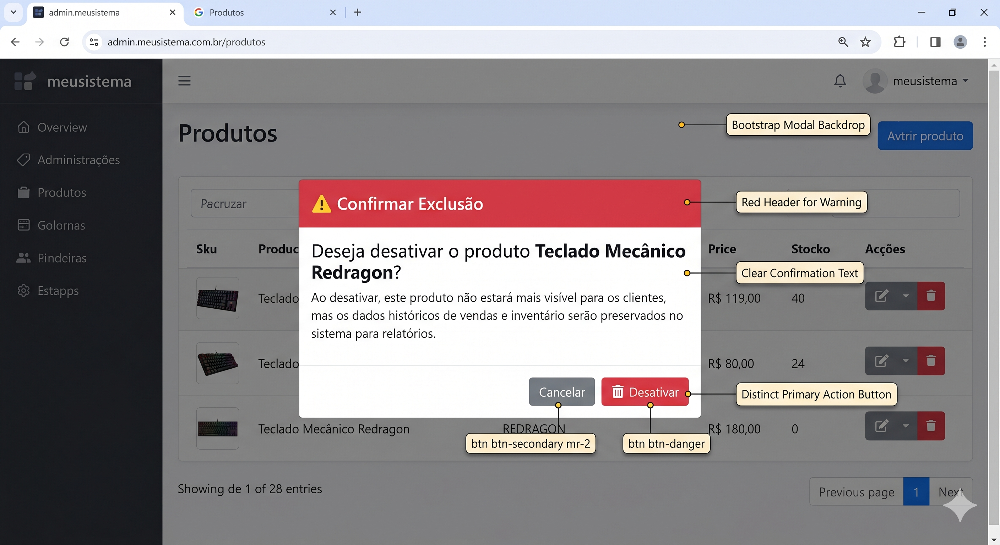
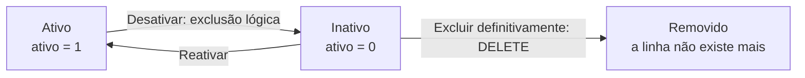

# Tópico 08 — CRUD: Edição e Exclusão

**Disciplina:** Programação para Internet (ILP951)
**Professor:** Ronan Adriel Zenatti · ronan.zenatti@cps.sp.gov.br
**Fatec Jahu — 2º Semestre/2026**

> **Pré-requisitos:** Tópico 07 concluído — cadastro (`/produtos/novo`), listagem com filtros, página de detalhe e a função `execute_insert` funcionando.

---

## 🎯 Objetivos do Tópico

Ao final deste tópico você deverá ser capaz de:

- Reaproveitar o formulário de cadastro para a edição, controlando o modo de uso com uma variável (`acao`) no template.
- Implementar o **Update** em duas etapas: `GET` pré-preenche o formulário e `POST` valida e executa o `UPDATE` com `WHERE id`.
- Extrair a validação para uma função reutilizável e tratar corretamente o campo `checkbox` (que não é enviado quando desmarcado).
- Explicar por que `rowcount` não serve para saber se um registro existe, e checar a existência antes de alterar.
- Diferenciar **exclusão lógica** (desativar) de **exclusão física** (`DELETE`) e escolher a adequada a cada situação.
- Explicar por que uma exclusão nunca pode ser um link `GET` e implementá-la com rota `POST`, janela de confirmação do Bootstrap e `input hidden`.
- Revisar um CRUD completo com um checklist de segurança: placeholders, lista de valores permitidos, `404`, PRG e regras de negócio no servidor.

No tópico anterior você construiu o **C** e o **R**. Faltam as duas operações mais delicadas: **atualizar** e **excluir**, justamente as que podem estragar dados de verdade. Um `UPDATE` sem `WHERE` altera a tabela inteira; um `DELETE` apaga sem volta; um link malfeito pode ser acionado por um robô de busca sem que ninguém clique em nada. Por isso, hoje o foco não é só "fazer funcionar": é fazer funcionar **com segurança**. Ao final, o módulo de produtos do seu sistema terá o CRUD completo.

---

## 🗺️ Mapa Mental do Tópico



---

## Parte 1 — Update (1): o formulário de edição

### Editar é cadastrar... com os dados já preenchidos

Pense no que o usuário vê ao clicar em "Editar": o **mesmo formulário** do cadastro, só que com os campos já cheios com os valores atuais. Seria um desperdício escrever um segundo template quase idêntico, e uma fonte de bugs: toda vez que um campo mudasse, você teria de lembrar de alterar dois arquivos. A solução é **um único template** (`produto_form.html`) que serve aos dois casos, e uma variável, `acao`, que diz ao template em qual modo ele está: `'criar'` ou `'editar'`.



O Update acontece em **duas requisições**, exatamente como o Create: um `GET` que mostra o formulário (agora preenchido) e um `POST` que recebe as alterações. Nesta parte construímos o `GET`; o `POST` fica para a Parte 2.

### Passo 1 — a rota de edição, só com GET

Acrescente ao `app.py`. Ela busca o produto pelo `id` da URL, responde `404` se ele não existir (padrão da Parte 5 do Tópico 07) e mostra o formulário com os dados do banco:

```python
@app.route('/produtos/<int:produto_id>/editar')
def produto_editar(produto_id):
    produto = execute_one('SELECT * FROM produto WHERE id = %s', (produto_id,))
    if produto is None:
        abort(404)
    return render_template('produto_form.html', produto=produto, categorias=CATEGORIAS)
```

Salve e acesse `http://localhost:5000/produtos/1/editar`. O formulário aparece com os dados do produto 1... mas o título ainda diz "Novo Produto", e o botão envia para a rota de cadastro. É o que vamos corrigir. O reaproveitamento já mostra a sua vantagem: o campo Descrição aparece **vazio** (e não com a palavra "None") para um produto cuja descrição é `NULL`, graças ao `default('', true)` que você usou no tópico anterior.

### Passo 2 — a variável `acao`

Cada chamada a `render_template('produto_form.html', ...)` passa a informar o modo. Na rota de edição:

```python
    return render_template('produto_form.html', acao='editar',
                           produto=produto, categorias=CATEGORIAS)
```

E, em `produto_novo`, acrescente `acao='criar'` às **três** chamadas ao `render_template` (a do `GET` e as duas de erro). Por exemplo, a do `GET`:

```python
    return render_template('produto_form.html', acao='criar',
                           produto={}, categorias=CATEGORIAS)
```

Ainda nada muda na tela: o template só passa a ter a informação. Os próximos passos a usam.

### Passo 3 — título e cabeçalho conforme o modo

No `produto_form.html`, troque o bloco de título e o cabeçalho do card para decidirem pelo valor de `acao`:

```html
{{ 'Editar Produto' if acao == 'editar' else 'Novo Produto' }} — Sistema de Gestão
```

```html
        <h4 class="mb-0">
          ✏️ Editar Produto #{{ produto.id }}📦 Novo Produto
        </h4>
```

Salve e compare `/produtos/novo` com `/produtos/1/editar`: o mesmo arquivo, dois cabeçalhos diferentes. A expressão `'A' if condição else 'B'` é o `if` em uma linha do Jinja2, ideal para trocar um texto curto.

### Passo 4 — para onde o formulário envia

Falta o mais importante: o `action` do `<form>`. Na criação ele aponta para `produto_novo`; na edição, para `produto_editar`, **com o `id` do produto**. No início do ``, defina uma variável com `` e use-a no formulário:

```html

{# Para onde o formulário envia os dados: depende de estarmos criando ou editando #}

```

```html
        <form action="{{ destino }}" method="post">
```

Repare que o Jinja2 só avalia o ramo escolhido: no modo `'criar'`, `produto.id` não existe, mas o `url_for` da edição nem chega a ser executado. Salve, abra `/produtos/1/editar`, clique em **Salvar produto** e observe o resultado: o navegador mostra **405 Method Not Allowed**. A URL de destino está correta, mas a rota `produto_editar` ainda só aceita `GET`. Exatamente o erro que você estudou no Tópico 04, e a deixa para a Parte 2.

### Passo 5 — o interruptor de status e o rótulo do botão

Na edição, o usuário também precisa poder ativar ou desativar o produto. Esse campo não faz sentido no cadastro (todo produto novo nasce ativo), então ele só aparece no modo `'editar'`. Acrescente, entre a linha de preço/estoque/categoria e os botões:

```html
          {# O interruptor de status só faz sentido na edição #}
          
          <div class="form-check form-switch mb-3">
            <input class="form-check-input" type="checkbox" role="switch"
                   id="ativo" name="ativo" value="1"
                   checked>
            <label class="form-check-label" for="ativo">Produto ativo</label>
          </div>
          
```

E ajuste o rótulo do botão de envio:

```html
            <button type="submit" class="btn btn-primary">
              {{ '✔ Salvar alterações' if acao == 'editar' else '✔ Salvar produto' }}
            </button>
```

Salve e recarregue a edição: o interruptor aparece ligado para produtos ativos, e o botão diz "Salvar alterações". No cadastro, nenhum dos dois muda.

### Passo 6 — os links de acesso à edição

Para chegar ao formulário sem digitar a URL, acrescente um botão **Editar** na coluna *Ações* da lista (`produtos.html`), ao lado do botão **Ver**:

```html
            <a href="{{ url_for('produto_editar', produto_id=produto.id) }}"
               class="btn btn-sm btn-outline-secondary">✏️ Editar</a>
```

E no cabeçalho do card do `produto_detalhe.html`, ao lado do "Voltar à lista":

```html
          <a href="{{ url_for('produto_editar', produto_id=produto.id) }}"
             class="btn btn-outline-secondary btn-sm">✏️ Editar</a>
```

Salve e navegue: lista → Editar → formulário preenchido; detalhe → Editar → o mesmo.

**Consolidação — `templates/produto_form.html` completo, nos dois modos:**

```html

{{ 'Editar Produto' if acao == 'editar' else 'Novo Produto' }} — Sistema de Gestão


{# Para onde o formulário envia os dados: depende de estarmos criando ou editando #}


<div class="row justify-content-center">
  <div class="col-lg-8">
    <div class="card shadow-sm">
      <div class="card-header bg-primary text-white d-flex justify-content-between align-items-center">
        <h4 class="mb-0">
          ✏️ Editar Produto #{{ produto.id }}📦 Novo Produto
        </h4>
        <a href="{{ url_for('lista_produtos') }}" class="btn btn-light btn-sm">← Voltar à lista</a>
      </div>
      <div class="card-body">
        <form action="{{ destino }}" method="post">

          <div class="mb-3">
            <label for="nome" class="form-label">Nome <span class="text-danger">*</span></label>
            <input type="text" class="form-control" id="nome" name="nome"
                   maxlength="200" placeholder="Ex.: Notebook Dell Inspiron" required
                   value="{{ produto.nome | default('') }}">
          </div>

          <div class="mb-3">
            <label for="descricao" class="form-label">Descrição</label>
            <textarea class="form-control" id="descricao" name="descricao"
                      rows="3">{{ produto.descricao | default('', true) }}</textarea>
          </div>

          <div class="row">
            <div class="col-md-4 mb-3">
              <label for="preco" class="form-label">Preço <span class="text-danger">*</span></label>
              <div class="input-group">
                <span class="input-group-text">R$</span>
                <input type="number" class="form-control" id="preco" name="preco"
                       step="0.01" min="0.01" placeholder="0,00" required
                       value="{{ produto.preco | default('') }}">
              </div>
            </div>
            <div class="col-md-4 mb-3">
              <label for="estoque" class="form-label">Estoque <span class="text-danger">*</span></label>
              <input type="number" class="form-control" id="estoque" name="estoque"
                     min="0" step="1" required
                     value="{{ produto.estoque | default(0) }}">
            </div>
            <div class="col-md-4 mb-3">
              <label for="categoria" class="form-label">Categoria <span class="text-danger">*</span></label>
              <select class="form-select" id="categoria" name="categoria" required>
                <option value="">-- Selecione --</option>
                
                  <option value="{{ c }}" selected>{{ c }}</option>
                
              </select>
            </div>
          </div>

          {# O interruptor de status só faz sentido na edição #}
          
          <div class="form-check form-switch mb-3">
            <input class="form-check-input" type="checkbox" role="switch"
                   id="ativo" name="ativo" value="1"
                   checked>
            <label class="form-check-label" for="ativo">Produto ativo</label>
          </div>
          

          <div class="d-flex gap-2">
            <button type="submit" class="btn btn-primary">
              {{ '✔ Salvar alterações' if acao == 'editar' else '✔ Salvar produto' }}
            </button>
            <a href="{{ url_for('lista_produtos') }}" class="btn btn-outline-secondary">✖ Cancelar</a>
          </div>

        </form>
      </div>
    </div>
  </div>
</div>

```

### 🔎 Verifique seu Entendimento

Uma empresa de patinetes elétricos compartilhados tem a tabela `patinete` (`id`, `codigo`, `modelo`, `bateria_pct`, `ativo`) e um formulário `patinete_form.html` que já serve ao cadastro. Agora o time precisa editar patinetes.

**Desafio:** Escreva a rota `GET` `/patinetes/<int:patinete_id>/editar`, que busca o patinete, responde `404` se ele não existir e renderiza o formulário com `acao='editar'`; e escreva o trecho do template que pré-preenche o campo `modelo` e o interruptor `ativo` (só visível na edição).

> 💬 Tente por conta própria antes de seguir. A solução comentada está no gabarito deste tópico (link na última seção da página).

---

## Parte 2 — Update (2): validar e executar o UPDATE

### Passo 1 — a validação vira uma função

A rota de edição precisa validar exatamente os mesmos campos da de cadastro. Copiar as 40 linhas de validação para uma segunda rota seria repetir código e semear bugs (corrigir uma regra em um lugar e esquecer o outro). A saída é mover a validação para **uma função** que as duas rotas chamam. Acrescente ao `app.py`, antes das rotas:

```python
def validar_produto(form):
    """
    Valida e converte os campos do formulário de produto.

    Retorna (dados, erros):
        dados — dict com os valores do formulário; preco vira Decimal e estoque vira int
                quando válidos. Se inválidos, mantém o texto digitado, para repopular o form.
        erros — lista de mensagens de erro (vazia quando tudo está válido).
    """
    nome        = form.get('nome', '').strip()
    descricao   = form.get('descricao', '').strip()
    preco_txt   = form.get('preco', '').strip()
    estoque_txt = form.get('estoque', '').strip()
    categoria   = form.get('categoria', '')

    erros = []

    if not nome:
        erros.append('O nome é obrigatório.')
    elif len(nome) < 3:
        erros.append('O nome deve ter pelo menos 3 caracteres.')
    elif len(nome) > 200:
        erros.append('O nome pode ter no máximo 200 caracteres.')

    preco = preco_txt
    try:
        valor = Decimal(preco_txt.replace(',', '.'))
    except InvalidOperation:
        erros.append('Informe um preço válido, por exemplo 199.90.')
    else:
        if not valor.is_finite() or valor <= 0:
            erros.append('O preço deve ser um número maior que zero.')
        elif valor > Decimal('99999999.99'):
            erros.append('O preço máximo permitido é 99999999.99.')
        else:
            preco = valor.quantize(Decimal('0.01'))

    estoque = estoque_txt
    try:
        valor_estoque = int(estoque_txt)
    except ValueError:
        erros.append('O estoque deve ser um número inteiro.')
    else:
        if valor_estoque < 0:
            erros.append('O estoque não pode ser negativo.')
        elif valor_estoque > 1000000:
            erros.append('O estoque máximo permitido é 1.000.000.')
        else:
            estoque = valor_estoque

    if categoria not in CATEGORIAS:
        erros.append('Selecione uma categoria válida.')

    dados = {'nome': nome, 'descricao': descricao, 'preco': preco,
             'estoque': estoque, 'categoria': categoria}
    return dados, erros
```

Todo o conteúdo é o código que você já escreveu na Parte 2 do tópico anterior, apenas **movido**. A função recebe `request.form` e devolve duas coisas: os `dados` (já convertidos quando válidos) e a lista de `erros`.

### Passo 2 — `produto_novo` fica muito menor

Agora a rota de cadastro **usa** a função. Substitua o corpo inteiro de `produto_novo` por esta versão e compare o tamanho com a anterior:

```python
@app.route('/produtos/novo', methods=['GET', 'POST'])
def produto_novo():

    if request.method == 'POST':
        dados, erros = validar_produto(request.form)

        if erros:
            for erro in erros:
                flash(erro, 'danger')
            return render_template('produto_form.html', acao='criar',
                                   produto=dados, categorias=CATEGORIAS)

        try:
            novo_id = execute_insert(
                'INSERT INTO produto (nome, descricao, preco, estoque, categoria) '
                'VALUES (%s, %s, %s, %s, %s)',
                (dados['nome'], dados['descricao'] or None, dados['preco'],
                 dados['estoque'], dados['categoria'])
            )
        except Exception as e:
            flash(f'Não foi possível salvar o produto: {e}', 'danger')
            return render_template('produto_form.html', acao='criar',
                                   produto=dados, categorias=CATEGORIAS)

        flash(f'Produto "{dados["nome"]}" cadastrado com sucesso (código #{novo_id}).', 'success')
        return redirect(url_for('lista_produtos'))

    return render_template('produto_form.html', acao='criar',
                           produto={}, categorias=CATEGORIAS)
```

**Salve e teste antes de seguir.** Um refatoramento só é seguro se o comportamento continua igual: cadastre um produto válido e depois um inválido (nome vazio). Tudo deve funcionar exatamente como antes. Se algo quebrou, o problema está na cópia que você acabou de fazer, e é muito mais fácil achá-lo agora do que depois de escrever mais código em cima.

### Passo 3 — a rota de edição aceita POST

Agora o `POST` da edição. Acrescente `'POST'` à lista de métodos e, no início da função, a checagem de existência. Esta parte merece uma explicação, logo depois do código:

```python
@app.route('/produtos/<int:produto_id>/editar', methods=['GET', 'POST'])
def produto_editar(produto_id):

    # Existe? Sem esta checagem, um id inexistente "atualizaria" zero linhas em silêncio
    atual = execute_one('SELECT * FROM produto WHERE id = %s', (produto_id,))
    if atual is None:
        abort(404)

    if request.method == 'POST':
        pass   # será preenchido nos próximos passos

    # Método GET: exibe o formulário já preenchido com os dados atuais
    return render_template('produto_form.html', acao='editar',
                           produto=atual, categorias=CATEGORIAS)
```

Por que o `SELECT` **antes** do `UPDATE`, e não simplesmente executar o `UPDATE` e conferir `rowcount`? Faça o teste no terminal para ver com os próprios olhos:

```
python -c "from db import execute_query; print(execute_query('UPDATE produto SET estoque = estoque WHERE id = 1')); print(execute_query('UPDATE produto SET estoque = estoque WHERE id = 99999'))"
```

As duas linhas imprimem `0`. O MySQL conta as linhas **efetivamente modificadas**: um `UPDATE` que grava os mesmos valores que já estavam lá (primeira linha) modifica zero linhas, exatamente como um `UPDATE` de um `id` que não existe (segunda linha). Se usássemos `rowcount == 0` como "não encontrei", um usuário que clicasse em **Salvar** sem mudar nada receberia um erro falso. Por isso a existência é verificada por um `SELECT`, e o `rowcount` não é usado para decidir isso.

### Passo 4 — validar e preparar os dados do POST

Substitua o `pass` pela validação e pelo tratamento do interruptor:

```python
    if request.method == 'POST':
        dados, erros = validar_produto(request.form)
        dados['id']    = produto_id
        dados['ativo'] = 1 if request.form.get('ativo') else 0   # checkbox desmarcado não é enviado

        if erros:
            for erro in erros:
                flash(erro, 'danger')
            return render_template('produto_form.html', acao='editar',
                                   produto=dados, categorias=CATEGORIAS)
```

Dois detalhes que costumam gerar bugs:

- **O `id` volta para `dados`.** Se a validação falhar, o formulário é renderizado de novo com `produto=dados`, e o template precisa de `produto.id` para montar o título e o `action`. Sem essa linha, o formulário de erro quebraria.
- **Checkbox desmarcado não é enviado.** Diferente de um campo de texto vazio (que chega como `''`), um `checkbox` desmarcado simplesmente **não aparece** em `request.form`, e `.get('ativo')` devolve `None`. Quando marcado, chega o `value="1"` que definimos. Por isso a conversão `1 if request.form.get('ativo') else 0`.

Salve e teste só a validação: abra a edição de um produto, apague o nome e envie (remova o `required` pelo DevTools). Você deve ver o alerta vermelho e o formulário de edição de volta, **ainda no modo de edição** e com os campos preservados.

### Passo 5 — o UPDATE, com o WHERE que não pode faltar

Complete o `POST`, logo depois do bloco `if erros:`:

```python
        try:
            execute_query(
                'UPDATE produto '
                'SET nome = %s, descricao = %s, preco = %s, estoque = %s, '
                '    categoria = %s, ativo = %s '
                'WHERE id = %s',
                (dados['nome'], dados['descricao'] or None, dados['preco'],
                 dados['estoque'], dados['categoria'], dados['ativo'], produto_id)
            )
        except Exception as e:
            flash(f'Não foi possível atualizar o produto: {e}', 'danger')
            return render_template('produto_form.html', acao='editar',
                                   produto=dados, categorias=CATEGORIAS)

        flash(f'Produto "{dados["nome"]}" atualizado com sucesso.', 'success')
        return redirect(url_for('produto_detalhe', produto_id=produto_id))
```

Olhe com atenção a última linha da consulta: **`WHERE id = %s`**. É ela que restringe a alteração ao produto certo. Lembre do aviso do Tópico 05: sem o `WHERE`, o `UPDATE` altera **todas** as linhas da tabela, e todo produto da loja passaria a ter o mesmo nome e o mesmo preço. O `id` vem da **URL** (`produto_id`, já convertido para `int` pelo Flask), e não de um campo do formulário que o usuário poderia adulterar. O restante segue o que você já sabe: valores em placeholders, `commit` dentro do `execute_query`, PRG com `redirect` e flash.

Salve e faça os testes, nesta ordem:

1. Edite o preço de um produto e salve: você vai para a página de detalhe, com o alerta verde e o novo valor.
2. Abra a edição e clique em **Salvar alterações** **sem mudar nada**: deve dar sucesso (e não erro) — a prova de que a checagem de existência funciona.
3. Na edição, **desligue o interruptor** "Produto ativo" e salve. Volte à lista: o produto sumiu (a lista padrão mostra só os ativos). Escolha o status **Inativos** no filtro e ele reaparece. Religue o interruptor para ativá-lo de novo.
4. Acesse `/produtos/99999/editar`: página `404`.
5. No Workbench, confirme com `SELECT * FROM produto;` que **só** o produto editado mudou.

**Consolidação — a rota `produto_editar` completa:**

```python
@app.route('/produtos/<int:produto_id>/editar', methods=['GET', 'POST'])
def produto_editar(produto_id):

    # Existe? Sem esta checagem, um id inexistente "atualizaria" zero linhas em silêncio
    atual = execute_one('SELECT * FROM produto WHERE id = %s', (produto_id,))
    if atual is None:
        abort(404)

    if request.method == 'POST':
        dados, erros = validar_produto(request.form)
        dados['id']    = produto_id
        dados['ativo'] = 1 if request.form.get('ativo') else 0   # checkbox desmarcado não é enviado

        if erros:
            for erro in erros:
                flash(erro, 'danger')
            return render_template('produto_form.html', acao='editar',
                                   produto=dados, categorias=CATEGORIAS)

        try:
            execute_query(
                'UPDATE produto '
                'SET nome = %s, descricao = %s, preco = %s, estoque = %s, '
                '    categoria = %s, ativo = %s '
                'WHERE id = %s',
                (dados['nome'], dados['descricao'] or None, dados['preco'],
                 dados['estoque'], dados['categoria'], dados['ativo'], produto_id)
            )
        except Exception as e:
            flash(f'Não foi possível atualizar o produto: {e}', 'danger')
            return render_template('produto_form.html', acao='editar',
                                   produto=dados, categorias=CATEGORIAS)

        flash(f'Produto "{dados["nome"]}" atualizado com sucesso.', 'success')
        return redirect(url_for('produto_detalhe', produto_id=produto_id))

    # Método GET: exibe o formulário já preenchido com os dados atuais
    return render_template('produto_form.html', acao='editar',
                           produto=atual, categorias=CATEGORIAS)
```

### 🔎 Verifique seu Entendimento

Uma plataforma de ingressos para shows de 2026 tem a tabela `evento` (`id`, `nome`, `lotacao`, `esgotado`). A organização precisa corrigir a lotação de um evento e marcar/desmarcar o aviso de "esgotado" (um `checkbox`).

**Desafio:** Escreva a parte `POST` da rota `/eventos/<int:evento_id>/editar`, que valida a lotação (inteiro maior ou igual a 1), converte o `checkbox` `esgotado` para `0` ou `1` e executa o `UPDATE` parametrizado de `lotacao` e `esgotado` com `WHERE id`. Explique também por que a existência do evento deve ser checada com um `SELECT` antes, e não com `rowcount`.

> 💬 Tente por conta própria antes de seguir. A solução comentada está no gabarito deste tópico (link na última seção da página).

---

## Parte 3 — Delete (1): excluir de verdade ou só desativar?

### Duas formas de "tirar" um registro

Antes de escrever uma única linha de código de exclusão, há uma decisão de projeto: **o registro realmente precisa deixar de existir?** Existem duas respostas, e cada uma tem um comando SQL:

| | Exclusão **lógica** | Exclusão **física** |
|---|---|---|
| **O que faz** | Marca o registro como inativo (`ativo = 0`); ele continua no banco | Remove a linha da tabela de vez |
| **Comando SQL** | `UPDATE produto SET ativo = 0 WHERE id = ?` | `DELETE FROM produto WHERE id = ?` |
| **Dá para desfazer?** | ✅ Sim (`UPDATE ... SET ativo = 1`) | ❌ Não |
| **Preserva o histórico?** | ✅ Sim: pedidos e relatórios antigos continuam apontando para o registro | ❌ Não |
| **A lista precisa filtrar?** | Sim: `WHERE ativo = 1` (já fazemos isso) | Não |
| **Bom para** | Dados com histórico: produtos vendidos, clientes, contas | Lixo: cadastros de teste, duplicados, registros criados por engano |

A coluna `ativo`, que desde o Tópico 05 parecia um detalhe, existe justamente para a exclusão lógica. Na prática, é a mais usada em sistemas reais: um produto que deixou de ser vendido **não pode sumir** dos pedidos antigos, senão o relatório do ano passado quebra. Um registro cadastrado por engano, por outro lado, só atrapalha, e pode ser apagado de vez.

> ⚖️ **Atenção a dados pessoais.** Quando o registro descreve uma **pessoa** (um cliente, um usuário), a LGPD garante ao titular o direito de pedir a eliminação dos seus dados. Nesse caso, desativar (que mantém os dados guardados) pode não bastar. A escolha entre lógica e física é uma **decisão de negócio** e, às vezes, jurídica, e não só técnica.

### Pratique no Workbench antes de programar

Como você viu no Tópico 05, `UPDATE` e `DELETE` merecem ensaio fora do código. Cadastre pelo formulário um produto de teste chamado "Produto de Teste" e anote o `id` dele. Depois, no Workbench (troque `X` pelo `id`):

```sql
-- Exclusão LÓGICA: o registro continua lá, só deixa de estar ativo
UPDATE produto SET ativo = 0 WHERE id = X;
SELECT id, nome, ativo FROM produto WHERE id = X;
```

Recarregue a lista no navegador: o produto some (a lista padrão mostra só os ativos). Escolha **Inativos** e ele aparece. Agora desfaça:

```sql
-- Reativar: a exclusão lógica é reversível
UPDATE produto SET ativo = 1 WHERE id = X;
```

Recarregue: ele volta. Por fim, a exclusão **física**:

```sql
-- Exclusão FÍSICA: a linha deixa de existir. Não há "desfazer"
DELETE FROM produto WHERE id = X;
SELECT id, nome, ativo FROM produto WHERE id = X;
```

O `SELECT` volta vazio: o registro não existe mais em lugar nenhum. Cadastre outro produto de teste e olhe o `id` gerado: ele é **maior** que o do produto apagado. O `AUTO_INCREMENT` nunca reaproveita números, então um `id` apagado fica vazio para sempre.

Repare também no `WHERE id = X` em **todos** os comandos. O `DELETE` sem `WHERE` apaga **todas** as linhas da tabela. É por isso que a barreira de segurança do Workbench (*Safe Updates*) que você encontrou no tópico anterior existe, e é uma boa prática mantê-la ligada.

### 🔎 Verifique seu Entendimento

A cooperativa de coleta seletiva do Tópico 07 quer remover o ponto de coleta de id `7`, que fechou, mas que tem dois anos de pesagens registradas e aparece em relatórios de volume coletado. Também quer remover o ponto de id `99`, cadastrado por engano ontem e sem nenhuma pesagem.

**Desafio:** Escreva o comando SQL adequado para cada um dos dois pontos e justifique em uma frase por que o tipo de exclusão escolhido é diferente em cada caso.

> 💬 Tente por conta própria antes de seguir. A solução comentada está no gabarito deste tópico (link na última seção da página).

---

## Parte 4 — Delete (2): excluir com segurança

### Por que excluir NUNCA pode ser um link

A forma mais simples de implementar uma exclusão seria um link na tabela: `<a href="/produtos/42/excluir">Excluir</a>`, com uma rota `GET` que apaga o registro. **Isso é uma falha de segurança séria**, e o motivo vem direto do Tópico 04: o método `GET` existe para **consultar**, e o mundo da web inteira parte do princípio de que um `GET` é **seguro**, ou seja, não altera nada. Por isso, vários programas fazem `GET` por conta própria, sem que ninguém clique em nada:

- **Robôs de busca e rastreadores** seguem todos os links de uma página para indexá-la.
- Navegadores e extensões fazem **pré-carregamento** (*prefetch*) de links para acelerar a navegação.
- Aplicativos de mensagem geram **pré-visualização** de qualquer link colado em uma conversa.

Se a exclusão for um link `GET`, qualquer um desses robôs pode **apagar produtos** apenas por passar pela página. Uma exclusão exige um clique humano **deliberado**, e a forma de garantir isso é usar o método `POST`, que formulários só enviam quando o usuário aciona um botão.



```python
# ❌ NUNCA faça assim: o GET apaga dados
@app.route('/produtos/<int:produto_id>/excluir')
def produto_excluir(produto_id):
    execute_query('DELETE FROM produto WHERE id = %s', (produto_id,))
    ...

# ✅ Sempre assim: só aceita POST
@app.route('/produtos/<int:produto_id>/excluir', methods=['POST'])
def produto_excluir(produto_id):
    ...
```

### Passo 1 — a rota que só aceita POST (exclusão lógica)

Comece pela versão mais simples e segura: uma rota que **só aceita `POST`** e faz a exclusão lógica. Acrescente ao `app.py`:

```python
@app.route('/produtos/<int:produto_id>/excluir', methods=['POST'])
def produto_excluir(produto_id):

    produto = execute_one('SELECT id, nome FROM produto WHERE id = %s', (produto_id,))
    if produto is None:
        abort(404)

    try:
        execute_query('UPDATE produto SET ativo = 0 WHERE id = %s', (produto_id,))
        flash(f'Produto "{produto["nome"]}" desativado. Você pode reativá-lo depois.', 'warning')
    except Exception as e:
        flash(f'Não foi possível concluir a operação: {e}', 'danger')

    return redirect(url_for('lista_produtos'))
```

Salve e faça o primeiro teste: digite `http://localhost:5000/produtos/1/excluir` direto na barra de endereços e tecle Enter. O navegador faz um `GET`, e a resposta é **405 Method Not Allowed**. A rota simplesmente recusa quem não veio por um `POST`: o robô de busca, o *prefetch* e a pré-visualização esbarram aqui. (O `methods=['POST']` é o que faz isso: lembra que, sem ele, uma rota Flask aceita só `GET`.)

### Passo 2 — o botão em um formulário POST

Para o usuário acionar a rota, a coluna *Ações* da lista ganha um **formulário** com um único botão, e não um link. Acrescente ao lado do botão **Editar**, dentro da célula de ações:

```html
            <form action="{{ url_for('produto_excluir', produto_id=produto.id) }}"
                  method="post" class="d-inline">
              <button type="submit" class="btn btn-sm btn-outline-danger">🗑 Desativar</button>
            </form>
```

O `class="d-inline"` mantém o formulário na mesma linha dos outros botões. Cadastre um "Produto de Teste", clique em **Desativar** na linha dele e veja: o produto some da lista, com o alerta amarelo. Funciona... mas note o problema: **um clique sem querer** já desativa o produto. Não há como se arrepender. Falta uma etapa de confirmação.

### Passo 3 — o modal de confirmação do Bootstrap

O Bootstrap tem um componente pronto para isso: o **modal**, uma janela que aparece por cima da página e pede uma confirmação. Em vez de repetir um modal para cada linha da tabela (50 produtos, 50 modais!), usaremos **um único** modal, reaproveitado, que o JavaScript preenche com os dados do produto clicado.



**3a — o HTML do modal.** No final do `` do `produtos.html`, antes do ``:

```html
  {# ===== MODAL DE CONFIRMAÇÃO: um só, reaproveitado por todas as linhas ===== #}
  <div class="modal fade" id="modalExcluir" tabindex="-1" aria-labelledby="modalExcluirTitulo" aria-hidden="true">
    <div class="modal-dialog modal-dialog-centered">
      <div class="modal-content">
        <div class="modal-header bg-danger text-white">
          <h5 class="modal-title" id="modalExcluirTitulo">⚠️ Confirmar</h5>
          <button type="button" class="btn-close btn-close-white"
                  data-bs-dismiss="modal" aria-label="Fechar"></button>
        </div>

        {# O action deste formulário é preenchido pelo JavaScript ao abrir o modal #}
        <form id="formExcluir" method="post" action="">
          <div class="modal-body">
            <p id="modalExcluirTexto" class="mb-0"></p>
          </div>
          <div class="modal-footer">
            <button type="button" class="btn btn-secondary" data-bs-dismiss="modal">Cancelar</button>
            <button type="submit" class="btn btn-danger" id="modalExcluirConfirmar">Confirmar</button>
          </div>
        </form>
      </div>
    </div>
  </div>
```

O formulário do modal começa com `action=""`: o endereço certo depende do produto clicado, e só será conhecido na hora. Os dois botões do rodapé são o ponto da confirmação: **Cancelar** (`data-bs-dismiss="modal"`) apenas fecha a janela; **Confirmar** (`type="submit"`) é o único que envia o `POST`.

**3b — o botão da linha abre o modal.** Substitua o formulário do Passo 2 por um botão comum, que **não** envia nada: ele só abre o modal e carrega, em atributos `data-*`, as informações do produto daquela linha:

```html
            <button type="button" class="btn btn-sm btn-outline-danger"
                    data-bs-toggle="modal" data-bs-target="#modalExcluir"
                    data-url="{{ url_for('produto_excluir', produto_id=produto.id) }}"
                    data-nome="{{ produto.nome }}">🗑 Desativar</button>
```

Os atributos `data-bs-toggle` e `data-bs-target` são do Bootstrap: dizem "este botão abre o modal `#modalExcluir`". Os atributos `data-url` e `data-nome` são **nossos**: guardam a URL de exclusão e o nome daquele produto. Repare que o produto *Monitor LG 24"* tem aspas no nome: o Jinja2 escapa o conteúdo automaticamente dentro do atributo, então isso não quebra o HTML.

**3c — o JavaScript que preenche o modal.** O `base.html` já tem um `` (Tópico 03), criado exatamente para isso. No final do `produtos.html`, depois do `` do conteúdo:

```html

<script>
  const modalExcluir = document.getElementById('modalExcluir');

  // O Bootstrap dispara 'show.bs.modal' um instante antes de abrir o modal.
  // event.relatedTarget é o botão que provocou a abertura.
  modalExcluir.addEventListener('show.bs.modal', function (event) {
    const botao = event.relatedTarget;

    // Aponta o formulário para a rota do produto clicado
    document.getElementById('formExcluir').action = botao.dataset.url;

    // textContent (e não innerHTML): o nome veio do banco e nunca deve ser lido como HTML
    document.getElementById('modalExcluirTitulo').textContent = '⚠️ Desativar produto';
    document.getElementById('modalExcluirTexto').textContent =
      'Desativar "' + botao.dataset.nome + '"? Ele sai da lista de ativos, mas o histórico é preservado e você pode reativá-lo depois.';
    document.getElementById('modalExcluirConfirmar').textContent = 'Desativar';
  });
</script>

```

Salve, recarregue a lista e clique em **Desativar** em uma linha: a janela aparece com o **nome do produto clicado**. Clique em **Cancelar**: nada acontece. Clique em outra linha: o texto muda para o produto dessa linha, porque o mesmo modal foi reaproveitado. Só o botão **Desativar** do modal envia o `POST`.

> 🛡️ **Por que `textContent` e não `innerHTML`?** O nome do produto veio de um campo de formulário: alguém poderia cadastrar um produto chamado ``. Com `innerHTML`, o navegador interpretaria isso como HTML e executaria o código (uma falha chamada XSS). Com `textContent`, o valor é tratado só como **texto** e aparece literalmente. É o mesmo princípio dos placeholders `%s` no SQL: dado de usuário nunca vira código.

### Passo 4 — exclusão física e reativação, com um `input hidden`

Até aqui, o botão só faz a exclusão lógica. Queremos também a física, mas com uma **regra de negócio**: só se apaga de vez o que **já foi desativado**, como uma lixeira. Produtos ativos só podem ser desativados; produtos inativos podem ser **reativados** ou **excluídos definitivamente**.

A rota precisa saber qual das duas exclusões foi pedida. O modal enviará essa informação em um campo `hidden`, um `<input>` invisível que carrega um valor no `POST` sem aparecer na tela. No formulário do modal, dentro do `modal-body`, acrescente:

```html
            {# Informa à rota se a exclusão é lógica ou física #}
            <input type="hidden" name="tipo" id="modalExcluirTipo" value="logica">
```

Cada botão da linha passa a carregar o seu tipo em um `data-tipo`. O produto **ativo** só tem o botão de desativar; o **inativo** ganha dois botões (e o de reativar, que é um formulário `POST` simples, sem necessidade de confirmação). Substitua o botão do Passo 3b por este bloco inteiro:

```html
            
              {# Produto ativo: só pode ser desativado (exclusão lógica) #}
              <button type="button" class="btn btn-sm btn-outline-danger"
                      data-bs-toggle="modal" data-bs-target="#modalExcluir"
                      data-url="{{ url_for('produto_excluir', produto_id=produto.id) }}"
                      data-nome="{{ produto.nome }}"
                      data-tipo="logica">🗑 Desativar</button>
            
              {# Produto inativo: pode ser reativado ou excluído de vez (exclusão física) #}
              <form action="{{ url_for('produto_reativar', produto_id=produto.id) }}"
                    method="post" class="d-inline">
                <button type="submit" class="btn btn-sm btn-outline-success">♻️ Reativar</button>
              </form>
              <button type="button" class="btn btn-sm btn-outline-danger"
                      data-bs-toggle="modal" data-bs-target="#modalExcluir"
                      data-url="{{ url_for('produto_excluir', produto_id=produto.id) }}"
                      data-nome="{{ produto.nome }}"
                      data-tipo="fisica">❌ Excluir</button>
            
```

O JavaScript passa a copiar o tipo para o `input hidden` e a trocar os textos conforme ele. Substitua o conteúdo da função do `addEventListener`:

```javascript
  modalExcluir.addEventListener('show.bs.modal', function (event) {
    const botao = event.relatedTarget;
    const nome  = botao.dataset.nome;
    const tipo  = botao.dataset.tipo;

    // Aponta o formulário para a rota do produto clicado e informa o tipo de exclusão
    document.getElementById('formExcluir').action = botao.dataset.url;
    document.getElementById('modalExcluirTipo').value = tipo;

    // textContent (e não innerHTML): o nome veio do banco e nunca deve ser lido como HTML
    if (tipo === 'fisica') {
      document.getElementById('modalExcluirTitulo').textContent = '⚠️ Excluir definitivamente';
      document.getElementById('modalExcluirTexto').textContent =
        'Excluir "' + nome + '" de forma definitiva? Esta ação não pode ser desfeita.';
      document.getElementById('modalExcluirConfirmar').textContent = 'Excluir definitivamente';
    } else {
      document.getElementById('modalExcluirTitulo').textContent = '⚠️ Desativar produto';
      document.getElementById('modalExcluirTexto').textContent =
        'Desativar "' + nome + '"? Ele sai da lista de ativos, mas o histórico é preservado e você pode reativá-lo depois.';
      document.getElementById('modalExcluirConfirmar').textContent = 'Desativar';
    }
  });
```

Agora, as rotas. A de exclusão passa a ler o `tipo` e a aplicar a regra de negócio **no servidor**. Substitua a `produto_excluir` do Passo 1 e acrescente a de reativação:

```python
@app.route('/produtos/<int:produto_id>/excluir', methods=['POST'])
def produto_excluir(produto_id):

    tipo = request.form.get('tipo', 'logica')
    if tipo not in ('logica', 'fisica'):
        abort(400)   # 400 Bad Request: o pedido veio malformado

    produto = execute_one('SELECT id, nome, ativo FROM produto WHERE id = %s', (produto_id,))
    if produto is None:
        abort(404)

    # Regra de negócio aplicada no servidor: só se apaga de vez o que já foi desativado
    if tipo == 'fisica' and produto['ativo']:
        flash('Desative o produto antes de excluí-lo definitivamente.', 'warning')
        return redirect(url_for('lista_produtos'))

    try:
        if tipo == 'fisica':
            execute_query('DELETE FROM produto WHERE id = %s', (produto_id,))
            flash(f'Produto "{produto["nome"]}" excluído definitivamente.', 'success')
            return redirect(url_for('lista_produtos', status='inativo'))

        execute_query('UPDATE produto SET ativo = 0 WHERE id = %s', (produto_id,))
        flash(f'Produto "{produto["nome"]}" desativado. Você pode reativá-lo depois.', 'warning')
    except Exception as e:
        flash(f'Não foi possível concluir a operação: {e}', 'danger')

    return redirect(url_for('lista_produtos'))


@app.route('/produtos/<int:produto_id>/reativar', methods=['POST'])
def produto_reativar(produto_id):

    produto = execute_one('SELECT id, nome FROM produto WHERE id = %s', (produto_id,))
    if produto is None:
        abort(404)

    try:
        execute_query('UPDATE produto SET ativo = 1 WHERE id = %s', (produto_id,))
        flash(f'Produto "{produto["nome"]}" reativado.', 'success')
    except Exception as e:
        flash(f'Não foi possível reativar o produto: {e}', 'danger')

    return redirect(url_for('lista_produtos'))
```

Três pontos de atenção:

- **A regra mora no servidor, não só na tela.** O botão **Excluir** só aparece para produtos inativos, mas isso é apenas conforto visual: qualquer pessoa pode montar um `POST` à mão com `tipo=fisica` para um produto ativo. Por isso a rota **confere de novo** (`if tipo == 'fisica' and produto['ativo']`). É a mesma ideia da validação de formulário do Tópico 04: nunca confie no cliente.
- **O `input hidden` também é adulterável.** Ele não aparece na tela, mas o usuário pode editá-lo pelo DevTools. É por isso que a rota só aceita os dois valores previstos (`logica` e `fisica`) e responde `400` a qualquer outro.
- **`url_for('lista_produtos', status='inativo')`**: argumentos extras de `url_for` que não existem na rota viram parâmetros da query string (`/produtos?status=inativo`). Depois de excluir definitivamente, o usuário volta à lista de inativos, onde estava.

Faça o teste completo com o seu "Produto de Teste": desative (modal vermelho de desativação) → filtre por **Inativos** → reative → desative de novo → em **Inativos**, clique em **Excluir** e confirme o modal de exclusão definitiva → o produto some para sempre. No Workbench, `SELECT * FROM produto WHERE nome = 'Produto de Teste';` volta vazio.

> ⚠️ **Um aviso honesto sobre segurança.** Usar `POST` resolve robôs e cliques acidentais, mas **não é uma proteção completa**. Um site mal-intencionado poderia fazer o navegador de um usuário logado enviar um `POST` ao nosso sistema sem que ele perceba (um ataque chamado **CSRF**). A defesa real é um **token** único por formulário, verificado pelo servidor. Como o nosso sistema ainda não tem login, esse risco ainda é teórico, mas passa a importar de verdade quando ele tiver. Guarde o nome: *CSRF token*.

### 🔎 Verifique seu Entendimento

Em um painel de créditos de uso de IA generativa, um desenvolvedor escreveu o link `<a href="/chaves/7/revogar">Revogar chave de API</a>` ao lado de cada chave, apontando para uma rota `GET` que revoga (apaga) a chave.

**Desafio:** Explique qual é o risco dessa implementação e reescreva-a: a rota `/chaves/<int:chave_id>/revogar`, que só aceita `POST`, responde `404` se a chave não existir e redireciona com uma flash; e o formulário com o botão que a aciona.

> 💬 Tente por conta própria antes de seguir. A solução comentada está no gabarito deste tópico (link na última seção da página).

---

## Parte 5 — O CRUD completo: revisão e checklist

### O mapa de rotas final

O recurso **produto** agora tem o CRUD inteiro. Compare com o mapa que desenhamos na Parte 1 do Tópico 07: todas as linhas estão preenchidas.

| Rota | Métodos | SQL executado | Resposta |
|---|---|---|---|
| `/produtos` | `GET` | `SELECT ... WHERE 1=1 ...` | Página (200) |
| `/produtos/novo` | `GET`, `POST` | `INSERT` | Formulário, ou redirect com flash |
| `/produtos/<id>` | `GET` | `SELECT ... WHERE id` | Página, ou 404 |
| `/produtos/<id>/editar` | `GET`, `POST` | `SELECT` e `UPDATE ... WHERE id` | Formulário, ou redirect com flash, ou 404 |
| `/produtos/<id>/excluir` | `POST` | `UPDATE ativo = 0` ou `DELETE ... WHERE id` | Redirect com flash, ou 400, ou 404 |
| `/produtos/<id>/reativar` | `POST` | `UPDATE ativo = 1 ... WHERE id` | Redirect com flash, ou 404 |

E o ciclo de vida de um produto, que resume as decisões da Parte 3 e da Parte 4:



### Checklist de segurança de um CRUD

Toda rota de um CRUD precisa passar por estas perguntas. Os itens vieram do Tópico 04 em diante, e agora aparecem juntos:

| Pergunta | Como o nosso CRUD responde |
|---|---|
| Os valores vão separados do SQL? | Placeholders `%s` em **todas** as consultas (`INSERT`, `UPDATE`, `DELETE`, `SELECT`) |
| E o que o SQL não aceita como parâmetro (ordenação)? | Lista de valores permitidos (`ORDENACOES`) |
| O registro existe? | `execute_one` + `abort(404)`; nunca `rowcount` |
| O `UPDATE`/`DELETE` está restrito a uma linha? | `WHERE id = %s`, com o `id` vindo da URL e convertido para `int` |
| Quem altera dados usa `POST`? | Sim: cadastro, edição, exclusão e reativação |
| Os dados foram validados no servidor? | `validar_produto` (tipos, limites e lista de categorias) |
| O fluxo termina com PRG e feedback? | `redirect` + `flash` depois de cada sucesso |
| As regras de negócio estão no servidor? | Física só para inativo; `tipo` só aceita `logica` e `fisica` |
| Dado do usuário é tratado como texto, nunca como código? | Jinja2 escapa o HTML; o JavaScript usa `textContent` |

### O `app.py` completo do módulo de produtos

Para consolidar, aqui está o `app.py` inteiro ao final do tópico, com todas as peças que você construiu nos Tópicos 07 e 08. Use-o para comparar com o seu e achar diferenças:

```python
from decimal import Decimal, InvalidOperation

from flask import Flask, render_template, request, redirect, url_for, flash, abort
from db import execute_query, execute_one, execute_insert

app = Flask(__name__)
app.secret_key = 'chave-secreta-fatec-2026'

# Categorias aceitas pelo sistema — fonte única para o formulário e para a validação
CATEGORIAS = ['Computadores', 'Periféricos', 'Áudio', 'Acessórios', 'Outros']

# Ordenações permitidas na listagem: a chave vem da URL, o valor é o SQL fixo
ORDENACOES = {
    'nome':       'nome ASC',
    'preco_asc':  'preco ASC',
    'preco_desc': 'preco DESC',
    'recentes':   'criado_em DESC',
    'estoque':    'estoque ASC',
}


@app.template_filter('moeda')
def formatar_moeda(valor):
    """Formata um número como moeda brasileira: 4500.5 -> R$ 4.500,50"""
    texto = f'{valor:,.2f}'                                   # 4,500.50 (padrão americano)
    texto = texto.replace(',', 'X').replace('.', ',').replace('X', '.')
    return f'R$ {texto}'


@app.errorhandler(404)
def pagina_nao_encontrada(erro):
    return render_template('404.html'), 404


def validar_produto(form):
    """
    Valida e converte os campos do formulário de produto.

    Retorna (dados, erros):
        dados — dict com os valores do formulário; preco vira Decimal e estoque vira int
                quando válidos. Se inválidos, mantém o texto digitado, para repopular o form.
        erros — lista de mensagens de erro (vazia quando tudo está válido).
    """
    nome        = form.get('nome', '').strip()
    descricao   = form.get('descricao', '').strip()
    preco_txt   = form.get('preco', '').strip()
    estoque_txt = form.get('estoque', '').strip()
    categoria   = form.get('categoria', '')

    erros = []

    if not nome:
        erros.append('O nome é obrigatório.')
    elif len(nome) < 3:
        erros.append('O nome deve ter pelo menos 3 caracteres.')
    elif len(nome) > 200:
        erros.append('O nome pode ter no máximo 200 caracteres.')

    preco = preco_txt
    try:
        valor = Decimal(preco_txt.replace(',', '.'))
    except InvalidOperation:
        erros.append('Informe um preço válido, por exemplo 199.90.')
    else:
        if not valor.is_finite() or valor <= 0:
            erros.append('O preço deve ser um número maior que zero.')
        elif valor > Decimal('99999999.99'):
            erros.append('O preço máximo permitido é 99999999.99.')
        else:
            preco = valor.quantize(Decimal('0.01'))

    estoque = estoque_txt
    try:
        valor_estoque = int(estoque_txt)
    except ValueError:
        erros.append('O estoque deve ser um número inteiro.')
    else:
        if valor_estoque < 0:
            erros.append('O estoque não pode ser negativo.')
        elif valor_estoque > 1000000:
            erros.append('O estoque máximo permitido é 1.000.000.')
        else:
            estoque = valor_estoque

    if categoria not in CATEGORIAS:
        erros.append('Selecione uma categoria válida.')

    dados = {'nome': nome, 'descricao': descricao, 'preco': preco,
             'estoque': estoque, 'categoria': categoria}
    return dados, erros


# ───────────────────────────── READ: lista com filtros ─────────────────────────────
@app.route('/produtos')
def lista_produtos():
    busca     = request.args.get('busca', '').strip()
    categoria = request.args.get('categoria', '')
    status    = request.args.get('status', 'ativo')
    ordem     = request.args.get('ordem', 'nome')

    if status not in ('ativo', 'inativo', 'todos'):
        status = 'ativo'

    sql = 'SELECT * FROM produto WHERE 1=1'
    params = []

    if busca:
        sql += ' AND nome LIKE %s'
        params.append(f'%{busca}%')

    if categoria:
        sql += ' AND categoria = %s'
        params.append(categoria)

    if status == 'ativo':
        sql += ' AND ativo = 1'
    elif status == 'inativo':
        sql += ' AND ativo = 0'

    sql += ' ORDER BY ' + ORDENACOES.get(ordem, ORDENACOES['nome'])

    try:
        produtos = execute_query(sql, params, fetch=True)
    except Exception as e:
        flash(f'Erro ao carregar produtos: {e}', 'danger')
        produtos = []

    return render_template('produtos.html',
                           produtos=produtos,
                           total=len(produtos),
                           categorias=CATEGORIAS,
                           busca=busca,
                           categoria=categoria,
                           status=status,
                           ordem=ordem)


# ───────────────────────────── READ: detalhe ─────────────────────────────
@app.route('/produtos/<int:produto_id>')
def produto_detalhe(produto_id):
    produto = execute_one('SELECT * FROM produto WHERE id = %s', (produto_id,))
    if produto is None:
        abort(404)
    return render_template('produto_detalhe.html', produto=produto)


# ───────────────────────────── CREATE ─────────────────────────────
@app.route('/produtos/novo', methods=['GET', 'POST'])
def produto_novo():

    if request.method == 'POST':
        dados, erros = validar_produto(request.form)

        if erros:
            for erro in erros:
                flash(erro, 'danger')
            return render_template('produto_form.html', acao='criar',
                                   produto=dados, categorias=CATEGORIAS)

        try:
            novo_id = execute_insert(
                'INSERT INTO produto (nome, descricao, preco, estoque, categoria) '
                'VALUES (%s, %s, %s, %s, %s)',
                (dados['nome'], dados['descricao'] or None, dados['preco'],
                 dados['estoque'], dados['categoria'])
            )
        except Exception as e:
            flash(f'Não foi possível salvar o produto: {e}', 'danger')
            return render_template('produto_form.html', acao='criar',
                                   produto=dados, categorias=CATEGORIAS)

        flash(f'Produto "{dados["nome"]}" cadastrado com sucesso (código #{novo_id}).', 'success')
        return redirect(url_for('lista_produtos'))

    return render_template('produto_form.html', acao='criar',
                           produto={}, categorias=CATEGORIAS)


# ───────────────────────────── UPDATE ─────────────────────────────
@app.route('/produtos/<int:produto_id>/editar', methods=['GET', 'POST'])
def produto_editar(produto_id):

    # Existe? Sem esta checagem, um id inexistente "atualizaria" zero linhas em silêncio
    atual = execute_one('SELECT * FROM produto WHERE id = %s', (produto_id,))
    if atual is None:
        abort(404)

    if request.method == 'POST':
        dados, erros = validar_produto(request.form)
        dados['id']    = produto_id
        dados['ativo'] = 1 if request.form.get('ativo') else 0   # checkbox desmarcado não é enviado

        if erros:
            for erro in erros:
                flash(erro, 'danger')
            return render_template('produto_form.html', acao='editar',
                                   produto=dados, categorias=CATEGORIAS)

        try:
            execute_query(
                'UPDATE produto '
                'SET nome = %s, descricao = %s, preco = %s, estoque = %s, '
                '    categoria = %s, ativo = %s '
                'WHERE id = %s',
                (dados['nome'], dados['descricao'] or None, dados['preco'],
                 dados['estoque'], dados['categoria'], dados['ativo'], produto_id)
            )
        except Exception as e:
            flash(f'Não foi possível atualizar o produto: {e}', 'danger')
            return render_template('produto_form.html', acao='editar',
                                   produto=dados, categorias=CATEGORIAS)

        flash(f'Produto "{dados["nome"]}" atualizado com sucesso.', 'success')
        return redirect(url_for('produto_detalhe', produto_id=produto_id))

    # Método GET: exibe o formulário já preenchido com os dados atuais
    return render_template('produto_form.html', acao='editar',
                           produto=atual, categorias=CATEGORIAS)


# ───────────────────────────── DELETE (lógico e físico) ─────────────────────────────
@app.route('/produtos/<int:produto_id>/excluir', methods=['POST'])
def produto_excluir(produto_id):

    tipo = request.form.get('tipo', 'logica')
    if tipo not in ('logica', 'fisica'):
        abort(400)

    produto = execute_one('SELECT id, nome, ativo FROM produto WHERE id = %s', (produto_id,))
    if produto is None:
        abort(404)

    # Regra de negócio aplicada no servidor: só se apaga de vez o que já foi desativado
    if tipo == 'fisica' and produto['ativo']:
        flash('Desative o produto antes de excluí-lo definitivamente.', 'warning')
        return redirect(url_for('lista_produtos'))

    try:
        if tipo == 'fisica':
            execute_query('DELETE FROM produto WHERE id = %s', (produto_id,))
            flash(f'Produto "{produto["nome"]}" excluído definitivamente.', 'success')
            return redirect(url_for('lista_produtos', status='inativo'))

        execute_query('UPDATE produto SET ativo = 0 WHERE id = %s', (produto_id,))
        flash(f'Produto "{produto["nome"]}" desativado. Você pode reativá-lo depois.', 'warning')
    except Exception as e:
        flash(f'Não foi possível concluir a operação: {e}', 'danger')

    return redirect(url_for('lista_produtos'))


@app.route('/produtos/<int:produto_id>/reativar', methods=['POST'])
def produto_reativar(produto_id):

    produto = execute_one('SELECT id, nome FROM produto WHERE id = %s', (produto_id,))
    if produto is None:
        abort(404)

    try:
        execute_query('UPDATE produto SET ativo = 1 WHERE id = %s', (produto_id,))
        flash(f'Produto "{produto["nome"]}" reativado.', 'success')
    except Exception as e:
        flash(f'Não foi possível reativar o produto: {e}', 'danger')

    return redirect(url_for('lista_produtos'))
```

E a coluna **Ações** e o modal do `produtos.html` final: as peças que você montou nos Passos 2 a 4 da Parte 4 juntas. A tabela fica assim (o formulário de filtros e o cabeçalho da página continuam como no tópico anterior):

```html
          <td class="text-nowrap">
            <a href="{{ url_for('produto_detalhe', produto_id=produto.id) }}"
               class="btn btn-sm btn-outline-primary">👁 Ver</a>
            <a href="{{ url_for('produto_editar', produto_id=produto.id) }}"
               class="btn btn-sm btn-outline-secondary">✏️ Editar</a>

            
              {# Produto ativo: só pode ser desativado (exclusão lógica) #}
              <button type="button" class="btn btn-sm btn-outline-danger"
                      data-bs-toggle="modal" data-bs-target="#modalExcluir"
                      data-url="{{ url_for('produto_excluir', produto_id=produto.id) }}"
                      data-nome="{{ produto.nome }}"
                      data-tipo="logica">🗑 Desativar</button>
            
              {# Produto inativo: pode ser reativado ou excluído de vez (exclusão física) #}
              <form action="{{ url_for('produto_reativar', produto_id=produto.id) }}"
                    method="post" class="d-inline">
                <button type="submit" class="btn btn-sm btn-outline-success">♻️ Reativar</button>
              </form>
              <button type="button" class="btn btn-sm btn-outline-danger"
                      data-bs-toggle="modal" data-bs-target="#modalExcluir"
                      data-url="{{ url_for('produto_excluir', produto_id=produto.id) }}"
                      data-nome="{{ produto.nome }}"
                      data-tipo="fisica">❌ Excluir</button>
            
          </td>
```

```html
  {# ===== MODAL DE CONFIRMAÇÃO: um só, reaproveitado por todas as linhas ===== #}
  <div class="modal fade" id="modalExcluir" tabindex="-1" aria-labelledby="modalExcluirTitulo" aria-hidden="true">
    <div class="modal-dialog modal-dialog-centered">
      <div class="modal-content">
        <div class="modal-header bg-danger text-white">
          <h5 class="modal-title" id="modalExcluirTitulo">⚠️ Confirmar</h5>
          <button type="button" class="btn-close btn-close-white"
                  data-bs-dismiss="modal" aria-label="Fechar"></button>
        </div>

        {# O action deste formulário é preenchido pelo JavaScript ao abrir o modal #}
        <form id="formExcluir" method="post" action="">
          <div class="modal-body">
            <p id="modalExcluirTexto" class="mb-0"></p>
            {# Informa à rota se a exclusão é lógica ou física #}
            <input type="hidden" name="tipo" id="modalExcluirTipo" value="logica">
          </div>
          <div class="modal-footer">
            <button type="button" class="btn btn-secondary" data-bs-dismiss="modal">Cancelar</button>
            <button type="submit" class="btn btn-danger" id="modalExcluirConfirmar">Confirmar</button>
          </div>
        </form>
      </div>
    </div>
  </div>
```

O bloco `` com o JavaScript é o do Passo 4 da Parte 4.

### 🔎 Verifique seu Entendimento

Um campeonato de e-sports de 2026 tem a tabela `inscricao` (`id`, `time`, `jogador`, `ativa`). Um estagiário escreveu a rota abaixo para cancelar inscrições, acionada por um link `<a href="/inscricoes/apagar/12">` na tabela:

```python
@app.route('/inscricoes/apagar/<id>')
def apagar_inscricao(id):
    execute_query(f'DELETE FROM inscricao WHERE id = {id}')
    return render_template('inscricoes.html')
```

**Desafio:** Liste pelo menos **quatro problemas** desse código, com base no checklist desta parte, e reescreva a rota corrigida (você pode assumir que existem a rota `lista_inscricoes` e o `execute_one` importado).

> 💬 Tente por conta própria antes de seguir. A solução comentada está no gabarito deste tópico (link na última seção da página).

---

## 🃏 Flashcards de Revisão

Tente responder mentalmente antes de clicar para revelar.

??? question "Como um único template serve tanto ao cadastro quanto à edição?"
    A rota passa uma variável `acao` (`'criar'` ou `'editar'`) e o template usa `if`/`else` para trocar o título, o `action` do formulário, o rótulo do botão e os campos exclusivos de cada modo (como o interruptor de status). O `GET` da edição também passa o `produto` do banco para pré-preencher os campos.

??? question "O que `request.form.get('ativo')` devolve quando o interruptor (checkbox) está desmarcado?"
    `None`. Um checkbox desmarcado **não é enviado** no formulário (diferente de um campo de texto vazio, que chega como `''`). Por isso a conversão é `1 if request.form.get('ativo') else 0`.

??? question "Por que não usar `cursor.rowcount == 0` para descobrir se o registro existe antes de um `UPDATE`?"
    Porque o MySQL conta só as linhas **efetivamente modificadas**: um `UPDATE` que grava os mesmos valores que já estavam no banco também devolve `0`, igual a um `id` inexistente. A existência deve ser checada com um `SELECT` antes (`execute_one` + `abort(404)`).

??? question "Qual a diferença entre exclusão lógica e exclusão física, e quando usar cada uma?"
    Lógica é um `UPDATE` que marca `ativo = 0`: o registro continua no banco, é reversível e preserva o histórico (produtos já vendidos, por exemplo). Física é um `DELETE` que remove a linha para sempre. Use a lógica para dados com histórico e a física para lixo, como cadastros de teste ou feitos por engano.

??? question "Por que uma exclusão nunca deve ser feita por um link `GET`?"
    Porque `GET` deve ser seguro (não alterar dados) e vários programas fazem `GET` sozinhos: robôs de busca, pré-carregamento do navegador, pré-visualização de links. Com um link de exclusão, qualquer um deles poderia apagar registros sem ninguém clicar. Com `POST`, só um clique deliberado em um botão envia o pedido.

??? question "Se o botão Excluir só aparece para produtos inativos, por que a rota ainda confere `produto['ativo']`?"
    Porque a interface é só conforto: qualquer pessoa pode montar um `POST` à mão (ou editar o `input hidden` pelo DevTools). Regras de negócio e validações precisam ser aplicadas **no servidor**, que é o único lugar que o usuário não controla.

---

## ✅ Quiz de Fixação

<quiz>
Qual par de métodos HTTP a rota de edição de um produto aceita, e o que cada um faz?
- [ ] Só `GET`, que mostra o formulário e também grava as alterações
> Não. Um `GET` não deve alterar dados; a gravação precisa de `POST`.
- [x] `GET` mostra o formulário pré-preenchido; `POST` valida e executa o `UPDATE`
> Correto. O Update acontece em duas requisições: uma para exibir os dados atuais e outra para receber as alterações.
- [ ] `POST` mostra o formulário e `DELETE` grava as alterações
> Não. Formulários HTML só enviam `GET` ou `POST`, e é o `GET` que exibe páginas.
- [ ] `PUT` mostra o formulário e `PATCH` grava as alterações
> Não. `PUT` e `PATCH` são verbos de APIs REST e não são enviados por formulários HTML.
</quiz>

<quiz>
Marque TODAS as razões pelas quais a exclusão deve ser feita por `POST`, e não por um link `GET`:
- [x] Robôs de busca seguem links `GET` automaticamente e poderiam apagar registros
> Sim — rastreadores seguem todos os links de uma página, sem nenhum clique humano.
- [x] Navegadores e aplicativos podem pré-carregar ou pré-visualizar links `GET`
> Sim — o *prefetch* e a pré-visualização de links fazem `GET` por conta própria.
- [x] Um `POST` só é enviado quando o usuário aciona deliberadamente um botão de formulário
> Sim — é o que garante que a ação destrutiva exigiu uma interação humana.
- [ ] Porque `POST` é criptografado e `GET` não é
> Não. A criptografia vem do HTTPS e vale para os dois métodos; a diferença está em `GET` ser seguro por convenção e `POST` não.
</quiz>

<quiz>
Um `UPDATE` que grava exatamente os mesmos valores que já estavam no banco devolve `rowcount` igual a `0`. O que isso implica para a nossa rota de edição?
- [ ] Que o registro não existe e a rota deve responder `404` com base no `rowcount`
> Não. Esse é exatamente o erro: `0` também ocorre quando nada mudou, e o usuário receberia um erro falso.
- [x] Que não dá para usar `rowcount` para saber se o registro existe: a existência é checada por um `SELECT` antes
> Correto. `rowcount` conta linhas modificadas, e não linhas encontradas.
- [ ] Que o MySQL falhou e o `UPDATE` deve ser repetido
> Não. Nenhuma falha ocorreu: o `UPDATE` funcionou, apenas não havia nada a modificar.
- [ ] Que o `commit()` não foi chamado
> Não. O `commit()` é independente do `rowcount`.
</quiz>

<quiz>
No formulário de edição, o interruptor "Produto ativo" está desligado e o usuário clica em Salvar. O que `request.form.get('ativo')` devolve?
- [ ] `'0'`
> Não. Só chega o `value` definido no HTML quando o checkbox está marcado.
- [ ] `''` (string vazia)
> Não. Um campo de texto vazio chega como `''`, mas um checkbox desmarcado não é enviado.
- [x] `None`
> Correto. O campo simplesmente não aparece em `request.form`, por isso a conversão `1 if request.form.get('ativo') else 0`.
- [ ] `False`
> Não. O formulário só transporta texto; nunca valores booleanos do Python.
</quiz>

<quiz>
Em qual situação a exclusão **física** (`DELETE`) é mais adequada do que a lógica?
- [ ] Um produto que já foi vendido e aparece em relatórios do ano passado
> Não. Apagá-lo quebraria o histórico; o caso pede exclusão lógica.
- [x] Um cadastro de teste ou duplicado, criado por engano e sem nenhum histórico associado
> Correto. Sem histórico a preservar, manter o registro só ocupa espaço e atrapalha.
- [ ] Qualquer registro que o usuário pediu para "excluir", sempre
> Não. A escolha é uma decisão de projeto, e a lógica costuma ser a padrão em dados com histórico.
- [ ] Um produto que o usuário talvez queira reativar semana que vem
> Não. A exclusão física não tem volta; se pode voltar, deve ser lógica.
</quiz>

---

## 📝 Resumo

Hoje você completou o **CRUD** do módulo de produtos. No **Update**, reaproveitou o formulário de cadastro com uma variável `acao`, extraiu a validação para a função `validar_produto` (usada pelas duas rotas), tratou o checkbox que não é enviado quando desmarcado e escreveu o `UPDATE ... WHERE id` com existência checada por `SELECT`, já que `rowcount` não distingue "não achei" de "nada mudou".

No **Delete**, distinguiu a exclusão **lógica** (`ativo = 0`, reversível, preserva o histórico) da **física** (`DELETE`, definitiva) e implementou o conjunto completo com segurança: rotas que só aceitam `POST`, janela de confirmação do Bootstrap reaproveitada por todas as linhas, `input hidden` para informar o tipo de exclusão e regras de negócio verificadas **no servidor**, porque a tela e os campos ocultos podem ser adulterados. Fechou com um checklist de segurança que reúne os cuidados do Tópico 04 em diante.

Com o CRUD funcionando de ponta a ponta, você tem em mãos o núcleo de qualquer sistema de informação: cadastrar, consultar, corrigir e remover registros com validação, persistência e segurança. Esse é o alicerce sobre o qual o sistema vai crescer nos próximos tópicos.

---

## Parte 6 — Atividade do Tópico

Complete o CRUD do **seu** sistema, no domínio que você escolheu desde o Tópico 05:

1. **Update:** crie a rota de edição (`GET` e `POST`) reaproveitando o formulário de cadastro com a variável `acao`, extraia a validação para uma função e valide todos os campos no servidor. Cheque a existência do registro com `SELECT` e use `WHERE id` no `UPDATE`.
2. **Delete:** implemente a exclusão lógica e a física, ambas somente por `POST`, com um modal de confirmação do Bootstrap e um `input hidden` para o tipo de exclusão. A exclusão física só pode valer para registros já desativados, e essa regra precisa estar **no servidor**.
3. **Reativar:** crie a rota de reativação e o botão correspondente para registros inativos.
4. **Teste como um atacante:** digite a URL de exclusão na barra de endereços (deve dar 405), tente um `tipo` inválido pelo DevTools (deve dar 400) e tente excluir fisicamente um registro ativo (deve ser recusado).

Esse CRUD completo será a base do Trabalho 1 (T1), cujo prazo será divulgado na página de **Atividades**.

```
git add .
git commit -m "Tópico 08: CRUD completo com edição, exclusão lógica e física com confirmação"
git push
```

---

## 🏆 Conquista do Tópico

!!! success "Selo desbloqueado: 🔧 Mantenedor(a) do Ciclo de Vida"
    Você completou o Tópico 08. O seu sistema agora acompanha um registro durante toda a vida dele: da criação à consulta, da correção à desativação, da reativação até a remoção definitiva, com cada passo protegido no servidor. O próximo tópico leva esse mesmo raciocínio para além de uma tabela isolada, modelando dados que se relacionam entre si.

---

## 🔗 Navegação

⬅️ [Tópico 07 — CRUD: Inserção e Leitura](Aula_07_CRUD_Insercao_e_Leitura.md) · 🔒 Tópico 11 — em breve.

---

## Referências e Leitura Complementar

A documentação do Bootstrap 5 sobre o componente *Modal*, incluindo o evento `show.bs.modal`, está em `getbootstrap.com/docs/5.3/components/modal`. O guia do OWASP sobre CSRF está em `cheatsheetseries.owasp.org` (busque por *Cross-Site Request Forgery Prevention*). A descrição dos métodos HTTP "seguros" (como o `GET`) está no MDN, em `developer.mozilla.org/pt-BR/docs/Glossary/Safe/HTTP`.

---

## 📋 Gabarito dos Exercícios

Os mini-desafios de "🔎 Verifique seu Entendimento" espalhados ao longo deste tópico têm as soluções comentadas reunidas em um único arquivo, organizado por bloco de conteúdo. Tente resolver cada desafio por conta própria antes de conferir.

➡️ [Gabarito — Tópico 08](gabaritos/Aula_08_gabarito.md)

---

*Fatec Jahu · ILP951 · Prof. Ronan Adriel Zenatti · 2026*
