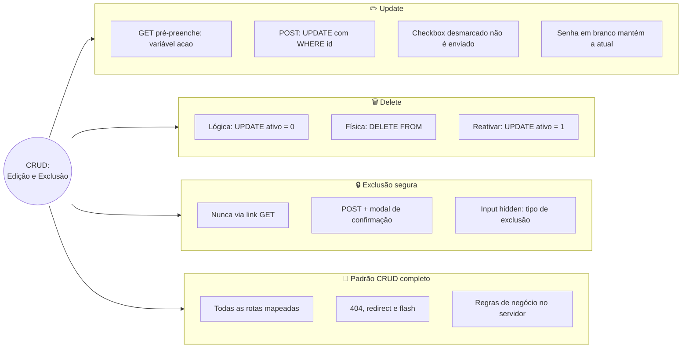
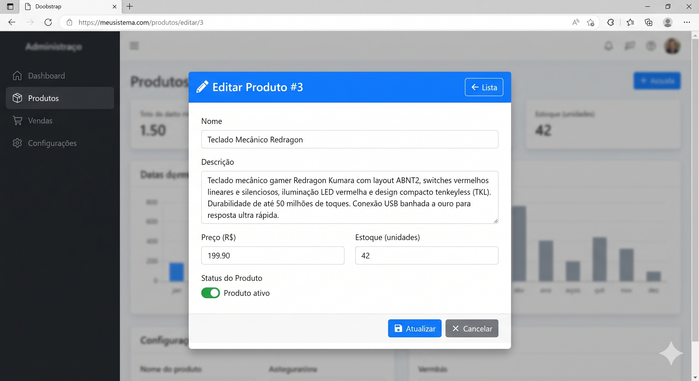
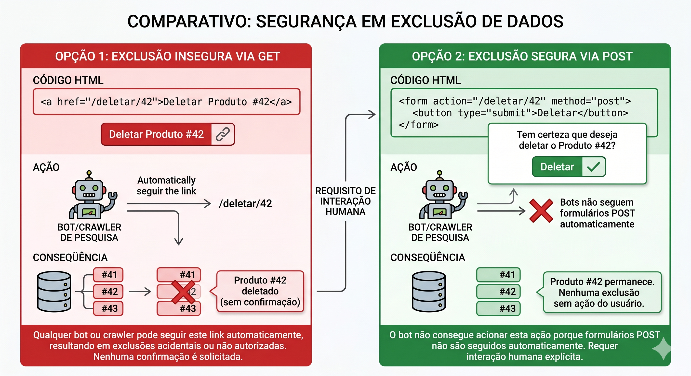
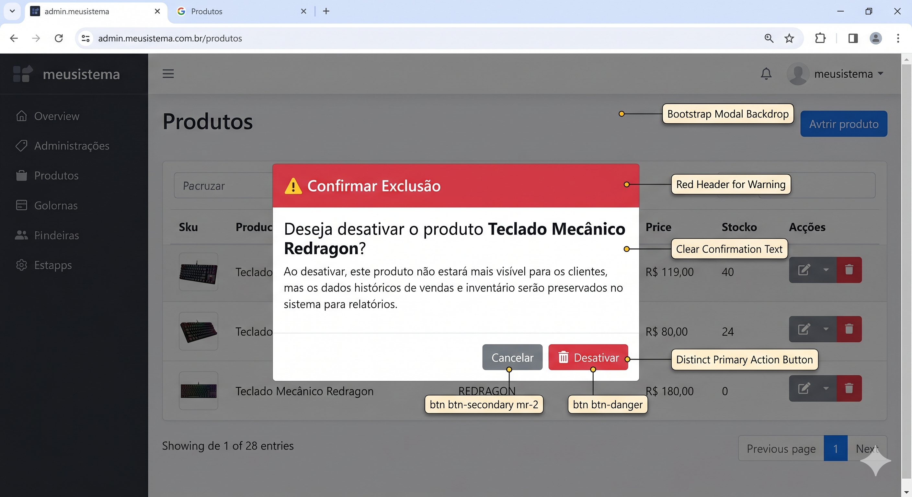
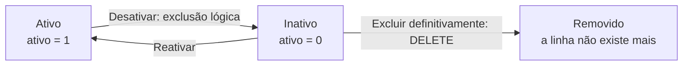

# Tópico 07 — CRUD: Edição e Exclusão

**Disciplina:** Programação para Internet (ILP951)
**Professor:** Ronan Adriel Zenatti · ronan.zenatti@cps.sp.gov.br
**Fatec Jahu — 2º Semestre/2026**

> **Pré-requisitos:** Tópico 06 concluído — cadastro (`/usuarios/novo`), listagem com filtros, página de detalhe, o módulo `validacoes.py` e a função `execute_insert` funcionando.

---

## 🎯 Objetivos do Tópico

Ao final deste tópico você deverá ser capaz de:

- Reaproveitar o formulário de cadastro para a edição, controlando o modo de uso com uma variável (`acao`) no template.
- Implementar o **Update** em duas etapas: `GET` pré-preenche o formulário e `POST` valida e executa o `UPDATE` com `WHERE id`.
- Extrair a validação para uma função reutilizável e tratar corretamente o campo `checkbox` (que não é enviado quando desmarcado).
- Tratar um campo opcional na edição, a senha: em branco, mantém a atual; preenchida, troca o hash.
- Explicar por que `rowcount` não serve para saber se um registro existe, e checar a existência antes de alterar.
- Diferenciar **exclusão lógica** (desativar) de **exclusão física** (`DELETE`) e escolher a adequada a cada situação, inclusive quando o registro descreve uma pessoa (LGPD).
- Explicar por que uma exclusão nunca pode ser um link `GET` e implementá-la com rota `POST`, janela de confirmação do Bootstrap e `input hidden`.
- Revisar um CRUD completo com um checklist de segurança: placeholders, lista de valores permitidos, `404`, PRG, hash de senha e regras de negócio no servidor.

No tópico anterior você construiu o **C** e o **R**. Faltam as duas operações mais delicadas: **atualizar** e **excluir**, justamente as que podem estragar dados de verdade. Um `UPDATE` sem `WHERE` altera a tabela inteira (e todo usuário do sistema passaria a ter o mesmo nome e a mesma senha); um `DELETE` apaga sem volta; um link malfeito pode ser acionado por um robô de busca sem que ninguém clique em nada. Por isso, hoje o foco não é só "fazer funcionar": é fazer funcionar **com segurança**. Ao final, o módulo de usuários do seu sistema terá o CRUD completo.

---

## 🗺️ Mapa Mental do Tópico



---

## Parte 1 — Update (1): o formulário de edição

### Editar é cadastrar... com os dados já preenchidos

Pense no que o usuário vê ao clicar em "Editar": o **mesmo formulário** do cadastro, só que com os campos já cheios com os valores atuais. Seria um desperdício escrever um segundo template quase idêntico, e uma fonte de bugs: toda vez que um campo mudasse, você teria de lembrar de alterar dois arquivos. A solução é **um único template** (`usuario_form.html`) que serve aos dois casos, e uma variável, `acao`, que diz ao template em qual modo ele está: `'criar'` ou `'editar'`.

<!-- IMAGEM PENDENTE: recapturar a tela "Editar Usuário" (a antiga Aula_07_img_01.png mostra o formulário de produto).

-->

O Update acontece em **duas requisições**, exatamente como o Create: um `GET` que mostra o formulário (agora preenchido) e um `POST` que recebe as alterações. Nesta parte construímos o `GET`; o `POST` fica para a Parte 2.

### Passo 1 — a rota de edição, só com GET

Acrescente ao `app.py`. Ela busca o usuário pelo `id` da URL, responde `404` se ele não existir (padrão da Parte 5 do Tópico 06) e mostra o formulário com os dados do banco:

```python
@app.route('/usuarios/<int:usuario_id>/editar')
def usuario_editar(usuario_id):
    usuario = execute_one(SELECT_USUARIO + ' WHERE u.id_usuario = %s', (usuario_id,))
    if usuario is None:
        abort(404)
    return render_template('usuario_form.html', usuario=usuario, **dados_apoio_form())
```

Salve e acesse `http://localhost:5000/usuarios/1/editar`. O formulário aparece com os dados do usuário 1, inclusive o perfil já selecionado e a data de nascimento no calendário... mas o título ainda diz "Novo Usuário", o botão envia para a rota de cadastro e os campos de senha continuam obrigatórios. É o que vamos corrigir. O reaproveitamento já mostra a sua vantagem: o campo Celular aparece **vazio** (e não com a palavra "None") para um usuário cujo celular é `NULL`, graças ao `default('', true)` que você usou no tópico anterior. E a senha não aparece preenchida, porque o `SELECT_USUARIO` nem a leu do banco.

### Passo 2 — a variável `acao`

Cada chamada a `render_template('usuario_form.html', ...)` passa a informar o modo. Na rota de edição:

```python
    return render_template('usuario_form.html', acao='editar',
                           usuario=usuario, **dados_apoio_form())
```

E, em `usuario_novo`, acrescente `acao='criar'` às **três** chamadas ao `render_template` (a do `GET` e as duas de erro). Por exemplo, a do `GET`:

```python
    return render_template('usuario_form.html', acao='criar',
                           usuario={}, **dados_apoio_form())
```

Ainda nada muda na tela: o template só passa a ter a informação. Os próximos passos a usam.

### Passo 3 — título e cabeçalho conforme o modo

No `usuario_form.html`, troque o bloco de título e o cabeçalho do card para decidirem pelo valor de `acao`:

```html
{{ 'Editar Usuário' if acao == 'editar' else 'Novo Usuário' }} — Sistema de Gestão
```

```html
        <h4 class="mb-0">
          ✏️ Editar Usuário #{{ usuario.id_usuario }}👤 Novo Usuário
        </h4>
```

Salve e compare `/usuarios/novo` com `/usuarios/1/editar`: o mesmo arquivo, dois cabeçalhos diferentes. A expressão `'A' if condição else 'B'` é o `if` em uma linha do Jinja2, ideal para trocar um texto curto.

### Passo 4 — para onde o formulário envia

Falta o mais importante: o `action` do `<form>`. Na criação ele aponta para `usuario_novo`; na edição, para `usuario_editar`, **com o `id` do usuário**. No início do ``, defina uma variável com `` e use-a no formulário:

```html

{# Para onde o formulário envia os dados: depende de estarmos criando ou editando #}

```

```html
        <form action="{{ destino }}" method="post">
```

Repare que o Jinja2 só avalia o ramo escolhido: no modo `'criar'`, `usuario.id_usuario` não existe, mas o `url_for` da edição nem chega a ser executado. Salve, abra `/usuarios/1/editar`, clique em **Salvar usuário** (os campos de senha estão obrigatórios, preencha-os por enquanto, ou remova o `required` pelo DevTools) e observe o resultado: o navegador mostra **405 Method Not Allowed**. A URL de destino está correta, mas a rota `usuario_editar` ainda só aceita `GET`. Exatamente o erro que você estudou no Tópico 04, e a deixa para a Parte 2.

### Passo 5 — o interruptor de status e o rótulo do botão

Na edição, quem administra também precisa poder ativar ou desativar o usuário. Esse campo não faz sentido no cadastro (todo usuário novo nasce ativo), então ele só aparece no modo `'editar'`. Acrescente, entre o bloco do endereço e os botões:

```html
          {# O interruptor de status só faz sentido na edição #}
          
          <div class="form-check form-switch mb-3">
            <input class="form-check-input" type="checkbox" role="switch"
                   id="ativo" name="ativo" value="1"
                   checked>
            <label class="form-check-label" for="ativo">Usuário ativo</label>
          </div>
          
```

E ajuste o rótulo do botão de envio:

```html
            <button type="submit" class="btn btn-primary">
              {{ '✔ Salvar alterações' if acao == 'editar' else '✔ Salvar usuário' }}
            </button>
```

Salve e recarregue a edição: o interruptor aparece ligado para usuários ativos (e desligado para a Juliana, desativada no tópico anterior), e o botão diz "Salvar alterações". No cadastro, nenhum dos dois muda.

### Passo 6 — a senha na edição é opcional

No cadastro, a senha é obrigatória. Na edição, não faz sentido obrigar quem só quer corrigir um telefone a digitar a senha de novo (e a senha atual, que é um hash, não tem como ser mostrada). A regra é: **em branco, mantém a senha atual; preenchida, troca**. Altere o bloco de senha do formulário para mudar de comportamento conforme o modo:

```html
          <div class="row">
            <div class="col-md-6 mb-3">
              <label for="senha" class="form-label">
                {{ 'Nova senha' if acao == 'editar' else 'Senha' }}
                <span class="text-danger">*</span>
              </label>
              <input type="password" class="form-control" id="senha" name="senha"
                     minlength="8" autocomplete="new-password"
                     required>
              <div class="form-text">
                Deixe em branco para manter a senha atual.
                Mínimo de 8 caracteres, com letras e números.
              </div>
            </div>
            <div class="col-md-6 mb-3">
              <label for="confirmar_senha" class="form-label">Confirmar senha</label>
              <input type="password" class="form-control" id="confirmar_senha" name="confirmar_senha"
                     minlength="8" autocomplete="new-password"
                     required>
            </div>
          </div>
```

O atributo `required` agora só existe no modo `'criar'`: o Jinja2 decide se ele entra ou não no HTML. Salve e compare as duas páginas.

### Passo 7 — os links de acesso à edição

Para chegar ao formulário sem digitar a URL, acrescente um botão **Editar** na coluna *Ações* da lista (`usuarios.html`), ao lado do botão **Ver**:

```html
            <a href="{{ url_for('usuario_editar', usuario_id=usuario.id_usuario) }}"
               class="btn btn-sm btn-outline-secondary">✏️ Editar</a>
```

E no cabeçalho do card do `usuario_detalhe.html`, ao lado do "Voltar à lista":

```html
          <a href="{{ url_for('usuario_editar', usuario_id=usuario.id_usuario) }}"
             class="btn btn-outline-secondary btn-sm">✏️ Editar</a>
```

Salve e navegue: lista → Editar → formulário preenchido; detalhe → Editar → o mesmo.

**Consolidação — `templates/usuario_form.html` completo, nos dois modos:**

```html

{{ 'Editar Usuário' if acao == 'editar' else 'Novo Usuário' }} — Sistema de Gestão


{# Para onde o formulário envia os dados: depende de estarmos criando ou editando #}


<div class="row justify-content-center">
  <div class="col-lg-9">
    <div class="card shadow-sm">
      <div class="card-header bg-primary text-white d-flex justify-content-between align-items-center">
        <h4 class="mb-0">
          ✏️ Editar Usuário #{{ usuario.id_usuario }}👤 Novo Usuário
        </h4>
        <a href="{{ url_for('lista_usuarios') }}" class="btn btn-light btn-sm">← Voltar à lista</a>
      </div>
      <div class="card-body">
        <form action="{{ destino }}" method="post">

          <div class="mb-3">
            <label for="nome" class="form-label">Nome completo <span class="text-danger">*</span></label>
            <input type="text" class="form-control" id="nome" name="nome"
                   maxlength="255" placeholder="Ex.: Ana Beatriz Lima" required
                   value="{{ usuario.nome | default('') }}">
          </div>

          <div class="mb-3">
            <label for="email" class="form-label">E-mail <span class="text-danger">*</span></label>
            <input type="email" class="form-control" id="email" name="email"
                   maxlength="255" placeholder="nome@dominio.com.br" required
                   value="{{ usuario.email | default('') }}">
          </div>

          <div class="row">
            <div class="col-md-6 mb-3">
              <label for="senha" class="form-label">
                {{ 'Nova senha' if acao == 'editar' else 'Senha' }}
                <span class="text-danger">*</span>
              </label>
              <input type="password" class="form-control" id="senha" name="senha"
                     minlength="8" autocomplete="new-password"
                     required>
              <div class="form-text">
                Deixe em branco para manter a senha atual.
                Mínimo de 8 caracteres, com letras e números.
              </div>
            </div>
            <div class="col-md-6 mb-3">
              <label for="confirmar_senha" class="form-label">Confirmar senha</label>
              <input type="password" class="form-control" id="confirmar_senha" name="confirmar_senha"
                     minlength="8" autocomplete="new-password"
                     required>
            </div>
          </div>

          <div class="row">
            <div class="col-md-4 mb-3">
              <label for="celular" class="form-label">Celular</label>
              <input type="tel" class="form-control" id="celular" name="celular"
                     maxlength="20" placeholder="(14) 99999-9999"
                     value="{{ usuario.celular | default('', true) }}">
            </div>
            <div class="col-md-4 mb-3">
              <label for="data_nascimento" class="form-label">Data de nascimento</label>
              <input type="date" class="form-control" id="data_nascimento" name="data_nascimento"
                     value="{{ usuario.data_nascimento | default('', true) }}">
            </div>
            <div class="col-md-4 mb-3">
              <label for="cpf" class="form-label">CPF</label>
              <input type="text" class="form-control" id="cpf" name="cpf"
                     maxlength="14" placeholder="000.000.000-00"
                     value="{{ usuario.cpf | default('', true) }}">
            </div>
          </div>

          <div class="mb-3">
            <label for="perfil_id" class="form-label">Perfil <span class="text-danger">*</span></label>
            <select class="form-select" id="perfil_id" name="perfil_id" required>
              <option value="">-- Selecione --</option>
              
                <option value="{{ p.id_perfil }}"
                        selected>{{ p.nome }}</option>
              
            </select>
          </div>

          <div class="row">
            <div class="col-md-3 mb-3">
              <label for="cep" class="form-label">CEP</label>
              <input type="text" class="form-control" id="cep" name="cep"
                     maxlength="9" placeholder="00000-000"
                     value="{{ usuario.cep | default('', true) }}">
            </div>
            <div class="col-md-6 mb-3">
              <label for="endereco" class="form-label">Endereço</label>
              <input type="text" class="form-control" id="endereco" name="endereco"
                     maxlength="255" value="{{ usuario.endereco | default('', true) }}">
            </div>
            <div class="col-md-3 mb-3">
              <label for="numero" class="form-label">Número</label>
              <input type="text" class="form-control" id="numero" name="numero"
                     maxlength="20" value="{{ usuario.numero | default('', true) }}">
            </div>
          </div>

          <div class="row">
            <div class="col-md-5 mb-3">
              <label for="complemento" class="form-label">Complemento</label>
              <input type="text" class="form-control" id="complemento" name="complemento"
                     maxlength="100" value="{{ usuario.complemento | default('', true) }}">
            </div>
            <div class="col-md-5 mb-3">
              <label for="cidade" class="form-label">Cidade</label>
              <input type="text" class="form-control" id="cidade" name="cidade"
                     maxlength="100" value="{{ usuario.cidade | default('', true) }}">
            </div>
            <div class="col-md-2 mb-3">
              <label for="estado" class="form-label">UF</label>
              <select class="form-select" id="estado" name="estado">
                <option value="">--</option>
                
                  <option value="{{ uf }}" selected>{{ uf }}</option>
                
              </select>
            </div>
          </div>

          {# O interruptor de status só faz sentido na edição #}
          
          <div class="form-check form-switch mb-3">
            <input class="form-check-input" type="checkbox" role="switch"
                   id="ativo" name="ativo" value="1"
                   checked>
            <label class="form-check-label" for="ativo">Usuário ativo</label>
          </div>
          

          <div class="d-flex gap-2">
            <button type="submit" class="btn btn-primary">
              {{ '✔ Salvar alterações' if acao == 'editar' else '✔ Salvar usuário' }}
            </button>
            <a href="{{ url_for('lista_usuarios') }}" class="btn btn-outline-secondary">✖ Cancelar</a>
          </div>

        </form>
      </div>
    </div>
  </div>
</div>

```

### 🔎 Verifique seu Entendimento

Uma empresa de patinetes elétricos compartilhados tem a tabela `patinete` (`id`, `codigo`, `modelo`, `bateria_pct`, `ativo`) e um formulário `patinete_form.html` que já serve ao cadastro. Agora o time precisa editar patinetes.

**Desafio:** Escreva a rota `GET` `/patinetes/<int:patinete_id>/editar`, que busca o patinete, responde `404` se ele não existir e renderiza o formulário com `acao='editar'`; e escreva o trecho do template que pré-preenche o campo `modelo` e o interruptor `ativo` (só visível na edição).

> 💬 Tente por conta própria antes de seguir. A solução comentada está no gabarito deste tópico (link na última seção da página).

---

## Parte 2 — Update (2): validar e executar o UPDATE

### Passo 1 — a validação vira uma função

A rota de edição precisa validar exatamente os mesmos campos da de cadastro. Copiar as 90 linhas de validação para uma segunda rota seria repetir código e semear bugs (corrigir uma regra em um lugar e esquecer o outro). A saída é mover a validação para **uma função** que as duas rotas chamam. Há apenas duas diferenças entre os modos, e a função as recebe por um parâmetro, `usuario_id`: na edição, o e-mail e o CPF **do próprio usuário** não contam como repetidos, e a senha é opcional. Acrescente ao `app.py`, antes das rotas:

```python
def validar_usuario(form, usuario_id=None):
    """
    Valida e converte os campos do formulário de usuário.

    usuario_id: None no cadastro; o id do usuário na edição. Na edição, o e-mail e o CPF do
                próprio usuário não contam como repetidos, e a senha em branco mantém a atual.

    Retorna (dados, erros):
        dados — dict com os valores do formulário; quando válidos, já convertidos (celular, CPF e
                CEP formatados, data como date, perfil como int). Se inválidos, mantém o texto
                digitado, para repopular o form. 'senha_hash' traz o hash da nova senha, ou None
                quando a senha não deve mudar. A senha em texto puro nunca sai desta função.
        erros — lista de mensagens de erro (vazia quando tudo está válido).
    """
    editando = usuario_id is not None

    nome        = form.get('nome', '').strip()
    email       = form.get('email', '').strip().lower()
    senha       = form.get('senha', '')
    confirmar   = form.get('confirmar_senha', '')
    celular_txt = form.get('celular', '').strip()
    nascimento  = form.get('data_nascimento', '').strip()
    cpf_txt     = form.get('cpf', '').strip()
    perfil_txt  = form.get('perfil_id', '')
    cep_txt     = form.get('cep', '').strip()
    endereco    = form.get('endereco', '').strip()
    numero      = form.get('numero', '').strip()
    complemento = form.get('complemento', '').strip()
    cidade      = form.get('cidade', '').strip()
    estado      = form.get('estado', '')

    erros = []

    if not nome:
        erros.append('O nome é obrigatório.')
    elif len(nome) < 3:
        erros.append('O nome deve ter pelo menos 3 caracteres.')
    elif len(nome) > 255:
        erros.append('O nome pode ter no máximo 255 caracteres.')

    if not email:
        erros.append('O e-mail é obrigatório.')
    elif len(email) > 255 or not re.fullmatch(r'[^@\s]+@[^@\s]+\.[^@\s]+', email):
        erros.append('Informe um e-mail válido, por exemplo nome@dominio.com.br.')
    else:
        existente = execute_one('SELECT id_usuario FROM usuarios WHERE email = %s', (email,))
        if existente and existente['id_usuario'] != usuario_id:
            erros.append('Já existe um usuário cadastrado com este e-mail.')
            # Na edição, achar o próprio usuário não é duplicidade: por isso se compara o id

    senha_hash = None
    if editando and not senha and not confirmar:
        pass   # edição sem nova senha: mantém a atual (senha_hash continua None)
    elif len(senha) < 8:
        erros.append('A senha deve ter pelo menos 8 caracteres.')
    elif len(senha) > 128:
        erros.append('A senha pode ter no máximo 128 caracteres.')
    elif not (re.search(r'[A-Za-z]', senha) and re.search(r'\d', senha)):
        erros.append('A senha deve conter letras e números.')
    elif senha != confirmar:
        erros.append('A confirmação não confere com a senha.')
    else:
        senha_hash = generate_password_hash(senha)

    celular = celular_txt
    if celular_txt:
        formatado = formatar_celular(celular_txt)
        if formatado is None:
            erros.append('Informe o celular com DDD (10 ou 11 dígitos).')
        else:
            celular = formatado

    cpf = cpf_txt
    if cpf_txt:
        if not cpf_valido(cpf_txt):
            erros.append('Informe um CPF válido.')
        else:
            cpf = formatar_cpf(cpf_txt)
            existente = execute_one('SELECT id_usuario FROM usuarios WHERE cpf = %s', (cpf,))
            if existente and existente['id_usuario'] != usuario_id:
                erros.append('Já existe um usuário cadastrado com este CPF.')

    data_nasc = nascimento
    if nascimento:
        try:
            valor_data = date.fromisoformat(nascimento)
        except ValueError:
            erros.append('Informe uma data de nascimento válida.')
        else:
            if valor_data > date.today():
                erros.append('A data de nascimento não pode estar no futuro.')
            elif valor_data.year < 1900:
                erros.append('A data de nascimento deve ser a partir de 1900.')
            else:
                data_nasc = valor_data

    perfil_id = perfil_txt
    try:
        valor_perfil = int(perfil_txt)
    except ValueError:
        erros.append('Selecione um perfil.')
    else:
        ids_validos = {p['id_perfil'] for p in dados_apoio_form()['perfis']}
        if valor_perfil in ids_validos:
            perfil_id = valor_perfil
        else:
            erros.append('Selecione um perfil válido.')

    cep = cep_txt
    if cep_txt:
        formatado = formatar_cep(cep_txt)
        if formatado is None:
            erros.append('Informe um CEP com 8 dígitos.')
        else:
            cep = formatado

    limites = {'endereço': (endereco, 255), 'número': (numero, 20),
               'complemento': (complemento, 100), 'cidade': (cidade, 100)}
    for rotulo, (valor, maximo) in limites.items():
        if len(valor) > maximo:
            erros.append(f'O campo {rotulo} pode ter no máximo {maximo} caracteres.')

    if estado and estado not in UFS:
        erros.append('Selecione um estado válido.')

    dados = {'nome': nome, 'email': email, 'celular': celular, 'data_nascimento': data_nasc,
             'cpf': cpf, 'perfil_id': perfil_id, 'cep': cep, 'endereco': endereco,
             'numero': numero, 'complemento': complemento, 'cidade': cidade, 'estado': estado,
             'senha_hash': senha_hash}
    return dados, erros
```

Todo o conteúdo é o código que você já escreveu na Parte 2 do tópico anterior, apenas **movido** (com as duas adaptações descritas acima). A função recebe `request.form` e devolve duas coisas: os `dados` (já convertidos quando válidos) e a lista de `erros`. Repare em um detalhe de segurança: o `senha_hash` volta em `dados`, e `dados` é entregue ao template para repopular o formulário, mas o template **não** tem nenhum campo que o exiba, e o texto puro da senha nem sai da função.

### Passo 2 — `usuario_novo` fica muito menor

Agora a rota de cadastro **usa** a função. Substitua o corpo inteiro de `usuario_novo` por esta versão e compare o tamanho com a anterior:

```python
@app.route('/usuarios/novo', methods=['GET', 'POST'])
def usuario_novo():

    if request.method == 'POST':
        dados, erros = validar_usuario(request.form)

        if erros:
            for erro in erros:
                flash(erro, 'danger')
            return render_template('usuario_form.html', acao='criar',
                                   usuario=dados, **dados_apoio_form())

        try:
            novo_id = execute_insert(
                'INSERT INTO usuarios (nome, email, senha, celular, data_nascimento, cpf, perfil_id, '
                'cep, endereco, numero, complemento, cidade, estado) '
                'VALUES (%s, %s, %s, %s, %s, %s, %s, %s, %s, %s, %s, %s, %s)',
                (dados['nome'], dados['email'], dados['senha_hash'], dados['celular'] or None,
                 dados['data_nascimento'] or None, dados['cpf'] or None, dados['perfil_id'],
                 dados['cep'] or None, dados['endereco'] or None, dados['numero'] or None,
                 dados['complemento'] or None, dados['cidade'] or None, dados['estado'] or None)
            )
        except Exception as e:
            flash(f'Não foi possível salvar o usuário: {e}', 'danger')
            return render_template('usuario_form.html', acao='criar',
                                   usuario=dados, **dados_apoio_form())

        flash(f'Usuário "{dados["nome"]}" cadastrado com sucesso (código #{novo_id}).', 'success')
        return redirect(url_for('lista_usuarios'))

    return render_template('usuario_form.html', acao='criar',
                           usuario={}, **dados_apoio_form())
```

**Salve e teste antes de seguir.** Um refatoramento só é seguro se o comportamento continua igual: cadastre um usuário válido e depois um inválido (nome vazio, e-mail repetido). Tudo deve funcionar exatamente como antes. Se algo quebrou, o problema está na cópia que você acabou de fazer, e é muito mais fácil achá-lo agora do que depois de escrever mais código em cima.

### Passo 3 — a rota de edição aceita POST

Agora o `POST` da edição. Acrescente `'POST'` à lista de métodos e, no início da função, a checagem de existência. Esta parte merece uma explicação, logo depois do código:

```python
@app.route('/usuarios/<int:usuario_id>/editar', methods=['GET', 'POST'])
def usuario_editar(usuario_id):

    # Existe? Sem esta checagem, um id inexistente "atualizaria" zero linhas em silêncio
    atual = execute_one(SELECT_USUARIO + ' WHERE u.id_usuario = %s', (usuario_id,))
    if atual is None:
        abort(404)

    if request.method == 'POST':
        pass   # será preenchido nos próximos passos

    # Método GET: exibe o formulário já preenchido com os dados atuais
    return render_template('usuario_form.html', acao='editar',
                           usuario=atual, **dados_apoio_form())
```

Por que o `SELECT` **antes** do `UPDATE`, e não simplesmente executar o `UPDATE` e conferir `rowcount`? Faça o teste no terminal para ver com os próprios olhos:

```
python -c "from db import execute_query; print(execute_query('UPDATE usuarios SET nome = nome WHERE id_usuario = 1')); print(execute_query('UPDATE usuarios SET nome = nome WHERE id_usuario = 99999'))"
```

As duas linhas imprimem `0`. O MySQL conta as linhas **efetivamente modificadas**: um `UPDATE` que grava os mesmos valores que já estavam lá (primeira linha) modifica zero linhas, exatamente como um `UPDATE` de um `id_usuario` que não existe (segunda linha). Se usássemos `rowcount == 0` como "não encontrei", uma pessoa que clicasse em **Salvar** sem mudar nada receberia um erro falso. Por isso a existência é verificada por um `SELECT`, e o `rowcount` não é usado para decidir isso.

### Passo 4 — validar e preparar os dados do POST

Substitua o `pass` pela validação e pelo tratamento do interruptor:

```python
    if request.method == 'POST':
        dados, erros = validar_usuario(request.form, usuario_id)
        dados['id_usuario'] = usuario_id
        dados['ativo']      = 1 if request.form.get('ativo') else 0   # checkbox desmarcado não é enviado

        if erros:
            for erro in erros:
                flash(erro, 'danger')
            return render_template('usuario_form.html', acao='editar',
                                   usuario=dados, **dados_apoio_form())
```

Dois detalhes que costumam gerar bugs:

- **O `id_usuario` volta para `dados`.** Se a validação falhar, o formulário é renderizado de novo com `usuario=dados`, e o template precisa de `usuario.id_usuario` para montar o título e o `action`. Sem essa linha, o formulário de erro quebraria.
- **Checkbox desmarcado não é enviado.** Diferente de um campo de texto vazio (que chega como `''`), um `checkbox` desmarcado simplesmente **não aparece** em `request.form`, e `.get('ativo')` devolve `None`. Quando marcado, chega o `value="1"` que definimos. Por isso a conversão `1 if request.form.get('ativo') else 0`.

Salve e teste só a validação: abra a edição de um usuário, apague o nome e envie (remova o `required` pelo DevTools). Você deve ver o alerta vermelho e o formulário de edição de volta, **ainda no modo de edição** e com os campos preservados. Teste também trocar o e-mail pelo de **outro** usuário (`carlos.souza@exemplo.com.br`): o alerta de e-mail repetido aparece; mantendo o **próprio** e-mail, não.

### Passo 5 — o UPDATE, com o WHERE que não pode faltar

Complete o `POST`, logo depois do bloco `if erros:`. O `UPDATE` ganha uma particularidade: a coluna `senha` só entra nele quando existe uma nova senha. É a mesma ideia da listagem com `WHERE 1=1`: **montar o SQL aos poucos**, com os valores sempre separados em `params`.

```python
        sql = ('UPDATE usuarios '
               'SET nome = %s, email = %s, celular = %s, data_nascimento = %s, cpf = %s, '
               '    perfil_id = %s, cep = %s, endereco = %s, numero = %s, complemento = %s, '
               '    cidade = %s, estado = %s, ativo = %s')
        params = [dados['nome'], dados['email'], dados['celular'] or None,
                  dados['data_nascimento'] or None, dados['cpf'] or None, dados['perfil_id'],
                  dados['cep'] or None, dados['endereco'] or None, dados['numero'] or None,
                  dados['complemento'] or None, dados['cidade'] or None,
                  dados['estado'] or None, dados['ativo']]

        if dados['senha_hash']:          # só troca a senha se uma nova foi informada
            sql += ', senha = %s'
            params.append(dados['senha_hash'])

        sql += ' WHERE id_usuario = %s'
        params.append(usuario_id)

        try:
            execute_query(sql, params)
        except Exception as e:
            flash(f'Não foi possível atualizar o usuário: {e}', 'danger')
            return render_template('usuario_form.html', acao='editar',
                                   usuario=dados, **dados_apoio_form())

        flash(f'Usuário "{dados["nome"]}" atualizado com sucesso.', 'success')
        return redirect(url_for('usuario_detalhe', usuario_id=usuario_id))
```

Olhe com atenção a última peça da consulta: **`WHERE id_usuario = %s`**. É ela que restringe a alteração ao usuário certo. Lembre do aviso do Tópico 05: sem o `WHERE`, o `UPDATE` altera **todas** as linhas da tabela, e todo usuário do sistema passaria a ter o mesmo nome, o mesmo e-mail e a mesma senha. O `id` vem da **URL** (`usuario_id`, já convertido para `int` pelo Flask), e não de um campo do formulário que o usuário poderia adulterar. O restante segue o que você já sabe: valores em placeholders, `commit` dentro do `execute_query`, PRG com `redirect` e flash.

Salve e faça os testes, nesta ordem:

1. Edite o celular de um usuário e salve: você vai para a página de detalhe, com o alerta verde e o novo valor. Repare em **Última alteração**: a data e a hora mudaram (o `ON UPDATE CURRENT_TIMESTAMP` do Tópico 05), enquanto **Cadastrado em** continua igual.
2. Abra a edição e clique em **Salvar alterações** **sem mudar nada**: deve dar sucesso (e não erro) — a prova de que a checagem de existência funciona. Dessa vez a **Última alteração** não muda: o MySQL só atualiza `atualizado_em` quando algum valor realmente muda.
3. Troque a senha de um usuário (por exemplo, `NovaSenha@456`, nos dois campos) e salve. No Workbench, `SELECT nome, senha FROM usuarios WHERE id_usuario = ...;` mostra **outro hash**. Edite de novo deixando os campos de senha em branco: o hash continua o mesmo.
4. Na edição, **desligue o interruptor** "Usuário ativo" e salve. Volte à lista: o usuário sumiu (a lista padrão mostra só os ativos). Escolha o status **Inativos** no filtro e ele reaparece. Religue o interruptor para ativá-lo de novo.
5. Acesse `/usuarios/99999/editar`: página `404`.
6. No Workbench, confirme com `SELECT * FROM usuarios;` que **só** os usuários editados mudaram.

**Consolidação — a rota `usuario_editar` completa:**

```python
@app.route('/usuarios/<int:usuario_id>/editar', methods=['GET', 'POST'])
def usuario_editar(usuario_id):

    # Existe? Sem esta checagem, um id inexistente "atualizaria" zero linhas em silêncio
    atual = execute_one(SELECT_USUARIO + ' WHERE u.id_usuario = %s', (usuario_id,))
    if atual is None:
        abort(404)

    if request.method == 'POST':
        dados, erros = validar_usuario(request.form, usuario_id)
        dados['id_usuario'] = usuario_id
        dados['ativo']      = 1 if request.form.get('ativo') else 0   # checkbox desmarcado não é enviado

        if erros:
            for erro in erros:
                flash(erro, 'danger')
            return render_template('usuario_form.html', acao='editar',
                                   usuario=dados, **dados_apoio_form())

        sql = ('UPDATE usuarios '
               'SET nome = %s, email = %s, celular = %s, data_nascimento = %s, cpf = %s, '
               '    perfil_id = %s, cep = %s, endereco = %s, numero = %s, complemento = %s, '
               '    cidade = %s, estado = %s, ativo = %s')
        params = [dados['nome'], dados['email'], dados['celular'] or None,
                  dados['data_nascimento'] or None, dados['cpf'] or None, dados['perfil_id'],
                  dados['cep'] or None, dados['endereco'] or None, dados['numero'] or None,
                  dados['complemento'] or None, dados['cidade'] or None,
                  dados['estado'] or None, dados['ativo']]

        if dados['senha_hash']:          # só troca a senha se uma nova foi informada
            sql += ', senha = %s'
            params.append(dados['senha_hash'])

        sql += ' WHERE id_usuario = %s'
        params.append(usuario_id)

        try:
            execute_query(sql, params)
        except Exception as e:
            flash(f'Não foi possível atualizar o usuário: {e}', 'danger')
            return render_template('usuario_form.html', acao='editar',
                                   usuario=dados, **dados_apoio_form())

        flash(f'Usuário "{dados["nome"]}" atualizado com sucesso.', 'success')
        return redirect(url_for('usuario_detalhe', usuario_id=usuario_id))

    # Método GET: exibe o formulário já preenchido com os dados atuais
    return render_template('usuario_form.html', acao='editar',
                           usuario=atual, **dados_apoio_form())
```

### 🔎 Verifique seu Entendimento

Uma plataforma de ingressos para shows de 2026 tem a tabela `evento` (`id`, `nome`, `lotacao`, `esgotado`). A organização precisa corrigir a lotação de um evento e marcar/desmarcar o aviso de "esgotado" (um `checkbox`).

**Desafio:** Escreva a parte `POST` da rota `/eventos/<int:evento_id>/editar`, que valida a lotação (inteiro maior ou igual a 1), converte o `checkbox` `esgotado` para `0` ou `1` e executa o `UPDATE` parametrizado de `lotacao` e `esgotado` com `WHERE id`. Explique também por que a existência do evento deve ser checada com um `SELECT` antes, e não com `rowcount`.

> 💬 Tente por conta própria antes de seguir. A solução comentada está no gabarito deste tópico (link na última seção da página).

---

## Parte 3 — Delete (1): excluir de verdade ou só desativar?

### Duas formas de "tirar" um registro

Antes de escrever uma única linha de código de exclusão, há uma decisão de projeto: **o registro realmente precisa deixar de existir?** Existem duas respostas, e cada uma tem um comando SQL:

| | Exclusão **lógica** | Exclusão **física** |
|---|---|---|
| **O que faz** | Marca o registro como inativo (`ativo = 0`); ele continua no banco | Remove a linha da tabela de vez |
| **Comando SQL** | `UPDATE usuarios SET ativo = 0 WHERE id_usuario = ?` | `DELETE FROM usuarios WHERE id_usuario = ?` |
| **Dá para desfazer?** | ✅ Sim (`UPDATE ... SET ativo = 1`) | ❌ Não |
| **Preserva o histórico?** | ✅ Sim: pedidos, registros de acesso e relatórios antigos continuam apontando para o registro | ❌ Não |
| **A lista precisa filtrar?** | Sim: `WHERE ativo = 1` (já fazemos isso) | Não |
| **Bom para** | Dados com histórico: usuários que já usaram o sistema, clientes, contas | Lixo: cadastros de teste, duplicados, registros criados por engano |

A coluna `ativo`, que você criou com `ALTER TABLE` no tópico anterior, existe justamente para a exclusão lógica. Na prática, é a mais usada em sistemas reais: um usuário que saiu da empresa **não pode sumir** dos registros antigos (quem aprovou aquele pedido? quem alterou aquele cadastro?), senão o relatório do ano passado quebra. E um usuário desativado simplesmente **não consegue mais entrar** no sistema, o que será usado no login do Tópico 11. Um cadastro feito por engano, por outro lado, só atrapalha, e pode ser apagado de vez.

> ⚖️ **Aqui o registro é uma pessoa.** Diferente de um produto ou de um ingresso, um usuário carrega **dados pessoais**: nome, e-mail, CPF, celular, endereço. A LGPD garante ao titular o direito de pedir a eliminação dos seus dados. Desativar (que mantém tudo guardado) pode **não bastar** para atender esse pedido, e a exclusão física passa a ser o caminho correto. Por isso o nosso CRUD oferece as duas, e por isso a escolha entre lógica e física é uma **decisão de negócio** e, às vezes, jurídica, e não só técnica.

### Pratique no Workbench antes de programar

Como você viu no Tópico 05, `UPDATE` e `DELETE` merecem ensaio fora do código. Cadastre pelo formulário um usuário de teste chamado "Usuário de Teste" (e-mail `teste.exclusao@exemplo.com.br`, qualquer perfil) e anote o `id_usuario` dele. Depois, no Workbench (troque `X` pelo `id_usuario`):

```sql
-- Exclusão LÓGICA: o registro continua lá, só deixa de estar ativo
UPDATE usuarios SET ativo = 0 WHERE id_usuario = X;
SELECT id_usuario, nome, ativo FROM usuarios WHERE id_usuario = X;
```

Recarregue a lista no navegador: o usuário some (a lista padrão mostra só os ativos). Escolha **Inativos** e ele aparece. Agora desfaça:

```sql
-- Reativar: a exclusão lógica é reversível
UPDATE usuarios SET ativo = 1 WHERE id_usuario = X;
```

Recarregue: ele volta. Por fim, a exclusão **física**:

```sql
-- Exclusão FÍSICA: a linha deixa de existir. Não há "desfazer"
DELETE FROM usuarios WHERE id_usuario = X;
SELECT id_usuario, nome, ativo FROM usuarios WHERE id_usuario = X;
```

O `SELECT` volta vazio: o registro não existe mais em lugar nenhum. Cadastre outro usuário de teste e olhe o `id_usuario` gerado: ele é **maior** que o do usuário apagado. O `AUTO_INCREMENT` nunca reaproveita números, então um `id` apagado fica vazio para sempre.

Repare também no `WHERE id_usuario = X` em **todos** os comandos. O `DELETE` sem `WHERE` apaga **todas** as linhas da tabela. É por isso que a barreira de segurança do Workbench (*Safe Updates*) que você encontrou no tópico anterior existe, e é uma boa prática mantê-la ligada.

### 🔎 Verifique seu Entendimento

A cooperativa de coleta seletiva do Tópico 06 quer remover o ponto de coleta de id `7`, que fechou, mas que tem dois anos de pesagens registradas e aparece em relatórios de volume coletado. Também quer remover o ponto de id `99`, cadastrado por engano ontem e sem nenhuma pesagem.

**Desafio:** Escreva o comando SQL adequado para cada um dos dois pontos e justifique em uma frase por que o tipo de exclusão escolhido é diferente em cada caso.

> 💬 Tente por conta própria antes de seguir. A solução comentada está no gabarito deste tópico (link na última seção da página).

---

## Parte 4 — Delete (2): excluir com segurança

### Por que excluir NUNCA pode ser um link

A forma mais simples de implementar uma exclusão seria um link na tabela: `<a href="/usuarios/42/excluir">Excluir</a>`, com uma rota `GET` que apaga o registro. **Isso é uma falha de segurança séria**, e o motivo vem direto do Tópico 04: o método `GET` existe para **consultar**, e o mundo da web inteira parte do princípio de que um `GET` é **seguro**, ou seja, não altera nada. Por isso, vários programas fazem `GET` por conta própria, sem que ninguém clique em nada:

- **Robôs de busca e rastreadores** seguem todos os links de uma página para indexá-la.
- Navegadores e extensões fazem **pré-carregamento** (*prefetch*) de links para acelerar a navegação.
- Aplicativos de mensagem geram **pré-visualização** de qualquer link colado em uma conversa.

Se a exclusão for um link `GET`, qualquer um desses robôs pode **apagar usuários** apenas por passar pela página. Uma exclusão exige um clique humano **deliberado**, e a forma de garantir isso é usar o método `POST`, que formulários só enviam quando o usuário aciona um botão.



```python
# ❌ NUNCA faça assim: o GET apaga dados
@app.route('/usuarios/<int:usuario_id>/excluir')
def usuario_excluir(usuario_id):
    execute_query('DELETE FROM usuarios WHERE id_usuario = %s', (usuario_id,))
    ...

# ✅ Sempre assim: só aceita POST
@app.route('/usuarios/<int:usuario_id>/excluir', methods=['POST'])
def usuario_excluir(usuario_id):
    ...
```

### Passo 1 — a rota que só aceita POST (exclusão lógica)

Comece pela versão mais simples e segura: uma rota que **só aceita `POST`** e faz a exclusão lógica. Acrescente ao `app.py`:

```python
@app.route('/usuarios/<int:usuario_id>/excluir', methods=['POST'])
def usuario_excluir(usuario_id):

    usuario = execute_one('SELECT id_usuario, nome FROM usuarios WHERE id_usuario = %s', (usuario_id,))
    if usuario is None:
        abort(404)

    try:
        execute_query('UPDATE usuarios SET ativo = 0 WHERE id_usuario = %s', (usuario_id,))
        flash(f'Usuário "{usuario["nome"]}" desativado. Você pode reativá-lo depois.', 'warning')
    except Exception as e:
        flash(f'Não foi possível concluir a operação: {e}', 'danger')

    return redirect(url_for('lista_usuarios'))
```

Salve e faça o primeiro teste: digite `http://localhost:5000/usuarios/1/excluir` direto na barra de endereços e tecle Enter. O navegador faz um `GET`, e a resposta é **405 Method Not Allowed**. A rota simplesmente recusa quem não veio por um `POST`: o robô de busca, o *prefetch* e a pré-visualização esbarram aqui. (O `methods=['POST']` é o que faz isso: lembra que, sem ele, uma rota Flask aceita só `GET`.)

### Passo 2 — o botão em um formulário POST

Para o usuário acionar a rota, a coluna *Ações* da lista ganha um **formulário** com um único botão, e não um link. Acrescente ao lado do botão **Editar**, dentro da célula de ações:

```html
            <form action="{{ url_for('usuario_excluir', usuario_id=usuario.id_usuario) }}"
                  method="post" class="d-inline">
              <button type="submit" class="btn btn-sm btn-outline-danger">🗑 Desativar</button>
            </form>
```

O `class="d-inline"` mantém o formulário na mesma linha dos outros botões. Cadastre um "Usuário de Teste", clique em **Desativar** na linha dele e veja: o usuário some da lista, com o alerta amarelo. Funciona... mas note o problema: **um clique sem querer** já desativa o usuário. Não há como se arrepender. Falta uma etapa de confirmação.

### Passo 3 — o modal de confirmação do Bootstrap

O Bootstrap tem um componente pronto para isso: o **modal**, uma janela que aparece por cima da página e pede uma confirmação. Em vez de repetir um modal para cada linha da tabela (50 usuários, 50 modais!), usaremos **um único** modal, reaproveitado, que o JavaScript preenche com os dados do usuário clicado.



**3a — o HTML do modal.** No final do `` do `usuarios.html`, antes do ``:

```html
  {# ===== MODAL DE CONFIRMAÇÃO: um só, reaproveitado por todas as linhas ===== #}
  <div class="modal fade" id="modalExcluir" tabindex="-1" aria-labelledby="modalExcluirTitulo" aria-hidden="true">
    <div class="modal-dialog modal-dialog-centered">
      <div class="modal-content">
        <div class="modal-header bg-danger text-white">
          <h5 class="modal-title" id="modalExcluirTitulo">⚠️ Confirmar</h5>
          <button type="button" class="btn-close btn-close-white"
                  data-bs-dismiss="modal" aria-label="Fechar"></button>
        </div>

        {# O action deste formulário é preenchido pelo JavaScript ao abrir o modal #}
        <form id="formExcluir" method="post" action="">
          <div class="modal-body">
            <p id="modalExcluirTexto" class="mb-0"></p>
          </div>
          <div class="modal-footer">
            <button type="button" class="btn btn-secondary" data-bs-dismiss="modal">Cancelar</button>
            <button type="submit" class="btn btn-danger" id="modalExcluirConfirmar">Confirmar</button>
          </div>
        </form>
      </div>
    </div>
  </div>
```

O formulário do modal começa com `action=""`: o endereço certo depende do usuário clicado, e só será conhecido na hora. Os dois botões do rodapé são o ponto da confirmação: **Cancelar** (`data-bs-dismiss="modal"`) apenas fecha a janela; **Confirmar** (`type="submit"`) é o único que envia o `POST`.

**3b — o botão da linha abre o modal.** Substitua o formulário do Passo 2 por um botão comum, que **não** envia nada: ele só abre o modal e carrega, em atributos `data-*`, as informações do usuário daquela linha:

```html
            <button type="button" class="btn btn-sm btn-outline-danger"
                    data-bs-toggle="modal" data-bs-target="#modalExcluir"
                    data-url="{{ url_for('usuario_excluir', usuario_id=usuario.id_usuario) }}"
                    data-nome="{{ usuario.nome }}">🗑 Desativar</button>
```

Os atributos `data-bs-toggle` e `data-bs-target` são do Bootstrap: dizem "este botão abre o modal `#modalExcluir`". Os atributos `data-url` e `data-nome` são **nossos**: guardam a URL de exclusão e o nome daquele usuário. Repare que um nome com aspas (cadastre "Maria "Mimi" Souza" para ver) não quebra o HTML: o Jinja2 escapa o conteúdo automaticamente dentro do atributo.

**3c — o JavaScript que preenche o modal.** O `base.html` já tem um `` (Tópico 03), criado exatamente para isso. No final do `usuarios.html`, depois do `` do conteúdo:

```html

<script>
  const modalExcluir = document.getElementById('modalExcluir');

  // O Bootstrap dispara 'show.bs.modal' um instante antes de abrir o modal.
  // event.relatedTarget é o botão que provocou a abertura.
  modalExcluir.addEventListener('show.bs.modal', function (event) {
    const botao = event.relatedTarget;

    // Aponta o formulário para a rota do usuário clicado
    document.getElementById('formExcluir').action = botao.dataset.url;

    // textContent (e não innerHTML): o nome veio do banco e nunca deve ser lido como HTML
    document.getElementById('modalExcluirTitulo').textContent = '⚠️ Desativar usuário';
    document.getElementById('modalExcluirTexto').textContent =
      'Desativar "' + botao.dataset.nome + '"? Ele sai da lista de ativos e deixa de poder entrar no sistema, mas o histórico é preservado e você pode reativá-lo depois.';
    document.getElementById('modalExcluirConfirmar').textContent = 'Desativar';
  });
</script>

```

Salve, recarregue a lista e clique em **Desativar** em uma linha: a janela aparece com o **nome do usuário clicado**. Clique em **Cancelar**: nada acontece. Clique em outra linha: o texto muda para o usuário dessa linha, porque o mesmo modal foi reaproveitado. Só o botão **Desativar** do modal envia o `POST`.

> 🛡️ **Por que `textContent` e não `innerHTML`?** O nome do usuário veio de um campo de formulário: alguém poderia se cadastrar com o nome ``. Com `innerHTML`, o navegador interpretaria isso como HTML e executaria o código (uma falha chamada XSS). Com `textContent`, o valor é tratado só como **texto** e aparece literalmente. É o mesmo princípio dos placeholders `%s` no SQL: dado de usuário nunca vira código.

### Passo 4 — exclusão física e reativação, com um `input hidden`

Até aqui, o botão só faz a exclusão lógica. Queremos também a física, mas com uma **regra de negócio**: só se apaga de vez o que **já foi desativado**, como uma lixeira. Usuários ativos só podem ser desativados; usuários inativos podem ser **reativados** ou **excluídos definitivamente**.

A rota precisa saber qual das duas exclusões foi pedida. O modal enviará essa informação em um campo `hidden`, um `<input>` invisível que carrega um valor no `POST` sem aparecer na tela. No formulário do modal, dentro do `modal-body`, acrescente:

```html
            {# Informa à rota se a exclusão é lógica ou física #}
            <input type="hidden" name="tipo" id="modalExcluirTipo" value="logica">
```

Cada botão da linha passa a carregar o seu tipo em um `data-tipo`. O usuário **ativo** só tem o botão de desativar; o **inativo** ganha dois botões (e o de reativar, que é um formulário `POST` simples, sem necessidade de confirmação). Substitua o botão do Passo 3b por este bloco inteiro:

```html
            
              {# Usuário ativo: só pode ser desativado (exclusão lógica) #}
              <button type="button" class="btn btn-sm btn-outline-danger"
                      data-bs-toggle="modal" data-bs-target="#modalExcluir"
                      data-url="{{ url_for('usuario_excluir', usuario_id=usuario.id_usuario) }}"
                      data-nome="{{ usuario.nome }}"
                      data-tipo="logica">🗑 Desativar</button>
            
              {# Usuário inativo: pode ser reativado ou excluído de vez (exclusão física) #}
              <form action="{{ url_for('usuario_reativar', usuario_id=usuario.id_usuario) }}"
                    method="post" class="d-inline">
                <button type="submit" class="btn btn-sm btn-outline-success">♻️ Reativar</button>
              </form>
              <button type="button" class="btn btn-sm btn-outline-danger"
                      data-bs-toggle="modal" data-bs-target="#modalExcluir"
                      data-url="{{ url_for('usuario_excluir', usuario_id=usuario.id_usuario) }}"
                      data-nome="{{ usuario.nome }}"
                      data-tipo="fisica">❌ Excluir</button>
            
```

O JavaScript passa a copiar o tipo para o `input hidden` e a trocar os textos conforme ele. Substitua o conteúdo da função do `addEventListener`:

```javascript
  modalExcluir.addEventListener('show.bs.modal', function (event) {
    const botao = event.relatedTarget;
    const nome  = botao.dataset.nome;
    const tipo  = botao.dataset.tipo;

    // Aponta o formulário para a rota do usuário clicado e informa o tipo de exclusão
    document.getElementById('formExcluir').action = botao.dataset.url;
    document.getElementById('modalExcluirTipo').value = tipo;

    // textContent (e não innerHTML): o nome veio do banco e nunca deve ser lido como HTML
    if (tipo === 'fisica') {
      document.getElementById('modalExcluirTitulo').textContent = '⚠️ Excluir definitivamente';
      document.getElementById('modalExcluirTexto').textContent =
        'Excluir "' + nome + '" de forma definitiva? Todos os dados desta pessoa serão apagados e esta ação não pode ser desfeita.';
      document.getElementById('modalExcluirConfirmar').textContent = 'Excluir definitivamente';
    } else {
      document.getElementById('modalExcluirTitulo').textContent = '⚠️ Desativar usuário';
      document.getElementById('modalExcluirTexto').textContent =
        'Desativar "' + nome + '"? Ele sai da lista de ativos e deixa de poder entrar no sistema, mas o histórico é preservado e você pode reativá-lo depois.';
      document.getElementById('modalExcluirConfirmar').textContent = 'Desativar';
    }
  });
```

Agora, as rotas. A de exclusão passa a ler o `tipo` e a aplicar a regra de negócio **no servidor**. Substitua a `usuario_excluir` do Passo 1 e acrescente a de reativação:

```python
@app.route('/usuarios/<int:usuario_id>/excluir', methods=['POST'])
def usuario_excluir(usuario_id):

    tipo = request.form.get('tipo', 'logica')
    if tipo not in ('logica', 'fisica'):
        abort(400)   # 400 Bad Request: o pedido veio malformado

    usuario = execute_one('SELECT id_usuario, nome, ativo FROM usuarios WHERE id_usuario = %s', (usuario_id,))
    if usuario is None:
        abort(404)

    # Regra de negócio aplicada no servidor: só se apaga de vez o que já foi desativado
    if tipo == 'fisica' and usuario['ativo']:
        flash('Desative o usuário antes de excluí-lo definitivamente.', 'warning')
        return redirect(url_for('lista_usuarios'))

    try:
        if tipo == 'fisica':
            execute_query('DELETE FROM usuarios WHERE id_usuario = %s', (usuario_id,))
            flash(f'Usuário "{usuario["nome"]}" excluído definitivamente.', 'success')
            return redirect(url_for('lista_usuarios', status='inativo'))

        execute_query('UPDATE usuarios SET ativo = 0 WHERE id_usuario = %s', (usuario_id,))
        flash(f'Usuário "{usuario["nome"]}" desativado. Você pode reativá-lo depois.', 'warning')
    except Exception as e:
        flash(f'Não foi possível concluir a operação: {e}', 'danger')

    return redirect(url_for('lista_usuarios'))


@app.route('/usuarios/<int:usuario_id>/reativar', methods=['POST'])
def usuario_reativar(usuario_id):

    usuario = execute_one('SELECT id_usuario, nome FROM usuarios WHERE id_usuario = %s', (usuario_id,))
    if usuario is None:
        abort(404)

    try:
        execute_query('UPDATE usuarios SET ativo = 1 WHERE id_usuario = %s', (usuario_id,))
        flash(f'Usuário "{usuario["nome"]}" reativado.', 'success')
    except Exception as e:
        flash(f'Não foi possível reativar o usuário: {e}', 'danger')

    return redirect(url_for('lista_usuarios'))
```

Quatro pontos de atenção:

- **A regra mora no servidor, não só na tela.** O botão **Excluir** só aparece para usuários inativos, mas isso é apenas conforto visual: qualquer pessoa pode montar um `POST` à mão com `tipo=fisica` para um usuário ativo. Por isso a rota **confere de novo** (`if tipo == 'fisica' and usuario['ativo']`). É a mesma ideia da validação de formulário do Tópico 04: nunca confie no cliente.
- **O `input hidden` também é adulterável.** Ele não aparece na tela, mas o usuário pode editá-lo pelo DevTools. É por isso que a rota só aceita os dois valores previstos (`logica` e `fisica`) e responde `400` a qualquer outro.
- **`url_for('lista_usuarios', status='inativo')`**: argumentos extras de `url_for` que não existem na rota viram parâmetros da query string (`/usuarios?status=inativo`). Depois de excluir definitivamente, quem administra volta à lista de inativos, onde estava.
- **Apagar um usuário não esbarra na chave estrangeira.** A `FOREIGN KEY` aponta de `usuarios` para `perfis`: o usuário é o lado "filho", e o `DELETE` dele é livre. O contrário, apagar um **perfil** que ainda tem usuários, é o que o `ON DELETE RESTRICT` bloqueia (você viu o erro `1451` no Tópico 05).

Faça o teste completo com o seu "Usuário de Teste": desative (modal vermelho de desativação) → filtre por **Inativos** → reative → desative de novo → em **Inativos**, clique em **Excluir** e confirme o modal de exclusão definitiva → o usuário some para sempre. No Workbench, `SELECT * FROM usuarios WHERE nome = 'Usuário de Teste';` volta vazio.

> ⚠️ **Um aviso honesto sobre segurança.** Usar `POST` resolve robôs e cliques acidentais, mas **não é uma proteção completa**. Um site mal-intencionado poderia fazer o navegador de um usuário logado enviar um `POST` ao nosso sistema sem que ele perceba (um ataque chamado **CSRF**). A defesa real é um **token** único por formulário, verificado pelo servidor. Como o nosso sistema ainda não tem login, esse risco ainda é teórico, mas passa a importar de verdade quando ele tiver (Tópico 11). Guarde o nome: *CSRF token*. E há uma segunda lacuna que o login vai fechar: **hoje qualquer pessoa pode abrir `/usuarios` e apagar usuários**, e uma regra como "só o perfil Administrador gerencia usuários" só poderá existir quando o sistema souber quem está logado.

### 🔎 Verifique seu Entendimento

Em um painel de créditos de uso de IA generativa, um desenvolvedor escreveu o link `<a href="/chaves/7/revogar">Revogar chave de API</a>` ao lado de cada chave, apontando para uma rota `GET` que revoga (apaga) a chave.

**Desafio:** Explique qual é o risco dessa implementação e reescreva-a: a rota `/chaves/<int:chave_id>/revogar`, que só aceita `POST`, responde `404` se a chave não existir e redireciona com uma flash; e o formulário com o botão que a aciona.

> 💬 Tente por conta própria antes de seguir. A solução comentada está no gabarito deste tópico (link na última seção da página).

---

## Parte 5 — O CRUD completo: revisão e checklist

### O mapa de rotas final

O recurso **usuário** agora tem o CRUD inteiro. Compare com o mapa que desenhamos na Parte 1 do Tópico 06: todas as linhas estão preenchidas.

| Rota | Métodos | SQL executado | Resposta |
|---|---|---|---|
| `/usuarios` | `GET` | `SELECT ... JOIN perfis ... WHERE 1=1 ...` | Página (200) |
| `/usuarios/novo` | `GET`, `POST` | `INSERT` | Formulário, ou redirect com flash |
| `/usuarios/<id>` | `GET` | `SELECT ... WHERE id_usuario` | Página, ou 404 |
| `/usuarios/<id>/editar` | `GET`, `POST` | `SELECT` e `UPDATE ... WHERE id_usuario` | Formulário, ou redirect com flash, ou 404 |
| `/usuarios/<id>/excluir` | `POST` | `UPDATE ativo = 0` ou `DELETE ... WHERE id_usuario` | Redirect com flash, ou 400, ou 404 |
| `/usuarios/<id>/reativar` | `POST` | `UPDATE ativo = 1 ... WHERE id_usuario` | Redirect com flash, ou 404 |

E o ciclo de vida de um usuário, que resume as decisões da Parte 3 e da Parte 4:



### Checklist de segurança de um CRUD

Toda rota de um CRUD precisa passar por estas perguntas. Os itens vieram do Tópico 04 em diante, e agora aparecem juntos:

| Pergunta | Como o nosso CRUD responde |
|---|---|
| Os valores vão separados do SQL? | Placeholders `%s` em **todas** as consultas (`INSERT`, `UPDATE`, `DELETE`, `SELECT`) |
| E o que o SQL não aceita como parâmetro (ordenação)? | Lista de valores permitidos (`ORDENACOES`) |
| O registro existe? | `execute_one` + `abort(404)`; nunca `rowcount` |
| O `UPDATE`/`DELETE` está restrito a uma linha? | `WHERE id_usuario = %s`, com o id vindo da URL e convertido para `int` |
| Quem altera dados usa `POST`? | Sim: cadastro, edição, exclusão e reativação |
| Os dados foram validados no servidor? | `validar_usuario` (tipos, limites, e-mail e CPF únicos, perfil conferido contra `perfis`) |
| A senha está protegida? | Só o hash vai ao banco; a senha não é lida de volta (`SELECT_USUARIO` a deixa de fora) nem repopula o formulário |
| O fluxo termina com PRG e feedback? | `redirect` + `flash` depois de cada sucesso |
| As regras de negócio estão no servidor? | Física só para inativo; `tipo` só aceita `logica` e `fisica` |
| Dado do usuário é tratado como texto, nunca como código? | Jinja2 escapa o HTML; o JavaScript usa `textContent` |
| Quem pode fazer isso? | **Ainda ninguém controla.** Autenticação e perfis de acesso chegam no Tópico 11 |

### O `app.py` completo do módulo de usuários

Para consolidar, aqui está o `app.py` inteiro ao final do tópico, com todas as peças que você construiu nos Tópicos 06 e 07. Use-o para comparar com o seu e achar diferenças:

```python
import re
from datetime import date

from flask import Flask, render_template, request, redirect, url_for, flash, abort
from werkzeug.security import generate_password_hash

from db import execute_query, execute_one, execute_insert
from validacoes import cpf_valido, formatar_cpf, formatar_celular, formatar_cep

app = Flask(__name__)
app.secret_key = 'chave-secreta-fatec-2026'

# Siglas dos estados aceitas pelo sistema — fonte única para o formulário e para a validação
UFS = ['AC', 'AL', 'AP', 'AM', 'BA', 'CE', 'DF', 'ES', 'GO', 'MA', 'MT', 'MS', 'MG', 'PA',
       'PB', 'PR', 'PE', 'PI', 'RJ', 'RN', 'RS', 'RO', 'RR', 'SC', 'SP', 'SE', 'TO']

# Ordenações permitidas na listagem: a chave vem da URL, o valor é o SQL fixo
ORDENACOES = {
    'nome':       'u.nome ASC',
    'email':      'u.email ASC',
    'perfil':     'p.nome ASC, u.nome ASC',
    'recentes':   'u.criado_em DESC',
    'nascimento': 'u.data_nascimento ASC',
}

# Colunas lidas pelas telas. A senha fica de fora DE PROPÓSITO: nenhuma tela precisa dela.
SELECT_USUARIO = (
    'SELECT u.id_usuario, u.nome, u.email, u.celular, u.data_nascimento, u.cpf, u.perfil_id, '
    'u.cep, u.endereco, u.numero, u.complemento, u.cidade, u.estado, u.ativo, '
    'u.criado_em, u.atualizado_em, p.nome AS perfil, p.descricao AS perfil_descricao '
    'FROM usuarios u JOIN perfis p ON p.id_perfil = u.perfil_id'
)


@app.template_filter('data_br')
def formatar_data(valor):
    """Formata date/datetime no padrão brasileiro: 1988-03-14 -> 14/03/1988."""
    if not valor:
        return '—'
    return valor.strftime('%d/%m/%Y')


@app.template_filter('cpf_oculto')
def ocultar_cpf(cpf):
    """Esconde os dígitos das pontas do CPF: 526.018.159-06 -> ***.018.159-**"""
    if not cpf:
        return '—'
    return '***.' + cpf[4:11] + '-**'


@app.errorhandler(404)
def pagina_nao_encontrada(erro):
    return render_template('404.html'), 404


def dados_apoio_form():
    """Listas de que o formulário precisa para montar os <select>: perfis (do banco) e UFs."""
    perfis = execute_query('SELECT id_perfil, nome FROM perfis ORDER BY nome', fetch=True)
    return {'perfis': perfis, 'ufs': UFS}


def validar_usuario(form, usuario_id=None):
    """
    Valida e converte os campos do formulário de usuário.

    usuario_id: None no cadastro; o id do usuário na edição. Na edição, o e-mail e o CPF do
                próprio usuário não contam como repetidos, e a senha em branco mantém a atual.

    Retorna (dados, erros):
        dados — dict com os valores do formulário; quando válidos, já convertidos (celular, CPF e
                CEP formatados, data como date, perfil como int). Se inválidos, mantém o texto
                digitado, para repopular o form. 'senha_hash' traz o hash da nova senha, ou None
                quando a senha não deve mudar. A senha em texto puro nunca sai desta função.
        erros — lista de mensagens de erro (vazia quando tudo está válido).
    """
    editando = usuario_id is not None

    nome        = form.get('nome', '').strip()
    email       = form.get('email', '').strip().lower()
    senha       = form.get('senha', '')
    confirmar   = form.get('confirmar_senha', '')
    celular_txt = form.get('celular', '').strip()
    nascimento  = form.get('data_nascimento', '').strip()
    cpf_txt     = form.get('cpf', '').strip()
    perfil_txt  = form.get('perfil_id', '')
    cep_txt     = form.get('cep', '').strip()
    endereco    = form.get('endereco', '').strip()
    numero      = form.get('numero', '').strip()
    complemento = form.get('complemento', '').strip()
    cidade      = form.get('cidade', '').strip()
    estado      = form.get('estado', '')

    erros = []

    if not nome:
        erros.append('O nome é obrigatório.')
    elif len(nome) < 3:
        erros.append('O nome deve ter pelo menos 3 caracteres.')
    elif len(nome) > 255:
        erros.append('O nome pode ter no máximo 255 caracteres.')

    if not email:
        erros.append('O e-mail é obrigatório.')
    elif len(email) > 255 or not re.fullmatch(r'[^@\s]+@[^@\s]+\.[^@\s]+', email):
        erros.append('Informe um e-mail válido, por exemplo nome@dominio.com.br.')
    else:
        existente = execute_one('SELECT id_usuario FROM usuarios WHERE email = %s', (email,))
        if existente and existente['id_usuario'] != usuario_id:
            erros.append('Já existe um usuário cadastrado com este e-mail.')

    senha_hash = None
    if editando and not senha and not confirmar:
        pass   # edição sem nova senha: mantém a atual (senha_hash continua None)
    elif len(senha) < 8:
        erros.append('A senha deve ter pelo menos 8 caracteres.')
    elif len(senha) > 128:
        erros.append('A senha pode ter no máximo 128 caracteres.')
    elif not (re.search(r'[A-Za-z]', senha) and re.search(r'\d', senha)):
        erros.append('A senha deve conter letras e números.')
    elif senha != confirmar:
        erros.append('A confirmação não confere com a senha.')
    else:
        senha_hash = generate_password_hash(senha)

    celular = celular_txt
    if celular_txt:
        formatado = formatar_celular(celular_txt)
        if formatado is None:
            erros.append('Informe o celular com DDD (10 ou 11 dígitos).')
        else:
            celular = formatado

    cpf = cpf_txt
    if cpf_txt:
        if not cpf_valido(cpf_txt):
            erros.append('Informe um CPF válido.')
        else:
            cpf = formatar_cpf(cpf_txt)
            existente = execute_one('SELECT id_usuario FROM usuarios WHERE cpf = %s', (cpf,))
            if existente and existente['id_usuario'] != usuario_id:
                erros.append('Já existe um usuário cadastrado com este CPF.')

    data_nasc = nascimento
    if nascimento:
        try:
            valor_data = date.fromisoformat(nascimento)
        except ValueError:
            erros.append('Informe uma data de nascimento válida.')
        else:
            if valor_data > date.today():
                erros.append('A data de nascimento não pode estar no futuro.')
            elif valor_data.year < 1900:
                erros.append('A data de nascimento deve ser a partir de 1900.')
            else:
                data_nasc = valor_data

    perfil_id = perfil_txt
    try:
        valor_perfil = int(perfil_txt)
    except ValueError:
        erros.append('Selecione um perfil.')
    else:
        ids_validos = {p['id_perfil'] for p in dados_apoio_form()['perfis']}
        if valor_perfil in ids_validos:
            perfil_id = valor_perfil
        else:
            erros.append('Selecione um perfil válido.')

    cep = cep_txt
    if cep_txt:
        formatado = formatar_cep(cep_txt)
        if formatado is None:
            erros.append('Informe um CEP com 8 dígitos.')
        else:
            cep = formatado

    limites = {'endereço': (endereco, 255), 'número': (numero, 20),
               'complemento': (complemento, 100), 'cidade': (cidade, 100)}
    for rotulo, (valor, maximo) in limites.items():
        if len(valor) > maximo:
            erros.append(f'O campo {rotulo} pode ter no máximo {maximo} caracteres.')

    if estado and estado not in UFS:
        erros.append('Selecione um estado válido.')

    dados = {'nome': nome, 'email': email, 'celular': celular, 'data_nascimento': data_nasc,
             'cpf': cpf, 'perfil_id': perfil_id, 'cep': cep, 'endereco': endereco,
             'numero': numero, 'complemento': complemento, 'cidade': cidade, 'estado': estado,
             'senha_hash': senha_hash}
    return dados, erros


# ───────────────────────────── READ: lista com filtros ─────────────────────────────
@app.route('/usuarios')
def lista_usuarios():
    busca  = request.args.get('busca', '').strip()
    perfil = request.args.get('perfil', type=int)
    status = request.args.get('status', 'ativo')
    ordem  = request.args.get('ordem', 'nome')

    if status not in ('ativo', 'inativo', 'todos'):
        status = 'ativo'

    sql = SELECT_USUARIO + ' WHERE 1=1'
    params = []

    if busca:
        sql += ' AND (u.nome LIKE %s OR u.email LIKE %s)'
        params.extend([f'%{busca}%', f'%{busca}%'])

    if perfil:
        sql += ' AND u.perfil_id = %s'
        params.append(perfil)

    if status == 'ativo':
        sql += ' AND u.ativo = 1'
    elif status == 'inativo':
        sql += ' AND u.ativo = 0'

    sql += ' ORDER BY ' + ORDENACOES.get(ordem, ORDENACOES['nome'])

    try:
        usuarios = execute_query(sql, params, fetch=True)
    except Exception as e:
        flash(f'Erro ao carregar usuários: {e}', 'danger')
        usuarios = []

    return render_template('usuarios.html',
                           usuarios=usuarios,
                           total=len(usuarios),
                           perfis=dados_apoio_form()['perfis'],
                           busca=busca,
                           perfil=perfil,
                           status=status,
                           ordem=ordem)


# ───────────────────────────── READ: detalhe ─────────────────────────────
@app.route('/usuarios/<int:usuario_id>')
def usuario_detalhe(usuario_id):
    usuario = execute_one(SELECT_USUARIO + ' WHERE u.id_usuario = %s', (usuario_id,))
    if usuario is None:
        abort(404)
    return render_template('usuario_detalhe.html', usuario=usuario)


# ───────────────────────────── CREATE ─────────────────────────────
@app.route('/usuarios/novo', methods=['GET', 'POST'])
def usuario_novo():

    if request.method == 'POST':
        dados, erros = validar_usuario(request.form)

        if erros:
            for erro in erros:
                flash(erro, 'danger')
            return render_template('usuario_form.html', acao='criar',
                                   usuario=dados, **dados_apoio_form())

        try:
            novo_id = execute_insert(
                'INSERT INTO usuarios (nome, email, senha, celular, data_nascimento, cpf, perfil_id, '
                'cep, endereco, numero, complemento, cidade, estado) '
                'VALUES (%s, %s, %s, %s, %s, %s, %s, %s, %s, %s, %s, %s, %s)',
                (dados['nome'], dados['email'], dados['senha_hash'], dados['celular'] or None,
                 dados['data_nascimento'] or None, dados['cpf'] or None, dados['perfil_id'],
                 dados['cep'] or None, dados['endereco'] or None, dados['numero'] or None,
                 dados['complemento'] or None, dados['cidade'] or None, dados['estado'] or None)
            )
        except Exception as e:
            flash(f'Não foi possível salvar o usuário: {e}', 'danger')
            return render_template('usuario_form.html', acao='criar',
                                   usuario=dados, **dados_apoio_form())

        flash(f'Usuário "{dados["nome"]}" cadastrado com sucesso (código #{novo_id}).', 'success')
        return redirect(url_for('lista_usuarios'))

    return render_template('usuario_form.html', acao='criar',
                           usuario={}, **dados_apoio_form())


# ───────────────────────────── UPDATE ─────────────────────────────
@app.route('/usuarios/<int:usuario_id>/editar', methods=['GET', 'POST'])
def usuario_editar(usuario_id):

    # Existe? Sem esta checagem, um id inexistente "atualizaria" zero linhas em silêncio
    atual = execute_one(SELECT_USUARIO + ' WHERE u.id_usuario = %s', (usuario_id,))
    if atual is None:
        abort(404)

    if request.method == 'POST':
        dados, erros = validar_usuario(request.form, usuario_id)
        dados['id_usuario'] = usuario_id
        dados['ativo']      = 1 if request.form.get('ativo') else 0   # checkbox desmarcado não é enviado

        if erros:
            for erro in erros:
                flash(erro, 'danger')
            return render_template('usuario_form.html', acao='editar',
                                   usuario=dados, **dados_apoio_form())

        sql = ('UPDATE usuarios '
               'SET nome = %s, email = %s, celular = %s, data_nascimento = %s, cpf = %s, '
               '    perfil_id = %s, cep = %s, endereco = %s, numero = %s, complemento = %s, '
               '    cidade = %s, estado = %s, ativo = %s')
        params = [dados['nome'], dados['email'], dados['celular'] or None,
                  dados['data_nascimento'] or None, dados['cpf'] or None, dados['perfil_id'],
                  dados['cep'] or None, dados['endereco'] or None, dados['numero'] or None,
                  dados['complemento'] or None, dados['cidade'] or None,
                  dados['estado'] or None, dados['ativo']]

        if dados['senha_hash']:          # só troca a senha se uma nova foi informada
            sql += ', senha = %s'
            params.append(dados['senha_hash'])

        sql += ' WHERE id_usuario = %s'
        params.append(usuario_id)

        try:
            execute_query(sql, params)
        except Exception as e:
            flash(f'Não foi possível atualizar o usuário: {e}', 'danger')
            return render_template('usuario_form.html', acao='editar',
                                   usuario=dados, **dados_apoio_form())

        flash(f'Usuário "{dados["nome"]}" atualizado com sucesso.', 'success')
        return redirect(url_for('usuario_detalhe', usuario_id=usuario_id))

    # Método GET: exibe o formulário já preenchido com os dados atuais
    return render_template('usuario_form.html', acao='editar',
                           usuario=atual, **dados_apoio_form())


# ───────────────────────────── DELETE (lógico e físico) ─────────────────────────────
@app.route('/usuarios/<int:usuario_id>/excluir', methods=['POST'])
def usuario_excluir(usuario_id):

    tipo = request.form.get('tipo', 'logica')
    if tipo not in ('logica', 'fisica'):
        abort(400)

    usuario = execute_one('SELECT id_usuario, nome, ativo FROM usuarios WHERE id_usuario = %s', (usuario_id,))
    if usuario is None:
        abort(404)

    # Regra de negócio aplicada no servidor: só se apaga de vez o que já foi desativado
    if tipo == 'fisica' and usuario['ativo']:
        flash('Desative o usuário antes de excluí-lo definitivamente.', 'warning')
        return redirect(url_for('lista_usuarios'))

    try:
        if tipo == 'fisica':
            execute_query('DELETE FROM usuarios WHERE id_usuario = %s', (usuario_id,))
            flash(f'Usuário "{usuario["nome"]}" excluído definitivamente.', 'success')
            return redirect(url_for('lista_usuarios', status='inativo'))

        execute_query('UPDATE usuarios SET ativo = 0 WHERE id_usuario = %s', (usuario_id,))
        flash(f'Usuário "{usuario["nome"]}" desativado. Você pode reativá-lo depois.', 'warning')
    except Exception as e:
        flash(f'Não foi possível concluir a operação: {e}', 'danger')

    return redirect(url_for('lista_usuarios'))


@app.route('/usuarios/<int:usuario_id>/reativar', methods=['POST'])
def usuario_reativar(usuario_id):

    usuario = execute_one('SELECT id_usuario, nome FROM usuarios WHERE id_usuario = %s', (usuario_id,))
    if usuario is None:
        abort(404)

    try:
        execute_query('UPDATE usuarios SET ativo = 1 WHERE id_usuario = %s', (usuario_id,))
        flash(f'Usuário "{usuario["nome"]}" reativado.', 'success')
    except Exception as e:
        flash(f'Não foi possível reativar o usuário: {e}', 'danger')

    return redirect(url_for('lista_usuarios'))
```

E a coluna **Ações** e o modal do `usuarios.html` final: as peças que você montou nos Passos 2 a 4 da Parte 4 juntas. A tabela fica assim (o formulário de filtros e o cabeçalho da página continuam como no tópico anterior, com o cabeçalho `<th>Ações</th>` ao final do `<thead>`):

```html
          <td class="text-nowrap">
            <a href="{{ url_for('usuario_detalhe', usuario_id=usuario.id_usuario) }}"
               class="btn btn-sm btn-outline-primary">👁 Ver</a>
            <a href="{{ url_for('usuario_editar', usuario_id=usuario.id_usuario) }}"
               class="btn btn-sm btn-outline-secondary">✏️ Editar</a>

            
              {# Usuário ativo: só pode ser desativado (exclusão lógica) #}
              <button type="button" class="btn btn-sm btn-outline-danger"
                      data-bs-toggle="modal" data-bs-target="#modalExcluir"
                      data-url="{{ url_for('usuario_excluir', usuario_id=usuario.id_usuario) }}"
                      data-nome="{{ usuario.nome }}"
                      data-tipo="logica">🗑 Desativar</button>
            
              {# Usuário inativo: pode ser reativado ou excluído de vez (exclusão física) #}
              <form action="{{ url_for('usuario_reativar', usuario_id=usuario.id_usuario) }}"
                    method="post" class="d-inline">
                <button type="submit" class="btn btn-sm btn-outline-success">♻️ Reativar</button>
              </form>
              <button type="button" class="btn btn-sm btn-outline-danger"
                      data-bs-toggle="modal" data-bs-target="#modalExcluir"
                      data-url="{{ url_for('usuario_excluir', usuario_id=usuario.id_usuario) }}"
                      data-nome="{{ usuario.nome }}"
                      data-tipo="fisica">❌ Excluir</button>
            
          </td>
```

```html
  {# ===== MODAL DE CONFIRMAÇÃO: um só, reaproveitado por todas as linhas ===== #}
  <div class="modal fade" id="modalExcluir" tabindex="-1" aria-labelledby="modalExcluirTitulo" aria-hidden="true">
    <div class="modal-dialog modal-dialog-centered">
      <div class="modal-content">
        <div class="modal-header bg-danger text-white">
          <h5 class="modal-title" id="modalExcluirTitulo">⚠️ Confirmar</h5>
          <button type="button" class="btn-close btn-close-white"
                  data-bs-dismiss="modal" aria-label="Fechar"></button>
        </div>

        {# O action deste formulário é preenchido pelo JavaScript ao abrir o modal #}
        <form id="formExcluir" method="post" action="">
          <div class="modal-body">
            <p id="modalExcluirTexto" class="mb-0"></p>
            {# Informa à rota se a exclusão é lógica ou física #}
            <input type="hidden" name="tipo" id="modalExcluirTipo" value="logica">
          </div>
          <div class="modal-footer">
            <button type="button" class="btn btn-secondary" data-bs-dismiss="modal">Cancelar</button>
            <button type="submit" class="btn btn-danger" id="modalExcluirConfirmar">Confirmar</button>
          </div>
        </form>
      </div>
    </div>
  </div>
```

O bloco `` com o JavaScript é o do Passo 4 da Parte 4.

### 🔎 Verifique seu Entendimento

Um campeonato de e-sports de 2026 tem a tabela `inscricao` (`id`, `time`, `jogador`, `ativa`). Um estagiário escreveu a rota abaixo para cancelar inscrições, acionada por um link `<a href="/inscricoes/apagar/12">` na tabela:

```python
@app.route('/inscricoes/apagar/<id>')
def apagar_inscricao(id):
    execute_query(f'DELETE FROM inscricao WHERE id = {id}')
    return render_template('inscricoes.html')
```

**Desafio:** Liste pelo menos **quatro problemas** desse código, com base no checklist desta parte, e reescreva a rota corrigida (você pode assumir que existem a rota `lista_inscricoes` e o `execute_one` importado).

> 💬 Tente por conta própria antes de seguir. A solução comentada está no gabarito deste tópico (link na última seção da página).

---

## 🃏 Flashcards de Revisão

Tente responder mentalmente antes de clicar para revelar.

??? question "Como um único template serve tanto ao cadastro quanto à edição?"
    A rota passa uma variável `acao` (`'criar'` ou `'editar'`) e o template usa `if`/`else` para trocar o título, o `action` do formulário, o rótulo do botão e os campos exclusivos de cada modo (como o interruptor de status e a obrigatoriedade da senha, que na edição fica em branco para manter a atual). O `GET` da edição também passa o `usuario` do banco para pré-preencher os campos.

??? question "O que `request.form.get('ativo')` devolve quando o interruptor (checkbox) está desmarcado?"
    `None`. Um checkbox desmarcado **não é enviado** no formulário (diferente de um campo de texto vazio, que chega como `''`). Por isso a conversão é `1 if request.form.get('ativo') else 0`.

??? question "Por que não usar `cursor.rowcount == 0` para descobrir se o registro existe antes de um `UPDATE`?"
    Porque o MySQL conta só as linhas **efetivamente modificadas**: um `UPDATE` que grava os mesmos valores que já estavam no banco também devolve `0`, igual a um `id` inexistente. A existência deve ser checada com um `SELECT` antes (`execute_one` + `abort(404)`).

??? question "Qual a diferença entre exclusão lógica e exclusão física, e quando usar cada uma?"
    Lógica é um `UPDATE` que marca `ativo = 0`: o registro continua no banco, é reversível e preserva o histórico (usuários que já usaram o sistema, por exemplo). Física é um `DELETE` que remove a linha para sempre. Use a lógica para dados com histórico e a física para lixo, como cadastros de teste ou feitos por engano, ou quando o titular dos dados pessoais pede a eliminação (LGPD).

??? question "Por que uma exclusão nunca deve ser feita por um link `GET`?"
    Porque `GET` deve ser seguro (não alterar dados) e vários programas fazem `GET` sozinhos: robôs de busca, pré-carregamento do navegador, pré-visualização de links. Com um link de exclusão, qualquer um deles poderia apagar registros sem ninguém clicar. Com `POST`, só um clique deliberado em um botão envia o pedido.

??? question "Se o botão Excluir só aparece para usuários inativos, por que a rota ainda confere `usuario['ativo']`?"
    Porque a interface é só conforto: qualquer pessoa pode montar um `POST` à mão (ou editar o `input hidden` pelo DevTools). Regras de negócio e validações precisam ser aplicadas **no servidor**, que é o único lugar que o usuário não controla.

---

## ✅ Quiz de Fixação

<quiz>
Qual par de métodos HTTP a rota de edição de um usuário aceita, e o que cada um faz?
- [ ] Só `GET`, que mostra o formulário e também grava as alterações
> Não. Um `GET` não deve alterar dados; a gravação precisa de `POST`.
- [x] `GET` mostra o formulário pré-preenchido; `POST` valida e executa o `UPDATE`
> Correto. O Update acontece em duas requisições: uma para exibir os dados atuais e outra para receber as alterações.
- [ ] `POST` mostra o formulário e `DELETE` grava as alterações
> Não. Formulários HTML só enviam `GET` ou `POST`, e é o `GET` que exibe páginas.
- [ ] `PUT` mostra o formulário e `PATCH` grava as alterações
> Não. `PUT` e `PATCH` são verbos de APIs REST e não são enviados por formulários HTML.
</quiz>

<quiz>
Marque TODAS as razões pelas quais a exclusão deve ser feita por `POST`, e não por um link `GET`:
- [x] Robôs de busca seguem links `GET` automaticamente e poderiam apagar registros
> Sim — rastreadores seguem todos os links de uma página, sem nenhum clique humano.
- [x] Navegadores e aplicativos podem pré-carregar ou pré-visualizar links `GET`
> Sim — o *prefetch* e a pré-visualização de links fazem `GET` por conta própria.
- [x] Um `POST` só é enviado quando o usuário aciona deliberadamente um botão de formulário
> Sim — é o que garante que a ação destrutiva exigiu uma interação humana.
- [ ] Porque `POST` é criptografado e `GET` não é
> Não. A criptografia vem do HTTPS e vale para os dois métodos; a diferença está em `GET` ser seguro por convenção e `POST` não.
</quiz>

<quiz>
Um `UPDATE` que grava exatamente os mesmos valores que já estavam no banco devolve `rowcount` igual a `0`. O que isso implica para a nossa rota de edição?
- [ ] Que o registro não existe e a rota deve responder `404` com base no `rowcount`
> Não. Esse é exatamente o erro: `0` também ocorre quando nada mudou, e o usuário receberia um erro falso.
- [x] Que não dá para usar `rowcount` para saber se o registro existe: a existência é checada por um `SELECT` antes
> Correto. `rowcount` conta linhas modificadas, e não linhas encontradas.
- [ ] Que o MySQL falhou e o `UPDATE` deve ser repetido
> Não. Nenhuma falha ocorreu: o `UPDATE` funcionou, apenas não havia nada a modificar.
- [ ] Que o `commit()` não foi chamado
> Não. O `commit()` é independente do `rowcount`.
</quiz>

<quiz>
No formulário de edição, o interruptor "Usuário ativo" está desligado e a pessoa clica em Salvar. O que `request.form.get('ativo')` devolve?
- [ ] `'0'`
> Não. Só chega o `value` definido no HTML quando o checkbox está marcado.
- [ ] `''` (string vazia)
> Não. Um campo de texto vazio chega como `''`, mas um checkbox desmarcado não é enviado.
- [x] `None`
> Correto. O campo simplesmente não aparece em `request.form`, por isso a conversão `1 if request.form.get('ativo') else 0`.
- [ ] `False`
> Não. O formulário só transporta texto; nunca valores booleanos do Python.
</quiz>

<quiz>
Em qual situação a exclusão **física** (`DELETE`) é mais adequada do que a lógica?
- [ ] Um usuário que já aprovou pedidos e aparece em relatórios do ano passado
> Não. Apagá-lo quebraria o histórico; o caso pede exclusão lógica.
- [x] Um cadastro de teste ou duplicado, criado por engano e sem nenhum histórico associado
> Correto. Sem histórico a preservar, manter o registro só ocupa espaço e atrapalha. O mesmo vale quando o titular dos dados pessoais pede a eliminação (LGPD).
- [ ] Qualquer registro que o usuário pediu para "excluir", sempre
> Não. A escolha é uma decisão de projeto, e a lógica costuma ser a padrão em dados com histórico.
- [ ] Um usuário que talvez volte a trabalhar na empresa semana que vem
> Não. A exclusão física não tem volta; se pode voltar, deve ser lógica.
</quiz>

---

## 📝 Resumo

Hoje você completou o **CRUD** do módulo de usuários. No **Update**, reaproveitou o formulário de cadastro com uma variável `acao`, extraiu a validação para a função `validar_usuario` (usada pelas duas rotas), tratou o checkbox que não é enviado quando desmarcado, fez a senha ser opcional na edição (em branco mantém o hash atual; preenchida, troca) e escreveu o `UPDATE ... WHERE id_usuario` montado aos poucos, com existência checada por `SELECT`, já que `rowcount` não distingue "não achei" de "nada mudou".

No **Delete**, distinguiu a exclusão **lógica** (`ativo = 0`, reversível, preserva o histórico) da **física** (`DELETE`, definitiva, o caminho para atender um pedido de eliminação de dados pessoais) e implementou o conjunto completo com segurança: rotas que só aceitam `POST`, janela de confirmação do Bootstrap reaproveitada por todas as linhas, `input hidden` para informar o tipo de exclusão e regras de negócio verificadas **no servidor**, porque a tela e os campos ocultos podem ser adulterados. Fechou com um checklist de segurança que reúne os cuidados do Tópico 04 em diante, e que termina com uma pergunta ainda sem resposta: **quem** pode fazer tudo isso?

Com o CRUD funcionando de ponta a ponta, você tem em mãos o núcleo de qualquer sistema de informação: cadastrar, consultar, corrigir e remover registros com validação, persistência e segurança. Esse é o alicerce sobre o qual o sistema vai crescer nos próximos tópicos.

---

## Parte 6 — Atividade do Tópico

Complete o CRUD do **seu** sistema, no domínio que você escolheu desde o Tópico 05, seguindo o caminho do CRUD de usuários:

1. **Update:** crie a rota de edição (`GET` e `POST`) reaproveitando o formulário de cadastro com a variável `acao`, extraia a validação para uma função e valide todos os campos no servidor. Cheque a existência do registro com `SELECT` e use `WHERE id` no `UPDATE`.
2. **Delete:** implemente a exclusão lógica e a física, ambas somente por `POST`, com um modal de confirmação do Bootstrap e um `input hidden` para o tipo de exclusão. A exclusão física só pode valer para registros já desativados, e essa regra precisa estar **no servidor**.
3. **Reativar:** crie a rota de reativação e o botão correspondente para registros inativos.
4. **Teste como um atacante:** digite a URL de exclusão na barra de endereços (deve dar 405), tente um `tipo` inválido pelo DevTools (deve dar 400) e tente excluir fisicamente um registro ativo (deve ser recusado).
5. **Desafio extra, no CRUD de usuários:** acrescente uma regra de negócio ao servidor: não permitir desativar nem excluir o **último usuário ativo com o perfil Administrador** (use um `SELECT COUNT(*)` com `JOIN` em `perfis` antes de executar a operação).

Esse CRUD completo será a base do Trabalho 1 (T1), cujo prazo será divulgado na página de **Atividades**.

```
git add .
git commit -m "Tópico 07: CRUD completo com edição, exclusão lógica e física com confirmação"
git push
```

---

## 📎 Material de Apoio

A função de validação deste tópico é a versão para usuários. A versão para **produtos**, com `Decimal` para o preço e `int` para o estoque, está no [Apoio aos Tópicos 06 e 07 — o CRUD com a tabela `produto`](apoio/Aula_07_apoio_produtos.md).

---

## 🏆 Conquista do Tópico

!!! success "Selo desbloqueado: 🔧 Mantenedor(a) do Ciclo de Vida"
    Você completou o Tópico 07. O seu sistema agora acompanha um registro durante toda a vida dele: da criação à consulta, da correção à desativação, da reativação até a remoção definitiva, com cada passo protegido no servidor. O próximo tópico leva esse mesmo raciocínio para além de uma tabela isolada, formalizando a relação entre `usuarios` e `perfis` que você já vem usando: a modelagem de dados que se relacionam.

---

## 🔗 Navegação

⬅️ [Tópico 06 — CRUD: Inserção e Leitura](Aula_07_CRUD_Insercao_e_Leitura.md) · 🔒 Tópico 08 — em breve.

---

## Referências e Leitura Complementar

A documentação do Bootstrap 5 sobre o componente *Modal*, incluindo o evento `show.bs.modal`, está em `getbootstrap.com/docs/5.3/components/modal`. O guia do OWASP sobre CSRF está em `cheatsheetseries.owasp.org` (busque por *Cross-Site Request Forgery Prevention*). A descrição dos métodos HTTP "seguros" (como o `GET`) está no MDN, em `developer.mozilla.org/pt-BR/docs/Glossary/Safe/HTTP`. O texto da Lei Geral de Proteção de Dados (Lei nº 13.709/2018), com o direito do titular à eliminação dos dados, está em `planalto.gov.br`.

---

## 📋 Gabarito dos Exercícios

Os mini-desafios de "🔎 Verifique seu Entendimento" espalhados ao longo deste tópico têm as soluções comentadas reunidas em um único arquivo, organizado por bloco de conteúdo. Tente resolver cada desafio por conta própria antes de conferir.

➡️ [Gabarito — Tópico 07](gabaritos/Aula_08_gabarito.md)

---

*Fatec Jahu · ILP951 · Prof. Ronan Adriel Zenatti · 2026*
