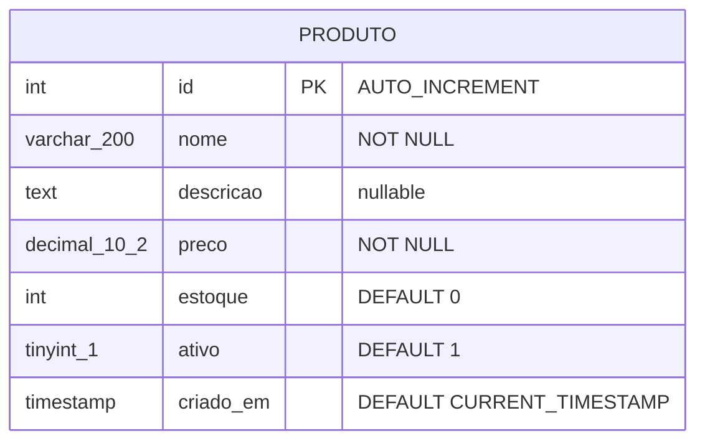

# Apoio ao Tópico 05 — A tabela `produto` (DECIMAL, agregações e preço)

**Disciplina:** Programação para Internet (ILP951)
**Professor:** Ronan Adriel Zenatti · ronan.zenatti@cps.sp.gov.br
**Fatec Jahu — 2º Semestre/2026**

> 📎 **Material de apoio.** No Tópico 05 o banco ganhou as tabelas `perfis` e `usuarios`. Alguns recursos de SQL ficaram de fora porque `usuarios` não tem colunas de preço, estoque ou texto longo: o tipo `DECIMAL`, o `TEXT`, o `BETWEEN` sobre valores, as funções `AVG`/`SUM`. Esta página os apresenta com uma tabela **`produto`**, para você praticar no mesmo banco `projeto_web`. Nada aqui é obrigatório para o CRUD de usuários, mas é o que você vai usar se o seu domínio tiver valores monetários.

---

## Estrutura da tabela `produto`



O `DECIMAL(10, 2)` suporta até `99999999.99` e guarda o valor **exato**, sem os erros de arredondamento do ponto flutuante. O `TEXT` serve a descrições longas, sem limite fixo.

## Criando a tabela e os dados de exemplo

Acrescente ao `db_setup.py` (ou rode em um script separado), depois da conexão:

**Passo 1 — criar a tabela.** Dentro do `try`, logo após a conexão:

```python
    # Cria a tabela de produtos
    cursor.execute('''
        CREATE TABLE IF NOT EXISTS produto (
            id         INT            AUTO_INCREMENT PRIMARY KEY,
            nome       VARCHAR(200)   NOT NULL,
            descricao  TEXT,
            preco      DECIMAL(10, 2) NOT NULL,
            estoque    INT            NOT NULL DEFAULT 0,
            ativo      TINYINT(1)     NOT NULL DEFAULT 1,
            criado_em  TIMESTAMP      DEFAULT CURRENT_TIMESTAMP
        ) CHARACTER SET utf8mb4 COLLATE utf8mb4_unicode_ci
    ''')
    # AUTO_INCREMENT: MySQL gera o id automaticamente (1, 2, 3, ...)
    # NOT NULL: campo obrigatório — INSERT sem esse campo gera erro
    # DEFAULT 0: valor padrão quando o campo não é informado no INSERT
    # DECIMAL(10,2): até 10 dígitos no total, 2 após a vírgula (ideal para preço)
    # TIMESTAMP DEFAULT CURRENT_TIMESTAMP: preenchido automaticamente

    conn.commit()
    print('✅ Tabela "produto" criada (ou já existia).')
```

Rode `python db_setup.py` de novo. No Workbench, atualize o painel Navigator (botão direito → Refresh All) e confirme que a tabela `produto` aparece dentro de `projeto_web`, mesmo sem nenhuma linha ainda.

**Passo 2 — verificar se já existem dados.** Antes de inserir exemplos, precisamos saber se a tabela já está populada (para não duplicar a cada execução do script). Adicione:

```python
    # Insere dados de exemplo apenas se a tabela estiver vazia
    cursor.execute('SELECT COUNT(*) FROM produto')
    total_existente = cursor.fetchone()[0]
    # fetchone() retorna a próxima linha do resultado como tupla; [0] pega o valor

    print(f'ℹ️  A tabela já contém {total_existente} registro(s).')
```

Rode novamente: como a tabela está vazia, a mensagem mostra `0 registro(s)`.

**Passo 3 — inserir os dados de exemplo.** Substitua a linha de `print` do Passo 3 pela lógica condicional que insere cinco produtos apenas na primeira execução:

```python
    if total_existente == 0:
        produtos_exemplo = [
            ('Notebook Dell Inspiron',    'i5, 8GB RAM, 256GB SSD',         3499.90, 15),
            ('Mouse Logitech MX Master',  'Sem fio ergonômico, 7 botões',    299.90, 42),
            ('Teclado Mecânico Redragon', 'Switches Red, retroiluminado',    189.90,  3),
            ('Monitor LG 24"',            'Full HD, 75Hz, painel IPS',      1199.90,  0),
            ('Headset HyperX Cloud',      'Som surround 7.1, microfone',     349.90, 27),
        ]
        cursor.executemany(
            'INSERT INTO produto (nome, descricao, preco, estoque) VALUES (%s, %s, %s, %s)',
            produtos_exemplo
        )
        # executemany: insere múltiplos registros com eficiência
        # %s são placeholders — NUNCA use f-strings ou concatenação em SQL
        # O conector trata cada %s como dado puro, nunca como código SQL
        conn.commit()
        print(f'✅ {len(produtos_exemplo)} produtos inseridos.')
    else:
        print(f'ℹ️  Tabela já contém {total_existente} registro(s).')
```

Rode `python db_setup.py` uma última vez: agora aparece `✅ 5 produtos inseridos.`. Rode de novo (uma segunda vez): a mensagem muda para `ℹ️ Tabela já contém 5 registro(s).` — a checagem do Passo 3 evita duplicar os dados.

---

## O SQL fundamental aplicado a `produto`

Antes de avançar para o CRUD completo, é essencial dominar os comandos SQL que o Python vai executar por baixo dos panos. Execute cada bloco no Workbench (`Ctrl+Enter`) e observe o resultado na grade antes de passar para o próximo:

```sql
-- ─── SELECT ──────────────────────────────────────────────────────
SELECT * FROM produto;
SELECT nome, preco, estoque FROM produto ORDER BY preco DESC;
SELECT * FROM produto WHERE estoque = 0;
SELECT * FROM produto WHERE preco BETWEEN 200 AND 500;
```

Rode esse primeiro bloco e observe: cada `SELECT` muda o que aparece na grade de resultados, do jeito que a cláusula pede.

```sql
-- LIKE com % busca texto em qualquer posição
SELECT * FROM produto WHERE nome LIKE '%mouse%';

-- Funções de agregação
SELECT COUNT(*)             AS total    FROM produto;
SELECT ROUND(AVG(preco), 2) AS media    FROM produto;
SELECT SUM(estoque)         AS estoque_total FROM produto;
```

Rode este segundo bloco: note que as funções de agregação (`COUNT`, `AVG`, `SUM`) devolvem uma única linha com o resultado calculado, diferente dos `SELECT` anteriores que devolviam várias linhas.

```sql
-- ─── INSERT ──────────────────────────────────────────────────────
INSERT INTO produto (nome, descricao, preco, estoque)
VALUES ('Webcam Logitech C920', 'Full HD 1080p, microfone duplo', 449.90, 18);
```

Rode o `INSERT` e depois repita `SELECT * FROM produto;`: a Webcam aparece como um sexto registro, com um novo `id` gerado automaticamente pelo `AUTO_INCREMENT`.

```sql
-- ─── UPDATE ──────────────────────────────────────────────────────
-- ATENÇÃO: sem WHERE o UPDATE afeta TODOS os registros!
UPDATE produto SET estoque = 10 WHERE id = 4;
UPDATE produto SET ativo   = 0  WHERE estoque = 0;
```

Rode o `UPDATE` e confira com um novo `SELECT` que só o produto de `id = 4` mudou de estoque — o `WHERE` é o que garante que a alteração fique restrita à linha certa.

```sql
-- ─── DELETE ──────────────────────────────────────────────────────
-- ATENÇÃO: sem WHERE o DELETE apaga TODOS os registros!
-- Sempre use WHERE com id específico:
DELETE FROM produto WHERE id = 99;
```

Como não existe produto com `id = 99`, esse `DELETE` não apaga nada — é proposital, para você rodá-lo sem risco de perder dados reais nesta prática.

Cada um desses comandos SQL tem um equivalente direto em Python via `execute_query`. Praticar no Workbench antes de codificar no Python é uma estratégia fundamental: você vê o resultado imediatamente, sem a variável do código Python adicionando complexidade ao diagnóstico.

---

## Listando produtos pelo Flask

```python
@app.route('/produtos')
def lista_produtos():
    try:
        produtos = execute_query(
            'SELECT * FROM produto WHERE ativo = 1 ORDER BY nome',
            fetch=True
        )
    except Exception as e:
        flash(f'Erro ao carregar produtos: {e}', 'danger')
        produtos = []

    return render_template('produtos.html', produtos=produtos, total=len(produtos))
```

---

⬅️ [Voltar ao Tópico 05](../Aula_05_Conexao_MySQL_e_Python.md)

*Fatec Jahu · ILP951 · Prof. Ronan Adriel Zenatti · 2026*
