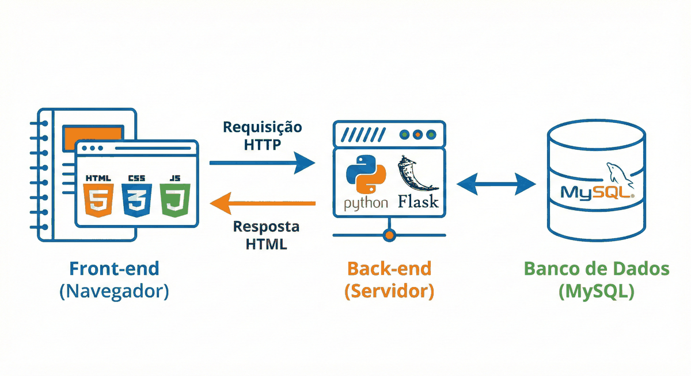
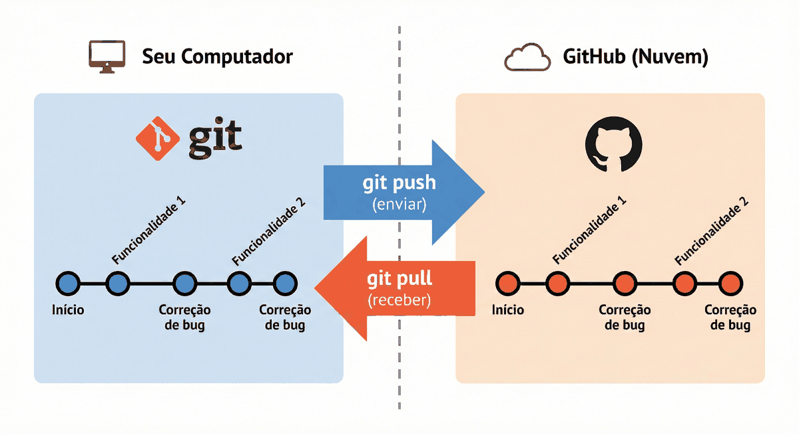
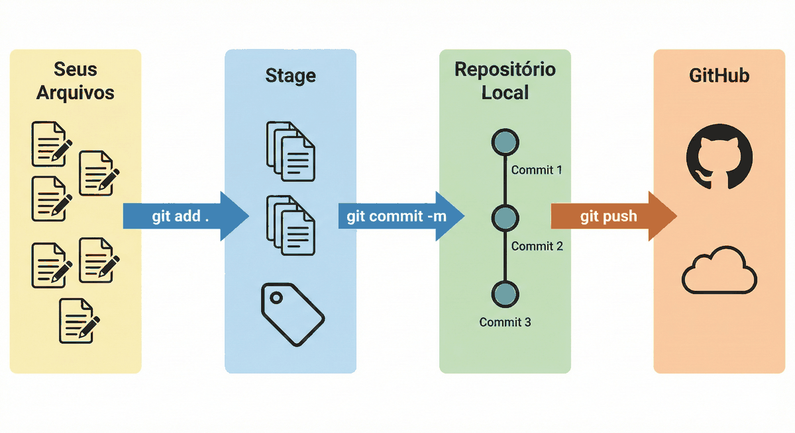
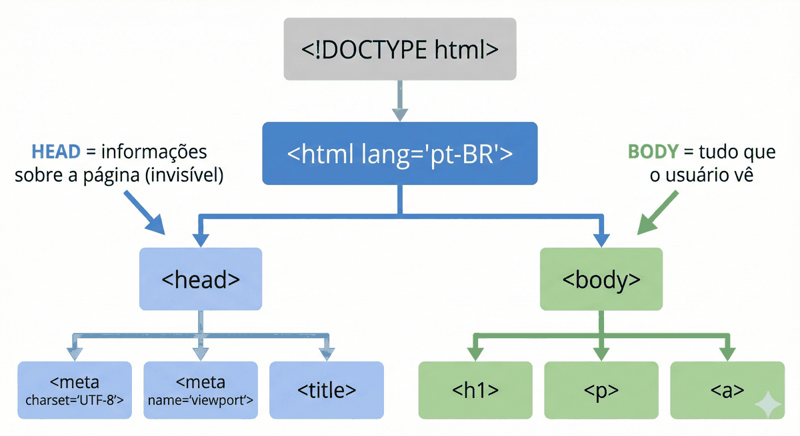

# Capítulo 01 — Git, GitHub, HTML5 e CSS

**Disciplina:** Programação para Internet (ILP951)
**Professor:** Ronan Adriel Zenatti · ronan.zenatti@cps.sp.gov.br
**Fatec Jahu — 2º Semestre/2026**

---

## 🎯 Objetivos do Capítulo

Ao final deste capítulo você deverá ser capaz de:

- Explicar o que são front-end, back-end e banco de dados e onde cada um aparece na aplicação que vamos construir
- Configurar o Git e registrar o histórico de um projeto com `init`, `add` e `commit`, deixando de fora o que não deve ser versionado com o `.gitignore`
- Criar um repositório no GitHub e enviar o projeto com `git push`
- Escrever um documento HTML5 válido, com as tags de texto, lista, tabela, imagem e formulário
- Montar a página estática do **Catálogo de Produtos** com tags semânticas (`header`, `nav`, `main`, `section`, `footer`) e estilizá-la com um arquivo CSS externo

Este capítulo é uma **revisão**: você já viu Git e HTML em outros momentos do curso. Aqui tudo é refeito com calma, porque o projeto que nasce neste capítulo, o **Catálogo de Produtos**, vai crescer até o Capítulo 10, e o Git vai acompanhar cada etapa dele.

---

## Tópico 1 — O que vamos construir e o ambiente

### Uma aplicação web em três camadas

Quando você pesquisa algo no Google, o navegador envia um pedido a um computador distante (o servidor), que consulta informações guardadas, monta uma página HTML e devolve para o navegador mostrar. Nessa história há três personagens:

- **Front-end:** tudo o que você vê e clica. Vive no navegador e é feito de HTML (estrutura), CSS (aparência) e JavaScript (comportamento).
- **Back-end:** o código que roda no servidor, recebe os pedidos, valida os dados e decide o que responder. Neste curso será Python com Flask.
- **Banco de dados:** onde as informações ficam guardadas de forma permanente. Neste curso será o MySQL.



Neste capítulo você constrói só a primeira camada, o front-end, como uma **página estática**: um arquivo que o navegador abre como está, sem servidor e sem banco. Do Capítulo 3 em diante, o back-end entra em cena.

### O projeto: Catálogo de Produtos

O **Projeto 1** (Capítulos 1 a 10) é um catálogo de produtos. Cada produto tem `nome`, `categoria` e `preco`. O catálogo começa como uma página HTML com os produtos escritos à mão (Capítulo 1), passa a ser gerado por Python (Capítulos 3 a 9) e termina lendo os produtos de um banco MySQL (Capítulo 10).

### Instalando o Visual Studio Code

O **VS Code** é o editor de código que usaremos. Dá para escrever HTML até em um editor de texto simples, mas um editor de código colore cada tipo de elemento (o que facilita a leitura), sugere o que você está digitando e traz um terminal embutido.

Acesse **code.visualstudio.com**, baixe a versão para Windows e instale aceitando as opções padrão. Depois abra a tela de extensões (ícone de blocos na barra lateral esquerda, ou `Ctrl + Shift + X`), busque **Prettier - Code formatter** e clique em **Install**. O Prettier arruma a indentação do código quando você pede.

!!! note "Como usar o Prettier"
    Em qualquer arquivo aberto, pressione `Shift + Alt + F` (formatar documento). Na primeira vez, o VS Code pergunta qual formatador usar: escolha **Prettier**. Dali em diante o mesmo atalho reorganiza o arquivo inteiro.

### Criando a pasta do projeto

Um projeto vive em uma pasta própria. Abra o VS Code e, no menu, escolha **Terminal → New Terminal** (atalho `Ctrl + '`). O terminal sempre abre na pasta do seu usuário (algo como `C:\Users\SeuNome`), e a Área de Trabalho fica dentro dela, com o nome `Desktop`. Digite:

```bash
cd Desktop
mkdir catalogo-produtos
cd catalogo-produtos
code .
```

- `cd` entra em uma pasta (de *change directory*);
- `mkdir` cria uma pasta (de *make directory*);
- `code .` abre o VS Code na pasta atual. O ponto (`.`) significa "aqui".

O VS Code reabre dentro de `catalogo-produtos`, vazia. Esse é o ponto de partida do Projeto 1.

---

## Tópico 2 — Git: o histórico do projeto no seu computador

### O problema

Você já escreveu um documento e acabou com isto na pasta?

```text
relatorio.docx
relatorio_v2.docx
relatorio_v3_final.docx
relatorio_v3_final_MESMO.docx
```

Qual é a versão certa? O que mudou entre a 2 e a 3? Em programação esse caos é pior, porque um projeto tem dezenas de arquivos que mudam juntos. O **Git** resolve isso: ele guarda cada versão do projeto como um registro chamado **commit**, com a descrição do que mudou, quando e por quem, e permite voltar a qualquer ponto da história.

### Git e GitHub são coisas diferentes

- **Git** é o programa instalado no seu computador, que controla as versões localmente. É o seu diário.
- **GitHub** é um serviço na internet que guarda uma cópia desse histórico na nuvem e permite compartilhá-la. É o cofre.



A figura mostra também o `git pull` (trazer a nuvem para o computador). Ele aparece no Capítulo 2. Por enquanto, só o `git push` (enviar) interessa.

### Instalando e configurando

Acesse **git-scm.com**, baixe o instalador e aceite as opções padrão. Feche e abra o terminal do VS Code e confirme:

```bash
git --version
```

Deve aparecer algo como `git version 2.45.0`. Agora diga ao Git quem você é. Esse nome e e-mail ficam gravados em cada commit:

```bash
git config --global user.name "Seu Nome Completo"
git config --global user.email "seu.email@example.com"
git config --global init.defaultBranch main
```

A terceira linha escolhe `main` como nome da linha principal de histórico (a *branch*) dos projetos novos, que é o nome que o GitHub usa. O `--global` grava a configuração para o seu usuário do computador, então você faz isso uma única vez.

### Criando o repositório

Com o terminal aberto em `catalogo-produtos`:

```bash
git init
```

O Git cria uma pasta oculta `.git` com todo o histórico. A pasta do projeto agora é um **repositório**. Veja o estado dele:

```bash
git status
```

A resposta traz `On branch main` e `No commits yet` (nenhum commit ainda). O `git status` é o comando que você mais vai usar: ele diz o que mudou e o que está pronto para entrar no próximo commit.

### O primeiro arquivo

No VS Code, crie o arquivo `index.html` (botão de "novo arquivo" no explorador ou `Ctrl + N` e salvar com esse nome) com este conteúdo:

```html
<!DOCTYPE html>
<html lang="pt-BR">
<head>
  <meta charset="UTF-8">
  <title>Catálogo de Produtos</title>
</head>
<body>
  <h1>Catálogo de Produtos</h1>
</body>
</html>
```

Copie como está. Cada linha é explicada no Tópico 4. Salve e rode `git status` de novo: o `index.html` aparece em vermelho, em **Untracked files** (arquivos não rastreados). O Git viu o arquivo, mas ainda não guarda o histórico dele.

### O que o Git não deve guardar

Crie agora outro arquivo, `rascunho.txt`, com qualquer texto, por exemplo `ideias soltas`. Esse arquivo é só uma anotação pessoal. Rode `git status`: ele também aparece como não rastreado, e se você usasse `git add .` agora ele iria junto para o histórico.

Para avisar o Git de que certos arquivos devem ser ignorados, crie o arquivo `.gitignore` (com o ponto no começo, na raiz da pasta) com este conteúdo:

```text
# Anotações pessoais que não vão para o repositório
rascunho.txt

# Configurações locais do VS Code
.vscode/

# Arquivos que o sistema operacional cria sozinho
Thumbs.db
.DS_Store
```

Salve e rode `git status`. O `rascunho.txt` **sumiu** da lista, e o `.gitignore` apareceu. Cada linha do `.gitignore` é um nome de arquivo ou pasta (a barra no final indica pasta); linhas com `#` são comentários.

!!! note "O `.gitignore` cresce com o projeto"
    Agora ele só tem o que existe hoje. Quando o Python entrar no Capítulo 3, ele ganha linhas para a pasta do ambiente virtual e para os arquivos temporários do Python.

### O caminho de um arquivo até o histórico

Todo commit passa por três lugares:

1. **Seus arquivos:** o que você edita na pasta.
2. **Stage** (área de preparação): onde você escolhe o que vai entrar no próximo commit. O comando é `git add`.
3. **Repositório local:** o histórico, onde `git commit` grava os arquivos que estavam no stage.



Veja o `add` funcionando. Primeiro adicione **só um** arquivo:

```bash
git add index.html
git status
```

Agora o `index.html` aparece em verde, em **Changes to be committed** (alterações a serem confirmadas): ele está no stage. O `.gitignore` continua em vermelho, ainda fora. Para levar tudo de uma vez:

```bash
git add .
git status
```

O ponto significa "tudo o que mudou nesta pasta". Os dois arquivos estão em verde, e o `rascunho.txt` continua de fora.

!!! note "O aviso sobre LF e CRLF"
    No Windows o Git pode imprimir `warning: LF will be replaced by CRLF`. É só um aviso sobre o tipo de quebra de linha e pode ser ignorado.

Falta gravar. O `commit` guarda o que está no stage, com uma mensagem que diz **o que** foi feito:

```bash
git commit -m "Cria a página inicial do catálogo"
git log --oneline
git status
```

O `git log --oneline` lista o histórico (um commit com um código curto e a sua mensagem) e o `git status` agora diz `nothing to commit, working tree clean`: tudo o que existe na pasta está guardado.

!!! tip "Mensagens de commit"
    Escreva em português, no imperativo e dizendo o que o commit faz: "Adiciona a tabela de produtos", "Corrige o título da página". Daqui a um mês, é a mensagem que vai dizer o que cada commit mudou.

Este é o seu **primeiro commit**. Ele existe só no seu computador. No próximo tópico ele vai para a nuvem.

---

## Tópico 3 — GitHub: enviando o projeto para a nuvem

### Criando o repositório remoto

Entre em **github.com** e faça login (ou crie uma conta gratuita). Clique em **New repository** (botão verde, ou o `+` no canto superior direito) e preencha:

- **Repository name:** `catalogo-produtos`
- **Public** ou **Private**, como preferir
- **Deixe desmarcadas** as opções de adicionar README, `.gitignore` e licença. O repositório precisa nascer vazio, porque o histórico já existe no seu computador.

Clique em **Create repository**. A página seguinte mostra o endereço do repositório, no formato `https://github.com/SEU-USUARIO/catalogo-produtos.git`.

### Conectando e enviando

De volta ao terminal do VS Code, troque `SEU-USUARIO` pelo seu nome de usuário do GitHub:

```bash
git remote add origin https://github.com/SEU-USUARIO/catalogo-produtos.git
git branch -M main
git push -u origin main
```

- `git remote add origin ...` registra o endereço do GitHub com o apelido `origin` (o "remoto" principal);
- `git branch -M main` garante que a linha de histórico se chama `main` (se você configurou o `init.defaultBranch` no tópico anterior, não muda nada);
- `git push -u origin main` envia o histórico. O `-u` grava a ligação entre sua `main` local e a `main` do GitHub, então nas próximas vezes basta `git push`.

Na primeira vez o Git abre o navegador para você entrar no GitHub e autorizar o acesso. O GitHub não aceita mais a senha da conta pelo terminal; essa autorização pelo navegador é o caminho normal.

Atualize a página do repositório no GitHub: o `index.html` e o `.gitignore` estão lá, e o `rascunho.txt` não. Para conferir o endereço registrado:

```bash
git remote -v
```

### O ciclo de edição

Repetiremos esse ciclo ao longo de todo o curso. No `index.html`, logo abaixo do `<h1>`, acrescente uma linha:

```html
  <p>Página em construção.</p>
```

Salve. Veja o que o Git percebe:

```bash
git status
```

O `index.html` aparece em **Changes not staged for commit**, com a palavra `modified`: ele já era conhecido e mudou. Agora o ciclo completo:

```bash
git add .
git commit -m "Adiciona o aviso de página em construção"
git push
```

Atualize a página do GitHub. O arquivo mostra a mudança, e o repositório lista 2 commits. A partir daqui, **todo** bloco de commit do curso termina com `git push`.

!!! tip "O ciclo em uma linha"
    Editar → salvar → `git status` → `git add .` → `git commit -m "..."` → `git push`.

---

## Tópico 4 — HTML5: estrutura e tags

### O que é HTML

**HTML** (HyperText Markup Language) define a **estrutura e o conteúdo** de uma página. Ele não é uma linguagem de programação: não tem lógica nem repetição. Ele **marca** pedaços de conteúdo para dizer o que cada um é: "isto é um título", "isto é um parágrafo", "isto é um link".

A unidade básica é a **tag**, um rótulo entre `<` e `>`. A maioria vem em par, uma de abertura e uma de fechamento (com uma barra `/` antes do nome):

```html
<p>Este texto é um parágrafo.</p>
```

### A estrutura de todo documento HTML5

O `index.html` que você criou no Tópico 2 já segue o esqueleto que todo documento HTML5 precisa ter:



```html
<!DOCTYPE html>
<!-- Declara que este é um documento HTML5. Sempre a primeira linha. -->

<html lang="pt-BR">
<!-- Envolve todo o documento. lang="pt-BR" informa o idioma para navegadores
     e leitores de tela (importante para acessibilidade). -->

  <head>
    <!-- Informações SOBRE a página. O usuário não vê o que está aqui. -->

    <meta charset="UTF-8">
    <!-- Codificação de caracteres. Sem ela, acentos e cedilhas como
         ã, é, ç aparecem como símbolos estranhos. -->

    <meta name="viewport" content="width=device-width, initial-scale=1.0">
    <!-- Essencial para celulares: diz ao navegador para não reduzir o zoom
         automaticamente. -->

    <title>Minha Primeira Página</title>
    <!-- Aparece na aba do navegador e nos resultados de busca. Não aparece
         no corpo da página. -->

  </head>

  <body>
    <!-- TUDO o que aparece na tela: textos, imagens, tabelas, formulários... -->

    <h1>Olá, mundo!</h1>
    <p>Este é meu primeiro parágrafo em HTML5.</p>

  </body>

</html>
```

Repare na **indentação**: os espaços no começo de cada linha. O navegador os ignora, mas eles deixam a hierarquia legível para você. Use 2 espaços por nível, e o Prettier (`Shift + Alt + F`) faz isso por você.

### Treinando as tags

Para conhecer as tags de uso mais comum, crie uma pasta `treino` dentro do projeto e, nela, três arquivos pequenos. Eles não fazem parte do catálogo, são um laboratório. Em cada um, salve, abra o arquivo no navegador (clique duas vezes nele no explorador de arquivos do Windows) e observe o que cada trecho novo faz antes de seguir.

#### Exemplo 1 — Página de apresentação (`treino/pagina_pessoal.html`)

Comece com o esqueleto e um único `<h1>`:

```html
<!DOCTYPE html>
<html lang="pt-BR">
<head>
  <meta charset="UTF-8">
  <meta name="viewport" content="width=device-width, initial-scale=1.0">
  <title>Sobre Mim</title>
</head>
<body>

  <h1>João Silva</h1>
  <!-- h1 = título principal da página: maior, em negrito, um só por página -->

</body>
</html>
```

Salve e abra no navegador. A aba mostra "Sobre Mim" (o `<title>`) e a página mostra "João Silva" em destaque (o `<h1>`): são coisas diferentes.

Depois do `<h1>`, acrescente um subtítulo e um parágrafo:

```html
  <h2>Sobre mim</h2>
  <!-- h2 = subtítulo: menor que o h1, organiza seções -->

  <p>
    Olá! Meu nome é João, tenho 22 anos e estou cursando Gestão da Tecnologia
    da Informação na FATEC Jahu. Tenho interesse em desenvolvimento web e
    banco de dados.
  </p>
  <!-- p = parágrafo: o navegador põe espaço antes e depois -->
```

Salve e recarregue (`F5`). O `<h2>` é menor que o `<h1>` e o parágrafo ganhou espaçamento sem você pedir.

Agora uma lista:

```html
  <h2>Minhas habilidades</h2>

  <ul>
    <!-- ul = lista com marcadores. Use quando a ordem dos itens não importa. -->
    <li>HTML e CSS</li>
    <!-- li = cada item da lista -->
    <li>Python (em aprendizado)</li>
    <li>MySQL</li>
    <li>Git e GitHub</li>
  </ul>
```

Salve e recarregue: cada `<li>` virou um item com marcador.

Por fim, um link:

```html
  <h2>Contato</h2>

  <p>
    Me encontre no GitHub:
    <a href="https://github.com/joaosilva">github.com/joaosilva</a>
    <!-- a = link. href = endereço de destino. O texto entre as tags é o
         que o usuário clica. -->
  </p>
```

Salve e recarregue. O link aparece sublinhado e em azul (o estilo padrão do navegador) e leva ao endereço do `href`. O arquivo completo:

```html
<!DOCTYPE html>
<html lang="pt-BR">
<head>
  <meta charset="UTF-8">
  <meta name="viewport" content="width=device-width, initial-scale=1.0">
  <title>Sobre Mim</title>
</head>
<body>

  <h1>João Silva</h1>

  <h2>Sobre mim</h2>

  <p>
    Olá! Meu nome é João, tenho 22 anos e estou cursando Gestão da Tecnologia
    da Informação na FATEC Jahu. Tenho interesse em desenvolvimento web e
    banco de dados.
  </p>

  <h2>Minhas habilidades</h2>

  <ul>
    <li>HTML e CSS</li>
    <li>Python (em aprendizado)</li>
    <li>MySQL</li>
    <li>Git e GitHub</li>
  </ul>

  <h2>Contato</h2>

  <p>
    Me encontre no GitHub:
    <a href="https://github.com/joaosilva">github.com/joaosilva</a>
  </p>

</body>
</html>
```

#### Exemplo 2 — Tabela de horários (`treino/horarios.html`)

Uma tabela organiza dados em linhas e colunas e usa quatro tags que trabalham juntas. Comece com o esqueleto, o `<h1>` e só a linha de cabeçalho:

```html
<!DOCTYPE html>
<html lang="pt-BR">
<head>
  <meta charset="UTF-8">
  <meta name="viewport" content="width=device-width, initial-scale=1.0">
  <title>Grade de Horários</title>
</head>
<body>

  <h1>Grade de Horários — 2º Semestre 2026</h1>

  <table border="1">
    <!-- table = a tabela inteira. border="1" desenha bordas só para você
         enxergar a estrutura; a aparência de verdade vem do CSS. -->

    <thead>
      <!-- thead = agrupa a linha de cabeçalho -->
      <tr>
        <!-- tr = uma linha da tabela (de "table row") -->
        <th>Dia</th>
        <!-- th = célula de cabeçalho: negrito e centralizada -->
        <th>Horário</th>
        <th>Disciplina</th>
        <th>Professor</th>
      </tr>
    </thead>

  </table>

</body>
</html>
```

Salve e abra: só o cabeçalho aparece, porque ainda não há linhas de dados. Dentro do `<table>`, logo depois do `</thead>`, acrescente o corpo da tabela com a primeira linha:

```html
    <tbody>
      <!-- tbody = agrupa as linhas de dados -->
      <tr>
        <td>Segunda-feira</td>
        <!-- td = célula de dado comum (de "table data") -->
        <td>19h00 — 20h40</td>
        <td>Programação para Internet</td>
        <td>Ronan Zenatti</td>
      </tr>
    </tbody>
```

Salve e recarregue. Uma linha de dados apareceu abaixo do cabeçalho, e o texto dos `<td>` não vem em negrito, ao contrário do dos `<th>`. Agora acrescente mais duas linhas dentro do `<tbody>`, logo depois da primeira `</tr>`:

```html
      <tr>
        <td>Quarta-feira</td>
        <td>19h00 — 20h40</td>
        <td>Programação para Internet</td>
        <td>Ronan Zenatti</td>
      </tr>
      <tr>
        <td>Quinta-feira</td>
        <td>19h00 — 20h40</td>
        <td>Redes de Computadores</td>
        <td>Professor X</td>
      </tr>
```

Salve e recarregue. A grade tem três linhas completas. O arquivo completo:

```html
<!DOCTYPE html>
<html lang="pt-BR">
<head>
  <meta charset="UTF-8">
  <meta name="viewport" content="width=device-width, initial-scale=1.0">
  <title>Grade de Horários</title>
</head>
<body>

  <h1>Grade de Horários — 2º Semestre 2026</h1>

  <table border="1">

    <thead>
      <tr>
        <th>Dia</th>
        <th>Horário</th>
        <th>Disciplina</th>
        <th>Professor</th>
      </tr>
    </thead>

    <tbody>
      <tr>
        <td>Segunda-feira</td>
        <td>19h00 — 20h40</td>
        <td>Programação para Internet</td>
        <td>Ronan Zenatti</td>
      </tr>
      <tr>
        <td>Quarta-feira</td>
        <td>19h00 — 20h40</td>
        <td>Programação para Internet</td>
        <td>Ronan Zenatti</td>
      </tr>
      <tr>
        <td>Quinta-feira</td>
        <td>19h00 — 20h40</td>
        <td>Redes de Computadores</td>
        <td>Professor X</td>
      </tr>
    </tbody>

  </table>

</body>
</html>
```

#### Exemplo 3 — Imagem e formulário (`treino/contato.html`)

Este exemplo apresenta a tag de imagem e a estrutura de um formulário. Os formulários são estudados a fundo no Capítulo 7. Aqui, observe só o papel de cada tag. Comece com o esqueleto, um `<h1>` e uma imagem:

```html
<!DOCTYPE html>
<html lang="pt-BR">
<head>
  <meta charset="UTF-8">
  <meta name="viewport" content="width=device-width, initial-scale=1.0">
  <title>Contato</title>
</head>
<body>

  <h1>Entre em Contato</h1>

  
  <!-- img = exibe uma imagem.
       src = caminho ou endereço da imagem (de "source").
       alt = texto alternativo: aparece se a imagem não carregar e é lido
             por leitores de tela. NUNCA omita o alt.
       width = largura em pixels.
        não tem tag de fechamento: é um "void element", uma tag que
       não envolve conteúdo. -->

</body>
</html>
```

Salve e abra. A imagem vem do **Picsum** (picsum.photos), um serviço que devolve uma foto de exemplo no tamanho pedido na própria URL (`150` é a largura e a altura, em pixels). Por isso o computador precisa estar conectado à internet, e a foto muda a cada vez que a página é carregada.

!!! note "Quando a imagem não aparece"
    Serviços de imagem de terceiros às vezes ficam fora do ar. Se isso acontecer, o navegador mostra o texto do `alt` ("Foto de perfil") no lugar da imagem. É exatamente para isso que o `alt` serve, e por isso ele nunca deve ser omitido.

Depois da imagem, abra o formulário com um campo de texto:

```html
  <h2>Envie uma mensagem</h2>

  <form>
    <!-- form = agrupa campos de entrada de dados. -->

    <label for="nome">Seu nome:</label>
    <!-- label = rótulo de um campo. O "for" deve ser igual ao "id" do input
         que ele descreve: clicar no rótulo leva o cursor ao campo. -->
    <br>
    <input type="text" id="nome" name="nome" placeholder="Digite seu nome">
    <!-- input = campo de entrada (também sem tag de fechamento).
         type="text" = texto de uma linha.
         placeholder = texto de dica que some ao digitar. -->
    <br><br>

  </form>
```

Salve e recarregue. Clique no texto "Seu nome:": o cursor vai direto ao campo, efeito do `for` combinado com o `id`. Dentro do `<form>`, depois do campo de nome e antes do `</form>`, acrescente o e-mail:

```html
    <label for="email">Seu e-mail:</label>
    <br>
    <input type="email" id="email" name="email" placeholder="seu@email.com">
    <!-- type="email": o navegador confere se o texto tem formato de e-mail
         antes de deixar enviar o formulário. -->
    <br><br>
```

Depois, o campo de mensagem, também dentro do `<form>`:

```html
    <label for="mensagem">Mensagem:</label>
    <br>
    <textarea id="mensagem" name="mensagem" rows="4" cols="40"
              placeholder="Escreva aqui..."></textarea>
    <!-- textarea = texto de várias linhas. Ao contrário do input, TEM tag de
         fechamento. rows e cols definem o tamanho inicial. -->
    <br><br>
```

Salve e recarregue. O `<textarea>` é uma caixa de várias linhas, enquanto o `<input type="text">` tem uma só. Por fim, o botão que fecha o formulário:

```html
    <button type="submit">Enviar Mensagem</button>
    <!-- type="submit" envia o formulário ao servidor. Ainda não existe
         servidor para receber (isso começa no Capítulo 3), mas a estrutura
         já está correta. -->
```

Salve e recarregue. Clicar no botão ainda não faz nada de útil, porque falta o back-end. Tente digitar um texto sem `@` no campo de e-mail e clicar no botão: o navegador reclama sozinho, por causa do `type="email"`. O arquivo completo:

```html
<!DOCTYPE html>
<html lang="pt-BR">
<head>
  <meta charset="UTF-8">
  <meta name="viewport" content="width=device-width, initial-scale=1.0">
  <title>Contato</title>
</head>
<body>

  <h1>Entre em Contato</h1>

  

  <h2>Envie uma mensagem</h2>

  <form>

    <label for="nome">Seu nome:</label>
    <br>
    <input type="text" id="nome" name="nome" placeholder="Digite seu nome">
    <br><br>

    <label for="email">Seu e-mail:</label>
    <br>
    <input type="email" id="email" name="email" placeholder="seu@email.com">
    <br><br>

    <label for="mensagem">Mensagem:</label>
    <br>
    <textarea id="mensagem" name="mensagem" rows="4" cols="40"
              placeholder="Escreva aqui..."></textarea>
    <br><br>

    <button type="submit">Enviar Mensagem</button>
  </form>

</body>
</html>
```

Para registrar os três exemplos no Git:

```bash
git add .
git commit -m "Adiciona os exemplos de treino de HTML"
git push
```

---

## Tópico 5 — HTML semântico: a página do catálogo

### O problema das caixas sem nome

Nos exemplos de treino, tudo era `<h1>`, `<p>` e `<table>`, tags que descrevem **o conteúdo**. Uma página real também tem **regiões**: o topo, o menu, o conteúdo principal, o rodapé. Dá para marcar todas com uma tag genérica sem significado (`<div>`), mas aí ninguém, nem o Google, nem um leitor de tela, nem você daqui a um mês, sabe o que cada caixa é.

O HTML5 tem tags **semânticas**, cujo nome já diz o papel da região:

| Tag | Papel |
|---|---|
| `<header>` | Topo da página (ou de uma seção): título, subtítulo, menu |
| `<nav>` | Conjunto de links de navegação |
| `<main>` | O conteúdo principal da página, um só por página |
| `<section>` | Um bloco temático do conteúdo, normalmente com um título (`<h2>`) |
| `<footer>` | Rodapé: autoria, ano, contatos |

Existem outras, como `<article>` (um conteúdo que faz sentido sozinho, como um cartão de produto) e `<aside>` (conteúdo lateral). Elas aparecem mais adiante, quando o Bootstrap entrar.

Visualmente, elas não mudam nada: sem CSS, `<header>` e `<section>` se comportam como qualquer bloco. O ganho é de significado, não de aparência.

### Montando o `index.html` do catálogo

Vamos substituir o `index.html` provisório por uma página completa, um bloco de cada vez. Abra o `index.html` e deixe-o assim, só com o topo da página:

```html
<!DOCTYPE html>
<html lang="pt-BR">
<head>
  <meta charset="UTF-8">
  <meta name="viewport" content="width=device-width, initial-scale=1.0">
  <title>Catálogo de Produtos</title>
</head>
<body>

  <header>
    <h1>Catálogo de Produtos</h1>
    <p>Papelaria, informática e utilidades para o dia a dia.</p>
  </header>

</body>
</html>
```

Salve e abra o arquivo no navegador. A página parece igual a uma sem `<header>`, e é isso mesmo: o significado está no código. Dentro do `<header>`, depois do parágrafo, acrescente o menu:

```html
    <nav>
      <a href="#produtos">Produtos</a>
      <a href="#categorias">Categorias</a>
    </nav>
```

Salve e recarregue. Dois links aparecem. O `#produtos` é um **link interno**: o `#` aponta para o elemento da própria página cujo `id` é `produtos`. Eles ainda não levam a lugar nenhum, porque esses elementos não existem. Vamos criá-los. Depois do `</header>`, acrescente o conteúdo principal com a primeira seção:

```html
  <main>
    <section id="produtos">
      <h2>Produtos</h2>
      <table>
        <thead>
          <tr>
            <th>Nome</th>
            <th>Categoria</th>
            <th>Preço</th>
          </tr>
        </thead>
        <tbody>
          <tr>
            <td>Caneta esferográfica azul</td>
            <td>Papelaria</td>
            <td>R$ 2,50</td>
          </tr>
          <tr>
            <td>Caderno universitário 96 folhas</td>
            <td>Papelaria</td>
            <td>R$ 18,90</td>
          </tr>
        </tbody>
      </table>
    </section>
  </main>
```

Salve e recarregue. A tabela aparece com dois produtos. Clique em **Produtos** no menu: o navegador "pula" para a seção (como a página é curta, o efeito é sutil). O `id="produtos"` é o destino do link. Acrescente os outros quatro produtos no `<tbody>`, depois do segundo:

```html
          <tr>
            <td>Mouse sem fio</td>
            <td>Informática</td>
            <td>R$ 59,90</td>
          </tr>
          <tr>
            <td>Teclado USB</td>
            <td>Informática</td>
            <td>R$ 89,90</td>
          </tr>
          <tr>
            <td>Garrafa térmica 500 ml</td>
            <td>Casa</td>
            <td>R$ 49,90</td>
          </tr>
          <tr>
            <td>Mochila escolar</td>
            <td>Acessórios</td>
            <td>R$ 129,00</td>
          </tr>
```

Salve e recarregue: seis produtos, cada um com `nome`, `categoria` e `preço`. Essa é a mesma forma de dado que o banco de dados vai guardar no Capítulo 10. Dentro do `<main>`, depois do `</section>` dos produtos, acrescente a segunda seção, para o link **Categorias** ter destino:

```html
    <section id="categorias">
      <h2>Categorias</h2>
      <ul>
        <li>Papelaria</li>
        <li>Informática</li>
        <li>Casa</li>
        <li>Acessórios</li>
      </ul>
    </section>
```

Por fim, depois do `</main>`, o rodapé:

```html
  <footer>
    <p>Catálogo de Produtos · Fatec Jahu · ILP951 · 2026</p>
  </footer>
```

Salve, recarregue e clique nos dois links do menu. O `index.html` completo neste ponto:

```html
<!DOCTYPE html>
<html lang="pt-BR">
<head>
  <meta charset="UTF-8">
  <meta name="viewport" content="width=device-width, initial-scale=1.0">
  <title>Catálogo de Produtos</title>
</head>
<body>

  <header>
    <h1>Catálogo de Produtos</h1>
    <p>Papelaria, informática e utilidades para o dia a dia.</p>
    <nav>
      <a href="#produtos">Produtos</a>
      <a href="#categorias">Categorias</a>
    </nav>
  </header>

  <main>
    <section id="produtos">
      <h2>Produtos</h2>
      <table>
        <thead>
          <tr>
            <th>Nome</th>
            <th>Categoria</th>
            <th>Preço</th>
          </tr>
        </thead>
        <tbody>
          <tr>
            <td>Caneta esferográfica azul</td>
            <td>Papelaria</td>
            <td>R$ 2,50</td>
          </tr>
          <tr>
            <td>Caderno universitário 96 folhas</td>
            <td>Papelaria</td>
            <td>R$ 18,90</td>
          </tr>
          <tr>
            <td>Mouse sem fio</td>
            <td>Informática</td>
            <td>R$ 59,90</td>
          </tr>
          <tr>
            <td>Teclado USB</td>
            <td>Informática</td>
            <td>R$ 89,90</td>
          </tr>
          <tr>
            <td>Garrafa térmica 500 ml</td>
            <td>Casa</td>
            <td>R$ 49,90</td>
          </tr>
          <tr>
            <td>Mochila escolar</td>
            <td>Acessórios</td>
            <td>R$ 129,00</td>
          </tr>
        </tbody>
      </table>
    </section>

    <section id="categorias">
      <h2>Categorias</h2>
      <ul>
        <li>Papelaria</li>
        <li>Informática</li>
        <li>Casa</li>
        <li>Acessórios</li>
      </ul>
    </section>
  </main>

  <footer>
    <p>Catálogo de Produtos · Fatec Jahu · ILP951 · 2026</p>
  </footer>

</body>
</html>
```

!!! note "O catálogo copiado à mão"
    Repare que cada produto é um bloco de seis linhas de HTML repetido à mão. Para um sexto produto, copiamos e colamos; para mil, seria inviável. Esse incômodo é proposital: nos Capítulos 3 e 5, o Python e o Jinja geram essas linhas por você.

Registre no Git:

```bash
git add .
git commit -m "Monta a página do catálogo com HTML semântico"
git push
```

---

## Tópico 6 — CSS básico: dando aparência ao catálogo

### O problema

A página funciona, mas está com a aparência padrão do navegador: fundo branco, letra serifada, tabela sem bordas. O **CSS** (Cascading Style Sheets) é a linguagem que define a **aparência** do HTML: cores, fontes, espaçamentos, larguras.

Uma primeira tentativa seria estilizar tag por tag, com o atributo `style`. Experimente no `index.html`, nos dois `<h2>`:

```html
<h2 style="color: #1f4e79;">Produtos</h2>
...
<h2 style="color: #1f4e79;">Categorias</h2>
```

Funciona, mas a mesma cor está escrita duas vezes. Para trocar o azul, você teria que achar e alterar cada `<h2>` da página (e, em um site de 50 páginas, de todas). Desfaça essa mudança (`Ctrl + Z` ou volte o `<h2>` ao que era): o caminho certo é separar o estilo em **um arquivo só**.

### Ligando um arquivo CSS ao HTML

Crie na raiz do projeto o arquivo `estilo.css`. No `index.html`, dentro do `<head>`, depois do `<title>`, acrescente a linha que liga os dois:

```html
  <link rel="stylesheet" href="estilo.css">
```

O `<link>` diz ao navegador: "carregue também este arquivo de estilos". Como o ``, ele não tem tag de fechamento.

### A anatomia de uma regra CSS

Uma regra tem um **seletor** (quem será estilizado) e, entre chaves, as **declarações** (`propriedade: valor;`). No `estilo.css`, escreva a primeira regra:

```css
body {
  font-family: Arial, sans-serif;
  background-color: #f4f6f8;
  color: #222222;
  margin: 0;
}
```

Salve os dois arquivos e recarregue a página. Fonte, fundo e cor do texto mudaram de uma vez para a página inteira, porque tudo está dentro do `<body>`. As cores aparecem em **hexadecimal** (`#RRGGBB`: quantidade de vermelho, verde e azul). O VS Code mostra um quadradinho colorido ao lado de cada uma. O `margin: 0` tira a margem que o navegador põe em volta do `<body>`.

### Seletor de tag: o topo e o menu

Um seletor que é só o nome de uma tag estilizou todas as tags daquele nome. Acrescente ao `estilo.css`:

```css
header {
  background-color: #1f4e79;
  color: #ffffff;
  padding: 24px;
  text-align: center;
}
```

Salve e recarregue. O topo ganhou faixa azul com texto branco e centralizado. O `padding` é o espaço **por dentro** do elemento, entre o conteúdo e a borda da caixa.

!!! note "O modelo de caixa"
    Todo elemento HTML é uma caixa com quatro camadas, de dentro para fora: o **conteúdo**; o **padding** (espaço interno); a **border** (borda); e a **margin** (espaço externo, entre a caixa e as vizinhas). Quase todo ajuste de espaçamento é uma conversa entre `padding`, `border` e `margin`.

Agora os links do menu, que estão azuis e sublinhados sobre fundo azul:

```css
nav a {
  color: #ffffff;
  margin: 0 12px;
  text-decoration: none;
}

nav a:hover {
  text-decoration: underline;
}
```

O seletor `nav a` significa "todo `<a>` que está **dentro** de um `<nav>`". Salve e recarregue: links brancos, com espaço entre eles e sem sublinhado. O `:hover` aplica a regra só **enquanto o mouse está sobre** o link: passe o mouse e o sublinhado volta. O `margin: 0 12px` dá 0 de margem em cima e embaixo e 12 pixels dos lados.

### O conteúdo centralizado e os títulos

```css
main {
  max-width: 800px;
  margin: 24px auto;
  padding: 0 16px;
}

h2 {
  color: #1f4e79;
  border-bottom: 2px solid #1f4e79;
  padding-bottom: 4px;
}
```

Salve e recarregue. O conteúdo ficou com no máximo 800 pixels de largura, centralizado: `margin: 24px auto` põe 24 pixels em cima e embaixo e deixa o navegador dividir o espaço restante dos lados (`auto`). Redimensione a janela do navegador para ver. Os `<h2>` ganharam a cor azul e uma linha embaixo. Compare com a tentativa do começo do tópico: **uma** regra estiliza todos os `<h2>`, agora e no futuro.

### Seletor de id e seletor de classe

Há duas outras formas de apontar para um elemento específico, além do nome da tag:

- **`#nome`** (seletor de **id**) escolhe o único elemento com `id="nome"`. O `id` é único na página;
- **`.nome`** (seletor de **classe**) escolhe todos os elementos com `class="nome"`. A classe pode ser repetida em vários elementos, até de tags diferentes.

Use o id que o menu já usa. Acrescente ao `estilo.css`:

```css
#produtos {
  margin-bottom: 32px;
}
```

Salve e recarregue: a seção de categorias desceu um pouco. Agora a tabela, com várias regras de uma vez:

```css
table {
  width: 100%;
  border-collapse: collapse;
  background-color: #ffffff;
}

th,
td {
  border: 1px solid #cccccc;
  padding: 8px 12px;
  text-align: left;
}

th {
  background-color: #1f4e79;
  color: #ffffff;
}
```

Salve e recarregue: tabela de largura total, com bordas finas e cabeçalho azul. O `border-collapse: collapse` junta as bordas vizinhas em uma só (sem ele, cada célula teria borda dupla). A vírgula em `th, td` aplica as mesmas declarações às duas tags. Duas regras podem apontar para o mesmo `<th>`: a de `th, td` (alinhamento à esquerda) e a de `th` (cores). O CSS soma as duas, e onde há conflito vale a regra **mais específica**.

Falta alinhar os preços à direita, como em um recibo. Isso só vale para a coluna de preço, não para a tabela inteira, então é caso de **classe**. No `index.html`, acrescente `class="preco"` ao `<th>Preço</th>` e a cada `<td>` com um preço (nas seis linhas). O trecho fica assim:

```html
<th class="preco">Preço</th>
...
<td class="preco">R$ 2,50</td>
```

E no `estilo.css`:

```css
.preco {
  text-align: right;
}
```

Salve os dois arquivos e recarregue: a coluna de preço ficou alinhada à direita. Repare que o `.preco` venceu o `text-align: left` de `th, td`: uma classe é mais específica do que uma tag. Para terminar, o rodapé:

```css
footer {
  text-align: center;
  padding: 16px;
  color: #666666;
}
```

O `estilo.css` completo:

```css
body {
  font-family: Arial, sans-serif;
  background-color: #f4f6f8;
  color: #222222;
  margin: 0;
}

header {
  background-color: #1f4e79;
  color: #ffffff;
  padding: 24px;
  text-align: center;
}

nav a {
  color: #ffffff;
  margin: 0 12px;
  text-decoration: none;
}

nav a:hover {
  text-decoration: underline;
}

main {
  max-width: 800px;
  margin: 24px auto;
  padding: 0 16px;
}

h2 {
  color: #1f4e79;
  border-bottom: 2px solid #1f4e79;
  padding-bottom: 4px;
}

#produtos {
  margin-bottom: 32px;
}

table {
  width: 100%;
  border-collapse: collapse;
  background-color: #ffffff;
}

th,
td {
  border: 1px solid #cccccc;
  padding: 8px 12px;
  text-align: left;
}

th {
  background-color: #1f4e79;
  color: #ffffff;
}

.preco {
  text-align: right;
}

footer {
  text-align: center;
  padding: 16px;
  color: #666666;
}
```

Para trocar a cor da identidade do catálogo, basta substituir `#1f4e79` no `header`, no `h2` e no `th`. Todas as outras páginas que usarem o arquivo mudam juntas. Mais adiante, o Bootstrap trará esse tipo de estilo pronto, mas agora você sabe o que ele faz por baixo.

Registre e envie:

```bash
git add .
git commit -m "Adiciona o CSS externo ao catálogo"
git push
```

---

## 📦 Código deste capítulo

Compare com o seu projeto, ou use como ponto de partida do próximo capítulo. O zip tem o `index.html`, o `estilo.css`, o `.gitignore` e a pasta `treino`.

➡️ [Baixar p1_cap_01.zip](../arquivos/p1_cap_01.zip)

---

## 🃏 Flashcards de Revisão

Tente responder mentalmente antes de abrir.

??? question "Qual é a diferença entre Git e GitHub?"
    O Git é o programa instalado no seu computador que registra o histórico do projeto. O GitHub é um serviço na internet que guarda uma cópia desse histórico na nuvem e permite compartilhá-la. O Git funciona sem o GitHub.

??? question "O que cada um destes comandos faz: `git add .`, `git commit -m` e `git push`?"
    `git add .` coloca no stage tudo o que mudou na pasta. `git commit -m "..."` grava no histórico local o que está no stage, com uma mensagem. `git push` envia os commits locais para o GitHub.

??? question "Para que serve o `.gitignore`?"
    Lista arquivos e pastas que o Git deve ignorar: anotações pessoais, configurações locais, arquivos gerados pelo sistema. Eles não aparecem no `git status` e não vão para o repositório.

??? question "Por que o `git status` é o comando mais usado?"
    Porque mostra o que mudou, o que já está no stage (em verde) e o que ainda está de fora (em vermelho). Rodá-lo antes de cada `add` e `commit` evita enviar o que não deveria.

??? question "Qual a vantagem de `<header>`, `<main>` e `<footer>` em relação a caixas genéricas?"
    Elas dizem **qual é o papel** de cada região da página, o que ajuda leitores de tela, buscadores e quem lê o código. Visualmente não mudam nada: a aparência vem do CSS.

??? question "Por que usar um arquivo CSS externo em vez do atributo `style`?"
    Uma regra escrita uma vez vale para todos os elementos que ela seleciona, e vale para todas as páginas que ligam o arquivo. Com `style`, a mesma cor teria que ser repetida (e corrigida) elemento por elemento.

---

## ✅ Quiz de Fixação

<quiz>
Você criou o arquivo `rascunho.txt` e não quer que ele vá para o GitHub. O que resolve?
- [ ] Rodar `git commit` sem o `-m`
> Não. O `-m` só informa a mensagem do commit, e o arquivo continuaria sendo adicionado pelo `git add .`.
- [x] Escrever `rascunho.txt` em uma linha do arquivo `.gitignore`
> Correto. O Git passa a ignorar o arquivo: ele não aparece no `git status` nem entra no `git add .`.
- [ ] Rodar `git push` duas vezes
> Não. O `push` apenas envia os commits que já existem, e repeti-lo não escolhe o que entra no histórico.
</quiz>

<quiz>
Qual é a ordem correta dos comandos para registrar uma alteração e enviá-la ao GitHub?
- [ ] `git push`, `git commit -m "..."`, `git add .`
> Não. O `push` envia commits, então o commit precisa existir antes, e o commit só grava o que está no stage.
- [x] `git add .`, `git commit -m "..."`, `git push`
> Correto. Primeiro vai para o stage (`add`), depois é gravado no histórico local (`commit`) e por fim enviado à nuvem (`push`).
- [ ] `git commit -m "..."`, `git push`, `git add .`
> Não. Sem o `add`, o commit não tem o que gravar (ou grava menos do que você imagina).
- [ ] `git add .`, `git push`, `git commit -m "..."`
> Não. O `push` antes do `commit` não leva a alteração, porque ela ainda não está no histórico.
</quiz>

<quiz>
Quais das afirmações sobre Git e GitHub estão corretas? (selecione todas que se aplicam)
- [x] O Git registra o histórico do projeto localmente, no seu computador
> Correto. O repositório com o histórico (a pasta `.git`) fica na sua máquina.
- [x] O GitHub guarda uma cópia do histórico na nuvem
> Correto. É para lá que o `git push` envia os commits.
- [ ] O Git só funciona se o projeto estiver conectado ao GitHub
> Não. O `init`, o `add` e o `commit` funcionam totalmente sem GitHub. O primeiro commit deste capítulo foi feito sem ele.
- [ ] O `.gitignore` não é enviado ao GitHub
> Não. O `.gitignore` é um arquivo comum do projeto e é versionado normalmente. O que ele faz é indicar quais **outros** arquivos ignorar.
</quiz>

<quiz>
Qual tag HTML marca o título principal da página, e quantas vezes ela deve aparecer?
- [ ] `<title>`, várias vezes
> Não. O `<title>` fica no `<head>` e aparece na aba do navegador, não no corpo da página.
- [x] `<h1>`, uma única vez
> Correto. O `<h1>` é o título principal, e uma página bem formada tem só um, como um livro tem um título.
- [ ] `<h6>`, uma única vez
> Não. O `<h6>` é o título de menor importância, usado para níveis internos.
- [ ] `<header>`, várias vezes
> Não. O `<header>` marca a região do topo da página, e não é o título principal.
</quiz>

<quiz>
No CSS, `.preco { text-align: right; }` e `#produtos { margin-bottom: 32px; }` usam seletores diferentes. Qual está certa sobre eles?
- [ ] Ambos escolhem todas as tags com aquele nome
> Não. Escolher pelo nome da tag é o seletor de tag, escrito sem `.` e sem `#` (como `table` ou `header`).
- [ ] `.preco` escolhe um único elemento, e `#produtos` escolhe vários
> Não. É o contrário: o `id` (`#`) é único na página, e a classe (`.`) pode se repetir.
- [x] `.preco` escolhe todos os elementos com `class="preco"`, e `#produtos` escolhe o elemento com `id="produtos"`
> Correto. A classe serve para um grupo de elementos (como todas as células de preço), e o id aponta para um elemento único.
- [ ] O `.` e o `#` são só enfeite e podem ser omitidos
> Não. `.` e `#` fazem parte do seletor: sem eles, o CSS procuraria uma tag chamada `preco` ou `produtos`.
</quiz>

---

## 📝 Resumo

Você montou o ambiente (VS Code e terminal), criou o repositório do Catálogo de Produtos e aprendeu o ciclo que vai se repetir em todo o curso: editar, `git status`, `git add .`, `git commit` e `git push`, com o `.gitignore` deixando de fora o que não deve ir para a nuvem. Na camada visual, escreveu HTML5 válido, organizou a página do catálogo com tags semânticas e deu a ela uma identidade com um arquivo CSS externo. A página é estática, com os produtos escritos à mão: a partir do Capítulo 3, o Python passa a produzi-la.

---

## 🔗 Navegação

🔒 Capítulo 2 — em breve.

---

*Fatec Jahu · ILP951 · Prof. Ronan Adriel Zenatti · 2026*
