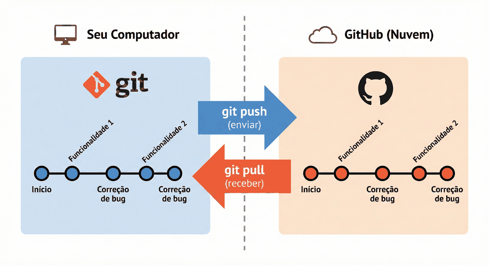

# Capítulo 02 — Clone, pull, formulário, CSS e JavaScript

**Disciplina:** Programação para Internet (ILP951)
**Professor:** Ronan Adriel Zenatti · ronan.zenatti@cps.sp.gov.br
**Fatec Jahu — 2º Semestre/2026**

---

## 🎯 Objetivos do Capítulo

Ao final deste capítulo você deverá ser capaz de:

- Recuperar um projeto do GitHub em um computador limpo com `git clone`
- Trazer para o seu computador as mudanças feitas no GitHub com `git pull`
- Explicar por que o que está no `.gitignore` não volta quando a pasta é clonada
- Montar o formulário de cadastro de produto com `label`, `input`, `select` e `button`, usando a validação nativa do HTML5 (`required`, `minlength`, `type`, `min` e `step`)
- Estilizar o formulário com CSS: espaçamento, campos, foco, botões e campos inválidos
- Acionar JavaScript na página, com `<script>` inline e em arquivo externo, lendo os campos com `getElementById` e `.value`, exibindo com `console.log` e disparando por `onclick` e `onsubmit`
- Abrir o console do navegador e ler o que o JavaScript escreve nele

Este capítulo continua a **revisão** iniciada no Capítulo 1. A primeira metade fecha o ciclo do Git (trazer o projeto de volta da nuvem), e a segunda dá ao Catálogo de Produtos a sua primeira tela de entrada de dados: o formulário que, a partir do Capítulo 7, vai enviar produtos para o Python. Aqui ainda não há servidor, então o formulário só existe na página.

## 📦 Ponto de partida

Este capítulo parte do **seu** repositório `catalogo-produtos` no GitHub, como ele ficou no fim do Capítulo 1. É justamente ele que você vai clonar no Tópico 1.

Se o seu projeto não chegou ao GitHub, baixe o código do Capítulo 1, descompacte na Área de Trabalho e refaça o Tópico 3 do [Capítulo 1](Capitulo_01_Git_GitHub_HTML5_e_CSS.md) (criar o repositório no GitHub, `git remote add origin ...` e `git push -u origin main`) antes de seguir:

➡️ [Baixar p1_cap_01.zip](../arquivos/p1_cap_01.zip)

---

## Tópico 1 — Clone: trazendo o projeto de volta da nuvem

### O problema

Até aqui, o GitHub foi só um lugar para onde você **enviou** o projeto. Mas um repositório na nuvem só vale a pena se, quando o computador der problema, for trocado ou a pasta for apagada sem querer, o projeto puder **voltar**. Vamos testar isso de verdade: você vai apagar a pasta do Capítulo 1 e recuperá-la.

### Confirmando que tudo foi enviado

Apagar uma pasta com arquivos que **não** foram para o GitHub é perder esses arquivos. Por isso, antes de apagar, confira. Abra o terminal do VS Code na pasta `catalogo-produtos` e rode:

```bash
git status
git log origin/main..HEAD --oneline
```

O que você espera ver:

- no `git status`, a frase `Your branch is up to date with 'origin/main'` e `nothing to commit, working tree clean`;
- no `git log`, **nenhuma linha**. Esse comando lista os commits que existem no seu computador (`HEAD`) e ainda não estão no GitHub (`origin/main`). Sem resposta, não há nada pendente.

Se aparecer qualquer outra coisa, faça o ciclo do Capítulo 1 (`git add .`, `git commit -m "..."`, `git push`) e confira de novo. Só siga adiante com tudo limpo.

### Apagando a pasta

O Windows não apaga uma pasta que está aberta em outro programa. Então:

1. **Feche** a janela do VS Code que está com o `catalogo-produtos` aberto.
2. Abra o **Explorador de Arquivos**, vá até a Área de Trabalho (`Desktop`), clique com o botão direito na pasta `catalogo-produtos` e escolha **Excluir**.

A pasta e tudo o que havia nela sumiram do computador, inclusive a pasta oculta `.git`, que guardava o histórico.

### Clonando

O `git clone` baixa um repositório inteiro do GitHub: os arquivos, **todo o histórico** e o endereço `origin`, tudo pronto para uso. Primeiro pegue o endereço. Entre no seu repositório em **github.com**, clique no botão verde **Code**, escolha a aba **HTTPS** e copie o endereço (o ícone de copiar fica ao lado dele). Ele tem o formato que você já conhece: `https://github.com/SEU-USUARIO/catalogo-produtos.git`.

Abra o VS Code (se ele tentar reabrir a pasta que você apagou, use **File → Close Folder**), abra o terminal com `Ctrl + '` e rode, trocando `SEU-USUARIO` pelo seu nome de usuário do GitHub:

```bash
cd Desktop
git clone https://github.com/SEU-USUARIO/catalogo-produtos.git
```

O Git mostra o andamento (`Cloning into 'catalogo-produtos'...`) e cria a pasta de novo. Se o repositório for privado, o navegador pode abrir para você autorizar o acesso, como no Capítulo 1. Entre na pasta e abra o VS Code nela:

```bash
cd catalogo-produtos
code .
```

Agora confira que o projeto voltou inteiro:

```bash
git log --oneline
git remote -v
git status
```

- O `git log --oneline` mostra **todos** os commits do Capítulo 1, com as mesmas mensagens. O histórico veio junto.
- O `git remote -v` mostra o `origin`, que você **não** precisou registrar com `git remote add`: o clone já fez isso.
- O `git status` diz que está tudo limpo e em dia com o `origin/main`. Também não foi preciso o `-u` do `git push`, a ligação com a `main` do GitHub já vem pronta.

No explorador do VS Code, abra o `index.html` e o `estilo.css`: estão lá. Abra o `index.html` no navegador e veja a página do catálogo, igual ao fim do Capítulo 1.

### O que não voltou

Olhe a pasta `treino` e o resto do projeto e procure o `rascunho.txt`. Ele **não voltou**. Lembra dele? Você o colocou no `.gitignore` justamente para não ir para o GitHub. Esse é o outro lado da moeda: o que o Git ignora também não está na nuvem, então some junto com a pasta. Isso é desejado para um rascunho pessoal, mas serve de alerta: tudo o que o projeto precisa para funcionar tem que estar versionado.

!!! note "`git init` e `git clone`"
    | Comando | Quando usar | O que faz |
    |---|---|---|
    | `git init` | O projeto nasce no seu computador | Cria um repositório novo e vazio na pasta atual. O endereço do GitHub é ligado depois, com `git remote add origin ...` |
    | `git clone` | O projeto já existe no GitHub | Cria a pasta, baixa os arquivos e todo o histórico, e já deixa o `origin` configurado |

    O `git clone` também serve para baixar o projeto de **outra pessoa**, desde que o repositório seja público. É assim que se estuda código aberto.

Neste tópico nenhum arquivo mudou, então não há commit.

---

## Tópico 2 — Pull: trazendo as mudanças da nuvem

### O problema

O `git push` leva mudanças do computador para o GitHub. E o caminho contrário? O projeto pode mudar na nuvem sem você ter mexido: você trabalha em outro computador (no laboratório da Fatec e em casa, por exemplo), alguém do grupo envia um commit, ou você edita um arquivo direto no site do GitHub. O seu computador não fica sabendo disso por conta própria.



O `git pull` é a seta de baixo da figura: ele busca no GitHub os commits que o seu computador ainda não tem e os junta ao seu projeto. Vamos fazer isso acontecer.

### Editando um arquivo pelo site do GitHub

Abra o seu repositório em **github.com** e faça uma alteração **sem usar o computador**:

1. Clique no arquivo `index.html`.
2. No canto superior direito do arquivo, clique no ícone de lápis (**Edit this file**).
3. Localize a linha do subtítulo e troque o texto:

   ```html
   <p>Papelaria, informática, casa e acessórios para o dia a dia.</p>
   ```

4. Clique no botão verde **Commit changes...**. Na janelinha, escreva a mensagem `Atualiza o subtítulo do catálogo`, deixe marcada a opção **Commit directly to the `main` branch** e clique em **Commit changes**.

Voltando à página inicial do repositório, o `index.html` já mostra o novo subtítulo, e o número de commits aumentou em um. Essa mudança foi gravada **na nuvem**.

### O seu computador não sabe

Volte ao VS Code, com o terminal na pasta `catalogo-produtos`, e rode:

```bash
git status
```

A resposta continua sendo `Your branch is up to date with 'origin/main'` e `nothing to commit`. Abra também o `index.html` no navegador (recarregue com `F5`): o subtítulo é o antigo. Isso não é um defeito: o `git status` compara com o que o seu computador **já conhecia** do GitHub, e o Git só consulta a nuvem quando você manda. Hora de mandar:

```bash
git pull
```

A resposta é parecida com esta (os códigos e os números variam):

```text
Updating 3f2a1bc..9d4e7a0
Fast-forward
 index.html | 2 +-
 1 file changed, 1 insertion(+), 1 deletion(-)
```

`Fast-forward` quer dizer que o seu histórico era um pedaço do histórico da nuvem, então o Git só precisou acrescentar os commits novos ao final. A linha `index.html | 2 +-` diz que o arquivo teve uma linha trocada. Confira o resultado:

```bash
git log --oneline
```

O commit `Atualiza o subtítulo do catálogo` aparece no topo, com a mesma mensagem que você escreveu no site. No VS Code, o `index.html` já mostra o subtítulo novo, e no navegador, ao recarregar, também.

!!! tip "O hábito do `git pull`"
    Sempre que for começar a mexer no projeto, e principalmente se você trabalha em mais de um lugar, rode `git pull` **antes**. Assim você parte da versão mais recente e evita editar em cima de um arquivo que já mudou na nuvem. O ciclo completo fica: `git pull` → editar → `git status` → `git add .` → `git commit -m "..."` → `git push`.

Neste tópico também não há commit seu: o commit foi feito no site do GitHub, e o `git pull` o trouxe.

---

## Tópico 3 — HTML: o formulário de cadastro de produto

### O problema

O catálogo mostra produtos, mas ninguém consegue **cadastrar** um. Todo cadastro começa com um formulário: uma página em que a pessoa digita os dados do produto (`nome`, `categoria` e `preco`) e clica em um botão. No Capítulo 1 você montou um formulário simples em `treino/contato.html`. Agora o formulário passa a fazer parte do catálogo.

O envio dos dados para o Python começa no Capítulo 7. Neste capítulo o formulário só precisa existir e **conferir o que foi digitado** antes de enviar, e o navegador sabe fazer isso, com atributos do próprio HTML5.

### Uma página nova e um link para ela

Crie o arquivo `cadastro.html` na raiz do projeto, ao lado do `index.html`, com a estrutura da página e o formulário ainda **vazio**:

```html
<!DOCTYPE html>
<html lang="pt-BR">
<head>
  <meta charset="UTF-8">
  <meta name="viewport" content="width=device-width, initial-scale=1.0">
  <title>Cadastrar Produto</title>
  <link rel="stylesheet" href="estilo.css">
</head>
<body>

  <header>
    <h1>Catálogo de Produtos</h1>
    <p>Papelaria, informática, casa e acessórios para o dia a dia.</p>
    <nav>
      <a href="index.html#produtos">Produtos</a>
      <a href="index.html#categorias">Categorias</a>
      <a href="cadastro.html">Cadastrar</a>
    </nav>
  </header>

  <main>
    <section id="cadastro">
      <h2>Cadastrar produto</h2>

      <form action="#">

      </form>
    </section>
  </main>

  <footer>
    <p>Catálogo de Produtos · Fatec Jahu · ILP951 · 2026</p>
  </footer>

</body>
</html>
```

Os links do menu desta página apontam para o `index.html` (`index.html#produtos` significa "abra o `index.html` e vá até o elemento `produtos`"). No `index.html`, acrescente o link para a página nova, dentro do `<nav>`, depois do link de Categorias:

```html
      <a href="cadastro.html">Cadastrar</a>
```

Salve os dois arquivos, abra o `index.html` no navegador e clique em **Cadastrar**. A página nova abre com o topo, o título **Cadastrar produto** e o rodapé, ainda sem campos. Clique em **Produtos** para voltar.

!!! note "O menu e o topo, copiados de novo"
    Repare que o `<header>` e o `<footer>` do `cadastro.html` são cópias do `index.html`. Se amanhã o menu ganhar um quarto link, será preciso editar as duas páginas (e todas as que vierem). O Capítulo 6 resolve isso com templates.

O `<form action="#">` tem um atributo novo, o `action`: é o **endereço para onde os dados do formulário serão enviados**. O `#` significa "esta mesma página". Quando o Flask entrar, ele será trocado pelo endereço de uma rota do Python.

### O campo nome e o botão de envio

Dentro do `<form>`, acrescente o primeiro campo e o botão que envia o formulário:

```html
        <div class="campo">
          <label for="nome">Nome do produto</label>
          <input type="text" id="nome" name="nome" placeholder="Ex.: Caneta esferográfica azul" required minlength="3">
        </div>

        <button type="submit">Cadastrar produto</button>
```

Salve e recarregue a página. O `<div>` é uma caixa genérica, sem significado próprio, usada aqui só para agrupar o rótulo e o campo (a classe `campo` só ganha estilo no Tópico 4). O atributo `name` é o nome com que o dado viaja ao ser enviado: o `id` serve para o `label` e para o JavaScript, o `name` serve ao envio. Os atributos novos do `<input>` são:

- `required`: o campo é **obrigatório**;
- `minlength="3"`: o texto precisa ter **pelo menos 3 caracteres**.

Experimente três coisas:

1. Clique em **Cadastrar produto** com o campo vazio. O navegador bloqueia o envio e avisa (algo como "Preencha este campo"), sem você ter escrito nenhuma linha de código para isso.
2. Digite `ab` e clique de novo. O aviso agora pede um texto maior.
3. Digite `Caneta` e clique. Dessa vez o navegador **envia**: a página recarrega, o campo fica vazio e o endereço na barra do navegador ganha um final novo, parecido com `cadastro.html?nome=Caneta#`.

Esse final é o dado viajando: `nome` (o `name` do campo), `=` e o valor digitado. Quando um formulário não diz como enviar, o navegador usa o método **GET**, que coloca os dados no próprio endereço. Nenhum programa recebe esses dados ainda (o `#` manda de volta para a mesma página), e é isso que o Capítulo 7 vai mudar.

### O campo categoria

A categoria vem de uma lista fechada (as quatro do catálogo), o que pede um `<select>`. Acrescente, depois do campo nome e antes do botão:

```html
        <div class="campo">
          <label for="categoria">Categoria</label>
          <select id="categoria" name="categoria" required>
            <option value="">Selecione...</option>
            <option value="Papelaria">Papelaria</option>
            <option value="Informática">Informática</option>
            <option value="Casa">Casa</option>
            <option value="Acessórios">Acessórios</option>
          </select>
        </div>
```

Salve e recarregue. Cada `<option>` é uma opção do menu: o `value` é o que **viaja** ao enviar e o texto entre as tags é o que a pessoa lê (aqui são iguais). A primeira opção tem `value=""`, vazio de propósito: com o `required`, escolher "Selecione..." conta como não escolher nada. Digite um nome, deixe a categoria em "Selecione..." e clique em **Cadastrar produto**: o navegador pede que você escolha um item.

### O campo preço

Falta o preço. Acrescente, depois da categoria e antes do botão:

```html
        <div class="campo">
          <label for="preco">Preço (R$)</label>
          <input type="number" id="preco" name="preco" placeholder="0,00" min="0.01" step="0.01" required>
        </div>
```

Salve e recarregue. Os atributos novos:

- `type="number"`: o campo só aceita número (letras são recusadas) e ganha setinhas para aumentar e diminuir;
- `min="0.01"`: o menor valor aceito. Digite `0` ou `-5` e tente enviar: o navegador recusa;
- `step="0.01"`: de quanto em quanto o valor pode variar. Sem o `step`, o navegador só aceitaria números inteiros e recusaria `59,90`. Com `0.01`, os centavos passam.

Preencha tudo (`Caneta`, `Papelaria`, `2,50`) e envie: os três campos viajam no endereço. Note que no endereço o preço aparece com **ponto** no lugar da vírgula, mesmo digitado com vírgula, porque é assim que o `type="number"` envia.

### O botão de limpar

Para testar várias vezes sem apagar tudo na mão, acrescente, logo depois do botão de envio:

```html
        <button type="reset">Limpar</button>
```

O `type="reset"` volta todos os campos ao estado inicial. O `type="submit"` envia o formulário, e é por isso que ele precisa estar **dentro** do `<form>`. O `cadastro.html` completo neste ponto:

```html
<!DOCTYPE html>
<html lang="pt-BR">
<head>
  <meta charset="UTF-8">
  <meta name="viewport" content="width=device-width, initial-scale=1.0">
  <title>Cadastrar Produto</title>
  <link rel="stylesheet" href="estilo.css">
</head>
<body>

  <header>
    <h1>Catálogo de Produtos</h1>
    <p>Papelaria, informática, casa e acessórios para o dia a dia.</p>
    <nav>
      <a href="index.html#produtos">Produtos</a>
      <a href="index.html#categorias">Categorias</a>
      <a href="cadastro.html">Cadastrar</a>
    </nav>
  </header>

  <main>
    <section id="cadastro">
      <h2>Cadastrar produto</h2>

      <form action="#">

        <div class="campo">
          <label for="nome">Nome do produto</label>
          <input type="text" id="nome" name="nome" placeholder="Ex.: Caneta esferográfica azul" required minlength="3">
        </div>

        <div class="campo">
          <label for="categoria">Categoria</label>
          <select id="categoria" name="categoria" required>
            <option value="">Selecione...</option>
            <option value="Papelaria">Papelaria</option>
            <option value="Informática">Informática</option>
            <option value="Casa">Casa</option>
            <option value="Acessórios">Acessórios</option>
          </select>
        </div>

        <div class="campo">
          <label for="preco">Preço (R$)</label>
          <input type="number" id="preco" name="preco" placeholder="0,00" min="0.01" step="0.01" required>
        </div>

        <button type="submit">Cadastrar produto</button>
        <button type="reset">Limpar</button>

      </form>
    </section>
  </main>

  <footer>
    <p>Catálogo de Produtos · Fatec Jahu · ILP951 · 2026</p>
  </footer>

</body>
</html>
```

!!! warning "A validação do navegador não basta"
    `required`, `minlength`, `min` e `step` dão uma resposta rápida a quem preenche, mas qualquer pessoa pode contorná-los (basta desativar o JavaScript, editar o HTML no navegador ou enviar os dados por outro programa). Por isso, a validação **de verdade** será feita no servidor, no Capítulo 9. A do navegador é um conforto, não uma proteção.

Registre no Git e envie:

```bash
git add .
git commit -m "Adiciona a página de cadastro de produto"
git push
```

---

## Tópico 4 — CSS: dando aparência ao formulário

### O problema

O formulário funciona, mas está com a aparência crua do navegador: rótulos grudados nos campos, campos de larguras diferentes e botões cinzas. O arquivo `estilo.css` já está ligado ao `cadastro.html` (pelo `<link>` que você copiou), então basta acrescentar regras a ele, uma por vez. Abra a página no navegador e deixe-a ao lado do VS Code, para recarregar depois de cada trecho.

### Espaço entre os campos e rótulos em linha própria

No final do `estilo.css`, acrescente:

```css
.campo {
  margin-bottom: 16px;
}

label {
  display: block;
  font-weight: bold;
  margin-bottom: 4px;
}
```

Salve e recarregue. Cada campo ficou separado do próximo, pela classe `.campo` que você colocou nos `<div>`. O `label` ficou em negrito e **acima** do campo. O `display: block` faz o elemento ocupar a linha inteira, como um parágrafo: antes, o rótulo ficava ao lado do campo.

### Campos com largura total

Os campos têm tamanhos diferentes: o `<select>` é mais estreito que o texto, e o número é ainda menor. Acrescente:

```css
input,
select {
  width: 100%;
  padding: 8px 12px;
  border: 1px solid #cccccc;
  border-radius: 4px;
  font-size: 16px;
  box-sizing: border-box;
}
```

Salve e recarregue: os três campos têm a mesma largura, com bordas arredondadas. O `border-radius` arredonda os cantos. O `box-sizing: border-box` merece atenção: sem ele, o `width: 100%` se refere só ao **conteúdo**, e o `padding` e a borda são somados por fora, fazendo o campo vazar para além da caixa. Com ele, a largura inclui o preenchimento e a borda, e os 100% cabem direitinho. É o modelo de caixa do Capítulo 1 em ação.

### Mostrando qual campo está ativo

Acrescente:

```css
input:focus,
select:focus {
  border-color: #1f4e79;
  outline: 2px solid #1f4e79;
}
```

Salve, recarregue e clique em cada campo. O `:focus` é como o `:hover` do Capítulo 1, mas vale para o campo **que está recebendo a digitação**: ele ganha um contorno azul, o que ajuda a saber onde você está. Navegue entre os campos com a tecla `Tab` para ver o efeito.

### Mostrando o campo com erro

O HTML5 sabe quando um campo está inválido, e o CSS enxerga isso. Acrescente:

```css
input:user-invalid,
select:user-invalid {
  border-color: #c0392b;
}
```

Salve e recarregue. Digite `ab` no nome, clique em outro campo e a borda do nome fica vermelha. O `:user-invalid` só vale **depois que a pessoa mexeu** no campo, então o formulário não aparece todo vermelho assim que a página abre. Apague o texto de volta para um nome válido, como `Caneta`, e o vermelho some.

### A caixa do formulário e os botões

Falta o formulário em si e os botões. Acrescente:

```css
form {
  max-width: 480px;
  padding: 24px;
  background-color: #ffffff;
  border: 1px solid #cccccc;
  border-radius: 8px;
}

button {
  margin-right: 8px;
  padding: 10px 20px;
  background-color: #1f4e79;
  color: #ffffff;
  border: none;
  border-radius: 4px;
  font-size: 16px;
  cursor: pointer;
}

button:hover {
  background-color: #163a5c;
}
```

Salve e recarregue: o formulário virou um cartão branco, com no máximo 480 pixels de largura, e os dois botões ficaram azuis. Passe o mouse sobre eles para ver o azul escurecer. Mas o **Limpar** não deveria chamar tanta atenção quanto o botão principal. Isso pede uma **classe**, como o `.preco` do Capítulo 1. No `cadastro.html`, acrescente `class="secundario"` ao botão de limpar:

```html
        <button type="reset" class="secundario">Limpar</button>
```

E no `estilo.css`:

```css
.secundario {
  background-color: #6c757d;
}

.secundario:hover {
  background-color: #565e64;
}
```

Salve os dois arquivos e recarregue: o **Limpar** ficou cinza. A regra do `:hover` do cinza é necessária porque `button:hover` (uma tag mais um estado) é mais específica do que `.secundario` (só uma classe), então sem ela o botão cinza ficaria azul-escuro quando o mouse passasse. A nova regra, com classe e estado, é mais específica que as duas e resolve. Esse é o desempate por especificidade que você viu no Capítulo 1. O `estilo.css` completo:

```css
body {
  font-family: Arial, sans-serif;
  background-color: #f4f6f8;
  color: #222222;
  margin: 0;
}

header {
  background-color: #1f4e79;
  color: #ffffff;
  padding: 24px;
  text-align: center;
}

nav a {
  color: #ffffff;
  margin: 0 12px;
  text-decoration: none;
}

nav a:hover {
  text-decoration: underline;
}

main {
  max-width: 800px;
  margin: 24px auto;
  padding: 0 16px;
}

h2 {
  color: #1f4e79;
  border-bottom: 2px solid #1f4e79;
  padding-bottom: 4px;
}

#produtos {
  margin-bottom: 32px;
}

table {
  width: 100%;
  border-collapse: collapse;
  background-color: #ffffff;
}

th,
td {
  border: 1px solid #cccccc;
  padding: 8px 12px;
  text-align: left;
}

th {
  background-color: #1f4e79;
  color: #ffffff;
}

.preco {
  text-align: right;
}

footer {
  text-align: center;
  padding: 16px;
  color: #666666;
}

.campo {
  margin-bottom: 16px;
}

label {
  display: block;
  font-weight: bold;
  margin-bottom: 4px;
}

input,
select {
  width: 100%;
  padding: 8px 12px;
  border: 1px solid #cccccc;
  border-radius: 4px;
  font-size: 16px;
  box-sizing: border-box;
}

input:focus,
select:focus {
  border-color: #1f4e79;
  outline: 2px solid #1f4e79;
}

input:user-invalid,
select:user-invalid {
  border-color: #c0392b;
}

form {
  max-width: 480px;
  padding: 24px;
  background-color: #ffffff;
  border: 1px solid #cccccc;
  border-radius: 8px;
}

button {
  margin-right: 8px;
  padding: 10px 20px;
  background-color: #1f4e79;
  color: #ffffff;
  border: none;
  border-radius: 4px;
  font-size: 16px;
  cursor: pointer;
}

button:hover {
  background-color: #163a5c;
}

.secundario {
  background-color: #6c757d;
}

.secundario:hover {
  background-color: #565e64;
}
```

Abra o `index.html` também: a tabela e o menu continuam como antes. Como o `estilo.css` é um arquivo só para o site inteiro, as regras do formulário (`label`, `input`, `button`) ficam valendo em todas as páginas que o ligarem, e como o `index.html` ainda não tem nenhum desses elementos, nada muda nele.

Registre e envie:

```bash
git add .
git commit -m "Estiliza o formulário de cadastro de produto"
git push
```

---

## Tópico 5 — JavaScript: o primeiro contato

### HTML, CSS e JavaScript

O HTML define a **estrutura**, o CSS define a **aparência** e o **JavaScript** define o **comportamento**: o que acontece quando a pessoa clica, digita ou envia algo. Ele roda **dentro do navegador**, no front-end, e não no servidor. O Python do back-end só entra no Capítulo 3, e o JavaScript deste curso fica pequeno: serve para você entender como uma página reage a uma ação. Aqui o escopo é só este: colocar JavaScript na página, ler o que foi digitado, mostrar no console e disparar tudo isso por um clique ou pelo envio do formulário.

### Abrindo o console do navegador

Quando o JavaScript quer "falar" com quem está programando (e não com quem usa a página), ele escreve no **console**, um painel escondido do navegador. É para lá que vão as mensagens de `console.log`, e também os erros, em vermelho. Para abri-lo:

1. Abra o `cadastro.html` no navegador (Chrome ou Edge).
2. Pressione `F12`, ou clique com o botão direito em qualquer ponto da página e escolha **Inspecionar**. Um painel se abre ao lado ou embaixo da página.
3. Clique na aba **Console**. (O atalho `Ctrl + Shift + J` abre o painel já nessa aba.)

Faça um teste: clique na linha que começa com `>` no fim do console, digite `console.log("Olá, console!")` e pressione `Enter`. A mensagem aparece logo abaixo. É assim que você enxerga o que o JavaScript fez. Deixe o console aberto durante todo este tópico, e se algo não funcionar, **olhe nele primeiro**: um erro de digitação aparece ali em vermelho, com o número da linha.

### Um `<script>` dentro da página

Para colocar JavaScript no HTML, usa-se a tag `<script>`. No `cadastro.html`, logo antes do `</body>` (depois do rodapé), acrescente:

```html
  <script>
    console.log("JavaScript funcionando");
  </script>
```

Salve e recarregue a página (com o console aberto). A mensagem aparece no console, junto com o nome do arquivo e a linha que a escreveu. O navegador executou o código assim que carregou a página. O `console.log(...)` escreve no console o que estiver entre os parênteses.

### Uma função que só roda quando chamada

Escrever na carga da página não ajuda muito: o que queremos é reagir a uma **ação** da pessoa. Para isso, o código precisa ficar guardado em uma **função**, que só roda quando alguém a chamar. Troque o conteúdo do `<script>` por:

```html
  <script>
    function mostrarProduto() {
      console.log("A função foi chamada");
    }
  </script>
```

!!! note "Python x JavaScript"
    Você já conhece funções em Python. Em JavaScript a ideia é a mesma, e muda a escrita:

    | | Python | JavaScript |
    |---|---|---|
    | Criar uma função | `def mostrar_produto():` | `function mostrarProduto() { ... }` |
    | Marcar o que está dentro | indentação | chaves `{ }` |
    | Mostrar algo | `print("oi")` | `console.log("oi")` |
    | Guardar um valor | `nome = "Caneta"` | `const nome = "Caneta";` |
    | Comentário | `# texto` | `// texto` |

    Em JavaScript, cada instrução termina com ponto e vírgula (`;`). O `const` cria um valor que não vai mudar depois de guardado.

Salve e recarregue: o console fica vazio, porque a função existe, mas ninguém a chamou. Vamos chamá-la com um clique. No formulário, depois do botão **Limpar**, acrescente um terceiro botão:

```html
        <button type="button" class="secundario" onclick="mostrarProduto()">Ver no console</button>
```

Salve e recarregue. Clique em **Ver no console** e a mensagem aparece. A cada clique, uma nova linha. O atributo `onclick` diz "quando este elemento for clicado, execute isto". O `type="button"` é importante: dentro de um `<form>`, um botão sem `type` envia o formulário, e este só deve chamar a função.

### Lendo o que foi digitado

Agora a função vai ler o campo do nome. Troque o `console.log` de dentro da função por:

```html
  <script>
    function mostrarProduto() {
      const nome = document.getElementById("nome").value;
      console.log("Nome:", nome);
    }
  </script>
```

- `document` é a página inteira;
- `document.getElementById("nome")` procura nela o elemento cujo `id` é `nome`, o mesmo `id` que o `label` usa no `for`;
- `.value` é o **valor** do campo, o texto que está nele neste instante;
- `console.log("Nome:", nome)` mostra um texto e o valor lado a lado: dá para passar várias coisas separadas por vírgula.

Salve e recarregue. Digite `Caneta` no campo de nome e clique em **Ver no console**: a linha `Nome: Caneta` aparece. Apague o texto e clique de novo: `Nome:` aparece sem nada depois. Acrescente agora a categoria e o preço, do mesmo jeito:

```html
  <script>
    function mostrarProduto() {
      const nome = document.getElementById("nome").value;
      const categoria = document.getElementById("categoria").value;
      const preco = document.getElementById("preco").value;

      console.log("Nome:", nome);
      console.log("Categoria:", categoria);
      console.log("Preço:", preco);
    }
  </script>
```

Salve, recarregue, preencha os três campos (`Caneta`, `Papelaria`, `2,50`) e clique em **Ver no console**. Três linhas aparecem, uma por campo. Repare que o botão **Ver no console** não confere nada: ele lê o que estiver ali, mesmo que esteja vazio ou errado, porque não é um botão de envio.

!!! note "`.value` sempre devolve texto"
    O `.value` devolve **texto**, mesmo em um campo `type="number"`. O preço que aparece no console é um texto, e não o número 2,5. O Python, quando receber dados de formulários no Capítulo 7, também recebe tudo como texto, e será ele quem converterá o preço em número.

### Tirando o JavaScript de dentro do HTML

Pelo mesmo motivo do CSS no Capítulo 1, o JavaScript fica melhor em um **arquivo próprio**: o `cadastro.html` fica só com a estrutura, e o código pode ser reaproveitado por outras páginas. Crie na raiz do projeto o arquivo `produto.js` e **mova** para ele a função (só o que estava dentro do `<script>`, sem as tags):

```javascript
function mostrarProduto() {
  const nome = document.getElementById("nome").value;
  const categoria = document.getElementById("categoria").value;
  const preco = document.getElementById("preco").value;

  console.log("Nome:", nome);
  console.log("Categoria:", categoria);
  console.log("Preço:", preco);
}
```

No `cadastro.html`, **apague** o bloco `<script>` inteiro e coloque no lugar dele a ligação com o arquivo:

```html
  <script src="produto.js"></script>
```

Salve os dois arquivos, recarregue e clique em **Ver no console**: funciona como antes. O atributo `src` aponta para o arquivo, como o `href` do `<link>` faz com o CSS. A tag fica no final do `<body>` para que o navegador carregue primeiro a página e só depois o script.

!!! tip "Quando nada acontece"
    Se o clique não mostrar nada, abra o console. A mensagem `Uncaught ReferenceError: mostrarProduto is not defined` quase sempre quer dizer que o nome do arquivo no `src` está errado ou que o `produto.js` não foi salvo.

### Disparando pelo envio do formulário

O `onclick` reage a um clique. Para reagir ao **envio** do formulário, existe o `onsubmit`, que fica na tag `<form>`. Mude a tag para:

```html
      <form action="#" onsubmit="mostrarProduto()">
```

Salve e recarregue. Preencha os três campos com valores válidos e clique em **Cadastrar produto**. O console escreveu as três linhas, mas **a página recarregou e tudo sumiu**: os campos ficaram vazios, o endereço ganhou o `?nome=...` do Tópico 3 e o console foi limpo no recarregamento. Esse recarregamento é o envio normal do formulário, e ele atropela o JavaScript.

Precisamos dizer ao navegador: "execute o JavaScript e **não** envie o formulário". Para isso a função precisa receber o **evento**, o objeto que descreve o que acabou de acontecer (aqui, o envio) e que tem uma instrução para cancelar o comportamento normal: `preventDefault()`, que quer dizer "evitar o padrão". Acrescente uma segunda função ao `produto.js`, depois da primeira:

```javascript
function cadastrarProduto(evento) {
  evento.preventDefault();
  mostrarProduto();
  console.log("Produto recebido pelo JavaScript. Ainda não existe servidor para guardá-lo.");
}
```

A função `cadastrarProduto` recebe o `evento` como **parâmetro**, como as funções do Python recebem argumentos. Ela cancela o envio, chama a função que já existe (uma função pode chamar outra) e escreve uma mensagem final. No `cadastro.html`, ligue o formulário a ela:

```html
      <form action="#" onsubmit="cadastrarProduto(event)">
```

O `event` escrito no HTML é uma palavra que o navegador reconhece dentro de `onclick` e `onsubmit`: é o evento que acabou de acontecer, entregue à função. Salve os dois arquivos, recarregue e teste três situações, sempre com o console aberto:

1. **Formulário vazio:** clique em **Cadastrar produto**. O navegador bloqueia e avisa o campo que falta, e o console fica em silêncio. A conferência do HTML5 (`required`, `minlength`, `min`, `step`) acontece **antes** do `onsubmit`: com dado inválido, a sua função nem é chamada.
2. **Formulário válido:** preencha os três campos e clique. As linhas aparecem no console e **ficam lá**. A página não recarrega, e os campos continuam preenchidos.
3. **Limpar e repetir:** clique em **Limpar**, preencha outro produto e envie de novo. O console acumula as linhas de cada envio.

Pronto: o formulário confere, o JavaScript lê, e nada se perde no recarregamento. A partir do Capítulo 7, o `onsubmit` e o `preventDefault` saem de cena, e o envio passa a ir de verdade para o Python. O arquivo `produto.js` completo:

```javascript
// Lê os campos do formulário e mostra os valores no console do navegador.
function mostrarProduto() {
  const nome = document.getElementById("nome").value;
  const categoria = document.getElementById("categoria").value;
  const preco = document.getElementById("preco").value;

  console.log("Nome:", nome);
  console.log("Categoria:", categoria);
  console.log("Preço:", preco);
}

// Chamada quando o formulário é enviado (onsubmit). Antes de chegar aqui, o
// navegador já conferiu required, minlength, min e step.
function cadastrarProduto(evento) {
  evento.preventDefault();
  mostrarProduto();
  console.log("Produto recebido pelo JavaScript. Ainda não existe servidor para guardá-lo.");
}
```

E o `cadastro.html` completo:

```html
<!DOCTYPE html>
<html lang="pt-BR">
<head>
  <meta charset="UTF-8">
  <meta name="viewport" content="width=device-width, initial-scale=1.0">
  <title>Cadastrar Produto</title>
  <link rel="stylesheet" href="estilo.css">
</head>
<body>

  <header>
    <h1>Catálogo de Produtos</h1>
    <p>Papelaria, informática, casa e acessórios para o dia a dia.</p>
    <nav>
      <a href="index.html#produtos">Produtos</a>
      <a href="index.html#categorias">Categorias</a>
      <a href="cadastro.html">Cadastrar</a>
    </nav>
  </header>

  <main>
    <section id="cadastro">
      <h2>Cadastrar produto</h2>

      <form action="#" onsubmit="cadastrarProduto(event)">

        <div class="campo">
          <label for="nome">Nome do produto</label>
          <input type="text" id="nome" name="nome" placeholder="Ex.: Caneta esferográfica azul" required minlength="3">
        </div>

        <div class="campo">
          <label for="categoria">Categoria</label>
          <select id="categoria" name="categoria" required>
            <option value="">Selecione...</option>
            <option value="Papelaria">Papelaria</option>
            <option value="Informática">Informática</option>
            <option value="Casa">Casa</option>
            <option value="Acessórios">Acessórios</option>
          </select>
        </div>

        <div class="campo">
          <label for="preco">Preço (R$)</label>
          <input type="number" id="preco" name="preco" placeholder="0,00" min="0.01" step="0.01" required>
        </div>

        <button type="submit">Cadastrar produto</button>
        <button type="reset" class="secundario">Limpar</button>
        <button type="button" class="secundario" onclick="mostrarProduto()">Ver no console</button>

      </form>
    </section>
  </main>

  <footer>
    <p>Catálogo de Produtos · Fatec Jahu · ILP951 · 2026</p>
  </footer>

  <script src="produto.js"></script>

</body>
</html>
```

Registre e envie:

```bash
git add .
git commit -m "Adiciona o JavaScript do formulário de cadastro"
git push
```

---

## 📦 Código deste capítulo

Compare com o seu projeto, ou use como ponto de partida do próximo capítulo. O zip tem o `index.html`, o `cadastro.html`, o `estilo.css`, o `produto.js`, o `.gitignore` e a pasta `treino`.

➡️ [Baixar p1_cap_02.zip](../arquivos/p1_cap_02.zip)

---

## 🃏 Flashcards de Revisão

Tente responder mentalmente antes de abrir.

??? question "Qual é a diferença entre `git init` e `git clone`?"
    O `git init` cria um repositório novo e vazio na pasta onde você está, e o endereço do GitHub é ligado depois. O `git clone` copia um repositório que já existe no GitHub: cria a pasta, baixa os arquivos e todo o histórico e já deixa o `origin` configurado.

??? question "Por que o `git status` diz que está tudo em dia, se você acabou de editar um arquivo no site do GitHub?"
    Porque o Git só compara com o que o seu computador já conhecia da nuvem, e não a consulta por conta própria. Para trazer as mudanças é preciso rodar `git pull`.

??? question "Por que o `rascunho.txt` não voltou depois do `git clone`?"
    Porque estava no `.gitignore` e nunca foi enviado ao GitHub. O clone só traz o que está versionado na nuvem.

??? question "Qual a vantagem de colocar o JavaScript em um arquivo `.js` em vez de dentro do HTML?"
    O HTML fica só com a estrutura, e o mesmo código pode ser usado por várias páginas, com uma única cópia para corrigir. É o mesmo motivo de usar um arquivo CSS externo.

??? question "Por que o `.value` de um campo numérico não é um número?"
    Porque o `.value` sempre devolve **texto**, qualquer que seja o tipo do campo. A conversão para número é uma etapa à parte, que o Python fará quando receber o dado.

??? question "O que o `preventDefault()` faz no `onsubmit`?"
    Cancela o comportamento normal do envio, que é enviar os dados e recarregar a página. Assim o JavaScript executa a sua função e a página continua como está.

---

## ✅ Quiz de Fixação

<quiz>
Você apagou a pasta `catalogo-produtos` do computador, mas todos os commits tinham sido enviados ao GitHub. Qual comando traz o projeto de volta?
- [ ] `git init`
> Não. O `git init` cria um repositório novo e vazio, sem os arquivos nem o histórico que estão no GitHub.
- [x] `git clone` com o endereço do repositório
> Correto. O clone baixa os arquivos, todo o histórico e já deixa o `origin` configurado.
- [ ] `git pull`, dentro da pasta apagada
> Não. O `pull` atualiza um repositório que já existe no computador. Sem a pasta (e sem a `.git`), não há onde rodá-lo.
- [ ] `git push`
> Não. O `push` envia commits do computador para o GitHub, e é o caminho contrário do que se precisa.
</quiz>

<quiz>
Você editou o `index.html` pelo site do GitHub. No seu computador, o `git status` diz `Your branch is up to date with 'origin/main'`. Por quê?
- [ ] Porque o `git status` está com defeito
> Não. Ele funciona como deve: compara com o que o seu computador já conhecia do GitHub.
- [x] Porque o Git não consulta a nuvem por conta própria: a mudança só chega ao computador com `git pull`
> Correto. Enquanto você não mandar buscar, o Git não sabe que existem commits novos no GitHub.
- [ ] Porque a edição pelo site não gera commit
> Não. O botão **Commit changes** do site grava um commit de verdade na nuvem. É o seu computador que ainda não o conhece.
- [ ] Porque é preciso rodar `git push` antes
> Não. O `push` envia o que está no seu computador. A mudança aqui está na nuvem, e precisa vir para cá.
</quiz>

<quiz>
Quais das afirmações sobre o formulário de produto estão corretas? (selecione todas que se aplicam)
- [x] O atributo `required` faz o navegador bloquear o envio de um campo vazio
> Correto. O aviso aparece sem nenhuma linha de JavaScript.
- [x] Sem `step="0.01"`, um campo `type="number"` não aceitaria `59,90`
> Correto. O intervalo padrão é 1, então só números inteiros seriam válidos.
- [x] O `.value` devolve sempre texto, até em um campo `type="number"`
> Correto. A conversão para número é uma etapa separada.
- [ ] Com `required` e `minlength`, a validação no servidor deixa de ser necessária
> Não. A validação do navegador pode ser contornada por qualquer pessoa. A que vale é a do servidor, vista no Capítulo 9.
</quiz>

<quiz>
No formulário, `onsubmit="cadastrarProduto(event)"` chama uma função que começa com `evento.preventDefault();`. O que acontece se essa linha for removida da função?
- [ ] O navegador deixa de validar os campos
> Não. A conferência do HTML5 (`required`, `min` etc.) acontece antes do `onsubmit` e não depende dessa linha.
- [ ] A função `mostrarProduto` deixa de ser chamada
> Não. A função continua sendo chamada, e as mensagens chegam a ser escritas no console.
- [x] O navegador envia o formulário e recarrega a página, e o console é limpo
> Correto. Sem o `preventDefault()`, o comportamento normal do envio acontece depois da sua função.
- [ ] Os campos ficam bloqueados para digitação
> Não. O `preventDefault()` não mexe nos campos. Ele só cancela o envio normal.
</quiz>

<quiz>
Para o JavaScript `document.getElementById("nome")` encontrar o campo de nome, o que precisa existir no HTML?
- [ ] `name="nome"` no `<input>`
> Não. O `name` é o nome com que o dado viaja ao ser enviado, e não é o que o `getElementById` procura.
- [ ] `class="nome"` no `<input>`
> Não. A classe é usada pelo CSS e por buscas de classe, e não por `getElementById`.
- [x] `id="nome"` no `<input>`
> Correto. O `getElementById` procura exatamente o atributo `id`, que também é o que liga o `label` ao campo.
- [ ] `placeholder="nome"` no `<input>`
> Não. O `placeholder` é só o texto de dica que some ao digitar.
</quiz>

---

## 📝 Resumo

Você fechou o ciclo do Git: apagou o projeto do computador e o trouxe de volta com `git clone`, e usou `git pull` para receber uma mudança feita direto no GitHub, descobrindo também que o que fica fora do repositório não volta. No catálogo, ganhou a sua primeira página de entrada de dados, um formulário de produto com `nome`, `categoria` e `preço` conferido pelo próprio navegador, estilizado com CSS e ligado a um arquivo `produto.js` que lê os campos e escreve no console. O formulário ainda não envia nada a ninguém: do Capítulo 3 em diante, o Python entra para receber, e a próxima etapa é montar o servidor com o Flask.

---

## 🔗 Navegação

⬅️ [Capítulo 1 — Git, GitHub, HTML5 e CSS](Capitulo_01_Git_GitHub_HTML5_e_CSS.md) · ➡️ [Capítulo 3 — Flask](Capitulo_03_Flask.md)

---

*Fatec Jahu · ILP951 · Prof. Ronan Adriel Zenatti · 2026*
