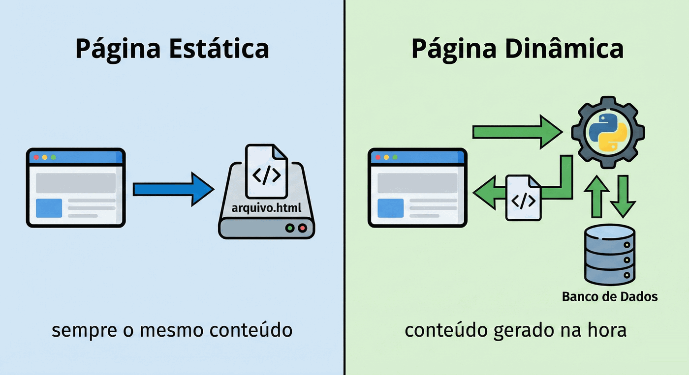
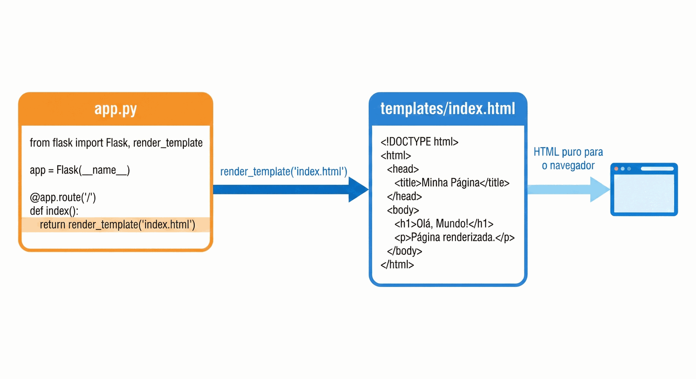

# Capítulo 03 — Flask

**Disciplina:** Programação para Internet (ILP951)
**Professor:** Ronan Adriel Zenatti · ronan.zenatti@cps.sp.gov.br
**Fatec Jahu — 2º Semestre/2026**

---

## 🎯 Objetivos do Capítulo

Ao final deste capítulo você deverá ser capaz de:

- Explicar a diferença entre uma página estática e uma página dinâmica, e o papel do servidor web
- Criar um ambiente virtual (`venv`), instalar o Flask com o `pip` e registrar as dependências em `requirements.txt` com `pip freeze`
- Ampliar o `.gitignore` para deixar de fora o ambiente virtual e os arquivos temporários do Python
- Criar uma aplicação Flask com rotas, usando `@app.route` (o seu primeiro decorador), e rodá-la no navegador
- Criar uma rota com variável na URL, como `/produto/<id>`
- Separar o HTML do Python com `render_template`, guardando as páginas em `templates/` e o CSS e o JavaScript em `static/`
- Guardar os produtos do catálogo em uma lista do Python e exibir um deles em uma página de detalhe

Até o Capítulo 2 o catálogo era um conjunto de arquivos que o navegador abria direto do disco. Neste capítulo o Python entra: o catálogo passa a ser **servido** por um programa, e é isso que permite, nos próximos capítulos, receber o que o formulário envia, guardar dados e mostrar páginas diferentes para cada pedido.

## 📦 Ponto de partida

Este capítulo parte do **seu** repositório `catalogo-produtos`, como ele ficou no fim do Capítulo 2: com `index.html`, `cadastro.html`, `estilo.css`, `produto.js`, a pasta `treino` e o `.gitignore`.

Se o seu projeto não está funcionando, baixe o código do Capítulo 2 e descompacte na Área de Trabalho:

➡️ [Baixar p1_cap_02.zip](../arquivos/p1_cap_02.zip)

---

## Tópico 1 — Do arquivo ao servidor

### Página estática e página dinâmica

Quando você abre o `index.html` com dois cliques, o navegador lê o arquivo do disco e o mostra. Não existe ninguém no meio: o arquivo é o que é, e **qualquer pessoa que o abrir vê exatamente a mesma coisa**. Isso é uma **página estática**.

Agora pense na tela "Meus pedidos" de uma loja on-line. Ela mostra pedidos diferentes para cada cliente, e muda a cada compra. Não existe um arquivo HTML pronto para cada pessoa: a página é **montada na hora** em que alguém a pede, a partir dos dados de quem pediu. Isso é uma **página dinâmica**.



Para gerar páginas dinâmicas é preciso um **servidor web**: um programa que fica ligado, esperando pedidos (as **requisições**), e responde a cada um com o conteúdo certo. Você já viu esse ciclo de pedido e resposta na figura do Capítulo 1 (navegador, back-end, banco de dados). Agora vamos construir a peça do meio.

### O que é o Flask

O **Flask** é uma biblioteca de Python que transforma um programa seu em um servidor web. Ele fica "escutando" no seu próprio computador e, a cada pedido do navegador, executa uma função sua e devolve o resultado. O "micro" do seu apelido (*microframework*) quer dizer que ele começa enxuto, sem impor estrutura: você acrescenta só o que precisa. Isso o torna bom para aprender, porque dá para enxergar o que cada linha faz.

### Antes de começar

Abra a pasta `catalogo-produtos` no VS Code (se ela estiver em outro computador, ou se você apagou a pasta, use o `git clone` do Capítulo 2). Abra o terminal com `Ctrl + '` e rode:

```bash
git pull
git status
```

O `git pull` garante que você parte da versão mais recente, e o `git status` deve dizer `nothing to commit, working tree clean`. Se aparecer algo pendente, faça o ciclo do Capítulo 1 (`git add .`, `git commit -m "..."`, `git push`) antes de seguir.

Neste tópico nada mudou no código, então não há commit.

---

## Tópico 2 — Ambiente virtual e instalação do Flask

### O problema: bibliotecas misturadas

O Python vem com uma ferramenta chamada **pip**, que instala bibliotecas feitas por outras pessoas. Ela funciona como uma loja de aplicativos do celular: um comando e a biblioteca é baixada e instalada. O Flask é uma delas.

Só que, por padrão, o `pip` instala tudo no Python **do computador inteiro**. Se o projeto A precisa da versão 2 de uma biblioteca e o projeto B da versão 3, os dois brigam. A solução é dar a **cada projeto o seu próprio Python isolado**, com as suas próprias bibliotecas: o **ambiente virtual** (*virtual environment*, ou `venv`).

### Verificando o Python

No terminal do VS Code, rode:

```bash
python --version
```

Deve aparecer algo como `Python 3.12.4` (qualquer versão 3.10 ou mais nova serve). Se aparecer um erro, ou se o Windows abrir a Microsoft Store, o Python não está instalado: baixe o instalador em **python.org**, e na primeira tela marque a caixa **Add python.exe to PATH** antes de clicar em **Install Now**. Depois, feche o VS Code, abra de novo e repita o comando.

### Criando o ambiente virtual

Com o terminal na pasta `catalogo-produtos`, rode:

```bash
python -m venv venv
```

Isso cria, dentro do projeto, uma pasta chamada `venv` com uma cópia isolada do Python. (`-m venv` diz "execute o módulo `venv`", e o segundo `venv` é o nome que damos à pasta.) Leva alguns segundos. Agora **ative** o ambiente:

```bash
venv\Scripts\activate
```

O começo da linha do terminal passa a mostrar `(venv)`, como em `(venv) PS C:\Users\SeuNome\Desktop\catalogo-produtos>`. Esse prefixo é o sinal de que o ambiente está ativo: tudo o que for instalado agora vai para dentro da pasta `venv`, sem tocar no resto do computador.

!!! warning "Erro de 'execução de scripts desabilitada'"
    No PowerShell, o Windows pode recusar a ativação com uma mensagem parecida com *"a execução de scripts foi desabilitada neste sistema"* (em inglês, *"running scripts is disabled on this system"*). Para liberar, rode uma vez:

    ```bash
    Set-ExecutionPolicy -Scope CurrentUser RemoteSigned
    ```

    Responda `S` (ou `Y`) se ele perguntar, feche o terminal do VS Code, abra outro com `Ctrl + '` e repita o `venv\Scripts\activate`.

!!! tip "Sempre que abrir o projeto"
    O ambiente virtual **não fica ativo sozinho**. Toda vez que abrir um terminal novo para trabalhar no projeto, ative-o de novo com `venv\Scripts\activate`. Se o `(venv)` não estiver no começo da linha, o Flask não será encontrado.

### O Git e o ambiente virtual

Rode o `git status`:

```bash
git status
```

A pasta `venv/` aparece como **não rastreada**. (Nas versões mais novas do Python, a partir da 3.13, o próprio ambiente virtual se esconde do Git, e a pasta pode não aparecer. Mesmo assim, siga a instrução abaixo: o `.gitignore` do projeto deve avisar, e vale para qualquer versão.) Ela tem milhares de arquivos, é pesada e pode ser recriada a qualquer momento, então não deve ir para o GitHub. Esse é o aviso que o Capítulo 1 deu: o `.gitignore` ia crescer. Abra o `.gitignore` e acrescente, ao final:

```text
# Ambiente virtual: pode ser recriado a qualquer momento com o requirements.txt
venv/

# Arquivos temporários que o Python cria sozinho
__pycache__/
*.pyc
```

Salve e rode `git status` de novo: a `venv/` **sumiu** da lista (e o `.gitignore`, modificado, apareceu). A pasta `__pycache__` ainda não existe, mas o Python a cria sozinho quando executa o código, e já fica avisado.

!!! tip "Se você fez o Capítulo 2.1"
    O Capítulo 2.1 (opcional) já acrescentou ao `.gitignore` as linhas `__pycache__/` e `*.pyc`, porque o `import` do Tópico 8 cria essa pasta. Nesse caso, acrescente só o `venv/` (e o comentário dele) e não repita as outras duas.

### Instalando o Flask

Com o `(venv)` ativo, instale:

```bash
pip install flask
```

O `pip` baixa o Flask e as outras bibliotecas das quais ele depende, e termina com uma linha `Successfully installed ...`. Confirme:

```bash
pip show flask
```

O comando mostra o nome, a versão e o local da instalação. Se aparecerem esses dados, o Flask está pronto.

!!! note "Versão usada como base"
    O `pip install flask` traz sempre a versão mais recente. Este material foi escrito e testado com o Flask **3.1.3**. Se uma versão futura se comportar de outro jeito que o texto, compare com o `requirements.txt` do zip do capítulo.

### O `requirements.txt`

Uma pessoa que receber o seu projeto (ou você mesmo, em outro computador, ou depois de um `git clone`) não terá a pasta `venv`, porque ela ficou de fora do Git. Como saber o que instalar? O projeto precisa de uma **lista das suas dependências**, e por convenção ela se chama `requirements.txt`. Você não escreve essa lista à mão, o `pip` a gera:

```bash
pip freeze > requirements.txt
```

O `pip freeze` lista tudo o que está instalado no ambiente, com as versões. O `>` desvia essa lista para dentro de um arquivo, que é criado na hora. Abra o `requirements.txt` no VS Code: ele tem uma lista parecida com esta (as versões variam):

```text
blinker==1.9.0
click==8.5.0
Flask==3.1.3
itsdangerous==2.2.0
Jinja2==3.1.6
MarkupSafe==3.0.4
Werkzeug==3.1.9
```

Você instalou só o Flask, mas ele trouxe as outras seis. Para reconstruir o ambiente em qualquer lugar, bastam estes dois comandos (você os usará sempre que clonar um projeto Python):

```bash
python -m venv venv
venv\Scripts\activate
pip install -r requirements.txt
```

Registre este ponto no Git:

```bash
git add .
git commit -m "Adiciona o ambiente virtual ao .gitignore e o requirements.txt com o Flask"
git push
```

---

## Tópico 3 — O primeiro servidor: rotas

### O primeiro arquivo Python do projeto

Crie o arquivo `app.py` na raiz do projeto, ao lado do `index.html`, com este conteúdo:

```python
from flask import Flask

app = Flask(__name__)


@app.route('/')
def index():
    return '<h1>Catálogo de Produtos</h1>'


if __name__ == '__main__':
    app.run(debug=True)
```

São poucas linhas, mas cada uma tem um papel:

- `from flask import Flask` traz a ferramenta `Flask` da biblioteca que você instalou;
- `app = Flask(__name__)` cria a **aplicação**, o objeto que conhece as rotas e recebe os pedidos. O `__name__` é uma variável do Python que o Flask usa para saber onde fica a pasta do projeto;
- `@app.route('/')` e a função logo abaixo formam uma **rota**: dizem "quando o navegador pedir o endereço `/`, execute esta função e devolva o que ela retornar". A barra `/` é a página principal do site;
- o `return` devolve o texto (aqui, um pedaço de HTML) que o navegador vai receber;
- as duas últimas linhas ligam o servidor, e ficam sempre no **final** do arquivo.

!!! note "Python: decorador"
    A linha que começa com `@` e fica logo acima de uma função é um **decorador**: uma instrução que "embrulha" a função e lhe dá um poder extra. O `@app.route('/')` entrega a função ao Flask e diz em qual endereço ela deve ser chamada. Você vai usar decoradores muitas vezes neste curso; por ora, basta lê-lo como "esta função responde a este endereço".

!!! note "Python: `if __name__ == '__main__'`"
    Quando você roda o arquivo direto (`python app.py`), o Python define `__name__` como `'__main__'`, e o `if` é verdadeiro. Se outro arquivo importasse o `app.py`, o `if` seria falso e o servidor não ligaria. Por isso o `app.run` fica dentro dele. O `debug=True` liga o **modo de desenvolvimento**: o servidor reinicia sozinho quando você salva o código e, se algo der errado, a página mostra o erro com detalhes.

### Ligando o servidor

Com o `(venv)` ativo, rode no terminal:

```bash
python app.py
```

O terminal não devolve o cursor: ele passa a **ser** o servidor, e mostra algo assim:

```text
 * Serving Flask app 'app'
 * Debug mode: on
 * Running on http://127.0.0.1:5000
Press CTRL+C to quit
```

Abra o navegador e entre em **http://127.0.0.1:5000**. Aparece o título **Catálogo de Produtos**, escrito em HTML, mas devolvido pelo Python. Olhe de novo o terminal: surgiu uma linha parecida com `127.0.0.1 - - [data] "GET / HTTP/1.1" 200 -`. É o **registro do pedido**: o método (`GET`), o endereço (`/`) e o resultado (`200`, que quer dizer "deu certo"). Você vai ler essas linhas muitas vezes.

!!! note "O que é `127.0.0.1`?"
    É o endereço do **seu próprio computador**, também chamado de `localhost`. O número `5000` depois dos dois-pontos é a **porta** em que o Flask está escutando. Como o servidor roda na sua máquina, só você o acessa. É um servidor de desenvolvimento, não um site publicado.

!!! warning "Parando e religando o servidor"
    Para **parar** o servidor, clique no terminal e pressione `Ctrl + C`. Para ligar de novo, `python app.py`. Enquanto ele estiver rodando, você não consegue digitar outros comandos nesse terminal: abra um segundo (o ícone **+** do painel do terminal) quando precisar do Git.

### O servidor acompanha o que você salva

Com o servidor ligado, troque o texto do `return` por:

```python
    return '<h1>Catálogo de Produtos</h1><p>Servido pelo Flask.</p>'
```

Salve o arquivo. No terminal aparece `Detected change in ... reloading`: o modo de desenvolvimento reiniciou o servidor. Volte ao navegador, recarregue com `F5` e o parágrafo novo aparece.

### Uma segunda rota

Cada página do site é uma rota. Acrescente a segunda, **acima** do bloco `if __name__ ...` (as rotas precisam existir antes de o servidor ser ligado):

```python
@app.route('/sobre')
def sobre():
    return '<h1>Sobre o catálogo</h1><p>Projeto da disciplina ILP951.</p>'
```

Salve e entre em **http://127.0.0.1:5000/sobre**. Agora tente um endereço que não existe, como `/xyz`: o Flask responde **Not Found**. O terminal registra `404`, o código de "página não encontrada". Se não há rota para o endereço, não há página.

### Uma rota com variável

E se a página depender de algo que vem no endereço, como o número de um produto? Não dá para criar uma rota para cada número. A rota aceita uma **parte variável**, escrita entre `<` e `>`. Para experimentar, acrescente (também acima do `if`):

```python
@app.route('/ola/<nome>')
def ola(nome):
    return f'<h1>Olá, {nome}!</h1>'
```

Salve e entre em **http://127.0.0.1:5000/ola/Maria**. Depois em `/ola/Joao`. A mesma função respondeu aos dois, e a página mudou conforme o endereço. O que está entre `< >` na rota vira um **parâmetro da função**, e os dois precisam ter o **mesmo nome** (`nome` na rota, `nome` na função).

!!! note "Python: f-string"
    O `f` antes das aspas cria uma *f-string*: um texto em que o que está entre chaves `{ }` é substituído pelo valor da variável. Com `nome = 'Maria'`, o texto `f'Olá, {nome}!'` vira `Olá, Maria!`.

Essas rotas de teste (`/sobre` e `/ola/<nome>`) serviram para entender como o Flask funciona, e saem de cena no próximo tópico. Por ora, registre no Git (pare o servidor com `Ctrl + C` ou use um segundo terminal):

```bash
git add .
git commit -m "Cria o primeiro servidor Flask com rotas de teste"
git push
```

---

## Tópico 4 — Templates: o catálogo servido pelo Flask

### O problema

Você já tem o `index.html` pronto, com 80 linhas. Para o Flask devolvê-lo com o que vimos até aqui, a função teria que **colar a página inteira dentro de um texto**:

```python
@app.route('/')
def index():
    return '''
    <!DOCTYPE html>
    <html lang="pt-BR">
    ...
    (mais 78 linhas de HTML dentro de aspas)
    ...
    </html>
    '''
```

Isso funciona, mas o HTML deixa de ser HTML: o VS Code não o reconhece, não completa as tags nem avisa de erros, e o Python fica soterrado. A solução do Flask é guardar as páginas em arquivos HTML separados, e a função só diz **qual** arquivo entregar. Esses arquivos se chamam **templates** e ficam em uma pasta com nome especial: `templates`.



### Movendo o `index.html` para `templates/`

Pare o servidor (`Ctrl + C`). No explorador do VS Code, crie a pasta `templates` na raiz do projeto e **arraste** o `index.html` para dentro dela. Depois, no `app.py`, troque o conteúdo para usar `render_template` e **apague** as rotas de teste:

```python
from flask import Flask, render_template

app = Flask(__name__)


@app.route('/')
def index():
    return render_template('index.html')


if __name__ == '__main__':
    app.run(debug=True)
```

A função `render_template('index.html')` procura o arquivo dentro da pasta `templates` e devolve o conteúdo dele. O nome da pasta **não pode mudar**: é onde o Flask procura. Ligue o servidor (`python app.py`) e abra **http://127.0.0.1:5000**.

### A página apareceu, mas sem estilo

O catálogo aparece, só que **cru**, sem as cores e sem a tabela formatada. Olhe o terminal: há uma linha como esta (a ordem varia):

```text
127.0.0.1 - - [data] "GET /estilo.css HTTP/1.1" 404 -
```

O navegador leu o HTML, viu `<link rel="stylesheet" href="estilo.css">` e pediu o `estilo.css` ao Flask. O Flask respondeu **404**: não existe rota para `/estilo.css`, e ele não entrega os arquivos da pasta do projeto por conta própria. Quando o `index.html` era aberto do disco, o navegador achava o CSS ao lado dele. Agora quem responde é um servidor, e ele só entrega o que foi combinado.

O combinado é uma segunda pasta especial, a `static`: **tudo o que está nela o Flask entrega como está**, sem processar. É o lugar do CSS, do JavaScript e das imagens. Pare o servidor, crie a pasta `static` na raiz do projeto e arraste para dentro dela o `estilo.css` e o `produto.js`. A estrutura fica assim:

```text
catalogo-produtos/
├── venv/              (ignorada pelo Git)
├── static/
│   ├── estilo.css
│   └── produto.js
├── templates/
│   └── index.html
├── treino/
├── .gitignore
├── app.py
└── requirements.txt
```

(Falta o `cadastro.html`, que entra daqui a pouco.) Um arquivo da pasta `static` é entregue no endereço `/static/` seguido do nome dele. Então, no `templates/index.html`, troque a linha do CSS:

```html
  <link rel="stylesheet" href="/static/estilo.css">
```

Ligue o servidor, recarregue a página e o catálogo recupera o visual do Capítulo 2. Abra também **http://127.0.0.1:5000/static/estilo.css**: o navegador mostra o texto do CSS. É assim que o Flask entrega os arquivos estáticos.

!!! note "`templates` e `static`"
    | Pasta | O que guarda | O Flask... |
    |---|---|---|
    | `templates` | páginas HTML | lê o arquivo (por `render_template`) e envia o HTML ao navegador. O navegador **não** acessa a pasta diretamente |
    | `static` | CSS, JavaScript, imagens | entrega o arquivo como ele está, no endereço `/static/nome-do-arquivo` |

### O menu aponta para arquivos que não existem mais

Clique em **Cadastrar** no menu. O endereço vira `/cadastro.html` e a resposta é **Not Found**. O menu ainda aponta para o arquivo do tempo em que as páginas eram soltas. Com o Flask, **cada página é uma rota**, e os links devem apontar para as rotas, não para nomes de arquivo.

Crie a rota da página de cadastro. No `app.py`, acima do `if __name__ ...`:

```python
@app.route('/cadastro')
def cadastro():
    return render_template('cadastro.html')
```

Mova o `cadastro.html` para a pasta `templates` (arrastando, como antes). Agora ajuste os links. No `templates/index.html`, o menu vira:

```html
      <a href="/#produtos">Produtos</a>
      <a href="/#categorias">Categorias</a>
      <a href="/cadastro">Cadastrar</a>
```

O `/#produtos` quer dizer "vá para a página principal (`/`) e desça até o elemento `produtos`". Ele funciona de qualquer página, e é por isso que o `#produtos` sozinho não serve mais: na página de cadastro ele procuraria um elemento que não está lá. No `templates/cadastro.html` há cinco linhas para ajustar: a do CSS, as três do menu e a do JavaScript, no final:

```html
  <link rel="stylesheet" href="/static/estilo.css">
```

```html
      <a href="/#produtos">Produtos</a>
      <a href="/#categorias">Categorias</a>
      <a href="/cadastro">Cadastrar</a>
```

```html
  <script src="/static/produto.js"></script>
```

Salve tudo, recarregue e navegue: **Produtos**, **Categorias** e **Cadastrar** funcionam, e o formulário tem o estilo de antes. Abra o console (`F12`), preencha o formulário e clique em **Cadastrar produto**: o `produto.js` continua escrevendo as três linhas no console, agora entregue pelo Flask. O resumo do que mudou nos endereços:

| Antes (arquivos soltos) | Agora (Flask) |
|---|---|
| `href="estilo.css"` | `href="/static/estilo.css"` |
| `src="produto.js"` | `src="/static/produto.js"` |
| `href="cadastro.html"` | `href="/cadastro"` |
| `href="index.html#produtos"` | `href="/#produtos"` |

!!! note "Os caminhos `/static/...` são provisórios"
    Escrever o endereço à mão funciona, mas, se o site um dia mudar de endereço, todos eles precisam ser corrigidos um a um. O Capítulo 4 apresenta a função `url_for`, que monta esses endereços para você.

A pasta `treino` não faz parte do site e continua como estava: as páginas dela você abre direto do disco, como antes. O `app.py` completo neste ponto:

```python
from flask import Flask, render_template

app = Flask(__name__)


@app.route('/')
def index():
    return render_template('index.html')


@app.route('/cadastro')
def cadastro():
    return render_template('cadastro.html')


if __name__ == '__main__':
    app.run(debug=True)
```

Registre no Git (em um segundo terminal, ou depois de parar o servidor):

```bash
git add .
git commit -m "Serve o catálogo e o cadastro com render_template e a pasta static"
git push
```

---

## Tópico 5 — Os produtos no Python e a página de detalhe

### Os produtos viram dados

Hoje, os seis produtos existem só **escritos à mão** dentro do `index.html`. Para o Python poder trabalhar com eles, eles precisam existir **no Python**. Abra o `app.py` e, logo abaixo de `app = Flask(__name__)`, acrescente a lista de produtos:

```python
produtos = [
    {'id': 1, 'nome': 'Caneta esferográfica azul', 'categoria': 'Papelaria', 'preco': 2.50},
    {'id': 2, 'nome': 'Caderno universitário 96 folhas', 'categoria': 'Papelaria', 'preco': 18.90},
    {'id': 3, 'nome': 'Mouse sem fio', 'categoria': 'Informática', 'preco': 59.90},
    {'id': 4, 'nome': 'Teclado USB', 'categoria': 'Informática', 'preco': 89.90},
    {'id': 5, 'nome': 'Garrafa térmica 500 ml', 'categoria': 'Casa', 'preco': 49.90},
    {'id': 6, 'nome': 'Mochila escolar', 'categoria': 'Acessórios', 'preco': 129.00},
]
```

Salve e recarregue o navegador: nada muda na tela. A lista existe, mas nenhuma rota a usa ainda.

!!! note "Python: lista e dicionário"
    Uma **lista** guarda vários itens em sequência, entre colchetes `[ ]`, separados por vírgula. Um **dicionário** guarda um item com várias informações, entre chaves `{ }`, em pares `chave: valor`. Aqui temos uma lista de dicionários: cada dicionário é um produto, com as chaves `id`, `nome`, `categoria` e `preco`. Para ler uma informação, usa-se a chave entre colchetes: `produto['nome']` devolve o nome. O número do preço usa **ponto** (`2.50`), como em todo número do Python.

### Uma rota para cada produto

Queremos uma página por produto: `/produto/1`, `/produto/2` e assim por diante. É a rota com variável do Tópico 3, agora com um detalhe: o número do produto deve ser **inteiro**. Acrescente, acima do `if __name__ ...`:

```python
@app.route('/produto/<int:produto_id>')
def produto(produto_id):
    return f'<h1>Produto {produto_id}</h1>'
```

Salve e entre em **http://127.0.0.1:5000/produto/3**. Depois em `/produto/abc`. O primeiro mostra "Produto 3". O segundo dá **Not Found**: o `int:` antes do nome diz ao Flask que só aceita números inteiros, e qualquer outra coisa nem chega à função. Já a `/produto/99` mostra "Produto 99", embora esse produto não exista. A rota ainda não consulta a lista.

### Procurando o produto na lista

Troque a função `produto` por esta, que percorre a lista procurando o produto com aquele `id`:

```python
@app.route('/produto/<int:produto_id>')
def produto(produto_id):
    produto_encontrado = None
    for item in produtos:
        if item['id'] == produto_id:
            produto_encontrado = item

    return f'<p>{produto_encontrado}</p>'
```

Salve e entre em `/produto/3`: aparece o dicionário inteiro do mouse, com chaves e aspas. Entre em `/produto/99`: aparece `None`.

!!! note "Python: `for`, `if` e `None`"
    O `for item in produtos:` repete o bloco indentado **uma vez para cada elemento** da lista, e a cada volta `item` é um dos produtos. O `if item['id'] == produto_id:` só executa o que está dentro se o `id` do item for igual ao número pedido (`==` compara). O `None` é o valor do Python para "nada": a variável começa como `None` e só passa a guardar um produto se o `if` encontrar um.

### Quando o produto não existe

O `None` na tela é feio e não diz o que aconteceu. O certo é responder como qualquer site responde a um endereço inexistente: **404**. O Flask tem a função `abort` para interromper a rota com um código de erro. Importe-a na primeira linha do arquivo e use-a na função:

```python
from flask import Flask, render_template, abort
```

```python
    if produto_encontrado is None:
        abort(404)
```

O `if` vai **depois** do `for` e **antes** do `return`. Entre de novo em `/produto/99`: agora o resultado é **Not Found**, o mesmo de um endereço que não existe. (O `is None` é a forma de perguntar "é nada?". O Capítulo 6 mostra como personalizar essa página de erro.)

### A página de detalhe

Em vez de devolver texto, a rota vai usar um template. Crie o arquivo `templates/produto.html`, com a estrutura das outras páginas e a seção do produto:

```html
<!DOCTYPE html>
<html lang="pt-BR">
<head>
  <meta charset="UTF-8">
  <meta name="viewport" content="width=device-width, initial-scale=1.0">
  <title>{{ produto.nome }} — Catálogo de Produtos</title>
  <link rel="stylesheet" href="/static/estilo.css">
</head>
<body>

  <header>
    <h1>Catálogo de Produtos</h1>
    <p>Papelaria, informática, casa e acessórios para o dia a dia.</p>
    <nav>
      <a href="/#produtos">Produtos</a>
      <a href="/#categorias">Categorias</a>
      <a href="/cadastro">Cadastrar</a>
    </nav>
  </header>

  <main>
    <section id="detalhe">
      <h2>{{ produto.nome }}</h2>
    </section>
  </main>

  <footer>
    <p>Catálogo de Produtos · Fatec Jahu · ILP951 · 2026</p>
  </footer>

</body>
</html>
```

As `{{ produto.nome }}` são o que há de novo. Falta a rota entregar o produto ao template. No fim da função `produto`, troque o `return` por:

```python
    return render_template('produto.html', produto=produto_encontrado)
```

Salve, abra `/produto/3` e veja o título **Mouse sem fio** na página e na aba do navegador.

!!! note "Variáveis no template: `{{ }}`"
    O `render_template` aceita, depois do nome do arquivo, **variáveis** para o template usar. Em `produto=produto_encontrado`, o nome à esquerda (`produto`) é o que o template enxerga, e o valor à direita é o dicionário que a rota encontrou. Dentro do HTML, o que está entre **chaves duplas** `{{ }}` é substituído pelo valor. Como `produto` é um dicionário, `{{ produto.nome }}` equivale a `produto['nome']`. Esse recurso se chama **Jinja2**, o motor de templates do Flask, e o Capítulo 5 o explora por inteiro (repetições, condições e formatação). Aqui só precisamos do básico.

Complete a seção com as outras informações do produto:

```html
    <section id="detalhe">
      <h2>{{ produto.nome }}</h2>
      <p><strong>Código:</strong> {{ produto.id }}</p>
      <p><strong>Categoria:</strong> {{ produto.categoria }}</p>
      <p><strong>Preço:</strong> R$ {{ produto.preco }}</p>
      <p><a href="/">Voltar para o catálogo</a></p>
    </section>
```

Salve e confira `/produto/3` e `/produto/6`. Repare no preço: aparece `R$ 59.9` e `R$ 129.0`, e não `R$ 59,90` e `R$ 129,00`. O Python guarda o **número**, e o número não tem formato de moeda. Formatá-lo é trabalho do Capítulo 5, com os filtros do Jinja2.

### Ligando o catálogo às páginas de detalhe

Falta chegar às páginas de detalhe sem digitar o endereço. No `templates/index.html`, transforme o nome de cada produto em um link para a página dele. A primeira linha da tabela fica assim:

```html
            <td><a href="/produto/1">Caneta esferográfica azul</a></td>
```

Faça o mesmo nas outras cinco, trocando o número e mantendo o nome que já estava ali:

```html
            <td><a href="/produto/2">Caderno universitário 96 folhas</a></td>
            <td><a href="/produto/3">Mouse sem fio</a></td>
            <td><a href="/produto/4">Teclado USB</a></td>
            <td><a href="/produto/5">Garrafa térmica 500 ml</a></td>
            <td><a href="/produto/6">Mochila escolar</a></td>
```

Salve, abra o catálogo e clique em cada produto. O `app.py` completo ao final do tópico:

```python
from flask import Flask, render_template, abort

app = Flask(__name__)

produtos = [
    {'id': 1, 'nome': 'Caneta esferográfica azul', 'categoria': 'Papelaria', 'preco': 2.50},
    {'id': 2, 'nome': 'Caderno universitário 96 folhas', 'categoria': 'Papelaria', 'preco': 18.90},
    {'id': 3, 'nome': 'Mouse sem fio', 'categoria': 'Informática', 'preco': 59.90},
    {'id': 4, 'nome': 'Teclado USB', 'categoria': 'Informática', 'preco': 89.90},
    {'id': 5, 'nome': 'Garrafa térmica 500 ml', 'categoria': 'Casa', 'preco': 49.90},
    {'id': 6, 'nome': 'Mochila escolar', 'categoria': 'Acessórios', 'preco': 129.00},
]


@app.route('/')
def index():
    return render_template('index.html')


@app.route('/cadastro')
def cadastro():
    return render_template('cadastro.html')


@app.route('/produto/<int:produto_id>')
def produto(produto_id):
    produto_encontrado = None
    for item in produtos:
        if item['id'] == produto_id:
            produto_encontrado = item

    if produto_encontrado is None:
        abort(404)

    return render_template('produto.html', produto=produto_encontrado)


if __name__ == '__main__':
    app.run(debug=True)
```

!!! warning "Dois incômodos que ficam de propósito"
    1. **Os dados estão em dois lugares.** Os produtos estão na lista do `app.py` **e** escritos à mão na tabela do `index.html`. Para incluir um sétimo produto, é preciso editar os dois, e é fácil esquecer um. O Capítulo 5 resolve isso: o template vai percorrer a lista do Python e montar a tabela sozinho.
    2. **O topo e o rodapé foram copiados de novo.** O `produto.html` repete o `<header>` e o `<footer>` das outras páginas, que agora são três cópias. O Capítulo 6 resolve isso com herança de templates.

Registre no Git:

```bash
git add .
git commit -m "Adiciona a lista de produtos e a página de detalhe de cada produto"
git push
```

---

## 📦 Código deste capítulo

Compare com o seu projeto, ou use como ponto de partida do próximo capítulo. O zip tem o `app.py`, a pasta `templates` (`index.html`, `cadastro.html` e `produto.html`), a pasta `static` (`estilo.css` e `produto.js`), o `requirements.txt`, o `.gitignore` e a pasta `treino`. O ambiente virtual **não** vai no zip: depois de descompactar, crie-o com os três comandos do Tópico 2 (`python -m venv venv`, `venv\Scripts\activate` e `pip install -r requirements.txt`).

➡️ [Baixar p1_cap_03.zip](../arquivos/p1_cap_03.zip)

---

## 🃏 Flashcards de Revisão

Tente responder mentalmente antes de abrir.

??? question "Qual é a diferença entre uma página estática e uma dinâmica?"
    A estática é um arquivo pronto: todo mundo que a abre vê o mesmo conteúdo. A dinâmica é montada na hora do pedido por um programa (aqui, o Flask), e pode mudar conforme quem pede e quais dados existem.

??? question "Para que serve o ambiente virtual, e por que a pasta `venv/` fica no `.gitignore`?"
    Ele dá a cada projeto o seu próprio Python, com as suas próprias bibliotecas, sem misturar com os outros projetos. A pasta é pesada e pode ser recriada a qualquer momento, então não vai para o GitHub.

??? question "Como uma pessoa que clonou o seu projeto instala as bibliotecas que ele usa?"
    Cria o ambiente virtual (`python -m venv venv`), ativa (`venv\Scripts\activate`) e roda `pip install -r requirements.txt`. O arquivo foi gerado por você com `pip freeze > requirements.txt`.

??? question "O que faz a linha `@app.route('/sobre')` acima de uma função?"
    É um decorador: entrega a função ao Flask e diz que ela deve ser executada quando o navegador pedir o endereço `/sobre`. O que a função retorna é a resposta.

??? question "Na rota `/produto/<int:produto_id>`, o que acontece com o endereço `/produto/abc`?"
    O Flask responde 404. O `int:` faz a rota aceitar só números inteiros, então `abc` nem chega à função. O texto entre `< >` vira o parâmetro da função, com o mesmo nome.

??? question "Qual a diferença entre as pastas `templates` e `static`?"
    Em `templates` ficam as páginas HTML, que o Flask lê com `render_template` e envia ao navegador. Em `static` ficam o CSS, o JavaScript e as imagens, que o Flask entrega como estão, no endereço `/static/nome-do-arquivo`.

---

## ✅ Quiz de Fixação

<quiz>
Você instalou o Flask com o `(venv)` ativo. Qual é a vantagem do ambiente virtual?
- [ ] Ele deixa o Python mais rápido
> Não. O ambiente virtual não muda a velocidade de execução, só o lugar onde as bibliotecas são instaladas.
- [x] Cada projeto tem as suas próprias bibliotecas, sem interferir nos outros projetos nem no resto do computador
> Correto. O que é instalado com o ambiente ativo vai para a pasta `venv` do projeto.
- [ ] Ele envia as bibliotecas para o GitHub automaticamente
> Não. Pelo contrário: a pasta `venv/` fica no `.gitignore` e não vai para o GitHub. Quem recebe o projeto recria o ambiente com o `requirements.txt`.
- [ ] Ele dispensa o `requirements.txt`
> Não. O ambiente virtual não é versionado, então o `requirements.txt` é justamente o que permite recriá-lo em outro lugar.
</quiz>

<quiz>
Quais das afirmações sobre o `requirements.txt` e o `.gitignore` do projeto estão corretas? (selecione todas que se aplicam)
- [x] O `pip freeze > requirements.txt` grava no arquivo as bibliotecas instaladas e as suas versões
> Correto. Ele lista também as bibliotecas que o Flask trouxe como dependência.
- [x] O `pip install -r requirements.txt` instala tudo o que está listado no arquivo
> Correto. É o comando usado depois de clonar o projeto e criar um novo ambiente virtual.
- [x] A linha `venv/` no `.gitignore` impede que o ambiente virtual seja enviado ao GitHub
> Correto. O Git deixa de listar a pasta no `git status` e ela não entra nos commits.
- [ ] O `requirements.txt` deve ficar no `.gitignore`, porque é um arquivo gerado
> Não. Ele precisa ir para o GitHub: é a lista que permite a outra pessoa recriar o ambiente.
</quiz>

<quiz>
A rota abaixo está no `app.py`. O que o Flask responde a um pedido para `/produto/abc`?

```python
@app.route('/produto/<int:produto_id>')
def produto(produto_id):
    ...
```

- [ ] Executa a função com `produto_id` igual a `'abc'`
> Não. O `int:` faz a rota aceitar só números inteiros, e `abc` não é um.
- [ ] Mostra um erro 500, de falha no servidor
> Não. Nenhum erro acontece dentro da função, porque ela nem chega a ser chamada.
- [x] Responde 404, porque nenhuma rota combina com esse endereço
> Correto. Sem rota correspondente, o Flask responde "Not Found", como em qualquer endereço inexistente.
- [ ] Converte `abc` para o número 0 e mostra o produto 0
> Não. O Flask não converte texto em número por conta própria: se o valor não é inteiro, a rota não combina.
</quiz>

<quiz>
Você moveu o `index.html` para `templates/` e ligou o servidor, mas a página apareceu sem estilo. No terminal há a linha `"GET /estilo.css HTTP/1.1" 404`. O que está acontecendo?
- [ ] O CSS tem um erro de sintaxe
> Não. Um erro no CSS não gera 404: o navegador chegou a pedir o arquivo, e foi o servidor que não o encontrou.
- [x] O Flask só entrega arquivos como CSS e JavaScript a partir da pasta `static`, no endereço `/static/...`, e o `<link>` ainda aponta para `estilo.css`
> Correto. A solução é mover o arquivo para `static/` e trocar o `href` para `/static/estilo.css`.
- [ ] O `render_template` não aceita CSS
> Não. O `render_template` entrega o HTML. O CSS é um arquivo à parte, que o navegador pede em seguida.
- [ ] Falta instalar o Bootstrap
> Não. O projeto ainda nem usa Bootstrap, e o pedido que falhou foi o do seu próprio `estilo.css`.
</quiz>

<quiz>
A rota `produto` termina com `return render_template('produto.html', produto=produto_encontrado)`. Dentro do `produto.html`, o que mostra o campo `nome` do produto?
- [ ] `{ produto.nome }`
> Não. Chaves simples não fazem nada no template: ele é só texto HTML.
- [x] `{{ produto.nome }}`
> Correto. As chaves duplas são substituídas pelo valor, e `produto.nome` equivale a `produto['nome']`.
- [ ] `{{ produto_encontrado.nome }}`
> Não. O template enxerga o nome que está **à esquerda** do `=` no `render_template`, que é `produto`.
- [ ] `<?produto.nome?>`
> Não. Essa não é uma sintaxe do Jinja2, o motor de templates do Flask.
</quiz>

---

## 📝 Resumo

Você deu ao catálogo o seu primeiro servidor: criou o ambiente virtual, instalou o Flask, registrou as dependências no `requirements.txt` e ampliou o `.gitignore`. Escreveu rotas com `@app.route`, viu que uma parte variável do endereço vira parâmetro da função, e separou o HTML do Python com `render_template`, guardando as páginas em `templates` e o CSS e o JavaScript em `static`. Os produtos passaram a viver em uma lista de dicionários, e a rota `/produto/<int:produto_id>` mostra a página de cada um, respondendo 404 quando ele não existe. Ficaram dois incômodos de propósito (os dados escritos em dois lugares e o topo copiado em cada página), que os próximos capítulos resolvem, a começar pelo Bootstrap e pela função `url_for` no Capítulo 4.

---

## 🔗 Navegação

⬅️ [Capítulo 2 — Clone, pull, formulário, CSS e JavaScript](Capitulo_02_Clone_Pull_Formulario_CSS_e_JS.md) · ➡️ [Capítulo 4 — Bootstrap com Flask](Capitulo_04_Bootstrap_com_Flask.md)

---

*Fatec Jahu · ILP951 · Prof. Ronan Adriel Zenatti · 2026*
