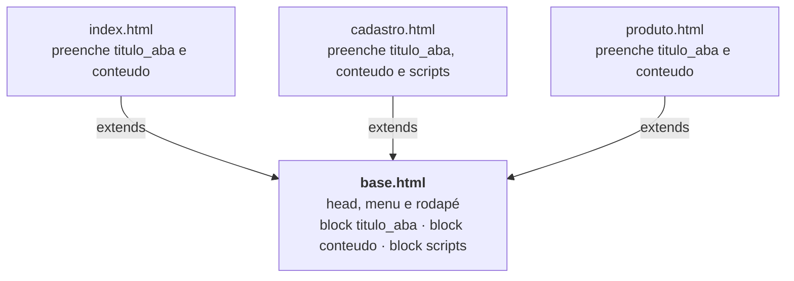

# Capítulo 06 — Herança de templates, `include` e páginas de erro

**Disciplina:** Programação para Internet (ILP951)
**Professor:** Ronan Adriel Zenatti · ronan.zenatti@cps.sp.gov.br
**Fatec Jahu — 2º Semestre/2026**

---

## 🎯 Objetivos do Capítulo

Ao final deste capítulo você deverá ser capaz de:

- Criar um template-base (`base.html`) com `` e fazer as outras páginas herdarem dele com ``
- Preencher os blocos `titulo_aba`, `conteudo` e `scripts` em cada página
- Destacar o link do menu da página atual com `request.endpoint`
- Guardar um pedaço de HTML em um arquivo próprio e reutilizá-lo com ``
- Criar as páginas de erro 404 e 500 do catálogo com `@app.errorhandler`
- Explicar por que o modo de desenvolvimento (`debug=True`) não mostra a página 500 quando acontece um erro de verdade

Desde o Capítulo 2, o menu e o rodapé são **copiados** em cada página. O Capítulo 5 acabou com a repetição dos dados, mas deixou dois incômodos: a `navbar` escrita três vezes e o mesmo `if` das faixas de preço em dois arquivos. Neste capítulo você resolve os dois. O menu e o rodapé passam a existir em **um só arquivo**, e a faixa de preço também. No fim, o catálogo ganha páginas de erro com a cara do resto do site, no lugar do "Not Found" cru que o Flask mostra desde o Capítulo 3.

## 📦 Ponto de partida

Este capítulo parte do **seu** repositório `catalogo-produtos`, como ele ficou no fim do Capítulo 5: com o `app.py`, as pastas `templates` (`index.html`, `cadastro.html` e `produto.html`) e `static` (`estilo.css` e `produto.js`), o `requirements.txt`, o `.gitignore` e a pasta `treino`.

Se o seu projeto não está funcionando, baixe o código do Capítulo 5 e descompacte na Área de Trabalho. Depois de descompactar, crie o ambiente virtual:

➡️ [Baixar p1_cap_05.zip](../arquivos/p1_cap_05.zip)

```bash
python -m venv venv
venv\Scripts\activate
pip install -r requirements.txt
```

---

## Tópico 1 — Da cópia ao `base.html`

### Antes de começar

Abra a pasta `catalogo-produtos` no VS Code e o terminal com `Ctrl + '`. Rode:

```bash
git pull
git status
```

O `git status` deve dizer `nothing to commit, working tree clean`. Se algo estiver pendente, faça o ciclo do Capítulo 1 (`git add .`, `git commit -m "..."`, `git push`) antes de seguir.

Ative o ambiente virtual (`venv\Scripts\activate`) e ligue o servidor:

```bash
python app.py
```

Deixe esse terminal rodando durante o capítulo e use um segundo terminal (o ícone **+** do painel) para o Git. Abra **http://127.0.0.1:5000** e deixe a página à vista.

### Sentindo o problema

Vamos fazer uma mudança que parece pequena: acrescentar o grupo da turma ao rodapé. O rodapé está escrito nos três arquivos de `templates`. Em `index.html` e em `cadastro.html`, troque a linha do rodapé:

```html
<p class="mb-0">Catálogo de Produtos · Fatec Jahu · ILP951 · GTI · 2026</p>
```

Salve os dois arquivos, recarregue **http://127.0.0.1:5000** e **http://127.0.0.1:5000/cadastro**: o rodapé mudou. Agora abra **http://127.0.0.1:5000/produto/1**. O rodapé ficou **como era**, porque você esqueceu o terceiro arquivo. Num site de vinte páginas, esse esquecimento é quase certo, e o visitante vê rodapés diferentes dependendo da página.

Desfaça a troca nos dois arquivos (volte a linha para `Catálogo de Produtos · Fatec Jahu · ILP951 · 2026`) antes de seguir. A solução é guardar o que é comum **uma vez só**, e é isso que o `base.html` faz.

### O esqueleto do `base.html`

Um **template-base** é um arquivo com a estrutura que todas as páginas têm em comum. Onde cada página difere, ele deixa um **bloco** (``): um espaço com nome, que a página preenche. Crie o arquivo `templates/base.html` com o esqueleto mínimo, que por enquanto só tem o `<head>`, o conteúdo principal e o script do Bootstrap:

```html
<!DOCTYPE html>
<html lang="pt-BR">
<head>
  <meta charset="UTF-8">
  <meta name="viewport" content="width=device-width, initial-scale=1.0">
  <title>Catálogo de Produtos</title>
  <link href="https://cdn.jsdelivr.net/npm/bootstrap@5.3.8/dist/css/bootstrap.min.css" rel="stylesheet">
  <link rel="stylesheet" href="{{ url_for('static', filename='estilo.css') }}">
</head>
<body>

  <main class="container my-4">
    
  </main>

  <script src="https://cdn.jsdelivr.net/npm/bootstrap@5.3.8/dist/js/bootstrap.bundle.min.js"></script>

</body>
</html>
```

Há dois blocos:

- `titulo_aba`, dentro do `<title>`, com um **valor padrão** ("Catálogo de Produtos") entre as marcas. A página que não preencher o bloco fica com esse texto.
- `conteudo`, dentro do `<main>`, vazio. É onde cada página coloca o que só ela tem.

Salve. Ainda não há nada para ver no navegador: o `base.html` nunca é aberto sozinho, nenhuma rota o chama. Ele existe para ser **herdado**.

!!! note "`block titulo_aba` e `{{ titulo }}` são coisas diferentes"
    Um **bloco** é um espaço do template, e quem o preenche é outro arquivo. Uma **variável** (`{{ titulo }}`) é um dado que a rota envia com `render_template`. Os nomes ficam em lugares separados: por isso o bloco se chama `titulo_aba` (o texto da aba do navegador), para não confundir com a variável `titulo` do Capítulo 5.

### O primeiro filho: `produto.html`

Vamos começar pela página menor. Abra `templates/produto.html` e faça duas trocas. A primeira: apague tudo desde o `<!DOCTYPE html>` até a linha `<main class="container my-4">` (isso inclui o `<head>` e a `navbar`) e escreva, no lugar, três linhas:

```html


{{ produto.nome }} — Catálogo de Produtos


```

A segunda: apague tudo desde `</main>` até o fim do arquivo (o rodapé, os scripts, o `</body>` e o `</html>`) e escreva ``. O arquivo fica assim:

```html


{{ produto.nome }} — Catálogo de Produtos


  <section id="detalhe" class="card">
    <div class="card-body">
      <h1 class="card-title h2">{{ produto.nome }}</h1>
      <p class="card-text"><strong>Código:</strong> {{ produto.id }}</p>
      <p class="card-text"><strong>Categoria:</strong> {{ produto.categoria }}</p>
      <p class="card-text"><strong>Preço:</strong> R$ {{ '%.2f'|format(produto.preco)|replace('.', ',') }}</p>
      <p class="card-text">
        <strong>Faixa:</strong>
        
        <span class="badge bg-success">Econômico</span>
        
        <span class="badge bg-primary">Intermediário</span>
        
        <span class="badge bg-warning text-dark">Premium</span>
        
      </p>
      <a href="{{ url_for('index') }}" class="btn btn-primary">Voltar para o catálogo</a>
    </div>
  </section>

```

!!! note "O que cada linha faz"
    O `` diz: "esta página é uma **filha** do `base.html`": o Flask monta a página a partir dele. Os `` ... `` dizem **o que colocar em cada espaço** do base. O que o filho escrever **fora** de um bloco é ignorado, então todo o conteúdo da página precisa estar dentro de um bloco.

Salve e abra **http://127.0.0.1:5000/produto/1**. O card do produto aparece, e a aba do navegador diz "Caneta esferográfica azul — Catálogo de Produtos". Mas **o menu e o rodapé sumiram**: o `produto.html` não os tem mais, e o `base.html` ainda não os tem. É o que o próximo tópico resolve.

Veja como as peças se encaixam:



Leia de baixo para cima: cada página filha aponta para o `base.html` com o `extends`, e só escreve o que é diferente dela. O quadro do `base.html` mostra o resultado final do capítulo: os blocos `scripts` e o menu ainda serão acrescentados.

Registre este ponto no Git (em um segundo terminal):

```bash
git add .
git commit -m "Cria o base.html e faz o produto herdar dele"
git push
```

---

## Tópico 2 — Menu e rodapé em um lugar só

### O menu vai para o `base.html`

Agora o `base.html` recebe o menu. No `templates/base.html`, logo **abaixo** de `<body>` e **antes** do `<main>`, escreva a `navbar`. É o mesmo bloco que está no `index.html` (o Produtos continua com a classe `active`, por enquanto):

```html
<nav class="navbar navbar-expand-lg" data-bs-theme="dark">
  <div class="container">
    <a class="navbar-brand" href="{{ url_for('index') }}">Catálogo de Produtos</a>
    <button class="navbar-toggler" type="button" data-bs-toggle="collapse"
            data-bs-target="#menu" aria-controls="menu" aria-expanded="false"
            aria-label="Abrir o menu">
      <span class="navbar-toggler-icon"></span>
    </button>
    <div class="collapse navbar-collapse" id="menu">
      <ul class="navbar-nav ms-auto">
        <li class="nav-item">
          <a class="nav-link active" href="{{ url_for('index') }}#produtos">Produtos</a>
        </li>
        <li class="nav-item">
          <a class="nav-link" href="{{ url_for('index') }}#categorias">Categorias</a>
        </li>
        <li class="nav-item">
          <a class="nav-link" href="{{ url_for('cadastro') }}">Cadastrar</a>
        </li>
      </ul>
    </div>
  </div>
</nav>

```

Salve e recarregue **http://127.0.0.1:5000/produto/1**: o menu apareceu, **sem você ter tocado no `produto.html`**. Ele vem do `base.html`. Para ver o alívio, troque no `base.html` o texto do `navbar-brand` de `Catálogo de Produtos` para `Meu Catálogo`, salve e recarregue: a mudança aparece no `produto.html` sem edição nele. Desfaça a troca.

### O rodapé também

No `base.html`, logo **depois** do `</main>` e antes do `<script>` do Bootstrap, escreva o rodapé:

```html
<footer class="text-center text-body-secondary py-3">
  <p class="mb-0">Catálogo de Produtos · Fatec Jahu · ILP951 · 2026</p>
</footer>

```

Salve e recarregue **http://127.0.0.1:5000/produto/1**: o rodapé voltou, também vindo do `base.html`. A página de produto agora é um arquivo curto, só com o que ela tem de próprio, e as outras duas ainda guardam suas cópias antigas (que vamos apagar no próximo tópico).

Registre no Git:

```bash
git add .
git commit -m "Move o menu e o rodapé para o base.html"
git push
```

---

## Tópico 3 — Os outros dois filhos

### `cadastro.html`

Abra `templates/cadastro.html`. Faça as mesmas duas trocas do `produto.html`, com um cuidado extra no fim do arquivo:

1. Apague tudo desde o `<!DOCTYPE html>` até a linha `<main class="container my-4">` e escreva no lugar:

```html


Cadastrar produto — Catálogo de Produtos


```

2. Apague tudo desde o `</main>` até o fim do arquivo, **inclusive as duas linhas `<script>`** do final (o script do Bootstrap já está no `base.html`, e o `produto.js` voltamos a tratar em seguida), e escreva ``.

Salve e abra **http://127.0.0.1:5000/cadastro**. O formulário aparece com menu e rodapé, mas surgiram **dois defeitos**:

- O menu marca **Produtos** como página atual, e você está em **Cadastrar**. A classe `active` ficou escrita à mão no `base.html`, igual para todas as páginas.
- Clique em **Ver no console** e abra o console do navegador (`F12`, aba **Console**): aparece `mostrarProduto is not defined`. O `produto.js`, que tem essa função, não está sendo carregado.

### O bloco `scripts`

Só o cadastro usa o `produto.js`. O `base.html` não pode carregá-lo em todas as páginas, mas precisa de um **espaço** para as páginas que têm script próprio. No `base.html`, logo depois do script do Bootstrap, acrescente um bloco vazio:

```html
<script src="https://cdn.jsdelivr.net/npm/bootstrap@5.3.8/dist/js/bootstrap.bundle.min.js"></script>

```

No fim do `cadastro.html`, depois do `` do conteúdo, preencha-o:

```html

  <script src="{{ url_for('static', filename='produto.js') }}"></script>

```

Salve, recarregue **http://127.0.0.1:5000/cadastro**, preencha os campos, clique em **Ver no console** e confira o console: os três valores digitados aparecem e o erro sumiu. A ordem importa: o bloco `scripts` vem **depois** do script do Bootstrap, e os scripts da página rodam por último.

### O link ativo do menu

Falta o primeiro defeito. O menu precisa saber em que página está. O Flask entrega isso ao template pelo objeto `request`, que já está disponível, sem enviar nada pela rota. O `request.endpoint` é o **nome da função da rota** que está atendendo o pedido, o mesmo nome que você passa ao `url_for`. Em `/cadastro` vale `'cadastro'`, em `/` vale `'index'` e em `/produto/3` vale `'produto'`.

No `base.html`, troque o link **Cadastrar**, tirando a classe fixa e usando um `if`:

```html
<a class="nav-link active" href="{{ url_for('cadastro') }}">Cadastrar</a>
```

Salve e recarregue **http://127.0.0.1:5000/cadastro**: **Cadastrar** está marcado, mas **Produtos** também continua marcado, porque a classe fixa ainda está lá. Troque o link **Produtos**. Ele deve ficar ativo no catálogo **e** na página de um produto, por isso a condição tem duas comparações ligadas por `or` (o `or` do Capítulo 5):

```html
<a class="nav-link active" href="{{ url_for('index') }}#produtos">Produtos</a>
```

Salve e navegue entre `/`, `/cadastro` e `/produto/3`: o destaque acompanha a página. Se você olhar o código-fonte (`Ctrl + U`), os links inativos têm `class="nav-link "`, com um espaço sobrando. É inofensivo.

### `index.html`

Falta o catálogo. Abra `templates/index.html` e repita as duas trocas. No começo, apague desde o `<!DOCTYPE html>` até o `<main class="container my-4">` e escreva:

```html


{{ titulo }}


```

No fim, apague desde o `</main>` até o último `</html>` e escreva ``. O `<h1>`, as seções de produtos e de categorias ficam como estão, dentro do bloco. Salve e navegue pelas três páginas: tudo funciona como antes, e agora cada arquivo só contém o que é dele.

Repare no `{{ titulo }}` dentro do bloco `titulo_aba`: o filho continua enxergando as variáveis que a rota enviou, como no Capítulo 5.

### O alívio

Repita o experimento do Tópico 1. Agora existe **um** rodapé. No `base.html`, troque o texto para `Catálogo de Produtos · Fatec Jahu · ILP951 · GTI · 2026`, salve e visite as três páginas: o rodapé mudou nas três, com **uma** edição. Desfaça a troca.

!!! warning "Um `base.html` quebrado derruba todas as páginas"
    Como todas as páginas dependem dele, um erro de sintaxe no `base.html` (um `` esquecido, por exemplo) faz todas falharem ao mesmo tempo, com um `TemplateSyntaxError`. O mesmo vale para o que o filho escreve fora de um `block`: nada aparece, e nenhum erro avisa. Se um conteúdo sumir, confira primeiro se ele está dentro de um bloco.

Registre no Git:

```bash
git add .
git commit -m "Faz o cadastro e o catálogo herdarem do base e marca o link ativo"
git push
```

---

## Tópico 4 — `include`: um pedaço de HTML reutilizado

O segundo incômodo do Capítulo 5 continua: o `if/elif/else` da faixa de preço está escrito no `index.html` e no `produto.html`. A herança não resolve isso, porque a faixa não é a estrutura da página inteira, é um **pedaço** usado em dois lugares. Para esse caso, o Jinja2 tem o ``: ele **insere o conteúdo de outro arquivo** no ponto onde foi escrito.

Crie o arquivo `templates/_faixa_preco.html` com o `if` que está no `produto.html`:

```html

<span class="badge bg-success">Econômico</span>

<span class="badge bg-primary">Intermediário</span>

<span class="badge bg-warning text-dark">Premium</span>

```

!!! note "Por que o nome começa com `_`?"
    É só uma convenção: o sublinhado avisa que o arquivo **não é uma página**. Nenhuma rota o chama, ele só é incluído em outras. O Flask não exige o `_`, mas ele ajuda a distinguir as páginas dos pedaços.

No `produto.html`, troque as seis linhas do `if` por uma:

```html
<p class="card-text">
  <strong>Faixa:</strong>
  
</p>
```

Salve e abra **http://127.0.0.1:5000/produto/1** e **/produto/6**: a faixa aparece igual a antes (Econômico e Premium). O arquivo incluído enxerga **as mesmas variáveis** do lugar onde foi incluído: aqui, o `produto` que a rota enviou.

Agora o `index.html`. Dentro do ``, troque o `if` da célula da faixa por:

```html
<td>
  
</td>
```

Salve e recarregue **http://127.0.0.1:5000**. As faixas continuam certas para os sete produtos, e é aqui que se vê que o arquivo incluído também enxerga a variável do `for`: a cada volta, o `produto` é outro, e o `include` usa o produto daquela volta.

Para ver o alívio, abra o `_faixa_preco.html` e troque o texto `Econômico` por `Barato`. Salve e confira o catálogo e `/produto/1`: as duas páginas mudaram com **uma** edição. Desfaça a troca.

!!! note "`extends` e `include`: a diferença"
    O `extends` é a relação de **filho e base**: a página inteira nasce do `base.html`, e cada bloco é preenchido pelo filho. O `include` é um **pedaço solto**, inserido em um ponto da página. Use `extends` para a estrutura que todas as páginas compartilham e `include` para um trecho que se repete em alguns lugares.

Registre no Git:

```bash
git add .
git commit -m "Guarda a faixa de preço em um arquivo incluído"
git push
```

---

## Tópico 5 — Páginas de erro 404 e 500

### O 404 padrão

Abra **http://127.0.0.1:5000/xyz**: o Flask mostra um **Not Found** em texto simples, sem menu e sem o visual do catálogo. Vale o mesmo para **/produto/99**, que não existe, e para **/produto/abc**, que o `int:` da rota recusa. Quem chega por um link errado fica sem saber para onde ir.

### Uma página 404 do catálogo

Uma página de erro é um template como os outros, e herda do `base.html`, então ganha o menu e o rodapé. Crie `templates/404.html`:

```html


Página não encontrada — Catálogo de Produtos


  <div class="text-center py-5">
    <h1 class="display-1">404</h1>
    <p class="lead">Não encontramos a página que você procurava.</p>
    <a href="{{ url_for('index') }}" class="btn btn-primary">Voltar para o catálogo</a>
  </div>

```

Falta dizer ao Flask quando usá-la. No `app.py`, **depois** da rota `produto` e **antes** do `if __name__`, acrescente:

```python
@app.errorhandler(404)
def pagina_nao_encontrada(erro):
    return render_template('404.html'), 404
```

!!! note "O `@app.errorhandler` e o `, 404`"
    O `@app.route` liga um **endereço** a uma função. O `@app.errorhandler(404)` liga um **código de erro** a uma função: sempre que o Flask precisar responder 404, ele chama essa função. O Flask passa à função o objeto do erro, e por isso ela recebe o parâmetro `erro`, mesmo que o nosso código não o use.

    O `return` tem **dois valores** separados por vírgula: a página e o código de status. O Flask lê o segundo como o código da resposta. Sem ele, a página de erro sairia com o código 200 ("deu certo"), e navegadores e buscadores achariam que ela existe.

Salve e abra **/xyz**, **/produto/99** e **/produto/abc**: as três mostram a página do catálogo, com menu e rodapé. Repare no menu:

- Em `/xyz` e em `/produto/abc`, nenhum link fica marcado. Nenhuma rota atendeu o pedido (a `produto` recusou o `abc`), e o `request.endpoint` não tem valor.
- Em `/produto/99`, o **Produtos** fica marcado. A rota `produto` **atendeu** o pedido e foi ela mesma que chamou o `abort(404)`, então o `request.endpoint` vale `'produto'`.

Confira o terminal: a linha do pedido termina em `404`:

```
127.0.0.1 - - [data] "GET /xyz HTTP/1.1" 404 -
```

Para ver o efeito do segundo valor, apague o `, 404` do `return`, salve e abra `/xyz` de novo: a página é a mesma, mas a linha do terminal passou a terminar em `200`. Devolva o `, 404`.

### O 500

O **500** significa que o servidor falhou: o Python quebrou no meio da rota. Na produção, o visitante também não deveria ver um texto cru. Crie `templates/500.html`:

```html


Erro no servidor — Catálogo de Produtos


  <div class="text-center py-5">
    <h1 class="display-1">500</h1>
    <p class="lead">Algo deu errado do nosso lado. Tente novamente em instantes.</p>
    <a href="{{ url_for('index') }}" class="btn btn-primary">Voltar para o catálogo</a>
  </div>

```

E no `app.py`, logo abaixo do tratador do 404:

```python
@app.errorhandler(500)
def erro_no_servidor(erro):
    return render_template('500.html'), 500
```

Para ver essa página, é preciso provocar o erro. Acrescente ao `app.py`, **antes** do `if __name__`, uma rota provisória que pede o erro 500 de propósito, com o `abort` que você já usa no 404:

```python
@app.route('/erro')
def erro():
    abort(500)
```

Salve e abra **http://127.0.0.1:5000/erro**: aparece a página 500 do catálogo, e o terminal registra `500`.

Agora provoque um erro **de verdade**. Troque o corpo da rota por uma divisão por zero, que o Python não consegue fazer:

```python
@app.route('/erro')
def erro():
    resultado = 1 / 0
    return str(resultado)
```

Salve e abra **/erro** de novo. Desta vez **não** aparece a página 500 do catálogo, e sim a página de depuração do Flask, com o texto `ZeroDivisionError: division by zero` e o trecho de código que falhou.

!!! warning "Em `debug=True`, o 500 de verdade não usa a sua página"
    O `app.run(debug=True)` liga o **modo de desenvolvimento**, que mostra o erro com todos os detalhes para quem está programando. Por isso a sua página 500 não aparece quando o Python quebra de verdade: o Flask a reserva para quando o modo de desenvolvimento está desligado, que é como um site publicado funciona. No `abort(500)` a página aparece, porque ele pede o erro 500 de forma explícita e não é um defeito do código.

    Esse depurador mostra o código do projeto. Ele **nunca** deve ficar ligado em um site publicado.

Apague a rota provisória `/erro` inteira antes de seguir. Se ela ficasse no projeto, qualquer visitante poderia provocar um erro.

Registre no Git:

```bash
git add .
git commit -m "Adiciona as páginas 404 e 500"
git push
```

---

## Os arquivos completos do capítulo

O `app.py`:

```python
from flask import Flask, render_template, abort

app = Flask(__name__)

categorias = ['Papelaria', 'Informática', 'Casa', 'Acessórios']

produtos = [
    {'id': 1, 'nome': 'Caneta esferográfica azul', 'categoria': 'Papelaria', 'preco': 2.50},
    {'id': 2, 'nome': 'Caderno universitário 96 folhas', 'categoria': 'Papelaria', 'preco': 18.90},
    {'id': 3, 'nome': 'Mouse sem fio', 'categoria': 'Informática', 'preco': 59.90},
    {'id': 4, 'nome': 'Teclado USB', 'categoria': 'Informática', 'preco': 89.90},
    {'id': 5, 'nome': 'Garrafa térmica 500 ml', 'categoria': 'Casa', 'preco': 49.90},
    {'id': 6, 'nome': 'Mochila escolar', 'categoria': 'Acessórios', 'preco': 129.00},
    {'id': 7, 'nome': 'Fone de ouvido', 'categoria': 'Informática', 'preco': 79.90},
]


@app.route('/')
def index():
    return render_template('index.html', titulo='Catálogo de Produtos',
                           produtos=produtos, categorias=categorias)


@app.route('/cadastro')
def cadastro():
    return render_template('cadastro.html', categorias=categorias)


@app.route('/produto/<int:id_produto>')
def produto(id_produto):
    produto_encontrado = None
    for item in produtos:
        if item['id'] == id_produto:
            produto_encontrado = item

    if produto_encontrado is None:
        abort(404)

    return render_template('produto.html', produto=produto_encontrado)


@app.errorhandler(404)
def pagina_nao_encontrada(erro):
    return render_template('404.html'), 404


@app.errorhandler(500)
def erro_no_servidor(erro):
    return render_template('500.html'), 500


if __name__ == '__main__':
    app.run(debug=True)
```

O `templates/base.html`:

```html
<!DOCTYPE html>
<html lang="pt-BR">
<head>
  <meta charset="UTF-8">
  <meta name="viewport" content="width=device-width, initial-scale=1.0">
  <title>Catálogo de Produtos</title>
  <link href="https://cdn.jsdelivr.net/npm/bootstrap@5.3.8/dist/css/bootstrap.min.css" rel="stylesheet">
  <link rel="stylesheet" href="{{ url_for('static', filename='estilo.css') }}">
</head>
<body>

  <nav class="navbar navbar-expand-lg" data-bs-theme="dark">
    <div class="container">
      <a class="navbar-brand" href="{{ url_for('index') }}">Catálogo de Produtos</a>
      <button class="navbar-toggler" type="button" data-bs-toggle="collapse"
              data-bs-target="#menu" aria-controls="menu" aria-expanded="false"
              aria-label="Abrir o menu">
        <span class="navbar-toggler-icon"></span>
      </button>
      <div class="collapse navbar-collapse" id="menu">
        <ul class="navbar-nav ms-auto">
          <li class="nav-item">
            <a class="nav-link active" href="{{ url_for('index') }}#produtos">Produtos</a>
          </li>
          <li class="nav-item">
            <a class="nav-link" href="{{ url_for('index') }}#categorias">Categorias</a>
          </li>
          <li class="nav-item">
            <a class="nav-link active" href="{{ url_for('cadastro') }}">Cadastrar</a>
          </li>
        </ul>
      </div>
    </div>
  </nav>

  <main class="container my-4">
    
  </main>

  <footer class="text-center text-body-secondary py-3">
    <p class="mb-0">Catálogo de Produtos · Fatec Jahu · ILP951 · 2026</p>
  </footer>

  <script src="https://cdn.jsdelivr.net/npm/bootstrap@5.3.8/dist/js/bootstrap.bundle.min.js"></script>
  

</body>
</html>
```

O `templates/index.html`:

```html


{{ titulo }}


  {# O título vem da rota index(), no app.py #}
  <h1>{{ titulo }}</h1>
  <p class="lead">Papelaria, informática, casa e acessórios para o dia a dia.</p>

  <section id="produtos" class="mb-5">
    <h2>Produtos</h2>
    <p class="text-body-secondary">{{ produtos|length }} produtos no catálogo.</p>
    <table class="table table-striped table-hover">
      <thead class="table-light">
        <tr>
          <th>Nº</th>
          <th>Nome</th>
          <th>Categoria</th>
          <th>Faixa</th>
          <th class="text-end">Preço</th>
        </tr>
      </thead>
      <tbody>
        
        <tr>
          <td>{{ loop.index }}</td>
          <td><a href="{{ url_for('produto', id_produto=produto.id) }}">{{ produto.nome }}</a></td>
          <td>{{ produto.categoria|default('Sem categoria') }}</td>
          <td>
            
          </td>
          <td class="text-end">R$ {{ '%.2f'|format(produto.preco)|replace('.', ',') }}</td>
        </tr>
        
        <tr>
          <td colspan="5" class="text-center text-body-secondary">Nenhum produto cadastrado.</td>
        </tr>
        
      </tbody>
    </table>
  </section>

  <section id="categorias">
    <h2>Categorias</h2>
    <div class="row g-3">
      
      <div class="col-sm-6 col-lg-3">
        <div class="card">
          <div class="card-body">{{ categoria }}</div>
        </div>
      </div>
      
    </div>
  </section>

```

O `templates/cadastro.html`:

```html


Cadastrar produto — Catálogo de Produtos


  <h1 class="h2 mb-4">Cadastrar produto</h1>

  <div class="row">
    <div class="col-lg-6">
      <div class="card">
        <div class="card-body">

          <form action="#" onsubmit="cadastrarProduto(event)">

            <div class="mb-3">
              <label for="nome" class="form-label">Nome do produto</label>
              <input type="text" class="form-control" id="nome" name="nome" placeholder="Ex.: Caneta esferográfica azul" required minlength="3">
            </div>

            <div class="mb-3">
              <label for="categoria" class="form-label">Categoria</label>
              <select class="form-select" id="categoria" name="categoria" required>
                <option value="">Selecione...</option>
                
                <option value="{{ categoria }}">{{ categoria }}</option>
                
              </select>
            </div>

            <div class="mb-3">
              <label for="preco" class="form-label">Preço (R$)</label>
              <input type="number" class="form-control" id="preco" name="preco" placeholder="0,00" min="0.01" step="0.01" required>
            </div>

            <div class="d-flex gap-2">
              <button type="submit" class="btn btn-primary">Cadastrar produto</button>
              <button type="reset" class="btn btn-outline-secondary">Limpar</button>
              <button type="button" class="btn btn-outline-secondary" onclick="mostrarProduto()">Ver no console</button>
            </div>

          </form>

        </div>
      </div>
    </div>
  </div>



  <script src="{{ url_for('static', filename='produto.js') }}"></script>

```

E o `templates/produto.html`:

```html


{{ produto.nome }} — Catálogo de Produtos


  <section id="detalhe" class="card">
    <div class="card-body">
      <h1 class="card-title h2">{{ produto.nome }}</h1>
      <p class="card-text"><strong>Código:</strong> {{ produto.id }}</p>
      <p class="card-text"><strong>Categoria:</strong> {{ produto.categoria }}</p>
      <p class="card-text"><strong>Preço:</strong> R$ {{ '%.2f'|format(produto.preco)|replace('.', ',') }}</p>
      <p class="card-text">
        <strong>Faixa:</strong>
        
      </p>
      <a href="{{ url_for('index') }}" class="btn btn-primary">Voltar para o catálogo</a>
    </div>
  </section>

```

Os outros três arquivos da pasta `templates` são o `_faixa_preco.html` (Tópico 4), o `404.html` e o `500.html` (Tópico 5), como você os escreveu.

!!! warning "Dois incômodos que continuam de propósito"
    1. **O formulário de cadastro ainda não envia nada ao Python.** Ele só confere os campos e escreve no console: o `action="#"` e o `onsubmit` do Capítulo 2 continuam lá. O Capítulo 7 faz o produto chegar ao servidor.
    2. **A formatação do preço (`'%.2f'|format(...)|replace('.', ',')`) continua repetida** no `index.html` e no `produto.html`. Ela é uma expressão e não um bloco de HTML, e por isso o `include` não é a ferramenta certa. O Capítulo 18 cria um filtro próprio para ela.

---

## 📦 Código deste capítulo

Compare com o seu projeto, ou use como ponto de partida do próximo capítulo. O zip tem o `app.py`, a pasta `templates` (`base.html`, `index.html`, `cadastro.html`, `produto.html`, `_faixa_preco.html`, `404.html` e `500.html`), a pasta `static` (`estilo.css` e `produto.js`), o `requirements.txt`, o `.gitignore` e a pasta `treino`. O ambiente virtual **não** vai no zip: depois de descompactar, crie-o com os três comandos do Capítulo 3 (`python -m venv venv`, `venv\Scripts\activate` e `pip install -r requirements.txt`).

➡️ [Baixar p1_cap_06.zip](../arquivos/p1_cap_06.zip)

---

## 🃏 Flashcards de Revisão

Tente responder mentalmente antes de abrir.

??? question "Para que serve o `base.html` e como as outras páginas o usam?"
    Ele guarda o que todas as páginas têm em comum (o `<head>`, o menu, o rodapé e os scripts) e deixa **blocos** nos pontos em que as páginas diferem. Cada página usa `` e preenche os blocos que quer. Para mudar o menu ou o rodapé, edita-se um arquivo só.

??? question "O que acontece com o que um template filho escreve fora de um ``?"
    É **ignorado**: não aparece na página, e o Flask não avisa. Por isso todo o conteúdo do filho precisa estar dentro de um bloco. Se um trecho sumir depois de a página passar a herdar do `base.html`, verifique se ele ficou fora de um bloco.

??? question "Qual a diferença entre `` e ``?"
    O `extends` faz a página inteira nascer de um template-base, cujos blocos o filho preenche. O `include` insere o conteúdo de outro arquivo em **um ponto** da página, como a faixa de preço (`_faixa_preco.html`). Um é a estrutura compartilhada, o outro é um pedaço reutilizado.

??? question "O que é o `request.endpoint` e como ele marca o link ativo do menu?"
    É o nome da função da rota que está atendendo o pedido (por exemplo, `'cadastro'` em `/cadastro`). No `base.html`, um `active` acrescenta a classe `active` só ao link da página atual. O `request` já está disponível nos templates, sem precisar enviá-lo pela rota.

??? question "Por que o tratador do 404 devolve `render_template('404.html'), 404`?"
    O segundo valor é o código de status da resposta. Sem ele, a página de erro sairia com o código 200 ("deu certo"), e navegadores e buscadores achariam que ela existe. A página é amigável, mas o código continua sendo 404.

??? question "Por que, com `debug=True`, um erro de verdade no Python não mostra a sua página 500?"
    O modo de desenvolvimento mostra o depurador do Flask, com o erro e o código que falhou, que é o que quem programa precisa ver. A página 500 do projeto é a que o visitante vê com o modo de desenvolvimento desligado. O `abort(500)` é diferente: pede o erro de forma explícita, e a página aparece mesmo em `debug=True`.

---

## ✅ Quiz de Fixação

<quiz>
O que faz a linha `` no início de uma página?
- [ ] Copia o texto do `base.html` para dentro da página, no lugar da linha
> Não. Quem copia um arquivo para dentro de outro é o ``. O `extends` cria uma relação de herança: a página passa a ser construída a partir do `base.html`.
- [x] Faz a página ser montada a partir do `base.html`, preenchendo os blocos que ele define
> Correto. O Flask parte da estrutura do `base.html` e coloca o conteúdo de cada `` do filho no espaço de mesmo nome.
- [ ] Define as rotas da página no `app.py`
> Não. As rotas ficam no `app.py`, com `@app.route`. O `extends` só diz de qual template a página herda.
- [ ] Carrega o CSS do Bootstrap na página
> Não. O CSS do Bootstrap é carregado pelo `<link>` do `<head>`, que agora está dentro do `base.html`. O `extends` é só o que liga o filho ao base.
</quiz>

<quiz>
Quais afirmações sobre a herança de templates do catálogo estão corretas? (selecione todas que se aplicam)
- [x] O `base.html` define blocos, vazios ou com valor padrão, que os filhos preenchem
> Correto. O `titulo_aba` tem um valor padrão e o `conteudo` e o `scripts` são vazios. Cada filho decide o que escrever em cada um.
- [x] Para mudar o texto do rodapé nas três páginas, basta editar o `base.html`
> Correto. É o ganho da herança: o rodapé existe em um arquivo só, e as páginas filhas o recebem de lá.
- [x] O que o filho escreve fora de um `` não aparece na página
> Correto. O Flask ignora o que está fora dos blocos, e não mostra erro. Por isso o conteúdo do filho precisa estar sempre dentro de um bloco.
- [ ] Cada página filha precisa repetir o `<head>` e a `navbar` para funcionar
> Não. É o contrário: o `<head>` e a `navbar` ficam no `base.html`, e o filho só escreve o que é dele.
</quiz>

<quiz>
A faixa de preço (Econômico, Intermediário, Premium) aparece no `index.html` e no `produto.html`. Qual é a melhor forma de escrevê-la **uma única vez**?
- [ ] Criar um bloco `faixa` no `base.html` e preenchê-lo nas duas páginas
> Não. Preencher o bloco nas duas páginas ainda repetiria o `if` em dois arquivos. O bloco serve para o que **difere** entre as páginas, e não para o que se repete.
- [x] Guardar o `if` em `_faixa_preco.html` e usar `` nos dois lugares
> Correto. O `include` insere o arquivo no ponto onde foi escrito, e o arquivo incluído enxerga a variável `produto` do lugar onde está, inclusive a do `for`.
- [ ] Colar o `if` também no `base.html`
> Não. Isso criaria uma terceira cópia, o contrário do que se quer. O `base.html` é a estrutura da página e não um depósito de pedaços repetidos.
- [ ] Usar o `` em cada página
> Não. Cada página só pode herdar de um template-base, que é o `base.html`. A faixa é um pedaço de uma página, e não uma página-base.
</quiz>

<quiz>
No `app.py`, o tratador do erro 404 foi escrito como `return render_template('404.html')`, **sem** o `, 404`. O que acontece ao abrir `/xyz`?
- [ ] O Flask mostra o Not Found padrão, ignorando o `404.html`
> Não. O tratador está registrado e o Flask o usa, então a página do catálogo aparece. O que muda é o código da resposta.
- [ ] A página 404 aparece, e o terminal registra `404`
> Não. Sem o segundo valor, o Flask não sabe que a resposta é um erro e usa o código padrão, 200. Só o `, 404` faz o terminal registrar 404.
- [x] A página 404 aparece, mas o terminal registra `200`, como se a página existisse
> Correto. O segundo valor do `return` é o código de status. Sem ele, a resposta sai com 200 ("deu certo"), o que engana navegadores e buscadores.
- [ ] O Flask mostra um erro 500, porque o `return` está incompleto
> Não. Devolver só a página é permitido, e o Flask aplica o código 200.
</quiz>

<quiz>
Em qual página o `request.endpoint` vale `'cadastro'`?
- [ ] Em `/produto/3`
> Não. Nessa página, a função da rota é `produto`, e o `request.endpoint` vale `'produto'`.
- [ ] Em qualquer página que tenha o link **Cadastrar** no menu
> Não. O link aparece em todas as páginas, porque está no `base.html`, mas o `request.endpoint` só olha qual rota está atendendo o pedido.
- [x] Em `/cadastro`, atendida pela função `cadastro`
> Correto. O `request.endpoint` é o nome da função da rota atual, o mesmo nome que se passa ao `url_for`.
- [ ] Em `/xyz`, que não existe
> Não. Como nenhuma rota atende `/xyz`, não há função, e nenhum link do menu fica marcado.
</quiz>

---

## 📝 Resumo

Você tirou o menu e o rodapé de dentro de cada página e os colocou no `base.html`: as páginas passaram a herdar dele com `` e a preencher só os blocos `titulo_aba`, `conteudo` e `scripts`. O `request.endpoint` permitiu marcar o link da página atual, e o `` guardou a faixa de preço em um único arquivo. As páginas 404 e 500 herdam do mesmo `base.html`, e o `@app.errorhandler` com o código de status as liga aos erros. O modo `debug=True` continua mostrando o depurador para erros de verdade. O catálogo agora tem estrutura e visual em um lugar só, e falta fazê-lo receber dados: o Capítulo 7 leva o formulário até o Python.

---

## 🔗 Navegação

⬅️ [Capítulo 5 — Variáveis, filtros, if e for](Capitulo_05_Variaveis_Filtros_If_e_For.md) · ➡️ [Capítulo 7 — Formulários](Capitulo_07_Formularios.md)

---

*Fatec Jahu · ILP951 · Prof. Ronan Adriel Zenatti · 2026*
