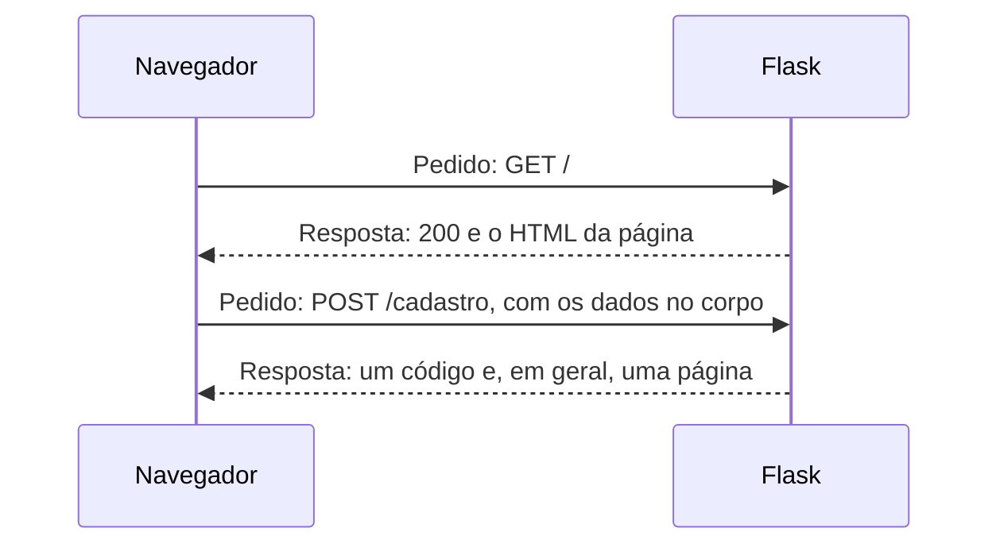
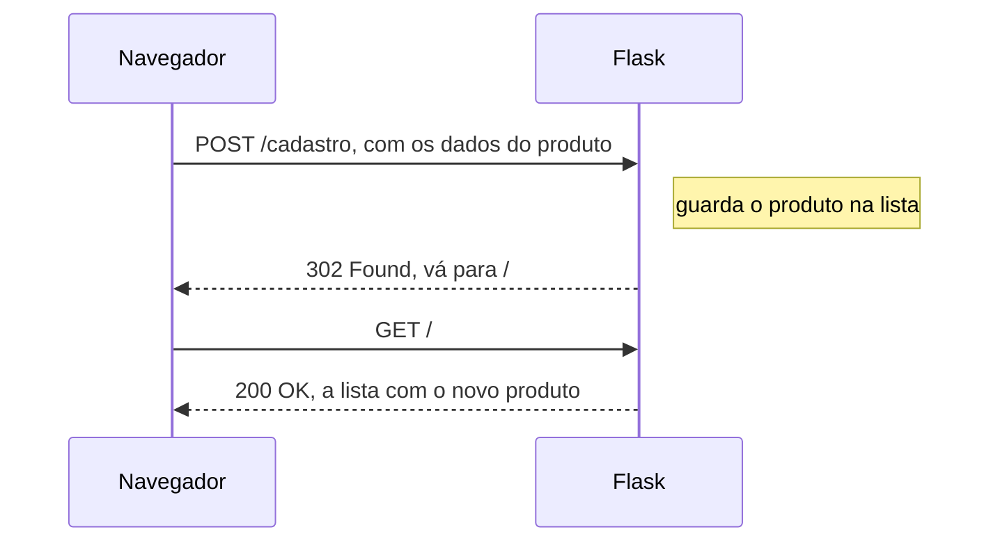

# Capítulo 07 — Formulários

**Disciplina:** Programação para Internet (ILP951)
**Professor:** Ronan Adriel Zenatti · ronan.zenatti@cps.sp.gov.br
**Fatec Jahu — 2º Semestre/2026**

---

## 🎯 Objetivos do Capítulo

Ao final deste capítulo você deverá ser capaz de:

- Descrever o pedido e a resposta do HTTP e ler o método, o endereço e o código de status no painel **Network** do navegador
- Escolher entre **GET** e **POST** e explicar onde os dados de cada um viajam
- Criar um formulário GET (a busca de produtos) e ler os dados com `request.args`
- Fazer uma rota aceitar POST com `methods` e ler os dados com `request.form`
- Usar os tipos de campo `text`, `email`, `date`, `radio`, `textarea`, `password`, `checkbox`, `select` e `number` e saber como cada um chega ao Python
- Guardar o produto enviado pelo formulário na lista do catálogo, convertendo o preço de texto para número
- Aplicar o padrão **PRG** (POST, Redirect, GET) para que atualizar a página não reenvie o formulário

Desde o Capítulo 2, o formulário de cadastro só existe na tela: ele confere os campos, escreve no console e não manda nada a ninguém. Neste capítulo ele passa a **enviar os dados ao Python**. Você vai primeiro olhar a conversa entre o navegador e o Flask, depois criar uma busca (que usa GET), uma página de contato (que usa POST e todos os tipos de campo) e, por fim, fazer o produto digitado entrar na lista do catálogo. O que ainda **não** existe fica para os próximos capítulos: conferir se os dados são válidos (Capítulo 9) e não perdê-los quando o servidor reinicia (Capítulos 8 e 10).

## 📦 Ponto de partida

Este capítulo parte do **seu** repositório `catalogo-produtos`, como ele ficou no fim do Capítulo 6: com o `app.py`, as pastas `templates` (`base.html`, `index.html`, `cadastro.html`, `produto.html`, `_faixa_preco.html`, `404.html` e `500.html`) e `static` (`estilo.css` e `produto.js`), o `requirements.txt`, o `.gitignore` e a pasta `treino`.

Se o seu projeto não está funcionando, baixe o código do Capítulo 6 e descompacte na Área de Trabalho. Depois de descompactar, crie o ambiente virtual:

➡️ [Baixar p1_cap_06.zip](../arquivos/p1_cap_06.zip)

```bash
python -m venv venv
venv\Scripts\activate
pip install -r requirements.txt
```

---

## Tópico 1 — A conversa entre o navegador e o Flask

### Antes de começar

Abra a pasta `catalogo-produtos` no VS Code e o terminal com `Ctrl + '`. Rode:

```bash
git pull
git status
```

O `git status` deve dizer `nothing to commit, working tree clean`. Se algo estiver pendente, faça o ciclo do Capítulo 1 (`git add .`, `git commit -m "..."`, `git push`) antes de seguir.

Ative o ambiente virtual (`venv\Scripts\activate`) e ligue o servidor:

```bash
python app.py
```

Deixe esse terminal rodando durante o capítulo e use um segundo terminal (o ícone **+** do painel) para o Git. Abra **http://127.0.0.1:5000**.

### O pedido e a resposta

Toda vez que o navegador mostra uma página, acontecem duas mensagens do protocolo **HTTP**: o navegador faz um **pedido** e o Flask devolve uma **resposta**. Você já vê essa conversa no terminal do servidor, a cada página aberta:

```
127.0.0.1 - - [data] "GET / HTTP/1.1" 200 -
```

Leia a linha assim: o método (`GET`), o endereço pedido (`/`) e o **código de status** da resposta (`200`). Agora olhe a mesma conversa pelo lado do navegador:

1. Com a página do catálogo aberta, aperte `F12` para abrir as ferramentas do desenvolvedor.
2. Clique na aba **Network** (em português, **Rede**).
3. Recarregue a página com `F5`.

A lista mostra **um pedido para cada arquivo** que a página usou: o próprio HTML, o CSS do Bootstrap, o `estilo.css`, o script do Bootstrap. Clique no **primeiro item** (o HTML da página) e, na aba **Headers** (**Cabeçalhos**), procure a seção **General**: ali estão o `Request URL`, o `Request Method` (`GET`) e o `Status Code` (`200 OK`).

Agora abra **http://127.0.0.1:5000/xyz** com o painel ainda aberto. O pedido continua sendo um `GET`, mas o código agora é `404 Not Found`, e a página 404 que você criou no Capítulo 6 aparece. Use o painel sempre que quiser saber **o que o navegador enviou e o que o Flask respondeu**: ele vai ser a principal ferramenta deste capítulo.



### Como são as duas mensagens

Um pedido é um texto simples. Este é o `GET` que a busca do Tópico 2 vai fazer:

```
GET /?busca=mouse HTTP/1.1
Host: 127.0.0.1:5000
```

E este é o `POST` que o cadastro de produto vai fazer no Tópico 4:

```
POST /cadastro HTTP/1.1
Host: 127.0.0.1:5000
Content-Type: application/x-www-form-urlencoded

nome=Mouse+sem+fio&categoria=Inform%C3%A1tica&preco=59.9
```

A primeira linha tem sempre o **método** e o **endereço**. No `GET`, os dados (`busca=mouse`) vão **no próprio endereço**, depois do `?`. No `POST`, os dados vão **no corpo** do pedido, depois de uma linha em branco, e o endereço fica limpo.

Os códigos de status que você vai encontrar neste capítulo:

| Código | Nome | Significa |
|---|---|---|
| `200` | OK | Deu certo, a página está na resposta |
| `302` | Found | "Não está aqui: vá buscar em outro endereço" (um **redirecionamento**) |
| `400` | Bad Request | O pedido chegou incompleto ou mal formado |
| `404` | Not Found | O endereço não existe |
| `405` | Method Not Allowed | O endereço existe, mas não aceita esse método |
| `500` | Internal Server Error | O Python quebrou no meio da rota |

### GET ou POST?

| | GET | POST |
|---|---|---|
| **Serve para** | Pedir uma página | Enviar dados para o servidor processar |
| **Onde vão os dados** | No endereço (`?busca=mouse`) | No corpo do pedido |
| **Fica no histórico e nos favoritos** | Sim | Não |
| **Dá para copiar e compartilhar o link** | Sim | Não |
| **Exemplo no catálogo** | Buscar produtos pelo nome | Cadastrar um produto |

A regra para decidir é simples: **se a ação só lê, use GET; se ela cria, altera ou apaga alguma coisa, use POST.** Uma busca pode ser copiada e enviada a um colega, e ele vê o mesmo resultado. Um cadastro não pode ser repetido por quem clicar em um link.

!!! warning "Corpo do POST não é segredo"
    O POST tira os dados do endereço, e só isso. O corpo do pedido **não é criptografado**: quem consegue ver o tráfego da rede lê o conteúdo. A proteção de verdade é o HTTPS, que fica no servidor publicado. Você vai ver o corpo de um POST no painel Network no Tópico 3.

Este tópico não muda o código, então não há commit.

---

## Tópico 2 — Formulário GET: buscar produtos pelo nome

### O formulário de busca

A tabela de produtos do catálogo vai ganhar uma busca pelo nome. Abra `templates/index.html` e escreva o formulário **logo abaixo** de `<h2>Produtos</h2>`, antes do parágrafo que conta os produtos:

```html
    <form action="{{ url_for('index') }}" method="get" class="row g-2 mb-3">
      <div class="col-sm-8 col-lg-5">
        <label for="busca" class="visually-hidden">Buscar pelo nome</label>
        <input type="search" class="form-control" id="busca" name="busca" placeholder="Buscar pelo nome">
      </div>
      <div class="col-auto">
        <button type="submit" class="btn btn-primary">Buscar</button>
      </div>
    </form>
```

!!! note "O que cada atributo faz"
    O `action` diz **para onde** o formulário vai: a própria página do catálogo, pelo nome da função (`url_for('index')`, como nos links). O `method="get"` diz **como**: os dados vão no endereço. O `name="busca"` é o **nome do dado**: é por ele que o Python vai pedir o valor. O `id` e o `for` do `<label>` continuam servindo para ligar o rótulo ao campo, e a classe `visually-hidden` do Bootstrap esconde o rótulo da vista, mas o mantém para leitores de tela.

Salve, recarregue **http://127.0.0.1:5000**, digite `mouse` e clique em **Buscar**. Olhe a barra de endereços: ela virou

```
http://127.0.0.1:5000/?busca=mouse
```

Os dados foram **para o endereço**: `?`, o nome do campo, `=` e o valor digitado. Era o que o Capítulo 2 prometia. Mas a tabela continua com os sete produtos, e o campo voltou vazio: nada no Python lê a busca ainda. Confira no painel **Network**: o pedido é um `GET`, e na aba **Payload** o item **Query String Parameters** mostra `busca: mouse`. Tente também `caneta azul` e `fone é`: o endereço fica `?busca=caneta+azul` e `?busca=fone+%C3%A9`. O navegador troca o espaço por `+` e o acento por um código com `%`, e o Flask desfaz isso automaticamente.

### Lendo a busca no Python

No `app.py`, importe o `request` na primeira linha:

```python
from flask import Flask, render_template, abort, request
```

E na rota `index`, leia o dado e envie-o ao template:

```python
@app.route('/')
def index():
    busca = request.args.get('busca', '').strip()

    return render_template('index.html', titulo='Catálogo de Produtos',
                           produtos=produtos, categorias=categorias, busca=busca)
```

!!! note "Flask: `request` e `request.args`"
    O `request` é um objeto do Flask com **tudo sobre o pedido que chegou**: o método, o endereço e os dados. No template você já o usava (o `request.endpoint` do Capítulo 6) sem importar nada, mas no `app.py` é preciso importá-lo. O `request.args` guarda os dados que vêm **no endereço**, depois do `?`, e funciona como um dicionário: a chave é o `name` do campo (`'busca'`).

!!! note "Python: `.get()` com valor padrão e `.strip()`"
    Em um dicionário, `dicionario['busca']` dá erro se a chave não existir, e `dicionario.get('busca', '')` devolve o **valor padrão** (aqui, o texto vazio `''`) quando ela não existe. Isso importa porque, ao abrir `/` pela primeira vez, o endereço não tem `?busca=...` nenhum. O `.strip()` tira os espaços do começo e do fim do texto: `'  mouse '` vira `'mouse'`.

No `index.html`, faça o campo mostrar a busca atual, acrescentando o `value` ao `<input>`:

```html
        <input type="search" class="form-control" id="busca" name="busca" placeholder="Buscar pelo nome" value="{{ busca }}">
```

Salve e busque `mouse` de novo: o campo agora **continua com o termo** depois de enviar. A lista ainda tem os sete produtos, porque ninguém filtrou. Teste também abrir **http://127.0.0.1:5000/?busca=%20%20teste%20%20**: o campo mostra `teste`, sem os espaços.

!!! note "O Jinja protege o que o usuário digita"
    Experimente buscar `<b>oi</b>`. O texto aparece como foi digitado, com os sinais `<` e `>`, e não vira negrito. O Jinja2 **troca esses sinais por códigos** antes de colocar o valor na página, e é isso que impede que alguém coloque HTML ou JavaScript no site através de um campo.

### Filtrando a lista

Agora o filtro. A rota percorre os produtos e guarda em uma lista nova só os que contêm o termo no nome:

```python
@app.route('/')
def index():
    busca = request.args.get('busca', '').strip()

    encontrados = []
    for item in produtos:
        if busca.lower() in item['nome'].lower():
            encontrados.append(item)

    return render_template('index.html', titulo='Catálogo de Produtos',
                           produtos=encontrados, categorias=categorias, busca=busca)
```

!!! note "Python: `.lower()`, `in` e `.append()`"
    O `.lower()` converte o texto para minúsculas, e usá-lo nos dois lados faz `MOUSE`, `Mouse` e `mouse` serem tratados como iguais. O `in`, entre dois textos, pergunta "o primeiro está **dentro** do segundo?": `'mou' in 'mouse sem fio'` é verdadeiro. O `.append(item)` **acrescenta** um elemento no fim de uma lista. O texto vazio está dentro de qualquer texto, e por isso, sem busca, **todos** os produtos passam pelo `if`.

Salve e teste:

- `mouse`: só o **Mouse sem fio**.
- `MOUSE`: o mesmo resultado.
- `a`: vários produtos, todos com a letra no nome.
- `xyz`: a tabela mostra a mensagem do `` do `for`, **Nenhum produto cadastrado.**, e o parágrafo acima da tabela diz `0 produtos no catálogo.`. As duas frases estão erradas: o catálogo tem sete produtos, só nenhum deles bate com a busca.

### Mensagens que dizem a verdade

No `index.html`, troque o texto da linha vazia da tabela:

```html
          <td colspan="5" class="text-center text-body-secondary">Nenhum produto encontrado.</td>
```

E troque o parágrafo da contagem por um `if` que distingue "com busca" de "sem busca":

```html
    
    <p class="text-body-secondary">
      {{ produtos|length }} resultado(s) para "<strong>{{ busca }}</strong>".
      <a href="{{ url_for('index') }}">Limpar a busca</a>
    </p>
    
    <p class="text-body-secondary">{{ produtos|length }} produtos no catálogo.</p>
    
```

Salve e busque `mouse`, depois `xyz`, e clique em **Limpar a busca**: o endereço volta a ser `/` e a contagem volta a `7 produtos no catálogo.`. Como o endereço da busca guarda tudo, você pode copiá-lo e abri-lo em outra aba, ou mandá-lo a um colega, e a página será a mesma. É por isso que a busca usa GET.

Registre no Git (em um segundo terminal):

```bash
git add .
git commit -m "Adiciona a busca de produtos por nome com formulário GET"
git push
```

---

## Tópico 3 — Formulário POST: a página de contato

O cadastro de produto vem no Tópico 4. Antes, vamos usar uma página mais simples, onde dá para errar sem estragar o catálogo: uma página de **Contato**. Ela vai servir também para conhecer todos os tipos de campo no Tópico 5, e por enquanto terá só dois campos, o nome e uma senha.

### A página, sem dizer o método

No `app.py`, acrescente uma rota **antes** da rota `produto`:

```python
@app.route('/contato')
def contato():
    return render_template('contato.html')
```

Crie `templates/contato.html`. Repare que o `<form>` **não** tem `method`:

```html


Contato — Catálogo de Produtos


  <h1 class="h2 mb-4">Contato</h1>

  <div class="row">
    <div class="col-lg-6">
      <div class="card">
        <div class="card-body">

          <form action="{{ url_for('contato') }}">

            <div class="mb-3">
              <label for="nome" class="form-label">Nome</label>
              <input type="text" class="form-control" id="nome" name="nome" required minlength="3">
            </div>

            <div class="mb-3">
              <label for="senha" class="form-label">Senha para acompanhar o atendimento</label>
              <input type="password" class="form-control" id="senha" name="senha" required minlength="6">
            </div>

            <div class="d-flex gap-2">
              <button type="submit" class="btn btn-primary">Enviar</button>
              <button type="reset" class="btn btn-outline-secondary">Limpar</button>
            </div>

          </form>

        </div>
      </div>
    </div>
  </div>

```

Para a página aparecer no menu, acrescente no `base.html`, logo depois do `<li>` do **Cadastrar**:

```html
          <li class="nav-item">
            <a class="nav-link active" href="{{ url_for('contato') }}">Contato</a>
          </li>
```

Salve, clique em **Contato** no menu, digite `Ana` e a senha `123456` e clique em **Enviar**. Olhe a barra de endereços:

```
http://127.0.0.1:5000/contato?nome=Ana&senha=123456
```

!!! warning "A senha foi para o endereço"
    Quando o formulário não diz o método, o navegador usa **GET**. A senha ficou **visível** na barra de endereços, ficou guardada no histórico do navegador e foi escrita no terminal do Flask (confira a linha `GET /contato?nome=Ana&senha=123456`). O campo `type="password"` só troca as letras por pontos **na tela**: ele não protege o dado. Para enviar dados que alteram algo ou que não devem aparecer na URL, o método é POST.

### Pedindo POST: o erro 405

No `contato.html`, acrescente `method="post"` ao formulário:

```html
          <form action="{{ url_for('contato') }}" method="post">
```

Salve, preencha de novo e envie. A página que aparece diz **Method Not Allowed**, e a linha do terminal termina em `405`:

```
127.0.0.1 - - [data] "POST /contato HTTP/1.1" 405 -
```

O navegador mandou um POST, e a rota `contato` só aceita GET: quando a rota não diz nada, o Flask só a deixa atender GET.

### A rota passa a aceitar POST

No `app.py`, a rota `contato` declara os métodos que aceita e separa os dois casos:

```python
@app.route('/contato', methods=['GET', 'POST'])
def contato():
    dados = None

    if request.method == 'POST':
        dados = {'nome': request.form['nome']}

    return render_template('contato.html', dados=dados)
```

!!! note "Flask: `methods`, `request.method` e `request.form`"
    O `methods=['GET', 'POST']` é a lista de métodos que a rota aceita. A mesma função agora atende **dois pedidos diferentes**: o GET (abrir a página com o formulário vazio) e o POST (receber o que foi enviado). O `request.method` diz qual dos dois chegou, e o `if` separa o que só vale para o POST. O `request.form` é o irmão do `request.args` para o **corpo** do pedido: funciona como um dicionário, e a chave é o `name` do campo HTML, que aqui é `'nome'`.

!!! note "Python: `None` como \"ainda não há dados\""
    A variável `dados` começa como `None` (o "nada" que você usou no Capítulo 3). Se o pedido for um POST, ela passa a guardar um dicionário. O template pergunta se ela tem alguma coisa, e quem abre a página pelo GET não vê resultado nenhum.

No `contato.html`, mostre o que chegou, **entre** o `<h1>` e o `<div class="row">`:

```html
  
  <div class="alert alert-success">
    <h2 class="h5">Recebemos a sua mensagem</h2>
    <ul class="mb-0">
      <li><strong>Nome:</strong> {{ dados.nome }}</li>
    </ul>
  </div>
  
```

Salve, abra **Contato**, preencha o nome `Ana` e a senha `123456` e envie. Agora o endereço continua `/contato`, sem nada depois, e a página mostra a caixa verde com o nome. Abra o painel **Network**, marque **Preserve log** (**Preservar registro**), envie de novo e clique no pedido `contato`. Na aba **Payload**, o item **Form Data** mostra `nome: Ana` e `senha: 123456`. Na aba **Headers**, o `Request Method` é `POST`. É o corpo do pedido: **não aparece no endereço, mas o navegador o envia às claras**. O Python recebeu a senha, só que o nosso código nem a lê, e por isso ela não aparece na caixa verde. O Capítulo 14 mostra o que se faz com uma senha de verdade.

### Quando o `name` não bate

O `request.form['nome']` depende de o HTML ter um campo com `name="nome"`. Para ver o que acontece quando não tem, troque por um instante, no `contato.html`, o `name="nome"` do campo por `name="nomee"`. Salve, envie o formulário e veja a página de depuração do Flask, com o erro `BadRequestKeyError` e o texto `KeyError: 'nome'`: o Python pediu um campo que o navegador não mandou. Um erro de digitação no `name` é a causa mais comum de "o dado não chega". **Desfaça a troca.**

!!! note "Flask: o 400 e o modo de desenvolvimento"
    Fora do modo `debug=True`, o Flask responde esse erro com o código **400 Bad Request** ("o pedido veio incompleto"), e não com uma página de depuração. É o mesmo comportamento do Capítulo 6: com `debug=True`, quem programa vê o erro com todos os detalhes.

### O problema do F5

Envie o formulário com sucesso, para a caixa verde aparecer. Agora aperte `F5`. O navegador pergunta se você quer **reenviar o formulário** (em português, "Confirmar reenvio do formulário"). Se confirmar, o POST inteiro é repetido, e o terminal registra mais uma linha `POST /contato`. Numa página de contato isso é inofensivo. Em um cadastro de produto, seria um produto duplicado: é o que você vai provocar de propósito no próximo tópico, junto com o jeito de evitar.

Registre no Git:

```bash
git add .
git commit -m "Cria a página de contato com formulário POST"
git push
```

---

## Tópico 4 — O produto chega ao Python

### O formulário passa a enviar

Abra `templates/cadastro.html`. Hoje a abertura do formulário é:

```html
          <form action="#" onsubmit="cadastrarProduto(event)">
```

Troque por:

```html
          <form action="{{ url_for('cadastro') }}" method="post">
```

O `onsubmit`, que existia só porque não havia servidor, **sai de cena**. No `static/produto.js`, apague a função `cadastrarProduto` inteira (a que termina com a mensagem "Ainda não existe servidor para guardá-lo"). O arquivo fica só com `mostrarProduto`, que o botão **Ver no console** continua usando:

```javascript
// Lê os campos do formulário e mostra os valores no console do navegador.
function mostrarProduto() {
  const nome = document.getElementById("nome").value;
  const categoria = document.getElementById("categoria").value;
  const preco = document.getElementById("preco").value;

  console.log("Nome:", nome);
  console.log("Categoria:", categoria);
  console.log("Preço:", preco);
}
```

Salve, abra **Cadastrar**, preencha e clique em **Cadastrar produto**. Aparece o **Method Not Allowed** que você já conhece: a rota `cadastro` só aceita GET.

### Lendo os três campos

No `app.py`, a importação passa a trazer o `redirect` e o `url_for`, que você vai usar adiante (o `url_for` já era conhecido dos templates):

```python
from flask import Flask, render_template, abort, request, redirect, url_for
```

E a rota `cadastro` passa a aceitar POST e a ler os campos. Duas linhas `print` são **provisórias**, para você ver o que chega:

```python
@app.route('/cadastro', methods=['GET', 'POST'])
def cadastro():
    if request.method == 'POST':
        nome = request.form['nome']
        categoria = request.form['categoria']
        preco = request.form['preco']

        print('Recebido:', nome, categoria, preco)
        print('Preço dobrado:', preco + preco)

    return render_template('cadastro.html', categorias=categorias)
```

Salve, abra **Cadastrar**, preencha `Caneta`, `Papelaria` e `2,50` e envie. A página volta com o formulário vazio, porque o POST cai no mesmo `return` do GET. Olhe o **terminal**:

```
Recebido: Caneta Papelaria 2.50
Preço dobrado: 2.502.50
```

O preço chegou com **ponto** (como o Capítulo 2 mostrou) e o dobro deu `2.502.50`, e não `5`. O dado chegou como **texto**, mesmo vindo de um `<input type="number">`, e somar dois textos os cola um no outro. É o que o Capítulo 2 avisou sobre o `.value`: tudo o que vem de um formulário é texto, inclusive no Python. Compare com o botão **Ver no console**, que mostra no console do **navegador** os mesmos valores que o `print` mostra no terminal do **servidor**.

### Convertendo o preço

Troque a leitura do preço por uma conversão para número:

```python
        preco = float(request.form['preco'])
```

!!! note "Python: `float()`"
    O `float()` converte um texto em um **número com casas decimais**: `float('2.5')` dá `2.5`. Se o texto não for um número (por exemplo, o texto vazio), o Python para com um `ValueError`. O `float` basta para este projeto de sala. Para dinheiro de verdade, o Capítulo 18 usa um tipo mais exato.

Salve e envie outro produto. O terminal agora mostra `Preço dobrado: 5.0`: é um número, e a soma funciona. Apague as duas linhas `print`, que já cumpriram a função.

### O produto entra na lista

Falta guardar o produto. A lista `produtos` precisa de um dicionário novo, com um `id` que ainda não exista. O jeito mais simples de calcular é achar o **maior `id`** e somar 1. Troque o conteúdo do `if` por:

```python
    if request.method == 'POST':
        nome = request.form['nome']
        categoria = request.form['categoria']
        preco = float(request.form['preco'])

        maior_id = 0
        for item in produtos:
            if item['id'] > maior_id:
                maior_id = item['id']

        novo = {'id': maior_id + 1, 'nome': nome, 'categoria': categoria, 'preco': preco}
        produtos.append(novo)
```

O `for` começa com `maior_id = 0` e, a cada produto, só atualiza a variável se o `id` dele for maior: no fim, ela guarda o maior de todos (7, por enquanto). O `.append(novo)` coloca o dicionário no fim da lista, a mesma lista que a página inicial percorre com o `for` do Jinja.

Salve, abra **Cadastrar**, envie `Lápis`, `Papelaria`, `1,50` e depois abra **http://127.0.0.1:5000**. O **Lápis** é a oitava linha, com o preço `R$ 1,50` e a faixa **Econômico**, e o link do nome abre `/produto/8`. O produto **chegou** à lista.

### O F5 duplica o produto

Volte para **Cadastrar** e envie `Borracha`, `Papelaria`, `3`. A página que aparece é o formulário vazio, mas ela é a **resposta de um POST**. Aperte `F5` e confirme o reenvio. Abra **http://127.0.0.1:5000**: a **Borracha** está **duas vezes**, em linhas seguidas. O navegador repetiu o POST, e o servidor fez o que sempre faz com um POST: cadastrou.

### O padrão PRG

A solução é nunca deixar o navegador parado em uma página que veio de um POST. Depois de guardar o produto, o servidor **não devolve página nenhuma**: ele manda o navegador **pedir outra**. Troque o fim da rota, para o POST terminar com um `redirect`:

```python
        novo = {'id': maior_id + 1, 'nome': nome, 'categoria': categoria, 'preco': preco}
        produtos.append(novo)

        return redirect(url_for('index'))

    return render_template('cadastro.html', categorias=categorias)
```

!!! note "Flask: `redirect` e `url_for` no Python"
    O `redirect(...)` devolve uma resposta de código **302**, que diz ao navegador: "o que você quer está em outro endereço, vá lá". O endereço vem do `url_for('index')`, o mesmo `url_for` dos templates: o nome da **função** da rota entre aspas, e não o endereço escrito à mão.

O nome do padrão diz a sequência: **P**OST (o navegador envia o formulário), **R**edirect (o servidor responde 302), **G**ET (o navegador segue o redirecionamento e pede a página inicial).



Salve e cadastre `Régua`, `Papelaria`, `4`. Desta vez você cai direto no catálogo, com a **Régua** na última linha. Aperte `F5`: nada é reenviado, a página só recarrega, e o produto **não** duplica. Para ver as duas mensagens, abra o painel **Network** com **Preserve log** marcado e cadastre outro produto: aparecem um `cadastro` com `302` e, logo depois, um pedido à página inicial com `200`.

### O que ainda não está resolvido

Há duas dores, e as duas são de propósito.

**A lista some quando o servidor reinicia.** Os produtos novos vivem na variável `produtos`, na memória do Python. No terminal, aperte `Ctrl + C` e rode `python app.py` de novo (ou salve o `app.py`, que também reinicia o servidor em modo de desenvolvimento) e abra o catálogo: voltam os sete produtos originais. O Capítulo 8 guarda a lista em outro lugar, e o Capítulo 10 a coloca em um banco de dados.

**O servidor aceita qualquer coisa.** Os atributos `required`, `min` e `step` do Capítulo 2 só funcionam no navegador, e qualquer pessoa os contorna. Veja: na página **Cadastrar**, aperte `F12`, aba **Elements** (**Elementos**), clique com o botão direito no `<input>` do preço e escolha **Edit as HTML** (**Editar como HTML**). Apague a palavra `required`, e clique fora. Preencha o nome e a categoria, **deixe o preço vazio** e envie. A página de depuração aparece com `ValueError: could not convert string to float: ''`: o `float('')` quebrou a rota. Em um site publicado, o visitante veria a página 500 que você criou no Capítulo 6. Conferir os dados **no servidor**, antes de usá-los, é o assunto do Capítulo 9.

Recarregue a página para restaurar o formulário e registre no Git:

```bash
git add .
git commit -m "Faz o cadastro enviar o produto ao Python com PRG"
git push
```

---

## Tópico 5 — Os tipos de campo e como chegam ao Python

O cadastro de produto usa três tipos de campo: texto, número e `select`. O formulário de contato vai receber os outros. Você vai acrescentar **um campo por vez** e olhar, a cada um, o que chega ao Python. Em todos os trechos abaixo, três lugares mudam: o campo no `contato.html`, uma linha no dicionário `dados` do `app.py` e um item `<li>` na caixa verde.

### E-mail

No `contato.html`, escreva o campo logo depois do campo **Nome**:

```html
            <div class="mb-3">
              <label for="email" class="form-label">E-mail</label>
              <input type="email" class="form-control" id="email" name="email" placeholder="voce@exemplo.com" required>
            </div>
```

No `app.py`, acrescente a chave ao dicionário `dados` (que agora passa a ocupar várias linhas), e no `contato.html`, o item da lista:

```python
        dados = {
            'nome': request.form['nome'],
            'email': request.form['email'],
        }
```

```html
      <li><strong>E-mail:</strong> {{ dados.email }}</li>
```

Salve e envie com `ana@exemplo.com`. O `type="email"` faz o **navegador** recusar um texto sem `@`, mas, para o Python, o e-mail é só um texto: ele chega como qualquer outro.

### Data

Logo depois do e-mail:

```html
            <div class="mb-3">
              <label for="retorno" class="form-label">Melhor data para o nosso retorno</label>
              <input type="date" class="form-control" id="retorno" name="retorno" required>
            </div>
```

```python
            'retorno': request.form['retorno'],
```

```html
      <li><strong>Data para retorno:</strong> {{ dados.retorno }}</li>
```

Salve, escolha uma data no calendário que o navegador abre e envie. Na tela o campo mostra `20/11/2026`, mas o que chega ao Python é `2026-11-20`: **ano, mês e dia**, sempre nesse formato, seja qual for o idioma do navegador. É texto também. Deixar a data no formato brasileiro é assunto do Capítulo 15.

### Radio

Um grupo de **radio** oferece várias opções e deixa marcar **uma só**. O que liga os botões em um grupo é o **mesmo `name`**, e cada um tem o seu `value`. Depois da data:

```html
            <div class="mb-3">
              <span class="form-label d-block">Assunto</span>
              <div class="form-check">
                <input class="form-check-input" type="radio" name="assunto" id="assunto_duvida" value="Dúvida" checked>
                <label class="form-check-label" for="assunto_duvida">Dúvida</label>
              </div>
              <div class="form-check">
                <input class="form-check-input" type="radio" name="assunto" id="assunto_sugestao" value="Sugestão">
                <label class="form-check-label" for="assunto_sugestao">Sugestão</label>
              </div>
              <div class="form-check">
                <input class="form-check-input" type="radio" name="assunto" id="assunto_reclamacao" value="Reclamação">
                <label class="form-check-label" for="assunto_reclamacao">Reclamação</label>
              </div>
            </div>
```

O atributo `checked` deixa a primeira opção marcada de saída. No Python, desta vez usamos o `.get()`:

```python
            'assunto': request.form.get('assunto', 'Não informado'),
```

```html
      <li><strong>Assunto:</strong> {{ dados.assunto }}</li>
```

!!! note "Python: `request.form.get()` x `request.form[...]`"
    É o mesmo `.get()` do Tópico 2. Com colchetes, um campo que **não chegou** derruba a rota com o erro 400. Com `.get('campo', 'padrão')`, a rota segue com o valor padrão. Use os colchetes para o que o formulário **sempre** envia e o `.get()` para o que **pode não vir**. Um grupo de radio onde nada foi marcado não envia o campo nenhum, e o `checked` evita isso só enquanto ninguém mexe no HTML.

Salve e envie com **Sugestão** marcada: a caixa verde mostra `Sugestão`, o `value` do botão, e não o rótulo. Em **Payload** só aparece `assunto: Sugestão`: **só o botão marcado viaja**.

### Textarea

Para textos longos, o `<textarea>`. Depois do radio:

```html
            <div class="mb-3">
              <label for="mensagem" class="form-label">Mensagem</label>
              <textarea class="form-control" id="mensagem" name="mensagem" rows="4" required></textarea>
            </div>
```

```python
            'mensagem': request.form['mensagem'],
```

```html
      <li><strong>Mensagem:</strong> <span class="mensagem-recebida">{{ dados.mensagem }}</span></li>
```

Ele **não tem** `value`: o texto inicial, se existir, fica entre `<textarea>` e `</textarea>`. O `rows` define a altura. Escreva duas linhas, com `Enter` entre elas, e envie: a mensagem aparece em **uma linha só**, porque o HTML trata a quebra de linha como um espaço. Para manter as quebras, acrescente ao `static/estilo.css`:

```css
/* Mantém as quebras de linha da mensagem enviada pelo formulário de contato (Capítulo 7) */
.mensagem-recebida {
  white-space: pre-line;
}
```

Recarregue com `Ctrl + F5`, envie de novo, e as duas linhas aparecem separadas.

### Password

O campo de senha que você escreveu no Tópico 3 é o `type="password"`. Ele já está no formulário, e o Python **não o lê de propósito**. O que você viu no painel vale para qualquer senha: ela **chega ao servidor às claras** e só é mascarada na tela. Por isso nunca devolva uma senha em uma página nem a escreva em um `print`.

### Checkbox

Um checkbox é uma caixa que se marca ou desmarca. Depois do campo da senha:

```html
            <div class="form-check mb-3">
              <input class="form-check-input" type="checkbox" id="novidades" name="novidades" value="sim">
              <label class="form-check-label" for="novidades">Quero receber as novidades do catálogo</label>
            </div>
```

O comportamento do checkbox é o mais surpreendente do HTML: **desmarcado, ele não envia nada**, nem um "não". Só o marcado chega, com o `value` (`'sim'`). Por isso o Python pergunta se o campo chegou, e o `.get()` devolve `None` quando ele não veio. No `app.py`, antes do dicionário `dados`, e como nova chave:

```python
        if request.form.get('novidades') == 'sim':
            novidades = 'Sim'
        else:
            novidades = 'Não'
```

```python
            'novidades': novidades,
```

```html
      <li><strong>Receber novidades:</strong> {{ dados.novidades }}</li>
```

Salve e envie duas vezes: uma com a caixa marcada (`Sim`) e outra com ela desmarcada (`Não`). No painel **Network**, compare os **Form Data** dos dois pedidos: no primeiro existe `novidades: sim`, e no segundo o campo **não existe**.

### O resumo dos tipos

| Campo | O que chega ao Python |
|---|---|
| `text`, `email`, `password`, `textarea` | O texto digitado |
| `date` | Texto no formato `2026-11-20` |
| `number` | **Texto** (`'2.5'`): é preciso converter com `float()` |
| `select` | O `value` da opção escolhida |
| `radio` | O `value` do botão marcado do grupo. Nada, se nenhum estiver marcado |
| `checkbox` | O `value` quando marcado. **Nada** quando desmarcado |

### Por que o contato não usa PRG

O produto, no Tópico 4, termina com `redirect` e o resultado é visível em outra página: a lista. O contato mostra o resultado na **própria resposta** do POST, e por isso o `F5` ainda pergunta sobre o reenvio. Para redirecionar e **ainda mostrar** uma mensagem como "Recebemos a sua mensagem", o Python precisa guardar a mensagem até o pedido seguinte. É o que a `session` (Capítulo 8) e o `flash` (Capítulo 9) fazem.

Registre no Git:

```bash
git add .
git commit -m "Completa o formulário de contato com todos os tipos de campo"
git push
```

---

## Os arquivos completos do capítulo

O `app.py`:

```python
from flask import Flask, render_template, abort, request, redirect, url_for

app = Flask(__name__)

categorias = ['Papelaria', 'Informática', 'Casa', 'Acessórios']

produtos = [
    {'id': 1, 'nome': 'Caneta esferográfica azul', 'categoria': 'Papelaria', 'preco': 2.50},
    {'id': 2, 'nome': 'Caderno universitário 96 folhas', 'categoria': 'Papelaria', 'preco': 18.90},
    {'id': 3, 'nome': 'Mouse sem fio', 'categoria': 'Informática', 'preco': 59.90},
    {'id': 4, 'nome': 'Teclado USB', 'categoria': 'Informática', 'preco': 89.90},
    {'id': 5, 'nome': 'Garrafa térmica 500 ml', 'categoria': 'Casa', 'preco': 49.90},
    {'id': 6, 'nome': 'Mochila escolar', 'categoria': 'Acessórios', 'preco': 129.00},
    {'id': 7, 'nome': 'Fone de ouvido', 'categoria': 'Informática', 'preco': 79.90},
]


@app.route('/')
def index():
    busca = request.args.get('busca', '').strip()

    encontrados = []
    for item in produtos:
        if busca.lower() in item['nome'].lower():
            encontrados.append(item)

    return render_template('index.html', titulo='Catálogo de Produtos',
                           produtos=encontrados, categorias=categorias, busca=busca)


@app.route('/cadastro', methods=['GET', 'POST'])
def cadastro():
    if request.method == 'POST':
        nome = request.form['nome']
        categoria = request.form['categoria']
        preco = float(request.form['preco'])

        maior_id = 0
        for item in produtos:
            if item['id'] > maior_id:
                maior_id = item['id']

        novo = {'id': maior_id + 1, 'nome': nome, 'categoria': categoria, 'preco': preco}
        produtos.append(novo)

        return redirect(url_for('index'))

    return render_template('cadastro.html', categorias=categorias)


@app.route('/contato', methods=['GET', 'POST'])
def contato():
    dados = None

    if request.method == 'POST':
        if request.form.get('novidades') == 'sim':
            novidades = 'Sim'
        else:
            novidades = 'Não'

        dados = {
            'nome': request.form['nome'],
            'email': request.form['email'],
            'retorno': request.form['retorno'],
            'assunto': request.form.get('assunto', 'Não informado'),
            'mensagem': request.form['mensagem'],
            'novidades': novidades,
        }

    return render_template('contato.html', dados=dados)


@app.route('/produto/<int:id_produto>')
def produto(id_produto):
    produto_encontrado = None
    for item in produtos:
        if item['id'] == id_produto:
            produto_encontrado = item

    if produto_encontrado is None:
        abort(404)

    return render_template('produto.html', produto=produto_encontrado)


@app.errorhandler(404)
def pagina_nao_encontrada(erro):
    return render_template('404.html'), 404


@app.errorhandler(500)
def erro_no_servidor(erro):
    return render_template('500.html'), 500


if __name__ == '__main__':
    app.run(debug=True)
```

O `templates/index.html`:

```html


{{ titulo }}


  {# O título vem da rota index(), no app.py #}
  <h1>{{ titulo }}</h1>
  <p class="lead">Papelaria, informática, casa e acessórios para o dia a dia.</p>

  <section id="produtos" class="mb-5">
    <h2>Produtos</h2>

    <form action="{{ url_for('index') }}" method="get" class="row g-2 mb-3">
      <div class="col-sm-8 col-lg-5">
        <label for="busca" class="visually-hidden">Buscar pelo nome</label>
        <input type="search" class="form-control" id="busca" name="busca" placeholder="Buscar pelo nome" value="{{ busca }}">
      </div>
      <div class="col-auto">
        <button type="submit" class="btn btn-primary">Buscar</button>
      </div>
    </form>

    
    <p class="text-body-secondary">
      {{ produtos|length }} resultado(s) para "<strong>{{ busca }}</strong>".
      <a href="{{ url_for('index') }}">Limpar a busca</a>
    </p>
    
    <p class="text-body-secondary">{{ produtos|length }} produtos no catálogo.</p>
    

    <table class="table table-striped table-hover">
      <thead class="table-light">
        <tr>
          <th>Nº</th>
          <th>Nome</th>
          <th>Categoria</th>
          <th>Faixa</th>
          <th class="text-end">Preço</th>
        </tr>
      </thead>
      <tbody>
        
        <tr>
          <td>{{ loop.index }}</td>
          <td><a href="{{ url_for('produto', id_produto=produto.id) }}">{{ produto.nome }}</a></td>
          <td>{{ produto.categoria|default('Sem categoria') }}</td>
          <td>
            
          </td>
          <td class="text-end">R$ {{ '%.2f'|format(produto.preco)|replace('.', ',') }}</td>
        </tr>
        
        <tr>
          <td colspan="5" class="text-center text-body-secondary">Nenhum produto encontrado.</td>
        </tr>
        
      </tbody>
    </table>
  </section>

  <section id="categorias">
    <h2>Categorias</h2>
    <div class="row g-3">
      
      <div class="col-sm-6 col-lg-3">
        <div class="card">
          <div class="card-body">{{ categoria }}</div>
        </div>
      </div>
      
    </div>
  </section>

```

O `templates/contato.html`:

```html


Contato — Catálogo de Produtos


  <h1 class="h2 mb-4">Contato</h1>

  
  <div class="alert alert-success">
    <h2 class="h5">Recebemos a sua mensagem</h2>
    <ul class="mb-0">
      <li><strong>Nome:</strong> {{ dados.nome }}</li>
      <li><strong>E-mail:</strong> {{ dados.email }}</li>
      <li><strong>Data para retorno:</strong> {{ dados.retorno }}</li>
      <li><strong>Assunto:</strong> {{ dados.assunto }}</li>
      <li><strong>Mensagem:</strong> <span class="mensagem-recebida">{{ dados.mensagem }}</span></li>
      <li><strong>Receber novidades:</strong> {{ dados.novidades }}</li>
    </ul>
  </div>
  

  <div class="row">
    <div class="col-lg-6">
      <div class="card">
        <div class="card-body">

          <form action="{{ url_for('contato') }}" method="post">

            <div class="mb-3">
              <label for="nome" class="form-label">Nome</label>
              <input type="text" class="form-control" id="nome" name="nome" required minlength="3">
            </div>

            <div class="mb-3">
              <label for="email" class="form-label">E-mail</label>
              <input type="email" class="form-control" id="email" name="email" placeholder="voce@exemplo.com" required>
            </div>

            <div class="mb-3">
              <label for="retorno" class="form-label">Melhor data para o nosso retorno</label>
              <input type="date" class="form-control" id="retorno" name="retorno" required>
            </div>

            <div class="mb-3">
              <span class="form-label d-block">Assunto</span>
              <div class="form-check">
                <input class="form-check-input" type="radio" name="assunto" id="assunto_duvida" value="Dúvida" checked>
                <label class="form-check-label" for="assunto_duvida">Dúvida</label>
              </div>
              <div class="form-check">
                <input class="form-check-input" type="radio" name="assunto" id="assunto_sugestao" value="Sugestão">
                <label class="form-check-label" for="assunto_sugestao">Sugestão</label>
              </div>
              <div class="form-check">
                <input class="form-check-input" type="radio" name="assunto" id="assunto_reclamacao" value="Reclamação">
                <label class="form-check-label" for="assunto_reclamacao">Reclamação</label>
              </div>
            </div>

            <div class="mb-3">
              <label for="mensagem" class="form-label">Mensagem</label>
              <textarea class="form-control" id="mensagem" name="mensagem" rows="4" required></textarea>
            </div>

            <div class="mb-3">
              <label for="senha" class="form-label">Senha para acompanhar o atendimento</label>
              <input type="password" class="form-control" id="senha" name="senha" required minlength="6">
            </div>

            <div class="form-check mb-3">
              <input class="form-check-input" type="checkbox" id="novidades" name="novidades" value="sim">
              <label class="form-check-label" for="novidades">Quero receber as novidades do catálogo</label>
            </div>

            <div class="d-flex gap-2">
              <button type="submit" class="btn btn-primary">Enviar</button>
              <button type="reset" class="btn btn-outline-secondary">Limpar</button>
            </div>

          </form>

        </div>
      </div>
    </div>
  </div>

```

As mudanças nos outros arquivos já estão nos tópicos: a abertura do `<form>` do `cadastro.html` (Tópico 4), o item **Contato** do menu no `base.html` (Tópico 3), a função `cadastrarProduto` que saiu do `produto.js` (Tópico 4) e a regra `.mensagem-recebida` do `estilo.css` (Tópico 5).

!!! warning "Dois incômodos que continuam de propósito"
    1. **Os dados não são conferidos no servidor.** Um preço vazio quebra a rota, e um nome vazio é cadastrado. O Capítulo 9 valida cada campo no Python e mostra as mensagens de erro ao usuário.
    2. **Os produtos novos vivem só na memória do Python.** Eles desaparecem quando o servidor reinicia. O Capítulo 8 guarda a lista fora da memória do servidor, e o Capítulo 10 a coloca em um banco de dados.

---

## 📦 Código deste capítulo

Compare com o seu projeto, ou use como ponto de partida do próximo capítulo. O zip tem o `app.py`, a pasta `templates` (`base.html`, `index.html`, `cadastro.html`, `contato.html`, `produto.html`, `_faixa_preco.html`, `404.html` e `500.html`), a pasta `static` (`estilo.css` e `produto.js`), o `requirements.txt`, o `.gitignore` e a pasta `treino`. O ambiente virtual **não** vai no zip: depois de descompactar, crie-o com os três comandos do Capítulo 3 (`python -m venv venv`, `venv\Scripts\activate` e `pip install -r requirements.txt`).

➡️ [Baixar p1_cap_07.zip](../arquivos/p1_cap_07.zip)

---

## 🃏 Flashcards de Revisão

Tente responder mentalmente antes de abrir.

??? question "Onde viajam os dados de um formulário GET e onde viajam os de um POST, e quando usar cada um?"
    No **GET**, vão no endereço, depois do `?` (`/?busca=mouse`), e o Flask os lê em `request.args`. Serve para **ler** (buscar, filtrar), porque o endereço pode ser copiado e compartilhado. No **POST**, vão no **corpo** do pedido, fora do endereço, e o Flask os lê em `request.form`. Serve para **criar, alterar ou apagar** algo, ou para enviar dados que não devem aparecer no endereço. Nenhum dos dois é criptografado: só o HTTPS protege o que trafega.

??? question "O que significa o erro 405 ao enviar um formulário?"
    O endereço existe, mas a rota não aceita o método usado. Um formulário com `method="post"` enviado a uma rota sem `methods=['GET', 'POST']` recebe **405 Method Not Allowed**, porque o Flask só deixa a rota atender GET quando nada é dito.

??? question "Qual a diferença entre `request.form['nome']` e `request.form.get('nome')`?"
    Com colchetes, se o campo não chegou (por exemplo, um `name` digitado errado no HTML), a rota falha com o erro 400. Com `.get('nome', 'padrão')`, a rota segue e usa o valor padrão. Colchetes para o que o formulário sempre envia, `.get()` para o que pode não vir.

??? question "Por que o preço de um `<input type=\"number\">` precisa de `float()` no Python?"
    Porque **tudo** o que vem de um formulário chega como **texto**. `'2.5' + '2.5'` dá `'2.52.5'`. O `float('2.5')` converte para um número, e só então a soma, a comparação e a formatação funcionam.

??? question "O que acontece com um checkbox desmarcado, e como o Python percebe?"
    Ele **não envia nada**: o campo nem aparece em `request.form`. Marcado, ele envia o `value` (por exemplo, `'sim'`). Por isso o Python usa `request.form.get('novidades')`, que devolve `None` quando o campo não veio, e compara com o valor esperado.

??? question "O que é o padrão PRG e que problema ele resolve?"
    É a sequência **P**OST, **R**edirect, **G**ET: depois de processar o POST, o servidor responde com um `redirect` (302) em vez de uma página, e o navegador pede a página seguinte com um GET. Assim o `F5` repete só o GET, e o formulário **não é reenviado** (o produto não duplica).

---

## ✅ Quiz de Fixação

<quiz>
O formulário de busca do catálogo usa `method="get"`, e o de cadastro de produto usa `method="post"`. Por quê?
- [ ] O GET é mais rápido, e o POST é mais bonito
> Não. A escolha não tem a ver com velocidade nem com aparência, e sim com o que a ação faz.
- [x] A busca só lê dados e pode ser compartilhada por link, e o cadastro cria um registro novo
> Correto. O GET coloca os dados no endereço, e por isso um link de busca reproduz o resultado. O cadastro altera a lista e não deve ser repetido por um simples clique em um link.
- [ ] O GET só funciona com campos de texto, e o POST funciona com qualquer campo
> Não. Os dois métodos aceitam os mesmos tipos de campo. O que muda é onde os dados viajam: no endereço ou no corpo do pedido.
- [ ] O POST criptografa os dados, e o GET não
> Não. O POST tira os dados do endereço, mas o corpo continua legível para quem vê o tráfego da rede. Só o HTTPS protege.
</quiz>

<quiz>
Quais afirmações sobre `request.args` e `request.form` estão corretas? (selecione todas que se aplicam)
- [x] O `request.args` lê os dados que vêm no endereço, depois do `?`
> Correto. É o que a busca do catálogo usa: `request.args.get('busca', '')`.
- [x] O `request.form` lê os dados que vêm no corpo de um pedido POST
> Correto. É o que o cadastro e o contato usam.
- [x] A chave de cada dado é o atributo `name` do campo HTML
> Correto. Um `name` diferente no HTML e no Python faz o dado não chegar, e `request.form['nome']` falha com o erro 400.
- [ ] Os valores chegam com o tipo certo: o `type="number"` entrega um número
> Não. Tudo chega como texto, inclusive o que vem de um `type="number"`. O preço precisa de `float()`.
</quiz>

<quiz>
Um formulário tem `method="post"`, mas a rota está escrita como `@app.route('/contato')`, sem o argumento `methods`. O que o navegador mostra ao enviar?
- [ ] A página normal, porque o Flask aceita POST em qualquer rota
> Não. Sem `methods`, a rota só atende GET.
- [ ] Um erro 404, porque o endereço não existe
> Não. O endereço existe. O que o Flask recusa é o método.
- [x] Um erro 405, Method Not Allowed
> Correto. A rota existe, mas só aceita GET. Para receber o POST é preciso escrever `methods=['GET', 'POST']`.
- [ ] Um erro 500, porque o Python quebrou
> Não. O Python nem chega a executar a função: o Flask recusa o pedido antes.
</quiz>

<quiz>
O formulário de contato tem um checkbox `name="novidades" value="sim"`, e a pessoa **não** o marca. O que `request.form.get('novidades')` devolve?
- [ ] `'sim'`
> Não. O `'sim'` só chega quando a caixa está marcada.
- [ ] `'não'`
> Não. O HTML nunca envia um "não": o navegador omite o campo.
- [x] `None`
> Correto. O checkbox desmarcado não envia nada, e o `.get()` devolve `None` quando o campo não existe.
- [ ] Um erro 400, porque o campo é obrigatório
> Não. O erro 400 acontece com `request.form['novidades']`, com colchetes. O `.get()` não falha.
</quiz>

<quiz>
Depois de guardar o produto na lista, a rota `cadastro` devolve `redirect(url_for('index'))` em vez de `render_template(...)`. Qual o ganho?
- [ ] O produto é guardado mais rápido
> Não. A velocidade é a mesma. O ganho é no comportamento do navegador.
- [x] O `F5` repete só o GET da página inicial, e não reenvia o formulário
> Correto. Sem o redirect, a página mostrada é a resposta de um POST, e o `F5` faz o navegador repetir o POST e duplicar o produto.
- [ ] O preço deixa de precisar de conversão para número
> Não. A conversão com `float()` continua necessária, porque o dado sempre chega como texto.
- [ ] A rota deixa de aceitar GET
> Não. A rota continua com `methods=['GET', 'POST']`, e é o GET que mostra o formulário vazio. O redirect só muda o que o POST responde.
</quiz>

---

## 📝 Resumo

O navegador e o Flask conversam por pedidos e respostas, e o painel **Network** mostra cada um, com método, endereço e código de status. O **GET** leva os dados no endereço e lê com `request.args`: é o jeito certo de buscar. O **POST** leva os dados no corpo e lê com `request.form`, em uma rota que declara `methods=['GET', 'POST']`. Tudo chega como texto, o checkbox desmarcado e o radio sem marcação não chegam, e o `.get()` com valor padrão cobre o que pode faltar. O produto agora vai do formulário para a lista, com o preço convertido por `float()`, e o **PRG** (POST, redirect, GET) impede que o `F5` o duplique. Ainda falta conferir os dados no servidor, e os produtos ainda somem quando o servidor reinicia: o Capítulo 8 guarda a lista na `session`.

---

## 🔗 Navegação

⬅️ [Capítulo 6 — Herança de templates, include e páginas de erro](Capitulo_06_Heranca_Include_e_Paginas_de_Erro.md) · ➡️ [Capítulo 8 — Session](Capitulo_08_Session.md)

---

*Fatec Jahu · ILP951 · Prof. Ronan Adriel Zenatti · 2026*
