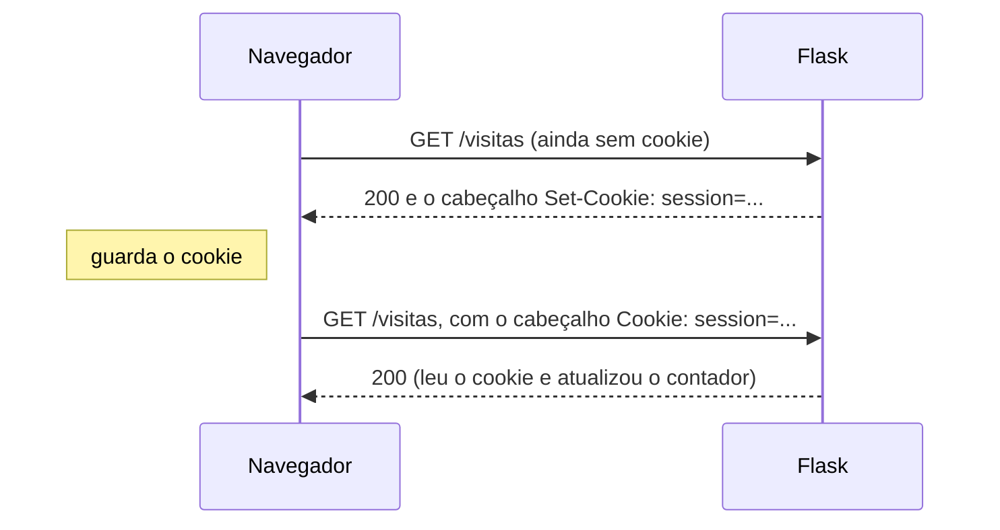
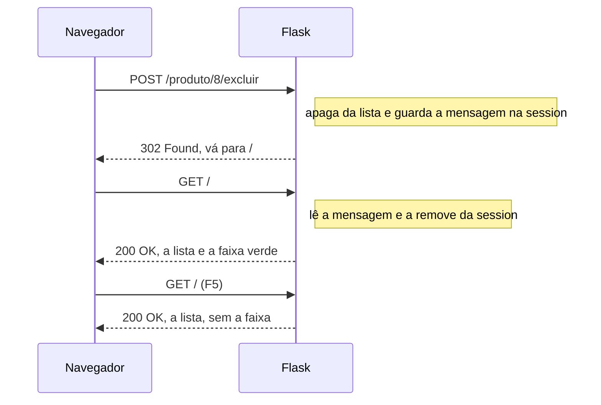
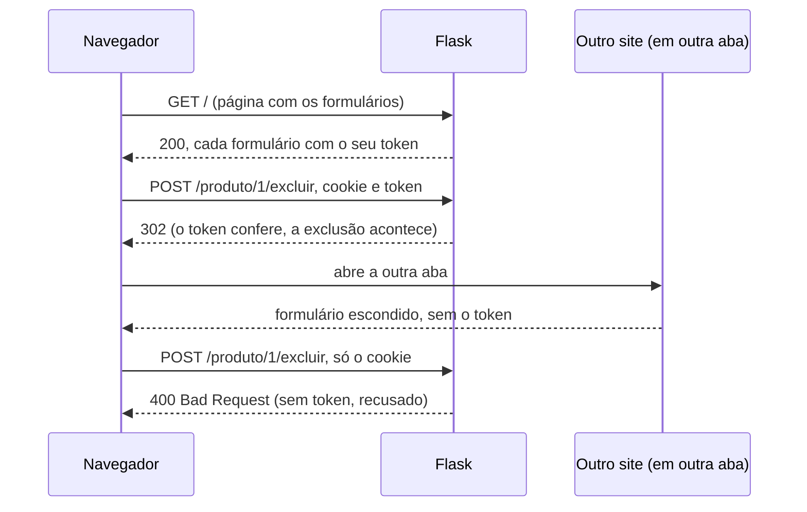

# Capítulo 08 — Session

**Disciplina:** Programação para Internet (ILP951)
**Professor:** Ronan Adriel Zenatti · ronan.zenatti@cps.sp.gov.br
**Fatec Jahu — 2º Semestre/2026**

---

## 🎯 Objetivos do Capítulo

Ao final deste capítulo você deverá ser capaz de:

- Explicar por que uma variável global é compartilhada por todos os visitantes e se perde quando o servidor reinicia
- Definir a `secret_key` e explicar o que ela assina no cookie da `session`
- Guardar e ler valores na `session` e encontrar o cookie `session` no navegador
- Explicar que o cookie da `session` é **assinado, mas não criptografado**, e que tem limite de tamanho
- Guardar a lista de produtos na `session` e avisar o Flask quando uma lista guardada nela é alterada por dentro (`session.modified`)
- Excluir um produto com uma rota POST e o padrão PRG
- Mostrar uma mensagem uma única vez depois de um redirect, com `session.pop`
- Explicar o que é **CSRF**, ativar o `CSRFProtect` do `Flask-WTF` e acrescentar o token aos formulários

No Capítulo 7, o produto passou do formulário para a lista do catálogo, mas a lista continuou sendo uma variável do Python: some quando o servidor reinicia e é a mesma para todo mundo. Neste capítulo ela passa a viver na **`session`**, um dicionário que o Flask guarda **no navegador** de cada visitante. Com isso o catálogo ganha um pequeno CRUD de teste: cadastrar, listar e **excluir** produtos. Como a exclusão é uma ação perigosa, o capítulo termina com a defesa que todo formulário POST precisa: o token **CSRF**. O que ainda **não** existe fica para os próximos capítulos: conferir se os dados são válidos (Capítulo 9) e guardar os produtos de verdade, em um banco de dados (Capítulo 10).

## 📦 Ponto de partida

Este capítulo parte do **seu** repositório `catalogo-produtos`, como ele ficou no fim do Capítulo 7: com o `app.py`, as pastas `templates` (`base.html`, `index.html`, `cadastro.html`, `contato.html`, `produto.html`, `_faixa_preco.html`, `404.html` e `500.html`) e `static` (`estilo.css` e `produto.js`), o `requirements.txt`, o `.gitignore` e a pasta `treino`.

Se o seu projeto não está funcionando, baixe o código do Capítulo 7 e descompacte na Área de Trabalho. Depois de descompactar, crie o ambiente virtual:

➡️ [Baixar p1_cap_07.zip](../arquivos/p1_cap_07.zip)

```bash
python -m venv .venv
.venv\Scripts\activate
pip install -r requirements.txt
```

---

## Tópico 1 — Onde a lista mora hoje

### Antes de começar

Abra a pasta `catalogo-produtos` no VS Code e o terminal com `Ctrl + '`. Rode:

```bash
git pull
git status
```

O `git status` deve dizer `nothing to commit, working tree clean`. Se algo estiver pendente, faça o ciclo do Capítulo 1 (`git add .`, `git commit -m "..."`, `git push`) antes de seguir.

Ative o ambiente virtual (`.venv\Scripts\activate`) e ligue o servidor:

```bash
python app.py
```

Deixe esse terminal rodando durante o capítulo e use um segundo terminal (o ícone **+** do painel) para o Git e para os outros comandos. Abra **http://127.0.0.1:5000**.

### A lista some quando o servidor reinicia

Você já viu isto no fim do Capítulo 7, mas vale repetir, porque é o primeiro problema. Abra **Cadastrar**, envie `Lápis`, `Papelaria`, `1,50` e confirme que o **Lápis** é a oitava linha do catálogo. Agora salve o `app.py` (`Ctrl + S`): em modo de desenvolvimento, o Flask reinicia sozinho. Recarregue o catálogo: voltam os sete produtos originais. A lista `produtos` vive na memória do processo do Python, e a memória é apagada junto com o processo.

### A lista é a mesma para todo mundo

O segundo problema é menos óbvio. Cadastre o `Lápis` de novo. Agora abra uma **janela anônima** (`Ctrl + Shift + N` no Chrome e no Edge; `Ctrl + Shift + P` no Firefox) e acesse **http://127.0.0.1:5000** nela. O **Lápis aparece** na lista, mesmo que a janela anônima seja, para o servidor, um visitante completamente diferente de você.

A variável `produtos` existe **uma vez só**, dentro do processo do Python, e todos os pedidos que chegam ao servidor leem e alteram a mesma lista. Para um catálogo de loja, compartilhar a lista é até o comportamento certo, e o banco de dados do Capítulo 10 vai fazer isso do jeito correto. Mas antes dele precisamos de um lugar **temporário**, que não dependa da memória do servidor e onde cada navegador tenha a **sua própria** lista de teste. Esse lugar é a `session`.

### Três lugares para guardar dados

| | Variável global (Capítulo 7) | `session` (este capítulo) | Banco de dados (Capítulo 10) |
|---|---|---|---|
| **Onde os dados ficam** | Na memória do servidor | Em um cookie, no navegador | No disco do servidor |
| **Quem enxerga** | Todos os visitantes | Só o navegador dono do cookie | Todos os visitantes |
| **Reiniciar o servidor** | Apaga | Não apaga | Não apaga |
| **Limpar os cookies do navegador** | Não afeta | Apaga | Não afeta |
| **Quanto cabe** | Quanto a memória aguentar | Cerca de 4 KB | Muito |

Feche a janela anônima. Este tópico não muda o código, então não há commit.

---

## Tópico 2 — Cookies, `secret_key` e a primeira session

### O que é um cookie

Um **cookie** é um pequeno texto que o servidor pede ao navegador para guardar. A partir daí, o navegador **devolve esse texto em todo pedido** feito ao mesmo site, sem que ninguém precise fazer nada. A `session` do Flask é um dicionário cujo conteúdo o Flask grava dentro de um cookie chamado `session`.



### Tentando usar a session sem a chave

Para ver a `session` funcionando, vamos fazer uma página de teste que **conta quantas vezes você a abriu**. No `app.py`, acrescente o `session` à importação da primeira linha:

```python
from flask import Flask, render_template, abort, request, redirect, url_for, session
```

E escreva a rota, **antes** da rota `produto`:

```python
@app.route('/visitas')
def visitas():
    if 'visitas' in session:
        session['visitas'] = session['visitas'] + 1
    else:
        session['visitas'] = 1

    quantas = session['visitas']
    return f'Você abriu esta página {quantas} vez(es).'
```

!!! note "Flask: o `session`"
    Assim como o `request`, o `session` é um objeto do Flask que você importa. Ele funciona como um **dicionário**: `session['visitas'] = 1` guarda um valor, e `session['visitas']` lê o valor de volta. O `'visitas' in session` pergunta se a chave **já existe**, o mesmo `in` que você usou para procurar um texto dentro de outro no Capítulo 7. Diferente do `request.form`, que você só lê, a `session` aceita escrita.

Salve e abra **http://127.0.0.1:5000/visitas**. Em vez da página, aparece a tela de depuração do Flask com o erro:

```
RuntimeError: The session is unavailable because no secret key was set.
Set the secret_key on the application to something unique and secret.
```

O Flask se recusa a usar a `session` sem uma **chave secreta**. Vamos ver por quê.

### A `secret_key`

No `app.py`, logo depois de `app = Flask(__name__)`, defina a chave:

```python
app = Flask(__name__)

# Chave provisória, só para o projeto de sala. Ela assina o cookie da session.
# Num sistema de verdade, a chave fica fora do código (o .env aparece no Capítulo 11).
app.secret_key = 'chave-provisoria-fatec-2026'
```

!!! note "O que a `secret_key` faz"
    O conteúdo da `session` viaja no cookie, e o cookie fica nas mãos do usuário, que pode editá-lo. Para o Flask perceber uma adulteração, ele **assina** o cookie: calcula uma assinatura que depende do conteúdo **e** da chave. Quando o cookie volta, o Flask recalcula a assinatura. Se ela não bater, o cookie foi alterado (ou foi assinado com outra chave), e o Flask o ignora e começa uma `session` vazia. Quem conhece a chave consegue fabricar cookies válidos, e por isso ela é secreta.

!!! warning "Chave no código é provisório"
    Como o código vai para o GitHub, essa chave fica visível a quem abrir o repositório. Em um projeto de sala, sem dados reais, tudo bem. Em um sistema de verdade, a chave é guardada fora do código. O Capítulo 11 mostra como, com o arquivo `.env`.

Salve e abra **http://127.0.0.1:5000/visitas**. Aparece `Você abriu esta página 1 vez(es).`. Aperte `F5` algumas vezes: o número sobe a cada recarga. O Flask guardou o contador no cookie e o leu de volta no pedido seguinte.

Agora a diferença para a variável global. No terminal do servidor, aperte `Ctrl + C` e rode `python app.py` de novo. Recarregue a página: o contador **continua de onde parou**. O dado não estava na memória do servidor, e sim no navegador.

### Olhando o cookie por dentro

Com a página aberta, aperte `F12` e clique na aba **Application** (em português, **Aplicativo**). No menu da esquerda, abra **Cookies** e clique em `http://127.0.0.1:5000`. Existe uma linha chamada `session`, com um valor parecido com este (os dois últimos pedaços variam):

```
eyJ2aXNpdGFzIjozfQ.aumKqQ.7D2ye5drbjuCdKJu9CncoAfBg2w
```

O valor tem **três pedaços separados por ponto**: o conteúdo, o momento em que o cookie foi criado e a assinatura. O primeiro pedaço é o seu contador, em um formato chamado base64. Copie **o primeiro pedaço** (até o primeiro ponto) e, no segundo terminal, decodifique-o com o Python. Cole o seu valor no lugar do exemplo e **mantenha os dois `=` no fim**:

```bash
python -c "import base64; print(base64.urlsafe_b64decode('eyJ2aXNpdGFzIjozfQ=='))"
```

A resposta é o conteúdo da sua `session`, escrito às claras:

```
b'{"visitas":3}'
```

!!! note "Python: o `b'...'` e os `=` do final"
    O `b` antes das aspas indica que o Python mostrou **bytes**, e não um texto comum. Os sinais `=` do final são um complemento que o base64 exige. O Flask os remove do cookie, e acrescentá-los de volta ao decodificar não atrapalha.

!!! warning "Assinado não é criptografado"
    Você acabou de ler o conteúdo do cookie sem conhecer a chave. A assinatura impede que o conteúdo seja **alterado**, mas não impede que seja **lido**. Por isso a `session` nunca guarda senha nem qualquer dado que o usuário não possa ver.

### A assinatura em ação

Ainda na aba **Application**, dê dois cliques no valor do cookie `session` e troque uma letra do **primeiro pedaço** por outra. Recarregue `/visitas`: o contador volta a **1**. O Flask recalculou a assinatura, não bateu, e ele descartou o cookie adulterado.

O mesmo acontece se a chave mudar. No `app.py`, troque a chave por `'outra-chave'`, salve e recarregue a página: o contador volta a 1, porque os cookies assinados com a chave antiga deixaram de valer. **Desfaça a troca** e deixe a chave `'chave-provisoria-fatec-2026'`.

### Limpando o experimento

A rota `/visitas` cumpriu a função. Apague-a inteira do `app.py`. Deixe o `session` na linha de importação, porque o próximo tópico o usa. O que fica deste tópico é a `secret_key`.

Registre no Git (em um segundo terminal):

```bash
git add .
git commit -m "Adiciona a secret_key para habilitar a session"
git push
```

---

## Tópico 3 — A lista de produtos na session

### Copiar a lista inicial para a session

A ideia é simples: na primeira vez que um navegador pede os produtos, o Flask **copia a lista inicial para a `session` dele**. Dali em diante, esse navegador lê e altera a própria cópia. No `app.py`, acrescente uma função **logo depois** da lista `produtos`:

```python
def produtos_da_sessao():
    if 'produtos' not in session:
        session['produtos'] = produtos.copy()

    return session['produtos']
```

!!! note "Python: função com `return`"
    Até aqui, as funções do `app.py` eram rotas, chamadas pelo Flask. Esta é uma função comum: o `def` dá um nome a um bloco de código, e o `return` devolve um valor a quem a chamou. Em `produtos_da_sessao()`, o nome fica no lugar do que a função devolve: a lista de produtos da `session`. Escrever o código uma vez e chamá-lo em várias rotas evita repetir o `if`.

!!! note "Python: `not in` e `.copy()`"
    O `not in` é o contrário do `in`: `'produtos' not in session` pergunta se a chave **ainda não existe**. O `.copy()` cria uma **cópia** da lista. Sem ele, a `session` e a lista `produtos` apontariam para a **mesma** lista, e um cadastro mudaria a lista original, a mesma que todos os visitantes novos recebem.

Agora a rota `index` passa a percorrer a lista da `session`. Troque apenas o `for`:

```python
    encontrados = []
    for item in produtos_da_sessao():
        if busca.lower() in item['nome'].lower():
            encontrados.append(item)
```

Salve e recarregue o catálogo: continuam os sete produtos, e a busca continua funcionando. Mas agora há um cookie novo. Na aba **Application** (`F12`), olhe o cookie `session`: ele tem a coluna **Size** (tamanho) com algumas centenas de bytes, e o valor **começa com um ponto**. O Flask comprime o conteúdo quando ele fica grande, e por isso você não consegue decodificar este valor como o do contador.

A página de detalhe também precisa ler a lista nova. Na rota `produto`, troque o `for`:

```python
    produto_encontrado = None
    for item in produtos_da_sessao():
        if item['id'] == produto_id:
            produto_encontrado = item
```

Salve e clique no nome de um produto: a página de detalhe abre normalmente.

### O cadastro e a armadilha do `.append()`

Antes de mexer no cadastro, vamos dar à lista inicial um nome que a distinga da lista da `session`. No `app.py`, troque `produtos` por `produtos_iniciais` em **dois lugares**: na definição da lista e dentro da função `produtos_da_sessao`.

```python
produtos_iniciais = [
    {'id': 1, 'nome': 'Caneta esferográfica azul', 'categoria': 'Papelaria', 'preco': 2.50},
    # ... os outros seis produtos continuam iguais ...
]


def produtos_da_sessao():
    if 'produtos' not in session:
        session['produtos'] = produtos_iniciais.copy()

    return session['produtos']
```

E a rota `cadastro` passa a guardar o produto na lista da `session`. Troque o miolo do `if`:

```python
    if request.method == 'POST':
        nome = request.form['nome']
        categoria = request.form['categoria']
        preco = float(request.form['preco'])

        produtos = produtos_da_sessao()

        maior_id = 0
        for item in produtos:
            if item['id'] > maior_id:
                maior_id = item['id']

        novo = {'id': maior_id + 1, 'nome': nome, 'categoria': categoria, 'preco': preco}
        produtos.append(novo)

        return redirect(url_for('index'))

    return render_template('cadastro.html', categorias=categorias)
```

Salve, abra o catálogo (a lista já está na `session`), vá em **Cadastrar** e envie `Lápis`, `Papelaria`, `1,50`. Você cai no catálogo, mas o **Lápis não está lá**: são só os sete produtos. O `.append()` funcionou (confira no terminal que o POST terminou em `302`), mas o produto não foi guardado.

Isto acontece porque o Flask só regrava o cookie quando **percebe** que a `session` mudou. Escrever `session['visitas'] = 2` ele percebe. Mas o `.append()` altera a lista **por dentro**, sem passar pela `session`, e o Flask não fica sabendo. A correção é avisar:

```python
        novo = {'id': maior_id + 1, 'nome': nome, 'categoria': categoria, 'preco': preco}
        produtos.append(novo)
        session.modified = True
```

!!! note "Flask: `session.modified`"
    Atribuir `session['chave'] = valor` marca a `session` como alterada automaticamente. Mudar uma lista ou um dicionário que **já está** dentro da `session` (com `.append()`, por exemplo) não marca. Nesse caso, escreva `session.modified = True` para o Flask regravar o cookie.

Salve e envie o `Lápis` de novo. Agora ele é a oitava linha do catálogo.

### O que mudou em relação à variável global

Faça os testes, um de cada vez:

- **Reiniciar o servidor.** Salve o `app.py` e recarregue o catálogo: o `Lápis` **continua lá**. Os dados estão no navegador.
- **Outro navegador.** Abra uma janela anônima e acesse o catálogo: só os sete produtos originais. Cada navegador tem a sua lista.
- **Limpar o cookie.** Na aba **Application**, clique com o botão direito no cookie `session` e escolha **Delete** (**Excluir**). Recarregue: voltam os sete produtos. A lista inicial é copiada de novo para uma `session` nova.

Por isso a `session` é, neste projeto, um **banco temporário**: guarda os dados sem depender do servidor, mas os dados pertencem ao navegador e desaparecem com o cookie.

### O limite do cookie

Todo pedido do navegador carrega o cookie junto, e os navegadores aceitam cookies de até cerca de **4 KB**. Para ver o que acontece quando passa disso, acrescente uma rota **temporária** no `app.py`, antes da rota `produto`. Ela cadastra 700 produtos de uma vez:

```python
@app.route('/encher')
def encher():
    produtos = produtos_da_sessao()
    for numero in range(8, 708):
        nome = f'Produto de teste {numero}'
        produtos.append({'id': numero, 'nome': nome, 'categoria': 'Casa', 'preco': 9.90})
    session.modified = True
    return redirect(url_for('index'))
```

!!! note "Python: `range()`"
    O `range(8, 708)` produz os números de 8 até 707 (o último não entra). Com o `for`, a rota repete o bloco uma vez para cada número, e o `numero` muda a cada volta.

Salve e abra **http://127.0.0.1:5000/encher**. Você cai no catálogo, e **nada mudou**: a lista continua como estava. No terminal do servidor aparece um aviso:

```
UserWarning: The 'session' cookie is too large: the value was 5407 bytes ...
The final size was ... bytes but the limit is 4093 bytes.
Browsers may silently ignore cookies larger than this.
```

Os números do aviso variam de um projeto para outro. O Flask tentou gravar um cookie de mais de 5 KB, e o navegador o **descartou sem reclamar**, mantendo o cookie antigo. Nenhum erro aparece na tela: o dado só não é guardado. É um limite sério, e uma das razões pelas quais o catálogo precisa de um banco de dados (Capítulo 10). Apague a rota `/encher`: ela cumpriu a função.

Registre no Git:

```bash
git add .
git commit -m "Guarda a lista de produtos na session"
git push
```

---

## Tópico 4 — Excluir produto e avisar o resultado

### A rota de exclusão

A lista agora tem cadastro e listagem. Falta a exclusão. Como ela **apaga** algo, segue a regra do Capítulo 7: usa POST, e nunca um link comum. No `app.py`, escreva a rota **depois** da rota `produto`, primeiro só o esqueleto:

```python
@app.route('/produto/<int:produto_id>/excluir', methods=['POST'])
def produto_excluir(produto_id):
    return redirect(url_for('index'))
```

Salve e digite **http://127.0.0.1:5000/produto/1/excluir** na barra de endereços. Aparece o **Method Not Allowed** (405) que você já conhece: digitar um endereço faz o navegador usar GET, e esta rota só aceita POST. Isso é de propósito: um link ou um robô que visite o endereço não consegue apagar nada.

### O botão Excluir

Em `templates/index.html`, acrescente o cabeçalho da coluna depois de `Preço`:

```html
          <th class="text-end">Preço</th>
          <th class="text-end">Ações</th>
```

E a célula, depois da célula do preço. Cada linha da tabela ganha um **formulário próprio**, com um botão:

```html
          <td class="text-end">R$ {{ '%.2f'|format(produto.preco)|replace('.', ',') }}</td>
          <td class="text-end">
            <form action="{{ url_for('produto_excluir', produto_id=produto.id) }}" method="post">
              <button type="submit" class="btn btn-sm btn-outline-danger">Excluir</button>
            </form>
          </td>
```

A linha vazia da tabela também precisa cobrir a coluna nova. Troque `colspan="5"` por `colspan="6"`:

```html
          <td colspan="6" class="text-center text-body-secondary">Nenhum produto encontrado.</td>
```

Salve, recarregue o catálogo e clique em **Excluir** em qualquer linha. A página recarrega e o produto continua lá: a rota só redireciona. Falta a exclusão de verdade.

### Apagando da lista

Na rota `produto_excluir`, percorra a lista e monte uma lista nova **sem** o produto excluído, o mesmo padrão da lista `encontrados` da busca:

```python
@app.route('/produto/<int:produto_id>/excluir', methods=['POST'])
def produto_excluir(produto_id):
    excluido = None
    restantes = []
    for item in produtos_da_sessao():
        if item['id'] == produto_id:
            excluido = item
        else:
            restantes.append(item)

    if excluido is None:
        abort(404)

    session['produtos'] = restantes

    return redirect(url_for('index'))
```

O `for` separa cada produto em dois grupos: o que tem o `id` pedido vai para `excluido`, e todos os outros vão para `restantes`. Se nenhum tiver o `id`, o produto não existe, e a rota responde com o 404 do Capítulo 6. No fim, a `session` recebe a lista nova.

Repare que aqui **não** foi preciso o `session.modified = True`: `session['produtos'] = restantes` é uma **atribuição**, e o Flask percebe atribuições.

Salve e exclua a **Caneta esferográfica azul**. A linha some, e os números `Nº` da tabela se reorganizam. Exclua também o **Teclado USB**, recarregue a página e reinicie o servidor: os produtos continuam excluídos. Se quiser a lista inicial de volta, apague o cookie `session` como fez no Tópico 3.

!!! note "Os ids se repetem"
    Exclua o último produto e cadastre outro: ele recebe o **mesmo** `id` do que foi excluído, porque o cadastro usa o maior `id` da lista mais 1. Para um teste em memória isso passa. No banco do Capítulo 10, o MySQL numera sozinho e nunca repete um número.

### Avisando o resultado

Há uma falha de usabilidade: depois de cadastrar ou excluir, a página recarrega e **ninguém avisa se deu certo**. Com o padrão PRG, a rota guarda o resultado e redireciona, e a página seguinte nem sabe que veio de um POST. O Capítulo 7 apontou o problema: para redirecionar e ainda mostrar uma mensagem, o Python precisa **guardar a mensagem até o pedido seguinte**. A `session` serve para isso.

Em `produto_excluir`, guarde uma mensagem antes do redirect:

```python
    nome = excluido['nome']

    session['produtos'] = restantes
    session['mensagem'] = f'Produto "{nome}" excluído.'

    return redirect(url_for('index'))
```

E em `cadastro`, o mesmo, no fim do `if`:

```python
        produtos.append(novo)
        session.modified = True

        session['mensagem'] = f'Produto "{nome}" cadastrado.'
        return redirect(url_for('index'))
```

Agora a página que recebe o redirect precisa **mostrar e apagar** a mensagem. Como qualquer página pode ser a próxima, o lugar certo é o `base.html`, **dentro do `<main>`, antes do bloco `conteudo`**:

```html
  <main class="container my-4">
    
    
    <div class="alert alert-success">{{ mensagem }}</div>
    

    
  </main>
```

!!! note "Jinja: `` e `session.pop()`"
    O `` cria uma variável **dentro do template**, com o valor que vem depois do `=`. O `session` já está disponível em todo template, como o `request`, sem passá-lo no `render_template`. O `.pop('mensagem', None)` **lê o valor e o remove** da `session` no mesmo gesto; o segundo argumento (`None`) é o que ele devolve se a chave não existir, como no `.get()` do Capítulo 7. Por isso a mensagem aparece **uma vez só**.

Salve e cadastre `Régua`, `Papelaria`, `4`. No catálogo, aparece uma faixa verde: `Produto "Régua" cadastrado.`. Aperte `F5`: a faixa **desaparece**, porque foi apagada ao ser mostrada. Exclua a Régua e veja a faixa de exclusão.



Isto é, em essência, o que o `flash` faz: guarda a mensagem na `session` e a entrega uma vez só. O Capítulo 9 usa o `flash` e deixa o código mais curto; por enquanto, você viu o mecanismo por dentro.

A página de **Contato** continua como estava: ela mostra o resultado na própria resposta do POST, de propósito, para você ver o que cada tipo de campo envia.

Registre no Git:

```bash
git add .
git commit -m "Adiciona a exclusão de produtos e a mensagem de resultado pela session"
git push
```

---

## Tópico 5 — CSRF: o formulário precisa provar que é o seu

### O problema

O navegador devolve o cookie em **todo pedido** ao site, sem perguntar **quem** provocou o pedido. Imagine isto: você está com o catálogo aberto, e o seu cookie guarda a sua lista. Em outra aba, você abre uma página de **outro site** que tem um formulário invisível, apontando para o endereço `http://127.0.0.1:5000/produto/1/excluir` e enviado sozinho assim que a página abre. O navegador envia o POST **com o seu cookie**. O Flask vê um POST de uma `session` válida e **não tem como saber** que o formulário não veio da página dele.

Esse ataque se chama **CSRF** (*Cross-Site Request Forgery*, falsificação de requisição entre sites). Neste catálogo o estrago é pequeno, mas com o login do Capítulo 17 o cookie passa a identificar uma pessoa, e o mesmo ataque conseguiria apagar usuários ou mudar dados em nome dela. Os navegadores atuais já reduzem esse risco em alguns casos, mas a defesa que o **servidor** controla é o **token CSRF**:

1. Ao montar um formulário, o servidor gera um valor aleatório, o guarda na `session` e coloca uma versão assinada dele em um campo escondido do formulário.
2. Ao receber o POST, o servidor confere se o valor enviado bate com o da `session`.
3. A página do outro site **não consegue ler** a sua página (o navegador proíbe), então não conhece o token e o POST dela é recusado.



Repare que o token depende da `session`, e por isso este assunto vem depois dela.

### Instalando o Flask-WTF

O `Flask-WTF` é uma extensão do Flask que traz a proteção CSRF pronta. Com o ambiente virtual ativo, no segundo terminal:

```bash
pip install Flask-WTF
pip freeze > requirements.txt
```

Abra o `requirements.txt`: ele ganhou **duas** linhas novas, `Flask-WTF` e `WTForms` (as versões variam).

!!! note "Por que o WTForms veio junto?"
    O `WTForms` é uma biblioteca para descrever formulários como classes do Python. Neste projeto **não a usamos**: os formulários continuam em HTML puro, lidos com `request.form`. Mas o `Flask-WTF` a declara como dependência, e o próprio código do `CSRFProtect` usa peças dela por dentro. O `pip` instala as duas, e a linha do `WTForms` no `requirements.txt` é esperada. Você só vai usar o `CSRFProtect` e o `csrf_token()`.

### Ativando a proteção

No `app.py`, importe o `CSRFProtect`, logo abaixo da primeira linha:

```python
from flask import Flask, render_template, abort, request, redirect, url_for, session
from flask_wtf.csrf import CSRFProtect
```

E ative-o depois da `secret_key`:

```python
app.secret_key = 'chave-provisoria-fatec-2026'

CSRFProtect(app)
```

!!! note "Flask-WTF: o `CSRFProtect`"
    Com o `CSRFProtect(app)`, o Flask passa a conferir o token em **todo pedido que altera dados** (POST, entre outros) e a recusar, com o erro **400 Bad Request**, o que não trouxer um token válido. Os pedidos GET não são conferidos. Ele precisa da `secret_key`, porque assina o token e guarda o valor na `session`.

Salve e recarregue o catálogo: a página abre normalmente, porque abrir uma página é um GET. Agora clique em **Excluir** em qualquer linha. A página mostra:

```
Bad Request
The CSRF token is missing.
```

Confira também o painel **Network**: o pedido é um POST, a resposta é `400`, e na aba **Payload** não há campo `csrf_token`. Tente cadastrar um produto e enviar o contato: os **três** formulários do projeto foram recusados. O servidor está fazendo o papel dele: nenhum deles prova de onde veio.

### Dando o token ao formulário

O token vai em um campo escondido (`type="hidden"`), que não aparece na tela mas viaja junto com o formulário. Comece pelo botão **Excluir**, em `templates/index.html`, logo depois da abertura do `<form>`:

```html
            <form action="{{ url_for('produto_excluir', produto_id=produto.id) }}" method="post">
              <input type="hidden" name="csrf_token" value="{{ csrf_token() }}">
              <button type="submit" class="btn btn-sm btn-outline-danger">Excluir</button>
            </form>
```

!!! note "Flask-WTF: o `csrf_token()` nos templates"
    O `csrf_token()` é uma função que o `Flask-WTF` deixa disponível em todo template. Cada vez que o Jinja a encontra, ela devolve o token do momento. O campo escondido tem o `name="csrf_token"`, e é com esse nome que o `CSRFProtect` o procura no POST.

Salve, recarregue o catálogo e exclua um produto: funciona de novo. Aperte `Ctrl + U` para ver o código-fonte da página: cada botão **Excluir** tem um campo escondido com um valor comprido, e o Network mostra `csrf_token` em **Form Data**.

Faça o mesmo no `templates/cadastro.html`, depois do `<form>`:

```html
          <form action="{{ url_for('cadastro') }}" method="post">
            <input type="hidden" name="csrf_token" value="{{ csrf_token() }}">
```

E no `templates/contato.html`:

```html
          <form action="{{ url_for('contato') }}" method="post">
            <input type="hidden" name="csrf_token" value="{{ csrf_token() }}">
```

Salve e teste cada um: cadastre um produto e envie o formulário de contato. Os três voltam a funcionar. O formulário de **busca** não precisa do token, porque é um GET que só lê.

**Daqui em diante, todo formulário com `method="post"` leva essa linha.** Se você esquecer, o erro 400 lembra.

### Três mensagens do 400

O erro 400 do CSRF tem mensagens diferentes. Provoque duas delas:

- **`The CSRF session token is missing.`** Abra **Cadastrar**, apague o cookie `session` na aba **Application** e **depois** envie o formulário. O formulário traz um token, mas a `session` perdeu o valor com o qual ele precisa ser comparado.
- **`The CSRF token has expired.`** O token vale por **uma hora**. Um formulário que ficou aberto por mais tempo do que isso é recusado com esta mensagem; basta recarregar a página e enviar de novo.

A terceira, `The CSRF token is invalid.`, aparece quando o valor do campo foi alterado.

Registre no Git:

```bash
git add .
git commit -m "Ativa a proteção CSRF com Flask-WTF e acrescenta o token aos formulários"
git push
```

---

## Os arquivos completos do capítulo

O `app.py`:

```python
from flask import Flask, render_template, abort, request, redirect, url_for, session
from flask_wtf.csrf import CSRFProtect

app = Flask(__name__)

# Chave provisória, só para o projeto de sala. Ela assina o cookie da session.
# Num sistema de verdade, a chave fica fora do código (o .env aparece no Capítulo 11).
app.secret_key = 'chave-provisoria-fatec-2026'

CSRFProtect(app)

categorias = ['Papelaria', 'Informática', 'Casa', 'Acessórios']

produtos_iniciais = [
    {'id': 1, 'nome': 'Caneta esferográfica azul', 'categoria': 'Papelaria', 'preco': 2.50},
    {'id': 2, 'nome': 'Caderno universitário 96 folhas', 'categoria': 'Papelaria', 'preco': 18.90},
    {'id': 3, 'nome': 'Mouse sem fio', 'categoria': 'Informática', 'preco': 59.90},
    {'id': 4, 'nome': 'Teclado USB', 'categoria': 'Informática', 'preco': 89.90},
    {'id': 5, 'nome': 'Garrafa térmica 500 ml', 'categoria': 'Casa', 'preco': 49.90},
    {'id': 6, 'nome': 'Mochila escolar', 'categoria': 'Acessórios', 'preco': 129.00},
    {'id': 7, 'nome': 'Fone de ouvido', 'categoria': 'Informática', 'preco': 79.90},
]


def produtos_da_sessao():
    if 'produtos' not in session:
        session['produtos'] = produtos_iniciais.copy()

    return session['produtos']


@app.route('/')
def index():
    busca = request.args.get('busca', '').strip()

    encontrados = []
    for item in produtos_da_sessao():
        if busca.lower() in item['nome'].lower():
            encontrados.append(item)

    return render_template('index.html', titulo='Catálogo de Produtos',
                           produtos=encontrados, categorias=categorias, busca=busca)


@app.route('/cadastro', methods=['GET', 'POST'])
def cadastro():
    if request.method == 'POST':
        nome = request.form['nome']
        categoria = request.form['categoria']
        preco = float(request.form['preco'])

        produtos = produtos_da_sessao()

        maior_id = 0
        for item in produtos:
            if item['id'] > maior_id:
                maior_id = item['id']

        novo = {'id': maior_id + 1, 'nome': nome, 'categoria': categoria, 'preco': preco}
        produtos.append(novo)
        session.modified = True

        session['mensagem'] = f'Produto "{nome}" cadastrado.'
        return redirect(url_for('index'))

    return render_template('cadastro.html', categorias=categorias)


@app.route('/contato', methods=['GET', 'POST'])
def contato():
    dados = None

    if request.method == 'POST':
        if request.form.get('novidades') == 'sim':
            novidades = 'Sim'
        else:
            novidades = 'Não'

        dados = {
            'nome': request.form['nome'],
            'email': request.form['email'],
            'retorno': request.form['retorno'],
            'assunto': request.form.get('assunto', 'Não informado'),
            'mensagem': request.form['mensagem'],
            'novidades': novidades,
        }

    return render_template('contato.html', dados=dados)


@app.route('/produto/<int:produto_id>')
def produto(produto_id):
    produto_encontrado = None
    for item in produtos_da_sessao():
        if item['id'] == produto_id:
            produto_encontrado = item

    if produto_encontrado is None:
        abort(404)

    return render_template('produto.html', produto=produto_encontrado)


@app.route('/produto/<int:produto_id>/excluir', methods=['POST'])
def produto_excluir(produto_id):
    excluido = None
    restantes = []
    for item in produtos_da_sessao():
        if item['id'] == produto_id:
            excluido = item
        else:
            restantes.append(item)

    if excluido is None:
        abort(404)

    nome = excluido['nome']

    session['produtos'] = restantes
    session['mensagem'] = f'Produto "{nome}" excluído.'
    return redirect(url_for('index'))


@app.errorhandler(404)
def pagina_nao_encontrada(erro):
    return render_template('404.html'), 404


@app.errorhandler(500)
def erro_no_servidor(erro):
    return render_template('500.html'), 500


if __name__ == '__main__':
    app.run(debug=True)
```

O `templates/index.html`:

```html


{{ titulo }}


  {# O título vem da rota index(), no app.py #}
  <h1>{{ titulo }}</h1>
  <p class="lead">Papelaria, informática, casa e acessórios para o dia a dia.</p>

  <section id="produtos" class="mb-5">
    <h2>Produtos</h2>

    <form action="{{ url_for('index') }}" method="get" class="row g-2 mb-3">
      <div class="col-sm-8 col-lg-5">
        <label for="busca" class="visually-hidden">Buscar pelo nome</label>
        <input type="search" class="form-control" id="busca" name="busca" placeholder="Buscar pelo nome" value="{{ busca }}">
      </div>
      <div class="col-auto">
        <button type="submit" class="btn btn-primary">Buscar</button>
      </div>
    </form>

    
    <p class="text-body-secondary">
      {{ produtos|length }} resultado(s) para "<strong>{{ busca }}</strong>".
      <a href="{{ url_for('index') }}">Limpar a busca</a>
    </p>
    
    <p class="text-body-secondary">{{ produtos|length }} produtos no catálogo.</p>
    

    <table class="table table-striped table-hover">
      <thead class="table-light">
        <tr>
          <th>Nº</th>
          <th>Nome</th>
          <th>Categoria</th>
          <th>Faixa</th>
          <th class="text-end">Preço</th>
          <th class="text-end">Ações</th>
        </tr>
      </thead>
      <tbody>
        
        <tr>
          <td>{{ loop.index }}</td>
          <td><a href="{{ url_for('produto', produto_id=produto.id) }}">{{ produto.nome }}</a></td>
          <td>{{ produto.categoria|default('Sem categoria') }}</td>
          <td>
            
          </td>
          <td class="text-end">R$ {{ '%.2f'|format(produto.preco)|replace('.', ',') }}</td>
          <td class="text-end">
            <form action="{{ url_for('produto_excluir', produto_id=produto.id) }}" method="post">
              <input type="hidden" name="csrf_token" value="{{ csrf_token() }}">
              <button type="submit" class="btn btn-sm btn-outline-danger">Excluir</button>
            </form>
          </td>
        </tr>
        
        <tr>
          <td colspan="6" class="text-center text-body-secondary">Nenhum produto encontrado.</td>
        </tr>
        
      </tbody>
    </table>
  </section>

  <section id="categorias">
    <h2>Categorias</h2>
    <div class="row g-3">
      
      <div class="col-sm-6 col-lg-3">
        <div class="card">
          <div class="card-body">{{ categoria }}</div>
        </div>
      </div>
      
    </div>
  </section>

```

As mudanças nos outros arquivos já estão nos tópicos: o bloco da mensagem no `base.html` (Tópico 4) e a linha do `csrf_token` no `cadastro.html` e no `contato.html` (Tópico 5). Os arquivos `produto.html`, `_faixa_preco.html`, `404.html`, `500.html`, `estilo.css` e `produto.js` não mudaram.

!!! warning "Dois incômodos que continuam de propósito"
    1. **Os dados não são conferidos no servidor.** Um preço vazio ainda quebra a rota, e um nome vazio é cadastrado. O Capítulo 9 valida cada campo no Python e usa o `flash` para mostrar as mensagens.
    2. **A `session` é um lugar pequeno e pessoal.** Cada navegador tem a sua lista, ela some quando o cookie é apagado e não passa de cerca de 4 KB. O Capítulo 10 guarda os produtos em um banco de dados.

---

## 📦 Código deste capítulo

Compare com o seu projeto, ou use como ponto de partida do próximo capítulo. O zip tem o `app.py`, a pasta `templates` (`base.html`, `index.html`, `cadastro.html`, `contato.html`, `produto.html`, `_faixa_preco.html`, `404.html` e `500.html`), a pasta `static` (`estilo.css` e `produto.js`), o `requirements.txt` (agora com o `Flask-WTF` e o `WTForms`), o `.gitignore` e a pasta `treino`. O ambiente virtual **não** vai no zip: depois de descompactar, crie-o com os três comandos do Capítulo 3 (`python -m venv .venv`, `.venv\Scripts\activate` e `pip install -r requirements.txt`).

➡️ [Baixar p1_cap_08.zip](../arquivos/p1_cap_08.zip)

---

## 🃏 Flashcards de Revisão

Tente responder mentalmente antes de abrir.

??? question "Onde ficam os dados da `session` do Flask, e o que isso muda em relação a uma variável global?"
    Ficam em um **cookie, no navegador** do visitante. Uma variável global fica na memória do servidor: é a mesma para todos e some quando o servidor reinicia. A `session` é própria de cada navegador, sobrevive ao reinício do servidor e some quando o cookie é apagado.

??? question "Para que serve a `secret_key`, e o que acontece se ela mudar?"
    Ela **assina** o cookie da `session`. Quando o cookie volta, o Flask recalcula a assinatura, e se não bater (conteúdo alterado ou outra chave), descarta o cookie e começa uma `session` vazia. Trocar a chave invalida todos os cookies já emitidos. A chave no código é provisória: num sistema de verdade ela fica fora do código.

??? question "Por que o conteúdo da `session` não pode guardar uma senha, se o cookie é assinado?"
    Porque **assinado não é criptografado**. A assinatura impede que o conteúdo seja alterado, mas qualquer pessoa pode ler o cookie, decodificando o base64 sem conhecer a chave.

??? question "Por que um `.append()` em uma lista da `session` pode não ser guardado, e como resolver?"
    O Flask só regrava o cookie quando percebe que a `session` foi alterada. A atribuição `session['chave'] = valor` ele percebe, mas o `.append()` muda a lista por dentro, sem passar pela `session`. A solução é escrever `session.modified = True` depois da alteração, ou reatribuir a lista (`session['produtos'] = lista`).

??? question "O que é CSRF e como o token defende o formulário?"
    É o ataque em que outro site faz o **navegador da vítima** enviar um POST ao nosso sistema, e o cookie da `session` vai junto automaticamente. O token é um valor aleatório que o servidor guarda na `session` e coloca em um campo escondido do formulário. O POST só é aceito se trouxer o token certo, e o outro site não consegue ler a nossa página para conhecê-lo.

??? question "O que significa a mensagem `Bad Request: The CSRF token is missing.`?"
    O servidor recebeu um POST sem o campo `csrf_token`. Quase sempre o formulário esqueceu a linha `<input type="hidden" name="csrf_token" value="{{ csrf_token() }}">`. Todo formulário com `method="post"` precisa dela.

---

## ✅ Quiz de Fixação

<quiz>
Onde o Flask guarda os dados da `session`?
- [ ] Na memória do servidor, em uma variável global
> Não. Essa é a lista `produtos` do Capítulo 7, que é a mesma para todos os visitantes e some quando o servidor reinicia.
- [ ] Em um arquivo na pasta do projeto
> Não. O Flask não grava nada em arquivo para a `session`.
- [x] Em um cookie assinado, no navegador do visitante
> Correto. O cookie `session` viaja em todo pedido, e por isso a `session` sobrevive ao reinício do servidor e é própria de cada navegador.
- [ ] No banco de dados MySQL
> Não. O banco só entra no Capítulo 10. A `session` não usa banco nenhum.
</quiz>

<quiz>
Quais afirmações sobre o cookie da `session` estão corretas? (selecione todas que se aplicam)
- [x] O conteúdo pode ser lido por quem tem acesso ao navegador, mesmo sem conhecer a `secret_key`
> Correto. O cookie é assinado, não criptografado: o primeiro pedaço é só base64 do conteúdo.
- [x] Alterar o conteúdo do cookie faz o Flask descartá-lo
> Correto. A assinatura depende do conteúdo e da chave, e ao recalculá-la o Flask percebe que não bate.
- [x] Cookies maiores que cerca de 4 KB são descartados pelo navegador
> Correto. O Flask avisa no terminal, e o navegador mantém o cookie antigo sem reclamar.
- [ ] É seguro guardar a senha do usuário na `session`, porque o cookie é assinado
> Não. Assinatura impede alteração, não leitura. A senha ficaria legível a quem abrisse o cookie.
</quiz>

<quiz>
Uma rota faz `produtos = session['produtos']` e depois `produtos.append(novo)`, sem mais nada. A página recarrega e o produto novo não está na lista. Por quê?
- [ ] Porque o `.append()` não funciona com listas da `session`
> Não. O `.append()` funciona e altera a lista, só que o Flask não percebe.
- [x] Porque o Flask só regrava o cookie quando percebe a alteração, e o `.append()` muda a lista por dentro
> Correto. A correção é `session.modified = True` depois do `.append()`, ou reatribuir `session['produtos'] = produtos`.
- [ ] Porque falta o `redirect` depois do POST
> Não. O `redirect` evita o reenvio do formulário, mas não tem relação com guardar a lista.
- [ ] Porque o navegador bloqueia a alteração do cookie
> Não. O cookie nem chega a ser regravado: quem decide isso é o Flask, no servidor.
</quiz>

<quiz>
Depois de ativar o `CSRFProtect(app)`, o envio do formulário de cadastro passou a mostrar `Bad Request: The CSRF token is missing.` O que falta?
- [ ] Trocar `method="post"` por `method="get"` no formulário
> Não. Isso faria os dados irem para o endereço, e um cadastro não deve ser um GET.
- [ ] Acrescentar `methods=['GET', 'POST']` à rota
> Não. A rota já os aceita. Sem eles o erro seria 405, e não 400.
- [x] Acrescentar ao formulário o campo `<input type="hidden" name="csrf_token" value="{{ csrf_token() }}">`
> Correto. O `CSRFProtect` procura o token no POST, e o `csrf_token()` o gera no template.
- [ ] Apagar a `secret_key` do `app.py`
> Não. O token depende da `secret_key` para ser assinado e guardado na `session`.
</quiz>

<quiz>
O que faz `session.pop('mensagem', None)` no `base.html`?
- [ ] Apaga a `session` inteira
> Não. O `.pop()` mexe só na chave pedida.
- [x] Lê o valor de `'mensagem'` e o remove da `session`, devolvendo `None` se a chave não existir
> Correto. É isso que faz a faixa verde aparecer uma vez só: no `F5` seguinte a chave já não existe.
- [ ] Guarda `None` na chave `'mensagem'`
> Não. Quem guarda valores é a atribuição `session['mensagem'] = ...`.
- [ ] Mostra a mensagem em todas as páginas, para sempre
> Não. Justamente por remover a chave, ela aparece só no pedido seguinte ao redirect.
</quiz>

---

## 📝 Resumo

A variável global do Capítulo 7 é compartilhada por todos os visitantes e some com o servidor; a **`session`** guarda os dados em um cookie no navegador de cada um, assinado com a **`secret_key`**, mas legível e limitado a cerca de 4 KB. A lista de produtos passou para a `session`, e uma lista alterada por dentro (`.append()`) exige `session.modified = True`, enquanto uma atribuição é percebida sozinha. A exclusão usa uma rota POST com PRG, e a `session` também carrega a mensagem do resultado até o pedido seguinte, onde o `session.pop` a mostra uma vez só. Como o cookie vai em todo pedido, outro site pode forjar um POST em nome do navegador (CSRF), e o `CSRFProtect` do `Flask-WTF` recusa com o erro 400 o que não trouxer o token do campo escondido. Ainda falta conferir os dados no servidor (Capítulo 9) e guardá-los de verdade em um banco de dados (Capítulo 10).

---

## 🔗 Navegação

⬅️ [Capítulo 7 — Formulários](Capitulo_07_Formularios.md) · ➡️ [Capítulo 9 — Validação e flash](Capitulo_09_Validacao_e_Flash.md)

---

*Fatec Jahu · ILP951 · Prof. Ronan Adriel Zenatti · 2026*
