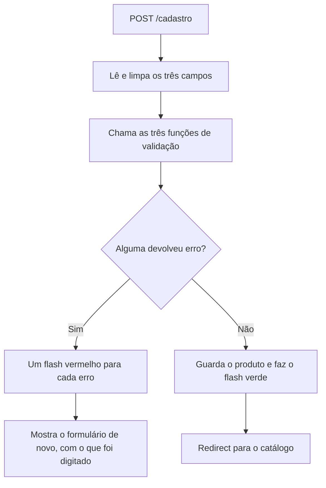

# Capítulo 09 — Validação e flash

**Disciplina:** Programação para Internet (ILP951)
**Professor:** Ronan Adriel Zenatti · ronan.zenatti@cps.sp.gov.br
**Fatec Jahu — 2º Semestre/2026**

---

## 🎯 Objetivos do Capítulo

Ao final deste capítulo você deverá ser capaz de:

- Explicar por que a validação do navegador (`required`, `minlength`, `min`) não protege o servidor e por que a validação no Python é obrigatória
- Escrever uma função de validação por campo, que devolve a mensagem de erro ou `None`
- Usar `float()` dentro de `try/except` para conferir se um texto é um número
- Mostrar mensagens com `flash` e alertas do Bootstrap, em verde para o sucesso e em vermelho para o erro
- Mostrar vários erros de uma vez e devolver o formulário com os valores que a pessoa já tinha digitado
- Explicar por que, quando há erro, a rota mostra o formulário de novo em vez de usar `redirect`
- Conferir no servidor que o valor de um `<select>` é mesmo uma das opções permitidas

No Capítulo 8, o catálogo ganhou um pequeno CRUD na `session`, mas o servidor continua aceitando qualquer coisa: um nome feito de espaços é cadastrado, e um preço vazio quebra a rota. Neste capítulo o Python passa a **conferir cada campo antes de usá-lo** e a **explicar o problema** a quem preencheu o formulário. A mensagem à mão do Capítulo 8 (`session.pop`) é trocada pelo `flash`, que já traz a cor e aceita várias mensagens. O que ainda **não** existe fica para o próximo capítulo: guardar os produtos de verdade, em um banco de dados (Capítulo 10).

## 📦 Ponto de partida

Este capítulo parte do **seu** repositório `catalogo-produtos`, como ele ficou no fim do Capítulo 8: com o `app.py`, as pastas `templates` (`base.html`, `index.html`, `cadastro.html`, `contato.html`, `produto.html`, `_faixa_preco.html`, `404.html` e `500.html`) e `static` (`estilo.css` e `produto.js`), o `requirements.txt` (com o `Flask-WTF`), o `.gitignore` e a pasta `treino`.

Se o seu projeto não está funcionando, baixe o código do Capítulo 8 e descompacte na Área de Trabalho. Depois de descompactar, crie o ambiente virtual:

➡️ [Baixar p1_cap_08.zip](../arquivos/p1_cap_08.zip)

```bash
python -m venv .venv
.venv\Scripts\activate
pip install -r requirements.txt
```

---

## Tópico 1 — O servidor aceita qualquer coisa

### Antes de começar

Abra a pasta `catalogo-produtos` no VS Code e o terminal com `Ctrl + '`. Rode:

```bash
git pull
git status
```

O `git status` deve dizer `nothing to commit, working tree clean`. Se algo estiver pendente, faça o ciclo do Capítulo 1 (`git add .`, `git commit -m "..."`, `git push`) antes de seguir.

Ative o ambiente virtual (`.venv\Scripts\activate`) e ligue o servidor:

```bash
python app.py
```

Deixe esse terminal rodando durante o capítulo e use um segundo terminal (o ícone **+** do painel) para o Git e para os outros comandos. Abra **http://127.0.0.1:5000**.

### Primeiro problema: o nome que parece preenchido

O formulário de cadastro tem `required` e `minlength="3"` no campo do nome. Abra **Cadastrar** e preencha:

- **Nome:** três espaços (aperte a barra de espaço três vezes)
- **Categoria:** `Casa`
- **Preço:** `5`

Envie. O navegador aceita, porque o `required` só confere se o campo **não está vazio**, e três espaços não são vazio. Você cai no catálogo com a faixa verde `Produto "   " cadastrado.` e uma linha nova de nome invisível, que nem dá para clicar. O servidor guardou um produto sem nome.

### Segundo problema: o preço vazio

Agora desligue as conferências do navegador. Com **Cadastrar** aberto, aperte `F12`, aba **Elements** (**Elementos**), clique com o botão direito na tag `<form action="/cadastro" method="post">`, escolha **Edit as HTML** (**Editar como HTML**) e acrescente a palavra `novalidate` dentro da tag de abertura, depois de `method="post"`:

```html
<form action="/cadastro" method="post" novalidate>
```

Clique fora para aplicar. O atributo `novalidate` manda o navegador **ignorar** `required`, `minlength`, `min` e `step`. Preencha só o nome (`Teste`) e a categoria (`Casa`), **deixe o preço vazio** e envie. A página de depuração do Flask aparece com:

```
ValueError: could not convert string to float: ''
```

A rota quebrou no `float('')`. Em um site publicado, a pessoa veria a página 500 que você criou no Capítulo 6.

### Terceiro problema: categoria vazia e preço negativo

Recarregue a página **Cadastrar**, repita o `novalidate` e preencha o nome (`Teste`), **deixe a categoria em "Selecione..."** e digite `-5` no preço. Envie. O catálogo mostra uma linha com a categoria em branco e o preço `R$ -5,00`, na faixa **Econômico**. O `min="0.01"` do HTML não impediu nada.

!!! note "Não precisa de ferramenta especial"
    Neste capítulo você desligou a conferência pelo `F12`. Outra pessoa faria o mesmo, ou enviaria o POST sem passar pelo formulário (por um programa de requisições ou um script). Mesmo com o token CSRF do Capítulo 8, quem abre o formulário no próprio navegador consegue alterá-lo antes de enviar. O servidor **não tem como saber** se o pedido passou pelas conferências do HTML.

Para limpar a bagunça, recarregue a página e apague o cookie `session` na aba **Application**, como no Capítulo 8. Voltam os sete produtos originais.

### Quem confere o quê

| | Validação no navegador (HTML) | Validação no servidor (Python) |
|---|---|---|
| **Onde roda** | No navegador de quem preenche | No Flask, antes de usar os dados |
| **Exemplos** | `required`, `minlength`, `maxlength`, `min`, `type="number"` | `if nome == ''`, `len(nome)`, `float(texto)` |
| **Quem consegue contornar** | Qualquer pessoa (`F12`, `novalidate`, JavaScript desligado) | Ninguém, o código roda no servidor |
| **Para que serve** | Responder rápido, sem ir ao servidor | Garantir que só dado válido entre no sistema |
| **Dá para dispensar?** | Dá, o sistema continua seguro | **Nunca** |

A regra do capítulo cabe em uma frase: **a validação do navegador é um conforto para quem preenche; a validação do servidor é a que protege o sistema**. Você mantém as duas, mas nunca abre mão da segunda.

Este tópico não muda o código, então não há commit.

---

## Tópico 2 — `flash`: avisar o resultado em uma linha

### O mecanismo do Capítulo 8 não basta

O Capítulo 8 avisou o resultado com `session['mensagem'] = ...` na rota e `session.pop('mensagem', None)` no `base.html`. Funciona, mas a validação pede mais do que ele dá:

- **Só cabe uma mensagem.** Se o formulário tiver três erros, a segunda gravação apaga a primeira.
- **A cor é sempre verde.** Um erro precisa aparecer em vermelho.
- **O mecanismo é seu.** Cada projeto reescreveria o mesmo `set`, `pop` e `if`.

O Flask traz isso pronto, com o nome de **`flash`**: guarda uma lista de mensagens na `session`, cada uma com um **tipo**, e as entrega uma única vez. É a mesma ideia do Capítulo 8, sem você escrever o mecanismo.

### Trocando o `session['mensagem']` pelo `flash`

No `app.py`, acrescente o `flash` à importação da primeira linha:

```python
from flask import Flask, render_template, abort, request, redirect, url_for, session, flash
```

Na rota `cadastro`, troque a linha que guardava a mensagem:

```python
        flash(f'Produto "{nome}" cadastrado.', 'success')
        return redirect(url_for('index'))
```

E na rota `produto_excluir`, faça o mesmo:

```python
    session['produtos'] = restantes
    flash(f'Produto "{nome}" excluído.', 'success')
    return redirect(url_for('index'))
```

!!! note "Flask: `flash(mensagem, tipo)`"
    O `flash` recebe o texto da mensagem e, como segundo argumento, o **tipo** dela (o Flask chama de *category*). Usamos como tipo os nomes das cores do Bootstrap: `'success'` (verde), `'danger'` (vermelho), `'warning'` (amarelo) e `'info'` (azul). Sem o segundo argumento, o tipo é `'message'`, que não existe no Bootstrap. Como o `flash` guarda as mensagens na `session`, ele também precisa da `secret_key`, que você definiu no Capítulo 8.

Salve, cadastre `Régua`, `Papelaria`, `4` e observe: você cai no catálogo, mas **a faixa verde não aparece**. A mensagem foi guardada pelo `flash`, só que o `base.html` ainda procura a chave antiga, `mensagem`. Falta mostrar as mensagens novas.

### Mostrando as mensagens no `base.html`

No `templates/base.html`, troque o bloco inteiro do `session.pop` (de `` até o ``) por este, ainda **dentro do `<main>`, antes do bloco `conteudo`**:

```html
  <main class="container my-4">
    
    <div class="alert alert-{{ tipo }} alert-dismissible fade show" role="alert">
      {{ mensagem }}
      <button type="button" class="btn-close" data-bs-dismiss="alert" aria-label="Fechar"></button>
    </div>
    

    
  </main>
```

!!! note "Jinja: `get_flashed_messages()` e o `for` com dois nomes"
    A função `get_flashed_messages()` está disponível em todo template. Com `with_categories=true`, ela devolve a lista de mensagens **e apaga a lista da `session`**, o mesmo efeito do `session.pop`. Cada item da lista é um **par** `(tipo, mensagem)`, e o `` separa os dois valores em duas variáveis a cada volta. O `alert-{{ tipo }}` monta a classe do Bootstrap: com o tipo `'success'` vira `alert-success`, com `'danger'` vira `alert-danger`. As classes `alert-dismissible` e `btn-close` acrescentam o **X** que fecha a faixa, e o JavaScript do Bootstrap, que o `base.html` já carrega, faz o resto.

Salve e cadastre `Régua`, `Papelaria`, `4` outra vez. A faixa verde volta, agora com um X à direita. Feche-a, aperte `F5` e veja que ela não reaparece. Exclua a Régua e confira a faixa de exclusão.

Registre no Git:

```bash
git add .
git commit -m "Troca a mensagem feita à mão pelo flash do Flask"
git push
```

---

## Tópico 3 — Validando o nome: uma função por campo

### A ideia

Cada campo do formulário vai ter **uma função própria de validação**. Ela recebe o texto do campo e devolve:

- uma **mensagem de erro**, se o valor não serve;
- `None`, se o valor está certo.

Funções pequenas, com uma única tarefa, são fáceis de ler e de testar. Comece pelo nome. No `app.py`, escreva a função **logo depois** da `produtos_da_sessao`, só com a primeira regra:

```python
def validar_nome(nome):
    if nome == '':
        return 'Informe o nome do produto.'

    return None
```

!!! note "Python: devolver uma mensagem ou `None`"
    O `return` encerra a função na hora e devolve o valor que vem depois dele. Aqui, se o nome é vazio, a função termina no primeiro `return` e devolve a mensagem. Se passar pelo `if`, chega ao `return None` do fim. O `None` é o valor do Python para **"nada"**. Neste projeto, `None` quer dizer **"nenhum erro"**.

Antes de ligar a função à rota, teste-a sozinha. No segundo terminal:

```bash
python -c "from app import validar_nome; print(validar_nome(''))"
python -c "from app import validar_nome; print(validar_nome('Lapis'))"
```

O primeiro comando imprime `Informe o nome do produto.`, e o segundo imprime `None`. Importar o `app` não liga o servidor, porque o `app.run` está dentro do `if __name__ == '__main__':`.

### Mais duas regras

O campo tem `minlength="3"`, e o banco do Capítulo 10 vai limitar o nome a 100 caracteres. O servidor confere os dois limites. Acrescente as regras **antes** do `return None`:

```python
def validar_nome(nome):
    if nome == '':
        return 'Informe o nome do produto.'

    if len(nome) < 3:
        return 'O nome deve ter pelo menos 3 caracteres.'

    if len(nome) > 100:
        return 'O nome deve ter no máximo 100 caracteres.'

    return None
```

!!! note "Python: `len()`"
    O `len()` conta quantos itens há em algo. Em um texto, conta os caracteres: `len('Mouse')` vale `5`. Em uma lista, conta os elementos, e o `length` do Jinja que você usou no Capítulo 5 faz o mesmo no template.

Teste de novo, no segundo terminal:

```bash
python -c "from app import validar_nome; print(validar_nome('ab'))"
python -c "from app import validar_nome; print(validar_nome('a' * 101))"
```

Cada um imprime a sua mensagem. O `'a' * 101` repete a letra 101 vezes.

### Ligando a função à rota

Agora a rota `cadastro` passa a chamar a função. Troque o início do `if request.method == 'POST':` e o `return` final, **por enquanto só para o nome** (a categoria e o preço continuam como estavam):

```python
@app.route('/cadastro', methods=['GET', 'POST'])
def cadastro():
    nome = ''

    if request.method == 'POST':
        nome = request.form.get('nome', '').strip()
        categoria = request.form['categoria']
        preco = float(request.form['preco'])

        erro = validar_nome(nome)
        if erro:
            flash(erro, 'danger')
        else:
            produtos = produtos_da_sessao()

            maior_id = 0
            for item in produtos:
                if item['id'] > maior_id:
                    maior_id = item['id']

            novo = {'id': maior_id + 1, 'nome': nome, 'categoria': categoria, 'preco': preco}
            produtos.append(novo)
            session.modified = True

            flash(f'Produto "{nome}" cadastrado.', 'success')
            return redirect(url_for('index'))

    return render_template('cadastro.html', categorias=categorias, nome=nome)
```

Há quatro mudanças aqui:

1. **`nome = ''` no começo da função.** O template vai precisar da variável `nome` também quando a página é aberta por GET, e nessa hora o formulário ainda não foi enviado.
2. **`request.form.get('nome', '')` em vez de `request.form['nome']`.** Com os colchetes, um POST sem o campo `nome` gera o erro 400 (`Bad Request`). Com o `.get`, o campo ausente vira `''`, e a validação responde com a mensagem amigável. O `.strip()` tira os espaços das pontas, e é ele que faz os três espaços do Tópico 1 virarem `''`.
3. **`if erro:` guarda a mensagem.** Uma mensagem é um texto não vazio (conta como verdadeiro), e `None` conta como falso. Então `if erro:` significa "se a função devolveu algum erro".
4. **O `else` guarda o produto, e só o sucesso faz `redirect`.** Quando há erro, a rota **não** redireciona: ela cai no `render_template` do fim e mostra o formulário de novo, na mesma resposta. Se redirecionasse, o navegador faria um GET novo e tudo o que a pessoa digitou se perderia. O padrão PRG é para o **sucesso**.

Falta o template mostrar o nome de volta. Em `templates/cadastro.html`, acrescente o `value` e o `maxlength` ao campo do nome:

```html
              <input type="text" class="form-control" id="nome" name="nome" placeholder="Ex.: Caneta esferográfica azul" value="{{ nome }}" required minlength="3" maxlength="100">
```

O `maxlength="100"` repete no navegador o limite que o servidor confere. O Jinja já escapa o que vai dentro do `{{ }}`, então um nome com aspas não quebra o HTML.

Salve e teste, um de cada vez:

- Nome com **três espaços**, categoria `Casa`, preço `5`. Uma faixa **vermelha** aparece no alto: `Informe o nome do produto.` O produto não entra no catálogo.
- Nome `ab`, categoria `Casa`, preço `5`. A faixa diz que o nome precisa de pelo menos 3 caracteres, e o campo **continua com o `ab`**.
- Nome `Lápis`, categoria `Papelaria`, preço `1.50`. Agora a faixa é verde e o Lápis aparece no catálogo.

Repare que, depois do erro do `ab`, a **categoria** e o **preço** voltaram para o estado inicial: o template ainda não repõe esses dois campos. O próximo tópico resolve.

!!! note "O botão Limpar"
    O botão `type="reset"` restaura o formulário para os valores com que a página **foi carregada**. Depois de um erro, esses valores são os que você digitou, então o **Limpar** volta a eles. Para esvaziar o formulário de verdade, abra **Cadastrar** de novo pelo menu.

Registre no Git:

```bash
git add .
git commit -m "Valida o nome do produto no servidor e mantém o valor digitado"
git push
```

---

## Tópico 4 — Categoria, preço e vários erros de uma vez

### A categoria

O `<select>` parece seguro, porque só oferece as opções da lista. Mas o valor que chega ao servidor é um texto como qualquer outro, e alguém pode alterá-lo antes de enviar. A função confere se o texto **é uma das categorias permitidas**. Escreva-a depois da `validar_nome`:

```python
def validar_categoria(categoria):
    if categoria not in categorias:
        return 'Escolha uma das categorias da lista.'

    return None
```

O `not in` é o mesmo do Capítulo 8, aqui aplicado à lista `categorias` do começo do arquivo. Como o texto vazio (`''`) também não está na lista, a opção "Selecione..." cai no mesmo erro. Teste:

```bash
python -c "from app import validar_categoria; print(validar_categoria('Casa'))"
python -c "from app import validar_categoria; print(validar_categoria('Armas'))"
```

O primeiro imprime `None`, e o segundo imprime a mensagem.

### O preço, em três regras

O preço chega como **texto** (`'2.50'`) e precisa virar número. Escreva a função aos poucos. Primeiro só o campo vazio:

```python
def validar_preco(texto):
    if texto == '':
        return 'Informe o preço.'

    return None
```

Em seguida, a conversão. Se o texto não for um número, o `float()` quebra a rota, como você viu no Tópico 1. A conversão vai dentro de um `try/except`, que **captura o erro** em vez de deixá-lo derrubar a página:

```python
def validar_preco(texto):
    if texto == '':
        return 'Informe o preço.'

    try:
        preco = float(texto)
    except ValueError:
        return 'O preço deve ser um número, como 2.50.'

    return None
```

!!! note "Python: `try` e `except`"
    O Python executa o bloco do `try`. Se tudo correr bem, o `except` é ignorado. Se acontecer o erro citado depois do `except` (aqui, `ValueError`, o erro do `float('abc')`), o Python **pula para o bloco do `except`** em vez de interromper o programa. É como dizer: "tente converter; se não der, faça isto". Erros de outro tipo continuam quebrando a rota.

Teste a conversão:

```bash
python -c "from app import validar_preco; print(validar_preco('abc'))"
python -c "from app import validar_preco; print(validar_preco('2.50'))"
```

Por fim, a faixa de valores. O preço precisa ser maior que zero e caber no banco do Capítulo 10, que terá a coluna `preco` com até 99999,99. Acrescente antes do `return None` final:

```python
    if preco > 0 and preco <= 99999.99:
        return None

    return 'O preço deve ser maior que zero e no máximo 99999.99.'
```

A função completa fica assim:

```python
def validar_preco(texto):
    if texto == '':
        return 'Informe o preço.'

    try:
        preco = float(texto)
    except ValueError:
        return 'O preço deve ser um número, como 2.50.'

    if preco > 0 and preco <= 99999.99:
        return None

    return 'O preço deve ser maior que zero e no máximo 99999.99.'
```

!!! note "Python: o `and`"
    O `and` junta duas condições e só dá verdadeiro quando **as duas** são verdadeiras. `preco > 0 and preco <= 99999.99` pergunta se o preço está acima de zero **e** abaixo do limite. É o mesmo `and` do Jinja que você viu no Capítulo 5.

!!! note "Por que a condição está do lado do que é válido?"
    O mais natural seria escrever `if preco <= 0: return 'erro'`. Só que o `float()` também aceita os textos `'nan'` (*not a number*) e `'inf'` (infinito), e o `nan` **não é menor nem maior que nada**: `nan <= 0` dá falso, e ele passaria direto. Perguntando "está na faixa válida?" e mandando todo o resto para a mensagem, o `nan` cai no erro. Teste: `python -c "from app import validar_preco; print(validar_preco('nan'))"`.

Teste os casos de uma vez, e confira o resultado de cada um:

```bash
python -c "from app import validar_preco; print(validar_preco('0'), validar_preco('-5'), validar_preco('100000'), validar_preco('2.50'))"
```

Os três primeiros viram mensagem e o último vira `None`.

### Todos os erros de uma vez

Agora a rota confere os três campos e junta as mensagens em uma lista. Quem preenche o formulário vê **todos** os problemas de uma vez, e não precisa enviar três vezes para descobrir um de cada vez. Troque a rota `cadastro` inteira por esta:

```python
@app.route('/cadastro', methods=['GET', 'POST'])
def cadastro():
    nome = ''
    categoria = ''
    preco_texto = ''

    if request.method == 'POST':
        nome = request.form.get('nome', '').strip()
        categoria = request.form.get('categoria', '')
        preco_texto = request.form.get('preco', '').strip()

        erros = []

        erro = validar_nome(nome)
        if erro:
            erros.append(erro)

        erro = validar_categoria(categoria)
        if erro:
            erros.append(erro)

        erro = validar_preco(preco_texto)
        if erro:
            erros.append(erro)

        if erros:
            for mensagem in erros:
                flash(mensagem, 'danger')
        else:
            preco = float(preco_texto)
            produtos = produtos_da_sessao()

            maior_id = 0
            for item in produtos:
                if item['id'] > maior_id:
                    maior_id = item['id']

            novo = {'id': maior_id + 1, 'nome': nome, 'categoria': categoria, 'preco': preco}
            produtos.append(novo)
            session.modified = True

            flash(f'Produto "{nome}" cadastrado.', 'success')
            return redirect(url_for('index'))

    return render_template('cadastro.html', categorias=categorias,
                           nome=nome, categoria=categoria, preco=preco_texto)
```

O fluxo de um POST ficou assim:



!!! note "Python: a lista `erros` e o `if erros:`"
    `erros = []` cria uma lista vazia, e o `.append()` acrescenta nela, como a `encontrados` da busca. Uma lista **vazia** conta como falso no `if`, e uma lista com pelo menos um item conta como verdadeiro. Então `if erros:` significa "se houver algum erro". Repare também que o `float(preco_texto)` só roda no `else`, quando a função de validação já garantiu que a conversão funciona.

### Repondo a categoria e o preço no formulário

Em `templates/cadastro.html`, o `<select>` e o preço precisam mostrar o que foi digitado. No `<select>`, troque o nome da variável do `for` e marque a opção escolhida:

```html
              <select class="form-select" id="categoria" name="categoria" required>
                <option value="">Selecione...</option>
                
                <option value="{{ opcao }}" selected>{{ opcao }}</option>
                
              </select>
```

A variável do `for` passou de `categoria` para `opcao`. Se continuasse `categoria`, ela esconderia dentro do laço a variável `categoria` que veio da rota (o valor escolhido), e a comparação nunca daria certo. O `selected` é o atributo HTML que marca a opção que já vem escolhida.

E no campo do preço, acrescente o `value`:

```html
              <input type="number" class="form-control" id="preco" name="preco" placeholder="0,00" value="{{ preco }}" min="0.01" step="0.01" required>
```

Salve e teste:

- Nome `ab`, categoria `Casa`, preço `5`. A faixa vermelha avisa do nome, e a categoria `Casa` e o preço `5` **continuam preenchidos**.
- Ative o `novalidate` como no Tópico 1 e envie tudo vazio. **Três faixas vermelhas** aparecem empilhadas: o nome, a categoria e o preço.
- Ainda com o `novalidate`, envie nome `Teste`, categoria `Casa` e preço `-5`. A faixa diz que o preço deve ser maior que zero.
- Nome `Régua`, categoria `Papelaria`, preço `4`. O produto é cadastrado com a faixa verde.

Registre no Git:

```bash
git add .
git commit -m "Valida categoria e preço e mostra todos os erros de uma vez"
git push
```

---

## Tópico 5 — Navegador e servidor, cada um no seu papel

### Repetindo os três problemas

No Tópico 1 o servidor aceitou um nome de espaços, quebrou com o preço vazio e guardou um preço negativo. Repita os testes agora:

1. **Nome de espaços.** Envie três espaços como nome. Resultado: `Informe o nome do produto.`
2. **Preço vazio.** Com o `novalidate`, envie o preço vazio. Em vez da página de depuração, aparece `Informe o preço.`
3. **Preço negativo e categoria vazia.** Com o `novalidate`, envie `-5` e "Selecione...". Duas faixas vermelhas.

Falta um teste que não existia no Tópico 1: **alterar o `<select>`**. Na aba **Elements**, clique com o botão direito em uma `<option>` (por exemplo, a de `Casa`), escolha **Edit as HTML** e troque o `value="Casa"` por `value="Armas"`. Escolha essa opção e envie. O navegador manda `Armas`, e o servidor responde `Escolha uma das categorias da lista.` O `<select>` não é garantia nenhuma: quem decide se o valor é válido é a função `validar_categoria`.

### O que cada camada confere

| Campo | No navegador (HTML) | No servidor (Python) |
|---|---|---|
| **Nome** | `required`, `minlength="3"`, `maxlength="100"` | `validar_nome`: vazio depois do `.strip()`, menos de 3, mais de 100 |
| **Categoria** | `required` no `<select>` | `validar_categoria`: o texto está na lista `categorias`? |
| **Preço** | `type="number"`, `min="0.01"`, `step="0.01"`, `required` | `validar_preco`: vazio, não numérico, fora de 0,01 a 99999,99 |

As duas camadas ficam, e os limites precisam **combinar** (o `maxlength="100"` do HTML e o `> 100` do Python). O HTML dá a resposta na hora, sem viagem ao servidor, e cobre quem usa o formulário do jeito normal. O Python cobre todo o resto.

### O que ainda não está resolvido

Duas coisas continuam de fora, as duas de propósito.

- **Nada impede dois produtos iguais.** Cadastre `Lápis` duas vezes e as duas entram. Impedir duplicados é papel do banco de dados, com uma restrição `UNIQUE`, que aparece no Projeto 2.
- **Os produtos ainda vivem na `session`.** Cada navegador tem a sua lista, ela some quando o cookie é apagado e não passa de cerca de 4 KB. O Capítulo 10 coloca os produtos em um banco de dados, e a validação deste capítulo continua valendo: o banco será uma **terceira barreira**, depois do HTML e do Python.

O formulário de **Contato** continua sem validação no servidor, porque ele existe para mostrar o que cada tipo de campo envia.

Este tópico não muda o código, então não há commit.

---

## Os arquivos completos do capítulo

O `app.py`:

```python
from flask import Flask, render_template, abort, request, redirect, url_for, session, flash
from flask_wtf.csrf import CSRFProtect

app = Flask(__name__)

# Chave provisória, só para o projeto de sala. Ela assina o cookie da session.
# Num sistema de verdade, a chave fica fora do código (o .env aparece no Capítulo 11).
app.secret_key = 'chave-provisoria-fatec-2026'

CSRFProtect(app)

categorias = ['Papelaria', 'Informática', 'Casa', 'Acessórios']

produtos_iniciais = [
    {'id': 1, 'nome': 'Caneta esferográfica azul', 'categoria': 'Papelaria', 'preco': 2.50},
    {'id': 2, 'nome': 'Caderno universitário 96 folhas', 'categoria': 'Papelaria', 'preco': 18.90},
    {'id': 3, 'nome': 'Mouse sem fio', 'categoria': 'Informática', 'preco': 59.90},
    {'id': 4, 'nome': 'Teclado USB', 'categoria': 'Informática', 'preco': 89.90},
    {'id': 5, 'nome': 'Garrafa térmica 500 ml', 'categoria': 'Casa', 'preco': 49.90},
    {'id': 6, 'nome': 'Mochila escolar', 'categoria': 'Acessórios', 'preco': 129.00},
    {'id': 7, 'nome': 'Fone de ouvido', 'categoria': 'Informática', 'preco': 79.90},
]


def produtos_da_sessao():
    if 'produtos' not in session:
        session['produtos'] = produtos_iniciais.copy()

    return session['produtos']


def validar_nome(nome):
    if nome == '':
        return 'Informe o nome do produto.'

    if len(nome) < 3:
        return 'O nome deve ter pelo menos 3 caracteres.'

    if len(nome) > 100:
        return 'O nome deve ter no máximo 100 caracteres.'

    return None


def validar_categoria(categoria):
    if categoria not in categorias:
        return 'Escolha uma das categorias da lista.'

    return None


def validar_preco(texto):
    if texto == '':
        return 'Informe o preço.'

    try:
        preco = float(texto)
    except ValueError:
        return 'O preço deve ser um número, como 2.50.'

    if preco > 0 and preco <= 99999.99:
        return None

    return 'O preço deve ser maior que zero e no máximo 99999.99.'


@app.route('/')
def index():
    busca = request.args.get('busca', '').strip()

    encontrados = []
    for item in produtos_da_sessao():
        if busca.lower() in item['nome'].lower():
            encontrados.append(item)

    return render_template('index.html', titulo='Catálogo de Produtos',
                           produtos=encontrados, categorias=categorias, busca=busca)


@app.route('/cadastro', methods=['GET', 'POST'])
def cadastro():
    nome = ''
    categoria = ''
    preco_texto = ''

    if request.method == 'POST':
        nome = request.form.get('nome', '').strip()
        categoria = request.form.get('categoria', '')
        preco_texto = request.form.get('preco', '').strip()

        erros = []

        erro = validar_nome(nome)
        if erro:
            erros.append(erro)

        erro = validar_categoria(categoria)
        if erro:
            erros.append(erro)

        erro = validar_preco(preco_texto)
        if erro:
            erros.append(erro)

        if erros:
            for mensagem in erros:
                flash(mensagem, 'danger')
        else:
            preco = float(preco_texto)
            produtos = produtos_da_sessao()

            maior_id = 0
            for item in produtos:
                if item['id'] > maior_id:
                    maior_id = item['id']

            novo = {'id': maior_id + 1, 'nome': nome, 'categoria': categoria, 'preco': preco}
            produtos.append(novo)
            session.modified = True

            flash(f'Produto "{nome}" cadastrado.', 'success')
            return redirect(url_for('index'))

    return render_template('cadastro.html', categorias=categorias,
                           nome=nome, categoria=categoria, preco=preco_texto)


@app.route('/contato', methods=['GET', 'POST'])
def contato():
    dados = None

    if request.method == 'POST':
        if request.form.get('novidades') == 'sim':
            novidades = 'Sim'
        else:
            novidades = 'Não'

        dados = {
            'nome': request.form['nome'],
            'email': request.form['email'],
            'retorno': request.form['retorno'],
            'assunto': request.form.get('assunto', 'Não informado'),
            'mensagem': request.form['mensagem'],
            'novidades': novidades,
        }

    return render_template('contato.html', dados=dados)


@app.route('/produto/<int:produto_id>')
def produto(produto_id):
    produto_encontrado = None
    for item in produtos_da_sessao():
        if item['id'] == produto_id:
            produto_encontrado = item

    if produto_encontrado is None:
        abort(404)

    return render_template('produto.html', produto=produto_encontrado)


@app.route('/produto/<int:produto_id>/excluir', methods=['POST'])
def produto_excluir(produto_id):
    excluido = None
    restantes = []
    for item in produtos_da_sessao():
        if item['id'] == produto_id:
            excluido = item
        else:
            restantes.append(item)

    if excluido is None:
        abort(404)

    nome = excluido['nome']

    session['produtos'] = restantes
    flash(f'Produto "{nome}" excluído.', 'success')
    return redirect(url_for('index'))


@app.errorhandler(404)
def pagina_nao_encontrada(erro):
    return render_template('404.html'), 404


@app.errorhandler(500)
def erro_no_servidor(erro):
    return render_template('500.html'), 500


if __name__ == '__main__':
    app.run(debug=True)
```

O `templates/cadastro.html`:

```html


Cadastrar produto — Catálogo de Produtos


  <h1 class="h2 mb-4">Cadastrar produto</h1>

  <div class="row">
    <div class="col-lg-6">
      <div class="card">
        <div class="card-body">

          <form action="{{ url_for('cadastro') }}" method="post">
            <input type="hidden" name="csrf_token" value="{{ csrf_token() }}">

            <div class="mb-3">
              <label for="nome" class="form-label">Nome do produto</label>
              <input type="text" class="form-control" id="nome" name="nome" placeholder="Ex.: Caneta esferográfica azul" value="{{ nome }}" required minlength="3" maxlength="100">
            </div>

            <div class="mb-3">
              <label for="categoria" class="form-label">Categoria</label>
              <select class="form-select" id="categoria" name="categoria" required>
                <option value="">Selecione...</option>
                
                <option value="{{ opcao }}" selected>{{ opcao }}</option>
                
              </select>
            </div>

            <div class="mb-3">
              <label for="preco" class="form-label">Preço (R$)</label>
              <input type="number" class="form-control" id="preco" name="preco" placeholder="0,00" value="{{ preco }}" min="0.01" step="0.01" required>
            </div>

            <div class="d-flex gap-2">
              <button type="submit" class="btn btn-primary">Cadastrar produto</button>
              <button type="reset" class="btn btn-outline-secondary">Limpar</button>
              <button type="button" class="btn btn-outline-secondary" onclick="mostrarProduto()">Ver no console</button>
            </div>

          </form>

        </div>
      </div>
    </div>
  </div>



  <script src="{{ url_for('static', filename='produto.js') }}"></script>

```

A mudança no `base.html` está no Tópico 2. Os arquivos `index.html`, `contato.html`, `produto.html`, `_faixa_preco.html`, `404.html`, `500.html`, `estilo.css` e `produto.js` não mudaram.

---

## 📦 Código deste capítulo

Compare com o seu projeto, ou use como ponto de partida do próximo capítulo. O zip tem o `app.py`, a pasta `templates` (`base.html`, `index.html`, `cadastro.html`, `contato.html`, `produto.html`, `_faixa_preco.html`, `404.html` e `500.html`), a pasta `static` (`estilo.css` e `produto.js`), o `requirements.txt`, o `.gitignore` e a pasta `treino`. O ambiente virtual **não** vai no zip: depois de descompactar, crie-o com os três comandos do Capítulo 3 (`python -m venv .venv`, `.venv\Scripts\activate` e `pip install -r requirements.txt`).

➡️ [Baixar p1_cap_09.zip](../arquivos/p1_cap_09.zip)

---

## 🃏 Flashcards de Revisão

Tente responder mentalmente antes de abrir.

??? question "Por que o servidor precisa validar os dados, se o formulário já tem `required`, `minlength` e `min`?"
    Porque esses atributos rodam no navegador, e qualquer pessoa os contorna (`F12`, `novalidate`, JavaScript desligado, um POST enviado sem o formulário). O servidor não tem como saber se o pedido passou por eles. A validação no navegador é conforto; a do servidor é a que protege o sistema.

??? question "O que uma função de validação deste projeto devolve?"
    A **mensagem de erro** (um texto), quando o valor não serve, ou `None`, quando está tudo certo. Na rota, `if erro:` trata a mensagem como verdadeira e o `None` como falso.

??? question "Qual a diferença entre `request.form['nome']` e `request.form.get('nome', '')`?"
    Com os colchetes, um POST sem o campo gera o erro 400 (`Bad Request`). Com o `.get`, o campo ausente vira o valor padrão (`''`), e a validação responde com uma mensagem amigável.

??? question "Para que serve o segundo argumento do `flash`, como em `flash('Erro', 'danger')`?"
    É o **tipo** da mensagem. Usando os nomes das cores do Bootstrap (`success`, `danger`, `warning`, `info`), o `base.html` monta a classe do alerta com `alert-{{ tipo }}`. Sem o segundo argumento, o tipo é `'message'`, que o Bootstrap não conhece.

??? question "Quando a validação falha, por que a rota mostra o formulário de novo em vez de usar `redirect`?"
    Porque o `redirect` faz o navegador abrir a página por um GET novo, e o que a pessoa digitou se perderia. Com o erro, a rota devolve o `render_template` na mesma resposta, passando os valores digitados para o template. O `redirect` (padrão PRG) é para o caso de sucesso.

??? question "Por que o `<select>` também precisa de validação no servidor?"
    Porque o valor que chega é só um texto, e quem abre o `F12` pode trocar o `value` de uma opção antes de enviar. A função `validar_categoria` confere se o texto está na lista `categorias`.

---

## ✅ Quiz de Fixação

<quiz>
Um formulário tem `required` em todos os campos. Por que o servidor ainda precisa validar os dados?
- [ ] Porque o `required` só funciona no Chrome
> Não. O `required` é suportado pelos navegadores atuais. O problema não é a compatibilidade.
- [x] Porque o `required` roda no navegador e pode ser contornado, e o servidor não sabe se o pedido passou por ele
> Correto. Com o `novalidate`, o `F12` ou um POST enviado sem o formulário, os dados chegam sem nenhuma conferência do HTML.
- [ ] Porque o `required` aceita espaços, mas rejeita números
> Não. O `required` aceita qualquer texto não vazio, inclusive só espaços, mas isso é uma lacuna dele, não o motivo principal.
- [ ] Porque o Flask não consegue ler campos que têm `required`
> Não. O Flask lê o campo normalmente, com ou sem o `required`.
</quiz>

<quiz>
O que a função `validar_nome('Mouse sem fio')` devolve, e o que isso significa neste projeto?
- [ ] `True`, o nome é válido
> Não. As funções de validação do capítulo não devolvem `True` nem `False`.
- [ ] Uma mensagem de erro, porque o nome tem espaços
> Não. Espaços no meio do nome são permitidos. A função só reclama de nome vazio, curto demais ou longo demais.
- [x] `None`, o que significa que não há erro
> Correto. A função devolve a mensagem de erro quando o valor não serve, e `None` quando está tudo certo.
- [ ] O próprio nome, já limpo
> Não. Quem limpa o nome é o `.strip()`, na rota. A função só confere.
</quiz>

<quiz>
Quais afirmações sobre o `flash` estão corretas? (selecione todas que se aplicam)
- [x] A mensagem fica guardada na `session` e aparece uma única vez
> Correto. O `get_flashed_messages()` lê as mensagens e as apaga da `session`, como o `session.pop` do Capítulo 8.
- [x] O segundo argumento, como `'danger'`, define o tipo da mensagem e a cor do alerta
> Correto. O `base.html` usa o tipo na classe `alert-{{ tipo }}` do Bootstrap.
- [x] Dá para chamar o `flash` várias vezes na mesma rota, e todas as mensagens aparecem
> Correto. Cada chamada acrescenta uma mensagem à lista, e o `for` do `base.html` mostra todas. É assim que os três erros aparecem juntos.
- [ ] O `flash` funciona sem a `secret_key`
> Não. O `flash` guarda as mensagens na `session`, e a `session` exige a `secret_key`.
</quiz>

<quiz>
A validação encontrou um erro no cadastro. Por que a rota mostra o formulário com `render_template`, em vez de fazer `redirect(url_for('cadastro'))`?
- [ ] Porque o `redirect` não funciona em rotas com POST
> Não. O `redirect` funciona depois de um POST, e é o que a rota faz quando o cadastro dá certo.
- [x] Porque o `redirect` abriria o formulário vazio por um GET novo, e a pessoa perderia o que digitou
> Correto. Com o `render_template`, a rota devolve o formulário na mesma resposta, já com os valores digitados.
- [ ] Porque o `flash` só funciona junto com o `render_template`
> Não. O `flash` funciona antes de um `redirect` também, como no cadastro com sucesso e na exclusão.
- [ ] Porque o `render_template` guarda o produto na `session`
> Não. O `render_template` só monta a página.
</quiz>

<quiz>
Quais destas conferências **não** protegem o servidor, porque uma pessoa consegue contorná-las pelo navegador? (selecione todas que se aplicam)
- [x] `required` e `minlength` no campo do nome
> Correto. Atributos HTML são conferidos pelo navegador, e `novalidate` ou o `F12` os desligam.
- [x] As opções do `<select>` de categoria
> Correto. O `value` de uma `<option>` pode ser editado antes do envio, e o servidor receberia um texto que não está na lista.
- [ ] A função `validar_preco`, escrita no `app.py`
> Não. Ela roda no servidor, e quem preenche o formulário não consegue alterá-la.
- [x] `min="0.01"` e `type="number"` no campo do preço
> Correto. Também são atributos do HTML, e um preço negativo chega ao servidor com o `novalidate`.
</quiz>

---

## 📝 Resumo

A validação do navegador (`required`, `minlength`, `min`) é um conforto que qualquer pessoa contorna, e por isso o servidor confere cada campo antes de usá-lo. No projeto, cada campo tem a sua função (`validar_nome`, `validar_categoria`, `validar_preco`), que devolve a mensagem de erro ou `None`, e o `try/except` deixa o `float()` dizer que um texto não é número sem derrubar a rota. A rota junta os erros em uma lista, mostra cada um com `flash` em vermelho e devolve o formulário com o que foi digitado, sem `redirect`, que fica reservado ao sucesso. O `flash` trocou a mensagem à mão do Capítulo 8: guarda as mensagens na `session`, entrega uma vez só e usa o tipo (`success`, `danger`) como classe do alerta do Bootstrap. Os produtos ainda vivem na `session`, e o Capítulo 10 os guarda de verdade em um banco de dados.

---

## 🔗 Navegação

⬅️ [Capítulo 8 — Session](Capitulo_08_Session.md) · ➡️ [Capítulo 10 — Banco de dados](Capitulo_10_Banco_de_Dados.md)

---

*Fatec Jahu · ILP951 · Prof. Ronan Adriel Zenatti · 2026*
