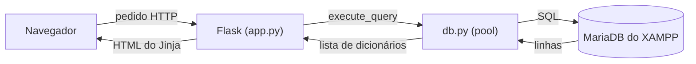
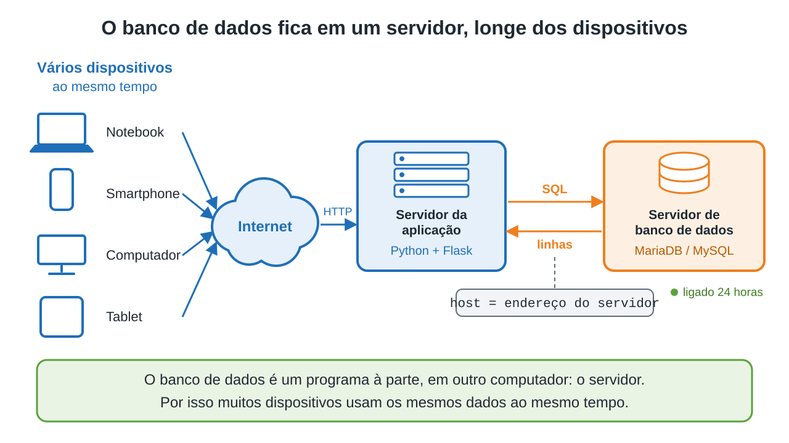

# Capítulo 10 — Banco de dados

**Disciplina:** Programação para Internet (ILP951)
**Professor:** Ronan Adriel Zenatti · ronan.zenatti@cps.sp.gov.br
**Fatec Jahu — 2º Semestre/2026**

---

## 🎯 Objetivos do Capítulo

Ao final deste capítulo você deverá ser capaz de:

- Instalar o XAMPP, ligar o MySQL (MariaDB) e o Apache e abrir o phpMyAdmin
- Instalar o MySQL Workbench pelo `winget` e conectá-lo ao banco do XAMPP
- Explicar por que um banco de dados costuma ficar em um servidor, separado da aplicação, e o que o `127.0.0.1` (`localhost`) significa
- Importar o `produtos_exemplo.sql` e conferir o banco `catalogo` e a tabela `produtos` no phpMyAdmin
- Instalar o `mysql-connector-python` e conectar o Python ao banco, preenchendo `host`, `user`, `password` e `database` e reconhecendo os erros `1045` e `1049`
- Criar o módulo `db.py`, com pool de conexões e as funções `execute_query` e `execute_one`, e explicar as quatro regras do `sql_mode`
- Listar, buscar e abrir produtos com `SELECT`, usando consultas parametrizadas (`%s`)
- Gravar produtos com `INSERT` e apagá-los com `DELETE`, sem o `id_produto` ser calculado pelo Python
- Explicar por que nunca se monta SQL com f-string e o que é *SQL Injection*

Desde o Capítulo 7, o catálogo guarda os produtos em lugares temporários: primeiro a memória do Python, depois o cookie da `session`. Neste capítulo eles passam para um **banco de dados**, que fica no disco, é o mesmo para todos os visitantes e não depende do navegador nem de o servidor Flask estar ligado. Você vai instalar o XAMPP, importar o banco do catálogo, conectar o Python a ele e trocar a lista da `session` por consultas SQL. A validação do Capítulo 9 continua valendo: o banco será a terceira barreira, depois do HTML e do Python. Com este capítulo termina o Projeto 1, e o Projeto 2 começa do zero no Capítulo 11.

## 📦 Ponto de partida

Este capítulo parte do **seu** repositório `catalogo-produtos`, como ele ficou no fim do Capítulo 9: com o `app.py`, as pastas `templates` (`base.html`, `index.html`, `cadastro.html`, `contato.html`, `produto.html`, `_faixa_preco.html`, `404.html` e `500.html`) e `static` (`estilo.css` e `produto.js`), o `requirements.txt`, o `.gitignore` e a pasta `treino`.

Se o seu projeto não está funcionando, baixe o código do Capítulo 9 e descompacte na Área de Trabalho. Depois de descompactar, crie o ambiente virtual:

➡️ [Baixar p1_cap_09.zip](../arquivos/p1_cap_09.zip)

```bash
python -m venv venv
venv\Scripts\activate
pip install -r requirements.txt
```

---

## Tópico 1 — O XAMPP e o phpMyAdmin

### Antes de começar

Abra a pasta `catalogo-produtos` no VS Code e o terminal com `Ctrl + '`. Rode:

```bash
git pull
git status
```

O `git status` deve dizer `nothing to commit, working tree clean`. Se algo estiver pendente, faça o ciclo do Capítulo 1 (`git add .`, `git commit -m "..."`, `git push`) antes de seguir.

### Por que um banco de dados

Os produtos do catálogo já passaram por dois lugares temporários. A lista global do Capítulo 7 some quando o servidor reinicia e é igual para todos. A `session` do Capítulo 8 sobrevive ao reinício, mas é própria de cada navegador, desaparece com o cookie e não passa de cerca de 4 KB. O terceiro lugar, que o Capítulo 8 já anunciava, é o banco de dados:

| | Variável global (Cap. 7) | `session` (Cap. 8) | Banco de dados (este capítulo) |
|---|---|---|---|
| **Onde os dados ficam** | Memória do servidor | Cookie, no navegador | Disco do computador do banco |
| **Quem enxerga** | Todos os visitantes | Só o navegador dono do cookie | Todos os visitantes |
| **Reiniciar o servidor Flask** | Apaga | Não apaga | Não apaga |
| **Limpar os cookies** | Não afeta | Apaga | Não afeta |
| **Quanto cabe** | O que a memória aguentar | Cerca de 4 KB | Milhões de linhas |

Quem guarda e consulta os dados é um programa separado, o **servidor de banco de dados**. O Flask não lê arquivos de produtos: ele **pede** ao banco, em SQL, e recebe as linhas de volta.



### O banco de dados mora em um servidor

Até aqui, o Flask e o catálogo rodam no seu computador, e é natural imaginar o banco ali também. Em um sistema de verdade não é assim. Um banco de dados é feito para ficar em um **servidor**: um computador separado, ligado o tempo todo, que só guarda dados e responde a consultas. A aplicação roda em **outro** lugar e se conecta a ele **pela rede**.



Repare no desenho: os dispositivos conversam com a **aplicação**, e só a aplicação conversa com o banco. Existem bons motivos para essa separação:

- **Muitos acessos ao mesmo tempo.** O notebook, o celular e o tablet de todos os usuários veem os mesmos dados, porque eles estão em um lugar só, e não copiados em cada aparelho.
- **Dados protegidos.** O servidor do banco fica em um lugar controlado, com cópias de segurança e acesso por usuário e senha, e não no aparelho de quem usa o sistema.
- **Cada peça pode mudar de forma independente.** É possível reforçar o servidor do banco, ou trocar a aplicação, sem mexer na outra.

Neste curso, por praticidade, o servidor do banco será o **seu próprio computador**, com o XAMPP. O Flask e o MariaDB continuam sendo dois programas diferentes, que conversam por uma conexão de rede, como no desenho. O que muda é só o endereço do banco, assunto do Tópico 3.

### O que é o XAMPP

O **XAMPP** é um pacote gratuito que instala, de uma vez, programas que um site costuma usar. Neste projeto vamos usar três deles:

- **MySQL**, que na verdade é o **MariaDB**: o servidor de banco de dados. O MariaDB nasceu do MySQL e fala o mesmo SQL e o mesmo protocolo, por isso o conector do Python que você vai instalar é o do MySQL.
- **phpMyAdmin**, um site para olhar e mexer no banco pelo navegador, sem escrever código.
- **Apache**, um servidor web. Ele não serve o catálogo (isso é o Flask), mas o phpMyAdmin é um site escrito em PHP, e é o Apache que o serve. **Sem o Apache ligado, o phpMyAdmin não abre.**

### Instalando

1. Baixe o instalador para Windows em **https://www.apachefriends.org**.
2. Execute-o. Se o Windows avisar sobre o controle de contas, confirme. Se aparecer um aviso sobre a pasta `Program Files`, **não use essa pasta**: mantenha o caminho padrão `C:\xampp`.
3. Na lista de componentes, deixe marcados **Apache**, **MySQL** e **phpMyAdmin**. Os outros (Tomcat, Perl, Mercury, FileZilla) não serão usados.
4. Conclua a instalação. Se você já tem o XAMPP, pule esta etapa.

### Ligando o banco

Abra o **XAMPP Control Panel** pelo menu Iniciar. Na linha **Apache** e na linha **MySQL**, clique em **Start**. Quando der certo, o nome do módulo fica com fundo verde e aparecem os números das portas (80 e 443 no Apache, 3306 no MySQL). Se o Windows perguntar sobre o firewall, permita o acesso em redes privadas.

Se um dos dois não iniciar, a causa quase sempre é uma **porta ocupada** por outro programa:

| Problema | Causa provável | O que fazer |
|---|---|---|
| **MySQL** não inicia, porta 3306 | Outro MySQL instalado no computador (de outro semestre, por exemplo) já usa a porta | Aperte `Win + R`, digite `services.msc`, ache o serviço `MySQL` (ou `MySQL80`), clique em **Parar** e tente de novo |
| **Apache** não inicia, porta 80 | Outro programa usa a porta 80 (Skype, IIS, outro servidor web) | Feche esse programa e tente de novo. A mensagem do painel mostra o que está usando a porta |

### Abrindo o phpMyAdmin

Com o Apache e o MySQL ligados, abra **http://localhost/phpmyadmin** no navegador. O XAMPP cria o usuário `root` **sem senha**, e o phpMyAdmin entra sozinho com ele. No painel da esquerda estão os bancos que já existem (como `information_schema`, `mysql` e `phpmyadmin`), que são do próprio sistema. O `catalogo` ainda não existe, e é ele que o próximo tópico cria.

!!! warning "`root` sem senha é só para a sua máquina"
    Usuário `root` sem senha é o padrão do XAMPP e serve para um computador de estudo, que não é acessível de fora. Em um servidor de verdade, o banco tem usuário e senha próprios. O Capítulo 11 mostra onde guardar a senha de forma correta.

### O MySQL Workbench

O phpMyAdmin é um site. O **MySQL Workbench** é um programa instalado no computador, a ferramenta gráfica oficial do MySQL: um editor de SQL com os resultados em uma grade. Os dois olham para o **mesmo** banco, e tudo o que o capítulo faz em um funciona no outro.

Instale o Workbench pelo **winget**, o gerenciador de pacotes do Windows. Abra o PowerShell e execute:

```powershell
winget install -e --id Oracle.MySQLWorkbench -v "8.0.47"
```

O `-e` exige o pacote exato, e o `-v` fixa a versão. Use a **8.0.47**, que é a que esta disciplina usa por ser a mais compatível com o MariaDB do XAMPP. Não instale a mais recente (a série 26). Ao terminar, procure **MySQL Workbench** no menu Iniciar.

O Workbench não encontra o banco do XAMPP sozinho: a "Local instance MySQL80" só existe quando o MySQL Server da Oracle está instalado. Crie a conexão à mão, com o **MySQL do XAMPP ligado**:

1. Na tela inicial, clique no **+** ao lado de **MySQL Connections**.
2. Em **Connection Name**, escreva `XAMPP`. Em **Hostname**, `127.0.0.1`, e em **Port**, `3306`. Em **Username**, `root`.
3. Clique em **Test Connection**. Quando pedir a senha, deixe o campo **vazio** e confirme. Se aparecer um aviso de versão incompatível do servidor (o XAMPP traz o MariaDB, não o MySQL da Oracle), clique em **Continue Anyway**.
4. Clique em **OK** e abra a conexão `XAMPP` com um duplo clique.

Para escrever SQL, abra uma aba de consulta (ícone de folha com raio) e execute o comando com `Ctrl + Enter`. O Workbench tem uma trava, o *Safe Updates*: ele recusa, com o erro `1175`, um `UPDATE` ou `DELETE` cujo `WHERE` não use a chave primária. Nos comandos deste capítulo o `WHERE` usa a chave primária (`id_produto`), então a trava não atrapalha, e vale deixá-la ligada.

Este tópico não muda o código, então não há commit.

---

## Tópico 2 — O banco `catalogo` no phpMyAdmin

### O arquivo `produtos_exemplo.sql`

O banco do catálogo vem pronto em um arquivo SQL. Baixe-o e salve **dentro da pasta do projeto** (`catalogo-produtos`), ao lado do `app.py`:

➡️ [Baixar produtos_exemplo.sql](../arquivos/produtos_exemplo.sql)

Abra o arquivo no VS Code e leia antes de importar. Você já conhece SQL de outro semestre, e as peças são estas:

```sql
CREATE DATABASE IF NOT EXISTS catalogo
    CHARACTER SET utf8mb4
    COLLATE utf8mb4_unicode_ci;

USE catalogo;
```

Cria o banco `catalogo` se ele ainda não existir e passa a usá-lo. O `utf8mb4` guarda acentos e emojis, e o `utf8mb4_unicode_ci` faz as comparações ignorarem maiúsculas e acentos (uma busca por `lapis` vai achar `Lápis`).

```sql
DROP TABLE IF EXISTS produtos;

CREATE TABLE produtos (
    id_produto BIGINT UNSIGNED AUTO_INCREMENT PRIMARY KEY,
    nome       VARCHAR(100) NOT NULL,
    categoria  VARCHAR(50),
    preco      DECIMAL(14,2) NOT NULL
) CHARACTER SET utf8mb4 COLLATE utf8mb4_unicode_ci;
```

A tabela tem as mesmas três informações do produto do catálogo (`nome`, `categoria` e `preco`) e uma chave primária, `id_produto`, que o próprio banco numera (`AUTO_INCREMENT`). O nome da chave é `id_` seguido do nome da tabela no singular, o mesmo padrão do Projeto 2. Cada tipo tem uma razão:

- `BIGINT UNSIGNED`: número inteiro grande e **sem sinal** (não aceita negativos), que não acaba tão cedo;
- `VARCHAR(100)` e `VARCHAR(50)`: textos de até 100 e 50 caracteres. O 100 é o limite do nome que a validação do Capítulo 9 usa;
- `DECIMAL(14,2)`: números com 14 dígitos no total, 2 deles depois da vírgula, ou seja, até `999999999999.99`. É bem mais do que os `99999.99` que a validação do Capítulo 9 aceita, e tudo bem: o banco é a **última** barreira, e pode ser mais folgado que as anteriores.

`nome` e `preco` são `NOT NULL`: o banco recusa um produto sem eles. A `categoria` **não** tem `NOT NULL`, então aceita `NULL` (a ausência de valor). O formulário do catálogo continua exigindo a categoria, mas o banco, sozinho, não a exige. O `DROP TABLE IF EXISTS` do começo faz com que importar o arquivo de novo **apague a tabela e a refaça**, e é assim que você volta aos sete produtos originais quando quiser.

O restante do arquivo é um `INSERT` com os mesmos sete produtos que, até agora, estavam na lista `produtos_iniciais` do `app.py`.

### Importando

1. No phpMyAdmin, clique na aba **Importar** (*Import*) do topo, **sem** nenhum banco selecionado.
2. Em **Arquivo a importar**, clique em **Escolher arquivo** (*Choose file*) e selecione o `produtos_exemplo.sql`.
3. Deixe as outras opções como estão (conjunto de caracteres `utf-8`) e clique em **Importar** (*Import*), no fim da página.

Uma faixa verde confirma a importação. No painel da esquerda aparece o banco **catalogo**, e dentro dele a tabela **produtos**.

### Olhando o que foi criado

Clique em **produtos** e explore as abas:

- **Visualizar** (*Browse*): as sete linhas, com `id_produto` de 1 a 7 e o preço com duas casas (`2.50`).
- **Estrutura** (*Structure*): as colunas, os tipos e a chave primária, como no `CREATE TABLE`.

### Praticando SQL no phpMyAdmin

Clique na aba **SQL**. Digite cada comando, clique em **Executar** (*Go*) e observe o resultado antes de passar ao próximo. Se preferir o Workbench, abra a conexão `XAMPP`, escolha o banco com `USE catalogo;` e execute cada comando com `Ctrl + Enter`. Primeiro uma consulta:

```sql
SELECT nome, preco FROM produtos WHERE categoria = 'Informática' ORDER BY preco;
```

Aparecem três linhas, do mouse (59,90) ao teclado (89,90). Agora um `INSERT`, **sem informar o `id_produto`**:

```sql
INSERT INTO produtos (nome, categoria, preco) VALUES ('Lápis', 'Papelaria', 1.50);
```

Volte para **Visualizar**: o Lápis é a oitava linha, com `id_produto` 8, gerado pelo banco. Agora o `DELETE`, com o `WHERE` que impede de apagar a tabela inteira:

```sql
DELETE FROM produtos WHERE id_produto = 8;
```

Repita o `INSERT` do Lápis e veja o `id_produto` dele. Não é 8: é **9**. O `AUTO_INCREMENT` **nunca reaproveita** um número, ao contrário do `maior_id + 1` do Capítulo 8, que repetia o `id` do último produto excluído.

Por fim, veja o banco recusar um dado inválido. Tente inserir um produto sem nome:

```sql
INSERT INTO produtos (nome, categoria, preco) VALUES (NULL, 'Casa', 5);
```

A resposta é um erro, `#1048 - Column 'nome' cannot be null`. A coluna é `NOT NULL`, e o banco recusa mesmo que o Python esquecesse de conferir.

Agora o contrário. A `categoria` não é `NOT NULL`, então o banco aceita um produto **sem** ela:

```sql
INSERT INTO produtos (nome, preco) VALUES ('Sem categoria', 5);
```

Em **Visualizar**, a linha aparece com `NULL` na categoria. O catálogo não vai criar produtos assim, porque o formulário exige a categoria, mas quem impede isso é o formulário, e não o banco.

Para deixar a tabela como veio, **importe o `produtos_exemplo.sql` de novo** (aba **Importar**, como acima). O `DROP TABLE` refaz a tabela: o Lápis e o produto sem categoria somem, e o próximo `id_produto` volta a ser 8.

### Guardando o arquivo no repositório

O `produtos_exemplo.sql` fica na pasta do projeto, e vale registrá-lo no Git:

```bash
git add .
git commit -m "Adiciona o script SQL do banco catalogo"
git push
```

---

## Tópico 3 — Conectando o Python: `db.py` e o pool

### Instalando o conector

Com o ambiente virtual ativo, no segundo terminal:

```bash
pip install mysql-connector-python
pip freeze > requirements.txt
```

Abra o `requirements.txt`: ele ganhou a linha `mysql-connector-python` (a versão varia).

!!! note "Versão usada como base"
    O `pip install` traz sempre a versão mais recente. Este material foi escrito e testado com o `mysql-connector-python` **26.10.0**. Se uma versão futura se comportar de outro jeito que o texto, compare com o `requirements.txt` do zip do capítulo.

### A primeira conexão

Antes de organizar o código, veja uma conexão acontecer. Crie na raiz do projeto um arquivo **temporário** `teste_banco.py`, só com a conexão e o fechamento:

```python
import mysql.connector

conexao = mysql.connector.connect(
    host='127.0.0.1',
    user='root',
    password='SUA_SENHA_AQUI',
    database='NOME_BANCO_DADOS',
    use_pure=True,
)
print('Conectado ao banco catalogo.')

conexao.close()
```

Conectar é dizer ao Python **quatro coisas**: onde o banco está (`host`), quem entra (`user`), com qual senha (`password`) e qual banco usar (`database`). Os dois valores em maiúsculas, `SUA_SENHA_AQUI` e `NOME_BANCO_DADOS`, são **marcadores**, e estão assim de propósito: se o código viesse pronto, você o copiaria sem saber o que depende de cada computador. Rode como está, sem trocar nada:

```bash
python teste_banco.py
```

A última linha da mensagem é parecida com esta:

```text
mysql.connector.errors.ProgrammingError: 1045 (28000): Access denied for user 'root'@'localhost' (using password: YES)
```

O Python **chegou** ao banco (o `host` e o `user` estão certos), e o banco recusou a senha `SUA_SENHA_AQUI`. O `root` do XAMPP **não tem senha**. Troque o primeiro marcador por um texto vazio, deixando `password='',`, e rode de novo:

```text
mysql.connector.errors.ProgrammingError: 1049 (42000): Unknown database 'nome_banco_dados'
```

Agora a senha passou, e o banco avisa que não existe um banco com aquele nome (no Windows, o nome pode aparecer em minúsculas na mensagem). Troque o segundo marcador pelo banco que você importou no Tópico 2, deixando `database='catalogo',`, e rode pela terceira vez. Se aparecer `Conectado ao banco catalogo.`, o Python está falando com o MariaDB. O `use_pure=True` pede ao conector a implementação em Python puro, e a tabela de configuração, logo adiante, explica por quê.

### O que é o `127.0.0.1`

Falta entender o `host='127.0.0.1'`. É o endereço do **próprio computador**, e tem um nome, `localhost`: escrever `host='localhost'` dá o mesmo resultado. Mesmo com o Python e o MariaDB no mesmo computador, a conexão acontece **como se fosse pela rede**: o Python faz o pedido a um endereço, a porta `3306` atende, e a resposta volta. A diferença é que o pacote sai do Python, passa pelo endereço `127.0.0.1` e **volta para dentro da mesma máquina**, sem nunca chegar à rede de verdade.


É por isso que o `127.0.0.1` serve para estudar: o seu computador **simula** o servidor. O código do `db.py` é o mesmo nos dois casos, e só o `host` muda. Em um sistema de verdade, ele seria o endereço do servidor do banco, como `192.168.0.10` (um exemplo de endereço de rede interna), ou um nome como `banco.suaempresa.com.br`.

Agora peça os produtos. Acrescente antes do `conexao.close()`:

```python
cursor = conexao.cursor()
cursor.execute('SELECT id_produto, nome, preco FROM produtos')
linhas = cursor.fetchall()

for linha in linhas:
    print(linha)

cursor.close()
```

!!! note "Python e banco: o cursor"
    A conexão é o canal com o banco. O **cursor** é o objeto que envia um comando por esse canal e traz o resultado: o `execute` manda o SQL, e o `fetchall` devolve **todas as linhas** do `SELECT`, como uma lista. Quando o cursor termina, você o fecha com `cursor.close()`.

Rode de novo. Cada linha chega como uma **tupla**, com os valores na ordem do `SELECT`:

```
(1, 'Caneta esferográfica azul', Decimal('2.50'))
```

O preço vem como `Decimal('2.50')`, o tipo do Python para números decimais exatos, que o conector usa para as colunas `DECIMAL`. Ele funciona nos templates que você já tem (o `format` e as comparações do Jinja aceitam), e o Capítulo 18 volta ao `Decimal` com calma.

Você já viu duas mensagens de erro de conexão, a `1045` (senha) e a `1049` (banco). Falta a terceira, a mais comum de todas. No painel do XAMPP, clique em **Stop** na linha do MySQL e rode o script. Aparece `InterfaceError: 2003: Can't connect to MySQL server on '127.0.0.1:3306'`. O banco está desligado, e o Python não encontra ninguém no endereço. Clique em **Start** de novo.

### A dor: repetir tudo em cada rota

O script mostra o ciclo completo de uma consulta: **conectar, criar o cursor, executar, ler, fechar o cursor e fechar a conexão**. São uns dez linhas. Imagine isso dentro de cada rota do `app.py` (listar, buscar, abrir, cadastrar, excluir): o código se repete, e para trocar a senha ou o banco você editaria cinco lugares. Mais um problema: abrir uma conexão nova a cada pedido é lento, porque o banco precisa autenticar a cada vez.

A solução tem duas peças, e as duas vão para um arquivo só, o `db.py`:

1. Um **pool de conexões**: um conjunto de conexões abertas **de antemão** e reutilizadas. Quando a rota termina de usar uma, ela volta para o pool em vez de ser fechada.
2. Duas funções, `execute_query` e `execute_one`, que cuidam de todo o ciclo. As rotas só dizem **qual SQL** querem executar.

Apague o `teste_banco.py`: ele cumpriu a função.

### O `db.py`, em incrementos

Crie o arquivo `db.py` na raiz do projeto, ao lado do `app.py`. Primeiro só a configuração e o pool:

```python
from mysql.connector import Error, pooling

# Troque SUA_SENHA_AQUI e NOME_BANCO_DADOS pelos valores do seu computador.
# Senha e dados de conexão no código são provisórios, só para o projeto de sala.
# Num sistema de verdade, ficam fora do código (o .env aparece no Capítulo 11).
CONFIGURACAO = {
    'host': '127.0.0.1',
    'user': 'root',
    'password': 'SUA_SENHA_AQUI',
    'database': 'NOME_BANCO_DADOS',
    'charset': 'utf8mb4',
    'sql_mode': (
        'STRICT_TRANS_TABLES,NO_ZERO_DATE,'
        'ERROR_FOR_DIVISION_BY_ZERO,NO_ENGINE_SUBSTITUTION'
    ),
    'time_zone': '-03:00',  # horário de Brasília, igual em qualquer computador
    'use_pure': True,  # conector em Python puro, evita erros com XAMPP e MySQL juntos
}

pool = pooling.MySQLConnectionPool(pool_name='catalogo_pool', pool_size=5, **CONFIGURACAO)
```

| Chave | O que faz |
|---|---|
| `host`, `user`, `password`, `database` | Onde está o banco, quem entra, com qual senha e qual banco usar. São os quatro valores do `teste_banco.py`: troque os marcadores `SUA_SENHA_AQUI` (no XAMPP, `''`) e `NOME_BANCO_DADOS` (`'catalogo'`) como você fez lá. |
| `charset` | `utf8mb4`: o texto viaja com acentos, sem virar `?`. |
| `sql_mode` | As quatro regras de validação da conexão. Elas estão explicadas na tabela logo abaixo. |
| `time_zone` | O fuso horário da conexão. `NOW()` e as colunas `TIMESTAMP` usam esse fuso. Sem ele, vale o do servidor, que pode ser outro (um servidor na nuvem costuma usar UTC, 3 horas à frente de Brasília). Com `-03:00`, o horário gravado é o mesmo em qualquer computador. Ainda não usamos datas no catálogo, mas o Projeto 2 grava `criado_em` em todas as tabelas. |
| `use_pure` | O conector tem duas implementações: uma extensão em C, mais rápida, e uma em **Python puro**. Em computadores que têm o XAMPP e o MySQL da Oracle instalados juntos, a extensão em C costuma falhar com erros como `Authentication plugin 'caching_sha2_password' is not supported` ou `Lost connection to MySQL server`, mesmo com o banco funcionando no phpMyAdmin. Com `True`, o conector usa sempre o Python puro. A diferença de velocidade não importa em um projeto deste tamanho. |
| `pool_name`, `pool_size` | O nome do pool e quantas conexões ele mantém abertas (5). |

!!! note "Python: o `**`"
    Os dois asteriscos antes de `CONFIGURACAO` **desempacotam** o dicionário: cada chave vira um argumento nomeado da função. `**CONFIGURACAO` equivale a escrever `host='127.0.0.1', user='root', ...` na chamada. É o que mantém todos os dados da conexão em um lugar só.

!!! note "Python: dois textos entre parênteses"
    No `sql_mode`, os dois textos ficam um embaixo do outro, dentro de parênteses, e o Python os junta em **um só**. É só uma forma de a linha não ficar comprida, como no Capítulo 5. A vírgula do fim da primeira linha faz parte do valor.

### O `sql_mode`: quatro regras de validação

O `sql_mode` diz ao banco **quão rigoroso** ser com os dados que chegam. O MariaDB do XAMPP vem sem o **modo estrito**: dado inválido é "consertado" em silêncio, e o erro só aparece mais tarde, em algum relatório errado. Declarar o `sql_mode` no código faz o banco **recusar** em vez de consertar, e garante o mesmo comportamento em qualquer computador ou servidor. São quatro regras, cada uma independente:

| Regra | Sem ela | Com ela |
|---|---|---|
| `STRICT_TRANS_TABLES` | Dado inválido é corrigido em silêncio: um texto longo demais é **cortado**, e um número fora do limite é trocado pelo maior valor que cabe | O banco **recusa** o dado, e o `INSERT` ou `UPDATE` dá erro. É a mais importante: é ela que faz o banco ser a terceira barreira, depois do HTML e do Python |
| `NO_ZERO_DATE` | A data `0000-00-00`, um "vazio" antigo do MySQL, é aceita como se fosse uma data | `0000-00-00` é recusada: uma data precisa ser real ou `NULL` |
| `ERROR_FOR_DIVISION_BY_ZERO` | Uma divisão por zero dentro de um `INSERT` ou `UPDATE` grava `NULL` sem reclamar | A divisão por zero dá erro, e o problema aparece em vez de se espalhar como `NULL` |
| `NO_ENGINE_SUBSTITUTION` | Se o motor de armazenamento pedido para uma tabela (como o InnoDB) não existir, o banco usa outro, sem avisar | Se o motor não existir, dá erro, em vez de criar a tabela com um motor diferente do esperado |

Ainda não há colunas de data no catálogo, mas o Projeto 2 grava datas em todas as tabelas.

Antes de testar, troque os dois marcadores do `db.py` pelos mesmos valores do `teste_banco.py` (`password` vazio e `database` igual a `'catalogo'`). Teste no segundo terminal:

```bash
python -c "import db; print('pool criado')"
```

Se aparecer `pool criado`, o Python entrou no banco com a configuração do `db.py`. Se aparecer um erro `1045` ou `1049`, algum marcador ficou sem ser trocado.

!!! warning "Senha no código é provisório"
    Como o código vai para o GitHub, qualquer pessoa que abrir o repositório lê esse arquivo. No projeto de sala isso não é problema, porque o `root` do XAMPP não tem senha e os dados são de teste. (Se um dia o seu `password` tiver uma senha de verdade, ela não pode ir para o GitHub.) Em um sistema de verdade, usuário e senha ficam fora do código. O Capítulo 11 mostra como, com o arquivo `.env`.

Agora a função que executa um `SELECT`. Acrescente ao `db.py`, abaixo do pool:

```python
def execute_query(sql, params=None):
    if params is None:
        params = ()

    conexao = pool.get_connection()
    cursor = conexao.cursor(dictionary=True)

    cursor.execute(sql, params)
    resultado = cursor.fetchall()

    cursor.close()
    conexao.close()
    return resultado
```

!!! note "O que cada linha faz"
    - `pool.get_connection()` pega uma conexão **já aberta** do pool.
    - `dictionary=True` faz cada linha chegar como um **dicionário** (`{'id_produto': 1, 'nome': 'Mouse sem fio', ...}`) em vez de uma tupla. As chaves do dicionário são os **nomes das colunas** do `SELECT`. Assim o Jinja lê `produto.nome` e `produto.preco`, como os templates já fazem com os dicionários da lista.
    - `params` são os valores que entram no SQL no lugar dos `%s`. O `if params is None` troca o "nada" por uma tupla vazia `()` para o `execute` aceitar.
    - `conexao.close()` de uma conexão que veio do pool **não a fecha de verdade**: ela só volta para o pool, pronta para o próximo pedido.

Teste:

```bash
python -c "from db import execute_query; print(execute_query('SELECT id_produto, nome, preco FROM produtos'))"
```

A resposta é uma lista de dicionários, um por produto:

```
[{'id_produto': 1, 'nome': 'Caneta esferográfica azul', 'preco': Decimal('2.50')}, ...]
```

### Dois problemas da primeira versão

A função está incompleta de duas maneiras.

**Ela só lê.** Um `INSERT` ou `DELETE` não devolve linhas, e, mais importante, o banco só **confirma** a mudança quando recebe `commit()`. Sem o `commit`, o dado parece gravado durante a conexão e desaparece quando ela acaba.

**Se o SQL der erro, nada é fechado.** Com um erro de digitação no `execute`, o Python interrompe a função, e o `cursor.close()` e o `conexao.close()` nunca rodam. A conexão não volta ao pool. Depois de cinco erros, as cinco conexões estariam presas, e o sexto pedido ficaria sem conexão nenhuma.

A versão completa resolve os dois com um `fetch` (ler ou escrever) e um bloco `try/except/finally`. Troque a função inteira por esta:

```python
def execute_query(sql, params=None, fetch=False):
    if params is None:
        params = ()

    conexao = pool.get_connection()
    cursor = conexao.cursor(dictionary=True)

    try:
        cursor.execute(sql, params)

        if fetch:
            resultado = cursor.fetchall()
        else:
            conexao.commit()
            resultado = cursor.rowcount

        return resultado
    except Error:
        conexao.rollback()
        raise
    finally:
        cursor.close()
        conexao.close()
```

!!! note "Python: `except`, `raise` e `finally`"
    Você já viu o `try/except` no Capítulo 9. Aqui há duas peças a mais. O `raise` sozinho **repete o erro** depois de tratá-lo: a função desfaz a operação com `rollback()` e devolve o problema para quem a chamou, em vez de escondê-lo. O `finally` é o bloco que roda **sempre**, tenha dado erro ou não, e por isso é o lugar certo para fechar o cursor e devolver a conexão ao pool.

Com `fetch=True`, a função lê e devolve a **lista de linhas**. Com `fetch=False`, ela confirma a mudança (`commit`) e devolve o `rowcount`, o **número de linhas afetadas**: `1` para um `INSERT` ou `DELETE` de um produto.

Por fim, a função para quando você espera **uma linha só**, como abrir um produto pelo `id_produto`. Acrescente ao fim do `db.py`:

```python
def execute_one(sql, params=None):
    linhas = execute_query(sql, params, fetch=True)

    if len(linhas) > 0:
        return linhas[0]

    return None
```

Ela devolve o **dicionário** da primeira linha, ou `None` se o `SELECT` não achou nada, e as rotas tratam esse `None` com o `abort(404)` do Capítulo 6. Teste as duas situações:

```bash
python -c "from db import execute_one; print(execute_one('SELECT id_produto, nome FROM produtos WHERE id_produto = %s', (3,)))"
python -c "from db import execute_one; print(execute_one('SELECT id_produto, nome FROM produtos WHERE id_produto = %s', (99,)))"
```

O primeiro imprime `{'id_produto': 3, 'nome': 'Mouse sem fio'}`, e o segundo imprime `None`. A tupla `(3,)` leva uma vírgula depois do 3. É ela que faz o Python entender uma tupla de **um** item; sem a vírgula, `(3)` é só o número 3.

Prove o modo estrito. Tente gravar um produto com um nome de 101 letras, um a mais que o `VARCHAR(100)` aceita:

```bash
python -c "from db import execute_query; execute_query('INSERT INTO produtos (nome, categoria, preco) VALUES (%s, %s, %s)', ('x' * 101, 'Casa', 1))"
```

A última linha da mensagem é `mysql.connector.errors.DataError: 1406 (22001): Data too long for column 'nome' at row 1`. O banco **recusou**. Sem o `STRICT_TRANS_TABLES`, o MariaDB do XAMPP gravaria o nome cortado nos 100 primeiros caracteres, sem avisar ninguém.

Se algo der errado, estas são as mensagens mais comuns:

| Mensagem | Causa | O que fazer |
|---|---|---|
| `ModuleNotFoundError: No module named 'mysql'` | O conector não está instalado no ambiente virtual ativo | Ative o `venv` e rode `pip install mysql-connector-python` |
| `2003: Can't connect to MySQL server` | O MySQL do XAMPP está desligado | Clique em **Start** na linha do MySQL |
| `1049 Unknown database 'catalogo'` | O `produtos_exemplo.sql` não foi importado | Volte ao Tópico 2 |
| `1049 Unknown database 'nome_banco_dados'` | O marcador `NOME_BANCO_DADOS` não foi trocado | Troque pelo nome do banco: `'catalogo'` |
| `1045 Access denied for user 'root'` | A senha na `CONFIGURACAO` não bate com a do `root`, ou o marcador `SUA_SENHA_AQUI` não foi trocado | No XAMPP, o `password` é vazio: `''` |
| `Authentication plugin 'caching_sha2_password' is not supported` ou `Lost connection to MySQL server` | O computador tem o MySQL da Oracle e o XAMPP, e a extensão em C do conector se confunde | Confira se o `use_pure` está `True` na `CONFIGURACAO` |

Registre no Git:

```bash
git add .
git commit -m "Adiciona o db.py com pool de conexões e instala o mysql-connector-python"
git push
```

---

## Tópico 4 — SELECT: o catálogo vem do banco

### Listando os produtos

No `app.py`, importe as duas funções, logo abaixo das outras importações:

```python
from flask import Flask, render_template, abort, request, redirect, url_for, session, flash
from flask_wtf.csrf import CSRFProtect

from db import execute_query, execute_one
```

Agora a rota `index`. Troque o `for` que percorria a lista da `session` por uma consulta ao banco:

```python
@app.route('/')
def index():
    busca = request.args.get('busca', '').strip()

    produtos = execute_query('SELECT id_produto, nome, categoria, preco FROM produtos ORDER BY id_produto', fetch=True)

    return render_template('index.html', titulo='Catálogo de Produtos',
                           produtos=produtos, categorias=categorias, busca=busca)
```

Salve e abra o catálogo. Em vez da lista, a página de depuração mostra um erro:

```text
jinja2.exceptions.UndefinedError: 'dict object' has no attribute 'id'
```

Cada linha do banco chega como um dicionário cujas chaves são os **nomes das colunas**, e a coluna agora se chama `id_produto`. O `index.html`, porém, ainda pede `produto.id`, a chave que a lista da `session` usava. Abra o `templates/index.html` e troque o `produto.id` por `produto.id_produto` nos **dois** lugares em que ele aparece (o link do nome do produto e o formulário do botão **Excluir**). O nome antes do `=` já é `id_produto`, o parâmetro da rota, e não muda:

```html
id_produto=produto.id_produto
```

Salve e recarregue: os **mesmos sete produtos** aparecem, mas agora vêm da tabela `produtos`. A busca, por outro lado, ficou sem efeito: a variável `busca` ainda é lida, mas a consulta não a usa.

### A busca com `LIKE` e o `%s`

Para buscar pelo nome, o SQL usa `WHERE nome LIKE ...`. Troque a consulta por esta:

```python
    produtos = execute_query(
        'SELECT id_produto, nome, categoria, preco FROM produtos WHERE nome LIKE %s ORDER BY id_produto',
        ('%' + busca + '%',),
        fetch=True,
    )
```

O `%s` é um **marcador de lugar**: o conector troca cada `%s` pelo valor correspondente da tupla, nessa ordem, e cuida das aspas e dos caracteres especiais. O `%` que envolve a busca é o curinga do `LIKE` ("qualquer coisa antes e depois"), e ele pertence ao **valor**, não ao SQL. Com a busca vazia, o valor vira `%%` e o `LIKE` aceita todos os nomes.

Salve e teste no campo de busca:

- `mouse`: um resultado.
- `MOUSE`: o mesmo resultado, porque a ordenação `utf8mb4_unicode_ci` do banco ignora maiúsculas.
- `term`: acha a **Garrafa térmica**, e `termica` (sem acento) também acha, pelo mesmo motivo.
- Busca vazia: os sete produtos.

!!! danger "Nunca monte o SQL com f-string"
    Existe um jeito de escrever esta consulta que parece mais simples e que **nunca deve ser usado**:

    ```python
    # ERRADO: NUNCA faça isso
    sql = f"SELECT id_produto, nome FROM produtos WHERE nome LIKE '%{busca}%'"
    ```

    O texto digitado é colado dentro do comando, e quem digita decide o que o banco executa. Alguém que busque por `' OR '1'='1` transforma o `WHERE` em uma condição sempre verdadeira; com `'; DROP TABLE produtos; --` o estrago seria maior. Esse ataque se chama **SQL Injection**. Com o `%s` e a tupla, o conector trata o valor sempre como **dado**, nunca como comando, e o mesmo texto digitado vira apenas uma busca sem resultados. Neste projeto, todo SQL com valores vindos do usuário usa `%s`.

Teste: busque por `' OR '1'='1`. A tabela mostra **Nenhum produto encontrado**, porque o texto foi tratado como um nome a procurar.

### Abrindo um produto

A rota `produto` precisava percorrer a lista inteira para achar o produto. Com o banco, o `WHERE` faz essa busca. Troque o corpo da rota:

```python
@app.route('/produto/<int:id_produto>')
def produto(id_produto):
    produto_encontrado = execute_one(
        'SELECT id_produto, nome, categoria, preco FROM produtos WHERE id_produto = %s',
        (id_produto,),
    )

    if produto_encontrado is None:
        abort(404)

    return render_template('produto.html', produto=produto_encontrado)
```

O `produto.html` também mostra o código do produto. No `templates/produto.html`, troque `{{ produto.id }}` por `{{ produto.id_produto }}`:

```html
      <p class="card-text"><strong>Código:</strong> {{ produto.id_produto }}</p>
```

Salve e clique no nome de um produto: a página de detalhe abre. Digite **http://127.0.0.1:5000/produto/999** e veja a página 404 do Capítulo 6: o `execute_one` devolveu `None`, e o `abort(404)` cuidou do resto.

### O cadastro e a exclusão ainda estão na `session`

Vá em **Cadastrar** e envie `Lápis`, `Papelaria`, `1,50` (ou `1.50`). A faixa verde aparece, mas o **Lápis não está na lista**. O `cadastro` ainda grava na lista da `session`, e a página inicial agora lê o banco. O mesmo vale para o **Excluir**. É o que o próximo tópico corrige.

Registre no Git:

```bash
git add .
git commit -m "Lista e busca os produtos a partir do banco de dados"
git push
```

---

## Tópico 5 — INSERT e DELETE: gravando de verdade

### Gravando o produto com INSERT

Na rota `cadastro`, o produto que passou na validação deixa de ir para a lista da `session`. Troque o bloco do `else`:

```python
        else:
            preco = float(preco_texto)

            execute_query(
                'INSERT INTO produtos (nome, categoria, preco) VALUES (%s, %s, %s)',
                (nome, categoria, preco),
            )

            flash(f'Produto "{nome}" cadastrado.', 'success')
            return redirect(url_for('index'))
```

Repare no que **sumiu**: o `for` que procurava o `maior_id`, o `novo = {...}`, o `append` e o `session.modified = True`. O `id_produto` é do banco (o `AUTO_INCREMENT` do Tópico 2), e o `execute_query` sem `fetch` já faz o `commit`. O `INSERT` não menciona o `id_produto`, e usa um `%s` para cada valor, na ordem das colunas: `nome`, `categoria` e `preco`. O `%s` serve para texto e número igualmente.

Salve e cadastre `Lápis`, `Papelaria`, `1.50`. Você cai no catálogo com a faixa verde, e desta vez o **Lápis é a oitava linha**. Confira nos três lugares:

- **No phpMyAdmin**, aba **Visualizar** da tabela `produtos`: a linha do Lápis está lá, com `id_produto` 8.
- **Reiniciando o servidor**: salve o `app.py` e recarregue o catálogo. O Lápis **continua**.
- **Em outro navegador**: abra uma janela anônima e acesse o catálogo. O Lápis aparece para **este** visitante também, porque o dado não está mais no navegador de ninguém.

As três dores dos capítulos anteriores acabaram: a lista não some, não depende do cookie e é a mesma para todos.

### Apagando o produto com DELETE

A rota `produto_excluir` percorria a lista da `session` para separar o produto excluído dos que ficam. Com o banco, ela confere se o produto existe e manda o `DELETE`. Troque o corpo:

```python
@app.route('/produto/<int:id_produto>/excluir', methods=['POST'])
def produto_excluir(id_produto):
    excluido = execute_one('SELECT id_produto, nome FROM produtos WHERE id_produto = %s', (id_produto,))

    if excluido is None:
        abort(404)

    execute_query('DELETE FROM produtos WHERE id_produto = %s', (id_produto,))

    nome = excluido['nome']
    flash(f'Produto "{nome}" excluído.', 'success')
    return redirect(url_for('index'))
```

O `SELECT` vem antes por dois motivos: para responder 404 se o `id_produto` não existe e para ter o nome do produto, que o `DELETE` apaga junto com a linha e que a mensagem precisa mostrar. O `WHERE id_produto = %s` é o que limita o `DELETE` a **uma linha**: sem ele, o comando apagaria todos os produtos.

Salve, exclua o **Lápis** e confira no phpMyAdmin que a linha sumiu. Cadastre outro Lápis: o `id_produto` não volta a ser 8, e sim 9, como no Tópico 2.

### Limpando o que não é mais usado

A lista inicial e a função da `session` perderam o sentido. No `app.py`, apague a lista `produtos_iniciais` inteira e a função `produtos_da_sessao`. Tire também o `session` da primeira linha, porque o arquivo não o usa mais:

```python
from flask import Flask, render_template, abort, request, redirect, url_for, flash
```

Salve e percorra o sistema: listar, buscar, abrir um produto, cadastrar e excluir. Tudo funciona igual, com menos código. O cookie `session` continua existindo no navegador (o `flash` e o token CSRF a usam), mas a chave `produtos` que ele guardava não é mais lida por ninguém.

### O banco é uma peça separada

Com o servidor Flask ligado, vá ao XAMPP e clique em **Stop** na linha do MySQL. Recarregue o catálogo: a página de depuração mostra o erro `2003: Can't connect to MySQL server`. Em um site publicado, o visitante veria a página 500 do Capítulo 6. O Flask, o `db.py` e o banco são programas diferentes, e o catálogo só funciona com os três ligados. Clique em **Start** de novo e recarregue: o catálogo volta, com os mesmos dados, porque eles estavam no disco.

Se você tentar **iniciar** o `python app.py` com o MySQL desligado, o erro aparece antes de qualquer página, porque o `db.py` cria o pool assim que é importado.

Registre no Git:

```bash
git add .
git commit -m "Grava e exclui produtos no banco de dados"
git push
```

---

## Os arquivos completos do capítulo

O `db.py` (os marcadores `SUA_SENHA_AQUI` e `NOME_BANCO_DADOS` continuam aqui só para você comparar: no seu arquivo, eles estão trocados pelos seus valores):

```python
from mysql.connector import Error, pooling

# Troque SUA_SENHA_AQUI e NOME_BANCO_DADOS pelos valores do seu computador.
# Senha e dados de conexão no código são provisórios, só para o projeto de sala.
# Num sistema de verdade, ficam fora do código (o .env aparece no Capítulo 11).
CONFIGURACAO = {
    'host': '127.0.0.1',
    'user': 'root',
    'password': 'SUA_SENHA_AQUI',
    'database': 'NOME_BANCO_DADOS',
    'charset': 'utf8mb4',
    'sql_mode': (
        'STRICT_TRANS_TABLES,NO_ZERO_DATE,'
        'ERROR_FOR_DIVISION_BY_ZERO,NO_ENGINE_SUBSTITUTION'
    ),
    'time_zone': '-03:00',  # horário de Brasília, igual em qualquer computador
    'use_pure': True,  # conector em Python puro, evita erros com XAMPP e MySQL juntos
}

pool = pooling.MySQLConnectionPool(pool_name='catalogo_pool', pool_size=5, **CONFIGURACAO)


def execute_query(sql, params=None, fetch=False):
    if params is None:
        params = ()

    conexao = pool.get_connection()
    cursor = conexao.cursor(dictionary=True)

    try:
        cursor.execute(sql, params)

        if fetch:
            resultado = cursor.fetchall()
        else:
            conexao.commit()
            resultado = cursor.rowcount

        return resultado
    except Error:
        conexao.rollback()
        raise
    finally:
        cursor.close()
        conexao.close()


def execute_one(sql, params=None):
    linhas = execute_query(sql, params, fetch=True)

    if len(linhas) > 0:
        return linhas[0]

    return None
```

O `app.py`:

```python
from flask import Flask, render_template, abort, request, redirect, url_for, flash
from flask_wtf.csrf import CSRFProtect

from db import execute_query, execute_one

app = Flask(__name__)

# Chave provisória, só para o projeto de sala. Ela assina o cookie da session.
# Num sistema de verdade, a chave fica fora do código (o .env aparece no Capítulo 11).
app.secret_key = 'chave-provisoria-fatec-2026'

CSRFProtect(app)

categorias = ['Papelaria', 'Informática', 'Casa', 'Acessórios']


def validar_nome(nome):
    if nome == '':
        return 'Informe o nome do produto.'

    if len(nome) < 3:
        return 'O nome deve ter pelo menos 3 caracteres.'

    if len(nome) > 100:
        return 'O nome deve ter no máximo 100 caracteres.'

    return None


def validar_categoria(categoria):
    if categoria not in categorias:
        return 'Escolha uma das categorias da lista.'

    return None


def validar_preco(texto):
    if texto == '':
        return 'Informe o preço.'

    try:
        preco = float(texto)
    except ValueError:
        return 'O preço deve ser um número, como 2.50.'

    if preco > 0 and preco <= 99999.99:
        return None

    return 'O preço deve ser maior que zero e no máximo 99999.99.'


@app.route('/')
def index():
    busca = request.args.get('busca', '').strip()

    produtos = execute_query(
        'SELECT id_produto, nome, categoria, preco FROM produtos WHERE nome LIKE %s ORDER BY id_produto',
        ('%' + busca + '%',),
        fetch=True,
    )

    return render_template('index.html', titulo='Catálogo de Produtos',
                           produtos=produtos, categorias=categorias, busca=busca)


@app.route('/cadastro', methods=['GET', 'POST'])
def cadastro():
    nome = ''
    categoria = ''
    preco_texto = ''

    if request.method == 'POST':
        nome = request.form.get('nome', '').strip()
        categoria = request.form.get('categoria', '')
        preco_texto = request.form.get('preco', '').strip()

        erros = []

        erro = validar_nome(nome)
        if erro:
            erros.append(erro)

        erro = validar_categoria(categoria)
        if erro:
            erros.append(erro)

        erro = validar_preco(preco_texto)
        if erro:
            erros.append(erro)

        if erros:
            for mensagem in erros:
                flash(mensagem, 'danger')
        else:
            preco = float(preco_texto)

            execute_query(
                'INSERT INTO produtos (nome, categoria, preco) VALUES (%s, %s, %s)',
                (nome, categoria, preco),
            )

            flash(f'Produto "{nome}" cadastrado.', 'success')
            return redirect(url_for('index'))

    return render_template('cadastro.html', categorias=categorias,
                           nome=nome, categoria=categoria, preco=preco_texto)


@app.route('/contato', methods=['GET', 'POST'])
def contato():
    dados = None

    if request.method == 'POST':
        if request.form.get('novidades') == 'sim':
            novidades = 'Sim'
        else:
            novidades = 'Não'

        dados = {
            'nome': request.form['nome'],
            'email': request.form['email'],
            'retorno': request.form['retorno'],
            'assunto': request.form.get('assunto', 'Não informado'),
            'mensagem': request.form['mensagem'],
            'novidades': novidades,
        }

    return render_template('contato.html', dados=dados)


@app.route('/produto/<int:id_produto>')
def produto(id_produto):
    produto_encontrado = execute_one(
        'SELECT id_produto, nome, categoria, preco FROM produtos WHERE id_produto = %s',
        (id_produto,),
    )

    if produto_encontrado is None:
        abort(404)

    return render_template('produto.html', produto=produto_encontrado)


@app.route('/produto/<int:id_produto>/excluir', methods=['POST'])
def produto_excluir(id_produto):
    excluido = execute_one('SELECT id_produto, nome FROM produtos WHERE id_produto = %s', (id_produto,))

    if excluido is None:
        abort(404)

    execute_query('DELETE FROM produtos WHERE id_produto = %s', (id_produto,))

    nome = excluido['nome']
    flash(f'Produto "{nome}" excluído.', 'success')
    return redirect(url_for('index'))


@app.errorhandler(404)
def pagina_nao_encontrada(erro):
    return render_template('404.html'), 404


@app.errorhandler(500)
def erro_no_servidor(erro):
    return render_template('500.html'), 500


if __name__ == '__main__':
    app.run(debug=True)
```

Os templates (`base.html`, `index.html`, `cadastro.html`, `contato.html`, `produto.html`, `_faixa_preco.html`, `404.html` e `500.html`) e a pasta `static` mudaram **só** nas três linhas do Tópico 4: `produto.id` virou `produto.id_produto` duas vezes no `index.html` e uma no `produto.html`. As outras chaves (`nome`, `categoria` e `preco`) continuam como a lista da `session` tinha.

!!! warning "Dois incômodos que continuam de propósito"
    1. **A senha do banco, o nome do banco e a `secret_key` estão no código.** Eles vão para o GitHub com o resto do projeto. É aceitável aqui, porque o `root` do XAMPP não tem senha e os dados são de teste. O Capítulo 11 guarda esses valores em um arquivo `.env`, que não vai para o repositório.
    2. **Não há como editar um produto.** O catálogo cadastra, lista e exclui, mas não altera. O `UPDATE` aparece no Projeto 2, que começa do zero no Capítulo 11, com as tabelas de perfis, usuários e produtos.

---

## 📦 Código deste capítulo

Compare com o seu projeto. O zip tem o `app.py`, o `db.py`, o `produtos_exemplo.sql`, a pasta `templates` (`base.html`, `index.html`, `cadastro.html`, `contato.html`, `produto.html`, `_faixa_preco.html`, `404.html` e `500.html`), a pasta `static` (`estilo.css` e `produto.js`), o `requirements.txt` (agora com o `mysql-connector-python`), o `.gitignore` e a pasta `treino`. O ambiente virtual **não** vai no zip: depois de descompactar, crie-o com os três comandos do Capítulo 3 (`python -m venv venv`, `venv\Scripts\activate` e `pip install -r requirements.txt`). O banco também não vai dentro do zip: importe o `produtos_exemplo.sql` no phpMyAdmin, como no Tópico 2. O `db.py` do zip traz os marcadores `SUA_SENHA_AQUI` e `NOME_BANCO_DADOS`: troque-os, como no Tópico 3, antes de rodar.

➡️ [Baixar p1_cap_10.zip](../arquivos/p1_cap_10.zip)

---

## 🃏 Flashcards de Revisão

Tente responder mentalmente antes de abrir.

??? question "O que são o XAMPP, o MariaDB e o phpMyAdmin, e por que o Apache precisa estar ligado?"
    O **XAMPP** é o pacote que instala tudo. O **MariaDB** (chamado de "MySQL" no painel) é o servidor de banco de dados onde os produtos ficam. O **phpMyAdmin** é um site para mexer no banco pelo navegador. Como o phpMyAdmin é um site em PHP, quem o serve é o **Apache**: sem ele, a página não abre. O Flask conversa direto com o MariaDB e não precisa do Apache.

??? question "O que significa `dictionary=True` no `conexao.cursor(dictionary=True)`?"
    Cada linha do `SELECT` chega como um **dicionário** (`{'id_produto': 3, 'nome': 'Mouse sem fio', ...}`) em vez de uma tupla, com os nomes das colunas como chaves. Assim o código e os templates usam `produto['nome']` ou `produto.nome`, sem depender da ordem das colunas.

??? question "Por que o SQL usa `%s` e uma tupla de valores, em vez de uma f-string?"
    Porque o conector trata os valores da tupla sempre como **dados**, nunca como pedaço do comando SQL. Com f-string, o texto digitado é colado dentro do comando, e quem digita pode alterar o que o banco executa (*SQL Injection*). A consulta parametrizada elimina esse risco.

??? question "O que faz um pool de conexões, e o que o `conexao.close()` faz com uma conexão do pool?"
    O pool mantém várias conexões abertas e as reutiliza, evitando abrir uma nova a cada pedido. O `conexao.close()` de uma conexão do pool **não a fecha de verdade**: ela só volta ao pool para o próximo pedido usar. Por isso o `finally` do `execute_query` sempre a devolve, mesmo quando há erro.

??? question "Por que o `execute_query` chama `commit()` depois de um `INSERT` ou `DELETE`?"
    O banco só confirma uma alteração quando recebe o `commit()`. Sem ele, o dado parece gravado enquanto a conexão está aberta e desaparece quando ela volta ao pool. O `SELECT` não altera nada, e por isso não precisa de `commit`.

??? question "O que muda, na prática, entre guardar os produtos na `session` e no banco de dados?"
    Na `session`, os dados ficam no cookie de cada navegador, somem quando o cookie é apagado e têm cerca de 4 KB de limite. No banco, ficam no disco, são os mesmos para todos os visitantes, sobrevivem ao reinício do Flask e do cookie, e o `id_produto` é gerado pelo `AUTO_INCREMENT`, que nunca repete um número.

---

## ✅ Quiz de Fixação

<quiz>
Qual é a vantagem de passar os valores em uma tupla (`WHERE id_produto = %s`, `(id_produto,)`) em vez de montar o SQL com f-string?
- [ ] A consulta fica mais rápida
> Não. A velocidade é praticamente a mesma. O motivo é outro.
- [x] O conector trata o valor sempre como dado, e o texto digitado nunca vira comando SQL
> Correto. É isso que impede o *SQL Injection*: mesmo que o valor traga aspas ou palavras do SQL, ele é só um texto a ser comparado.
- [ ] O `%s` converte o valor para número automaticamente
> Não. O `%s` serve para qualquer tipo (texto, número, data); a conversão não é papel dele.
- [ ] A tupla evita que a rota precise do `commit()`
> Não. O `commit` continua necessário em `INSERT`, `UPDATE` e `DELETE`, com ou sem tupla.
</quiz>

<quiz>
Quais afirmações sobre o pool de conexões e o `execute_query` estão corretas? (selecione todas que se aplicam)
- [x] O pool mantém conexões abertas e as reutiliza entre os pedidos
> Correto. Abrir uma conexão nova a cada pedido seria mais lento.
- [x] O `conexao.close()` de uma conexão do pool a devolve ao pool, sem fechá-la de verdade
> Correto. Ela fica pronta para o próximo pedido.
- [x] O `finally` garante a devolução da conexão mesmo quando o SQL dá erro
> Correto. Sem ele, cada erro deixaria uma conexão presa, e o pool se esgotaria.
- [ ] Sem o `commit()`, um `INSERT` fica gravado permanentemente
> Não. Sem o `commit`, o banco descarta a alteração quando a conexão é devolvida.
</quiz>

<quiz>
O que o `execute_one('SELECT id_produto, nome FROM produtos WHERE id_produto = %s', (99,))` devolve quando não existe produto com `id_produto` 99?
- [ ] Uma lista vazia, `[]`
> Não. Quem devolve a lista vazia é o `execute_query` com `fetch=True`. O `execute_one` já pega a primeira linha.
- [ ] Um erro `KeyError`
> Não. A função confere se há linhas antes de pegar a primeira.
- [x] `None`, que a rota trata com `abort(404)`
> Correto. Com `None`, a rota sabe que o produto não existe e responde com a página 404.
- [ ] Um dicionário com os valores em branco
> Não. Sem linha encontrada, não há dicionário nenhum.
</quiz>

<quiz>
Você cadastra o `Lápis` (que recebe o `id_produto` 8), exclui o `Lápis` e cadastra outro `Lápis`. Que `id_produto` o segundo recebe?
- [ ] 8, porque o último número livre é reaproveitado
> Não. Era assim com o `maior_id + 1` do Capítulo 8, que repetia o `id` do último produto excluído.
- [x] 9, porque o `AUTO_INCREMENT` nunca reaproveita um número já usado
> Correto. O banco continua a contagem de onde parou, mesmo depois de um `DELETE`.
- [ ] 1, porque a numeração recomeça quando uma linha é excluída
> Não. A numeração só recomeça se a tabela for apagada e refeita, como na importação do `produtos_exemplo.sql`.
- [ ] O Python escolhe o `id_produto` no momento do `INSERT`
> Não. O `INSERT` do projeto nem menciona a coluna `id_produto`; é o banco que a preenche.
</quiz>

<quiz>
Ao rodar `python app.py`, o terminal mostra `InterfaceError: 2003: Can't connect to MySQL server on '127.0.0.1:3306'`. Qual é a causa mais provável?
- [ ] A `secret_key` não foi definida
> Não. Isso geraria o erro da `session`, do Capítulo 8, e não um erro de conexão com o MySQL.
- [ ] O `produtos_exemplo.sql` tem um erro de sintaxe
> Não. Um erro no SQL apareceria na importação do phpMyAdmin. O 2003 é de conexão.
- [x] O MySQL do XAMPP está desligado
> Correto. O `db.py` cria o pool assim que é importado e não encontra o servidor de banco. Clique em **Start** na linha do MySQL no painel do XAMPP.
- [ ] O Apache do XAMPP está desligado
> Não. O Apache só serve o phpMyAdmin. O Flask fala direto com o MariaDB.
</quiz>

---

## 📝 Resumo

O XAMPP traz o MariaDB (o servidor do banco), o phpMyAdmin (para mexer no banco pelo navegador, servido pelo Apache) e o `produtos_exemplo.sql`, que cria o banco `catalogo` e a tabela `produtos` com os sete produtos originais. O `db.py` concentra a conexão em um pool e oferece duas funções: `execute_query`, que lê com `fetch=True` ou confirma a escrita com `commit`, e `execute_one`, que devolve uma linha ou `None`. Todo valor vindo do usuário entra no SQL por `%s` e uma tupla, o que impede o *SQL Injection*, e o `try/except/finally` devolve a conexão ao pool mesmo quando o SQL dá erro. O catálogo agora lista, busca e abre produtos com `SELECT`, cadastra com `INSERT` e exclui com `DELETE`, e os dados sobrevivem ao reinício do servidor e são os mesmos para todos os visitantes. Você também viu por que um banco de dados costuma ficar em um servidor, separado da aplicação, e que o `127.0.0.1` (`localhost`) faz o seu computador simular esse servidor: só o `host` muda. O `sql_mode` do `db.py` ativa quatro regras que fazem o banco recusar dados inválidos em vez de consertá-los em silêncio. O Projeto 1 termina aqui, e o Projeto 2 começa do zero no Capítulo 11, com o `.env` para guardar a senha e o nome do banco.

---

## 🔗 Navegação

⬅️ [Capítulo 9 — Validação e flash](Capitulo_09_Validacao_e_Flash.md) · ➡️ [Capítulo 11 — Projeto novo e banco](Capitulo_11_Projeto_Novo_e_Banco.md)

---

*Fatec Jahu · ILP951 · Prof. Ronan Adriel Zenatti · 2026*
