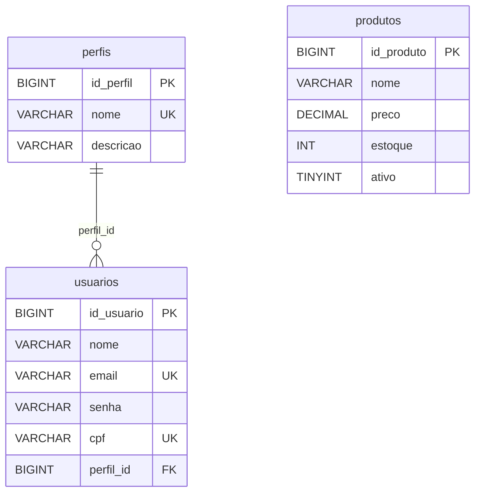

# Capítulo 11 — Projeto novo e banco

**Disciplina:** Programação para Internet (ILP951)
**Professor:** Ronan Adriel Zenatti · ronan.zenatti@cps.sp.gov.br
**Fatec Jahu — 2º Semestre/2026**

---

## 🎯 Objetivos do Capítulo

Ao final deste capítulo você deverá ser capaz de:

- Montar um projeto Flask do zero (pasta, ambiente virtual, pacotes, `.gitignore`, Git e GitHub), reconhecendo em cada etapa o capítulo onde ela foi ensinada
- Ler o `banco.sql` e explicar as tabelas `perfis`, `usuarios` e `produtos`, a chave estrangeira e as convenções de nomes
- Importar o `banco.sql` no phpMyAdmin e conferir o banco `gestao`
- Guardar a senha do banco e a `secret_key` em um arquivo `.env`, fora do Git, e deixar um `.env.example` no repositório
- Explicar cada trecho do `db.py`: a leitura do `.env`, a configuração, o pool e as funções `execute_query`, `execute_one` e `execute_insert`
- Testar a conexão com o `testar_conexao.py` e reconhecer as mensagens de erro mais comuns
- Montar os dois layouts do sistema com Bootstrap (um com menu e outro limpo), a tela de login provisória, o dashboard e as páginas 404 e 500

O Projeto 1 terminou no Capítulo 10, com o catálogo ligado a um banco. O **Projeto 2 é outro sistema e começa do zero**: um **Sistema de Gestão** com perfis, usuários e produtos, que vai crescer até o Capítulo 19. Este capítulo é quase todo uma revisão: tudo o que ele repete você já fez, e cada etapa traz o link para o capítulo onde foi explicada em detalhe. As novidades são o **arquivo `.env`**, o **`banco.sql`** e um **`db.py` mais completo**, que lê o `.env` e já traz a função de `INSERT`.

> **Antes de começar:** o XAMPP precisa estar instalado, como no [Capítulo 10](Capitulo_10_Banco_de_Dados.md#topico-1-o-xampp-e-o-phpmyadmin). Se não estiver, instale-o por lá.

---

## Tópico 1 — O projeto do zero

Todo projeto novo segue o mesmo roteiro. A tabela resume as etapas, e cada link leva à explicação completa:

| Etapa | Onde foi ensinada |
|---|---|
| Pasta do projeto e VS Code | [Capítulo 1, Tópico 1](Capitulo_01_Git_GitHub_HTML5_e_CSS.md#topico-1-o-que-vamos-construir-e-o-ambiente) |
| Ambiente virtual (`venv`) | [Capítulo 3, Tópico 2](Capitulo_03_Flask.md#topico-2-ambiente-virtual-e-instalacao-do-flask) |
| `pip install` e `requirements.txt` | [Capítulo 3, Tópico 2](Capitulo_03_Flask.md#o-requirementstxt) |
| `.gitignore` | [Capítulo 1, Tópico 2](Capitulo_01_Git_GitHub_HTML5_e_CSS.md#o-que-o-git-nao-deve-guardar) |
| `git init`, `add` e `commit` | [Capítulo 1, Tópico 2](Capitulo_01_Git_GitHub_HTML5_e_CSS.md#topico-2-git-o-historico-do-projeto-no-seu-computador) |
| Repositório no GitHub e `push` | [Capítulo 1, Tópico 3](Capitulo_01_Git_GitHub_HTML5_e_CSS.md#topico-3-github-enviando-o-projeto-para-a-nuvem) |
| Primeira rota do Flask | [Capítulo 3, Tópico 3](Capitulo_03_Flask.md#topico-3-o-primeiro-servidor-rotas) |

### A pasta e o ambiente virtual

Abra o VS Code, o terminal (`Ctrl + '`) e crie a pasta do projeto, que se chama **`sistema-gestao`**:

```bash
cd Desktop
mkdir sistema-gestao
cd sistema-gestao
code .
```

O VS Code reabre dentro da pasta vazia. No terminal dele, crie e ative o ambiente virtual:

```bash
python -m venv venv
venv\Scripts\activate
```

O `(venv)` aparece no começo da linha do terminal. Se o PowerShell recusar a ativação, o aviso do [Capítulo 3](Capitulo_03_Flask.md#criando-o-ambiente-virtual) mostra o `Set-ExecutionPolicy`.

### Os pacotes do projeto

Com o `(venv)` ativo, instale **de uma vez** todos os pacotes que o Projeto 2 vai usar:

```bash
pip install flask flask-wtf mysql-connector-python python-dotenv
```

Os três primeiros você já conhece, e o último é novo e fica por último no comando:

| Pacote | Para que serve | Onde aparece |
|---|---|---|
| `flask` | O servidor, as rotas e os templates | [Capítulo 3](Capitulo_03_Flask.md) |
| `flask-wtf` | A proteção CSRF dos formulários (só o `CSRFProtect`, como no Projeto 1) | [Capítulo 8](Capitulo_08_Session.md#topico-5-csrf-o-formulario-precisa-provar-que-e-o-seu). Entra em uso no Capítulo 12, com o primeiro formulário |
| `mysql-connector-python` | O conector entre o Python e o MySQL (MariaDB) | [Capítulo 10](Capitulo_10_Banco_de_Dados.md#instalando-o-conector). Entra em uso ainda neste capítulo, no `db.py` |
| `python-dotenv` | **Novo.** Lê o arquivo `.env` (Tópico 4) e entrega os valores dele ao Python | Este capítulo |

Gere o `requirements.txt`, como no Capítulo 3:

```bash
pip freeze > requirements.txt
```

!!! note "Versão usada como base"
    O `pip install` traz sempre a versão mais recente. Este material foi escrito e testado com Flask **3.1.3**, Flask-WTF **1.3.0**, mysql-connector-python **26.10.0** e python-dotenv **1.2.4**. Se uma versão futura se comportar de outro jeito que o texto, compare com o `requirements.txt` do zip do capítulo.

### O `.gitignore` e a primeira rota

Crie o arquivo `.gitignore`. Ele já nasce com tudo o que este projeto deixa de fora do Git, inclusive o `.env`, que só será criado no Tópico 4:

```text
# Ambiente virtual: pode ser recriado a qualquer momento com o requirements.txt
venv/

# Arquivos temporários que o Python cria sozinho
__pycache__/
*.pyc

# Segredos: senha do banco e secret_key. Nunca vão para o GitHub (o modelo é o .env.example)
.env

# Configurações locais do VS Code
.vscode/

# Arquivos que o sistema operacional cria sozinho
Thumbs.db
.DS_Store
```

Crie também o `app.py`, só com o necessário para ver o servidor de pé:

```python
from flask import Flask

app = Flask(__name__)


@app.route('/')
def index():
    return 'Sistema de Gestão no ar.'


if __name__ == '__main__':
    app.run(debug=True)
```

Rode `python app.py`, abra **http://127.0.0.1:5000** e confira a frase. (Esta rota provisória será trocada no Tópico 7.) Pare o servidor com `Ctrl + C`.

### O primeiro commit

Inicialize o repositório e confira o que o Git enxerga:

```bash
git init
git status
```

Estão na lista o `.gitignore`, o `app.py` e o `requirements.txt`. A pasta `venv` não aparece, porque o `.gitignore` a esconde. Registre este ponto **só no computador**, o repositório do GitHub vem no próximo tópico:

```bash
git add .
git commit -m "Cria o projeto base do Sistema de Gestão"
```

---

## Tópico 2 — O repositório no GitHub

No **github.com**, clique em **New repository**, escreva o nome **`sistema-gestao`** e deixe **desmarcadas** as opções de README, `.gitignore` e licença: o repositório nasce vazio, porque o histórico já existe aí no seu computador. É o roteiro do [Capítulo 1](Capitulo_01_Git_GitHub_HTML5_e_CSS.md#topico-3-github-enviando-o-projeto-para-a-nuvem). De volta ao terminal, troque `SEU-USUARIO` pelo seu nome no GitHub:

```bash
git remote add origin https://github.com/SEU-USUARIO/sistema-gestao.git
git branch -M main
git push -u origin main
```

Atualize a página do repositório: o `app.py`, o `.gitignore` e o `requirements.txt` estão lá. **Daqui em diante, todo bloco de commit deste projeto termina com `git push`.**

---

## Tópico 3 — O banco `gestao`

Ligue o **Apache** e o **MySQL** no painel do XAMPP e abra **http://localhost/phpmyadmin**. Tudo isso foi explicado no [Capítulo 10](Capitulo_10_Banco_de_Dados.md#topico-1-o-xampp-e-o-phpmyadmin).

### As três tabelas

O banco do Projeto 2 se chama **`gestao`** e tem três tabelas. Cada usuário pertence a **um** perfil, e um perfil pode ter vários usuários. Os produtos não se ligam a nenhuma das duas:



O diagrama mostra só as colunas principais, e o `banco.sql` tem todas. Baixe o arquivo e salve **dentro da pasta `sistema-gestao`**, ao lado do `app.py`:

➡️ [Baixar banco.sql](../arquivos/banco.sql)

### Lendo o `banco.sql`

Abra o arquivo no VS Code e leia antes de importar. Você já conhece SQL de outro semestre, então vamos só pelo que é próprio deste projeto. O começo do arquivo:

```sql
-- DROP DATABASE IF EXISTS gestao;   -- tire o "--" só se quiser apagar tudo e recomeçar do zero

CREATE DATABASE IF NOT EXISTS gestao
    CHARACTER SET utf8mb4
    COLLATE utf8mb4_unicode_ci;

USE gestao;
```

Dois `--` no início de uma linha a transformam em **comentário**: o MySQL a ignora. A primeira linha é um `DROP DATABASE` **desligado de propósito**. O restante do arquivo usa `IF NOT EXISTS`, então importar de novo **não apaga nada** e não dá erro. Só quem quiser recomeçar do zero tira o `--` e importa.

!!! warning "Cuidado com o `DROP DATABASE`"
    Com o `--` retirado, importar o arquivo **apaga o banco `gestao` inteiro**, com todos os perfis, usuários e produtos cadastrados, e o refaz vazio. Depois de recomeçar, volte a colocar o `--` na frente da linha, para uma importação futura não apagar o que você cadastrou.

Agora a tabela de perfis:

```sql
CREATE TABLE IF NOT EXISTS perfis (
    id_perfil     BIGINT UNSIGNED AUTO_INCREMENT PRIMARY KEY,
    nome          VARCHAR(100) NOT NULL UNIQUE,
    descricao     VARCHAR(255),
    criado_em     TIMESTAMP DEFAULT CURRENT_TIMESTAMP,
    atualizado_em TIMESTAMP DEFAULT CURRENT_TIMESTAMP ON UPDATE CURRENT_TIMESTAMP,
    deletado_em   DATETIME NULL
);
```

- **`id_perfil`**: a chave primária, numerada pelo banco (`AUTO_INCREMENT`). O nome segue a convenção do projeto: `id_` seguido do nome da tabela no singular. `UNSIGNED` significa "sem sinal": só números positivos.
- **`nome` `NOT NULL UNIQUE`**: obrigatório e sem repetição. Dois perfis com o mesmo nome o banco recusa (erro `1062`, que o Capítulo 12 trata).
- **`descricao`**: sem `NOT NULL`, então é **opcional**. A regra do projeto é: o que é `NOT NULL` no banco é obrigatório no formulário, e o que aceita `NULL` é opcional.
- **`criado_em` e `atualizado_em`**: o próprio banco preenche. O `ON UPDATE CURRENT_TIMESTAMP` atualiza o `atualizado_em` sozinho a cada `UPDATE`. Nenhum código Python mexe nessas colunas.
- **`deletado_em`**: fica vazia (`NULL`) e só é usada no Capítulo 13.1, opcional. Ela já existe agora para o banco **não precisar ser alterado** mais tarde.

A tabela de usuários repete esse molde e acrescenta a chave estrangeira. As colunas de dados (`nome`, `email`, `senha`, `celular`, `cpf`, endereço...) você lê no arquivo. O que merece atenção está no fim:

```sql
    perfil_id       BIGINT UNSIGNED NOT NULL,
    ...
    CONSTRAINT fk_usuarios_perfis
        FOREIGN KEY (perfil_id) REFERENCES perfis (id_perfil)
        ON DELETE RESTRICT
        ON UPDATE CASCADE
```

- **`perfil_id`**: a chave estrangeira segue a convenção `<singular>_id`. O tipo é **idêntico** ao de `id_perfil` (`BIGINT UNSIGNED`); se os tipos diferissem, o banco recusaria a ligação.
- **`FOREIGN KEY ... REFERENCES`**: o banco só aceita um `perfil_id` que **exista** em `perfis`. É por isso que `perfis` vem antes de `usuarios` no arquivo.
- **`ON DELETE RESTRICT`**: o banco **recusa** excluir um perfil que ainda tenha usuários (erro `1451`, que aparece no Capítulo 13).
- **`ON UPDATE CASCADE`**: se o `id_perfil` mudasse, o `perfil_id` dos usuários seria atualizado junto. Na prática o `id` nunca muda, é uma segurança.
- **`senha VARCHAR(255)`**: guarda o **hash** da senha, nunca a senha em si (Capítulo 14). O `cpf` e o `email` são `UNIQUE`.

Por fim, `produtos` segue o mesmo molde (`id_produto`, `criado_em`, `atualizado_em`), com `preco DECIMAL(10,2)`, `estoque`, `foto` (o caminho do arquivo gravado em disco) e `ativo`. Esta tabela **não** tem `deletado_em`: o `ativo` é o que liga e desliga um produto.

### Importando e conferindo

No phpMyAdmin, clique na aba **Importar** (*Import*) **sem** nenhum banco selecionado, escolha o `banco.sql` e clique em **Importar**, como no [Capítulo 10](Capitulo_10_Banco_de_Dados.md#importando). No painel da esquerda aparece o banco **gestao**, com as tabelas `perfis`, `produtos` e `usuarios`, todas **vazias**: os perfis e os usuários serão cadastrados pelo próprio sistema.

Clique em **usuarios** e abra a aba **Estrutura**. Confira as colunas, os tipos e as chaves, e a restrição `fk_usuarios_perfis` na **Visão de relação** (*Relation view*). Depois importe o `banco.sql` uma **segunda vez**: a faixa verde aparece de novo, sem erro e sem apagar nada.

### Registrando o arquivo

```bash
git add .
git commit -m "Adiciona o banco.sql do banco gestao"
git push
```

---

## Tópico 4 — O arquivo `.env`

### O problema

No `db.py` do [Capítulo 10](Capitulo_10_Banco_de_Dados.md#o-dbpy-em-incrementos), o usuário e a senha do banco estavam escritos **dentro do código**, e o código vai para o GitHub. Naquele projeto o `root` do XAMPP não tem senha, então não fazia diferença, e o aviso já dizia que era provisório. Em um sistema de verdade, qualquer pessoa que abrisse o repositório leria a senha do banco.

### A solução

A saída é tirar esses valores do código e colocá-los em um arquivo separado, o **`.env`**. Ele é um arquivo de texto com uma linha `NOME=valor` por configuração. O `.gitignore` do Tópico 1 já o deixa **fora do Git**, então ele existe só no seu computador, e cada computador tem o seu. O Python lê o `.env` por meio do `python-dotenv`, que você instalou.

Como o `.env` não vai para o GitHub, quem baixar o projeto não sabe quais linhas escrever. Por isso o repositório leva um **modelo** sem segredos, o **`.env.example`**. Crie o `.env.example` na raiz do projeto:

```text
# Modelo do arquivo .env. Copie este arquivo para .env e preencha com os seus valores.
# O .env NÃO vai para o GitHub; este .env.example vai.

DB_HOST=127.0.0.1
DB_PORT=3306
DB_USER=root
DB_PASSWORD=SUA_SENHA_AQUI
DB_NAME=NOME_BANCO_DADOS

# Troque por um texto longo e só seu. Ele assina o cookie da session.
SECRET_KEY=troque-por-um-texto-longo-e-so-seu
```

| Variável | O que guarda |
|---|---|
| `DB_HOST` | O endereço do servidor do banco. `127.0.0.1` é o próprio computador, como no [Capítulo 10](Capitulo_10_Banco_de_Dados.md#o-que-e-o-127001) |
| `DB_PORT` | A porta do MySQL. A do XAMPP é a `3306` |
| `DB_USER` e `DB_PASSWORD` | Quem entra e com qual senha. O modelo traz o marcador `SUA_SENHA_AQUI`, que você troca no `.env`. O `root` do XAMPP **não tem senha**, então a linha fica vazia |
| `DB_NAME` | O banco a usar. O modelo traz o marcador `NOME_BANCO_DADOS`, que você troca no `.env` por `gestao` |
| `SECRET_KEY` | O texto que assina o cookie da `session`, como no [Capítulo 8](Capitulo_08_Session.md#a-secret_key). Não é usada agora, mas o `flash` e o CSRF do Capítulo 12 dependem dela |

Agora crie o `.env` **a partir do modelo**, no terminal:

```bash
copy .env.example .env
```

Abra o `.env`. Ele é uma cópia do modelo, e os dois **marcadores** do Capítulo 10 vieram junto. Troque-os pelos valores do seu computador, **no `.env`** (o `.env.example` continua com os marcadores, porque é só o modelo): a senha do `root` do XAMPP é vazia, então não deixe nada depois do `=`, e o banco é o `gestao`:

```text
DB_PASSWORD=
DB_NAME=gestao
```

Troque também o valor do `SECRET_KEY` por um texto só seu. Para gerar um bom, rode no terminal e copie o resultado:

```bash
python -c "import secrets; print(secrets.token_hex(32))"
```

!!! note "Python: o módulo `secrets`"
    O `secrets` vem com o Python e gera números aleatórios próprios para segurança. O `token_hex(32)` devolve um texto de 64 caracteres, impossível de adivinhar.

Confira o que o Git enxerga:

```bash
git status
```

O `.env.example` aparece como arquivo novo, e o **`.env` não aparece**: o `.gitignore` o esconde. É exatamente o que se quer.

!!! danger "Se o `.env` for para o GitHub"
    Se um dia um `.env` com senha real for commitado e enviado, **apagar o arquivo depois não basta**: ele continua no histórico do repositório. A saída é tratar a senha como vazada e **trocá-la**. Por isso o `.gitignore` do Tópico 1 foi escrito *antes* de o `.env` existir.

```bash
git add .
git commit -m "Adiciona o modelo .env.example com as variáveis do projeto"
git push
```

---

## Tópico 5 — O `db.py` por dentro

O `db.py` é o único arquivo do projeto que fala com o banco. As rotas dizem **qual SQL** querem, e ele cuida de todo o resto: pegar uma conexão, executar, confirmar, devolver. Pool de conexões, cursor, `commit`, `rollback` e `finally` foram explicados no [Capítulo 10, Tópico 3](Capitulo_10_Banco_de_Dados.md#topico-3-conectando-o-python-dbpy-e-o-pool). Aqui o arquivo é refeito com duas diferenças: os valores vêm do `.env`, e ele ganha a função de `INSERT`. Vamos montá-lo aos poucos.

### Lendo o `.env`

Crie o `db.py` na raiz do projeto, com este começo:

```python
import os

from dotenv import load_dotenv
from mysql.connector import Error, pooling

# Lê o arquivo .env e coloca cada linha dele nas variáveis de ambiente do programa.
load_dotenv()

if os.getenv('DB_NAME') is None:
    raise RuntimeError('Não encontrei o arquivo .env. Copie o .env.example para .env e preencha.')
```

!!! note "Python: `import os` e `os.getenv`"
    O módulo `os` fala com o sistema operacional. O `load_dotenv()` lê o `.env` e coloca cada linha como uma **variável de ambiente**, e o `os.getenv('DB_NAME')` busca o valor de uma delas. Se a variável não existir, devolve `None`. Um segundo argumento, como em `os.getenv('DB_PORT', '3306')`, é o valor **padrão** para quando ela não existir.

!!! note "Python: `raise` com uma mensagem"
    No Capítulo 10, o `raise` sozinho repetia um erro que já tinha acontecido. Aqui o `raise RuntimeError('...')` **cria** um erro, com a mensagem que você escolheu, e interrompe o programa. O `if` garante que quem esqueceu de criar o `.env` receba uma frase clara, em vez de um erro de conexão confuso.

Teste no terminal:

```bash
python -c "import os; from dotenv import load_dotenv; load_dotenv(); print(os.getenv('DB_NAME'))"
python -c "import db; print('db.py carregado')"
```

O primeiro comando mostra `gestao`: o Python leu o `.env`. (Se aparecer `None`, o `.env` não está na raiz do projeto. Se aparecer `NOME_BANCO_DADOS`, o marcador não foi trocado.) O segundo confirma que o `db.py` carrega sem o `RuntimeError`.

### A configuração e o pool

Acrescente ao `db.py`, abaixo do `if`:

```python
CONFIGURACAO = {
    'host': os.getenv('DB_HOST'),
    'port': int(os.getenv('DB_PORT', '3306')),
    'user': os.getenv('DB_USER'),
    'password': os.getenv('DB_PASSWORD', ''),
    'database': os.getenv('DB_NAME'),
    'charset': 'utf8mb4',
    'sql_mode': (
        'STRICT_TRANS_TABLES,NO_ZERO_DATE,'
        'ERROR_FOR_DIVISION_BY_ZERO,NO_ENGINE_SUBSTITUTION'
    ),
    'time_zone': '-03:00',  # horário de Brasília, igual em qualquer computador
    'use_pure': True,  # conector em Python puro, evita erros com XAMPP e MySQL juntos
}

pool = pooling.MySQLConnectionPool(pool_name='gestao_pool', pool_size=5, **CONFIGURACAO)
```

Cada chave do dicionário é um argumento que o conector entende:

| Chave | De onde vem | O que faz |
|---|---|---|
| `host` | `DB_HOST` do `.env` | Onde está o servidor do banco |
| `port` | `DB_PORT` do `.env` | A porta do servidor. O `os.getenv` sempre devolve **texto**, e a porta precisa ser **número**, por isso o `int(...)` |
| `user` e `password` | `DB_USER` e `DB_PASSWORD` do `.env` | Quem entra no banco. O `''` é o padrão de uma senha vazia |
| `database` | `DB_NAME` do `.env` | O banco usado nas consultas: `gestao` |
| `charset` | Fixo no código | `utf8mb4`: o texto viaja com acentos, sem virar `?` |
| `sql_mode` | Fixo no código | As mesmas quatro regras de validação do [Capítulo 10](Capitulo_10_Banco_de_Dados.md#o-sql_mode-quatro-regras-de-validacao) |
| `time_zone` | Fixo no código | O fuso da conexão. `NOW()` e as colunas `criado_em` e `atualizado_em` usam esse fuso. Com `-03:00`, o horário gravado é o de Brasília em qualquer computador ou servidor |
| `use_pure` | Fixo no código | `True` usa o conector em Python puro. Em computadores com o XAMPP e o MySQL da Oracle instalados juntos, a extensão em C falha com erros como `Authentication plugin 'caching_sha2_password' is not supported` ou `Lost connection to MySQL server` |
| `pool_name` e `pool_size` | Fixo no código | O nome do pool e quantas conexões ele mantém abertas (5) |

O que vem do `.env` **muda de um computador para outro** (a senha, o banco). O que é fixo no código é a mesma regra para todos. O `**CONFIGURACAO` desempacota o dicionário em argumentos nomeados, como no Capítulo 10.

Teste que o pool foi criado, com o MySQL do XAMPP ligado e o banco importado:

```bash
python -c "import db; print('pool criado')"
```

### A função `execute_query`

Acrescente ao final do `db.py`:

```python
def execute_query(sql, params=None, fetch=False):
    if params is None:
        params = ()

    conexao = pool.get_connection()
    cursor = conexao.cursor(dictionary=True)

    try:
        cursor.execute(sql, params)

        if fetch:
            resultado = cursor.fetchall()
        else:
            conexao.commit()
            resultado = cursor.rowcount

        return resultado
    except Error:
        conexao.rollback()
        raise
    finally:
        cursor.close()
        conexao.close()
```

Linha a linha, na ordem em que acontece:

1. **`params=None` e o `if`**: os valores que entram no SQL no lugar dos `%s`. Sem eles, o `None` vira uma tupla vazia `()`, que o `execute` aceita.
2. **`pool.get_connection()`**: pega uma conexão **já aberta** do pool.
3. **`conexao.cursor(dictionary=True)`**: o cursor é quem envia o comando e traz o resultado. Com `dictionary=True`, cada linha chega como um **dicionário** (`{'id_perfil': 1, 'nome': 'Administrador'}`), e o Jinja lê `perfil.nome`.
4. **`cursor.execute(sql, params)`**: manda o SQL ao banco. Os `%s` são trocados pelos valores da tupla, sempre como **dados**, nunca como pedaço do comando.
5. **`fetch=True`**: é um `SELECT`. O `fetchall()` devolve a **lista de linhas** (vazia, se não houver nenhuma).
6. **`fetch=False`**: é um `INSERT`, `UPDATE` ou `DELETE`. O `commit()` **confirma** a mudança (sem ele, o banco a descarta) e o `rowcount` devolve **quantas linhas foram afetadas**.
7. **`except Error`**: se o SQL der erro, o `rollback()` desfaz o que tenha ficado pela metade, e o `raise` repete o erro para a rota decidir o que fazer. O Capítulo 12 usa isso para reconhecer o erro `1062` (nome repetido).
8. **`finally`**: roda **sempre**. O cursor é fechado e a conexão volta ao pool, mesmo quando houve erro. Sem isso, cada erro deixaria uma conexão presa, e o pool de cinco se esgotaria.

Teste a função com um `SELECT`. O banco está vazio, então a resposta é uma lista vazia:

```bash
python -c "from db import execute_query; print(execute_query('SELECT id_perfil, nome FROM perfis', fetch=True))"
```

A resposta é `[]`.

### A função `execute_one`

Acrescente ao final:

```python
def execute_one(sql, params=None):
    linhas = execute_query(sql, params, fetch=True)

    if len(linhas) > 0:
        return linhas[0]

    return None
```

Ela serve para quando se espera **uma linha só**, como abrir um perfil pelo `id`: devolve o **dicionário** da primeira linha, ou `None` se o `SELECT` não achou nada, e as rotas tratam o `None` com `abort(404)`. Teste:

```bash
python -c "from db import execute_one; print(execute_one('SELECT id_perfil FROM perfis WHERE id_perfil = %s', (1,)))"
```

A resposta é `None`, porque ainda não há nenhum perfil. A tupla `(1,)` leva a vírgula que o Python exige para uma tupla de um item.

### A função `execute_insert`

Falta a função de `INSERT`. O `execute_query` já grava e faz o `commit`, mas devolve apenas o `rowcount`, que num `INSERT` é sempre `1`. Na maioria das vezes isso basta, porém às vezes o sistema precisa saber **qual `id` o banco gerou** para a nova linha (por exemplo, para dizer "Perfil nº 4 cadastrado"). Essa informação fica guardada no cursor, em `lastrowid`, e some quando o cursor é fechado. Por isso o `INSERT` ganha a sua função. Acrescente ao final do `db.py`:

```python
def execute_insert(sql, params=None):
    if params is None:
        params = ()

    conexao = pool.get_connection()
    cursor = conexao.cursor()

    try:
        cursor.execute(sql, params)
        conexao.commit()
        return cursor.lastrowid
    except Error:
        conexao.rollback()
        raise
    finally:
        cursor.close()
        conexao.close()
```

A estrutura é a mesma do `execute_query`: pega a conexão, executa, confirma e, no `finally`, devolve tudo. Há duas diferenças: o cursor é comum (`cursor()`, sem `dictionary=True`), porque um `INSERT` não devolve linhas, e o retorno é o **`lastrowid`**, o `id` gerado pelo `AUTO_INCREMENT`.

Ainda **não há nada para inserir**: o banco fica vazio até o Capítulo 12, quando os alunos cadastram os primeiros perfis pelo próprio sistema. Por isso a função não é testada agora. É assim que ela será usada:

```python
novo_id = execute_insert(
    'INSERT INTO perfis (nome, descricao) VALUES (%s, %s)',
    (nome, descricao),
)
```

### Qual função usar

| O que a rota quer fazer | Função | O que devolve |
|---|---|---|
| `SELECT` de **várias** linhas | `execute_query(sql, params, fetch=True)` | Lista de dicionários (pode ser vazia) |
| `SELECT` de **uma** linha | `execute_one(sql, params)` | Um dicionário, ou `None` |
| `INSERT` | `execute_insert(sql, params)` | O `id` gerado pelo banco |
| `UPDATE` e `DELETE` | `execute_query(sql, params)` | O número de linhas afetadas |

!!! danger "Todo valor vindo do usuário entra por `%s`"
    Nunca monte o SQL com f-string ou com `+` para colocar um texto digitado dentro do comando. Quem digita decidiria o que o banco executa (*SQL Injection*, explicado no [Capítulo 10](Capitulo_10_Banco_de_Dados.md#topico-4-select-o-catalogo-vem-do-banco)). O `%s` com a tupla é obrigatório em todos os capítulos deste projeto.

### Quando algo dá errado

| Mensagem | Causa | O que fazer |
|---|---|---|
| `RuntimeError: Não encontrei o arquivo .env` | O `.env` não existe na raiz do projeto | Rode `copy .env.example .env` |
| `ModuleNotFoundError: No module named 'dotenv'` (ou `'mysql'`) | O pacote não está instalado no ambiente ativo | Ative o `venv` e rode o `pip install` do Tópico 1 |
| `2003: Can't connect to MySQL server` | O MySQL do XAMPP está desligado, ou a porta do `.env` está errada | Clique em **Start** no MySQL e confira o `DB_PORT` |
| `1045 Access denied for user` | `DB_USER` ou `DB_PASSWORD` não batem com os do banco, ou o marcador `SUA_SENHA_AQUI` ficou no `.env` | Confira o `.env`. No XAMPP, a senha do `root` é vazia (`DB_PASSWORD=`) |
| `1049 Unknown database 'gestao'` | O `banco.sql` não foi importado, ou o `DB_NAME` está errado | Volte ao Tópico 3 e confira o `.env` |
| `1049 Unknown database 'nome_banco_dados'` | O marcador `NOME_BANCO_DADOS` ficou no `.env` | Troque por `DB_NAME=gestao` |
| `1146 Table 'gestao.perfis' doesn't exist` | O banco existe, mas está sem as tabelas | Importe o `banco.sql` de novo |
| `Authentication plugin 'caching_sha2_password' is not supported` | A extensão em C do conector se confunde com o MySQL da Oracle | Confira se o `use_pure` está `True` |

Registre o `db.py`:

```bash
git add .
git commit -m "Adiciona o db.py com pool de conexões lendo o .env"
git push
```

---

## Tópico 6 — Testando a conexão

Um programa de teste evita descobrir o erro só quando uma página quebra. Crie na raiz do projeto o `testar_conexao.py`:

```python
from db import execute_one

# Se o .env, o XAMPP ou o banco estiverem errados, o erro aparece já na linha acima,
# quando o db.py cria o pool.
print('Conectado ao banco de dados.')

info = execute_one('SELECT DATABASE() AS banco, VERSION() AS versao, NOW() AS agora')
print('Banco:', info['banco'])
print('Servidor:', info['versao'])
print('Hora do banco:', info['agora'])

perfis = execute_one('SELECT COUNT(*) AS total FROM perfis')
usuarios = execute_one('SELECT COUNT(*) AS total FROM usuarios')
produtos = execute_one('SELECT COUNT(*) AS total FROM produtos')

print('Tabela perfis:', perfis['total'], 'linhas')
print('Tabela usuarios:', usuarios['total'], 'linhas')
print('Tabela produtos:', produtos['total'], 'linhas')
```

Rode:

```bash
python testar_conexao.py
```

A saída é parecida com esta (o servidor e a hora variam):

```text
Conectado ao banco de dados.
Banco: gestao
Servidor: 10.4.32-MariaDB
Hora do banco: 2026-11-03 07:28:46
Tabela perfis: 0 linhas
Tabela usuarios: 0 linhas
Tabela produtos: 0 linhas
```

- O `import` já cria o pool, que abre as conexões. Se algo estiver errado, o erro aparece nessa linha.
- O `SELECT DATABASE(), VERSION(), NOW()` não lê nenhuma tabela: pergunta ao banco qual é o banco em uso, a versão do servidor e a hora dele. Compare a **hora do banco** com o relógio do Windows: elas devem bater, e é o `time_zone` do `db.py` fazendo o trabalho.
- O `COUNT(*)` conta as linhas de cada tabela. Os três zeros mostram que as tabelas existem e estão vazias. O `AS total` dá nome à coluna, para o Python ler `perfis['total']`.

Agora veja o `.env` mandando no programa, **sem tocar no código**. Abra o `.env`, troque `DB_NAME=gestao` por `DB_NAME=nao_existe` e rode o teste de novo: aparece `1049 (42000): Unknown database 'nao_existe'`. Desfaça a troca e rode mais uma vez para confirmar que voltou ao normal.

```bash
git add .
git commit -m "Adiciona o testar_conexao.py"
git push
```

---

## Tópico 7 — Os layouts, o dashboard e as páginas de erro

O sistema precisa de molduras que se repitam em todas as páginas. É a herança de templates (`extends` e `block`) do [Capítulo 6](Capitulo_06_Heranca_Include_e_Paginas_de_Erro.md#topico-1-da-copia-ao-basehtml), com a navbar e o `url_for` do [Capítulo 4](Capitulo_04_Bootstrap_com_Flask.md#topico-2-a-barra-de-navegacao). Desta vez ela já nasce como herança, sem a duplicação do Projeto 1, e com **dois layouts**, porque nem toda página tem menu:

| Layout | Tem menu? | Quem usa |
|---|---|---|
| `layout/base_menu.html` | Sim, o menu de navegação, com o conteúdo dentro do `<main>` | O dashboard e, nos próximos capítulos, as telas de perfis, usuários e produtos |
| `layout/base_limpo.html` | Não: o conteúdo fica centralizado na tela | O login e as páginas de erro (404 e 500) |

### A organização da pasta `templates`

Os templates deste projeto ficam em subpastas, para o `templates` não virar uma lista de dezenas de arquivos soltos. Este é o mapa final, que vai se completando capítulo a capítulo:

```text
templates/
├── layout/
│   ├── base_menu.html
│   └── base_limpo.html
├── login.html
├── dashboard.html
├── 404.html
├── 500.html
├── perfis/        (Capítulos 12 e 13)
├── usuarios/      (Capítulos 14 a 16)
└── produtos/      (Capítulo 18)
```

Cada tabela terá a sua pasta, com o nome dela, e dentro dela sempre dois arquivos: a **lista**, com o nome da tabela no plural (`perfis_lista.html`), e o **formulário**, com o nome no singular (`perfil_form.html`). O Flask procura os templates dentro de `templates/`, então o nome da subpasta faz parte do nome do arquivo em `render_template` e em `extends`: `'layout/base_menu.html'`, `'perfis/perfis_lista.html'`.

### O estilo e o layout limpo

Crie a pasta `static` com o arquivo `estilo.css`:

```css
/* Regras próprias do sistema. O resto do visual vem do Bootstrap. */

body {
  background-color: #f4f6f8;
}

/* Cor da barra de navegação */
.navbar {
  background-color: #1f4e79;
}
```

Crie a pasta `templates`, dentro dela a pasta `layout`, e nela o `base_limpo.html`, o layout **sem menu**:

```html
<!DOCTYPE html>
<html lang="pt-BR">
<head>
  <meta charset="UTF-8">
  <meta name="viewport" content="width=device-width, initial-scale=1.0">
  <title>Sistema de Gestão</title>
  <link href="https://cdn.jsdelivr.net/npm/bootstrap@5.3.8/dist/css/bootstrap.min.css" rel="stylesheet">
  <link rel="stylesheet" href="{{ url_for('static', filename='estilo.css') }}">
</head>
<body>

  <main class="container min-vh-100 d-flex align-items-center justify-content-center py-4">
    <div class="col-12 col-md-8 col-lg-5">
      
    </div>
  </main>

  <script src="https://cdn.jsdelivr.net/npm/bootstrap@5.3.8/dist/js/bootstrap.bundle.min.js"></script>
  

</body>
</html>
```

O que centraliza o conteúdo está nas classes do `<main>` e da `<div>` de dentro:

- `min-vh-100` dá ao `<main>` a altura mínima de 100% da janela, para haver espaço de sobra para centralizar.
- `d-flex`, `align-items-center` e `justify-content-center` centralizam o conteúdo na vertical e na horizontal.
- `col-12 col-md-8 col-lg-5` limita a largura: a tela inteira no celular, dois terços no tablet e pouco menos da metade no computador.

### O login provisório e a rota `/`

Crie o `templates/login.html`. Ele herda do layout limpo, então não tem menu:

```html


Entrar — Sistema de Gestão


  <div class="card">
    <div class="card-body p-4 text-center">
      <h1 class="h2 mb-1">Sistema de Gestão</h1>
      <p class="text-body-secondary mb-4">Fatec Jahu · ILP951</p>

      <a href="{{ url_for('dashboard') }}" class="btn btn-primary w-100">Entrar</a>

      <p class="small text-body-secondary mt-3 mb-0">
        Ainda não há verificação de e-mail e senha: o botão leva direto ao dashboard.
      </p>
    </div>
  </div>

```

O `` leva o nome da subpasta, e o botão **Entrar** é um link comum para a rota `dashboard`. A verificação de e-mail e senha só chega no [Capítulo 17](Capitulo_17_Login.md); até lá o botão apenas navega.

Troque o `app.py` por esta versão, com as três rotas do sistema:

```python
from flask import Flask, render_template, redirect, url_for

app = Flask(__name__)


@app.route('/')
def index():
    return redirect(url_for('login'))


@app.route('/login')
def login():
    return render_template('login.html')


@app.route('/dashboard')
def dashboard():
    return 'Dashboard em construção.'


if __name__ == '__main__':
    app.run(debug=True)
```

- A rota `/` não mostra nada: ela só **redireciona** para `/login`, com `redirect` e `url_for`, como no [Capítulo 4](Capitulo_04_Bootstrap_com_Flask.md). Quem abre o sistema sempre cai na tela de entrada.
- A rota `/login` mostra o `login.html`.
- A rota `/dashboard` devolve só um texto por enquanto. Ela existe agora porque o botão **Entrar** usa `url_for('dashboard')`, e o `url_for` dá erro se a rota não existir.

Salve e rode `python app.py`. Abra **http://127.0.0.1:5000** e observe que o endereço **muda sozinho** para `/login`, com o cartão centralizado e sem menu. Clique em **Entrar**: aparece o texto do dashboard.

### O layout com menu e o dashboard

Agora o layout **com menu**. Crie o `templates/layout/base_menu.html`:

```html
<!DOCTYPE html>
<html lang="pt-BR">
<head>
  <meta charset="UTF-8">
  <meta name="viewport" content="width=device-width, initial-scale=1.0">
  <title>Sistema de Gestão</title>
  <link href="https://cdn.jsdelivr.net/npm/bootstrap@5.3.8/dist/css/bootstrap.min.css" rel="stylesheet">
  <link rel="stylesheet" href="{{ url_for('static', filename='estilo.css') }}">
</head>
<body>

  <nav class="navbar navbar-expand-lg" data-bs-theme="dark">
    <div class="container">
      <a class="navbar-brand" href="{{ url_for('dashboard') }}">Sistema de Gestão</a>
      <button class="navbar-toggler" type="button" data-bs-toggle="collapse"
              data-bs-target="#menu" aria-controls="menu" aria-expanded="false"
              aria-label="Abrir o menu">
        <span class="navbar-toggler-icon"></span>
      </button>
      <div class="collapse navbar-collapse" id="menu">
        <ul class="navbar-nav me-auto">
          <li class="nav-item">
            <a class="nav-link active" href="{{ url_for('dashboard') }}">Home</a>
          </li>
        </ul>
        <ul class="navbar-nav align-items-lg-center">
          <li class="nav-item">
            <a class="btn btn-sm btn-outline-light" href="{{ url_for('login') }}">Sair</a>
          </li>
        </ul>
      </div>
    </div>
  </nav>

  <main class="container my-4">
    
  </main>

  <footer class="text-center text-body-secondary py-3">
    <p class="mb-0">Sistema de Gestão · Fatec Jahu · ILP951 · 2026</p>
  </footer>

  <script src="https://cdn.jsdelivr.net/npm/bootstrap@5.3.8/dist/js/bootstrap.bundle.min.js"></script>
  

</body>
</html>
```

O menu tem dois grupos de itens. O primeiro, com `me-auto`, fica à esquerda e vai receber os menus das tabelas; por enquanto só tem o **Home**, que fica destacado quando a página aberta é o dashboard (`request.endpoint`, do Capítulo 4). O segundo fica à direita, com o botão **Sair**, que por enquanto só volta para a tela de login. Os menus suspensos de **Perfis**, **Usuários** e **Produtos** entram nos capítulos em que essas páginas nascem, porque cada link usa `url_for` de uma rota que ainda não existe.

Crie o `templates/dashboard.html`, primeiro só com o título:

```html


{{ titulo }}


  <h1>{{ titulo }}</h1>
  <p class="lead">O Flask está conectado ao banco <strong>gestao</strong>.</p>

```

E, no `app.py`, faça a rota `dashboard` usar o template:

```python
@app.route('/dashboard')
def dashboard():
    return render_template('dashboard.html', titulo='Sistema de Gestão')
```

Salve e recarregue. Abra **http://127.0.0.1:5000**, clique em **Entrar**: a barra azul, o título e o rodapé aparecem. Clique em **Sair** e você volta ao login.

### O dashboard lê o banco

Agora o dashboard vai provar, com números, que o Flask fala com o banco. No `app.py`, a rota `dashboard` passa a contar as linhas das três tabelas, e o `secret_key` vem do `.env`. Troque o arquivo inteiro por:

```python
import os

from dotenv import load_dotenv
from flask import Flask, render_template, redirect, url_for

from db import execute_one

load_dotenv()

app = Flask(__name__)
app.secret_key = os.getenv('SECRET_KEY')


@app.route('/')
def index():
    return redirect(url_for('login'))


@app.route('/login')
def login():
    return render_template('login.html')


@app.route('/dashboard')
def dashboard():
    perfis = execute_one('SELECT COUNT(*) AS total FROM perfis')
    usuarios = execute_one('SELECT COUNT(*) AS total FROM usuarios')
    produtos = execute_one('SELECT COUNT(*) AS total FROM produtos')

    return render_template('dashboard.html', titulo='Sistema de Gestão',
                           total_perfis=perfis['total'],
                           total_usuarios=usuarios['total'],
                           total_produtos=produtos['total'])


if __name__ == '__main__':
    app.run(debug=True)
```

O `db.py` já carrega o `.env` ao ser importado, mas o `app.py` também lê dele (o `SECRET_KEY`), então chama o `load_dotenv()` por conta própria, em vez de depender do que outro arquivo fez. A `secret_key` é a do `.env`, e não mais um texto escrito no código, como no Projeto 1.

No `templates/dashboard.html`, troque o `<p class="lead">` pelos três cartões:

```html
  <p class="lead">O Flask está conectado ao banco <strong>gestao</strong>.</p>

  <div class="row g-3">
    <div class="col-sm-4">
      <div class="card text-center">
        <div class="card-body">
          <p class="display-5 mb-0">{{ total_perfis }}</p>
          <p class="text-body-secondary mb-0">perfis</p>
        </div>
      </div>
    </div>
    <div class="col-sm-4">
      <div class="card text-center">
        <div class="card-body">
          <p class="display-5 mb-0">{{ total_usuarios }}</p>
          <p class="text-body-secondary mb-0">usuários</p>
        </div>
      </div>
    </div>
    <div class="col-sm-4">
      <div class="card text-center">
        <div class="card-body">
          <p class="display-5 mb-0">{{ total_produtos }}</p>
          <p class="text-body-secondary mb-0">produtos</p>
        </div>
      </div>
    </div>
  </div>
```

Salve e recarregue o dashboard: os três cartões mostram **0**. Eles vão subindo conforme os próximos capítulos cadastram dados.

!!! note "Mudou o `.env`? Reinicie o servidor"
    O modo `debug=True` reinicia o Flask sozinho quando um arquivo `.py` muda, mas **não** quando o `.env` muda. Depois de editar o `.env`, pare o servidor com `Ctrl + C` e rode `python app.py` de novo.

### As páginas 404 e 500

Como no [Capítulo 6](Capitulo_06_Heranca_Include_e_Paginas_de_Erro.md#topico-5-paginas-de-erro-404-e-500), os erros ganham páginas próprias. Elas usam o **layout limpo**: quem caiu num erro não precisa do menu, só de um caminho de volta. Crie o `templates/404.html`:

```html


Página não encontrada — Sistema de Gestão


  <div class="text-center py-5">
    <h1 class="display-1">404</h1>
    <p class="lead">Não encontramos a página que você procurava.</p>
    <a href="{{ url_for('dashboard') }}" class="btn btn-primary">Voltar para a Home</a>
  </div>

```

E o `templates/500.html`:

```html


Erro no servidor — Sistema de Gestão


  <div class="text-center py-5">
    <h1 class="display-1">500</h1>
    <p class="lead">Algo deu errado do nosso lado. Tente novamente em instantes.</p>
    <a href="{{ url_for('dashboard') }}" class="btn btn-primary">Voltar para a Home</a>
  </div>

```

Registre-os no `app.py`, antes do `if __name__ == '__main__':`:

```python
@app.errorhandler(404)
def pagina_nao_encontrada(erro):
    return render_template('404.html'), 404


@app.errorhandler(500)
def erro_no_servidor(erro):
    return render_template('500.html'), 500
```

Salve e abra **http://127.0.0.1:5000/qualquer-coisa**: a página 404 aparece centralizada, sem o menu. A página 500 só aparece com o `debug` desligado, como mostrou o Capítulo 6.

```bash
git add .
git commit -m "Adiciona os layouts, o login provisório, o dashboard e as páginas 404 e 500"
git push
```

---

## Os arquivos completos do capítulo

O `db.py`:

```python
import os

from dotenv import load_dotenv
from mysql.connector import Error, pooling

# Lê o arquivo .env e coloca cada linha dele nas variáveis de ambiente do programa.
load_dotenv()

if os.getenv('DB_NAME') is None:
    raise RuntimeError('Não encontrei o arquivo .env. Copie o .env.example para .env e preencha.')

CONFIGURACAO = {
    'host': os.getenv('DB_HOST'),
    'port': int(os.getenv('DB_PORT', '3306')),
    'user': os.getenv('DB_USER'),
    'password': os.getenv('DB_PASSWORD', ''),
    'database': os.getenv('DB_NAME'),
    'charset': 'utf8mb4',
    'sql_mode': (
        'STRICT_TRANS_TABLES,NO_ZERO_DATE,'
        'ERROR_FOR_DIVISION_BY_ZERO,NO_ENGINE_SUBSTITUTION'
    ),
    'time_zone': '-03:00',  # horário de Brasília, igual em qualquer computador
    'use_pure': True,  # conector em Python puro, evita erros com XAMPP e MySQL juntos
}

pool = pooling.MySQLConnectionPool(pool_name='gestao_pool', pool_size=5, **CONFIGURACAO)


def execute_query(sql, params=None, fetch=False):
    if params is None:
        params = ()

    conexao = pool.get_connection()
    cursor = conexao.cursor(dictionary=True)

    try:
        cursor.execute(sql, params)

        if fetch:
            resultado = cursor.fetchall()
        else:
            conexao.commit()
            resultado = cursor.rowcount

        return resultado
    except Error:
        conexao.rollback()
        raise
    finally:
        cursor.close()
        conexao.close()


def execute_one(sql, params=None):
    linhas = execute_query(sql, params, fetch=True)

    if len(linhas) > 0:
        return linhas[0]

    return None


def execute_insert(sql, params=None):
    if params is None:
        params = ()

    conexao = pool.get_connection()
    cursor = conexao.cursor()

    try:
        cursor.execute(sql, params)
        conexao.commit()
        return cursor.lastrowid
    except Error:
        conexao.rollback()
        raise
    finally:
        cursor.close()
        conexao.close()
```

O `app.py`:

```python
import os

from dotenv import load_dotenv
from flask import Flask, render_template, redirect, url_for

from db import execute_one

load_dotenv()

app = Flask(__name__)
app.secret_key = os.getenv('SECRET_KEY')


@app.route('/')
def index():
    return redirect(url_for('login'))


@app.route('/login')
def login():
    return render_template('login.html')


@app.route('/dashboard')
def dashboard():
    perfis = execute_one('SELECT COUNT(*) AS total FROM perfis')
    usuarios = execute_one('SELECT COUNT(*) AS total FROM usuarios')
    produtos = execute_one('SELECT COUNT(*) AS total FROM produtos')

    return render_template('dashboard.html', titulo='Sistema de Gestão',
                           total_perfis=perfis['total'],
                           total_usuarios=usuarios['total'],
                           total_produtos=produtos['total'])


@app.errorhandler(404)
def pagina_nao_encontrada(erro):
    return render_template('404.html'), 404


@app.errorhandler(500)
def erro_no_servidor(erro):
    return render_template('500.html'), 500


if __name__ == '__main__':
    app.run(debug=True)
```

O `testar_conexao.py` e o `.env.example` estão nos Tópicos 6 e 4, e os templates e o `estilo.css`, no Tópico 7.

---

## 📦 Código deste capítulo

Compare com o seu projeto, ou use como ponto de partida do próximo capítulo. O zip tem o `app.py`, o `db.py`, o `testar_conexao.py`, o `banco.sql`, o `.env.example`, o `.gitignore`, o `requirements.txt`, a pasta `templates` (a subpasta `layout`, com `base_menu.html` e `base_limpo.html`, mais `login.html`, `dashboard.html`, `404.html` e `500.html`) e a pasta `static` (`estilo.css`). O ambiente virtual **não** vai no zip, e o **`.env` também não**: depois de descompactar, crie o ambiente com os três comandos do Capítulo 3 (`python -m venv venv`, `venv\Scripts\activate` e `pip install -r requirements.txt`) e rode `copy .env.example .env`. Depois, abra o `.env` e troque os marcadores `SUA_SENHA_AQUI` (por nada, no XAMPP) e `NOME_BANCO_DADOS` (por `gestao`), como no Tópico 4. O banco também não vai dentro do zip: importe o `banco.sql` no phpMyAdmin, como no Tópico 3.

➡️ [Baixar p2_cap_11.zip](../arquivos/p2_cap_11.zip)

---

## 🃏 Flashcards de Revisão

Tente responder mentalmente antes de abrir.

??? question "O que é o arquivo `.env` e por que ele não vai para o GitHub?"
    É um arquivo de texto com uma linha `NOME=valor` por configuração, como a senha do banco e a `secret_key`. Ele fica fora do Git (listado no `.gitignore`) porque quem abrisse o repositório leria os segredos. Cada computador tem o seu `.env`.

??? question "Para que serve o `.env.example`, se o `.env` não vai para o repositório?"
    É o **modelo** do `.env`: tem os mesmos nomes de variáveis, mas sem segredos. Vai para o GitHub para quem baixar o projeto saber quais linhas escrever. Basta copiá-lo para `.env` e preencher.

??? question "Por que o `db.py` usa `int(os.getenv('DB_PORT', '3306'))`?"
    Porque o `os.getenv` sempre devolve **texto**, e o conector espera a porta como **número**. O `'3306'` é o valor padrão, usado quando a variável não existe, e o `int(...)` converte o texto em número.

??? question "Por que existe o `execute_insert`, se o `execute_query` também grava?"
    O `execute_query` devolve só o `rowcount`, que num `INSERT` é sempre `1`. O `execute_insert` devolve o `lastrowid`, o **`id` que o banco gerou** para a nova linha, informação que fica no cursor e some quando ele é fechado.

??? question "O que fazem `ON DELETE RESTRICT` e `ON UPDATE CASCADE` na chave estrangeira de `usuarios`?"
    O `ON DELETE RESTRICT` faz o banco **recusar** a exclusão de um perfil que ainda tem usuários. O `ON UPDATE CASCADE` repassa aos usuários um eventual novo `id_perfil`. Os dois mantêm a ligação entre as tabelas sempre válida.

??? question "O que significa a linha `-- DROP DATABASE IF EXISTS gestao;` no começo do `banco.sql`?"
    É um comando que apagaria o banco inteiro, **desligado** pelo `--` (comentário). Importar o `banco.sql` normalmente não apaga nada, graças ao `IF NOT EXISTS`. Só quem quer recomeçar do zero tira o `--`, sabendo que perde todos os dados.

---

## ✅ Quiz de Fixação

<quiz>
Por que a senha do banco fica no `.env` e não escrita direto no `db.py`?
- [ ] Porque o Python não consegue ler senhas escritas no código
> Não. O Python lê qualquer texto do código. O motivo é a segurança, e não uma limitação da linguagem.
- [x] Porque o código vai para o GitHub e o `.env` fica de fora do Git
> Correto. Quem abrisse o repositório leria a senha. O `.env` existe só no seu computador, e o repositório leva apenas o `.env.example`, sem segredos.
- [ ] Porque o `.env` deixa as consultas ao banco mais rápidas
> Não. A velocidade é a mesma. O `.env` muda só o lugar onde os valores ficam guardados.
- [ ] Porque o MySQL exige que a senha venha de um arquivo
> Não. O MySQL aceita a senha de qualquer origem. O `.env` é uma convenção de segurança do projeto.
</quiz>

<quiz>
Qual função do `db.py` você usa para fazer um `INSERT` e receber o `id` que o banco gerou?
- [ ] `execute_query(sql, params, fetch=True)`
> Não. Com `fetch=True` ela lê linhas de um `SELECT`. Num `INSERT` não há linhas para ler.
- [ ] `execute_one(sql, params)`
> Não. Ela executa um `SELECT` e devolve a primeira linha, ou `None`.
- [x] `execute_insert(sql, params)`
> Correto. Ela confirma o `INSERT` com `commit` e devolve o `lastrowid`, o `id` gerado pelo `AUTO_INCREMENT`.
- [ ] `execute_query(sql, params)`, sem o `fetch`
> Não. Ela grava e faz o `commit`, mas devolve só o `rowcount`, que num `INSERT` é sempre `1`.
</quiz>

<quiz>
Quais afirmações sobre o `.env`, o `.env.example` e o `.gitignore` estão corretas? (selecione todas que se aplicam)
- [x] O `.env` deve estar listado no `.gitignore` antes de ser criado
> Correto. Assim ele nunca chega a entrar no Git. Apagar um `.env` já enviado não basta, porque ele continua no histórico.
- [x] O `.env.example` vai para o GitHub e não contém segredos
> Correto. Ele é o modelo que mostra quais variáveis o projeto usa.
- [x] Depois de editar o `.env`, é preciso reiniciar o servidor Flask
> Correto. O reinício automático do `debug=True` só vale para mudanças em arquivos `.py`.
- [ ] O `.env` vai dentro do zip do capítulo, para o projeto já funcionar
> Não. O `.env` nunca vai em zips nem no repositório. O aluno cria o dele a partir do `.env.example`.
</quiz>

<quiz>
Ao rodar o `testar_conexao.py`, aparece `1049 (42000): Unknown database 'gestao'`. Qual é a causa mais provável?
- [ ] O MySQL do XAMPP está desligado
> Não. Com o MySQL desligado o erro seria o `2003: Can't connect to MySQL server`. O `1049` mostra que o servidor respondeu.
- [ ] A `SECRET_KEY` do `.env` está vazia
> Não. A `SECRET_KEY` não participa da conexão com o banco.
- [x] O `banco.sql` não foi importado, ou o `DB_NAME` do `.env` está com outro nome
> Correto. O servidor está ligado e respondeu, mas não existe um banco com esse nome. Importe o `banco.sql` ou corrija o `DB_NAME`.
- [ ] A senha do `root` está errada
> Não. Senha errada gera o erro `1045 Access denied`.
</quiz>

<quiz>
Você já cadastrou perfis e usuários e importa o `banco.sql` de novo, sem mexer no arquivo. O que acontece com os dados?
- [ ] Todos são apagados, porque o `CREATE DATABASE` refaz o banco
> Não. O comando é `CREATE DATABASE IF NOT EXISTS`: se o banco já existe, nada é recriado.
- [x] Nada é apagado, porque o arquivo usa `IF NOT EXISTS` e o `DROP DATABASE` está comentado
> Correto. As tabelas já existem e são mantidas com seus dados. Só tirando o `--` da primeira linha o banco seria apagado.
- [ ] As tabelas são duplicadas, com o nome `perfis_2`
> Não. O MySQL não duplica tabelas. O `IF NOT EXISTS` apenas pula as que já existem.
- [ ] A importação falha com o erro `1062`
> Não. O `1062` é de valor repetido em coluna `UNIQUE`. O `banco.sql` não insere nenhuma linha.
</quiz>

---

## 📝 Resumo

O Projeto 2 nasceu do zero com o mesmo roteiro do Projeto 1: pasta, ambiente virtual, um `pip install` com todos os pacotes, `.gitignore`, primeiro commit local e depois o repositório no GitHub. O `banco.sql` cria o banco `gestao` com as tabelas `perfis`, `usuarios` e `produtos`, ligadas por uma chave estrangeira, sem nenhum dado. A senha do banco e a `secret_key` saíram do código e foram para o `.env`, que o Git ignora, com o `.env.example` como modelo no repositório. O `db.py` lê o `.env`, cria o pool e oferece `execute_query`, `execute_one` e `execute_insert`, e o `testar_conexao.py` e o dashboard provam que o Flask conversa com o banco. O sistema ganhou dois layouts, um com menu e outro limpo, para o login e os erros, e a rota `/` passou a levar para `/login`. No Capítulo 12, essa base recebe os primeiros perfis cadastrados pelo próprio sistema.

---

## 🔗 Navegação

⬅️ [Capítulo 10 — Banco de dados](Capitulo_10_Banco_de_Dados.md) · ➡️ [Capítulo 12 — INSERT e SELECT de perfis](Capitulo_12_INSERT_e_SELECT_de_Perfis.md)

---

*Fatec Jahu · ILP951 · Prof. Ronan Adriel Zenatti · 2026*
