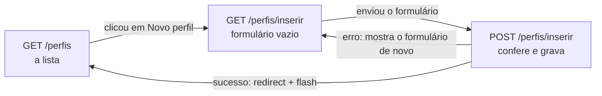

# Capítulo 12 — INSERT e SELECT de perfis

**Disciplina:** Programação para Internet (ILP951)
**Professor:** Ronan Adriel Zenatti · ronan.zenatti@cps.sp.gov.br
**Fatec Jahu — 2º Semestre/2026**

---

## 🎯 Objetivos do Capítulo

Ao final deste capítulo você deverá ser capaz de:

- Listar os perfis do banco em uma tabela do Bootstrap com `SELECT`, já com todas as colunas, a data formatada e a coluna de ações
- Criar um formulário de cadastro centralizado, protegido pelo token CSRF
- Escrever todas as validações de um cadastro em um arquivo próprio (`validacoes/validacoes_perfil.py`), que devolve a lista de erros
- Gravar um perfil com `INSERT` parametrizado, guardando `NULL` quando o campo opcional vem vazio (`or None`)
- Aplicar o padrão PRG, avisar o resultado com `flash` e tratar o nome repetido (consulta antes e erro `1062` do banco)
- Cadastrar os perfis **Administrador**, **Gerente** e **Usuário**, que o sistema usa até o fim do projeto

O Capítulo 11 deixou o Projeto 2 de pé: banco `gestao` com as três tabelas vazias, `db.py` com as funções `execute_*`, os dois layouts (com menu e limpo, já com o bloco de mensagens), a proteção CSRF ligada, o login provisório e o dashboard. Falta o sistema **fazer** alguma coisa com elas. Este capítulo é o primeiro CRUD do projeto, e só a metade dele: **ler** (`SELECT`) e **criar** (`INSERT`) perfis. Alterar e excluir ficam para o Capítulo 13. Um perfil é o papel de quem usa o sistema (quem administra, quem gerencia, quem apenas consulta), e cada usuário do Capítulo 14 pertencerá a **um** deles. Quase tudo o que você vê aqui já apareceu no Projeto 1 (formulário, CSRF, validação, `flash`, PRG, `execute_*`), então cada etapa traz o link para a explicação completa. O que muda é a organização: cada arquivo é escrito **de uma vez**, completo e comentado, e depois explicado parte por parte.

## 📦 Ponto de partida

Este capítulo continua do **seu** repositório `sistema-gestao`, como ficou no fim do Capítulo 11: com o `app.py`, o `db.py`, o `testar_conexao.py`, o `banco.sql`, o `.env.example`, o `.gitignore`, o `requirements.txt`, a pasta `templates` (a subpasta `layout`, com `base_menu.html` e `base_limpa.html`, mais `login.html`, `dashboard.html`, `404.html` e `500.html`) e a pasta `static` (`estilo.css`). O `.env` também precisa existir, com o banco `gestao`.

Se o seu projeto não está funcionando, baixe o código do Capítulo 11 e descompacte. Depois de descompactar, crie o ambiente virtual e o `.env`, como no [Capítulo 11, Tópico 4](Capitulo_11_Projeto_Novo_e_Banco.md#topico-4-o-arquivo-env), e importe o `banco.sql` no phpMyAdmin, como no [Tópico 3 do mesmo capítulo](Capitulo_11_Projeto_Novo_e_Banco.md#topico-3-o-banco-gestao):

➡️ [Baixar p2_cap_11.zip](../arquivos/p2_cap_11.zip)

```bash
python -m venv venv
venv\Scripts\activate
pip install -r requirements.txt
copy .env.example .env
```

---

## Tópico 1 — A lista de perfis (SELECT)

### Antes de começar

Ligue o **Apache** e o **MySQL** no painel do XAMPP. Abra a pasta `sistema-gestao` no VS Code, o terminal (`Ctrl + '`), ative o ambiente virtual e confira o Git:

```bash
venv\Scripts\activate
git status
```

O `git status` deve dizer `nothing to commit, working tree clean`. Ligue o servidor com `python app.py`, deixe esse terminal rodando durante o capítulo (use um segundo terminal, o ícone **+**, para o Git e para os testes) e abra **http://127.0.0.1:5000**: o sistema leva para a tela de login. Clique em **Entrar** e, no dashboard, os três cartões mostram **0**.

### O mapa do recurso

Um **recurso** é a "coisa" que o sistema cadastra e consulta. Aqui, o perfil. Os três recursos do projeto (perfis, usuários e produtos) seguem o mesmo molde de nomes, e vale conhecê-lo agora:

| Rota | Métodos | O que faz | Função no `app.py` | Template |
|---|---|---|---|---|
| `/perfis` | GET | Lista os perfis | `listar_perfis` | `perfis/perfis_lista.html` |
| `/perfis/inserir` | GET e POST | GET mostra o formulário, POST confere e grava | `inserir_perfil` | `perfis/perfil_form.html` |

As duas funções têm nome de **ação**, com o verbo no infinitivo na frente: `listar_perfis` lista, `inserir_perfil` insere. O Capítulo 13 acrescenta as rotas de editar e excluir (`editar_perfil` e `excluir_perfil`). O caminho que o navegador percorre neste capítulo é este:



Repare que o `POST` com erro **volta para o formulário** (sem `redirect`) e o `POST` bem-sucedido **redireciona** para a lista. É o que você aprendeu no [Capítulo 9](Capitulo_09_Validacao_e_Flash.md#topico-3-validando-o-nome-uma-funcao-por-campo) e no [padrão PRG do Capítulo 7](Capitulo_07_Formularios.md#o-padrao-prg).

### A rota que lê o banco

No `app.py`, troque a linha de importação do `db` para trazer também o `execute_query`:

```python
from db import execute_one, execute_query
```

E acrescente uma seção nova, **PERFIS**, entre a seção das páginas principais e a das telas de erros, com a rota `listar_perfis`:

```python
# ==============================================================================
# PERFIS
# ==============================================================================

@app.route('/perfis')
def listar_perfis():
    # Busca a lista de perfis na tabela do banco
    perfis = execute_query(
        'SELECT id_perfil, nome, descricao, criado_em FROM perfis ORDER BY nome',
        fetch=True,
    )

    return render_template('perfis/perfis_lista.html', titulo='Perfis', perfis=perfis)
```

O `SELECT` já traz as quatro colunas que a tabela vai mostrar: o código, o nome, a descrição e a data de criação (`criado_em`, que o próprio banco preenche ao gravar, como você viu no `banco.sql`). O `fetch=True` diz ao `execute_query` que é um `SELECT` e que ele deve devolver a **lista de linhas**, cada uma como um dicionário (Capítulo 11, Tópico 5). O `ORDER BY nome` deixa os perfis em ordem alfabética. A lista pode vir **vazia**, e é isso que vai acontecer agora, porque o banco ainda não tem nenhum perfil.

### A tabela, com todas as colunas

Crie a pasta `templates/perfis` e, dentro dela, o `perfis_lista.html`:

```html


{{ titulo }} — Sistema de Gestão


  <h1 class="h2 mb-3">{{ titulo }}</h1>

  <table class="table table-striped table-hover align-middle">
    <thead class="table-light">
      <tr>
        <th>Código</th>
        <th>Nome</th>
        <th>Descrição</th>
        <th>Criado em</th>
        <th class="text-end">Ações</th>
      </tr>
    </thead>
    <tbody>
      
      <tr>
        <td>{{ perfil.id_perfil }}</td>
        <td>{{ perfil.nome }}</td>
        <td>{{ perfil.descricao if perfil.descricao else '—' }}</td>
        <td>{{ perfil.criado_em.strftime('%d/%m/%Y %H:%M') }}</td>
        <td class="text-end text-nowrap">
          <a href="#" class="btn btn-sm btn-warning" title="Editar"><i class="bi bi-pencil-square"></i></a>
          <button type="button" class="btn btn-sm btn-danger" title="Excluir"><i class="bi bi-trash"></i></button>
        </td>
      </tr>
      
      <tr>
        <td colspan="5" class="text-center text-body-secondary py-4">Nenhum perfil cadastrado ainda.</td>
      </tr>
      
    </tbody>
  </table>

```

Salve e abra **http://127.0.0.1:5000/perfis**. A tabela aparece com o cabeçalho e a mensagem **Nenhum perfil cadastrado ainda.** Ainda não há link no menu para chegar aqui: por enquanto, a página é aberta pelo endereço. Cada coluna tem um detalhe:

- **O `` do `for`** ([Capítulo 5](Capitulo_05_Variaveis_Filtros_If_e_For.md#quando-a-lista-esta-vazia-o-else-do-for)) só roda quando a lista está vazia, que é exatamente o caso de um banco recém-criado. Todo sistema novo começa assim, e a tela precisa dizer isso em vez de mostrar uma tabela sem explicação. O `colspan="5"` faz essa célula ocupar as cinco colunas.
- **A descrição** usa um **`if` em uma linha**, explicado logo abaixo. A coluna `descricao` aceita `NULL`, e um perfil sem descrição chegaria ao template como `None`. Sem o `if`, o Jinja escreveria a palavra **None** na tela.
- **O "Criado em"** formata a data com o `strftime`, explicado logo abaixo.
- **As ações** são dois botões pequenos (`btn-sm`): o **amarelo** (`btn-warning`), com o ícone de lápis, vai editar o perfil, e o **vermelho** (`btn-danger`), com o ícone de lixeira, vai excluí-lo. Os ícones vêm dos Bootstrap Icons, que o `base_menu.html` já carrega desde o Capítulo 11. Por enquanto os dois **não fazem nada** (o `href="#"` não leva a lugar nenhum e o botão não tem ação): eles ganham a rota de edição e a de exclusão no Capítulo 13. O `title` mostra o nome do botão quando o mouse para em cima, e o `text-nowrap` impede que os dois quebrem em duas linhas.
- **O `align-middle`** na tabela centraliza o texto na vertical, para ele ficar alinhado com os botões.

!!! note "Jinja: o `if` em uma linha (operador ternário)"
    `{{ A if condição else B }}` escreve **A** quando a condição é verdadeira e **B** quando é falsa. É o mesmo `if/else` do Capítulo 5, só que dentro do `{{ }}` e em uma linha só, para escolher **um valor**. Em `{{ perfil.descricao if perfil.descricao else '—' }}`, um texto conta como verdadeiro e o `None` (ou um texto vazio) conta como falso: com descrição, aparece a descrição; sem, aparece um traço. O Python tem o mesmo formato: `texto = descricao if descricao else '—'`.

!!! note "Python: a data e o `strftime`"
    As colunas `TIMESTAMP` e `DATETIME` chegam ao Python como objetos de data e hora (`datetime`). Sem formatação, o Jinja mostraria `2026-11-03 10:15:42`, no formato do banco. O método `strftime` recebe um **modelo** e devolve o texto formatado: `%d` é o dia, `%m` o mês, `%Y` o ano com quatro dígitos, `%H` a hora e `%M` os minutos. Com `'%d/%m/%Y %H:%M'`, aparece `03/11/2026 10:15`. A hora fica na tela de propósito: num sistema, saber **quando** um registro foi criado ajuda a rastrear o que aconteceu.

### O menu Perfis

No `templates/layout/base_menu.html`, acrescente o menu suspenso **Perfis** logo depois do item **Home**, dentro do primeiro `<ul class="navbar-nav me-auto">`:

```html
<li class="nav-item dropdown">
  <a class="nav-link dropdown-toggle active" href="#" role="button" data-bs-toggle="dropdown" aria-expanded="false">Perfis</a>
  <ul class="dropdown-menu">
    <li><a class="dropdown-item" href="{{ url_for('listar_perfis') }}">Listar Perfis</a></li>
  </ul>
</li>
```

Um **menu suspenso** (dropdown) do Bootstrap é um item do menu que abre uma lista de links quando é clicado. O `<li class="nav-item dropdown">` é o item inteiro, o `<a class="nav-link dropdown-toggle" data-bs-toggle="dropdown">` é o botão que abre a lista, e o `<ul class="dropdown-menu">` guarda os links, cada um com a classe `dropdown-item`. O `href="#"` do botão é só um marcador: quem manda é o `data-bs-toggle`.

O `request.endpoint` é o nome da função da rota que atendeu o pedido (Capítulo 6), e o `in [...]` pergunta se ele está na lista. Assim o botão **Perfis** fica destacado quando qualquer página de perfis está aberta. Salve, recarregue e use **Perfis > Listar Perfis** no menu.

Registre este ponto no Git:

```bash
git add .
git commit -m "Adiciona a lista de perfis e o menu Perfis"
git push
```

---

## Tópico 2 — O formulário de novo perfil

### A rota, por enquanto só mostrando o formulário

No `app.py`, na seção **PERFIS**, acrescente a rota `inserir_perfil` depois da `listar_perfis`:

```python
@app.route('/perfis/inserir', methods=['GET', 'POST'])
def inserir_perfil():
    # Inicializa variáveis para cada campo do formulário
    nome = ''
    descricao = ''

    return render_template('perfis/perfil_form.html', nome=nome, descricao=descricao)
```

O `methods=['GET', 'POST']` faz a mesma função atender os dois pedidos, como no [Capítulo 7](Capitulo_07_Formularios.md#topico-3-formulario-post-a-pagina-de-contato). Por enquanto ela trata os dois do mesmo jeito: mostra o formulário. As variáveis `nome` e `descricao` já existem para o template poder **devolver o que a pessoa digitou** quando houver erro, como no Capítulo 9. No primeiro acesso, elas estão vazias.

### O template do formulário

Crie o `templates/perfis/perfil_form.html`:

```html


Novo perfil — Sistema de Gestão


<h1 class="h2 mb-4">Novo perfil</h1>

<div class="row justify-content-center">
    <div class="col-lg-6">
        <div class="card">
            <div class="card-body">

                <form action="{{ url_for('inserir_perfil') }}" method="post">
                    <input type="hidden" name="csrf_token" value="{{ csrf_token() }}">
                    <div class="mb-3">
                        <label for="nome" class="form-label">Nome do perfil</label>
                        <input type="text" class="form-control" id="nome" name="nome" placeholder="Ex.: Administrador"
                            value="{{ nome }}" required minlength="3" maxlength="100">
                    </div>

                    <div class="mb-3">
                        <label for="descricao" class="form-label">Descrição (opcional)</label>
                        <input type="text" class="form-control" id="descricao" name="descricao"
                            placeholder="Ex.: Acesso total ao sistema" value="{{ descricao or '' }}" maxlength="255">
                            <!-- ADICIONAR or '' EM TODO CAMPO QUE NÃO É OBRIGATÓRIO -->
                    </div>

                    <div class="d-flex justify-content-between gap-2">
                        <a href="{{ url_for('listar_perfis') }}" class="btn btn-outline-secondary">Cancelar</a>
                        <button type="submit" class="btn btn-primary">Salvar perfil</button>
                    </div>

                </form>

            </div>
        </div>
    </div>
</div>

```

Abra **http://127.0.0.1:5000/perfis/inserir** e confira. Parte por parte:

- **A centralização.** O `<div class="row justify-content-center">` é uma linha da grade do Bootstrap que coloca as colunas no **centro**, e o `<div class="col-lg-6">` é uma coluna com metade da largura no computador (6 de 12). Juntas, deixam o cartão do formulário no meio da tela. No celular, a coluna ocupa a largura toda. Todos os formulários do projeto seguem esse molde.
- **O token CSRF.** A primeira linha dentro do `<form>` é o campo escondido com o token, o mesmo do [Capítulo 8, Tópico 5](Capitulo_08_Session.md#topico-5-csrf-o-formulario-precisa-provar-que-e-o-seu). O `CSRFProtect` está ligado desde o Capítulo 11, então **todo** formulário POST deste projeto leva essa linha. Sem ela, o envio é recusado com o erro 400.
- **O nome** é obrigatório (`required`) e tem os limites do banco: no mínimo 3 caracteres e no máximo 100, porque a coluna é `VARCHAR(100)`. O `value="{{ nome }}"` devolve o que a pessoa digitou quando houver erro.
- **A descrição** é opcional: **não** tem `required`, porque a coluna `descricao` aceita `NULL`. É a regra do projeto: o que é `NOT NULL` no banco é obrigatório no formulário, e o que aceita `NULL` é opcional. O limite de 255 vem do `VARCHAR(255)`.
- **O `or ''` no `value` da descrição.** No próximo tópico, um campo opcional deixado em branco vai virar `None` no Python (para o banco gravar `NULL`). Sem o `or ''`, o Jinja escreveria a palavra **None** dentro da caixa de texto. O `or ''` diz: "se não houver valor, escreva vazio". Por isso o comentário: **todo campo que não é obrigatório leva `or ''`** no `value`. O nome é obrigatório e nunca chega como `None`, então dispensa.
- **Os botões.** O `d-flex justify-content-between` empurra o primeiro botão para a esquerda e o último para a direita: o **Cancelar** (um link de volta para a lista) fica à esquerda, e o **Salvar** fica à direita, onde a pessoa termina de ler o formulário. Todos os formulários do projeto têm os botões nessa posição.

Digite `Teste` no nome e clique em **Salvar perfil**: a página recarrega **vazia**. É esperado: a rota ainda ignora o que chega pelo POST. Para ver a proteção CSRF agindo, abra o `F12`, clique com o botão direito na linha `<input type="hidden" name="csrf_token" ...>` (aba **Elements**), escolha **Delete element** e envie de novo: aparece `Bad Request — The CSRF token is missing.` Recarregue a página para o token voltar.

### Os dois caminhos até o formulário

Agora que a rota `inserir_perfil` existe, a lista e o menu podem levar até ela.

**Na lista.** Abra o `templates/perfis/perfis_lista.html` e procure a linha do título, logo depois do ``:

```html
<h1 class="h2 mb-3">{{ titulo }}</h1>
```

Troque **só essa linha** por um cabeçalho com o título à esquerda e o botão **Novo perfil** à direita:

```html
<div class="d-flex justify-content-between align-items-center mb-3">
  <h1 class="h2 mb-0">{{ titulo }}</h1>
  <a href="{{ url_for('inserir_perfil') }}" class="btn btn-primary">Novo perfil</a>
</div>
```

**No menu.** Abra o `templates/layout/base_menu.html` e procure o bloco do menu **Perfis** que você criou no Tópico 1 (use `Ctrl+F` e busque por `Listar Perfis`). Há **duas** alterações nele, uma dentro do `<ul class="dropdown-menu">` e outra no botão que abre a lista.

**Primeira alteração: o link novo.** Acrescente o segundo link do menu **Perfis** dentro do `<ul class="dropdown-menu">`, logo **depois** da linha do **Listar Perfis**:

```html
<li><a class="dropdown-item" href="{{ url_for('inserir_perfil') }}">Cadastrar Perfil</a></li>
```

**Segunda alteração: a lista do `request.endpoint`.** Sem ela, o link funciona, mas o botão **Perfis** apagaria ao abrir o formulário, porque o `request.endpoint` ali vale `'inserir_perfil'`, e esse nome ainda não está na lista. Na primeira linha do bloco, a do `<a class="nav-link dropdown-toggle ...>`, inclua `'inserir_perfil'` dentro dos colchetes do `in [...]`, separado do anterior por vírgula. Troque só o trecho do ``; o resto da linha fica igual:

```html
active
```

por:

```html
active
```

Com as duas alterações, o bloco inteiro do menu **Perfis** fica assim:

```html
<li class="nav-item dropdown">
  <a class="nav-link dropdown-toggle active" href="#" role="button" data-bs-toggle="dropdown" aria-expanded="false">Perfis</a>
  <ul class="dropdown-menu">
    <li><a class="dropdown-item" href="{{ url_for('listar_perfis') }}">Listar Perfis</a></li>
    <li><a class="dropdown-item" href="{{ url_for('inserir_perfil') }}">Cadastrar Perfil</a></li>
  </ul>
</li>
```

Salve, abra **Perfis > Listar Perfis** e clique em **Novo perfil**; depois use **Perfis > Cadastrar Perfil**. Os dois levam ao formulário, e ele abre com o botão **Perfis** destacado, como na lista.

```bash
git add .
git commit -m "Adiciona o formulário de novo perfil e os links até ele"
git push
```

---

## Tópico 3 — As validações em um arquivo próprio

### Por que um arquivo só para elas

Antes de gravar, o servidor precisa **conferir** o que chegou, como no [Capítulo 9](Capitulo_09_Validacao_e_Flash.md): o `required` e o `maxlength` do HTML são só um conforto para quem preenche, e qualquer pessoa pode desligá-los pelo `F12`. Desta vez as conferências não ficam no `app.py`. Cada tabela do projeto terá o **seu** arquivo de validações, dentro de uma pasta `validacoes`: o de perfis agora, o de usuários no Capítulo 14 e o de produtos no 18. Cada arquivo tem **uma função principal** que recebe os dados do formulário e devolve a **lista de erros**: vazia quando está tudo certo. Assim o `app.py` fica curto, só com o caminho do pedido, e as regras ficam todas num lugar só.

### O arquivo `validacoes_perfil.py`

Crie a pasta `validacoes` **na raiz do projeto**, ao lado do `app.py`, e dentro dela o arquivo `validacoes_perfil.py`:

```python
from db import execute_one


def validar_perfil(nome, descricao):
    erros = []

    # ================ VALIDAÇÕES PARA O CAMPO nome =====================
    if not nome:
        erros.append('Informe o nome do perfil.')
    elif len(nome) < 3:
        erros.append('O nome deve ter pelo menos 3 caracteres.')
    elif len(nome) > 100:
        erros.append('O nome deve ter no máximo 100 caracteres.')

    # ================ VALIDAÇÕES PARA O CAMPO descricao =====================
    # Como descricao pode ser None, checamos antes de usar len()
    if descricao and len(descricao) > 255:
        erros.append('A descrição deve ter no máximo 255 caracteres.')

    # ================ NOME REPETIDO (CONSULTA AO BANCO) =====================
    # Se as regras básicas passaram, checa unicidade no banco de dados
    if not erros:
        existente = execute_one('SELECT id_perfil FROM perfis WHERE nome = %s', (nome,))

        if existente:
            erros.append('Já existe um perfil com este nome.')

    return erros
```

A função começa com a lista `erros` vazia e, a cada regra que falha, acrescenta uma mensagem com o `append`. No fim, devolve a lista inteira, para quem preenche ver **todos** os problemas de uma vez, como no [Capítulo 9](Capitulo_09_Validacao_e_Flash.md#topico-4-categoria-preco-e-varios-erros-de-uma-vez). Os comentários com `=====` separam as seções do arquivo, uma por campo. Seção por seção:

1. **O nome.** O `if not nome` é verdadeiro quando o nome está vazio (um texto vazio conta como falso, e o `not` inverte). O `elif` ("senão, se") só é testado quando o anterior falhou: com o nome vazio, não faz sentido reclamar também do tamanho, então cada nome recebe **no máximo uma** mensagem. Os limites 3 e 100 são os mesmos do `minlength`, do `maxlength` e do `VARCHAR(100)`.
2. **A descrição.** Ela é opcional e, como você vai ver no próximo tópico, chega aqui como `None` quando fica em branco. O `len(None)` daria erro, por isso o `if descricao and len(descricao) > 255`: o `and` só calcula o `len` quando a descrição existe. Vazia, não há o que conferir.
3. **O nome repetido.** A coluna `nome` é `UNIQUE` no banco: dois perfis não podem ter o mesmo nome. Antes de gravar, a função **pergunta ao banco** se o nome já existe. O `if not erros:` só faz essa consulta quando as regras de cima passaram, para não gastar uma ida ao banco com um nome que já é inválido. O `execute_one` devolve a linha encontrada (um dicionário, que conta como verdadeiro) ou `None`, e a tupla `(nome,)` tem a vírgula que o Python exige para uma tupla de um item só. O banco usa a ordenação `utf8mb4_unicode_ci`, que ignora maiúsculas e acentos na comparação: `Gerente` e `gerente` contam como o mesmo nome.

!!! note "Python: o seu próprio arquivo é um módulo"
    Todo arquivo `.py` é um **módulo** e pode ser importado por outro. Quando ele está dentro de uma pasta, o nome da pasta vem na frente, separado por ponto: `from validacoes.validacoes_perfil import validar_perfil` abre o arquivo `validacoes/validacoes_perfil.py` e traz dele a função, para usá-la como se tivesse sido escrita ali. É o mesmo `from ... import ...` que você usa com o `db` (`from db import execute_one`), e o próprio `validacoes_perfil.py` faz isso na primeira linha, para consultar o banco. Os nomes de pastas e módulos do projeto não levam acento nem espaço.

Teste a função antes de usá-la, no segundo terminal, com o `venv` ativo e na pasta do projeto:

```bash
python -c "from validacoes.validacoes_perfil import validar_perfil; print(validar_perfil('', None))"
python -c "from validacoes.validacoes_perfil import validar_perfil; print(validar_perfil('ab', 'a' * 256))"
python -c "from validacoes.validacoes_perfil import validar_perfil; print(validar_perfil('Gerente', None))"
```

O primeiro imprime `['Informe o nome do perfil.']`, o segundo imprime as **duas** mensagens (nome curto e descrição longa) e o terceiro imprime `[]`, a lista vazia: está tudo certo, e o banco ainda não tem nenhum `Gerente`.

```bash
git add .
git commit -m "Cria o arquivo de validações de perfil"
git push
```

---

## Tópico 4 — Receber, conferir e gravar (INSERT e PRG)

### A rota completa

Agora a rota `inserir_perfil` passa a tratar o POST: lê os campos, chama a validação e, se estiver tudo certo, grava no banco. No `app.py`, troque as importações do começo do arquivo por estas (o Flask ganha o `flash` e o `request`; o `db`, o `execute_insert`; e entram o tipo de erro do conector e a sua função de validação):

```python
from flask import Flask, flash, redirect, render_template, request, url_for
from flask_wtf.csrf import CSRFProtect
from mysql.connector import Error

from db import execute_insert, execute_one, execute_query
from validacoes.validacoes_perfil import validar_perfil
```

Os nomes dentro de cada importação estão em ordem alfabética: assim fica fácil ver se um já está lá. Agora troque a rota `inserir_perfil` inteira por esta:

```python
@app.route('/perfis/inserir', methods=['GET', 'POST'])
def inserir_perfil():
    # Inicializa variáveis para cada campo do formulário
    nome = ''
    descricao = ''

    # Executado apenas no envio do formulário (POST)
    if request.method == 'POST':
        # 1. Coleta os dados do formulário
        nome = request.form.get('nome', '').strip()

        # 'or None' garante que string vazia vire None (gravado como NULL no MySQL)
        descricao = request.form.get('descricao', '').strip() or None

        # -------------------------------------------------------------------------
        # 2. Validação dos campos
        erros = validar_perfil(nome, descricao)

        # 3. Se houver erros, exibe as mensagens
        if erros:
            for mensagem in erros:
                flash(mensagem, 'danger')

        # -------------------------------------------------------------------------
        # 4. Se não houver erros, tenta salvar no banco
        else:
            try:
                novo_id = execute_insert(
                    'INSERT INTO perfis (nome, descricao) VALUES (%s, %s)',
                    (nome, descricao),
                )

                flash(f'Perfil "{nome}" cadastrado (código {novo_id}).', 'success')
                return redirect(url_for('listar_perfis'))

            # Trata concorrência (duplicidade no momento do insert)
            except Error as erro:
                if erro.errno == 1062:
                    flash('Já existe um perfil com este nome.', 'danger')
                else:
                    # Com o raise: Se o MySQL cair, o cabo de rede desconectar ou houver um erro de
                    # sintaxe no SQL, o Python interrompe a execução imediatamente e mostra o
                    # Traceback com o erro real no console/log.
                    raise

    # Exibe a tela em caso de GET ou se houver erros (de validação ou de nome repetido)
    return render_template('perfis/perfil_form.html', nome=nome, descricao=descricao)
```

Os comentários numerados são o roteiro de **todo** cadastro deste projeto: coletar, validar, mostrar os erros ou salvar. Siga-os na ordem.

**1. Coletar.** O `request.form.get('nome', '')` e o `.strip()` são os do Capítulo 9: o campo ausente vira `''` em vez de erro 400, e os espaços das pontas somem (um nome com três espaços vira `''` e cai no "Informe o nome"). A descrição ganha o `or None` no fim, explicado na caixa abaixo: um campo opcional deixado em branco chega como `''` (texto vazio), mas no banco o jeito certo de dizer "sem valor" é o **`NULL`**. A regra do projeto: campo opcional vazio vira `NULL`, nunca `''`. O `None` é o valor do Python para "nada", e o conector o grava como `NULL`.

**2. Validar.** Uma linha só: a função do Tópico 3 devolve a lista de erros.

**3. Mostrar os erros.** Cada mensagem vira um `flash` vermelho (`danger`), que o bloco de mensagens do layout desenha. A rota não faz `redirect`: ela cai no `render_template` do fim, que devolve o formulário com o `nome` e a `descricao` que a pessoa digitou.

**4. Salvar.** O `execute_insert` (Capítulo 11) executa o `INSERT` e devolve o `id` que o `AUTO_INCREMENT` gerou. Os `%s` recebem os valores da tupla como **dados**, nunca como pedaço do comando. Depois de gravar vem o **PRG**: o `flash` verde e o `redirect` para a lista. Se a rota desenhasse a página em vez de redirecionar, um `F5` reenviaria o formulário e cadastraria o perfil de novo.

**O `try/except` e o erro 1062.** A validação já perguntou ao banco se o nome existe, mas entre essa pergunta e o `INSERT` passa um instante. Se duas pessoas cadastrarem `Supervisor` ao mesmo tempo, as duas perguntas respondem "não existe", e o banco, que tem a coluna `UNIQUE`, recusa o segundo `INSERT` com o erro **1062** ("valor repetido"). O `try` tenta gravar; se o banco recusar, o `except Error as erro` captura o erro, e o `erro.errno` diz qual foi. Sendo o `1062`, a pessoa vê a mesma mensagem da validação e o formulário volta com o que ela digitou. Sendo **outro** erro (banco desligado, SQL errado), o `raise` o deixa seguir, e ele aparece como uma falha de verdade (a página 500), em vez de ficar escondido. Em resumo: a consulta da validação dá a mensagem amigável no caso comum, e o `UNIQUE` do banco é a garantia final.

!!! note "Python: o `or` que escolhe um valor"
    O `or` não serve só para condições. Em `valor = texto or None`, o Python olha o que está à esquerda: se for um texto com conteúdo, o resultado é esse texto; se for um texto vazio (que conta como falso), o resultado é o que está à direita, o `None`. Assim, `'Gerente' or None` dá `'Gerente'`, e `'' or None` dá `None`. É o mesmo truque do `{{ descricao or '' }}` do template, só que ao contrário: no Python o vazio vira `None` para o banco, e no template o `None` vira vazio para a tela.

!!! note "Python: `except Error as erro` e o `errno`"
    O `except Error` captura qualquer erro do conector MySQL (o `Error` vem do `from mysql.connector import Error`, o mesmo que o `db.py` usa). O `as erro` dá um **nome** ao erro capturado, para a rota poder examiná-lo, e todo erro do banco traz o atributo `errno`, o número do erro do MySQL (`1062`, `1451`, `1146`...). Um `raise` sozinho, dentro do `except`, repete o erro que acabou de ser capturado.

Repare no desenho do `try`: o `return redirect(...)` fica **dentro** dele, logo depois de gravar. Quando o `INSERT` dá certo, a rota termina ali. Quando dá o `1062`, o `except` mostra o aviso e a rota **cai** no `render_template` do final, devolvendo o formulário sem `redirect`.

| Situação | Quem trata | O que a pessoa vê |
|---|---|---|
| Nome vazio, curto ou longo demais | `validar_perfil` | Faixa vermelha com a regra |
| Nome já existe (caso comum) | `validar_perfil`, com o `SELECT` | Faixa vermelha: "Já existe um perfil com este nome." |
| Nome já existe (dois cadastros simultâneos) | `UNIQUE` do banco, erro `1062` capturado | A mesma faixa vermelha |
| Qualquer outro erro do banco | Ninguém na rota (o `raise` repete) | A página 500 |

### Testando

Salve e teste, nesta ordem:

1. **Um nome com três espaços**: a faixa vermelha diz `Informe o nome do perfil.` O `required` do HTML não percebe, porque espaços contam como texto; o `.strip()` do servidor percebe.
2. **O primeiro perfil**: nome `Administrador`, descrição `Acesso total ao sistema`. Você cai na lista com a faixa verde (`Perfil "Administrador" cadastrado (código 1).`, ou outro número, se o banco já gerou códigos antes), e o perfil aparece na tabela, com a data e a hora em que foi criado. Aperte `F5`: a faixa some e nada é cadastrado de novo. Volte ao **Home** pelo menu: o cartão de perfis mostra **1**.
3. **Um perfil sem descrição**: nome `Gerente`, descrição em branco. Na lista, a célula da descrição mostra o traço `—` do `if` em uma linha. Abra o **phpMyAdmin**, o banco `gestao`, a tabela `perfis` e a aba **Procurar** (*Browse*): a descrição do Gerente aparece como `NULL`, em itálico, e não como um texto vazio. As colunas `criado_em` e `atualizado_em` foram preenchidas pelo próprio banco, sem nenhuma linha de Python.
4. **Um nome repetido**: cadastre `gerente`, tudo minúsculo. A faixa vermelha diz `Já existe um perfil com este nome.` e o formulário mantém o que foi digitado.
5. **Vários erros de uma vez**: nome `ab` com uma descrição qualquer gera uma faixa vermelha. Para ver as duas juntas, tire o `maxlength` da descrição pelo `F12` (aba **Elements**, **Edit as HTML**), como no Capítulo 9, e envie 256 caracteres. O servidor não depende do HTML: a mesma conferência vale para quem desligar o `required` ou o `maxlength`.

### Os três perfis do sistema

Cadastre agora o que falta e confira a lista. O **nome** precisa ser exatamente este, com a mesma grafia e acento, porque os capítulos seguintes procuram o perfil por ele:

| Nome | Descrição sugerida |
|---|---|
| `Administrador` | Acesso total ao sistema (já cadastrado) |
| `Gerente` | (cadastrado sem descrição, no teste acima) |
| `Usuário` | Acesso básico ao sistema |

Ao final, a lista tem **três** perfis em ordem alfabética: Administrador, Gerente e Usuário. O Gerente fica sem descrição por enquanto. O Capítulo 13 ensina a alterar um perfil já cadastrado.

```bash
git add .
git commit -m "Grava o perfil no banco com INSERT, PRG e tratamento do nome repetido"
git push
```

---

## Os arquivos completos do capítulo

O `app.py`:

```python
import os

from dotenv import load_dotenv
from flask import Flask, flash, redirect, render_template, request, url_for
from flask_wtf.csrf import CSRFProtect
from mysql.connector import Error

from db import execute_insert, execute_one, execute_query
from validacoes.validacoes_perfil import validar_perfil

load_dotenv()

app = Flask(__name__)
app.secret_key = os.getenv('SECRET_KEY')

# Liga a proteção CSRF: todo formulário POST do sistema vai precisar do token
CSRFProtect(app)


# ==============================================================================
# PÁGINAS PRINCIPAIS
# ==============================================================================

@app.route('/')
def index():
    # A raiz não mostra nada: só leva para a tela de login
    return redirect(url_for('login'))


@app.route('/login')
def login():
    return render_template('login.html')


@app.route('/dashboard')
def dashboard():
    # Conta as linhas de cada tabela para os cartões da Home
    perfis = execute_one('SELECT COUNT(*) AS total FROM perfis')
    usuarios = execute_one('SELECT COUNT(*) AS total FROM usuarios')
    produtos = execute_one('SELECT COUNT(*) AS total FROM produtos')

    return render_template('dashboard.html', titulo='Sistema de Gestão',
                           total_perfis=perfis['total'],
                           total_usuarios=usuarios['total'],
                           total_produtos=produtos['total'])


# ==============================================================================
# PERFIS
# ==============================================================================

@app.route('/perfis')
def listar_perfis():
    # Busca a lista de perfis na tabela do banco
    perfis = execute_query(
        'SELECT id_perfil, nome, descricao, criado_em FROM perfis ORDER BY nome',
        fetch=True,
    )

    return render_template('perfis/perfis_lista.html', titulo='Perfis', perfis=perfis)


@app.route('/perfis/inserir', methods=['GET', 'POST'])
def inserir_perfil():
    # Inicializa variáveis para cada campo do formulário
    nome = ''
    descricao = ''

    # Executado apenas no envio do formulário (POST)
    if request.method == 'POST':
        # 1. Coleta os dados do formulário
        nome = request.form.get('nome', '').strip()

        # 'or None' garante que string vazia vire None (gravado como NULL no MySQL)
        descricao = request.form.get('descricao', '').strip() or None

        # -------------------------------------------------------------------------
        # 2. Validação dos campos
        erros = validar_perfil(nome, descricao)

        # 3. Se houver erros, exibe as mensagens
        if erros:
            for mensagem in erros:
                flash(mensagem, 'danger')

        # -------------------------------------------------------------------------
        # 4. Se não houver erros, tenta salvar no banco
        else:
            try:
                novo_id = execute_insert(
                    'INSERT INTO perfis (nome, descricao) VALUES (%s, %s)',
                    (nome, descricao),
                )

                flash(f'Perfil "{nome}" cadastrado (código {novo_id}).', 'success')
                return redirect(url_for('listar_perfis'))

            # Trata concorrência (duplicidade no momento do insert)
            except Error as erro:
                if erro.errno == 1062:
                    flash('Já existe um perfil com este nome.', 'danger')
                else:
                    # Com o raise: Se o MySQL cair, o cabo de rede desconectar ou houver um erro de
                    # sintaxe no SQL, o Python interrompe a execução imediatamente e mostra o
                    # Traceback com o erro real no console/log.
                    raise

    # Exibe a tela em caso de GET ou se houver erros (de validação ou de nome repetido)
    return render_template('perfis/perfil_form.html', nome=nome, descricao=descricao)


# ==============================================================================
# TELAS DE ERROS
# ==============================================================================

@app.errorhandler(404)
def pagina_nao_encontrada(erro):
    return render_template('404.html'), 404


@app.errorhandler(500)
def erro_no_servidor(erro):
    return render_template('500.html'), 500


if __name__ == '__main__':
    app.run(debug=True)
```

O `validacoes/validacoes_perfil.py`:

```python
from db import execute_one


def validar_perfil(nome, descricao):
    erros = []

    # ================ VALIDAÇÕES PARA O CAMPO nome =====================
    if not nome:
        erros.append('Informe o nome do perfil.')
    elif len(nome) < 3:
        erros.append('O nome deve ter pelo menos 3 caracteres.')
    elif len(nome) > 100:
        erros.append('O nome deve ter no máximo 100 caracteres.')

    # ================ VALIDAÇÕES PARA O CAMPO descricao =====================
    # Como descricao pode ser None, checamos antes de usar len()
    if descricao and len(descricao) > 255:
        erros.append('A descrição deve ter no máximo 255 caracteres.')

    # ================ NOME REPETIDO (CONSULTA AO BANCO) =====================
    # Se as regras básicas passaram, checa unicidade no banco de dados
    if not erros:
        existente = execute_one('SELECT id_perfil FROM perfis WHERE nome = %s', (nome,))

        if existente:
            erros.append('Já existe um perfil com este nome.')

    return erros
```

O `templates/perfis/perfis_lista.html`:

```html


{{ titulo }} — Sistema de Gestão


  <div class="d-flex justify-content-between align-items-center mb-3">
    <h1 class="h2 mb-0">{{ titulo }}</h1>
    <a href="{{ url_for('inserir_perfil') }}" class="btn btn-primary">Novo perfil</a>
  </div>

  <table class="table table-striped table-hover align-middle">
    <thead class="table-light">
      <tr>
        <th>Código</th>
        <th>Nome</th>
        <th>Descrição</th>
        <th>Criado em</th>
        <th class="text-end">Ações</th>
      </tr>
    </thead>
    <tbody>
      
      <tr>
        <td>{{ perfil.id_perfil }}</td>
        <td>{{ perfil.nome }}</td>
        <td>{{ perfil.descricao if perfil.descricao else '—' }}</td>
        <td>{{ perfil.criado_em.strftime('%d/%m/%Y %H:%M') }}</td>
        <td class="text-end text-nowrap">
          <a href="#" class="btn btn-sm btn-warning" title="Editar"><i class="bi bi-pencil-square"></i></a>
          <button type="button" class="btn btn-sm btn-danger" title="Excluir"><i class="bi bi-trash"></i></button>
        </td>
      </tr>
      
      <tr>
        <td colspan="5" class="text-center text-body-secondary py-4">Nenhum perfil cadastrado ainda.</td>
      </tr>
      
    </tbody>
  </table>

```

O `templates/perfis/perfil_form.html`:

```html


Novo perfil — Sistema de Gestão


<h1 class="h2 mb-4">Novo perfil</h1>

<div class="row justify-content-center">
    <div class="col-lg-6">
        <div class="card">
            <div class="card-body">

                <form action="{{ url_for('inserir_perfil') }}" method="post">
                    <input type="hidden" name="csrf_token" value="{{ csrf_token() }}">
                    <div class="mb-3">
                        <label for="nome" class="form-label">Nome do perfil</label>
                        <input type="text" class="form-control" id="nome" name="nome" placeholder="Ex.: Administrador"
                            value="{{ nome }}" required minlength="3" maxlength="100">
                    </div>

                    <div class="mb-3">
                        <label for="descricao" class="form-label">Descrição (opcional)</label>
                        <input type="text" class="form-control" id="descricao" name="descricao"
                            placeholder="Ex.: Acesso total ao sistema" value="{{ descricao or '' }}" maxlength="255">
                            <!-- ADICIONAR or '' EM TODO CAMPO QUE NÃO É OBRIGATÓRIO -->
                    </div>

                    <div class="d-flex justify-content-between gap-2">
                        <a href="{{ url_for('listar_perfis') }}" class="btn btn-outline-secondary">Cancelar</a>
                        <button type="submit" class="btn btn-primary">Salvar perfil</button>
                    </div>

                </form>

            </div>
        </div>
    </div>
</div>

```

As mudanças no `base_menu.html` estão nos Tópicos 1 e 2 (o menu suspenso **Perfis**). Os demais arquivos (`db.py`, `base_limpa.html`, `login.html`, `dashboard.html`, `404.html`, `500.html`, `estilo.css`, `testar_conexao.py`) não mudaram.

---

## 📦 Código deste capítulo

Compare com o seu projeto, ou use como ponto de partida do próximo capítulo. O zip tem o `app.py`, o `db.py`, a pasta `validacoes` (com o `validacoes_perfil.py`), o `testar_conexao.py`, o `banco.sql`, o `.env.example`, o `.gitignore`, o `requirements.txt`, a pasta `templates` (`layout/base_menu.html`, `layout/base_limpa.html`, `login.html`, `dashboard.html`, `perfis/perfis_lista.html`, `perfis/perfil_form.html`, `404.html` e `500.html`) e a pasta `static` (`estilo.css`). O ambiente virtual **não** vai no zip, e o **`.env` também não**: depois de descompactar, crie o ambiente com os três comandos do Capítulo 3 e rode `copy .env.example .env`, trocando os marcadores `SUA_SENHA_AQUI` e `NOME_BANCO_DADOS` como no Capítulo 11. O banco também não vai dentro do zip: importe o `banco.sql` e cadastre os três perfis pelo formulário.

➡️ [Baixar p2_cap_12.zip](../arquivos/p2_cap_12.zip)

---

## 🃏 Flashcards de Revisão

Tente responder mentalmente antes de abrir.

??? question "Por que a descrição vazia é gravada como `NULL` e não como texto vazio?"
    Porque, no projeto, o que aceita `NULL` no banco é opcional, e um campo opcional deixado em branco significa "sem valor". O `or None` troca o `''` por `None` assim que o campo é lido, e o conector grava `NULL`. Um texto vazio seria um valor, só que invisível.

??? question "Para que serve o `or ''` no `value` dos campos opcionais do formulário?"
    Um campo opcional em branco vira `None` no Python. Sem o `or ''`, o Jinja escreveria a palavra `None` dentro da caixa de texto. O `or ''` escreve vazio quando não há valor.

??? question "O que a função `validar_perfil` devolve?"
    A lista de mensagens de erro, com uma mensagem para cada regra que falhou: tamanho do nome, tamanho da descrição e nome repetido. Quando está tudo certo, devolve a lista vazia (`[]`), e a rota segue para o `INSERT`.

??? question "Para que serve a função `execute_insert` aqui, se o `execute_query` também grava?"
    O `execute_insert` devolve o `id` que o banco gerou para a linha nova (o `lastrowid`), e a rota o usa na mensagem `Perfil "..." cadastrado (código N)`. O `execute_query` devolveria só o número de linhas afetadas, que num `INSERT` é sempre 1.

??? question "Por que conferir o nome repetido com `SELECT` e ainda capturar o erro `1062`?"
    O `SELECT` da validação dá uma mensagem amigável na maioria dos casos. Mas entre o `SELECT` e o `INSERT` outra pessoa pode cadastrar o mesmo nome, e só o `UNIQUE` do banco garante de verdade que não haverá duplicata. Capturar o `1062` trata esse caso raro com a mesma mensagem.

??? question "Como a lista mostra um traço quando o perfil não tem descrição?"
    Com o `if` em uma linha do Jinja: `{{ perfil.descricao if perfil.descricao else '—' }}`. O `None` conta como falso, então aparece o traço no lugar da palavra `None`.

---

## ✅ Quiz de Fixação

<quiz>
O nome do perfil é conferido por um `SELECT` dentro da `validar_perfil` e, mesmo assim, a rota captura o erro `1062`. Por que as duas defesas existem?
- [ ] Porque o `SELECT` é mais lento e o `1062` é mais rápido
> Não. A velocidade não é o motivo. As duas têm papéis diferentes.
- [ ] Porque o `UNIQUE` do banco só funciona quando o `SELECT` falha
> Não. O `UNIQUE` funciona sempre. Ele é a barreira final, e o `SELECT` é uma cortesia que vem antes.
- [x] Porque o `SELECT` dá uma mensagem amigável no caso comum, e o `UNIQUE` com o `1062` garante o resultado quando dois cadastros chegam quase juntos
> Correto. Entre o `SELECT` e o `INSERT` outra pessoa pode gravar o mesmo nome. O banco recusa o segundo, e a rota reconhece o erro e responde com a mesma mensagem.
- [ ] Porque o Flask exige um `try/except` em toda rota que usa o banco
> Não. O Flask não exige isso. A rota captura o `1062` porque sabe responder a ele.
</quiz>

<quiz>
O formulário de perfil é enviado com o nome `Auditor` e a descrição em branco. O que a rota grava na coluna `descricao`?
- [ ] Um texto vazio (`''`)
> Não. O `or None` troca o texto vazio por `None` assim que o campo é lido.
- [ ] O texto `None`
> Não. O `None` é o valor do Python. O conector o converte em `NULL` ao gravar, e não em um texto.
- [x] `NULL`
> Correto. O `'' or None` dá `None`, e o conector grava `NULL` no banco.
- [ ] A rota recusa o cadastro, porque a descrição é obrigatória
> Não. A coluna `descricao` aceita `NULL`, então o campo é opcional.
</quiz>

<quiz>
Quais afirmações sobre o cadastro de perfil estão corretas? (selecione todas que se aplicam)
- [x] Depois de gravar, a rota faz `redirect` para a lista, e por isso o `F5` não cadastra o perfil de novo
> Correto. É o padrão PRG: o navegador faz um GET novo na lista, e não reenvia o POST.
- [x] Quando há erro de validação, a rota mostra o formulário de novo, com o que foi digitado
> Correto. Com o `redirect`, a pessoa perderia o que digitou. Sem ele, o `render_template` devolve os valores.
- [x] As conferências do servidor continuam valendo mesmo que alguém desligue o `required` pelo `F12`
> Correto. O HTML só dá conforto. Quem protege o sistema é o Python.
- [ ] O token CSRF dispensa a validação do nome
> Não. O token prova que o formulário é o do sistema, mas não diz nada sobre o conteúdo dos campos.
</quiz>

<quiz>
No `except Error as erro`, a rota trata o `errno == 1062` e, nos demais casos, executa `raise`. O que acontece quando o banco devolve outro erro, como o `1146` (tabela inexistente)?
- [ ] A rota mostra a mensagem "Já existe um perfil com este nome."
> Não. Essa mensagem só vale para o `1062`.
- [ ] O erro é ignorado e o cadastro parece ter funcionado
> Não. Esconder o erro faria a falha passar despercebida. O `raise` existe justamente para isso não acontecer.
- [x] O erro é repetido e chega ao Flask, que mostra a página 500
> Correto. A rota não sabe responder a esse erro, então o `raise` o repete e o sistema avisa que houve uma falha.
- [ ] O Python reinicia o servidor e tenta de novo
> Não. O Python não repete nada sozinho. O erro simplesmente sobe até o Flask.
</quiz>

---

## 📝 Resumo

O sistema ganhou o primeiro recurso de leitura e criação. A rota `listar_perfis` faz o `SELECT` com todas as colunas que a tela usa, e a tabela já nasce completa: a lista vazia tratada pelo ``, a descrição ausente trocada por um traço com o `if` em uma linha, a data com hora formatada pelo `strftime` e a coluna de ações com os botões de editar (amarelo) e excluir (vermelho), que ganham função no Capítulo 13. A rota `inserir_perfil` mostra o formulário centralizado (GET), com o token CSRF e os botões Cancelar à esquerda e Salvar à direita, e recebe o envio (POST) seguindo o roteiro coletar, validar, mostrar os erros ou salvar. As regras ficam todas em `validacoes/validacoes_perfil.py`, numa função que devolve a lista de erros, inclusive a consulta do nome repetido. O `or None` transforma a descrição vazia em `NULL`, o `or ''` do template evita o `None` na caixa de texto, e o `UNIQUE` do banco, com o erro `1062` capturado, é a barreira final contra nomes repetidos. O banco `gestao` agora tem os perfis Administrador, Gerente e Usuário, e o Capítulo 13 acrescenta a edição e a exclusão a esse mesmo molde.

---

## 🔗 Navegação

⬅️ [Capítulo 11 — Projeto novo e banco](Capitulo_11_Projeto_Novo_e_Banco.md) · ➡️ [Capítulo 12.1 — Busca, filtro e paginação (opcional)](Capitulo_12_1_Busca_Filtro_e_Paginacao.md) · ➡️ [Capítulo 13 — UPDATE e DELETE de perfis](Capitulo_13_UPDATE_e_DELETE_de_Perfis.md)

---

*Fatec Jahu · ILP951 · Prof. Ronan Adriel Zenatti · 2026*
