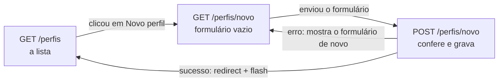

# Capítulo 12 — INSERT e SELECT de perfis

**Disciplina:** Programação para Internet (ILP951)
**Professor:** Ronan Adriel Zenatti · ronan.zenatti@cps.sp.gov.br
**Fatec Jahu — 2º Semestre/2026**

---

## 🎯 Objetivos do Capítulo

Ao final deste capítulo você deverá ser capaz de:

- Listar os perfis do banco em uma página, com `SELECT` e uma tabela do Bootstrap, e tratar a lista vazia
- Criar um formulário de cadastro e proteger o envio com o token CSRF
- Escrever uma função de validação por campo em um módulo próprio (`validacoes.py`) e importá-la no `app.py`
- Gravar um perfil com `INSERT` parametrizado, guardando `NULL` quando o campo opcional vem vazio
- Aplicar o padrão PRG e avisar o resultado com `flash`, mostrando o código que o banco gerou
- Impedir um nome repetido de duas formas: conferindo com `SELECT` antes e reconhecendo o erro `1062` do banco
- Cadastrar os perfis **Administrador**, **Gerente** e **Usuário**, que o sistema usa até o fim do projeto

O Capítulo 11 deixou o Projeto 2 de pé: banco `gestao` com as três tabelas vazias, `db.py` com as funções `execute_*` e o layout base. Falta o sistema **fazer** alguma coisa com elas. Este capítulo é o primeiro CRUD do projeto, e só a metade dele: **ler** (`SELECT`) e **criar** (`INSERT`) perfis. Alterar e excluir ficam para o Capítulo 13. Um perfil é o papel de quem usa o sistema (quem administra, quem gerencia, quem apenas consulta), e cada usuário do Capítulo 14 pertencerá a **um** deles. Quase tudo o que você vê aqui já apareceu no Projeto 1 (formulário, CSRF, validação, `flash`, PRG, `execute_*`), então cada etapa traz o link para a explicação completa. O que muda é o conjunto: agora os dados vão para um banco de verdade, e o banco também tem opinião sobre o que aceita.

## 📦 Ponto de partida

Este capítulo continua do **seu** repositório `sistema-gestao`, como ficou no fim do Capítulo 11: com o `app.py`, o `db.py`, o `testar_conexao.py`, o `banco.sql`, o `.env.example`, o `.gitignore`, o `requirements.txt`, a pasta `templates` (`base.html`, `index.html`, `404.html` e `500.html`) e a pasta `static` (`estilo.css`). O `.env` também precisa existir, com o banco `gestao`.

Se o seu projeto não está funcionando, baixe o código do Capítulo 11 e descompacte. Depois de descompactar, crie o ambiente virtual e o `.env`, como no [Capítulo 11, Tópico 4](Capitulo_11_Projeto_Novo_e_Banco.md#topico-4-o-arquivo-env), e importe o `banco.sql` no phpMyAdmin, como no [Tópico 3 do mesmo capítulo](Capitulo_11_Projeto_Novo_e_Banco.md#topico-3-o-banco-gestao):

➡️ [Baixar p2_cap_11.zip](../arquivos/p2_cap_11.zip)

```bash
python -m venv venv
venv\Scripts\activate
pip install -r requirements.txt
copy .env.example .env
```

---

## Tópico 1 — A lista de perfis (SELECT)

### Antes de começar

Ligue o **Apache** e o **MySQL** no painel do XAMPP. Abra a pasta `sistema-gestao` no VS Code, o terminal (`Ctrl + '`), ative o ambiente virtual e confira o Git:

```bash
venv\Scripts\activate
git status
```

O `git status` deve dizer `nothing to commit, working tree clean`. Ligue o servidor com `python app.py`, deixe esse terminal rodando durante o capítulo (use um segundo terminal, o ícone **+**, para o Git e para os testes) e abra **http://127.0.0.1:5000**. Os três cartões mostram **0**.

### O mapa do recurso

Um **recurso** é a "coisa" que o sistema cadastra e consulta. Aqui, o perfil. Os três recursos do projeto (perfis, usuários e produtos) seguem o mesmo molde de nomes, e vale conhecê-lo agora:

| Rota | Métodos | O que faz | Função no `app.py` | Template |
|---|---|---|---|---|
| `/perfis` | GET | Lista os perfis | `lista_perfis` | `perfis.html` |
| `/perfis/novo` | GET e POST | GET mostra o formulário, POST confere e grava | `perfil_novo` | `perfil_form.html` |

O Capítulo 13 acrescenta as rotas de editar e excluir. O caminho que o navegador percorre neste capítulo é este:



Repare que o `POST` com erro **volta para o formulário** (sem `redirect`) e o `POST` bem-sucedido **redireciona** para a lista. É o que você aprendeu no [Capítulo 9](Capitulo_09_Validacao_e_Flash.md#topico-3-validando-o-nome-uma-funcao-por-campo) e no [padrão PRG do Capítulo 7](Capitulo_07_Formularios.md#o-padrao-prg).

### A rota que lê o banco

No `app.py`, a rota vai precisar do `execute_query`. Troque a linha de importação do `db`:

```python
from db import execute_query, execute_one
```

E acrescente a rota `lista_perfis`, **antes** dos `@app.errorhandler`:

```python
@app.route('/perfis')
def lista_perfis():
    perfis = execute_query(
        'SELECT id_perfil, nome, descricao FROM perfis ORDER BY nome',
        fetch=True,
    )

    return render_template('perfis.html', titulo='Perfis', perfis=perfis)
```

O `fetch=True` diz ao `execute_query` que é um `SELECT` e que ele deve devolver a **lista de linhas**, cada uma como um dicionário (Capítulo 11, Tópico 5). O `ORDER BY nome` deixa os perfis em ordem alfabética. A lista pode vir **vazia**, e é isso que vai acontecer agora, porque o banco ainda não tem nenhum perfil.

Crie o `templates/perfis.html`, primeiro só com o título:

```html


{{ titulo }} — Sistema de Gestão


  <h1 class="h2 mb-3">{{ titulo }}</h1>

```

Salve e abra **http://127.0.0.1:5000/perfis**: o título aparece dentro do layout. Ainda não há link no menu para chegar aqui, a página é aberta pelo endereço.

Agora a tabela. Acrescente, abaixo do `<h1>`, o cabeçalho e o `for` com o `` do [Capítulo 5](Capitulo_05_Variaveis_Filtros_If_e_For.md#quando-a-lista-esta-vazia-o-else-do-for):

```html
  <table class="table table-striped table-hover">
    <thead class="table-light">
      <tr>
        <th>Código</th>
        <th>Nome</th>
        <th>Descrição</th>
      </tr>
    </thead>
    <tbody>
      
      <tr>
        <td>{{ perfil.id_perfil }}</td>
        <td>{{ perfil.nome }}</td>
        <td>{{ perfil.descricao }}</td>
      </tr>
      
      <tr>
        <td colspan="3" class="text-center text-body-secondary py-4">Nenhum perfil cadastrado ainda.</td>
      </tr>
      
    </tbody>
  </table>
```

Salve e recarregue. A tabela aparece com o cabeçalho e a mensagem **Nenhum perfil cadastrado ainda.** O `` só roda quando a lista está vazia, e é exatamente o caso de um banco recém-criado. Todo sistema novo começa assim, e a tela precisa dizer isso em vez de mostrar uma tabela sem explicação.

### O link no menu

No `templates/base.html`, acrescente o item **Perfis** logo depois do item **Início**, dentro do `<ul class="navbar-nav ms-auto">`:

```html
          <li class="nav-item">
            <a class="nav-link active" href="{{ url_for('lista_perfis') }}">Perfis</a>
          </li>
```

O `request.endpoint` é o nome da função da rota que atendeu o pedido (Capítulo 6), e o `in [...]` pergunta se ele está na lista. Assim o item **Perfis** fica destacado tanto na lista quanto no formulário que vem a seguir. Salve, recarregue e clique em **Perfis** no menu.

Registre este ponto no Git:

```bash
git add .
git commit -m "Adiciona a lista de perfis e o link Perfis no menu"
git push
```

---

## Tópico 2 — O formulário de novo perfil

### A rota, por enquanto só mostrando o formulário

No `app.py`, acrescente a rota `perfil_novo` depois da `lista_perfis`:

```python
@app.route('/perfis/novo', methods=['GET', 'POST'])
def perfil_novo():
    nome = ''
    descricao = ''

    return render_template('perfil_form.html', nome=nome, descricao=descricao)
```

O `methods=['GET', 'POST']` faz a mesma função atender os dois pedidos, como no [Capítulo 7](Capitulo_07_Formularios.md#topico-3-formulario-post-a-pagina-de-contato). Por enquanto ela trata os dois do mesmo jeito: mostra o formulário. As variáveis `nome` e `descricao` já existem para o template poder **devolver o que a pessoa digitou** quando houver erro, como no Capítulo 9. No primeiro acesso, elas estão vazias.

### O template, campo por campo

Crie o `templates/perfil_form.html` com o campo do nome:

```html


Novo perfil — Sistema de Gestão


  <h1 class="h2 mb-4">Novo perfil</h1>

  <div class="row">
    <div class="col-lg-6">
      <div class="card">
        <div class="card-body">

          <form action="{{ url_for('perfil_novo') }}" method="post">

            <div class="mb-3">
              <label for="nome" class="form-label">Nome do perfil</label>
              <input type="text" class="form-control" id="nome" name="nome" placeholder="Ex.: Administrador" value="{{ nome }}" required minlength="3" maxlength="100">
            </div>

          </form>

        </div>
      </div>
    </div>
  </div>

```

Os limites do HTML (`minlength="3"` e `maxlength="100"`) combinam com os do banco (`VARCHAR(100)`) e com os da validação que o Tópico 4 escreve. Abra **http://127.0.0.1:5000/perfis/novo** e confira o campo. Agora a descrição, **abaixo** do `<div class="mb-3">` do nome:

```html
            <div class="mb-3">
              <label for="descricao" class="form-label">Descrição (opcional)</label>
              <input type="text" class="form-control" id="descricao" name="descricao" placeholder="Ex.: Acesso total ao sistema" value="{{ descricao }}" maxlength="255">
            </div>
```

Esse campo **não** tem `required`, porque a coluna `descricao` do banco aceita `NULL`. É a regra do projeto: o que é `NOT NULL` no banco é obrigatório no formulário, e o que aceita `NULL` é opcional. O limite de 255 vem do `VARCHAR(255)`.

Por fim, os botões, **depois** da descrição e ainda dentro do `<form>`:

```html
            <div class="d-flex gap-2">
              <button type="submit" class="btn btn-primary">Salvar perfil</button>
              <a href="{{ url_for('lista_perfis') }}" class="btn btn-outline-secondary">Cancelar</a>
            </div>
```

Salve e recarregue. Falta o caminho da lista até o formulário. No `perfis.html`, troque o `<h1>` por um cabeçalho com o botão **Novo perfil**:

```html
  <div class="d-flex justify-content-between align-items-center mb-3">
    <h1 class="h2 mb-0">{{ titulo }}</h1>
    <a href="{{ url_for('perfil_novo') }}" class="btn btn-primary">Novo perfil</a>
  </div>
```

Salve, abra **Perfis** e clique em **Novo perfil**. Digite `Teste` no nome e clique em **Salvar perfil**: a página recarrega **vazia**. É esperado: a rota ainda ignora o que chega pelo POST.

```bash
git add .
git commit -m "Adiciona o formulário de novo perfil"
git push
```

---

## Tópico 3 — CSRF: o formulário prova que é o seu

O formulário envia dados por POST, e todo POST do projeto precisa do token CSRF. O problema e a solução foram explicados no [Capítulo 8, Tópico 5](Capitulo_08_Session.md#topico-5-csrf-o-formulario-precisa-provar-que-e-o-seu); aqui é só repetir. O `flask-wtf` já está instalado desde o Capítulo 11. No `app.py`, acrescente a importação:

```python
from flask_wtf.csrf import CSRFProtect
```

E ative a proteção logo depois da `secret_key`:

```python
app = Flask(__name__)
app.secret_key = os.getenv('SECRET_KEY')

CSRFProtect(app)
```

A `secret_key` agora tem um motivo extra para vir do `.env`: ela assina o cookie da `session`, e o token CSRF e o `flash` do próximo tópico dependem dele. Salve, abra o formulário, digite `Teste` e envie. Aparece:

```text
Bad Request
The CSRF token is missing.
```

O erro 400 mostra a proteção funcionando: o POST chegou sem o token e o Flask o recusou antes de a rota rodar. O formulário precisa entregar o token. No `perfil_form.html`, logo abaixo da tag `<form>`:

```html
          <form action="{{ url_for('perfil_novo') }}" method="post">
            <input type="hidden" name="csrf_token" value="{{ csrf_token() }}">
```

Salve, recarregue o formulário e envie de novo. Agora a página recarrega vazia, como antes: o POST passou pela proteção e a rota o ignorou. Todo formulário POST deste projeto leva essa linha.

```bash
git add .
git commit -m "Ativa a proteção CSRF e adiciona o token ao formulário de perfil"
git push
```

---

## Tópico 4 — Receber, conferir e avisar

### O `flash` no layout

O resultado de cada envio precisa aparecer na tela. Para isso, o `base.html` do Projeto 2 ganha o bloco de mensagens que você montou no [Capítulo 9](Capitulo_09_Validacao_e_Flash.md#topico-2-flash-avisar-o-resultado-em-uma-linha). No `templates/base.html`, **dentro do `<main>`, antes do bloco `conteudo`**:

```html
  <main class="container my-4">
    
    <div class="alert alert-{{ tipo }} alert-dismissible fade show" role="alert">
      {{ mensagem }}
      <button type="button" class="btn-close" data-bs-dismiss="alert" aria-label="Fechar"></button>
    </div>
    

    
  </main>
```

O tipo do `flash` (`success`, `danger`, `info`) vira a cor do alerta do Bootstrap.

### O que chegou pelo POST

Agora a rota lê o que foi enviado. No `app.py`, a primeira linha de importação do Flask passa a trazer o `request` e o `flash`:

```python
from flask import Flask, render_template, request, flash
```

E a rota `perfil_novo` ganha o `if` do POST. Por enquanto ela só lê os dois campos e mostra o que recebeu:

```python
@app.route('/perfis/novo', methods=['GET', 'POST'])
def perfil_novo():
    nome = ''
    descricao = ''

    if request.method == 'POST':
        nome = request.form.get('nome', '').strip()
        descricao = request.form.get('descricao', '').strip()

        flash(f'Recebi o perfil "{nome}" com a descrição "{descricao}".', 'info')

    return render_template('perfil_form.html', nome=nome, descricao=descricao)
```

O `request.form.get('nome', '')` e o `.strip()` são os do Capítulo 9: o campo ausente vira `''` em vez de erro 400, e os espaços das pontas somem. Salve e teste:

- Nome `Teste`, descrição `Só para ver`: a faixa azul repete os dois, e **o formulário mantém** o que você digitou.
- Nome com três espaços: a faixa mostra o nome `""`. O `.strip()` esvaziou. Se o formulário é aceito, o servidor ainda precisa **conferir** esse vazio.

### Funções de validação em um módulo próprio

Cada campo ganha a sua função de validação, que devolve a mensagem de erro ou `None`, como no Capítulo 9. Desta vez elas não ficam no `app.py`: o projeto terá validações de CPF, celular, CEP e preço, e um arquivo só para elas mantém o `app.py` enxuto. Crie o `validacoes.py` **na raiz do projeto**, ao lado do `app.py`, primeiro só com a função do nome:

```python
def validar_nome_perfil(nome):
    if nome == '':
        return 'Informe o nome do perfil.'

    if len(nome) < 3:
        return 'O nome deve ter pelo menos 3 caracteres.'

    if len(nome) > 100:
        return 'O nome deve ter no máximo 100 caracteres.'

    return None
```

Teste no segundo terminal:

```bash
python -c "from validacoes import validar_nome_perfil; print(validar_nome_perfil(''))"
python -c "from validacoes import validar_nome_perfil; print(validar_nome_perfil('Gerente'))"
```

O primeiro imprime `Informe o nome do perfil.` e o segundo imprime `None`.

!!! note "Python: o seu próprio arquivo é um módulo"
    Todo arquivo `.py` é um **módulo** e pode ser importado por outro. O `from validacoes import validar_nome_perfil` abre o arquivo `validacoes.py` (que precisa estar na mesma pasta) e traz dele a função, para usá-la como se tivesse sido escrita ali. É o mesmo `from ... import ...` que você usa com o `db` (`from db import execute_one`). Os nomes dos módulos do projeto não levam acento nem espaço.

No `app.py`, importe a função (abaixo da importação do `db`):

```python
from validacoes import validar_nome_perfil
```

E troque, dentro do `if request.method == 'POST':`, o `flash` provisório pela chamada da função:

```python
        erro = validar_nome_perfil(nome)
        if erro:
            flash(erro, 'danger')
        else:
            flash('Dados válidos. Ainda não gravei no banco.', 'success')
```

Salve e teste três envios: nome com três espaços (`Informe o nome do perfil.`), nome `ab` (mínimo de 3 caracteres) e nome `Gerente` (faixa verde). Nos três, o formulário mantém o que foi digitado.

### A descrição e todos os erros de uma vez

A descrição é opcional, então só tem um limite: 255 caracteres. Acrescente ao `validacoes.py`:

```python
def validar_descricao_perfil(descricao):
    if len(descricao) > 255:
        return 'A descrição deve ter no máximo 255 caracteres.'

    return None
```

Como o `maxlength` do HTML impede de digitar mais que isso, teste pelo terminal:

```bash
python -c "from validacoes import validar_descricao_perfil; print(validar_descricao_perfil('a' * 256))"
```

Aparece a mensagem. Agora a rota junta as mensagens das duas funções em uma lista, para quem preenche ver **todos** os problemas de uma vez, como no [Capítulo 9](Capitulo_09_Validacao_e_Flash.md#topico-4-categoria-preco-e-varios-erros-de-uma-vez). Importe a segunda função:

```python
from validacoes import validar_nome_perfil, validar_descricao_perfil
```

E troque o bloco do `erro` por este, dentro do mesmo `if request.method == 'POST':`:

```python
        erros = []

        erro = validar_nome_perfil(nome)
        if erro:
            erros.append(erro)

        erro = validar_descricao_perfil(descricao)
        if erro:
            erros.append(erro)

        if erros:
            for mensagem in erros:
                flash(mensagem, 'danger')
        else:
            flash('Dados válidos. Ainda não gravei no banco.', 'success')
```

Salve e teste: nome `ab` com a descrição `Teste` gera uma faixa vermelha. Para ver as duas faixas juntas, tire o `maxlength` da descrição pelo `F12` (aba **Elements**, **Edit as HTML**), como no Capítulo 9, e envie 256 caracteres. O servidor não depende do HTML: a mesma conferência vale para quem desligar o `required` ou o `maxlength`.

```bash
git add .
git commit -m "Valida o nome e a descrição do perfil no servidor"
git push
```

---

## Tópico 5 — Gravando no banco (INSERT e PRG)

### O INSERT

Os dados chegam conferidos. Falta trocar o aviso provisório pela gravação. O `app.py` precisa do `execute_insert` (que devolve o `id` gerado), do `redirect` e do `url_for`. Atualize as duas importações:

```python
from flask import Flask, render_template, request, redirect, url_for, flash
```

```python
from db import execute_query, execute_one, execute_insert
```

Troque o `else` do final do `if erros:` por este:

```python
        else:
            if descricao == '':
                descricao_gravada = None
            else:
                descricao_gravada = descricao

            novo_id = execute_insert(
                'INSERT INTO perfis (nome, descricao) VALUES (%s, %s)',
                (nome, descricao_gravada),
            )

            flash(f'Perfil "{nome}" cadastrado (código {novo_id}).', 'success')
            return redirect(url_for('lista_perfis'))
```

Linha a linha, na ordem em que acontece:

1. **O `if descricao == ''`**: um campo opcional deixado em branco chega como `''` (texto vazio), mas no banco o jeito certo de dizer "sem valor" é o **`NULL`**. A regra do projeto: campo opcional vazio vira `NULL`, nunca `''`.
2. **`None`**: o valor do Python para "nada". O conector o grava como `NULL`.
3. **`execute_insert(sql, params)`**: a função do Capítulo 11. Os `%s` recebem os valores da tupla como **dados**, nunca como pedaço do comando, e a função devolve o `id` que o `AUTO_INCREMENT` gerou.
4. **`flash` e `redirect`**: é o PRG. Depois de gravar, a rota **não** desenha a página, redireciona para a lista. Se desenhasse, um `F5` reenviaria o formulário e cadastraria o perfil de novo.

Salve e cadastre o primeiro perfil: nome `Administrador`, descrição `Acesso total ao sistema`. Você cai na lista com a faixa verde (`Perfil "Administrador" cadastrado (código 1).`, ou outro número, se o banco já gerou códigos antes) e o perfil na tabela. Aperte `F5`: a faixa some e nada é cadastrado de novo. Volte ao **Início**: o cartão de perfis mostra **1**.

### O `None` que aparece na tela

Cadastre o segundo perfil, **deixando a descrição vazia**: nome `Gerente`. Na lista, a célula da descrição mostra a palavra **None**. O Jinja escreve o `None` do Python como texto. Isso não é o que se quer ver na tela. Em `perfis.html`, troque a célula da descrição por um `if`:

```html
        <td>
          
            {{ perfil.descricao }}
          
            <span class="text-body-secondary">—</span>
          
        </td>
```

Salve e recarregue: o `Gerente` mostra um traço cinza. O `if perfil.descricao` é verdadeiro para um texto e falso para o `None`.

Abra o **phpMyAdmin**, o banco `gestao`, a tabela `perfis` e a aba **Procurar** (*Browse*). A descrição do Gerente aparece como `NULL`, em itálico, e não como um texto vazio. As colunas `criado_em` e `atualizado_em` foram preenchidas pelo próprio banco, sem nenhuma linha de Python.

### A coluna "Criado em"

A lista pode mostrar quando o perfil foi criado. Acrescente `criado_em` ao `SELECT` da rota `lista_perfis`:

```python
        'SELECT id_perfil, nome, descricao, criado_em FROM perfis ORDER BY nome',
```

No `perfis.html`, a coluna no cabeçalho (`<th>Criado em</th>`, depois de `Descrição`) e, na linha, depois da célula da descrição:

```html
        <td>{{ perfil.criado_em }}</td>
```

E o `colspan` do `` passa de `3` para `4`. Salve e recarregue. A coluna mostra algo como `2026-11-03 10:15:42`, no formato do banco. Troque a célula por uma versão em dia/mês/ano:

```html
        <td>{{ perfil.criado_em.strftime('%d/%m/%Y') }}</td>
```

Agora aparece `03/11/2026`.

!!! note "Python: datas e o `strftime`"
    As colunas `TIMESTAMP` e `DATETIME` chegam ao Python como objetos do tipo `datetime`. Todo objeto de data tem o método `strftime`, que recebe um **modelo** e devolve o texto formatado: `%d` é o dia, `%m` o mês, `%Y` o ano com quatro dígitos, `%H` a hora e `%M` os minutos. `'%d/%m/%Y %H:%M'` daria `03/11/2026 10:15`. O Jinja deixa chamar o método direto no template.

### Os três perfis do sistema

Cadastre agora os que faltam e confira a lista. O **nome** precisa ser exatamente este, com a mesma grafia e acento, porque os capítulos seguintes procuram o perfil por ele:

| Nome | Descrição sugerida |
|---|---|
| `Administrador` | Acesso total ao sistema (já cadastrado) |
| `Gerente` | (cadastrado sem descrição, no experimento acima) |
| `Usuário` | Acesso básico ao sistema |

Ao final, a lista tem **três** perfis em ordem alfabética: Administrador, Gerente e Usuário. O Gerente fica sem descrição por enquanto. O Capítulo 13 ensina a alterar um perfil já cadastrado.

```bash
git add .
git commit -m "Grava o perfil no banco com INSERT e redireciona para a lista"
git push
```

---

## Tópico 6 — Nome repetido: o erro 1062

### O que o banco faz sozinho

A coluna `nome` da tabela `perfis` é `UNIQUE`: o banco recusa dois perfis com o mesmo nome. Veja o que acontece com a rota como ela está. Cadastre de novo um perfil chamado `Gerente`. A página de depuração do Flask aparece com algo assim:

```text
mysql.connector.errors.IntegrityError: 1062 (23000): Duplicate entry 'Gerente' for key 'nome'
```

Duas coisas para notar. A boa: **o banco protegeu os dados**, nada foi duplicado. A ruim: quem usa o sistema vê uma página técnica (e, com o `debug` desligado, a página 500 do Capítulo 11, que não diz o que houve). O número **1062** é o código do MySQL para "valor repetido em coluna `UNIQUE`". O `rollback()` que o `execute_insert` faz no `except` desfaz o que ficou pela metade, e o `raise` repete o erro para a rota.

A rota precisa receber esse aviso e responder com uma mensagem clara. Há duas formas de fazer isso, e o projeto usa as duas.

### Primeira defesa: perguntar antes

Antes de gravar, a rota pergunta ao banco se já existe um perfil com esse nome. No `app.py`, dentro do POST, **depois** da validação da descrição e **antes** do `if erros:`:

```python
        if not erros:
            existente = execute_one('SELECT id_perfil FROM perfis WHERE nome = %s', (nome,))
            if existente:
                erros.append('Já existe um perfil com este nome.')
```

O `if not erros:` só consulta o banco quando o nome já passou nas outras conferências, para não gastar uma consulta com um dado que já é inválido. O `execute_one` devolve a linha encontrada (um dicionário, que conta como verdadeiro) ou `None`. A tupla `(nome,)` tem a vírgula que o Python exige para uma tupla de um item. Salve e cadastre `Gerente` de novo: agora a faixa vermelha diz `Já existe um perfil com este nome.` e o formulário mantém o que foi digitado. Teste também `gerente`, tudo minúsculo: o banco usa a ordenação `utf8mb4_unicode_ci`, que ignora maiúsculas, então o `WHERE nome = %s` e o `UNIQUE` tratam `Gerente` e `gerente` como o mesmo nome.

### Por que a pergunta não basta

Entre o `SELECT` e o `INSERT` passa um intervalo, pequeno, mas real. Se duas pessoas cadastrarem `Supervisor` no mesmo instante, as duas perguntas respondem "não existe", e os dois `INSERT` chegam ao banco: o primeiro grava, o segundo recebe o erro `1062`. A pergunta dá uma **mensagem amigável** na imensa maioria dos casos, mas a garantia de verdade é o `UNIQUE` do banco. O app precisa saber lidar com o erro quando ele acontecer.

### Segunda defesa: reconhecer o erro 1062

O erro do banco vira uma exceção do Python que a rota pode capturar com `try/except`, como você fez com o `float()` no Capítulo 9. Importe o tipo de erro do conector (o mesmo que o `db.py` usa), no começo do `app.py`:

```python
from mysql.connector import Error
```

E troque o `execute_insert` e o `flash` do final da rota por este bloco, ainda dentro do `else`:

```python
            try:
                novo_id = execute_insert(
                    'INSERT INTO perfis (nome, descricao) VALUES (%s, %s)',
                    (nome, descricao_gravada),
                )
                flash(f'Perfil "{nome}" cadastrado (código {novo_id}).', 'success')
                return redirect(url_for('lista_perfis'))
            except Error as erro:
                if erro.errno == 1062:
                    flash('Já existe um perfil com este nome.', 'danger')
                else:
                    raise
```

!!! note "Python: `except Error as erro` e o `errno`"
    O `except Error` captura qualquer erro do conector MySQL. O `as erro` dá um **nome** ao erro capturado, para a rota poder examiná-lo. Todo erro do banco traz o atributo `errno`, o número do erro do MySQL (`1062`, `1451`, `1146`...). Se for o `1062`, a rota avisa o usuário. Se for **outro** número, o `raise` sozinho repete o erro, e ele continua sendo uma falha de verdade (a página 500), porque não há nada de útil a dizer sobre um erro que a rota não esperava.

Repare no desenho: o `return redirect(...)` fica **dentro** do `try`, logo depois de gravar. Quando o `INSERT` dá certo, a rota termina ali. Quando dá o `1062`, o `except` mostra o aviso e a rota **cai** no `render_template` do final, devolvendo o formulário com os valores digitados, sem `redirect`.

Para ver a barreira final funcionando, desligue por um instante a primeira defesa: coloque um `#` na frente das quatro linhas do `if not erros:` (no VS Code, selecione e aperte `Ctrl + ;`). Salve e cadastre `Gerente` de novo: a faixa vermelha aparece vinda do `except`, não mais do `SELECT`. **Tire os `#`** para restaurar a primeira defesa e salve.

| Situação | Quem trata | O que a pessoa vê |
|---|---|---|
| Nome vazio, curto ou longo demais | Funções de `validacoes.py` | Faixa vermelha com a regra |
| Nome já existe (caso comum) | `SELECT` antes do `INSERT` | Faixa vermelha: "Já existe um perfil com este nome." |
| Nome já existe (dois cadastros simultâneos) | `UNIQUE` do banco, erro `1062` capturado | A mesma faixa vermelha |
| Qualquer outro erro do banco | Ninguém na rota (o `raise` repete) | A página 500 |

```bash
git add .
git commit -m "Impede nome de perfil repetido com SELECT e com o erro 1062"
git push
```

---

## Os arquivos completos do capítulo

O `app.py`:

```python
import os

from dotenv import load_dotenv
from flask import Flask, render_template, request, redirect, url_for, flash
from flask_wtf.csrf import CSRFProtect
from mysql.connector import Error

from db import execute_query, execute_one, execute_insert
from validacoes import validar_nome_perfil, validar_descricao_perfil

load_dotenv()

app = Flask(__name__)
app.secret_key = os.getenv('SECRET_KEY')

CSRFProtect(app)


@app.route('/')
def index():
    perfis = execute_one('SELECT COUNT(*) AS total FROM perfis')
    usuarios = execute_one('SELECT COUNT(*) AS total FROM usuarios')
    produtos = execute_one('SELECT COUNT(*) AS total FROM produtos')

    return render_template('index.html', titulo='Sistema de Gestão',
                           total_perfis=perfis['total'],
                           total_usuarios=usuarios['total'],
                           total_produtos=produtos['total'])


@app.route('/perfis')
def lista_perfis():
    perfis = execute_query(
        'SELECT id_perfil, nome, descricao, criado_em FROM perfis ORDER BY nome',
        fetch=True,
    )

    return render_template('perfis.html', titulo='Perfis', perfis=perfis)


@app.route('/perfis/novo', methods=['GET', 'POST'])
def perfil_novo():
    nome = ''
    descricao = ''

    if request.method == 'POST':
        nome = request.form.get('nome', '').strip()
        descricao = request.form.get('descricao', '').strip()

        erros = []

        erro = validar_nome_perfil(nome)
        if erro:
            erros.append(erro)

        erro = validar_descricao_perfil(descricao)
        if erro:
            erros.append(erro)

        if not erros:
            existente = execute_one('SELECT id_perfil FROM perfis WHERE nome = %s', (nome,))
            if existente:
                erros.append('Já existe um perfil com este nome.')

        if erros:
            for mensagem in erros:
                flash(mensagem, 'danger')
        else:
            if descricao == '':
                descricao_gravada = None
            else:
                descricao_gravada = descricao

            try:
                novo_id = execute_insert(
                    'INSERT INTO perfis (nome, descricao) VALUES (%s, %s)',
                    (nome, descricao_gravada),
                )
                flash(f'Perfil "{nome}" cadastrado (código {novo_id}).', 'success')
                return redirect(url_for('lista_perfis'))
            except Error as erro:
                if erro.errno == 1062:
                    flash('Já existe um perfil com este nome.', 'danger')
                else:
                    raise

    return render_template('perfil_form.html', nome=nome, descricao=descricao)


@app.errorhandler(404)
def pagina_nao_encontrada(erro):
    return render_template('404.html'), 404


@app.errorhandler(500)
def erro_no_servidor(erro):
    return render_template('500.html'), 500


if __name__ == '__main__':
    app.run(debug=True)
```

O `validacoes.py`:

```python
def validar_nome_perfil(nome):
    if nome == '':
        return 'Informe o nome do perfil.'

    if len(nome) < 3:
        return 'O nome deve ter pelo menos 3 caracteres.'

    if len(nome) > 100:
        return 'O nome deve ter no máximo 100 caracteres.'

    return None


def validar_descricao_perfil(descricao):
    if len(descricao) > 255:
        return 'A descrição deve ter no máximo 255 caracteres.'

    return None
```

O `templates/perfis.html`:

```html


{{ titulo }} — Sistema de Gestão


  <div class="d-flex justify-content-between align-items-center mb-3">
    <h1 class="h2 mb-0">{{ titulo }}</h1>
    <a href="{{ url_for('perfil_novo') }}" class="btn btn-primary">Novo perfil</a>
  </div>

  <table class="table table-striped table-hover">
    <thead class="table-light">
      <tr>
        <th>Código</th>
        <th>Nome</th>
        <th>Descrição</th>
        <th>Criado em</th>
      </tr>
    </thead>
    <tbody>
      
      <tr>
        <td>{{ perfil.id_perfil }}</td>
        <td>{{ perfil.nome }}</td>
        <td>
          
            {{ perfil.descricao }}
          
            <span class="text-body-secondary">—</span>
          
        </td>
        <td>{{ perfil.criado_em.strftime('%d/%m/%Y') }}</td>
      </tr>
      
      <tr>
        <td colspan="4" class="text-center text-body-secondary py-4">Nenhum perfil cadastrado ainda.</td>
      </tr>
      
    </tbody>
  </table>

```

O `templates/perfil_form.html`:

```html


Novo perfil — Sistema de Gestão


  <h1 class="h2 mb-4">Novo perfil</h1>

  <div class="row">
    <div class="col-lg-6">
      <div class="card">
        <div class="card-body">

          <form action="{{ url_for('perfil_novo') }}" method="post">
            <input type="hidden" name="csrf_token" value="{{ csrf_token() }}">

            <div class="mb-3">
              <label for="nome" class="form-label">Nome do perfil</label>
              <input type="text" class="form-control" id="nome" name="nome" placeholder="Ex.: Administrador" value="{{ nome }}" required minlength="3" maxlength="100">
            </div>

            <div class="mb-3">
              <label for="descricao" class="form-label">Descrição (opcional)</label>
              <input type="text" class="form-control" id="descricao" name="descricao" placeholder="Ex.: Acesso total ao sistema" value="{{ descricao }}" maxlength="255">
            </div>

            <div class="d-flex gap-2">
              <button type="submit" class="btn btn-primary">Salvar perfil</button>
              <a href="{{ url_for('lista_perfis') }}" class="btn btn-outline-secondary">Cancelar</a>
            </div>

          </form>

        </div>
      </div>
    </div>
  </div>

```

As mudanças no `base.html` estão nos Tópicos 1 e 4 (o item **Perfis** no menu e o bloco do `flash`). Os demais arquivos (`db.py`, `index.html`, `404.html`, `500.html`, `estilo.css`, `testar_conexao.py`) não mudaram.

---

## 📦 Código deste capítulo

Compare com o seu projeto, ou use como ponto de partida do próximo capítulo. O zip tem o `app.py`, o `db.py`, o `validacoes.py`, o `testar_conexao.py`, o `banco.sql`, o `.env.example`, o `.gitignore`, o `requirements.txt`, a pasta `templates` (`base.html`, `index.html`, `perfis.html`, `perfil_form.html`, `404.html` e `500.html`) e a pasta `static` (`estilo.css`). O ambiente virtual **não** vai no zip, e o **`.env` também não**: depois de descompactar, crie o ambiente com os três comandos do Capítulo 3 e rode `copy .env.example .env`, trocando os marcadores `SUA_SENHA_AQUI` e `NOME_BANCO_DADOS` como no Capítulo 11. O banco também não vai dentro do zip: importe o `banco.sql` e cadastre os três perfis pelo formulário.

➡️ [Baixar p2_cap_12.zip](../arquivos/p2_cap_12.zip)

---

## 🃏 Flashcards de Revisão

Tente responder mentalmente antes de abrir.

??? question "Por que a descrição vazia é gravada como `NULL` e não como texto vazio?"
    Porque, no projeto, o que aceita `NULL` no banco é opcional, e um campo opcional deixado em branco significa "sem valor". A rota troca o `''` por `None`, e o conector grava `NULL`. Um texto vazio seria um valor, só que invisível.

??? question "O que acontece se o formulário de perfil for enviado sem o `csrf_token`?"
    O Flask-WTF recusa o POST com o erro 400 (`The CSRF token is missing`) antes de a rota rodar. Por isso todo formulário POST leva `<input type="hidden" name="csrf_token" value="{{ csrf_token() }}">`.

??? question "Para que serve a função `execute_insert` aqui, se o `execute_query` também grava?"
    O `execute_insert` devolve o `id` que o banco gerou para a linha nova (o `lastrowid`), e a rota o usa na mensagem `Perfil "..." cadastrado (código N)`. O `execute_query` devolveria só o número de linhas afetadas, que num `INSERT` é sempre 1.

??? question "Por que conferir o nome repetido com `SELECT` e ainda capturar o erro `1062`?"
    O `SELECT` dá uma mensagem amigável na maioria dos casos. Mas entre o `SELECT` e o `INSERT` outra pessoa pode cadastrar o mesmo nome, e só o `UNIQUE` do banco garante de verdade que não haverá duplicata. Capturar o `1062` trata esse caso raro com a mesma mensagem.

??? question "O que o `raise` faz no `else` do `except Error as erro`?"
    Repete o erro capturado. Se o `errno` não for `1062`, a rota não sabe o que fazer com ele, e o erro segue para o Flask, que mostra a página 500. Esconder um erro inesperado faria o sistema parecer que deu certo.

??? question "Por que a lista mostrava a palavra `None` na descrição, e como foi resolvido?"
    O Jinja escreve o `None` do Python como texto. O `` trata o `None` como falso e mostra um traço no lugar.

---

## ✅ Quiz de Fixação

<quiz>
O nome do perfil é conferido por um `SELECT` antes do `INSERT` e, mesmo assim, a rota captura o erro `1062`. Por que as duas defesas existem?
- [ ] Porque o `SELECT` é mais lento e o `1062` é mais rápido
> Não. A velocidade não é o motivo. As duas têm papéis diferentes.
- [ ] Porque o `UNIQUE` do banco só funciona quando o `SELECT` falha
> Não. O `UNIQUE` funciona sempre. Ele é a barreira final, e o `SELECT` é uma cortesia que vem antes.
- [x] Porque o `SELECT` dá uma mensagem amigável no caso comum, e o `UNIQUE` com o `1062` garante o resultado quando dois cadastros chegam quase juntos
> Correto. Entre o `SELECT` e o `INSERT` outra pessoa pode gravar o mesmo nome. O banco recusa o segundo, e a rota reconhece o erro e responde com a mesma mensagem.
- [ ] Porque o Flask exige um `try/except` em toda rota que usa o banco
> Não. O Flask não exige isso. A rota captura o `1062` porque sabe responder a ele.
</quiz>

<quiz>
O formulário de perfil é enviado com o nome `Auditor` e a descrição em branco. O que a rota grava na coluna `descricao`?
- [ ] Um texto vazio (`''`)
> Não. O texto vazio seria um valor. A regra do projeto é que campo opcional vazio vire `NULL`.
- [ ] O texto `None`
> Não. O `None` é o valor do Python. O conector o converte em `NULL` ao gravar, e não em um texto.
- [x] `NULL`
> Correto. A rota troca o `''` por `None`, e o conector grava `NULL` no banco.
- [ ] A rota recusa o cadastro, porque a descrição é obrigatória
> Não. A coluna `descricao` aceita `NULL`, então o campo é opcional.
</quiz>

<quiz>
Quais afirmações sobre o cadastro de perfil estão corretas? (selecione todas que se aplicam)
- [x] Depois de gravar, a rota faz `redirect` para a lista, e por isso o `F5` não cadastra o perfil de novo
> Correto. É o padrão PRG: o navegador faz um GET novo na lista, e não reenvia o POST.
- [x] Quando há erro de validação, a rota mostra o formulário de novo, com o que foi digitado
> Correto. Com o `redirect`, a pessoa perderia o que digitou. Sem ele, o `render_template` devolve os valores.
- [x] As conferências do servidor continuam valendo mesmo que alguém desligue o `required` pelo `F12`
> Correto. O HTML só dá conforto. Quem protege o sistema é o Python.
- [ ] O token CSRF dispensa a validação do nome
> Não. O token prova que o formulário é o do sistema, mas não diz nada sobre o conteúdo dos campos.
</quiz>

<quiz>
No `except Error as erro`, a rota trata o `errno == 1062` e, nos demais casos, executa `raise`. O que acontece quando o banco devolve outro erro, como o `1146` (tabela inexistente)?
- [ ] A rota mostra a mensagem "Já existe um perfil com este nome."
> Não. Essa mensagem só vale para o `1062`.
- [ ] O erro é ignorado e o cadastro parece ter funcionado
> Não. Esconder o erro faria a falha passar despercebida. O `raise` existe justamente para isso não acontecer.
- [x] O erro é repetido e chega ao Flask, que mostra a página 500
> Correto. A rota não sabe responder a esse erro, então o `raise` o repete e o sistema avisa que houve uma falha.
- [ ] O Python reinicia o servidor e tenta de novo
> Não. O Python não repete nada sozinho. O erro simplesmente sobe até o Flask.
</quiz>

---

## 📝 Resumo

O sistema ganhou o primeiro recurso completo de leitura e criação: a rota `lista_perfis` faz o `SELECT` e a tabela trata a lista vazia, e a rota `perfil_novo` mostra o formulário (GET) e recebe o envio (POST). O POST passa pelo token CSRF, pelas funções de `validacoes.py` (uma por campo, devolvendo a mensagem ou `None`) e pelo `INSERT` parametrizado, que grava `NULL` quando a descrição vem vazia. Depois de gravar, o `flash` e o `redirect` (PRG) levam à lista. O nome repetido é barrado duas vezes: por um `SELECT` antes, que dá a mensagem amigável, e pelo `UNIQUE` do banco, cujo erro `1062` a rota reconhece com `except Error`. O banco `gestao` agora tem os perfis Administrador, Gerente e Usuário, e o Capítulo 13 acrescenta a edição e a exclusão a esse mesmo molde.

---

## 🔗 Navegação

⬅️ [Capítulo 11 — Projeto novo e banco](Capitulo_11_Projeto_Novo_e_Banco.md) · 🔒 Capítulo 12.1 (opcional) — em breve · 🔒 Capítulo 13 — em breve.

---

*Fatec Jahu · ILP951 · Prof. Ronan Adriel Zenatti · 2026*
