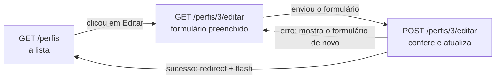

# Capítulo 13 — UPDATE e DELETE de perfis

**Disciplina:** Programação para Internet (ILP951)
**Professor:** Ronan Adriel Zenatti · ronan.zenatti@cps.sp.gov.br
**Fatec Jahu — 2º Semestre/2026**

---

## 🎯 Objetivos do Capítulo

Ao final deste capítulo você deverá ser capaz de:

- Reaproveitar o formulário de cadastro para a edição, com uma variável (`acao`) que diz ao template em qual modo ele está
- Adaptar a validação do perfil para ignorar o próprio registro na conferência do nome repetido
- Gravar a edição com `UPDATE ... WHERE id_perfil = %s` e explicar por que a existência do registro é conferida com `SELECT`, e não com `rowcount`
- Explicar por que a exclusão aceita só `POST` e pedir a confirmação em um modal do Bootstrap, acionado por uma função JavaScript que recebe o código do perfil
- Impedir a exclusão de um perfil que tem usuários, com `SELECT COUNT(*)` antes e o erro `1451` do banco como barreira final

O Capítulo 12 entregou a metade do CRUD de perfis: **ler** (`SELECT`) e **criar** (`INSERT`). Faltam as duas operações mais delicadas, **alterar** (`UPDATE`) e **excluir** (`DELETE`), porque são as que podem estragar dados de verdade. Um `UPDATE` sem `WHERE` altera a tabela inteira (todos os perfis passariam a ter o mesmo nome), e um `DELETE` apaga sem volta. Por isso o foco deste capítulo não é só fazer funcionar, é fazer funcionar **com segurança**. A boa notícia é que quase tudo já está pronto: a lista já tem os botões de editar e excluir esperando uma rota, a validação já está num arquivo próprio e o roteiro da rota (coletar, validar, mostrar os erros ou salvar) é o mesmo do cadastro. Ao final, o recurso `perfis` fica completo, e o mesmo molde de rotas e de nomes será repetido para `usuarios` e `produtos`.

## 📦 Ponto de partida

Este capítulo continua do **seu** repositório `sistema-gestao`, como ficou no fim do Capítulo 12: com o `app.py`, o `db.py`, a pasta `validacoes` (com o `validacoes_perfil.py`), a pasta `templates` (`layout/base_menu.html`, `layout/base_limpa.html`, `login.html`, `dashboard.html`, `perfis/perfis_lista.html`, `perfis/perfil_form.html`, `404.html` e `500.html`) e os perfis **Administrador**, **Gerente** e **Usuário** cadastrados. O Capítulo 12.1 é opcional: este capítulo parte do código do 12, e os trechos mostram a lista simples do 12, sem a busca e a paginação.

Se o seu projeto não está funcionando, baixe o código do Capítulo 12 e descompacte. Depois de descompactar, crie o ambiente virtual e o `.env`, como no [Capítulo 11, Tópico 4](Capitulo_11_Projeto_Novo_e_Banco.md#topico-4-o-arquivo-env), importe o `banco.sql` no phpMyAdmin e cadastre os três perfis pelo formulário:

➡️ [Baixar p2_cap_12.zip](../arquivos/p2_cap_12.zip)

```bash
python -m venv venv
venv\Scripts\activate
pip install -r requirements.txt
copy .env.example .env
```

---

## Tópico 1 — Editar um perfil (UPDATE)

### Antes de começar

Ligue o **Apache** e o **MySQL** no painel do XAMPP. Abra a pasta `sistema-gestao` no VS Code, o terminal (`Ctrl + '`), ative o ambiente virtual e confira o Git:

```bash
venv\Scripts\activate
git status
```

O `git status` deve dizer `nothing to commit, working tree clean`. Ligue o servidor com `python app.py`, deixe esse terminal rodando durante o capítulo (use um segundo terminal, o ícone **+**, para o Git e para os testes) e abra **http://127.0.0.1:5000/perfis**. A lista mostra os três perfis do Capítulo 12. Cadastre também um perfil chamado `Teste`, com qualquer descrição: ele será editado e excluído nos testes, para os três perfis do sistema ficarem intactos.

### O mapa do recurso, agora completo

O Capítulo 12 mostrou o molde de nomes do recurso. Este capítulo acrescenta as duas linhas que faltavam:

| Rota | Métodos | O que faz | Função no `app.py` | Template |
|---|---|---|---|---|
| `/perfis` | GET | Lista os perfis | `listar_perfis` | `perfis/perfis_lista.html` |
| `/perfis/inserir` | GET e POST | GET mostra o formulário, POST confere e grava | `inserir_perfil` | `perfis/perfil_form.html` |
| `/perfis/<int:id_perfil>/editar` | GET e POST | GET mostra o formulário preenchido, POST confere e atualiza | `editar_perfil` | `perfis/perfil_form.html` |
| `/perfis/<int:id_perfil>/excluir` | só POST | Exclui o perfil e volta para a lista | `excluir_perfil` | (nenhum) |

Repare que o `editar` usa o **mesmo template** do cadastro, e que o `excluir` não tem template: ele não mostra nada, só faz o que foi pedido e redireciona. O caminho do navegador na edição é parecido com o do cadastro:



### A validação ignora o próprio perfil

A edição confere **os mesmos campos** do cadastro, e a `validar_perfil` já faz isso. Há uma única diferença, e ela está no nome repetido: na edição, o **próprio** perfil não conta como repetido. Quem abre o Gerente e só corrige a descrição envia o nome `Gerente`, que já existe, e é dele mesmo. Por isso a função passa a receber também o código do perfil que está sendo editado (`id_perfil`), e o `SELECT` passa a ignorá-lo com `id_perfil <> %s`.

Abra o `validacoes/validacoes_perfil.py`. São duas mudanças. A primeira é na linha do `def`. Troque:

```python
def validar_perfil(nome, descricao):
```

por:

```python
def validar_perfil(nome, descricao, id_perfil=0):
```

A segunda é na seção do nome repetido, no fim do arquivo. Troque:

```python
    # ================ NOME REPETIDO (CONSULTA AO BANCO) =====================
    # Se as regras básicas passaram, checa unicidade no banco de dados
    if not erros:
        existente = execute_one('SELECT id_perfil FROM perfis WHERE nome = %s', (nome,))
```

por:

```python
    # ================ NOME REPETIDO (CONSULTA AO BANCO) =====================
    # Se as regras básicas passaram, checa unicidade no banco de dados
    # O id_perfil <> %s ignora o próprio perfil na edição (no cadastro, o id_perfil vale 0)
    if not erros:
        existente = execute_one(
            'SELECT id_perfil FROM perfis WHERE nome = %s AND id_perfil <> %s',
            (nome, id_perfil),
        )
```

O resto do arquivo não muda.

- **O `id_perfil=0` no `def`** é um **valor padrão**: quem chama a função pode passar o terceiro valor ou deixá-lo de fora, e aí ele vale `0`. A rota de cadastro continua chamando `validar_perfil(nome, descricao)`, sem mudar nada, e a de edição vai chamar `validar_perfil(nome, descricao, id_perfil)`.
- **O `id_perfil <> %s`**: nenhum perfil tem o código `0`, então, no cadastro, a condição não exclui ninguém, e o `SELECT` procura o nome em todos os perfis, como antes. Na edição, ela tira da busca o perfil que está sendo editado.

!!! note "SQL: `<>` é “diferente de”"
    O `WHERE nome = %s AND id_perfil <> %s` procura um perfil com **aquele nome** e com um código **diferente** do informado. Se o único perfil com esse nome for o próprio, o `SELECT` não devolve nada, e não há repetição.

Salve e cadastre `Teste` de novo pelo formulário: a mensagem `Já existe um perfil com este nome.` continua aparecendo. O cadastro segue igual.

### A rota de edição

No `app.py`, acrescente o `abort` à importação do Flask (em ordem alfabética, logo depois do `Flask`):

```python
from flask import Flask, abort, flash, redirect, render_template, request, url_for
```

E acrescente a rota `editar_perfil` na seção **PERFIS**, **depois** da `inserir_perfil`:

```python
@app.route('/perfis/<int:id_perfil>/editar', methods=['GET', 'POST'])
def editar_perfil(id_perfil):
    # Busca o perfil pelo código que veio no endereço
    perfil = execute_one(
        'SELECT id_perfil, nome, descricao FROM perfis WHERE id_perfil = %s',
        (id_perfil,),
    )

    # Código que não existe: mostra a página 404
    if perfil is None:
        abort(404)

    # O formulário começa com os valores que estão no banco
    nome = perfil['nome']
    descricao = perfil['descricao']

    # Executado apenas no envio do formulário (POST)
    if request.method == 'POST':
        # 1. Coleta os dados do formulário
        nome = request.form.get('nome', '').strip()
        descricao = request.form.get('descricao', '').strip() or None

        # -------------------------------------------------------------------------
        # 2. Validação dos campos (o id_perfil faz o próprio perfil não contar como repetido)
        erros = validar_perfil(nome, descricao, id_perfil)

        # 3. Se houver erros, exibe as mensagens
        if erros:
            for mensagem in erros:
                flash(mensagem, 'danger')

        # -------------------------------------------------------------------------
        # 4. Se não houver erros, tenta salvar no banco
        else:
            try:
                # O WHERE garante que só este perfil seja alterado
                execute_query(
                    'UPDATE perfis SET '
                    '    nome = %s, '
                    '    descricao = %s '
                    'WHERE id_perfil = %s',
                    (nome, descricao, id_perfil),
                )

                flash(f'Perfil "{nome}" atualizado.', 'success')
                return redirect(url_for('listar_perfis'))

            # Trata concorrência (duplicidade no momento do update)
            except Error as erro:
                if erro.errno == 1062:
                    flash('Já existe um perfil com este nome.', 'danger')
                else:
                    raise

    # Exibe a tela em caso de GET ou se houver erros (de validação ou de nome repetido)
    return render_template('perfis/perfil_form.html', acao='editar', id_perfil=id_perfil,
                           nome=nome, descricao=descricao)
```

Compare com a `inserir_perfil`: os passos 1 a 4 são os mesmos. O que muda está no começo, no `UPDATE` e no `render_template`.

**O começo: buscar o perfil.** O código do perfil vem **no endereço** (`/perfis/3/editar`), como a variável de rota do [Capítulo 3](Capitulo_03_Flask.md). A rota busca o perfil com esse código e, se ele não existir, responde com a página 404. Se existir, as variáveis `nome` e `descricao` **começam com os valores do banco**: é assim que o formulário aparece preenchido no GET. No POST, elas são reescritas com o que veio do formulário, e, se houver erro, o formulário volta com o que a pessoa digitou, e não com o que estava no banco. Um perfil sem descrição traz `None` do banco, e o `or ''` que já está no `value` do formulário o mostra como um campo vazio.

!!! note "Flask: `<int:id_perfil>` e `abort(404)`"
    O `<int:id_perfil>` captura o pedaço do endereço, converte para número inteiro e entrega à função como o parâmetro `id_perfil`. O parâmetro leva o **mesmo nome da chave primária** da tabela, de propósito: o nome `perfil_id` fica reservado para a chave **estrangeira** da tabela `usuarios`. Um endereço como `/perfis/abc/editar` nem chega à função: o Flask já responde 404. O `execute_one` devolve o perfil encontrado ou `None`, e o `abort(404)` interrompe a rota e mostra a página 404 do Capítulo 11. O `is None` é o jeito do Python de perguntar se o valor é o "nada".

**O `UPDATE`.** Olhe com atenção a última peça do comando: **`WHERE id_perfil = %s`**. É ela que restringe a alteração ao perfil certo. O `execute_query` sem `fetch` faz o `commit`, e o `try/except` do `1062` é o mesmo do cadastro: entre a consulta da validação e o `UPDATE`, outra pessoa pode cadastrar o mesmo nome, e só o `UNIQUE` do banco garante de verdade ([Capítulo 12, Tópico 4](Capitulo_12_INSERT_e_SELECT_de_Perfis.md#a-rota-completa)).

!!! note "Python: um texto escrito em várias linhas"
    O comando está dividido em quatro textos, um por linha, só para ficar fácil de ler: cada coluna que será alterada tem a sua linha. Quando dois ou mais textos ficam um embaixo do outro, separados apenas por espaço e quebra de linha, o Python os **junta em um texto só**. Por isso, o texto de cada linha termina com um **espaço** (`'    nome = %s, '`): sem ele, as palavras ficariam coladas (`nome = %s,descricao = %s`) e o MySQL reclamaria de um erro de sintaxe. O resultado é exatamente o mesmo comando de uma linha só.

!!! danger "UPDATE sem WHERE altera a tabela inteira"
    Sem o `WHERE`, o `UPDATE perfis SET nome = %s` trocaria o nome de **todos** os perfis para o mesmo valor. O banco não pergunta se você tem certeza. O código do perfil vem do **endereço** (`id_perfil`, já convertido para número pelo Flask), e não de um campo do formulário, que a pessoa poderia adulterar.

**O `render_template`.** A rota entrega duas variáveis a mais: `acao='editar'`, que diz ao formulário em qual modo ele está, e o `id_perfil`, de que o formulário precisa para montar o endereço de envio. É o assunto da próxima seção.

### O formulário nos dois modos: a variável `acao`

O formulário precisa mudar conforme o modo: o título (**Novo perfil** ou **Editar perfil**), o texto do botão (**Salvar perfil** ou **Salvar alterações**) e, principalmente, o **destino do envio**: no cadastro, o `action` aponta para `inserir_perfil`; na edição, para `editar_perfil`, com o código do perfil. Em vez de criar um segundo template quase igual (e ter de lembrar de mexer nos dois a cada campo novo), o `perfil_form.html` passa a servir aos dois modos, guiado pela variável `acao`.

Primeiro, a rota de cadastro também passa a informar o modo. Na `inserir_perfil`, troque a última linha:

```python
    return render_template('perfis/perfil_form.html', nome=nome, descricao=descricao)
```

por:

```python
    return render_template('perfis/perfil_form.html', acao='criar', id_perfil=None,
                           nome=nome, descricao=descricao)
```

Agora o template. São quatro pontos espalhados pelo arquivo, então troque o `templates/perfis/perfil_form.html` **inteiro** por esta versão:

```html


{{ 'Editar perfil' if acao == 'editar' else 'Novo perfil' }} — Sistema de Gestão



    

    


<h1 class="h2 mb-4">{{ 'Editar perfil' if acao == 'editar' else 'Novo perfil' }}</h1>

<div class="row justify-content-center">
    <div class="col-lg-6">
        <div class="card">
            <div class="card-body">

                <form action="{{ destino }}" method="post">
                    <input type="hidden" name="csrf_token" value="{{ csrf_token() }}">
                    <div class="mb-3">
                        <label for="nome" class="form-label">Nome do perfil</label>
                        <input type="text" class="form-control" id="nome" name="nome" placeholder="Ex.: Administrador"
                            value="{{ nome }}" required minlength="3" maxlength="100">
                    </div>

                    <div class="mb-3">
                        <label for="descricao" class="form-label">Descrição (opcional)</label>
                        <input type="text" class="form-control" id="descricao" name="descricao"
                            placeholder="Ex.: Acesso total ao sistema" value="{{ descricao or '' }}" maxlength="255">
                            <!-- ADICIONAR or '' EM TODO CAMPO QUE NÃO É OBRIGATÓRIO -->
                    </div>

                    <div class="d-flex justify-content-between gap-2">
                        <a href="{{ url_for('listar_perfis') }}" class="btn btn-outline-secondary">Cancelar</a>
                        <button type="submit" class="btn btn-primary">{{ 'Salvar alterações' if acao == 'editar' else 'Salvar perfil' }}</button>
                    </div>

                </form>

            </div>
        </div>
    </div>
</div>

```

Os campos são os mesmos do Capítulo 12. O que mudou:

1. **O título da aba, o `<h1>` e o botão** usam o `if` em uma linha que você conheceu na descrição da lista: `{{ 'Editar perfil' if acao == 'editar' else 'Novo perfil' }}` escreve um texto ou o outro.
2. **O destino do envio** é escolhido no começo do bloco `conteudo`, com um `if` comum e o `` (caixa abaixo), e usado no `<form action="{{ destino }}">`.

!!! note "Jinja: ``"
    O `` cria uma variável **dentro do template**, como o `destino = ...` do Python. Aqui ela guarda um endereço escolhido pelo `if`. O Jinja só executa o ramo que vale: no cadastro, o `id_perfil` é `None`, mas o `url_for('editar_perfil', ...)` nem chega a rodar.

Salve. Na lista, descubra o código do `Teste` (a primeira coluna) e abra, pela barra de endereço, `http://127.0.0.1:5000/perfis/` + o código + `/editar`: o formulário aparece **preenchido**, com o título **Editar perfil** e o botão **Salvar alterações**. Abra `/perfis/inserir`: o mesmo arquivo, com **Novo perfil** e **Salvar perfil**. Agora abra `/perfis/99999/editar`: a página 404, porque não existe perfil com esse código.

### Os caminhos até a edição

**Na lista.** O botão amarelo de editar existe desde o Capítulo 12, com o `href="#"`. Abra o `templates/perfis/perfis_lista.html`, procure na célula de ações a linha do botão de editar:

```html
<a href="#" class="btn btn-sm btn-warning" title="Editar"><i class="bi bi-pencil-square"></i></a>
```

E troque **só o `href`**, para ele levar à rota `editar_perfil` com o código do perfil daquela linha:

```html
<a href="{{ url_for('editar_perfil', id_perfil=perfil.id_perfil) }}" class="btn btn-sm btn-warning" title="Editar"><i class="bi bi-pencil-square"></i></a>
```

**No menu.** O menu **Perfis** precisa continuar destacado durante a edição. No `templates/layout/base_menu.html`, procure o botão do menu suspenso **Perfis** (busque por `dropdown-toggle`) e acrescente `'editar_perfil'` à lista do `request.endpoint`. Troque só o trecho do ``:

```html
active
```

por:

```html
active
```

### Testando a edição

Salve e faça os testes, nesta ordem, sempre entrando pelo botão amarelo da lista:

1. Edite a descrição do perfil `Teste` e salve: você volta para a lista, com a faixa verde `Perfil "Teste" atualizado.` e a nova descrição na tabela.
2. Abra a edição de novo e clique em **Salvar alterações** **sem mudar nada**: o resultado é a faixa verde, e não um erro. O próprio perfil **não** conta como repetido, por causa do `id_perfil <> %s`.
3. Troque o nome por `administrador` (tudo minúsculo): faixa vermelha `Já existe um perfil com este nome.`, e o formulário continua **em modo de edição**, com `administrador` no campo.
4. Apague a descrição e salve: na lista, a célula mostra o traço. No phpMyAdmin (banco `gestao`, tabela `perfis`, aba **Procurar**), a descrição aparece como `NULL`.
5. Ainda no phpMyAdmin, compare as colunas `criado_em` e `atualizado_em` do perfil `Teste`: a segunda mudou depois das edições, e a primeira continua igual. O próprio banco cuida disso (`ON UPDATE CURRENT_TIMESTAMP`, do `banco.sql` do Capítulo 11), sem nenhuma linha de Python. Na edição do item 2, em que nada mudou, o `atualizado_em` **não** muda.
6. Confira na lista que **só** o perfil editado mudou.

### Por que o SELECT vem antes, e não o `rowcount`

A rota confere se o perfil existe com um `SELECT` **antes** de tentar o `UPDATE`. Seria mais curto executar o `UPDATE` e olhar quantas linhas ele alterou (o `rowcount`, que o `execute_query` devolve). Teste no segundo terminal, trocando `3` por um código que exista na sua lista:

```bash
python -c "from db import execute_query; print(execute_query('UPDATE perfis SET nome = nome WHERE id_perfil = 3')); print(execute_query('UPDATE perfis SET nome = nome WHERE id_perfil = 99999'))"
```

As duas linhas imprimem `0`. O MySQL conta as linhas **efetivamente modificadas**: um `UPDATE` que grava os mesmos valores que já estavam lá (a primeira linha) modifica zero linhas, exatamente como um `UPDATE` de um código que não existe (a segunda). Se a rota usasse `rowcount == 0` como "não encontrei", quem clicasse em **Salvar** sem mudar nada receberia um erro falso. Por isso a existência é verificada por um `SELECT`, e o `rowcount` não decide isso.

```bash
git add .
git commit -m "Adiciona a edição de perfil com UPDATE e o formulário nos dois modos"
git push
```

---

## Tópico 2 — Excluir com segurança (DELETE)

### O comando

Excluir um perfil, no SQL, é o `DELETE`:

```sql
DELETE FROM perfis WHERE id_perfil = 3;
```

Valem os mesmos cuidados do `UPDATE`: sem o `WHERE`, o `DELETE` apaga **todas** as linhas da tabela, e não existe "desfazer". Um número que já foi usado também não volta: o `AUTO_INCREMENT` nunca reaproveita um código apagado, e o perfil seguinte ganha um número maior. Todas as exclusões deste capítulo são pelo código, e o código sempre vem do endereço.

### Por que excluir nunca pode ser um link

A forma mais curta de implementar a exclusão seria um link na tabela, `<a href="/perfis/3/excluir">Excluir</a>`, com uma rota `GET` que apaga o perfil. **Isso é uma falha de segurança.** O `GET` existe para **consultar**, e a web inteira parte do princípio de que um `GET` não altera nada. Por isso vários programas fazem `GET` sozinhos, sem que ninguém clique em nada: os robôs de busca seguem todos os links da página, os navegadores carregam links antes do clique para acelerar a navegação, e os aplicativos de mensagem fazem a pré-visualização de qualquer link colado em uma conversa. Com a exclusão em um link, qualquer um deles poderia **apagar perfis** só por passar pela página.

A exclusão exige um clique humano **deliberado**, e a forma de garantir isso é o método `POST`, que só sai de um formulário quando alguém aperta o botão. É o mesmo princípio do formulário de cadastro, e a mesma proteção CSRF.

### Um perfil com usuários não pode sair

Há mais um cuidado. A tabela `usuarios` tem uma chave estrangeira para `perfis`, e o `banco.sql` do Capítulo 11 a criou com `ON DELETE RESTRICT`: o banco **recusa** excluir um perfil enquanto houver usuário apontando para ele, com o erro **1451** ("não dá para excluir esta linha, porque outras linhas dependem dela"). O banco protege os dados, mas, sem tratamento, quem usa o sistema veria uma página técnica.

A rota trata isso como o cadastro tratou o nome repetido, com as mesmas duas defesas: **perguntar antes** (contar os usuários do perfil, para dar uma mensagem clara) e **reconhecer o erro do banco** (o `1451`, para o caso raro de alguém cadastrar um usuário no perfil entre a contagem e o `DELETE`).

### A rota que só aceita POST

No `app.py`, acrescente a rota depois da `editar_perfil`:

```python
@app.route('/perfis/<int:id_perfil>/excluir', methods=['POST'])
def excluir_perfil(id_perfil):
    # Busca o perfil: confirma que ele existe e traz o nome para a mensagem
    perfil = execute_one(
        'SELECT id_perfil, nome FROM perfis WHERE id_perfil = %s',
        (id_perfil,),
    )

    # Código que não existe: mostra a página 404
    if perfil is None:
        abort(404)

    # Conta os usuários do perfil: um perfil em uso não pode ser excluído
    usuarios = execute_one(
        'SELECT COUNT(*) AS total FROM usuarios WHERE perfil_id = %s',
        (id_perfil,),
    )

    if usuarios['total'] > 0:
        flash(f'O perfil "{perfil["nome"]}" tem {usuarios["total"]} usuário(s) e não pode ser excluído.', 'danger')
        return redirect(url_for('listar_perfis'))

    try:
        # O WHERE garante que só este perfil seja excluído
        execute_query('DELETE FROM perfis WHERE id_perfil = %s', (id_perfil,))
        flash(f'Perfil "{perfil["nome"]}" excluído.', 'success')

    # Trata concorrência (um usuário cadastrado no perfil entre a contagem e o DELETE)
    except Error as erro:
        if erro.errno == 1451:
            flash(f'O perfil "{perfil["nome"]}" está em uso e não pode ser excluído.', 'danger')
        else:
            raise

    return redirect(url_for('listar_perfis'))
```

Parte por parte:

- **O `methods=['POST']`** é o que protege: sem ele, uma rota Flask aceita só `GET`, e com ele aceita **só** `POST`.
- **O `SELECT` inicial** cumpre dois papéis: responde 404 para um código que não existe e traz o **nome**, para a mensagem dizer qual perfil foi excluído.
- **A contagem.** O `COUNT(*)` conta as linhas encontradas, e o `AS total` dá um nome à coluna do resultado, como no cartão do dashboard ([Capítulo 11](Capitulo_11_Projeto_Novo_e_Banco.md)). Se houver algum usuário, a rota avisa com a quantidade e **volta para a lista** sem tentar o `DELETE`.
- **O `try/except` do `1451`.** É o mesmo desenho do `1062`: se o `errno` for `1451`, a rota avisa a pessoa, e qualquer **outro** erro do banco é repetido com o `raise` e vira a página 500. Aqui não há `return` dentro do `try`, porque os dois caminhos terminam no mesmo lugar: o `redirect` para a lista, no final da rota. Uma exclusão nunca desenha página, sempre volta para a lista (PRG).

Salve e digite, na barra de endereço, `http://127.0.0.1:5000/perfis/3/excluir` (com qualquer código). O navegador faz um `GET`, e a resposta é **Method Not Allowed** (405): a rota recusa quem não veio por um `POST`. É onde o robô de busca, o carregamento antecipado e a pré-visualização esbarram, e nada é excluído.

### O modal de confirmação

Um botão que envia o `POST` direto teria outro problema: **um clique sem querer já exclui**, e não há como se arrepender. Por isso o botão vermelho da lista não envia nada: ele **abre uma janela de confirmação**, e só o botão dessa janela envia o `POST`.

O Bootstrap tem um componente pronto para isso, o **modal**: uma janela que aparece por cima da página. Em vez de repetir um modal para cada linha da tabela, o `perfis_lista.html` terá **um só**, reaproveitado por todas as linhas. No `perfis_lista.html`, acrescente o modal no final do ``, **depois** da `</table>` e antes do ``:

```html
<div class="modal fade" id="modalExcluir" tabindex="-1" aria-labelledby="tituloModalExcluir" aria-hidden="true">
  <div class="modal-dialog modal-dialog-centered">
    <div class="modal-content">
      <div class="modal-header">
        <h2 class="modal-title h5" id="tituloModalExcluir">Excluir perfil</h2>
        <button type="button" class="btn-close" data-bs-dismiss="modal" aria-label="Fechar"></button>
      </div>
      <form id="formExcluir" action="" method="post">
        <input type="hidden" name="csrf_token" value="{{ csrf_token() }}">
        <div class="modal-body">
          <p class="mb-0">Excluir o perfil <strong id="nomeExcluir"></strong>? Esta ação não pode ser desfeita.</p>
        </div>
        <div class="modal-footer">
          <button type="button" class="btn btn-outline-secondary" data-bs-dismiss="modal">Cancelar</button>
          <button type="submit" class="btn btn-danger">Excluir</button>
        </div>
      </form>
    </div>
  </div>
</div>
```

Os dois botões do rodapé são o ponto da confirmação: **Cancelar** (`data-bs-dismiss="modal"`) só fecha a janela, e **Excluir** (`type="submit"`) é o único que envia o `POST`, com o `csrf_token` de todo formulário POST do projeto. O formulário começa com o `action=""` vazio de propósito: o endereço certo depende do perfil clicado, e só será conhecido na hora do clique. Quem preenche esse endereço, e o nome do perfil na janela, é uma função JavaScript.

### Uma função JavaScript que recebe o código

A função é como a do [Capítulo 2](Capitulo_02_Clone_Pull_Formulario_CSS_e_JS.md#uma-funcao-que-so-roda-quando-chamada), chamada pelo `onclick` do botão. Ela recebe o **código** do perfil e faz duas coisas: escreve o nome na janela e aponta o formulário para a rota daquele perfil. São três alterações no `perfis_lista.html`.

**Primeira: um `id` na célula do nome**, para a função achar o nome do perfil. Na linha do `for`, troque:

```html
<td>{{ perfil.nome }}</td>
```

por:

```html
<td id="nome_perfil_{{ perfil.id_perfil }}">{{ perfil.nome }}</td>
```

Para o perfil de código 3, o HTML gerado é `<td id="nome_perfil_3">Teste</td>`.

**Segunda: o botão vermelho abre o modal e chama a função.** Na célula de ações, troque a linha do botão de excluir:

```html
<button type="button" class="btn btn-sm btn-danger" title="Excluir"><i class="bi bi-trash"></i></button>
```

por:

```html
<button type="button" class="btn btn-sm btn-danger" title="Excluir" data-bs-toggle="modal" data-bs-target="#modalExcluir" onclick="prepararExclusao({{ perfil.id_perfil }})"><i class="bi bi-trash"></i></button>
```

O `data-bs-toggle` e o `data-bs-target` são do Bootstrap: dizem "este botão abre o modal `#modalExcluir`". O `onclick` chama a função, e o Jinja troca `{{ perfil.id_perfil }}` pelo número: no perfil 3, o navegador recebe `onclick="prepararExclusao(3)"`.

**Terceira: a função.** O `base_menu.html` já tem o `` depois do JavaScript do Bootstrap. No **final** do `perfis_lista.html`, **depois** do `` do conteúdo, acrescente:

```html

<script>
  function prepararExclusao(id) {
    const nome = document.getElementById('nome_perfil_' + id).textContent;
    document.getElementById('nomeExcluir').textContent = nome;
    document.getElementById('formExcluir').action = '/perfis/' + id + '/excluir';
  }
</script>

```

!!! note "JavaScript: as três linhas da função"
    1. `document.getElementById('nome_perfil_' + id)` acha a célula do nome. O `+` junta textos, como no Python: com `id` valendo `3`, o texto é `nome_perfil_3`. O `.textContent` lê o texto que está dentro da célula.
    2. A segunda linha escreve esse nome no `<strong id="nomeExcluir">` da janela. O `.textContent` também **escreve**, e sempre como texto puro, nunca como HTML.
    3. A terceira troca o `action` do formulário por `/perfis/3/excluir`, o mesmo endereço da rota `excluir_perfil`. Se um dia você mudar o endereço da rota, mude aqui também.

    A função recebe só o **código**, e não o nome: um nome com aspas, como `Chefe "Geral"`, quebraria o atributo `onclick`. Lendo o nome da própria célula, o problema não existe.

Salve, recarregue a lista e clique no botão vermelho da linha do `Teste`: a janela mostra `Excluir o perfil Teste?`. Clique em **Cancelar**: a janela fecha, e nada é excluído. Clique no botão vermelho de **outro** perfil: o texto muda, porque o mesmo modal foi reaproveitado. Cancele de novo. Para terminar, abra a janela do `Teste` e confirme: o perfil some da lista, com a faixa verde `Perfil "Teste" excluído.` **Não** exclua os três perfis do sistema.

```bash
git add .
git commit -m "Adiciona a exclusão de perfil por POST com modal de confirmação"
git push
```

---

## Tópico 3 — Testando o perfil em uso (erro 1451)

### Um usuário para o teste

A rota já sabe tratar um perfil que **tem usuários**, mas falta ver isso acontecer. Para isso é preciso um usuário, e o cadastro de usuários só chega no Capítulo 14, então ele vai ser criado direto no phpMyAdmin, só para o teste.

Cadastre pelo sistema um perfil chamado `Visitante`. Depois abra o **phpMyAdmin**, selecione o banco `gestao`, clique na aba **SQL**, cole o comando e clique em **Executar**:

```sql
INSERT INTO usuarios (nome, email, senha, perfil_id)
VALUES ('Usuário de Teste', 'teste@exemplo.com', 'hash-de-teste',
        (SELECT id_perfil FROM perfis WHERE nome = 'Visitante'));
```

O `SELECT` dentro dos parênteses busca o código do perfil `Visitante`, seja qual for. A `senha` aqui é um texto qualquer: este usuário não vai entrar no sistema, e a senha de verdade (um **hash**) só aparece no Capítulo 14. Confira na tabela `usuarios`: há uma linha.

### As duas defesas em ação

Na lista de perfis, clique no botão vermelho do `Visitante` e confirme. A faixa vermelha diz `O perfil "Visitante" tem 1 usuário(s) e não pode ser excluído.`, e o perfil continua na lista: a **contagem** barrou a exclusão antes do `DELETE`.

Para ver a barreira final, a do banco, desligue a contagem por um instante: na `excluir_perfil`, coloque um `#` na frente das linhas que vão do `usuarios = execute_one(` até o `return redirect(...)` do `if` (no VS Code, selecione e aperte `Ctrl + ;`). Salve e tente excluir o `Visitante` de novo: agora o `DELETE` chega ao banco, que o recusa com o `1451`, e a faixa vermelha `O perfil "Visitante" está em uso e não pode ser excluído.` vem do `except`. Sem esse `except`, o que apareceria seria a página de depuração do Flask com o erro técnico:

```text
mysql.connector.errors.IntegrityError: 1451 (23000): Cannot delete or update a parent row: a foreign key constraint fails (`gestao`.`usuarios`, CONSTRAINT `fk_usuarios_perfis` FOREIGN KEY (`perfil_id`) REFERENCES `perfis` (`id_perfil`) ON UPDATE CASCADE)
```

**Tire os `#`** para restaurar a contagem e salve.

### O perfil sai quando deixa de estar em uso

No phpMyAdmin, aba **SQL**, apague o usuário de teste:

```sql
DELETE FROM usuarios WHERE email = 'teste@exemplo.com';
```

Volte à lista e exclua o `Visitante`: agora a exclusão funciona, porque nenhum usuário depende dele. Os perfis **Administrador**, **Gerente** e **Usuário** ficam, porque o sistema os usa até o fim do projeto.

| Situação | Quem trata | O que a pessoa vê |
|---|---|---|
| Código de perfil que não existe | `SELECT` + `abort(404)` | A página 404 |
| Nome repetido ao editar | `validar_perfil` (e o `1062` do `UPDATE`) | Faixa vermelha: "Já existe um perfil com este nome." |
| Perfil com usuários (caso comum) | `SELECT COUNT(*)` antes do `DELETE` | Faixa vermelha com a quantidade de usuários |
| Perfil com usuários (cadastro simultâneo) | Chave estrangeira, erro `1451` capturado | Faixa vermelha: "está em uso" |
| Qualquer outro erro do banco | Ninguém na rota (o `raise` repete) | A página 500 |

Este tópico só testou, sem mudar o código. Se o `git status` mostrar alguma alteração (por exemplo, um `#` esquecido), desfaça-a antes de seguir.

---

## Os arquivos completos do capítulo

O `app.py`:

```python
import os

from dotenv import load_dotenv
from flask import Flask, abort, flash, redirect, render_template, request, url_for
from flask_wtf.csrf import CSRFProtect
from mysql.connector import Error

from db import execute_insert, execute_one, execute_query
from validacoes.validacoes_perfil import validar_perfil

load_dotenv()

app = Flask(__name__)
app.secret_key = os.getenv('SECRET_KEY')

# Liga a proteção CSRF: todo formulário POST do sistema vai precisar do token
CSRFProtect(app)


# ==============================================================================
# PÁGINAS PRINCIPAIS
# ==============================================================================

@app.route('/')
def index():
    # A raiz não mostra nada: só leva para a tela de login
    return redirect(url_for('login'))


@app.route('/login')
def login():
    return render_template('login.html')


@app.route('/dashboard')
def dashboard():
    # Conta as linhas de cada tabela para os cartões da Home
    perfis = execute_one('SELECT COUNT(*) AS total FROM perfis')
    usuarios = execute_one('SELECT COUNT(*) AS total FROM usuarios')
    produtos = execute_one('SELECT COUNT(*) AS total FROM produtos')

    return render_template('dashboard.html', titulo='Sistema de Gestão',
                           total_perfis=perfis['total'],
                           total_usuarios=usuarios['total'],
                           total_produtos=produtos['total'])


# ==============================================================================
# PERFIS
# ==============================================================================

@app.route('/perfis')
def listar_perfis():
    # Busca a lista de perfis na tabela do banco
    perfis = execute_query(
        'SELECT id_perfil, nome, descricao, criado_em FROM perfis ORDER BY nome',
        fetch=True,
    )

    return render_template('perfis/perfis_lista.html', titulo='Perfis', perfis=perfis)


@app.route('/perfis/inserir', methods=['GET', 'POST'])
def inserir_perfil():
    # Inicializa variáveis para cada campo do formulário
    nome = ''
    descricao = ''

    # Executado apenas no envio do formulário (POST)
    if request.method == 'POST':
        # 1. Coleta os dados do formulário
        nome = request.form.get('nome', '').strip()

        # 'or None' garante que string vazia vire None (gravado como NULL no MySQL)
        descricao = request.form.get('descricao', '').strip() or None

        # -------------------------------------------------------------------------
        # 2. Validação dos campos
        erros = validar_perfil(nome, descricao)

        # 3. Se houver erros, exibe as mensagens
        if erros:
            for mensagem in erros:
                flash(mensagem, 'danger')

        # -------------------------------------------------------------------------
        # 4. Se não houver erros, tenta salvar no banco
        else:
            try:
                novo_id = execute_insert(
                    'INSERT INTO perfis (nome, descricao) VALUES (%s, %s)',
                    (nome, descricao),
                )

                flash(f'Perfil "{nome}" cadastrado (código {novo_id}).', 'success')
                return redirect(url_for('listar_perfis'))

            # Trata concorrência (duplicidade no momento do insert)
            except Error as erro:
                if erro.errno == 1062:
                    flash('Já existe um perfil com este nome.', 'danger')
                else:
                    # Com o raise: Se o MySQL cair, o cabo de rede desconectar ou houver um erro de
                    # sintaxe no SQL, o Python interrompe a execução imediatamente e mostra o
                    # Traceback com o erro real no console/log.
                    raise

    # Exibe a tela em caso de GET ou se houver erros (de validação ou de nome repetido)
    return render_template('perfis/perfil_form.html', acao='criar', id_perfil=None,
                           nome=nome, descricao=descricao)


@app.route('/perfis/<int:id_perfil>/editar', methods=['GET', 'POST'])
def editar_perfil(id_perfil):
    # Busca o perfil pelo código que veio no endereço
    perfil = execute_one(
        'SELECT id_perfil, nome, descricao FROM perfis WHERE id_perfil = %s',
        (id_perfil,),
    )

    # Código que não existe: mostra a página 404
    if perfil is None:
        abort(404)

    # O formulário começa com os valores que estão no banco
    nome = perfil['nome']
    descricao = perfil['descricao']

    # Executado apenas no envio do formulário (POST)
    if request.method == 'POST':
        # 1. Coleta os dados do formulário
        nome = request.form.get('nome', '').strip()
        descricao = request.form.get('descricao', '').strip() or None

        # -------------------------------------------------------------------------
        # 2. Validação dos campos (o id_perfil faz o próprio perfil não contar como repetido)
        erros = validar_perfil(nome, descricao, id_perfil)

        # 3. Se houver erros, exibe as mensagens
        if erros:
            for mensagem in erros:
                flash(mensagem, 'danger')

        # -------------------------------------------------------------------------
        # 4. Se não houver erros, tenta salvar no banco
        else:
            try:
                # O WHERE garante que só este perfil seja alterado
                execute_query(
                    'UPDATE perfis SET '
                    '    nome = %s, '
                    '    descricao = %s '
                    'WHERE id_perfil = %s',
                    (nome, descricao, id_perfil),
                )

                flash(f'Perfil "{nome}" atualizado.', 'success')
                return redirect(url_for('listar_perfis'))

            # Trata concorrência (duplicidade no momento do update)
            except Error as erro:
                if erro.errno == 1062:
                    flash('Já existe um perfil com este nome.', 'danger')
                else:
                    raise

    # Exibe a tela em caso de GET ou se houver erros (de validação ou de nome repetido)
    return render_template('perfis/perfil_form.html', acao='editar', id_perfil=id_perfil,
                           nome=nome, descricao=descricao)


@app.route('/perfis/<int:id_perfil>/excluir', methods=['POST'])
def excluir_perfil(id_perfil):
    # Busca o perfil: confirma que ele existe e traz o nome para a mensagem
    perfil = execute_one(
        'SELECT id_perfil, nome FROM perfis WHERE id_perfil = %s',
        (id_perfil,),
    )

    # Código que não existe: mostra a página 404
    if perfil is None:
        abort(404)

    # Conta os usuários do perfil: um perfil em uso não pode ser excluído
    usuarios = execute_one(
        'SELECT COUNT(*) AS total FROM usuarios WHERE perfil_id = %s',
        (id_perfil,),
    )

    if usuarios['total'] > 0:
        flash(f'O perfil "{perfil["nome"]}" tem {usuarios["total"]} usuário(s) e não pode ser excluído.', 'danger')
        return redirect(url_for('listar_perfis'))

    try:
        # O WHERE garante que só este perfil seja excluído
        execute_query('DELETE FROM perfis WHERE id_perfil = %s', (id_perfil,))
        flash(f'Perfil "{perfil["nome"]}" excluído.', 'success')

    # Trata concorrência (um usuário cadastrado no perfil entre a contagem e o DELETE)
    except Error as erro:
        if erro.errno == 1451:
            flash(f'O perfil "{perfil["nome"]}" está em uso e não pode ser excluído.', 'danger')
        else:
            raise

    return redirect(url_for('listar_perfis'))


# ==============================================================================
# TELAS DE ERROS
# ==============================================================================

@app.errorhandler(404)
def pagina_nao_encontrada(erro):
    return render_template('404.html'), 404


@app.errorhandler(500)
def erro_no_servidor(erro):
    return render_template('500.html'), 500


if __name__ == '__main__':
    app.run(debug=True)
```

O `validacoes/validacoes_perfil.py`:

```python
from db import execute_one


def validar_perfil(nome, descricao, id_perfil=0):
    erros = []

    # ================ VALIDAÇÕES PARA O CAMPO nome =====================
    if not nome:
        erros.append('Informe o nome do perfil.')
    elif len(nome) < 3:
        erros.append('O nome deve ter pelo menos 3 caracteres.')
    elif len(nome) > 100:
        erros.append('O nome deve ter no máximo 100 caracteres.')

    # ================ VALIDAÇÕES PARA O CAMPO descricao =====================
    # Como descricao pode ser None, checamos antes de usar len()
    if descricao and len(descricao) > 255:
        erros.append('A descrição deve ter no máximo 255 caracteres.')

    # ================ NOME REPETIDO (CONSULTA AO BANCO) =====================
    # Se as regras básicas passaram, checa unicidade no banco de dados
    # O id_perfil <> %s ignora o próprio perfil na edição (no cadastro, o id_perfil vale 0)
    if not erros:
        existente = execute_one(
            'SELECT id_perfil FROM perfis WHERE nome = %s AND id_perfil <> %s',
            (nome, id_perfil),
        )

        if existente:
            erros.append('Já existe um perfil com este nome.')

    return erros
```

O `templates/perfis/perfis_lista.html`:

```html


{{ titulo }} — Sistema de Gestão


  <div class="d-flex justify-content-between align-items-center mb-3">
    <h1 class="h2 mb-0">{{ titulo }}</h1>
    <a href="{{ url_for('inserir_perfil') }}" class="btn btn-primary">Novo perfil</a>
  </div>

  <table class="table table-striped table-hover align-middle">
    <thead class="table-light">
      <tr>
        <th>Código</th>
        <th>Nome</th>
        <th>Descrição</th>
        <th>Criado em</th>
        <th class="text-end">Ações</th>
      </tr>
    </thead>
    <tbody>
      
      <tr>
        <td>{{ perfil.id_perfil }}</td>
        <td id="nome_perfil_{{ perfil.id_perfil }}">{{ perfil.nome }}</td>
        <td>{{ perfil.descricao if perfil.descricao else '—' }}</td>
        <td>{{ perfil.criado_em.strftime('%d/%m/%Y %H:%M') }}</td>
        <td class="text-end text-nowrap">
          <a href="{{ url_for('editar_perfil', id_perfil=perfil.id_perfil) }}" class="btn btn-sm btn-warning" title="Editar"><i class="bi bi-pencil-square"></i></a>
          <button type="button" class="btn btn-sm btn-danger" title="Excluir" data-bs-toggle="modal" data-bs-target="#modalExcluir" onclick="prepararExclusao({{ perfil.id_perfil }})"><i class="bi bi-trash"></i></button>
        </td>
      </tr>
      
      <tr>
        <td colspan="5" class="text-center text-body-secondary py-4">Nenhum perfil cadastrado ainda.</td>
      </tr>
      
    </tbody>
  </table>

  <div class="modal fade" id="modalExcluir" tabindex="-1" aria-labelledby="tituloModalExcluir" aria-hidden="true">
    <div class="modal-dialog modal-dialog-centered">
      <div class="modal-content">
        <div class="modal-header">
          <h2 class="modal-title h5" id="tituloModalExcluir">Excluir perfil</h2>
          <button type="button" class="btn-close" data-bs-dismiss="modal" aria-label="Fechar"></button>
        </div>
        <form id="formExcluir" action="" method="post">
          <input type="hidden" name="csrf_token" value="{{ csrf_token() }}">
          <div class="modal-body">
            <p class="mb-0">Excluir o perfil <strong id="nomeExcluir"></strong>? Esta ação não pode ser desfeita.</p>
          </div>
          <div class="modal-footer">
            <button type="button" class="btn btn-outline-secondary" data-bs-dismiss="modal">Cancelar</button>
            <button type="submit" class="btn btn-danger">Excluir</button>
          </div>
        </form>
      </div>
    </div>
  </div>



<script>
  function prepararExclusao(id) {
    const nome = document.getElementById('nome_perfil_' + id).textContent;
    document.getElementById('nomeExcluir').textContent = nome;
    document.getElementById('formExcluir').action = '/perfis/' + id + '/excluir';
  }
</script>

```

O `templates/perfis/perfil_form.html`:

```html


{{ 'Editar perfil' if acao == 'editar' else 'Novo perfil' }} — Sistema de Gestão



    

    


<h1 class="h2 mb-4">{{ 'Editar perfil' if acao == 'editar' else 'Novo perfil' }}</h1>

<div class="row justify-content-center">
    <div class="col-lg-6">
        <div class="card">
            <div class="card-body">

                <form action="{{ destino }}" method="post">
                    <input type="hidden" name="csrf_token" value="{{ csrf_token() }}">
                    <div class="mb-3">
                        <label for="nome" class="form-label">Nome do perfil</label>
                        <input type="text" class="form-control" id="nome" name="nome" placeholder="Ex.: Administrador"
                            value="{{ nome }}" required minlength="3" maxlength="100">
                    </div>

                    <div class="mb-3">
                        <label for="descricao" class="form-label">Descrição (opcional)</label>
                        <input type="text" class="form-control" id="descricao" name="descricao"
                            placeholder="Ex.: Acesso total ao sistema" value="{{ descricao or '' }}" maxlength="255">
                            <!-- ADICIONAR or '' EM TODO CAMPO QUE NÃO É OBRIGATÓRIO -->
                    </div>

                    <div class="d-flex justify-content-between gap-2">
                        <a href="{{ url_for('listar_perfis') }}" class="btn btn-outline-secondary">Cancelar</a>
                        <button type="submit" class="btn btn-primary">{{ 'Salvar alterações' if acao == 'editar' else 'Salvar perfil' }}</button>
                    </div>

                </form>

            </div>
        </div>
    </div>
</div>

```

A única mudança nos layouts é o `'editar_perfil'` na lista do menu **Perfis**, no `base_menu.html` (Tópico 1). Os demais arquivos (`db.py`, `base_limpa.html`, `login.html`, `dashboard.html`, `404.html`, `500.html`, `estilo.css`, `testar_conexao.py`) são os do Capítulo 12.

---

## 📦 Código deste capítulo

Compare com o seu projeto, ou use como ponto de partida do próximo capítulo. O zip tem o `app.py`, o `db.py`, a pasta `validacoes` (com o `validacoes_perfil.py`), o `testar_conexao.py`, o `banco.sql`, o `.env.example`, o `.gitignore`, o `requirements.txt`, a pasta `templates` (`layout/base_menu.html`, `layout/base_limpa.html`, `login.html`, `dashboard.html`, `perfis/perfis_lista.html`, `perfis/perfil_form.html`, `404.html` e `500.html`) e a pasta `static` (`estilo.css`). O ambiente virtual e o `.env` **não** vão no zip: depois de descompactar, crie o ambiente com os três comandos do Capítulo 3 e rode `copy .env.example .env`, trocando os marcadores `SUA_SENHA_AQUI` e `NOME_BANCO_DADOS` como no Capítulo 11. O banco também não vai dentro do zip: importe o `banco.sql` e cadastre os três perfis pelo formulário.

➡️ [Baixar p2_cap_13.zip](../arquivos/p2_cap_13.zip)

---

## 🃏 Flashcards de Revisão

Tente responder mentalmente antes de abrir.

??? question "Para que serve a variável `acao` no `perfil_form.html`?"
    Ela diz ao template se ele está no modo `'criar'` ou `'editar'`. Com ela, um único arquivo muda o título, o `action` do formulário e o texto do botão, em vez de existirem dois templates quase iguais para manter.

??? question "Por que a conferência do nome repetido usa `id_perfil <> %s` na edição?"
    Porque, ao editar, o perfil já existe com aquele nome. Sem o `<>`, quem corrigisse só a descrição do Gerente receberia "Já existe um perfil com este nome", barrado pelo próprio perfil. Com o `<>`, o `SELECT` ignora o registro que está sendo editado. No cadastro, a `validar_perfil` usa o valor padrão `0`, um código que não existe, e a condição não exclui ninguém.

??? question "Por que a rota confere a existência com `SELECT`, e não olhando o `rowcount` do `UPDATE`?"
    Porque o `rowcount` conta só as linhas **modificadas**. Um `UPDATE` que grava os mesmos valores que já estavam lá devolve `0`, igual a um `UPDATE` de um código que não existe. Usar o `rowcount` daria um erro falso para quem clica em Salvar sem mudar nada.

??? question "O que acontece com um `UPDATE` ou um `DELETE` sem `WHERE`?"
    Ele afeta **todas** as linhas da tabela, sem perguntar nada. Por isso toda alteração e toda exclusão do projeto termina com `WHERE id_perfil = %s`, e o código vem do endereço, não de um campo que a pessoa possa adulterar.

??? question "Por que a exclusão não pode ser um link?"
    Porque o `GET` deve apenas consultar, e robôs de busca, carregamento antecipado de links e pré-visualização de mensagens fazem `GET` sozinhos. Com a exclusão em um link, qualquer um deles poderia apagar perfis. Com `methods=['POST']`, a rota responde 405 a um `GET`, e só um clique deliberado em um botão de formulário a aciona.

??? question "Como o modal único sabe qual perfil excluir?"
    O botão da linha chama `prepararExclusao(id)` no `onclick`, passando o código do perfil. A função lê o nome da célula `nome_perfil_<id>`, escreve-o na janela e troca o `action` do formulário por `/perfis/<id>/excluir`. Quando a pessoa confirma, o `POST` vai para o perfil certo.

??? question "O que é o erro `1451` e como a rota o trata?"
    É o erro do MySQL para "não dá para excluir esta linha, porque outras dependem dela", aqui causado pelo `ON DELETE RESTRICT` da chave estrangeira entre `usuarios` e `perfis`. A rota conta os usuários antes e avisa com a quantidade, e ainda captura o `1451` com `except Error` para o caso de um cadastro simultâneo. Qualquer outro erro é repetido com `raise`.

---

## ✅ Quiz de Fixação

<quiz>
Um `UPDATE perfis SET nome = nome WHERE id_perfil = 3` devolve `rowcount` igual a `0`, e o perfil de código 3 existe. Por que a rota de edição não usa o `rowcount` para saber se o perfil existe?
- [ ] Porque o `rowcount` só funciona com `DELETE`
> Não. O `rowcount` também existe no `UPDATE`. O problema é o que ele conta.
- [x] Porque o `rowcount` conta só as linhas modificadas, e um `UPDATE` sem mudança devolve `0`, igual a um código inexistente
> Correto. Quem clica em Salvar sem mudar nada receberia um erro falso. Por isso a existência é conferida com um `SELECT` antes.
- [ ] Porque o `rowcount` devolve sempre o código do perfil
> Não. Ele devolve o número de linhas afetadas, e não um código.
- [ ] Porque o Flask proíbe usar o `rowcount` dentro de uma rota
> Não. O Flask não proíbe nada disso. A razão está no que o MySQL conta.
</quiz>

<quiz>
Qual é o motivo de a exclusão de perfil usar `methods=['POST']` em vez de um link com `GET`?
- [ ] O `POST` é mais rápido que o `GET`
> Não. A velocidade não é o motivo.
- [ ] O `GET` não consegue enviar o código do perfil
> Não. O código vai no endereço (`/perfis/3/excluir`), e o `GET` o leva sem problema. Esse é justamente o perigo.
- [x] Robôs, carregamento antecipado de links e pré-visualizações fazem `GET` sozinhos, e a exclusão não pode acontecer sem um clique deliberado
> Correto. O `GET` deve só consultar. O `POST`, enviado por um botão de formulário (com o token CSRF), exige uma ação da pessoa.
- [ ] O Bootstrap só abre o modal se o formulário usar `POST`
> Não. O modal não depende do método. A escolha do `POST` é uma questão de segurança.
</quiz>

<quiz>
Quais afirmações sobre a edição de perfil estão corretas? (selecione todas que se aplicam)
- [x] O código do perfil vem do endereço, e não de um campo do formulário
> Correto. O endereço já passa pelo `<int:id_perfil>`, e um campo do formulário poderia ser adulterado.
- [x] Na edição, o nome do próprio perfil não conta como repetido
> Correto. O `id_perfil <> %s` faz o `SELECT` ignorar o registro que está sendo editado.
- [x] Quando há erro de validação, a rota mostra o formulário de novo, ainda em modo de edição, com o que foi digitado
> Correto. Sem `redirect`, o `render_template` devolve os valores digitados, com `acao='editar'`.
- [ ] O `WHERE` do `UPDATE` é opcional, porque o formulário já tem o código
> Não. Sem o `WHERE`, o `UPDATE` altera **todos** os perfis da tabela.
</quiz>

<quiz>
Um perfil tem usuários e a rota `excluir_perfil` executa o `DELETE` direto, sem a contagem e sem o `try/except`. O que acontece?
- [ ] O perfil é excluído e os usuários ficam sem perfil
> Não. A chave estrangeira com `ON DELETE RESTRICT` impede isso.
- [ ] O banco exclui o perfil e também todos os usuários dele
> Não. Isso aconteceria com `ON DELETE CASCADE`, que o projeto não usa.
- [x] O banco recusa com o erro `1451`, e o Flask mostra a página de depuração (ou a 500, com o `debug` desligado)
> Correto. O banco protegeu os dados, mas a pessoa vê uma página técnica. Por isso a rota conta os usuários antes e captura o `1451`.
- [ ] O `DELETE` é ignorado em silêncio e a rota mostra "excluído"
> Não. O banco devolve um erro, que a rota não captura, e o erro sobe até o Flask.
</quiz>

---

## 📝 Resumo

O recurso `perfis` ficou completo. A edição reaproveita o `perfil_form.html` com a variável `acao`, a `validar_perfil` ganhou o `id_perfil` (com valor padrão `0`) para ignorar o próprio perfil na busca do nome repetido, e o `UPDATE ... WHERE id_perfil = %s` grava a alteração, com a existência conferida por `SELECT` e não por `rowcount`. A exclusão aceita só `POST`, porque um `GET` pode ser disparado por robôs e por pré-visualizações, e pede a confirmação em um modal do Bootstrap, preenchido por uma função JavaScript que recebe o código do perfil. Os botões amarelo e vermelho que a lista tinha desde o Capítulo 12 ganharam as suas rotas. O perfil que tem usuários não é excluído: a rota conta os usuários antes e ainda reconhece o erro `1451` da chave estrangeira, as mesmas duas defesas do nome repetido no Capítulo 12. O Capítulo 13.1 mostra uma alternativa à exclusão de verdade, a lixeira, e o Capítulo 14 repete este molde de rotas para os usuários.

---

## 🔗 Navegação

⬅️ [Capítulo 12 — INSERT e SELECT de perfis](Capitulo_12_INSERT_e_SELECT_de_Perfis.md) · ➡️ [Capítulo 13.1 — Soft-delete (opcional)](Capitulo_13_1_Soft_Delete.md) · ➡️ [Capítulo 14 — INSERT relacional de usuário](Capitulo_14_INSERT_Relacional_de_Usuario.md)

---

*Fatec Jahu · ILP951 · Prof. Ronan Adriel Zenatti · 2026*
