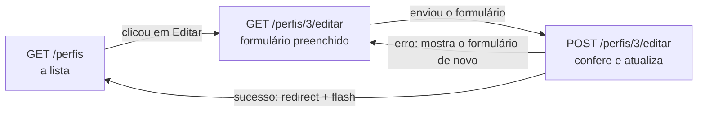

# Capítulo 13 — UPDATE e DELETE de perfis

**Disciplina:** Programação para Internet (ILP951)
**Professor:** Ronan Adriel Zenatti · ronan.zenatti@cps.sp.gov.br
**Fatec Jahu — 2º Semestre/2026**

---

## 🎯 Objetivos do Capítulo

Ao final deste capítulo você deverá ser capaz de:

- Reaproveitar o formulário de cadastro para a edição, com uma variável (`acao`) que diz ao template em qual modo ele está
- Mover as conferências do perfil para uma função usada pelas rotas de cadastro e de edição
- Gravar a edição com `UPDATE ... WHERE id_perfil = %s`, ignorando o próprio perfil na conferência do nome repetido
- Explicar por que a existência do registro é conferida com `SELECT`, e não com `rowcount`
- Explicar por que a exclusão aceita só `POST` e pedir a confirmação em um modal do Bootstrap
- Acionar o modal com uma função JavaScript que recebe o código do perfil
- Reconhecer o erro `1451` e impedir a exclusão de um perfil que tem usuários, com `SELECT COUNT(*)` antes e `except Error` como barreira final

O Capítulo 12 entregou a metade do CRUD de perfis: **ler** (`SELECT`) e **criar** (`INSERT`). Faltam as duas operações mais delicadas, **alterar** (`UPDATE`) e **excluir** (`DELETE`), porque são as que podem estragar dados de verdade. Um `UPDATE` sem `WHERE` altera a tabela inteira (todos os perfis passariam a ter o mesmo nome), e um `DELETE` apaga sem volta. Por isso o foco deste capítulo não é só fazer funcionar, é fazer funcionar **com segurança**. Ao final, o recurso `perfis` fica completo, e o mesmo molde de rotas e de nomes será repetido para `usuarios` e `produtos`.

## 📦 Ponto de partida

Este capítulo continua do **seu** repositório `sistema-gestao`, como ficou no fim do Capítulo 12: com o `app.py`, o `db.py`, o `validacoes.py`, a pasta `templates` (`base.html`, `index.html`, `perfis.html`, `perfil_form.html`, `404.html` e `500.html`) e os perfis **Administrador**, **Gerente** e **Usuário** cadastrados. O Capítulo 12.1 é opcional: este capítulo parte do código do 12, e os trechos mostram a lista simples do 12, sem a busca e a paginação.

Se o seu projeto não está funcionando, baixe o código do Capítulo 12 e descompacte. Depois de descompactar, crie o ambiente virtual e o `.env`, como no [Capítulo 11, Tópico 4](Capitulo_11_Projeto_Novo_e_Banco.md#topico-4-o-arquivo-env), importe o `banco.sql` no phpMyAdmin e cadastre os três perfis pelo formulário:

➡️ [Baixar p2_cap_12.zip](../arquivos/p2_cap_12.zip)

```bash
python -m venv venv
venv\Scripts\activate
pip install -r requirements.txt
copy .env.example .env
```

---

## Tópico 1 — Editar: o formulário já preenchido

### Antes de começar

Ligue o **Apache** e o **MySQL** no painel do XAMPP. Abra a pasta `sistema-gestao` no VS Code, o terminal (`Ctrl + '`), ative o ambiente virtual e confira o Git:

```bash
venv\Scripts\activate
git status
```

O `git status` deve dizer `nothing to commit, working tree clean`. Ligue o servidor com `python app.py`, deixe esse terminal rodando durante o capítulo (use um segundo terminal, o ícone **+**, para o Git e para os testes) e abra **http://127.0.0.1:5000/perfis**. A lista mostra os três perfis do Capítulo 12.

### O mapa do recurso, agora completo

O Capítulo 12 mostrou o molde de nomes do recurso. Este capítulo acrescenta as duas linhas que faltavam:

| Rota | Métodos | O que faz | Função no `app.py` | Template |
|---|---|---|---|---|
| `/perfis` | GET | Lista os perfis | `lista_perfis` | `perfis.html` |
| `/perfis/novo` | GET e POST | GET mostra o formulário, POST confere e grava | `perfil_novo` | `perfil_form.html` |
| `/perfis/<int:perfil_id>/editar` | GET e POST | GET mostra o formulário preenchido, POST confere e atualiza | `perfil_editar` | `perfil_form.html` |
| `/perfis/<int:perfil_id>/excluir` | só POST | Exclui o perfil e volta para a lista | `perfil_excluir` | (nenhum) |

Repare que o `editar` usa o **mesmo template** do `novo`, e que o `excluir` não tem template: ele não mostra nada, só faz o que foi pedido e redireciona. O caminho do navegador na edição é parecido com o do cadastro:



### Buscar o perfil pelo código

Na rota de edição, o código do perfil vem **no endereço** (`/perfis/3/editar`), como a variável de rota do [Capítulo 3](Capitulo_03_Flask.md). No `app.py`, acrescente a importação do `abort` na primeira linha do Flask:

```python
from flask import Flask, render_template, request, redirect, url_for, flash, abort
```

E acrescente a rota `perfil_editar`, **depois** da `perfil_novo` e antes dos `@app.errorhandler`. Por enquanto ela só busca o perfil e mostra o formulário:

```python
@app.route('/perfis/<int:perfil_id>/editar')
def perfil_editar(perfil_id):
    perfil = execute_one(
        'SELECT id_perfil, nome, descricao FROM perfis WHERE id_perfil = %s',
        (perfil_id,),
    )
    if perfil is None:
        abort(404)

    return render_template('perfil_form.html', nome=perfil['nome'], descricao=perfil['descricao'])
```

!!! note "Flask: `<int:perfil_id>` e `abort(404)`"
    O `<int:perfil_id>` captura o pedaço do endereço, converte para número inteiro e entrega à função como o parâmetro `perfil_id`. Um endereço como `/perfis/abc/editar` nem chega à função: o Flask já responde 404. O `execute_one` devolve o perfil encontrado ou `None`, e o `abort(404)` interrompe a rota e mostra a página 404 do Capítulo 11. A tupla `(perfil_id,)` tem a vírgula que o Python exige para uma tupla de um item.

Salve. Na lista, descubra o código de um perfil (a primeira coluna) e abra, pela barra de endereço, `http://127.0.0.1:5000/perfis/` + o código + `/editar`. O formulário aparece **preenchido** com o nome e a descrição do perfil. Agora abra `/perfis/99999/editar`: a página 404, porque não existe perfil com esse código.

Abra o formulário do **Gerente**, que você cadastrou sem descrição no Capítulo 12. O campo da descrição mostra a palavra **None**. É o mesmo problema da lista no Capítulo 12: a coluna aceita `NULL`, o Python entrega `None`, e o Jinja o escreve como texto. Aqui o `None` iria para dentro do campo, e quem clicasse em **Salvar** gravaria o texto "None" na descrição. A rota precisa trocar o `None` por um texto vazio antes de entregar ao template. Troque a última linha da rota por:

```python
    nome = perfil['nome']
    descricao = perfil['descricao']
    if descricao is None:
        descricao = ''

    return render_template('perfil_form.html', nome=nome, descricao=descricao)
```

Salve e recarregue o formulário do Gerente: o campo vem vazio. (A conferência é `is None`, e não `== None`: é o jeito do Python de perguntar se o valor é o "nada".)

### Uma variável para os dois modos: `acao`

O formulário já aparece preenchido, mas ainda diz **Novo perfil**, o botão diz **Salvar perfil** e o `action` aponta para a rota de cadastro. Em vez de criar um segundo template quase igual (e ter de lembrar de mexer nos dois a cada campo novo), o `perfil_form.html` passa a servir aos dois modos. Uma variável, `acao`, diz em qual deles ele está: `'criar'` ou `'editar'`.

Primeiro, as rotas entregam a informação. Na `perfil_editar`, a última linha passa a ser:

```python
    return render_template('perfil_form.html', acao='editar', perfil_id=perfil_id,
                           nome=nome, descricao=descricao)
```

E, na `perfil_novo`, o `render_template` do final passa a ser:

```python
    return render_template('perfil_form.html', acao='criar', perfil_id=None,
                           nome=nome, descricao=descricao)
```

Salve e recarregue as duas telas: nada mudou, o template só **recebeu** a informação. Agora ele a usa. No `templates/perfil_form.html`, troque o título da aba e o `<h1>`:

```html
Editar perfilNovo perfil — Sistema de Gestão
```

```html
  <h1 class="h2 mb-4">Editar perfilNovo perfil</h1>
```

Salve e compare `/perfis/novo` com a edição de um perfil: o mesmo arquivo, dois títulos. O `action` do formulário é o mais importante: no cadastro aponta para `perfil_novo`, e na edição precisa apontar para `perfil_editar` **com o código do perfil**. No começo do ``, guarde o destino em uma variável:

```html

  
    
  
    
  
```

!!! note "Jinja: ``"
    O `` cria uma variável **dentro do template**, como o `destino = ...` do Python. Aqui ela guarda um endereço escolhido pelo `if`. O Jinja só executa o ramo que vale: no cadastro, o `perfil_id` é `None`, mas o `url_for('perfil_editar', ...)` nem chega a rodar.

E use a variável no formulário:

```html
          <form action="{{ destino }}" method="post">
```

Salve, abra a edição de um perfil e clique em **Salvar perfil**. A página mostra **Method Not Allowed** (405). O endereço de destino está certo (`/perfis/3/editar`), mas a rota `perfil_editar` ainda só aceita `GET`. É a deixa para o próximo tópico. Falta só o texto do botão. Troque o botão de envio por:

```html
              <button type="submit" class="btn btn-primary">Salvar alteraçõesSalvar perfil</button>
```

Salve e confira os dois modos: o cadastro mostra **Salvar perfil**, e a edição mostra **Salvar alterações**.

### Os caminhos até o formulário

Para chegar à edição sem digitar o endereço, a lista ganha uma coluna **Ações**. No `perfis.html`, acrescente o cabeçalho depois de `Criado em`:

```html
        <th class="text-end">Ações</th>
```

Na linha do `for`, depois da célula do `criado_em`:

```html
        <td class="text-end">
          <a href="{{ url_for('perfil_editar', perfil_id=perfil.id_perfil) }}" class="btn btn-sm btn-outline-primary">Editar</a>
        </td>
```

E o `colspan` do `` passa de `4` para `5`. Por fim, no `base.html`, o item **Perfis** do menu precisa continuar destacado durante a edição. Acrescente `'perfil_editar'` à lista do `request.endpoint`:

```html
            <a class="nav-link active" href="{{ url_for('lista_perfis') }}">Perfis</a>
```

Salve e navegue: **Perfis**, **Editar** em uma linha, o formulário preenchido, **Cancelar** de volta à lista.

```bash
git add .
git commit -m "Adiciona o formulário de edição de perfil com a variável acao"
git push
```

---

## Tópico 2 — Salvar a edição (UPDATE)

### A dor: as mesmas conferências, de novo

A edição precisa conferir **os mesmos campos** do cadastro: nome obrigatório, entre 3 e 100 caracteres, descrição de até 255 e nome que ainda não existe. Essas conferências hoje estão escritas dentro da `perfil_novo`. Copiá-las para uma segunda rota seria repetir cerca de vinte linhas, e o dia em que uma regra mudar você corrigiria uma rota e esqueceria a outra. A saída é mover as conferências para **uma função**, e as duas rotas a chamam.

Há uma única diferença entre os dois casos, e ela está no nome repetido: na edição, o **próprio** perfil não conta como repetido. Quem abre o Gerente e só corrige a descrição envia o nome `Gerente`, que já existe, e é dele mesmo. A função recebe o código do perfil que está sendo editado (`id_atual`), e o `SELECT` passa a ignorá-lo com `id_perfil <> %s`.

!!! note "SQL: `<>` é “diferente de”"
    O `WHERE nome = %s AND id_perfil <> %s` procura um perfil com **aquele nome** e com um código **diferente** do informado. Se o único perfil com esse nome for o próprio, o `SELECT` não devolve nada, e não há repetição.

No `app.py`, **acima** da `perfil_novo`, escreva a função. Ela não tem `@app.route`: não é uma rota, é só um pedaço do código que as rotas chamam.

```python
def conferir_perfil(nome, descricao, id_atual):
    erros = []

    erro = validar_nome_perfil(nome)
    if erro:
        erros.append(erro)

    erro = validar_descricao_perfil(descricao)
    if erro:
        erros.append(erro)

    if not erros:
        existente = execute_one(
            'SELECT id_perfil FROM perfis WHERE nome = %s AND id_perfil <> %s',
            (nome, id_atual),
        )
        if existente:
            erros.append('Já existe um perfil com este nome.')

    return erros
```

!!! note "Python: uma função que devolve uma lista"
    A função recebe três valores, junta as mensagens de erro em uma lista e a devolve com o `return`. Uma lista vazia significa que está tudo certo. É a mesma ideia do Capítulo 12, só que agora o código fica num lugar só. Quem a chama decide o que fazer com a lista.

Agora a `perfil_novo` usa a função. Dentro do `if request.method == 'POST':`, **apague** tudo o que está entre as duas leituras do `request.form` e o `if erros:` (o `erros = []`, as duas validações e o `SELECT` do nome repetido) e deixe no lugar:

```python
        erros = conferir_perfil(nome, descricao, 0)
```

O `0` é o `id_atual` do cadastro: nenhum perfil tem o código `0`, então a condição `id_perfil <> 0` não exclui ninguém, e o `SELECT` procura o nome em todos os perfis, como antes. O resto da rota (o `if erros:`, o `INSERT` e o `try/except`) não muda.

**Salve e teste antes de seguir.** Uma reorganização só é segura se o comportamento continua igual. Cadastre um perfil `Teste`, cadastre `Teste` de novo (deve aparecer `Já existe um perfil com este nome.`) e cadastre `ab` (mínimo de 3 caracteres). Tudo deve funcionar como no Capítulo 12. Se algo quebrou, o problema está na troca que você acabou de fazer, e é mais fácil achá-lo agora do que depois de escrever mais código em cima. Deixe o perfil `Teste` na lista: ele será usado mais adiante.

### A rota de edição recebe o POST

Agora a `perfil_editar` aceita o envio. Troque a linha do `@app.route` para aceitar os dois métodos:

```python
@app.route('/perfis/<int:perfil_id>/editar', methods=['GET', 'POST'])
```

E, **antes** do `return render_template(...)` do final da rota, acrescente o `if` do POST. Por enquanto ele só confere e avisa:

```python
    if request.method == 'POST':
        nome = request.form.get('nome', '').strip()
        descricao = request.form.get('descricao', '').strip()

        erros = conferir_perfil(nome, descricao, perfil_id)

        if erros:
            for mensagem in erros:
                flash(mensagem, 'danger')
        else:
            flash('Dados válidos. Ainda não gravei no banco.', 'success')
```

Repare que o `nome` e a `descricao` são **reescritos** com o que veio do formulário. Se houver erro, a rota cai no `render_template` do final e devolve o formulário com o que a pessoa digitou, e não com o que estava no banco. Salve e teste, na edição do perfil `Teste`:

- Mude a descrição e salve: faixa verde `Dados válidos. Ainda não gravei no banco.`, e o banco continua igual.
- Troque o nome por `administrador` (tudo minúsculo): faixa vermelha `Já existe um perfil com este nome.`, e o formulário continua **em modo de edição**, com `administrador` no campo. Lembre que a ordenação do banco ignora maiúsculas.
- Envie o próprio nome, `Teste`, sem mudar nada: faixa verde. O próprio perfil **não** conta como repetido, por causa do `id_perfil <> %s`.

### O UPDATE, com o WHERE que não pode faltar

Os dados chegam conferidos. Falta trocar o aviso provisório pela gravação. Troque o `else` do final do `if erros:` por este:

```python
        else:
            if descricao == '':
                descricao_gravada = None
            else:
                descricao_gravada = descricao

            try:
                execute_query(
                    'UPDATE perfis SET nome = %s, descricao = %s WHERE id_perfil = %s',
                    (nome, descricao_gravada, perfil_id),
                )
                flash(f'Perfil "{nome}" atualizado.', 'success')
                return redirect(url_for('lista_perfis'))
            except Error as erro:
                if erro.errno == 1062:
                    flash('Já existe um perfil com este nome.', 'danger')
                else:
                    raise
```

O `if descricao == ''` é o mesmo do cadastro: campo opcional em branco vira `NULL`, nunca `''`. O `try/except` também: entre o `SELECT` da conferência e o `UPDATE` outra pessoa pode cadastrar o mesmo nome, e só o `UNIQUE` do banco garante de verdade ([Capítulo 12, Tópico 6](Capitulo_12_INSERT_e_SELECT_de_Perfis.md#topico-6-nome-repetido-o-erro-1062)). Olhe com atenção a última peça do comando: **`WHERE id_perfil = %s`**. É ela que restringe a alteração ao perfil certo.

!!! danger "UPDATE sem WHERE altera a tabela inteira"
    Sem o `WHERE`, o `UPDATE perfis SET nome = %s` trocaria o nome de **todos** os perfis para o mesmo valor. O banco não pergunta se você tem certeza. O código do perfil vem do **endereço** (`perfil_id`, já convertido para número pelo Flask), e não de um campo do formulário, que a pessoa poderia adulterar. O restante segue o que você já sabe: valores em `%s`, `commit` dentro do `execute_query`, PRG com `redirect` e `flash`.

Salve e faça os testes, nesta ordem:

1. Edite a descrição do perfil `Teste` e salve: você volta para a lista, com a faixa verde `Perfil "Teste" atualizado.` e a nova descrição na tabela.
2. Abra a edição de novo e clique em **Salvar alterações** **sem mudar nada**: o resultado é a faixa verde, e não um erro. A explicação está no quadro logo adiante.
3. Apague a descrição e salve: na lista, a célula mostra o traço cinza. No phpMyAdmin (banco `gestao`, tabela `perfis`, aba **Procurar**), a descrição aparece como `NULL`.
4. Ainda no phpMyAdmin, compare as colunas `criado_em` e `atualizado_em` do perfil `Teste`: a segunda mudou depois das edições, e a primeira continua igual. O próprio banco cuida disso (`ON UPDATE CURRENT_TIMESTAMP`, do `banco.sql` do Capítulo 11), sem nenhuma linha de Python. Na edição do item 2, em que nada mudou, o `atualizado_em` **não** muda.
5. Acesse `/perfis/99999/editar`: a página 404, porque o perfil não existe.
6. Confira na lista que **só** o perfil editado mudou.

### Por que o SELECT vem antes, e não o `rowcount`

A rota confere se o perfil existe com um `SELECT` **antes** de tentar o `UPDATE`. Seria mais curto executar o `UPDATE` e olhar quantas linhas ele alterou (o `rowcount`, que o `execute_query` devolve). Teste no segundo terminal, trocando `3` por um código que exista na sua lista:

```bash
python -c "from db import execute_query; print(execute_query('UPDATE perfis SET nome = nome WHERE id_perfil = 3')); print(execute_query('UPDATE perfis SET nome = nome WHERE id_perfil = 99999'))"
```

As duas linhas imprimem `0`. O MySQL conta as linhas **efetivamente modificadas**: um `UPDATE` que grava os mesmos valores que já estavam lá (a primeira linha) modifica zero linhas, exatamente como um `UPDATE` de um código que não existe (a segunda). Se a rota usasse `rowcount == 0` como "não encontrei", quem clicasse em **Salvar** sem mudar nada receberia um erro falso. Por isso a existência é verificada por um `SELECT`, e o `rowcount` não decide isso.

A rota `perfil_editar` completa, para conferir com a sua:

```python
@app.route('/perfis/<int:perfil_id>/editar', methods=['GET', 'POST'])
def perfil_editar(perfil_id):
    perfil = execute_one(
        'SELECT id_perfil, nome, descricao FROM perfis WHERE id_perfil = %s',
        (perfil_id,),
    )
    if perfil is None:
        abort(404)

    nome = perfil['nome']
    descricao = perfil['descricao']
    if descricao is None:
        descricao = ''

    if request.method == 'POST':
        nome = request.form.get('nome', '').strip()
        descricao = request.form.get('descricao', '').strip()

        erros = conferir_perfil(nome, descricao, perfil_id)

        if erros:
            for mensagem in erros:
                flash(mensagem, 'danger')
        else:
            if descricao == '':
                descricao_gravada = None
            else:
                descricao_gravada = descricao

            try:
                execute_query(
                    'UPDATE perfis SET nome = %s, descricao = %s WHERE id_perfil = %s',
                    (nome, descricao_gravada, perfil_id),
                )
                flash(f'Perfil "{nome}" atualizado.', 'success')
                return redirect(url_for('lista_perfis'))
            except Error as erro:
                if erro.errno == 1062:
                    flash('Já existe um perfil com este nome.', 'danger')
                else:
                    raise

    return render_template('perfil_form.html', acao='editar', perfil_id=perfil_id,
                           nome=nome, descricao=descricao)
```

```bash
git add .
git commit -m "Move as conferências do perfil para uma função e grava a edição com UPDATE"
git push
```

---

## Tópico 3 — Excluir com segurança (DELETE)

### O comando

Excluir um perfil, no SQL, é o `DELETE`:

```sql
DELETE FROM perfis WHERE id_perfil = 3;
```

Valem os mesmos cuidados do `UPDATE`: sem o `WHERE`, o `DELETE` apaga **todas** as linhas da tabela, e não existe "desfazer". Um número que já foi usado também não volta: o `AUTO_INCREMENT` nunca reaproveita um código apagado, e o perfil seguinte ganha um número maior. Todas as exclusões deste capítulo são pelo código, e o código sempre vem do endereço.

### Por que excluir nunca pode ser um link

A forma mais curta de implementar a exclusão seria um link na tabela, `<a href="/perfis/3/excluir">Excluir</a>`, com uma rota `GET` que apaga o perfil. **Isso é uma falha de segurança.** O `GET` existe para **consultar**, e a web inteira parte do princípio de que um `GET` não altera nada. Por isso vários programas fazem `GET` sozinhos, sem que ninguém clique em nada: os robôs de busca seguem todos os links da página, os navegadores carregam links antes do clique para acelerar a navegação, e os aplicativos de mensagem fazem a pré-visualização de qualquer link colado em uma conversa. Com a exclusão em um link, qualquer um deles poderia **apagar perfis** só por passar pela página.

A exclusão exige um clique humano **deliberado**, e a forma de garantir isso é o método `POST`, que só sai de um formulário quando alguém aperta o botão. É o mesmo princípio do formulário de cadastro, e a mesma proteção CSRF.

### A rota que só aceita POST

No `app.py`, acrescente a rota depois da `perfil_editar`:

```python
@app.route('/perfis/<int:perfil_id>/excluir', methods=['POST'])
def perfil_excluir(perfil_id):
    perfil = execute_one(
        'SELECT id_perfil, nome FROM perfis WHERE id_perfil = %s',
        (perfil_id,),
    )
    if perfil is None:
        abort(404)

    execute_query('DELETE FROM perfis WHERE id_perfil = %s', (perfil_id,))
    flash(f'Perfil "{perfil["nome"]}" excluído.', 'success')

    return redirect(url_for('lista_perfis'))
```

O `SELECT` inicial cumpre dois papéis: responde 404 para um código que não existe e traz o **nome**, para a mensagem dizer qual perfil foi excluído. O `methods=['POST']` é o que protege: sem ele, uma rota Flask aceita só `GET`, e com ele aceita **só** `POST`. Salve e digite, na barra de endereço, `http://127.0.0.1:5000/perfis/3/excluir` (com qualquer código). O navegador faz um `GET`, e a resposta é **Method Not Allowed** (405): a rota recusa quem não veio por um `POST`. É onde o robô de busca, o carregamento antecipado e a pré-visualização esbarram, e nada é excluído.

### O botão, dentro de um formulário

Para a pessoa acionar a rota, a coluna **Ações** da lista ganha um **formulário** com um botão, e não um link. No `perfis.html`, dentro da célula de ações, **depois** do link **Editar**:

```html
          <form action="{{ url_for('perfil_excluir', perfil_id=perfil.id_perfil) }}" method="post" class="d-inline">
            <input type="hidden" name="csrf_token" value="{{ csrf_token() }}">
            <button type="submit" class="btn btn-sm btn-outline-danger">Excluir</button>
          </form>
```

O `class="d-inline"` mantém o formulário na mesma linha do botão **Editar**, e o `csrf_token` é o mesmo de todo formulário POST do projeto. Salve e recarregue. Na linha do perfil `Teste` (que você cadastrou no tópico anterior), clique em **Excluir**: o perfil some da lista, com a faixa verde `Perfil "Teste" excluído.` Funciona. Mas note o problema: **um clique sem querer já exclui**, e não há como se arrepender. Falta uma etapa de confirmação. Cadastre o perfil `Teste` de novo, porque ele será usado nos próximos testes.

### O modal de confirmação

O Bootstrap tem um componente pronto para isso, o **modal**: uma janela que aparece por cima da página e pede uma confirmação. Em vez de repetir um modal para cada linha da tabela, o `perfis.html` terá **um só**, reaproveitado por todas as linhas. Primeiro o HTML do modal. No final do ``, depois da `</table>`:

```html
  <div class="modal fade" id="modalExcluir" tabindex="-1" aria-labelledby="tituloModalExcluir" aria-hidden="true">
    <div class="modal-dialog modal-dialog-centered">
      <div class="modal-content">
        <div class="modal-header">
          <h2 class="modal-title h5" id="tituloModalExcluir">Excluir perfil</h2>
          <button type="button" class="btn-close" data-bs-dismiss="modal" aria-label="Fechar"></button>
        </div>
        <form id="formExcluir" action="" method="post">
          <input type="hidden" name="csrf_token" value="{{ csrf_token() }}">
          <div class="modal-body">
            <p class="mb-0">Excluir o perfil <strong id="nomeExcluir"></strong>? Esta ação não pode ser desfeita.</p>
          </div>
          <div class="modal-footer">
            <button type="button" class="btn btn-outline-secondary" data-bs-dismiss="modal">Cancelar</button>
            <button type="submit" class="btn btn-danger">Excluir</button>
          </div>
        </form>
      </div>
    </div>
  </div>
```

Os dois botões do rodapé são o ponto da confirmação: **Cancelar** (`data-bs-dismiss="modal"`) só fecha a janela, e **Excluir** (`type="submit"`) é o único que envia o `POST`. O formulário começa com o `action=""` vazio de propósito: o endereço certo depende do perfil clicado, e só será conhecido na hora do clique.

Agora o botão da linha deixa de ser um formulário e passa a **abrir** o modal. Na célula de ações, **troque** o `<form>` inteiro de antes por este botão comum:

```html
          <button type="button" class="btn btn-sm btn-outline-danger" data-bs-toggle="modal" data-bs-target="#modalExcluir">Excluir</button>
```

O `data-bs-toggle` e o `data-bs-target` são do Bootstrap: dizem "este botão abre o modal `#modalExcluir`". Salve, recarregue e clique em **Excluir**: a janela aparece, mas o nome do perfil está **vazio**. Clique em **Cancelar**: a janela fecha, e nada é excluído. Abra de novo e clique em **Excluir** dentro da janela: aparece **Method Not Allowed**, porque o `action` está vazio e o formulário enviou o `POST` para `/perfis`, uma rota que só aceita `GET`. O modal está pronto, e falta preenchê-lo com o perfil da linha clicada.

### Uma função JavaScript que recebe o código

Quem preenche o modal é uma **função JavaScript**, como a do [Capítulo 2](Capitulo_02_Clone_Pull_Formulario_CSS_e_JS.md#uma-funcao-que-so-roda-quando-chamada), chamada pelo `onclick` do botão. Ela recebe o **código** do perfil e faz duas coisas: escreve o nome na janela e aponta o formulário para a rota daquele perfil.

Primeiro, a função precisa achar o nome. Dê um `id` à célula do nome, que passa a incluir o código do perfil. Na linha do `for`, troque a célula do nome por:

```html
        <td id="nome_perfil_{{ perfil.id_perfil }}">{{ perfil.nome }}</td>
```

Para o perfil de código 3, o HTML gerado é `<td id="nome_perfil_3">Teste</td>`. Agora o botão **chama** a função, passando o código. Troque o botão da linha por:

```html
          <button type="button" class="btn btn-sm btn-outline-danger" data-bs-toggle="modal" data-bs-target="#modalExcluir" onclick="prepararExclusao({{ perfil.id_perfil }})">Excluir</button>
```

O Jinja troca `{{ perfil.id_perfil }}` pelo número: no perfil 3, o navegador recebe `onclick="prepararExclusao(3)"`. Por último, a função. O `base.html` já tem o `` depois do JavaScript do Bootstrap. No **final** do `perfis.html`, **depois** do `` do conteúdo, acrescente:

```html

<script>
  function prepararExclusao(id) {
    const nome = document.getElementById('nome_perfil_' + id).textContent;
    document.getElementById('nomeExcluir').textContent = nome;
    document.getElementById('formExcluir').action = '/perfis/' + id + '/excluir';
  }
</script>

```

!!! note "JavaScript: as três linhas da função"
    1. `document.getElementById('nome_perfil_' + id)` acha a célula do nome. O `+` junta textos, como no Python: com `id` valendo `3`, o texto é `nome_perfil_3`. O `.textContent` lê o texto que está dentro da célula.
    2. A segunda linha escreve esse nome no `<strong id="nomeExcluir">` da janela. O `.textContent` também **escreve**, e sempre como texto puro, nunca como HTML.
    3. A terceira troca o `action` do formulário por `/perfis/3/excluir`, o mesmo endereço da rota `perfil_excluir`. Se um dia você mudar o endereço da rota, mude aqui também.

    A função recebe só o **código**, e não o nome: um nome com aspas, como `Chefe "Geral"`, quebraria o atributo `onclick`. Lendo o nome da própria célula, o problema não existe.

Salve, recarregue a lista e clique em **Excluir** na linha do `Teste`: a janela mostra `Excluir o perfil Teste?`. Clique em **Cancelar**, depois em **Excluir** na linha de **outro** perfil: o texto muda, porque o mesmo modal foi reaproveitado. Para terminar, confirme a exclusão do `Teste`: o perfil some da lista, com a faixa verde. **Não** exclua os três perfis do sistema. Cadastre o `Teste` de novo, porque falta um tópico.

```bash
git add .
git commit -m "Adiciona a exclusão de perfil por POST com modal de confirmação"
git push
```

---

## Tópico 4 — Perfil em uso: o erro 1451

### Um usuário para o teste

O que acontece quando alguém tenta excluir um perfil que **tem usuários**? A tabela `usuarios` tem uma chave estrangeira para `perfis`, e o `banco.sql` do Capítulo 11 a criou com `ON DELETE RESTRICT`: o banco **recusa** excluir um perfil enquanto houver usuário apontando para ele. Para ver isso, é preciso um usuário. O cadastro de usuários só chega no Capítulo 14, então ele vai ser criado direto no phpMyAdmin, só para o teste.

Antes, cadastre pelo sistema um perfil chamado `Visitante`. Depois abra o **phpMyAdmin**, selecione o banco `gestao`, clique na aba **SQL**, cole o comando e clique em **Executar**:

```sql
INSERT INTO usuarios (nome, email, senha, perfil_id)
VALUES ('Usuário de Teste', 'teste@exemplo.com', 'hash-de-teste',
        (SELECT id_perfil FROM perfis WHERE nome = 'Visitante'));
```

O `SELECT` dentro dos parênteses busca o código do perfil `Visitante`, seja qual for. A `senha` aqui é um texto qualquer: este usuário não vai entrar no sistema, e a senha de verdade (um **hash**) só aparece no Capítulo 14. Confira na tabela `usuarios`: há uma linha.

### O que o banco responde

Na lista de perfis, clique em **Excluir** na linha do `Visitante` e confirme. A página de depuração do Flask aparece com algo assim:

```text
mysql.connector.errors.IntegrityError: 1451 (23000): Cannot delete or update a parent row: a foreign key constraint fails (`gestao`.`usuarios`, CONSTRAINT `fk_usuarios_perfis` FOREIGN KEY (`perfil_id`) REFERENCES `perfis` (`id_perfil`) ON UPDATE CASCADE)
```

Como no `1062` do Capítulo 12, duas coisas para notar. A boa: **o banco protegeu os dados**, o perfil continua na lista e o usuário não ficou sem perfil. A ruim: quem usa o sistema vê uma página técnica. O número **1451** é o código do MySQL para "não dá para excluir esta linha, porque outras linhas dependem dela". O `rollback()` do `execute_query` desfaz o que ficou pela metade, e o `raise` repete o erro para a rota. As defesas são as mesmas do cadastro: perguntar antes e reconhecer o erro.

### Primeira defesa: contar os usuários antes

Antes de excluir, a rota pergunta ao banco quantos usuários o perfil tem. Na `perfil_excluir`, **depois** do `if perfil is None:` e **antes** do `DELETE`:

```python
    usuarios = execute_one(
        'SELECT COUNT(*) AS total FROM usuarios WHERE perfil_id = %s',
        (perfil_id,),
    )
    if usuarios['total'] > 0:
        flash(f'O perfil "{perfil["nome"]}" tem {usuarios["total"]} usuário(s) e não pode ser excluído.', 'danger')
        return redirect(url_for('lista_perfis'))
```

O `COUNT(*)` conta as linhas encontradas, e o `AS total` dá um nome à coluna do resultado, como no cartão do Início ([Capítulo 11](Capitulo_11_Projeto_Novo_e_Banco.md)). Se houver algum usuário, a rota avisa com a quantidade e **volta para a lista** sem tentar o `DELETE`. Salve e tente excluir o `Visitante` de novo: a faixa vermelha diz `O perfil "Visitante" tem 1 usuário(s) e não pode ser excluído.`, e a página de depuração não aparece mais.

### Por que a contagem não basta

Como no `SELECT` do nome repetido, passa um intervalo entre a contagem e o `DELETE`. Se outra pessoa cadastrar um usuário nesse perfil bem nessa hora, a contagem dá `0`, e o banco recusa o `DELETE` com o `1451`. A contagem dá a **mensagem amigável** na imensa maioria dos casos, e a garantia de verdade é a chave estrangeira do banco. Falta o `try/except`. No `app.py`, troque as duas linhas do `DELETE` e do `flash` do final da rota por:

```python
    try:
        execute_query('DELETE FROM perfis WHERE id_perfil = %s', (perfil_id,))
        flash(f'Perfil "{perfil["nome"]}" excluído.', 'success')
    except Error as erro:
        if erro.errno == 1451:
            flash(f'O perfil "{perfil["nome"]}" está em uso e não pode ser excluído.', 'danger')
        else:
            raise
```

É o mesmo desenho do `1062`: se o `errno` for `1451`, a rota avisa a pessoa, e qualquer **outro** erro do banco é repetido com o `raise` e vira a página 500. Aqui não há `return` dentro do `try`, porque os dois caminhos terminam no mesmo lugar: o `redirect` para a lista, no final da rota.

Para ver a barreira final funcionando, desligue a primeira defesa por um instante: coloque um `#` na frente das **sete** linhas que vão do `usuarios = execute_one(` até o `return redirect(...)` do `if` (no VS Code, selecione e aperte `Ctrl + ;`). Salve e tente excluir o `Visitante`: a faixa vermelha `O perfil "Visitante" está em uso e não pode ser excluído.` vem do `except`, não mais da contagem. **Tire os `#`** para restaurar a primeira defesa e salve.

### O perfil sai quando deixa de estar em uso

No phpMyAdmin, aba **SQL**, apague o usuário de teste:

```sql
DELETE FROM usuarios WHERE email = 'teste@exemplo.com';
```

Volte à lista e exclua o `Visitante` e o `Teste`: agora a exclusão funciona, porque nenhum usuário depende deles. Os perfis **Administrador**, **Gerente** e **Usuário** ficam, porque o sistema os usa até o fim do projeto.

| Situação | Quem trata | O que a pessoa vê |
|---|---|---|
| Código de perfil que não existe | `SELECT` + `abort(404)` | A página 404 |
| Nome repetido ao editar | `conferir_perfil` (e o `1062` do `UPDATE`) | Faixa vermelha: "Já existe um perfil com este nome." |
| Perfil com usuários (caso comum) | `SELECT COUNT(*)` antes do `DELETE` | Faixa vermelha com a quantidade de usuários |
| Perfil com usuários (cadastro simultâneo) | Chave estrangeira, erro `1451` capturado | Faixa vermelha: "está em uso" |
| Qualquer outro erro do banco | Ninguém na rota (o `raise` repete) | A página 500 |

```bash
git add .
git commit -m "Impede a exclusão de perfil em uso com COUNT e com o erro 1451"
git push
```

---

## Os arquivos completos do capítulo

O `app.py`:

```python
import os

from dotenv import load_dotenv
from flask import Flask, render_template, request, redirect, url_for, flash, abort
from flask_wtf.csrf import CSRFProtect
from mysql.connector import Error

from db import execute_query, execute_one, execute_insert
from validacoes import validar_nome_perfil, validar_descricao_perfil

load_dotenv()

app = Flask(__name__)
app.secret_key = os.getenv('SECRET_KEY')

CSRFProtect(app)


@app.route('/')
def index():
    perfis = execute_one('SELECT COUNT(*) AS total FROM perfis')
    usuarios = execute_one('SELECT COUNT(*) AS total FROM usuarios')
    produtos = execute_one('SELECT COUNT(*) AS total FROM produtos')

    return render_template('index.html', titulo='Sistema de Gestão',
                           total_perfis=perfis['total'],
                           total_usuarios=usuarios['total'],
                           total_produtos=produtos['total'])


@app.route('/perfis')
def lista_perfis():
    perfis = execute_query(
        'SELECT id_perfil, nome, descricao, criado_em FROM perfis ORDER BY nome',
        fetch=True,
    )

    return render_template('perfis.html', titulo='Perfis', perfis=perfis)


def conferir_perfil(nome, descricao, id_atual):
    erros = []

    erro = validar_nome_perfil(nome)
    if erro:
        erros.append(erro)

    erro = validar_descricao_perfil(descricao)
    if erro:
        erros.append(erro)

    if not erros:
        existente = execute_one(
            'SELECT id_perfil FROM perfis WHERE nome = %s AND id_perfil <> %s',
            (nome, id_atual),
        )
        if existente:
            erros.append('Já existe um perfil com este nome.')

    return erros


@app.route('/perfis/novo', methods=['GET', 'POST'])
def perfil_novo():
    nome = ''
    descricao = ''

    if request.method == 'POST':
        nome = request.form.get('nome', '').strip()
        descricao = request.form.get('descricao', '').strip()

        erros = conferir_perfil(nome, descricao, 0)

        if erros:
            for mensagem in erros:
                flash(mensagem, 'danger')
        else:
            if descricao == '':
                descricao_gravada = None
            else:
                descricao_gravada = descricao

            try:
                novo_id = execute_insert(
                    'INSERT INTO perfis (nome, descricao) VALUES (%s, %s)',
                    (nome, descricao_gravada),
                )
                flash(f'Perfil "{nome}" cadastrado (código {novo_id}).', 'success')
                return redirect(url_for('lista_perfis'))
            except Error as erro:
                if erro.errno == 1062:
                    flash('Já existe um perfil com este nome.', 'danger')
                else:
                    raise

    return render_template('perfil_form.html', acao='criar', perfil_id=None,
                           nome=nome, descricao=descricao)


@app.route('/perfis/<int:perfil_id>/editar', methods=['GET', 'POST'])
def perfil_editar(perfil_id):
    perfil = execute_one(
        'SELECT id_perfil, nome, descricao FROM perfis WHERE id_perfil = %s',
        (perfil_id,),
    )
    if perfil is None:
        abort(404)

    nome = perfil['nome']
    descricao = perfil['descricao']
    if descricao is None:
        descricao = ''

    if request.method == 'POST':
        nome = request.form.get('nome', '').strip()
        descricao = request.form.get('descricao', '').strip()

        erros = conferir_perfil(nome, descricao, perfil_id)

        if erros:
            for mensagem in erros:
                flash(mensagem, 'danger')
        else:
            if descricao == '':
                descricao_gravada = None
            else:
                descricao_gravada = descricao

            try:
                execute_query(
                    'UPDATE perfis SET nome = %s, descricao = %s WHERE id_perfil = %s',
                    (nome, descricao_gravada, perfil_id),
                )
                flash(f'Perfil "{nome}" atualizado.', 'success')
                return redirect(url_for('lista_perfis'))
            except Error as erro:
                if erro.errno == 1062:
                    flash('Já existe um perfil com este nome.', 'danger')
                else:
                    raise

    return render_template('perfil_form.html', acao='editar', perfil_id=perfil_id,
                           nome=nome, descricao=descricao)


@app.route('/perfis/<int:perfil_id>/excluir', methods=['POST'])
def perfil_excluir(perfil_id):
    perfil = execute_one(
        'SELECT id_perfil, nome FROM perfis WHERE id_perfil = %s',
        (perfil_id,),
    )
    if perfil is None:
        abort(404)

    usuarios = execute_one(
        'SELECT COUNT(*) AS total FROM usuarios WHERE perfil_id = %s',
        (perfil_id,),
    )
    if usuarios['total'] > 0:
        flash(f'O perfil "{perfil["nome"]}" tem {usuarios["total"]} usuário(s) e não pode ser excluído.', 'danger')
        return redirect(url_for('lista_perfis'))

    try:
        execute_query('DELETE FROM perfis WHERE id_perfil = %s', (perfil_id,))
        flash(f'Perfil "{perfil["nome"]}" excluído.', 'success')
    except Error as erro:
        if erro.errno == 1451:
            flash(f'O perfil "{perfil["nome"]}" está em uso e não pode ser excluído.', 'danger')
        else:
            raise

    return redirect(url_for('lista_perfis'))


@app.errorhandler(404)
def pagina_nao_encontrada(erro):
    return render_template('404.html'), 404


@app.errorhandler(500)
def erro_no_servidor(erro):
    return render_template('500.html'), 500


if __name__ == '__main__':
    app.run(debug=True)
```

O `templates/perfis.html`:

```html


{{ titulo }} — Sistema de Gestão


  <div class="d-flex justify-content-between align-items-center mb-3">
    <h1 class="h2 mb-0">{{ titulo }}</h1>
    <a href="{{ url_for('perfil_novo') }}" class="btn btn-primary">Novo perfil</a>
  </div>

  <table class="table table-striped table-hover">
    <thead class="table-light">
      <tr>
        <th>Código</th>
        <th>Nome</th>
        <th>Descrição</th>
        <th>Criado em</th>
        <th class="text-end">Ações</th>
      </tr>
    </thead>
    <tbody>
      
      <tr>
        <td>{{ perfil.id_perfil }}</td>
        <td id="nome_perfil_{{ perfil.id_perfil }}">{{ perfil.nome }}</td>
        <td>
          
            {{ perfil.descricao }}
          
            <span class="text-body-secondary">—</span>
          
        </td>
        <td>{{ perfil.criado_em.strftime('%d/%m/%Y') }}</td>
        <td class="text-end">
          <a href="{{ url_for('perfil_editar', perfil_id=perfil.id_perfil) }}" class="btn btn-sm btn-outline-primary">Editar</a>
          <button type="button" class="btn btn-sm btn-outline-danger" data-bs-toggle="modal" data-bs-target="#modalExcluir" onclick="prepararExclusao({{ perfil.id_perfil }})">Excluir</button>
        </td>
      </tr>
      
      <tr>
        <td colspan="5" class="text-center text-body-secondary py-4">Nenhum perfil cadastrado ainda.</td>
      </tr>
      
    </tbody>
  </table>

  <div class="modal fade" id="modalExcluir" tabindex="-1" aria-labelledby="tituloModalExcluir" aria-hidden="true">
    <div class="modal-dialog modal-dialog-centered">
      <div class="modal-content">
        <div class="modal-header">
          <h2 class="modal-title h5" id="tituloModalExcluir">Excluir perfil</h2>
          <button type="button" class="btn-close" data-bs-dismiss="modal" aria-label="Fechar"></button>
        </div>
        <form id="formExcluir" action="" method="post">
          <input type="hidden" name="csrf_token" value="{{ csrf_token() }}">
          <div class="modal-body">
            <p class="mb-0">Excluir o perfil <strong id="nomeExcluir"></strong>? Esta ação não pode ser desfeita.</p>
          </div>
          <div class="modal-footer">
            <button type="button" class="btn btn-outline-secondary" data-bs-dismiss="modal">Cancelar</button>
            <button type="submit" class="btn btn-danger">Excluir</button>
          </div>
        </form>
      </div>
    </div>
  </div>



<script>
  function prepararExclusao(id) {
    const nome = document.getElementById('nome_perfil_' + id).textContent;
    document.getElementById('nomeExcluir').textContent = nome;
    document.getElementById('formExcluir').action = '/perfis/' + id + '/excluir';
  }
</script>

```

O `templates/perfil_form.html`:

```html


Editar perfilNovo perfil — Sistema de Gestão


  
    
  
    
  

  <h1 class="h2 mb-4">Editar perfilNovo perfil</h1>

  <div class="row">
    <div class="col-lg-6">
      <div class="card">
        <div class="card-body">

          <form action="{{ destino }}" method="post">
            <input type="hidden" name="csrf_token" value="{{ csrf_token() }}">

            <div class="mb-3">
              <label for="nome" class="form-label">Nome do perfil</label>
              <input type="text" class="form-control" id="nome" name="nome" placeholder="Ex.: Administrador" value="{{ nome }}" required minlength="3" maxlength="100">
            </div>

            <div class="mb-3">
              <label for="descricao" class="form-label">Descrição (opcional)</label>
              <input type="text" class="form-control" id="descricao" name="descricao" placeholder="Ex.: Acesso total ao sistema" value="{{ descricao }}" maxlength="255">
            </div>

            <div class="d-flex gap-2">
              <button type="submit" class="btn btn-primary">Salvar alteraçõesSalvar perfil</button>
              <a href="{{ url_for('lista_perfis') }}" class="btn btn-outline-secondary">Cancelar</a>
            </div>

          </form>

        </div>
      </div>
    </div>
  </div>

```

A única mudança no `base.html` é o `'perfil_editar'` na lista do item **Perfis** do menu (Tópico 1). Os demais arquivos (`db.py`, `validacoes.py`, `index.html`, `404.html`, `500.html`, `estilo.css`, `testar_conexao.py`) são os do Capítulo 12.

---

## 📦 Código deste capítulo

Compare com o seu projeto, ou use como ponto de partida do próximo capítulo. O zip tem o `app.py`, o `db.py`, o `validacoes.py`, o `testar_conexao.py`, o `banco.sql`, o `.env.example`, o `.gitignore`, o `requirements.txt`, a pasta `templates` (`base.html`, `index.html`, `perfis.html`, `perfil_form.html`, `404.html` e `500.html`) e a pasta `static` (`estilo.css`). O ambiente virtual e o `.env` **não** vão no zip: depois de descompactar, crie o ambiente com os três comandos do Capítulo 3 e rode `copy .env.example .env`, trocando os marcadores `SUA_SENHA_AQUI` e `NOME_BANCO_DADOS` como no Capítulo 11. O banco também não vai dentro do zip: importe o `banco.sql` e cadastre os três perfis pelo formulário.

➡️ [Baixar p2_cap_13.zip](../arquivos/p2_cap_13.zip)

---

## 🃏 Flashcards de Revisão

Tente responder mentalmente antes de abrir.

??? question "Para que serve a variável `acao` no `perfil_form.html`?"
    Ela diz ao template se ele está no modo `'criar'` ou `'editar'`. Com ela, um único arquivo muda o título, o `action` do formulário e o texto do botão, em vez de existirem dois templates quase iguais para manter.

??? question "Por que a conferência do nome repetido usa `id_perfil <> %s` na edição?"
    Porque, ao editar, o perfil já existe com aquele nome. Sem o `<>`, quem corrigisse só a descrição do Gerente receberia "Já existe um perfil com este nome", barrado pelo próprio perfil. Com o `<>`, o `SELECT` ignora o registro que está sendo editado. No cadastro, a rota passa `0`, um código que não existe, e a condição não exclui ninguém.

??? question "Por que a rota confere a existência com `SELECT`, e não olhando o `rowcount` do `UPDATE`?"
    Porque o `rowcount` conta só as linhas **modificadas**. Um `UPDATE` que grava os mesmos valores que já estavam lá devolve `0`, igual a um `UPDATE` de um código que não existe. Usar o `rowcount` daria um erro falso para quem clica em Salvar sem mudar nada.

??? question "O que acontece com um `UPDATE` ou um `DELETE` sem `WHERE`?"
    Ele afeta **todas** as linhas da tabela, sem perguntar nada. Por isso toda alteração e toda exclusão do projeto termina com `WHERE id_perfil = %s`, e o código vem do endereço, não de um campo que a pessoa possa adulterar.

??? question "Por que a exclusão não pode ser um link?"
    Porque o `GET` deve apenas consultar, e robôs de busca, carregamento antecipado de links e pré-visualização de mensagens fazem `GET` sozinhos. Com a exclusão em um link, qualquer um deles poderia apagar perfis. Com `methods=['POST']`, a rota responde 405 a um `GET`, e só um clique deliberado em um botão de formulário a aciona.

??? question "Como o modal único sabe qual perfil excluir?"
    O botão da linha chama `prepararExclusao(id)` no `onclick`, passando o código do perfil. A função lê o nome da célula `nome_perfil_<id>`, escreve-o na janela e troca o `action` do formulário por `/perfis/<id>/excluir`. Quando a pessoa confirma, o `POST` vai para o perfil certo.

??? question "O que é o erro `1451` e como a rota o trata?"
    É o erro do MySQL para "não dá para excluir esta linha, porque outras dependem dela", aqui causado pelo `ON DELETE RESTRICT` da chave estrangeira entre `usuarios` e `perfis`. A rota conta os usuários antes e avisa com a quantidade, e ainda captura o `1451` com `except Error` para o caso de um cadastro simultâneo. Qualquer outro erro é repetido com `raise`.

---

## ✅ Quiz de Fixação

<quiz>
Um `UPDATE perfis SET nome = nome WHERE id_perfil = 3` devolve `rowcount` igual a `0`, e o perfil de código 3 existe. Por que a rota de edição não usa o `rowcount` para saber se o perfil existe?
- [ ] Porque o `rowcount` só funciona com `DELETE`
> Não. O `rowcount` também existe no `UPDATE`. O problema é o que ele conta.
- [x] Porque o `rowcount` conta só as linhas modificadas, e um `UPDATE` sem mudança devolve `0`, igual a um código inexistente
> Correto. Quem clica em Salvar sem mudar nada receberia um erro falso. Por isso a existência é conferida com um `SELECT` antes.
- [ ] Porque o `rowcount` devolve sempre o código do perfil
> Não. Ele devolve o número de linhas afetadas, e não um código.
- [ ] Porque o Flask proíbe usar o `rowcount` dentro de uma rota
> Não. O Flask não proíbe nada disso. A razão está no que o MySQL conta.
</quiz>

<quiz>
Qual é o motivo de a exclusão de perfil usar `methods=['POST']` em vez de um link com `GET`?
- [ ] O `POST` é mais rápido que o `GET`
> Não. A velocidade não é o motivo.
- [ ] O `GET` não consegue enviar o código do perfil
> Não. O código vai no endereço (`/perfis/3/excluir`), e o `GET` o leva sem problema. Esse é justamente o perigo.
- [x] Robôs, carregamento antecipado de links e pré-visualizações fazem `GET` sozinhos, e a exclusão não pode acontecer sem um clique deliberado
> Correto. O `GET` deve só consultar. O `POST`, enviado por um botão de formulário (com o token CSRF), exige uma ação da pessoa.
- [ ] O Bootstrap só abre o modal se o formulário usar `POST`
> Não. O modal não depende do método. A escolha do `POST` é uma questão de segurança.
</quiz>

<quiz>
Quais afirmações sobre a edição de perfil estão corretas? (selecione todas que se aplicam)
- [x] O código do perfil vem do endereço, e não de um campo do formulário
> Correto. O endereço já passa pelo `<int:perfil_id>`, e um campo do formulário poderia ser adulterado.
- [x] Na edição, o nome do próprio perfil não conta como repetido
> Correto. O `id_perfil <> %s` faz o `SELECT` ignorar o registro que está sendo editado.
- [x] Quando há erro de validação, a rota mostra o formulário de novo, ainda em modo de edição, com o que foi digitado
> Correto. Sem `redirect`, o `render_template` devolve os valores digitados, com `acao='editar'`.
- [ ] O `WHERE` do `UPDATE` é opcional, porque o formulário já tem o código
> Não. Sem o `WHERE`, o `UPDATE` altera **todos** os perfis da tabela.
</quiz>

<quiz>
Um perfil tem usuários e a rota `perfil_excluir` executa o `DELETE` direto, sem a contagem e sem o `try/except`. O que acontece?
- [ ] O perfil é excluído e os usuários ficam sem perfil
> Não. A chave estrangeira com `ON DELETE RESTRICT` impede isso.
- [ ] O banco exclui o perfil e também todos os usuários dele
> Não. Isso aconteceria com `ON DELETE CASCADE`, que o projeto não usa.
- [x] O banco recusa com o erro `1451`, e o Flask mostra a página de depuração (ou a 500, com o `debug` desligado)
> Correto. O banco protegeu os dados, mas a pessoa vê uma página técnica. Por isso a rota conta os usuários antes e captura o `1451`.
- [ ] O `DELETE` é ignorado em silêncio e a rota mostra "excluído"
> Não. O banco devolve um erro, que a rota não captura, e o erro sobe até o Flask.
</quiz>

---

## 📝 Resumo

O recurso `perfis` ficou completo. A edição reaproveita o `perfil_form.html` com a variável `acao`, as conferências viraram a função `conferir_perfil` (que ignora o próprio perfil na busca do nome repetido) e o `UPDATE ... WHERE id_perfil = %s` grava a alteração, com a existência conferida por `SELECT` e não por `rowcount`. A exclusão aceita só `POST`, porque um `GET` pode ser disparado por robôs e por pré-visualizações, e pede a confirmação em um modal do Bootstrap, preenchido por uma função JavaScript que recebe o código do perfil. O perfil que tem usuários não é excluído: a rota conta os usuários antes e ainda reconhece o erro `1451` da chave estrangeira, as mesmas duas defesas do nome repetido no Capítulo 12. O Capítulo 13.1 mostra uma alternativa à exclusão de verdade, a lixeira, e o Capítulo 14 repete este molde de rotas para os usuários.

---

## 🔗 Navegação

⬅️ [Capítulo 12 — INSERT e SELECT de perfis](Capitulo_12_INSERT_e_SELECT_de_Perfis.md) · ➡️ [Capítulo 13.1 — Soft-delete (opcional)](Capitulo_13_1_Soft_Delete.md) · 🔒 Capítulo 14 — em breve.

---

*Fatec Jahu · ILP951 · Prof. Ronan Adriel Zenatti · 2026*
