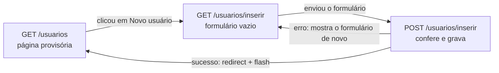

# Capítulo 14 — INSERT relacional de usuário

**Disciplina:** Programação para Internet (ILP951)
**Professor:** Ronan Adriel Zenatti · ronan.zenatti@cps.sp.gov.br
**Fatec Jahu — 2º Semestre/2026**

---

## 🎯 Objetivos do Capítulo

Ao final deste capítulo você deverá ser capaz de:

- Montar um formulário com vários grupos de campos e um `<select>` cujas opções vêm de **outra tabela** (`perfis`)
- Guardar o formulário inteiro em um **dicionário** e devolvê-lo ao template quando houver erro
- Escrever o `validacoes/validacoes_usuario.py`, com uma função por campo (nome, e-mail, senha, perfil, celular, CPF, data de nascimento, CEP, estado) e uma função principal que recebe o dicionário e devolve a lista de erros
- Conferir no servidor um valor que veio de um `<select>` e impedir e-mail e CPF repetidos
- Explicar por que a senha é gravada como **hash** e gerá-lo com `generate_password_hash`
- Gravar os opcionais em branco como `NULL` e os dados formatados (`000.000.000-00`) como o banco espera, tratando o erro `1062`

O Capítulo 13 fechou o CRUD de `perfis`. Este capítulo começa o de `usuarios`, e a tabela de usuários é a primeira do projeto que **depende de outra**: todo usuário tem um `perfil_id`, uma chave estrangeira para `perfis`. Também é a primeira com dados de gente de verdade (e-mail, CPF, celular, endereço) e com um campo que exige cuidado redobrado, a **senha**. Este capítulo cuida da metade de **criar** (`INSERT`). A lista e o detalhe vêm no Capítulo 15, e a edição e a exclusão, no 16. O roteiro é o mesmo dos perfis: o formulário, o arquivo de validações e a rota que coleta, valida e grava. Os comentários do código aparecem só onde algo é diferente do que você já fez nos perfis.

## 📦 Ponto de partida

Este capítulo continua do **seu** repositório `sistema-gestao`, como ficou no fim do Capítulo 13: com o CRUD de perfis completo (cadastro, lista, edição e exclusão) e os perfis **Administrador**, **Gerente** e **Usuário** cadastrados. Os Capítulos 12.1 e 13.1 são opcionais: este capítulo parte do código do 13, e não deles.

Se o seu projeto não está funcionando, baixe o código do Capítulo 13 e descompacte. Depois de descompactar, crie o ambiente virtual e o `.env`, como no [Capítulo 11, Tópico 4](Capitulo_11_Projeto_Novo_e_Banco.md#topico-4-o-arquivo-env), importe o `banco.sql` no phpMyAdmin e cadastre os três perfis pelo formulário:

➡️ [Baixar p2_cap_13.zip](../arquivos/p2_cap_13.zip)

```bash
python -m venv venv
venv\Scripts\activate
pip install -r requirements.txt
copy .env.example .env
```

---

## Tópico 1 — O formulário de novo usuário

### Antes de começar

Ligue o **Apache** e o **MySQL** no painel do XAMPP. Abra a pasta `sistema-gestao` no VS Code, o terminal (`Ctrl + '`), ative o ambiente virtual e confira o Git:

```bash
venv\Scripts\activate
git status
```

O `git status` deve dizer `nothing to commit, working tree clean`. Ligue o servidor com `python app.py` e deixe esse terminal rodando durante o capítulo (use um segundo terminal, o ícone **+**, para o Git e para os testes).

### O mapa do recurso

O molde de nomes do Capítulo 12 vale para `usuarios`. Este capítulo constrói as duas primeiras linhas, e o resto vem nos próximos:

| Rota | Métodos | O que faz | Função no `app.py` | Template | Capítulo |
|---|---|---|---|---|---|
| `/usuarios` | GET | Lista os usuários | `listar_usuarios` | `usuarios/usuarios_lista.html` | 15 (hoje: página provisória) |
| `/usuarios/inserir` | GET e POST | GET mostra o formulário, POST confere e grava | `inserir_usuario` | `usuarios/usuario_form.html` | **14** |
| `/usuarios/<int:id_usuario>` | GET | Detalhe de um usuário | `detalhar_usuario` | `usuarios/usuario_detalhe.html` | 15 |
| `/usuarios/<int:id_usuario>/editar` | GET e POST | Edita o usuário | `editar_usuario` | `usuarios/usuario_form.html` | 16 |
| `/usuarios/<int:id_usuario>/excluir` | só POST | Exclui o usuário | `excluir_usuario` | (nenhum) | 16 |

O caminho do navegador no cadastro é o mesmo do perfil:



### A lista de estados

O formulário terá um campo **Estado**, um `<select>` com as siglas das 27 unidades da federação, e o servidor vai conferir que a sigla recebida é uma delas. Os dois precisam usar a **mesma** lista, e ela fica no arquivo de validações dos usuários, que nasce agora. Crie, dentro da pasta `validacoes`, o arquivo `validacoes_usuario.py`, por enquanto só com a lista:

```python
# Siglas dos estados aceitas pelo sistema: o formulário e a validação usam a mesma lista
UFS = ['AC', 'AL', 'AP', 'AM', 'BA', 'CE', 'DF', 'ES', 'GO', 'MA', 'MT', 'MS', 'MG', 'PA',
       'PB', 'PR', 'PE', 'PI', 'RJ', 'RN', 'RS', 'RO', 'RR', 'SC', 'SP', 'SE', 'TO']
```

O nome em maiúsculas (`UFS`) é a convenção do Python para um valor que não muda enquanto o programa roda, uma **constante**. O Tópico 2 completa o arquivo com as funções de validação.

### As rotas

No `app.py`, importe a lista, logo abaixo da importação do `validacoes_perfil`:

```python
from validacoes.validacoes_usuario import UFS
```

E crie uma seção nova, **USUÁRIOS**, entre a seção **PERFIS** e a das telas de erros, com duas rotas:

```python
# ==============================================================================
# USUÁRIOS
# ==============================================================================

@app.route('/usuarios')
def listar_usuarios():
    # Página provisória: a lista com SELECT chega no Capítulo 15
    return render_template('usuarios/usuarios_lista.html', titulo='Usuários')


@app.route('/usuarios/inserir', methods=['GET', 'POST'])
def inserir_usuario():
    # Com muitos campos, o formulário inteiro fica em um dicionário (vazio no GET)
    dados = {}

    # As opções do <select> de perfil vêm da tabela perfis
    perfis = execute_query('SELECT id_perfil, nome FROM perfis ORDER BY nome', fetch=True)

    return render_template('usuarios/usuario_form.html', dados=dados, perfis=perfis, ufs=UFS)
```

- **A `listar_usuarios`** é uma página **provisória**, sem consulta ao banco. A lista de verdade só chega no Capítulo 15, mas o botão **Cancelar** do formulário e o redirect depois de gravar precisam de um destino desde já.
- **O `dados = {}`.** No perfil, a rota guardava cada campo em uma variável (`nome` e `descricao`) para devolvê-los quando houvesse erro. Com treze campos, seriam treze variáveis e um `render_template` com treze argumentos. Aqui o formulário inteiro fica em **um dicionário**, `dados`, com uma chave para cada campo. No GET ele começa vazio, e o formulário aparece em branco. No Tópico 3, o POST o preenche com o que chegou.
- **Os perfis vêm do banco.** Até aqui, as opções de um `<select>` eram escritas por você, em uma lista no Python (a lista de categorias do Capítulo 9). O perfil é diferente: as opções são as **linhas da tabela `perfis`**. Se alguém cadastrar um perfil novo, o formulário o mostra sem que se altere uma linha de código.

### A página provisória

Crie a pasta `templates/usuarios` e, dentro dela, o `usuarios_lista.html`:

```html


{{ titulo }} — Sistema de Gestão


  <div class="d-flex justify-content-between align-items-center mb-3">
    <h1 class="h2 mb-0">{{ titulo }}</h1>
    <a href="{{ url_for('inserir_usuario') }}" class="btn btn-primary">Novo usuário</a>
  </div>

  <div class="alert alert-info" role="alert">
    A lista de usuários chega no Capítulo 15. Por enquanto, confira os cadastros no phpMyAdmin
    (banco <strong>gestao</strong>, tabela <strong>usuarios</strong>) e no contador do dashboard.
  </div>

```

### O formulário

Na mesma pasta, crie o `usuario_form.html`. É o mesmo molde do `perfil_form.html` (cartão centralizado, token CSRF, Cancelar à esquerda e Salvar à direita), com mais campos, divididos em três grupos. A coluna é um pouco mais larga (`col-lg-8`), porque há linhas com dois e três campos lado a lado:

```html


Novo usuário — Sistema de Gestão


  <h1 class="h2 mb-4">Novo usuário</h1>

  <div class="row justify-content-center">
    <div class="col-lg-8">
      <div class="card">
        <div class="card-body">

          <form action="{{ url_for('inserir_usuario') }}" method="post">
            <input type="hidden" name="csrf_token" value="{{ csrf_token() }}">

            <h2 class="h5 mb-3">Dados principais</h2>

            <div class="mb-3">
              <label for="nome" class="form-label">Nome completo</label>
              <input type="text" class="form-control" id="nome" name="nome" placeholder="Ex.: Ana Beatriz Lima" value="{{ dados.nome }}" required minlength="3" maxlength="255">
            </div>

            <div class="mb-3">
              <label for="email" class="form-label">E-mail</label>
              <input type="email" class="form-control" id="email" name="email" placeholder="nome@dominio.com.br" value="{{ dados.email }}" required maxlength="255">
            </div>

            <div class="row">
              <div class="col-md-6 mb-3">
                <label for="senha" class="form-label">Senha</label>
                <input type="password" class="form-control" id="senha" name="senha" required minlength="8" maxlength="128" autocomplete="new-password">
                <div class="form-text">Mínimo de 8 caracteres, com letras e números.</div>
              </div>
              <div class="col-md-6 mb-3">
                <label for="confirmacao" class="form-label">Confirmar a senha</label>
                <input type="password" class="form-control" id="confirmacao" name="confirmacao" required minlength="8" maxlength="128" autocomplete="new-password">
              </div>
            </div>

            <div class="mb-4">
              <label for="perfil_id" class="form-label">Perfil</label>
              
                <select class="form-select" id="perfil_id" name="perfil_id" required>
                  <option value="">Selecione...</option>
                  
                    <option value="{{ perfil.id_perfil }}" selected>{{ perfil.nome }}</option>
                  
                </select>
              
                <div class="alert alert-warning mb-0" role="alert">
                  Nenhum perfil cadastrado. <a href="{{ url_for('inserir_perfil') }}" class="alert-link">Cadastre um perfil</a> antes de cadastrar usuários.
                </div>
              
            </div>

            <h2 class="h5 mb-3">Dados pessoais (opcionais)</h2>

            <div class="row">
              <div class="col-md-4 mb-3">
                <label for="celular" class="form-label">Celular</label>
                <input type="tel" class="form-control" id="celular" name="celular" placeholder="(14) 99999-9999" value="{{ dados.celular or '' }}" maxlength="20">
              </div>
              <div class="col-md-4 mb-3">
                <label for="data_nascimento" class="form-label">Data de nascimento</label>
                <input type="date" class="form-control" id="data_nascimento" name="data_nascimento" value="{{ dados.data_nascimento or '' }}">
              </div>
              <div class="col-md-4 mb-4">
                <label for="cpf" class="form-label">CPF</label>
                <input type="text" class="form-control" id="cpf" name="cpf" placeholder="000.000.000-00" value="{{ dados.cpf or '' }}" maxlength="14">
              </div>
            </div>

            <h2 class="h5 mb-3">Endereço (opcional)</h2>

            <div class="row">
              <div class="col-md-4 mb-3">
                <label for="cep" class="form-label">CEP</label>
                <input type="text" class="form-control" id="cep" name="cep" placeholder="00000-000" value="{{ dados.cep or '' }}" maxlength="9">
              </div>
              <div class="col-md-8 mb-3">
                <label for="endereco" class="form-label">Endereço</label>
                <input type="text" class="form-control" id="endereco" name="endereco" value="{{ dados.endereco or '' }}" maxlength="255">
              </div>
            </div>

            <div class="row">
              <div class="col-md-4 mb-3">
                <label for="numero" class="form-label">Número</label>
                <input type="text" class="form-control" id="numero" name="numero" value="{{ dados.numero or '' }}" maxlength="20">
              </div>
              <div class="col-md-8 mb-3">
                <label for="complemento" class="form-label">Complemento</label>
                <input type="text" class="form-control" id="complemento" name="complemento" value="{{ dados.complemento or '' }}" maxlength="100">
              </div>
            </div>

            <div class="row">
              <div class="col-md-8 mb-4">
                <label for="cidade" class="form-label">Cidade</label>
                <input type="text" class="form-control" id="cidade" name="cidade" value="{{ dados.cidade or '' }}" maxlength="100">
              </div>
              <div class="col-md-4 mb-4">
                <label for="estado" class="form-label">Estado</label>
                <select class="form-select" id="estado" name="estado">
                  <option value="">--</option>
                  
                    <option value="{{ uf }}" selected>{{ uf }}</option>
                  
                </select>
              </div>
            </div>

            <div class="d-flex justify-content-between gap-2">
              <a href="{{ url_for('listar_usuarios') }}" class="btn btn-outline-secondary">Cancelar</a>
              <button type="submit" class="btn btn-primary">Salvar usuário</button>
            </div>

          </form>

        </div>
      </div>
    </div>
  </div>

```

Salve e abra **http://127.0.0.1:5000/usuarios/inserir**. Grupo por grupo:

**Dados principais**, todos obrigatórios (as colunas são `NOT NULL`):

- **Nome e e-mail.** Os limites (`minlength="3"`, `maxlength="255"`) combinam com o `VARCHAR(255)` do banco e com a validação do Tópico 2. O `type="email"` faz o navegador conferir o formato.
- **As senhas.** O `type="password"` esconde o que se digita, e o `autocomplete="new-password"` pede ao navegador que **não** preencha o campo com uma senha salva de outro site. O `maxlength="128"` é o limite que a validação vai usar. Os dois campos de senha **não têm `value`**, nunca: uma senha não volta para a tela, nem quando o formulário tem erro (a pessoa digita de novo).
- **O perfil.** O `value` de cada opção é o `id_perfil`, o número que a chave estrangeira guarda, e o texto que aparece é o `nome`. Quem escolhe vê o nome, e o servidor recebe o número. O `` é verdadeiro quando a lista tem itens e falso quando está vazia: sem nenhum perfil cadastrado, o formulário avisa e oferece o caminho para cadastrar um, em vez de mostrar uma lista vazia que ninguém consegue escolher.

**Dados pessoais e endereço**, todos opcionais (as colunas aceitam `NULL`), por isso sem `required`. Os `maxlength` são os tamanhos das colunas do `banco.sql` do Capítulo 11 (`endereco VARCHAR(255)`, `numero VARCHAR(20)`, `complemento VARCHAR(100)`, `cidade VARCHAR(100)`). O `type="date"` abre um calendário e envia a data sempre como `AAAA-MM-DD`, seja qual for o jeito que o navegador a mostre. O **Estado** é um `<select>` montado com o `for` sobre a lista `ufs`.

**Os `value`.** Cada campo de texto devolve o valor do dicionário com o nome do próprio campo: `value="{{ dados.nome }}"`. Os opcionais levam o `or ''` do Capítulo 12, porque no Tópico 3 um opcional em branco vai virar `None` no dicionário. Os dois `<select>` não têm `value`: a opção escolhida continua marcada com o `selected`, quando o valor do dicionário é igual ao da opção.

!!! note "Jinja: `dados.nome` quando a chave não existe"
    O `dados.nome` procura a chave `nome` no dicionário. Quando ela **não existe** (no GET, o dicionário está vazio), o Jinja não dá erro: escreve um texto vazio. Por isso o mesmo `value="{{ dados.nome }}"` serve ao formulário em branco e ao formulário devolvido com erro.

!!! note "Jinja: o `|string` na comparação do perfil"
    O `id_perfil` chega do banco como **número** (`2`), e o que vem do formulário é **texto** (`'2'`). Em Python e em Jinja, `'2' == 2` é falso, e a opção nunca seria marcada. O filtro `|string` converte os dois lados em texto antes de comparar. Já a sigla do estado é texto nos dois lados, e não precisa de conversão.

### O menu Usuários

O `base_menu.html` ganha o menu suspenso **Usuários**, **depois** do menu Perfis, dentro do primeiro `<ul class="navbar-nav me-auto">`. Procure o `</li>` que fecha o bloco do menu **Perfis** (logo depois do link **Cadastrar Perfil** e do `</ul>`) e acrescente, abaixo dele:

```html
<li class="nav-item dropdown">
  <a class="nav-link dropdown-toggle active" href="#" role="button" data-bs-toggle="dropdown" aria-expanded="false">Usuários</a>
  <ul class="dropdown-menu">
    <li><a class="dropdown-item" href="{{ url_for('listar_usuarios') }}">Listar Usuários</a></li>
    <li><a class="dropdown-item" href="{{ url_for('inserir_usuario') }}">Cadastrar Usuário</a></li>
  </ul>
</li>
```

É o mesmo molde do **Perfis**, com um link para a lista e outro para o cadastro. Salve e navegue: **Usuários > Listar Usuários**, **Novo usuário**, o formulário completo, com o `<select>` listando **Administrador**, **Gerente** e **Usuário** em ordem alfabética, e **Cancelar** de volta. Preencha o nome e clique em **Salvar usuário**: a página recarrega vazia, porque a rota ainda ignora o POST.

```bash
git add .
git commit -m "Adiciona o formulário de novo usuário e a página provisória de usuários"
git push
```

---

## Tópico 2 — As validações do usuário

### O arquivo completo

Com treze campos, a validação é bem maior que a do perfil, e por isso ela é dividida em **uma função por campo**, como no Capítulo 9: cada uma confere um campo e devolve a mensagem de erro, ou `None` quando está tudo certo. No fim do arquivo, uma **função principal**, `validar_usuario`, recebe o dicionário `dados`, chama as funções de cada campo e junta as mensagens em uma lista, como a `validar_perfil`. A rota só chama a principal.

Troque o conteúdo do `validacoes/validacoes_usuario.py` pelo arquivo completo (a lista `UFS` continua no topo):

```python
from datetime import datetime

from db import execute_one

# Siglas dos estados aceitas pelo sistema: o formulário e a validação usam a mesma lista
UFS = ['AC', 'AL', 'AP', 'AM', 'BA', 'CE', 'DF', 'ES', 'GO', 'MA', 'MT', 'MS', 'MG', 'PA',
       'PB', 'PR', 'PE', 'PI', 'RJ', 'RN', 'RS', 'RO', 'RR', 'SC', 'SP', 'SE', 'TO']


# ==============================================================================
# FUNÇÕES DE APOIO
# ==============================================================================

def so_digitos(texto):
    # '(14) 99811-2030' vira '14998112030'
    resultado = ''
    for letra in texto:
        if letra in '0123456789':
            resultado = resultado + letra
    return resultado


def formatar_celular(celular):
    # Devolve o celular no formato que vai para o banco, ou None se o campo veio vazio
    if not celular:
        return None

    digitos = so_digitos(celular)
    if len(digitos) == 11:
        return f'({digitos[0:2]}) {digitos[2:7]}-{digitos[7:11]}'

    return f'({digitos[0:2]}) {digitos[2:6]}-{digitos[6:10]}'


def formatar_cpf(cpf):
    # Devolve o CPF como 000.000.000-00, ou None se o campo veio vazio
    if not cpf:
        return None

    digitos = so_digitos(cpf)
    return f'{digitos[0:3]}.{digitos[3:6]}.{digitos[6:9]}-{digitos[9:11]}'


def formatar_cep(cep):
    # Devolve o CEP como 00000-000, ou None se o campo veio vazio
    if not cep:
        return None

    digitos = so_digitos(cep)
    return f'{digitos[0:5]}-{digitos[5:8]}'


def calcular_digito_cpf(digitos, quantidade):
    # Conta de um dígito verificador do CPF: pesos decrescentes, soma e resto da divisão por 11
    soma = 0
    for posicao in range(quantidade):
        peso = quantidade + 1 - posicao
        soma = soma + int(digitos[posicao]) * peso

    resto = (soma * 10) % 11
    if resto == 10:
        resto = 0

    return resto


# ==============================================================================
# UMA FUNÇÃO POR CAMPO: cada uma devolve a mensagem de erro ou None
# ==============================================================================

# ================ VALIDAÇÕES PARA O CAMPO nome =====================
def validar_nome(nome):
    if not nome:
        return 'Informe o nome do usuário.'

    if len(nome) < 3:
        return 'O nome deve ter pelo menos 3 caracteres.'

    if len(nome) > 255:
        return 'O nome deve ter no máximo 255 caracteres.'

    return None


# ================ VALIDAÇÕES PARA O CAMPO email =====================
def validar_email(email):
    mensagem = 'Informe um e-mail válido, por exemplo nome@dominio.com.br.'

    if not email:
        return 'Informe o e-mail.'

    if len(email) > 255:
        return 'O e-mail deve ter no máximo 255 caracteres.'

    if ' ' in email or email.count('@') != 1:
        return mensagem

    partes = email.split('@')
    antes = partes[0]
    depois = partes[1]

    if antes == '' or '.' not in depois:
        return mensagem

    if depois.startswith('.') or depois.endswith('.'):
        return mensagem

    # Formato certo: confere no banco se o e-mail já pertence a outro usuário
    existente = execute_one('SELECT id_usuario FROM usuarios WHERE email = %s', (email,))
    if existente:
        return 'Já existe um usuário com este e-mail.'

    return None


# ================ VALIDAÇÕES PARA O CAMPO senha =====================
def validar_senha(senha, confirmacao):
    if len(senha) < 8:
        return 'A senha deve ter pelo menos 8 caracteres.'

    if len(senha) > 128:
        return 'A senha deve ter no máximo 128 caracteres.'

    tem_letra = False
    tem_numero = False
    for caractere in senha:
        if caractere.isalpha():
            tem_letra = True
        if caractere in '0123456789':
            tem_numero = True

    if not tem_letra or not tem_numero:
        return 'A senha deve ter letras e números.'

    if senha != confirmacao:
        return 'A confirmação da senha não confere.'

    return None


# ================ VALIDAÇÕES PARA O CAMPO perfil_id =====================
def validar_perfil_id(perfil_id):
    # Tudo o que chega do formulário é texto: precisa ser um número...
    try:
        numero = int(perfil_id)
    except ValueError:
        return 'Selecione um perfil.'

    # ...e precisa existir na tabela perfis
    perfil = execute_one('SELECT id_perfil FROM perfis WHERE id_perfil = %s', (numero,))
    if perfil is None:
        return 'Selecione um perfil válido.'

    return None


# ================ VALIDAÇÕES PARA O CAMPO celular (opcional) =====================
def validar_celular(celular):
    if not celular:
        return None

    digitos = so_digitos(celular)
    if len(digitos) != 10 and len(digitos) != 11:
        return 'Informe o celular com DDD, com 10 ou 11 dígitos.'

    return None


# ================ VALIDAÇÕES PARA O CAMPO cpf (opcional) =====================
def validar_cpf(cpf):
    if not cpf:
        return None

    digitos = so_digitos(cpf)
    if len(digitos) != 11:
        return 'O CPF deve ter 11 dígitos.'

    if digitos == digitos[0] * 11:
        return 'Informe um CPF válido.'

    if calcular_digito_cpf(digitos, 9) != int(digitos[9]):
        return 'Informe um CPF válido.'

    if calcular_digito_cpf(digitos, 10) != int(digitos[10]):
        return 'Informe um CPF válido.'

    # CPF válido: confere no banco, já no formato em que ele é gravado
    existente = execute_one('SELECT id_usuario FROM usuarios WHERE cpf = %s', (formatar_cpf(cpf),))
    if existente:
        return 'Já existe um usuário com este CPF.'

    return None


# ================ VALIDAÇÕES PARA O CAMPO data_nascimento (opcional) =====================
def validar_data_nascimento(texto):
    if not texto:
        return None

    try:
        data = datetime.strptime(texto, '%Y-%m-%d')
    except ValueError:
        return 'Informe uma data de nascimento válida.'

    if data > datetime.now():
        return 'A data de nascimento não pode estar no futuro.'

    if data.year < 1900:
        return 'A data de nascimento deve ser a partir de 1900.'

    return None


# ================ VALIDAÇÕES PARA O CAMPO cep (opcional) =====================
def validar_cep(cep):
    if not cep:
        return None

    if len(so_digitos(cep)) != 8:
        return 'Informe um CEP com 8 dígitos.'

    return None


# ================ VALIDAÇÕES PARA O CAMPO estado (opcional) =====================
def validar_estado(estado):
    if not estado:
        return None

    if estado not in UFS:
        return 'Selecione um estado válido.'

    return None


# ================ TAMANHO DOS CAMPOS DE TEXTO LIVRE (opcionais) =====================
def validar_tamanho(valor, rotulo, maximo):
    if valor and len(valor) > maximo:
        return f'O campo {rotulo} deve ter no máximo {maximo} caracteres.'

    return None


# ==============================================================================
# FUNÇÃO PRINCIPAL: recebe o dicionário com o formulário e devolve a lista de erros
# ==============================================================================

def validar_usuario(dados):
    erros = []

    # ================ DADOS PRINCIPAIS (obrigatórios) =====================
    erro = validar_nome(dados['nome'])
    if erro:
        erros.append(erro)

    erro = validar_email(dados['email'])
    if erro:
        erros.append(erro)

    erro = validar_senha(dados['senha'], dados['confirmacao'])
    if erro:
        erros.append(erro)

    erro = validar_perfil_id(dados['perfil_id'])
    if erro:
        erros.append(erro)

    # ================ DADOS PESSOAIS (opcionais) =====================
    erro = validar_celular(dados['celular'])
    if erro:
        erros.append(erro)

    erro = validar_cpf(dados['cpf'])
    if erro:
        erros.append(erro)

    erro = validar_data_nascimento(dados['data_nascimento'])
    if erro:
        erros.append(erro)

    # ================ ENDEREÇO (opcional) =====================
    erro = validar_cep(dados['cep'])
    if erro:
        erros.append(erro)

    erro = validar_tamanho(dados['endereco'], 'endereço', 255)
    if erro:
        erros.append(erro)

    erro = validar_tamanho(dados['numero'], 'número', 20)
    if erro:
        erros.append(erro)

    erro = validar_tamanho(dados['complemento'], 'complemento', 100)
    if erro:
        erros.append(erro)

    erro = validar_tamanho(dados['cidade'], 'cidade', 100)
    if erro:
        erros.append(erro)

    erro = validar_estado(dados['estado'])
    if erro:
        erros.append(erro)

    return erros
```

É um arquivo longo, mas repetitivo: quase todas as funções têm a mesma forma. A seguir, seção por seção.

### As funções de apoio

Celular, CPF e CEP chegam em formatos variados: `(14) 99811-2030`, `14998112030`, `14 99811 2030`. Todas as conferências deles começam do mesmo ponto: **ficar só com os dígitos**. A `so_digitos` percorre o texto letra por letra (o `for` em um texto, explicado na caixa da senha, mais abaixo) e junta, em `resultado`, só as que são dígitos.

As três funções `formatar_` devolvem o valor no formato que será **gravado no banco**: `(14) 99811-2030`, `529.982.247-25` e `17201-000`. Assim o banco fica com um formato único, seja qual for o jeito que a pessoa digitou. Elas começam com `if not ...: return None`: um campo opcional em branco chega como `None` (o `or None` do Capítulo 12) e continua `None`. Elas só são chamadas **depois** da validação, quando a quantidade de dígitos já está garantida. O celular pode ter 11 dígitos (com o nove na frente) ou 10 (fixo ou celular antigo), e por isso tem dois formatos.

!!! note "Python: fatias de texto, `[0:2]`"
    Um texto pode ser **fatiado**: `digitos[0:2]` devolve do primeiro caractere (posição 0) até **antes** da posição 2, ou seja, os dois primeiros. É o mesmo "o último não entra" do `range`. Com `digitos = '14998112030'`: `digitos[0:2]` é `14`, `digitos[2:7]` é `99811` e `digitos[7:11]` é `2030`. O `f'...'` junta as fatias com os parênteses, o espaço e o hífen.

A `calcular_digito_cpf` é a conta do CPF, explicada junto com a `validar_cpf`.

### Uma função por campo

Todas seguem a mesma forma: um `if` por regra, cada um devolvendo a sua mensagem, e o `return None` no fim, quando todas as regras passaram. Diferente do perfil, cada `if` termina com um `return`, então a função **para** na primeira regra que falhar: um nome vazio recebe só "Informe o nome", e não também "pelo menos 3 caracteres".

**O nome** é parecido com o do perfil, com o limite de 255 da coluna.

**O e-mail** tem mais regras. O `type="email"` do HTML só vale no navegador, e o servidor precisa conferir por conta própria. Sem recursos avançados, a função confere o essencial: um único `@`, um texto antes dele e, depois dele, um domínio com um ponto no meio. Repare na variável `mensagem` no topo: a mesma frase é devolvida em vários pontos, e escrevê-la uma vez só evita copiar o texto. As últimas linhas consultam o banco: com o formato certo, a função pergunta se já existe um usuário com esse e-mail (a coluna é `UNIQUE`), como a `validar_perfil` fazia com o nome. O e-mail chega aqui em minúsculas (a rota faz o `.lower()`, no Tópico 3), e a ordenação do banco (`utf8mb4_unicode_ci`) ignora maiúsculas, então `Bruno@Exemplo.com` também é reconhecido como repetido.

!!! note "Python: `count`, `split`, `startswith` e `endswith`"
    São quatro métodos do texto. O `email.count('@')` conta quantas vezes o `@` aparece. O `email.split('@')` **corta** o texto em cada `@` e devolve uma lista com os pedaços: `'ana@exemplo.com'` vira `['ana', 'exemplo.com']`. O `partes[0]` é o primeiro pedaço e o `partes[1]`, o segundo (a contagem de uma lista começa em 0, como no [Capítulo 2.1](Capitulo_02_1_Python_Essencial.md)). O `startswith('.')` e o `endswith('.')` perguntam se o texto começa ou termina com aquele caractere.

**A senha** recebe os **dois** campos, a senha e a confirmação, e confere nesta ordem: tamanho mínimo, tamanho máximo, letras e números, e confirmação igual.

!!! note "Python: `for` em um texto e `isalpha`"
    O `for` também percorre um **texto**, uma letra por volta: no `for caractere in senha`, a variável `caractere` vale cada símbolo da senha, um de cada vez. O `caractere.isalpha()` pergunta se aquele símbolo é uma letra, e o `caractere in '0123456789'` pergunta se ele é um dos dez dígitos. As duas variáveis (`tem_letra` e `tem_numero`) começam em `False` e viram `True` quando o `for` encontra o que procura.

**O perfil.** O `<select>` só oferece perfis que existem, então parece que não há o que conferir. Mas o navegador é só a primeira linha de defesa: qualquer pessoa abre o `F12`, troca o `value` de uma opção para `99` e envia. Por isso a `validar_perfil_id` faz duas conferências. O `int(perfil_id)` converte o texto em número, e falha com `ValueError` se o texto não for um número: tanto o `'abc'` de quem adulterou o formulário quanto o `''` de quem não escolheu nada (a opção "Selecione..."). É o mesmo `try/except ValueError` do [Capítulo 9](Capitulo_09_Validacao_e_Flash.md#topico-4-categoria-preco-e-varios-erros-de-uma-vez). Depois da conversão, o `SELECT` pergunta ao banco se aquele perfil existe.

**Os opcionais** (celular, CPF, data, CEP, estado e os textos livres) começam todos com `if not ...: return None`: em branco é aceito, porque o campo é opcional. Preenchido, o valor é conferido como qualquer outro.

- **Celular**: DDD e 9 ou 8 dígitos, ou seja, **10 ou 11 dígitos** no total.
- **CPF**: os dois últimos dígitos de um CPF não são sorteados, são **calculados** a partir dos nove primeiros, e por isso dá para descobrir um CPF digitado errado. Na `calcular_digito_cpf`, cada dígito é multiplicado por um **peso** que diminui (para o primeiro dígito verificador, 10, 9, 8... até 2), os produtos são somados, e o resto da divisão da soma (vezes 10) por 11 dá o dígito. O `%` devolve o **resto** da divisão (`23 % 5` é `3`), e o `range(quantidade)` percorre as posições, como no Capítulo 2.1. A `validar_cpf` usa a conta duas vezes: com 9 números (para o 10º dígito do CPF) e com 10 números (para o 11º). A linha `digitos == digitos[0] * 11` barra o CPF de um número repetido (`111.111.111-11`), que passaria na conta mas não existe: `'1' * 11` é o texto `11111111111`. No fim, como o e-mail, o CPF válido é procurado no banco, e **já formatado** (`529.982.247-25`), porque é assim que ele é gravado: procurar só os dígitos não acharia nada.
- **Data de nascimento**: o `<input type="date">` envia a data como `AAAA-MM-DD`, por exemplo `1988-03-14`. A conversão usa o `strptime` do [Capítulo 2.1](Capitulo_02_1_Python_Essencial.md), com o modelo `'%Y-%m-%d'`, e o `try/except ValueError` trata uma data impossível (30 de fevereiro). Duas regras de negócio completam: a data não pode estar no futuro, nem ser anterior a 1900. O `datetime.now()` é o momento atual, e duas datas podem ser comparadas com `>`, como dois números.
- **CEP**: 8 dígitos.
- **Estado**: o `estado not in UFS` é o `not in` do Capítulo 9, aplicado à lista do começo do arquivo. O formulário já oferece só essas siglas, mas o servidor confere, como no perfil.
- **Endereço, número, complemento e cidade** só precisam respeitar o tamanho das colunas, e **uma** função serve aos quatro: a `validar_tamanho` recebe o texto, o **nome do campo** para a mensagem e o limite, como em `validar_tamanho(dados['cidade'], 'cidade', 100)`. O `if valor and ...` é o mesmo cuidado da descrição do perfil: com o campo em branco (`None`), não há tamanho a conferir.

!!! warning "Validar o CPF não prova que ele existe"
    A conta dos dígitos só descarta erros de digitação. Saber se aquele CPF pertence mesmo a alguém exigiria consultar um serviço oficial. O sistema aceita qualquer número que **passe na conta**.

### A função principal

A `validar_usuario` recebe o dicionário `dados` e chama as funções dos campos na ordem do formulário. Cada chamada tem a mesma forma de três linhas: guarda a resposta em `erro` e, se houver mensagem, a acrescenta à lista. No fim, devolve a lista inteira, como a `validar_perfil`. Os comentários com `=====` separam os três grupos do formulário.

!!! note "Python: uma função que recebe um dicionário"
    A `validar_usuario` recebe **um** argumento, o dicionário inteiro, e lê cada campo pela chave: `dados['nome']`, `dados['email']`. Os colchetes com o nome da chave buscam o valor guardado nela, como no [Capítulo 2.1](Capitulo_02_1_Python_Essencial.md). Com treze campos, passar um dicionário é bem mais curto e seguro do que passar treze argumentos na ordem certa.

### Testando as funções

Teste algumas funções no segundo terminal, com o `venv` ativo e na pasta do projeto:

```bash
python -c "from validacoes.validacoes_usuario import so_digitos, formatar_cpf; print(so_digitos('(14) 99811-2030')); print(formatar_cpf('52998224725'))"
python -c "from validacoes.validacoes_usuario import validar_email; print(validar_email('ana@exemplo.com.br')); print(validar_email('ana@exemplo')); print(validar_email('a b@exemplo.com'))"
python -c "from validacoes.validacoes_usuario import validar_senha; print(validar_senha('abc', 'abc')); print(validar_senha('abcdefgh', 'abcdefgh')); print(validar_senha('Senha123', 'Senha124')); print(validar_senha('Senha123', 'Senha123'))"
python -c "from validacoes.validacoes_usuario import validar_cpf; print(validar_cpf('529.982.247-25')); print(validar_cpf('529.982.247-26')); print(validar_cpf('111.111.111-11')); print(validar_cpf('123'))"
python -c "from validacoes.validacoes_usuario import validar_data_nascimento as v; print(v('1988-03-14')); print(v('2026-02-30')); print(v('2999-01-01')); print(v('1899-12-31'))"
```

O que deve aparecer:

1. `14998112030` e `529.982.247-25`.
2. `None` (e-mail bom, que ainda não existe no banco) e duas vezes `Informe um e-mail válido, por exemplo nome@dominio.com.br.`
3. `A senha deve ter pelo menos 8 caracteres.`, `A senha deve ter letras e números.`, `A confirmação da senha não confere.` e `None`.
4. `None`, `Informe um CPF válido.`, `Informe um CPF válido.` e `O CPF deve ter 11 dígitos.` Trocar um único dígito derruba a validação.
5. `None` e depois as três mensagens (data inválida, no futuro, anterior a 1900).

```bash
git add .
git commit -m "Cria o arquivo de validações de usuário"
git push
```

---

## Tópico 3 — Gravar o usuário (INSERT)

### Por que a senha não pode ser gravada como veio

O banco já tem a coluna `senha VARCHAR(255)`. A tentação é gravar nela o que a pessoa digitou. Pense no que isso significa: quem tiver acesso ao banco (um backup esquecido, uma invasão, um colega curioso com acesso ao phpMyAdmin) lê **todas as senhas**. E como muita gente repete a mesma senha em vários sites, o estrago passa do seu sistema para o e-mail, o banco e as redes sociais dessas pessoas.

| O que está na coluna `senha` | Quem lê o banco enxerga |
|---|---|
| A senha digitada | `Senha123` |
| O **hash** da senha | `scrypt:32768:8:1$a6tybEY3NCOuA8aS$4ae201a98...` |

A solução é guardar um **hash**: o resultado de uma conta matemática de **mão única**, que transforma a senha em uma sequência longa e embaralhada, e que **não tem caminho de volta**. Do hash não se chega à senha. Veja com os próprios olhos, no segundo terminal:

```bash
python -c "from werkzeug.security import generate_password_hash; print(generate_password_hash('Senha123')); print(generate_password_hash('Senha123'))"
```

Aparecem duas linhas, parecidas com a tabela acima. Repare em duas coisas. A primeira: as duas linhas são **diferentes**, embora a senha seja a mesma. A função mistura um texto aleatório, o **sal**, antes de calcular, e por isso duas pessoas com a mesma senha não deixam hashes iguais (quem roubasse o banco não descobriria quem repete a senha). A segunda: o sal fica **dentro** do próprio hash (é o trecho entre os `$`), e isso permite conferir uma senha mais tarde. Teste:

```bash
python -c "from werkzeug.security import generate_password_hash, check_password_hash; h = generate_password_hash('Senha123'); print(check_password_hash(h, 'Senha123')); print(check_password_hash(h, 'senha123'))"
```

Imprime `True` e `False`. O `check_password_hash` refaz a conta com o mesmo sal e compara o resultado: acerta a senha certa e erra até por uma letra maiúscula. É exatamente o que o login faz, no Capítulo 17. O hash tem cerca de 160 caracteres, e é para isso que a coluna é `VARCHAR(255)`: a senha tem 8 a 128 caracteres, mas o que se grava é o hash. O `werkzeug` já veio instalado junto com o Flask: não há `pip install` novo.

### A rota completa

No `app.py`, acrescente a importação do hash logo abaixo da linha `from mysql.connector import Error`, e troque a importação do `validacoes_usuario` para trazer também a função principal e os três formatadores:

```python
from werkzeug.security import generate_password_hash
```

```python
from validacoes.validacoes_usuario import UFS, formatar_cep, formatar_celular, formatar_cpf, validar_usuario
```

Agora troque a rota `inserir_usuario` inteira por esta:

```python
@app.route('/usuarios/inserir', methods=['GET', 'POST'])
def inserir_usuario():
    # Com muitos campos, o formulário inteiro fica em um dicionário (vazio no GET)
    dados = {}

    if request.method == 'POST':
        # 1. Coleta os dados do formulário (os opcionais com 'or None')
        dados = {
            'nome': request.form.get('nome', '').strip(),
            'email': request.form.get('email', '').strip().lower(),
            'senha': request.form.get('senha', ''),  # a senha não leva strip: espaço pode fazer parte dela
            'confirmacao': request.form.get('confirmacao', ''),
            'perfil_id': request.form.get('perfil_id', ''),
            'celular': request.form.get('celular', '').strip() or None,
            'data_nascimento': request.form.get('data_nascimento', '').strip() or None,
            'cpf': request.form.get('cpf', '').strip() or None,
            'cep': request.form.get('cep', '').strip() or None,
            'endereco': request.form.get('endereco', '').strip() or None,
            'numero': request.form.get('numero', '').strip() or None,
            'complemento': request.form.get('complemento', '').strip() or None,
            'cidade': request.form.get('cidade', '').strip() or None,
            'estado': request.form.get('estado', '') or None,
        }

        # 2. A validação recebe o dicionário inteiro
        erros = validar_usuario(dados)

        if erros:
            for mensagem in erros:
                flash(mensagem, 'danger')
        else:
            try:
                novo_id = execute_insert(
                    'INSERT INTO usuarios (nome, email, senha, celular, data_nascimento, cpf, '
                    'perfil_id, cep, endereco, numero, complemento, cidade, estado) '
                    'VALUES (%s, %s, %s, %s, %s, %s, %s, %s, %s, %s, %s, %s, %s)',
                    (
                        dados['nome'],
                        dados['email'],
                        generate_password_hash(dados['senha']),  # grava o hash, nunca a senha
                        formatar_celular(dados['celular']),      # celular, CPF e CEP vão formatados
                        dados['data_nascimento'],
                        formatar_cpf(dados['cpf']),
                        dados['perfil_id'],
                        formatar_cep(dados['cep']),
                        dados['endereco'],
                        dados['numero'],
                        dados['complemento'],
                        dados['cidade'],
                        dados['estado'],
                    ),
                )

                flash(f'Usuário "{dados["nome"]}" cadastrado (código {novo_id}).', 'success')
                return redirect(url_for('listar_usuarios'))

            # Duas colunas UNIQUE: o 1062 pode ser do e-mail ou do CPF
            except Error as erro:
                if erro.errno == 1062:
                    flash('Já existe um usuário com este e-mail ou este CPF.', 'danger')
                else:
                    raise

    # As opções do <select> de perfil vêm da tabela perfis
    perfis = execute_query('SELECT id_perfil, nome FROM perfis ORDER BY nome', fetch=True)

    return render_template('usuarios/usuario_form.html', dados=dados, perfis=perfis, ufs=UFS)
```

O roteiro é o da `inserir_perfil`: coletar, validar, mostrar os erros ou salvar. Os comentários marcam só o que é diferente.

**1. Coletar, num dicionário.** O POST preenche o `dados` com uma chave para cada campo, e é esse mesmo dicionário que vai para a validação e, se houver erro, de volta para o formulário.

- **`.strip()`** tira os espaços das pontas. A **senha** é a exceção: ela **não** leva `.strip()`, porque um espaço pode fazer parte dela.
- **`.lower()` no e-mail** deixa tudo em minúsculas. Sem isso, `Ana@Exemplo.com` e `ana@exemplo.com` seriam dois cadastros para a mesma pessoa.
- **`or None` nos nove opcionais**: é a regra do Capítulo 12, campo opcional em branco vira `None` (gravado como `NULL`), nunca `''`. Os quatro obrigatórios não levam, porque nunca são gravados vazios.
- **O `perfil_id`** chega como **texto**, como tudo o que vem do formulário. A validação confere que ele é um número de um perfil que existe, e o MySQL converte o texto `'2'` no número `2` ao gravar.

!!! note "Python: um dicionário escrito em várias linhas"
    O `dados = { ... }` cria um dicionário de uma vez, com um par `'chave': valor` por linha, separados por vírgula. É o mesmo dicionário do [Capítulo 2.1](Capitulo_02_1_Python_Essencial.md), só que com cada valor calculado na hora: `'nome': request.form.get('nome', '').strip()` guarda na chave `'nome'` o que chegou no campo `nome`. Depois, `dados['nome']` lê esse valor.

**2. Validar.** Uma linha só: a `validar_usuario` do Tópico 2 recebe o dicionário e devolve a lista de erros. Com erro, a rota cai no `render_template` do final, e o template devolve o que foi digitado lendo o mesmo `dados`, menos as senhas.

**3. Gravar.** O `INSERT` tem as **treze** colunas, e os treze `%s` correspondem, um a um e na mesma ordem, às colunas e aos valores da tupla. Três cuidados aparecem nos valores:

- **`generate_password_hash(dados['senha'])`**: no banco entra o hash, e a senha, com o texto puro, morre dentro da rota. Ela nunca é gravada, nunca é impressa, nunca entra em mensagem nem em log.
- **Os `formatar_`**: celular, CPF e CEP vão no formato único do banco. Em branco, o formatador devolve `None`, e o banco grava `NULL`.
- **A data** não precisa de conversão: depois de validada, o texto `AAAA-MM-DD` é um formato que o MySQL entende direto. Os textos de uma coluna só (`endereco`, `numero`...) vão como vieram, com o `None` quando estavam em branco.

Depois de gravar vem o PRG de sempre: o `flash` verde e o `redirect` para `/usuarios`.

**O erro 1062.** As colunas `email` e `cpf` são `UNIQUE`. A validação já perguntou ao banco se o e-mail e o CPF existem, mas, como no perfil, entre a pergunta e o `INSERT` passa um instante, e o banco é a garantia final: se duas pessoas cadastrarem o mesmo e-mail ao mesmo tempo, a segunda recebe o erro `1062`, que o `except` transforma em uma faixa vermelha ([Capítulo 12, Tópico 4](Capitulo_12_INSERT_e_SELECT_de_Perfis.md#a-rota-completa)). A mensagem diz "e-mail **ou** CPF" porque o `1062` não diz sozinho qual dos dois repetiu, e separar os dois exigiria ler o texto do erro, o que complicaria o código sem ajudar quem usa o sistema: a validação, que cobre quase todos os casos, já diz exatamente qual campo é o culpado.

| Situação | Quem trata | O que a pessoa vê |
|---|---|---|
| Nome, e-mail, senha ou dado opcional inválido | Funções de `validacoes_usuario.py` | Faixa vermelha com a regra |
| Perfil adulterado ou inexistente | `int()` e `SELECT` em `validar_perfil_id` | Faixa vermelha: "Selecione um perfil válido." |
| E-mail ou CPF já cadastrado (caso comum) | `SELECT` em `validar_email` e `validar_cpf` | Faixa vermelha dizendo qual campo repete |
| E-mail ou CPF repetido (cadastro simultâneo) | `UNIQUE` do banco, erro `1062` capturado | Faixa vermelha: "e-mail ou este CPF" |
| Qualquer outro erro do banco | Ninguém na rota (o `raise` repete) | A página 500 |

### Testando

Salve e faça os testes, nesta ordem. Para ver o servidor trabalhar, tire os `required`, os `minlength` e os `maxlength` pelo `F12`, como no Capítulo 9, quando o navegador atrapalhar.

1. **Tudo errado de uma vez**: nome `ab`, e-mail `ana@exemplo`, senhas `abc` e `abc`, celular `123`, CPF `111.111.111-11`, CEP `12`, uma data no futuro (o calendário aceita) e a cidade com 101 letras. Cada problema aparece em uma faixa vermelha, e o formulário mantém o que foi digitado, **menos as senhas**.
2. **O perfil adulterado**: no `F12` (aba **Elements**), troque o `value` de uma opção do `<select>` por `99` e envie com os outros campos bons: `Selecione um perfil válido.` Troque por `abc`: `Selecione um perfil.`
3. **Só os obrigatórios**: nome `Ana Beatriz Lima`, e-mail `ANA@Exemplo.com`, senha `Senha123` (nos dois campos), perfil **Administrador**. Você cai na página provisória, com a faixa verde `Usuário "Ana Beatriz Lima" cadastrado (código 1).` (ou outro número). Aperte `F5`: a faixa some e nada é cadastrado de novo. Abra o **Home** pelo menu: o cartão de usuários mostra **1**.
4. **No phpMyAdmin**, banco `gestao`, tabela `usuarios`, aba **Procurar**, confira três coisas: a coluna `senha` mostra o **hash** (`scrypt:32768:8:1$...`), e não `Senha123`; a coluna `perfil_id` mostra o código do perfil Administrador, e **não** o nome (é a chave estrangeira); o e-mail está em minúsculas, e as colunas opcionais aparecem como `NULL`.
5. **Um usuário completo**: nome `Bruno Souza`, e-mail `bruno@exemplo.com`, perfil **Gerente**, celular `14998112030`, nascimento `14/03/1988`, CPF `52998224725`, CEP `17201000`, endereço `Rua das Flores`, número `10`, cidade `Jaú`, estado `SP`. No phpMyAdmin, confira que o celular está como `(14) 99811-2030`, o CPF como `529.982.247-25` e o CEP como `17201-000`: o sistema grava no formato certo, mesmo que a pessoa tenha digitado sem pontuação. O complemento, deixado em branco, está `NULL`.
6. **Repetidos**: cadastre um usuário com o e-mail `BRUNO@exemplo.com`: faixa vermelha `Já existe um usuário com este e-mail.` Agora um e-mail novo com o CPF `529.982.247-25` (o do Bruno), e depois com `52998224725`, sem pontuação: nos dois, `Já existe um usuário com este CPF.`, e o perfil escolhido continua selecionado.
7. **Mais um, só com os obrigatórios**: e-mail `carla@exemplo.com`, perfil **Usuário**. Vários usuários podem ficar sem CPF: o `UNIQUE` aceita vários `NULL`.

Para ver a barreira final funcionando, desligue por um instante a consulta do e-mail: na `validar_email`, troque `WHERE email = %s` por `WHERE email = %s AND 1 = 0` (o `1 = 0` é sempre falso, então o `SELECT` nunca acha ninguém). Salve e cadastre `bruno@exemplo.com` de novo, com o CPF em branco: a faixa vermelha `Já existe um usuário com este e-mail ou este CPF.` vem do `except`, e não mais da validação. **Tire** o `AND 1 = 0` e salve.

```bash
git add .
git commit -m "Grava o usuário com a senha em hash, os opcionais em NULL e o tratamento do 1062"
git push
```

---

## Os arquivos completos do capítulo

O `app.py`:

```python
import os

from dotenv import load_dotenv
from flask import Flask, abort, flash, redirect, render_template, request, url_for
from flask_wtf.csrf import CSRFProtect
from mysql.connector import Error
from werkzeug.security import generate_password_hash

from db import execute_insert, execute_one, execute_query
from validacoes.validacoes_perfil import validar_perfil
from validacoes.validacoes_usuario import UFS, formatar_cep, formatar_celular, formatar_cpf, validar_usuario

load_dotenv()

app = Flask(__name__)
app.secret_key = os.getenv('SECRET_KEY')

# Liga a proteção CSRF: todo formulário POST do sistema vai precisar do token
CSRFProtect(app)


# ==============================================================================
# PÁGINAS PRINCIPAIS
# ==============================================================================

@app.route('/')
def index():
    # A raiz não mostra nada: só leva para a tela de login
    return redirect(url_for('login'))


@app.route('/login')
def login():
    return render_template('login.html')


@app.route('/dashboard')
def dashboard():
    # Conta as linhas de cada tabela para os cartões da Home
    perfis = execute_one('SELECT COUNT(*) AS total FROM perfis')
    usuarios = execute_one('SELECT COUNT(*) AS total FROM usuarios')
    produtos = execute_one('SELECT COUNT(*) AS total FROM produtos')

    return render_template('dashboard.html', titulo='Sistema de Gestão',
                           total_perfis=perfis['total'],
                           total_usuarios=usuarios['total'],
                           total_produtos=produtos['total'])


# ==============================================================================
# PERFIS
# ==============================================================================

@app.route('/perfis')
def listar_perfis():
    # Busca a lista de perfis na tabela do banco
    perfis = execute_query(
        'SELECT id_perfil, nome, descricao, criado_em FROM perfis ORDER BY nome',
        fetch=True,
    )

    return render_template('perfis/perfis_lista.html', titulo='Perfis', perfis=perfis)


@app.route('/perfis/inserir', methods=['GET', 'POST'])
def inserir_perfil():
    # Inicializa variáveis para cada campo do formulário
    nome = ''
    descricao = ''

    # Executado apenas no envio do formulário (POST)
    if request.method == 'POST':
        # 1. Coleta os dados do formulário
        nome = request.form.get('nome', '').strip()

        # 'or None' garante que string vazia vire None (gravado como NULL no MySQL)
        descricao = request.form.get('descricao', '').strip() or None

        # -------------------------------------------------------------------------
        # 2. Validação dos campos
        erros = validar_perfil(nome, descricao)

        # 3. Se houver erros, exibe as mensagens
        if erros:
            for mensagem in erros:
                flash(mensagem, 'danger')

        # -------------------------------------------------------------------------
        # 4. Se não houver erros, tenta salvar no banco
        else:
            try:
                novo_id = execute_insert(
                    'INSERT INTO perfis (nome, descricao) VALUES (%s, %s)',
                    (nome, descricao),
                )

                flash(f'Perfil "{nome}" cadastrado (código {novo_id}).', 'success')
                return redirect(url_for('listar_perfis'))

            # Trata concorrência (duplicidade no momento do insert)
            except Error as erro:
                if erro.errno == 1062:
                    flash('Já existe um perfil com este nome.', 'danger')
                else:
                    # Com o raise: Se o MySQL cair, o cabo de rede desconectar ou houver um erro de
                    # sintaxe no SQL, o Python interrompe a execução imediatamente e mostra o
                    # Traceback com o erro real no console/log.
                    raise

    # Exibe a tela em caso de GET ou se houver erros (de validação ou de nome repetido)
    return render_template('perfis/perfil_form.html', acao='criar', id_perfil=None,
                           nome=nome, descricao=descricao)


@app.route('/perfis/<int:id_perfil>/editar', methods=['GET', 'POST'])
def editar_perfil(id_perfil):
    # Busca o perfil pelo código que veio no endereço
    perfil = execute_one(
        'SELECT id_perfil, nome, descricao FROM perfis WHERE id_perfil = %s',
        (id_perfil,),
    )

    # Código que não existe: mostra a página 404
    if perfil is None:
        abort(404)

    # O formulário começa com os valores que estão no banco
    nome = perfil['nome']
    descricao = perfil['descricao']

    # Executado apenas no envio do formulário (POST)
    if request.method == 'POST':
        # 1. Coleta os dados do formulário
        nome = request.form.get('nome', '').strip()
        descricao = request.form.get('descricao', '').strip() or None

        # -------------------------------------------------------------------------
        # 2. Validação dos campos (o id_perfil faz o próprio perfil não contar como repetido)
        erros = validar_perfil(nome, descricao, id_perfil)

        # 3. Se houver erros, exibe as mensagens
        if erros:
            for mensagem in erros:
                flash(mensagem, 'danger')

        # -------------------------------------------------------------------------
        # 4. Se não houver erros, tenta salvar no banco
        else:
            try:
                # O WHERE garante que só este perfil seja alterado
                execute_query(
                    'UPDATE perfis SET '
                    '    nome = %s, '
                    '    descricao = %s '
                    'WHERE id_perfil = %s',
                    (nome, descricao, id_perfil),
                )

                flash(f'Perfil "{nome}" atualizado.', 'success')
                return redirect(url_for('listar_perfis'))

            # Trata concorrência (duplicidade no momento do update)
            except Error as erro:
                if erro.errno == 1062:
                    flash('Já existe um perfil com este nome.', 'danger')
                else:
                    raise

    # Exibe a tela em caso de GET ou se houver erros (de validação ou de nome repetido)
    return render_template('perfis/perfil_form.html', acao='editar', id_perfil=id_perfil,
                           nome=nome, descricao=descricao)


@app.route('/perfis/<int:id_perfil>/excluir', methods=['POST'])
def excluir_perfil(id_perfil):
    # Busca o perfil: confirma que ele existe e traz o nome para a mensagem
    perfil = execute_one(
        'SELECT id_perfil, nome FROM perfis WHERE id_perfil = %s',
        (id_perfil,),
    )

    # Código que não existe: mostra a página 404
    if perfil is None:
        abort(404)

    # Conta os usuários do perfil: um perfil em uso não pode ser excluído
    usuarios = execute_one(
        'SELECT COUNT(*) AS total FROM usuarios WHERE perfil_id = %s',
        (id_perfil,),
    )

    if usuarios['total'] > 0:
        flash(f'O perfil "{perfil["nome"]}" tem {usuarios["total"]} usuário(s) e não pode ser excluído.', 'danger')
        return redirect(url_for('listar_perfis'))

    try:
        # O WHERE garante que só este perfil seja excluído
        execute_query('DELETE FROM perfis WHERE id_perfil = %s', (id_perfil,))
        flash(f'Perfil "{perfil["nome"]}" excluído.', 'success')

    # Trata concorrência (um usuário cadastrado no perfil entre a contagem e o DELETE)
    except Error as erro:
        if erro.errno == 1451:
            flash(f'O perfil "{perfil["nome"]}" está em uso e não pode ser excluído.', 'danger')
        else:
            raise

    return redirect(url_for('listar_perfis'))


# ==============================================================================
# USUÁRIOS
# ==============================================================================

@app.route('/usuarios')
def listar_usuarios():
    # Página provisória: a lista com SELECT chega no Capítulo 15
    return render_template('usuarios/usuarios_lista.html', titulo='Usuários')


@app.route('/usuarios/inserir', methods=['GET', 'POST'])
def inserir_usuario():
    # Com muitos campos, o formulário inteiro fica em um dicionário (vazio no GET)
    dados = {}

    if request.method == 'POST':
        # 1. Coleta os dados do formulário (os opcionais com 'or None')
        dados = {
            'nome': request.form.get('nome', '').strip(),
            'email': request.form.get('email', '').strip().lower(),
            'senha': request.form.get('senha', ''),  # a senha não leva strip: espaço pode fazer parte dela
            'confirmacao': request.form.get('confirmacao', ''),
            'perfil_id': request.form.get('perfil_id', ''),
            'celular': request.form.get('celular', '').strip() or None,
            'data_nascimento': request.form.get('data_nascimento', '').strip() or None,
            'cpf': request.form.get('cpf', '').strip() or None,
            'cep': request.form.get('cep', '').strip() or None,
            'endereco': request.form.get('endereco', '').strip() or None,
            'numero': request.form.get('numero', '').strip() or None,
            'complemento': request.form.get('complemento', '').strip() or None,
            'cidade': request.form.get('cidade', '').strip() or None,
            'estado': request.form.get('estado', '') or None,
        }

        # 2. A validação recebe o dicionário inteiro
        erros = validar_usuario(dados)

        if erros:
            for mensagem in erros:
                flash(mensagem, 'danger')
        else:
            try:
                novo_id = execute_insert(
                    'INSERT INTO usuarios (nome, email, senha, celular, data_nascimento, cpf, '
                    'perfil_id, cep, endereco, numero, complemento, cidade, estado) '
                    'VALUES (%s, %s, %s, %s, %s, %s, %s, %s, %s, %s, %s, %s, %s)',
                    (
                        dados['nome'],
                        dados['email'],
                        generate_password_hash(dados['senha']),  # grava o hash, nunca a senha
                        formatar_celular(dados['celular']),      # celular, CPF e CEP vão formatados
                        dados['data_nascimento'],
                        formatar_cpf(dados['cpf']),
                        dados['perfil_id'],
                        formatar_cep(dados['cep']),
                        dados['endereco'],
                        dados['numero'],
                        dados['complemento'],
                        dados['cidade'],
                        dados['estado'],
                    ),
                )

                flash(f'Usuário "{dados["nome"]}" cadastrado (código {novo_id}).', 'success')
                return redirect(url_for('listar_usuarios'))

            # Duas colunas UNIQUE: o 1062 pode ser do e-mail ou do CPF
            except Error as erro:
                if erro.errno == 1062:
                    flash('Já existe um usuário com este e-mail ou este CPF.', 'danger')
                else:
                    raise

    # As opções do <select> de perfil vêm da tabela perfis
    perfis = execute_query('SELECT id_perfil, nome FROM perfis ORDER BY nome', fetch=True)

    return render_template('usuarios/usuario_form.html', dados=dados, perfis=perfis, ufs=UFS)


# ==============================================================================
# TELAS DE ERROS
# ==============================================================================

@app.errorhandler(404)
def pagina_nao_encontrada(erro):
    return render_template('404.html'), 404


@app.errorhandler(500)
def erro_no_servidor(erro):
    return render_template('500.html'), 500


if __name__ == '__main__':
    app.run(debug=True)
```

O `validacoes/validacoes_usuario.py`:

```python
from datetime import datetime

from db import execute_one

# Siglas dos estados aceitas pelo sistema: o formulário e a validação usam a mesma lista
UFS = ['AC', 'AL', 'AP', 'AM', 'BA', 'CE', 'DF', 'ES', 'GO', 'MA', 'MT', 'MS', 'MG', 'PA',
       'PB', 'PR', 'PE', 'PI', 'RJ', 'RN', 'RS', 'RO', 'RR', 'SC', 'SP', 'SE', 'TO']


# ==============================================================================
# FUNÇÕES DE APOIO
# ==============================================================================

def so_digitos(texto):
    # '(14) 99811-2030' vira '14998112030'
    resultado = ''
    for letra in texto:
        if letra in '0123456789':
            resultado = resultado + letra
    return resultado


def formatar_celular(celular):
    # Devolve o celular no formato que vai para o banco, ou None se o campo veio vazio
    if not celular:
        return None

    digitos = so_digitos(celular)
    if len(digitos) == 11:
        return f'({digitos[0:2]}) {digitos[2:7]}-{digitos[7:11]}'

    return f'({digitos[0:2]}) {digitos[2:6]}-{digitos[6:10]}'


def formatar_cpf(cpf):
    # Devolve o CPF como 000.000.000-00, ou None se o campo veio vazio
    if not cpf:
        return None

    digitos = so_digitos(cpf)
    return f'{digitos[0:3]}.{digitos[3:6]}.{digitos[6:9]}-{digitos[9:11]}'


def formatar_cep(cep):
    # Devolve o CEP como 00000-000, ou None se o campo veio vazio
    if not cep:
        return None

    digitos = so_digitos(cep)
    return f'{digitos[0:5]}-{digitos[5:8]}'


def calcular_digito_cpf(digitos, quantidade):
    # Conta de um dígito verificador do CPF: pesos decrescentes, soma e resto da divisão por 11
    soma = 0
    for posicao in range(quantidade):
        peso = quantidade + 1 - posicao
        soma = soma + int(digitos[posicao]) * peso

    resto = (soma * 10) % 11
    if resto == 10:
        resto = 0

    return resto


# ==============================================================================
# UMA FUNÇÃO POR CAMPO: cada uma devolve a mensagem de erro ou None
# ==============================================================================

# ================ VALIDAÇÕES PARA O CAMPO nome =====================
def validar_nome(nome):
    if not nome:
        return 'Informe o nome do usuário.'

    if len(nome) < 3:
        return 'O nome deve ter pelo menos 3 caracteres.'

    if len(nome) > 255:
        return 'O nome deve ter no máximo 255 caracteres.'

    return None


# ================ VALIDAÇÕES PARA O CAMPO email =====================
def validar_email(email):
    mensagem = 'Informe um e-mail válido, por exemplo nome@dominio.com.br.'

    if not email:
        return 'Informe o e-mail.'

    if len(email) > 255:
        return 'O e-mail deve ter no máximo 255 caracteres.'

    if ' ' in email or email.count('@') != 1:
        return mensagem

    partes = email.split('@')
    antes = partes[0]
    depois = partes[1]

    if antes == '' or '.' not in depois:
        return mensagem

    if depois.startswith('.') or depois.endswith('.'):
        return mensagem

    # Formato certo: confere no banco se o e-mail já pertence a outro usuário
    existente = execute_one('SELECT id_usuario FROM usuarios WHERE email = %s', (email,))
    if existente:
        return 'Já existe um usuário com este e-mail.'

    return None


# ================ VALIDAÇÕES PARA O CAMPO senha =====================
def validar_senha(senha, confirmacao):
    if len(senha) < 8:
        return 'A senha deve ter pelo menos 8 caracteres.'

    if len(senha) > 128:
        return 'A senha deve ter no máximo 128 caracteres.'

    tem_letra = False
    tem_numero = False
    for caractere in senha:
        if caractere.isalpha():
            tem_letra = True
        if caractere in '0123456789':
            tem_numero = True

    if not tem_letra or not tem_numero:
        return 'A senha deve ter letras e números.'

    if senha != confirmacao:
        return 'A confirmação da senha não confere.'

    return None


# ================ VALIDAÇÕES PARA O CAMPO perfil_id =====================
def validar_perfil_id(perfil_id):
    # Tudo o que chega do formulário é texto: precisa ser um número...
    try:
        numero = int(perfil_id)
    except ValueError:
        return 'Selecione um perfil.'

    # ...e precisa existir na tabela perfis
    perfil = execute_one('SELECT id_perfil FROM perfis WHERE id_perfil = %s', (numero,))
    if perfil is None:
        return 'Selecione um perfil válido.'

    return None


# ================ VALIDAÇÕES PARA O CAMPO celular (opcional) =====================
def validar_celular(celular):
    if not celular:
        return None

    digitos = so_digitos(celular)
    if len(digitos) != 10 and len(digitos) != 11:
        return 'Informe o celular com DDD, com 10 ou 11 dígitos.'

    return None


# ================ VALIDAÇÕES PARA O CAMPO cpf (opcional) =====================
def validar_cpf(cpf):
    if not cpf:
        return None

    digitos = so_digitos(cpf)
    if len(digitos) != 11:
        return 'O CPF deve ter 11 dígitos.'

    if digitos == digitos[0] * 11:
        return 'Informe um CPF válido.'

    if calcular_digito_cpf(digitos, 9) != int(digitos[9]):
        return 'Informe um CPF válido.'

    if calcular_digito_cpf(digitos, 10) != int(digitos[10]):
        return 'Informe um CPF válido.'

    # CPF válido: confere no banco, já no formato em que ele é gravado
    existente = execute_one('SELECT id_usuario FROM usuarios WHERE cpf = %s', (formatar_cpf(cpf),))
    if existente:
        return 'Já existe um usuário com este CPF.'

    return None


# ================ VALIDAÇÕES PARA O CAMPO data_nascimento (opcional) =====================
def validar_data_nascimento(texto):
    if not texto:
        return None

    try:
        data = datetime.strptime(texto, '%Y-%m-%d')
    except ValueError:
        return 'Informe uma data de nascimento válida.'

    if data > datetime.now():
        return 'A data de nascimento não pode estar no futuro.'

    if data.year < 1900:
        return 'A data de nascimento deve ser a partir de 1900.'

    return None


# ================ VALIDAÇÕES PARA O CAMPO cep (opcional) =====================
def validar_cep(cep):
    if not cep:
        return None

    if len(so_digitos(cep)) != 8:
        return 'Informe um CEP com 8 dígitos.'

    return None


# ================ VALIDAÇÕES PARA O CAMPO estado (opcional) =====================
def validar_estado(estado):
    if not estado:
        return None

    if estado not in UFS:
        return 'Selecione um estado válido.'

    return None


# ================ TAMANHO DOS CAMPOS DE TEXTO LIVRE (opcionais) =====================
def validar_tamanho(valor, rotulo, maximo):
    if valor and len(valor) > maximo:
        return f'O campo {rotulo} deve ter no máximo {maximo} caracteres.'

    return None


# ==============================================================================
# FUNÇÃO PRINCIPAL: recebe o dicionário com o formulário e devolve a lista de erros
# ==============================================================================

def validar_usuario(dados):
    erros = []

    # ================ DADOS PRINCIPAIS (obrigatórios) =====================
    erro = validar_nome(dados['nome'])
    if erro:
        erros.append(erro)

    erro = validar_email(dados['email'])
    if erro:
        erros.append(erro)

    erro = validar_senha(dados['senha'], dados['confirmacao'])
    if erro:
        erros.append(erro)

    erro = validar_perfil_id(dados['perfil_id'])
    if erro:
        erros.append(erro)

    # ================ DADOS PESSOAIS (opcionais) =====================
    erro = validar_celular(dados['celular'])
    if erro:
        erros.append(erro)

    erro = validar_cpf(dados['cpf'])
    if erro:
        erros.append(erro)

    erro = validar_data_nascimento(dados['data_nascimento'])
    if erro:
        erros.append(erro)

    # ================ ENDEREÇO (opcional) =====================
    erro = validar_cep(dados['cep'])
    if erro:
        erros.append(erro)

    erro = validar_tamanho(dados['endereco'], 'endereço', 255)
    if erro:
        erros.append(erro)

    erro = validar_tamanho(dados['numero'], 'número', 20)
    if erro:
        erros.append(erro)

    erro = validar_tamanho(dados['complemento'], 'complemento', 100)
    if erro:
        erros.append(erro)

    erro = validar_tamanho(dados['cidade'], 'cidade', 100)
    if erro:
        erros.append(erro)

    erro = validar_estado(dados['estado'])
    if erro:
        erros.append(erro)

    return erros
```

O `templates/usuarios/usuario_form.html`:

```html


Novo usuário — Sistema de Gestão


  <h1 class="h2 mb-4">Novo usuário</h1>

  <div class="row justify-content-center">
    <div class="col-lg-8">
      <div class="card">
        <div class="card-body">

          <form action="{{ url_for('inserir_usuario') }}" method="post">
            <input type="hidden" name="csrf_token" value="{{ csrf_token() }}">

            <h2 class="h5 mb-3">Dados principais</h2>

            <div class="mb-3">
              <label for="nome" class="form-label">Nome completo</label>
              <input type="text" class="form-control" id="nome" name="nome" placeholder="Ex.: Ana Beatriz Lima" value="{{ dados.nome }}" required minlength="3" maxlength="255">
            </div>

            <div class="mb-3">
              <label for="email" class="form-label">E-mail</label>
              <input type="email" class="form-control" id="email" name="email" placeholder="nome@dominio.com.br" value="{{ dados.email }}" required maxlength="255">
            </div>

            <div class="row">
              <div class="col-md-6 mb-3">
                <label for="senha" class="form-label">Senha</label>
                <input type="password" class="form-control" id="senha" name="senha" required minlength="8" maxlength="128" autocomplete="new-password">
                <div class="form-text">Mínimo de 8 caracteres, com letras e números.</div>
              </div>
              <div class="col-md-6 mb-3">
                <label for="confirmacao" class="form-label">Confirmar a senha</label>
                <input type="password" class="form-control" id="confirmacao" name="confirmacao" required minlength="8" maxlength="128" autocomplete="new-password">
              </div>
            </div>

            <div class="mb-4">
              <label for="perfil_id" class="form-label">Perfil</label>
              
                <select class="form-select" id="perfil_id" name="perfil_id" required>
                  <option value="">Selecione...</option>
                  
                    <option value="{{ perfil.id_perfil }}" selected>{{ perfil.nome }}</option>
                  
                </select>
              
                <div class="alert alert-warning mb-0" role="alert">
                  Nenhum perfil cadastrado. <a href="{{ url_for('inserir_perfil') }}" class="alert-link">Cadastre um perfil</a> antes de cadastrar usuários.
                </div>
              
            </div>

            <h2 class="h5 mb-3">Dados pessoais (opcionais)</h2>

            <div class="row">
              <div class="col-md-4 mb-3">
                <label for="celular" class="form-label">Celular</label>
                <input type="tel" class="form-control" id="celular" name="celular" placeholder="(14) 99999-9999" value="{{ dados.celular or '' }}" maxlength="20">
              </div>
              <div class="col-md-4 mb-3">
                <label for="data_nascimento" class="form-label">Data de nascimento</label>
                <input type="date" class="form-control" id="data_nascimento" name="data_nascimento" value="{{ dados.data_nascimento or '' }}">
              </div>
              <div class="col-md-4 mb-4">
                <label for="cpf" class="form-label">CPF</label>
                <input type="text" class="form-control" id="cpf" name="cpf" placeholder="000.000.000-00" value="{{ dados.cpf or '' }}" maxlength="14">
              </div>
            </div>

            <h2 class="h5 mb-3">Endereço (opcional)</h2>

            <div class="row">
              <div class="col-md-4 mb-3">
                <label for="cep" class="form-label">CEP</label>
                <input type="text" class="form-control" id="cep" name="cep" placeholder="00000-000" value="{{ dados.cep or '' }}" maxlength="9">
              </div>
              <div class="col-md-8 mb-3">
                <label for="endereco" class="form-label">Endereço</label>
                <input type="text" class="form-control" id="endereco" name="endereco" value="{{ dados.endereco or '' }}" maxlength="255">
              </div>
            </div>

            <div class="row">
              <div class="col-md-4 mb-3">
                <label for="numero" class="form-label">Número</label>
                <input type="text" class="form-control" id="numero" name="numero" value="{{ dados.numero or '' }}" maxlength="20">
              </div>
              <div class="col-md-8 mb-3">
                <label for="complemento" class="form-label">Complemento</label>
                <input type="text" class="form-control" id="complemento" name="complemento" value="{{ dados.complemento or '' }}" maxlength="100">
              </div>
            </div>

            <div class="row">
              <div class="col-md-8 mb-4">
                <label for="cidade" class="form-label">Cidade</label>
                <input type="text" class="form-control" id="cidade" name="cidade" value="{{ dados.cidade or '' }}" maxlength="100">
              </div>
              <div class="col-md-4 mb-4">
                <label for="estado" class="form-label">Estado</label>
                <select class="form-select" id="estado" name="estado">
                  <option value="">--</option>
                  
                    <option value="{{ uf }}" selected>{{ uf }}</option>
                  
                </select>
              </div>
            </div>

            <div class="d-flex justify-content-between gap-2">
              <a href="{{ url_for('listar_usuarios') }}" class="btn btn-outline-secondary">Cancelar</a>
              <button type="submit" class="btn btn-primary">Salvar usuário</button>
            </div>

          </form>

        </div>
      </div>
    </div>
  </div>

```

O `templates/usuarios/usuarios_lista.html`:

```html


{{ titulo }} — Sistema de Gestão


  <div class="d-flex justify-content-between align-items-center mb-3">
    <h1 class="h2 mb-0">{{ titulo }}</h1>
    <a href="{{ url_for('inserir_usuario') }}" class="btn btn-primary">Novo usuário</a>
  </div>

  <div class="alert alert-info" role="alert">
    A lista de usuários chega no Capítulo 15. Por enquanto, confira os cadastros no phpMyAdmin
    (banco <strong>gestao</strong>, tabela <strong>usuarios</strong>) e no contador do dashboard.
  </div>

```

No `base_menu.html`, a mudança é o menu suspenso **Usuários** (Tópico 1). Os demais arquivos (`db.py`, `validacoes/validacoes_perfil.py`, os templates de perfis, `base_limpa.html`, `login.html`, `dashboard.html`, `404.html`, `500.html`, `estilo.css`, `testar_conexao.py`) são os do Capítulo 13.

---

## 📦 Código deste capítulo

Compare com o seu projeto, ou use como ponto de partida do próximo capítulo. O zip tem o `app.py`, o `db.py`, a pasta `validacoes` (com o `validacoes_perfil.py` e o `validacoes_usuario.py`), o `testar_conexao.py`, o `banco.sql`, o `.env.example`, o `.gitignore`, o `requirements.txt`, a pasta `templates` (`layout/base_menu.html`, `layout/base_limpa.html`, `login.html`, `dashboard.html`, `perfis/perfis_lista.html`, `perfis/perfil_form.html`, `usuarios/usuarios_lista.html`, `usuarios/usuario_form.html`, `404.html` e `500.html`) e a pasta `static` (`estilo.css`). O ambiente virtual e o `.env` **não** vão no zip: depois de descompactar, crie o ambiente com os três comandos do Capítulo 3 e rode `copy .env.example .env`, trocando os marcadores `SUA_SENHA_AQUI` e `NOME_BANCO_DADOS` como no Capítulo 11. O banco também não vai dentro do zip: importe o `banco.sql` e cadastre os três perfis pelo formulário.

➡️ [Baixar p2_cap_14.zip](../arquivos/p2_cap_14.zip)

---

## 🃏 Flashcards de Revisão

Tente responder mentalmente antes de abrir.

??? question "Por que a senha é gravada como hash, e não como foi digitada?"
    Porque quem tiver acesso ao banco (um backup, uma invasão, um colega) leria todas as senhas, e as pessoas costumam repetir a senha em outros sites. O hash é o resultado de uma conta de **mão única**: dele não se volta à senha. No login, o `check_password_hash` refaz a conta com a senha digitada e compara com o hash guardado.

??? question "Por que duas pessoas com a mesma senha têm hashes diferentes?"
    Porque o `generate_password_hash` mistura um texto aleatório, o **sal**, antes de calcular. O sal fica dentro do próprio hash, e é por isso que a conferência funciona mesmo assim. Quem roubasse o banco não descobriria quem usa a mesma senha.

??? question "Se o `<select>` só oferece perfis que existem, por que o servidor ainda confere o perfil?"
    Porque o navegador é só a primeira linha de defesa: qualquer pessoa pode trocar o `value` de uma opção pelo `F12` e enviar `99` ou `abc`. O servidor converte com `int()` (que falha com `ValueError` se não for número) e pergunta ao banco se o perfil existe. O banco ainda barra um perfil inexistente com a chave estrangeira.

??? question "Por que o campo opcional em branco é gravado como `NULL`, e não como texto vazio?"
    Porque `NULL` é o jeito do banco de dizer "sem valor", e `''` é um valor, que ocupa o campo e confunde buscas e contagens. No Python, o `None` vira `NULL` no `INSERT`, e o `or None` faz essa troca para cada opcional assim que o campo é lido.

??? question "Por que o CPF é procurado já formatado na conferência do CPF repetido?"
    Porque o banco guarda o CPF no formato `000.000.000-00`. Procurar `52998224725` (só dígitos) não acharia o CPF gravado como `529.982.247-25`, e a repetição passaria despercebida até o `UNIQUE` barrar com o `1062`. Formatar antes de procurar faz a primeira defesa funcionar para qualquer jeito de digitar.

??? question "A validação dos dígitos prova que o CPF existe?"
    Não. Ela só confere se os dois dígitos finais batem com a conta feita sobre os nove primeiros, o que descarta erros de digitação. Saber se o CPF pertence a uma pessoa exigiria consultar um serviço oficial.

---

## ✅ Quiz de Fixação

<quiz>
Qual é o principal motivo de gravar o hash da senha, e não a senha digitada?
- [ ] O hash ocupa menos espaço no banco
> Não. O hash tem cerca de 160 caracteres, e é bem maior que a maioria das senhas.
- [ ] O hash permite recuperar a senha esquecida de uma pessoa
> Não. O hash é de mão única, ninguém consegue voltar dele à senha. Quem esquece a senha precisa criar uma nova.
- [x] Quem ler o banco não consegue descobrir as senhas, e o login ainda confere a senha digitada com `check_password_hash`
> Correto. O banco guarda só o resultado da conta, e o `check_password_hash` refaz a conta com a senha digitada para comparar.
- [ ] O MySQL recusa gravar senhas que não estejam em hash
> Não. A coluna é um `VARCHAR` comum, e o banco gravaria qualquer texto. O cuidado é da aplicação.
</quiz>

<quiz>
Alguém troca, pelo `F12`, o `value` de uma opção do `<select>` de perfil para `99` e envia o formulário. O que acontece com a rota deste capítulo?
- [ ] O banco grava o usuário com `perfil_id` 99
> Não. A chave estrangeira recusaria, e antes disso o servidor já conferiu o perfil.
- [x] A função `validar_perfil_id` pergunta ao banco, não encontra o perfil e a rota mostra `Selecione um perfil válido.`
> Correto. O servidor converte o valor com `int()` e consulta a tabela `perfis`, em vez de confiar no que o navegador enviou.
- [ ] O Bootstrap impede o envio, porque o `99` não está na lista
> Não. O Bootstrap só cuida do visual. O `F12` altera a página no navegador, e o servidor recebe o `99` como qualquer outro valor.
- [ ] O Flask converte o `99` no primeiro perfil da lista
> Não. O Flask entrega o valor como veio. Quem decide se ele vale é o código da rota.
</quiz>

<quiz>
Quais afirmações sobre os campos opcionais do usuário estão corretas? (selecione todas que se aplicam)
- [x] Em branco, o campo é aceito e gravado como `NULL`
> Correto. É a regra do projeto, aplicada pelo `or None` na leitura do formulário.
- [x] Preenchido, o campo é validado e gravado no formato do banco, como o CPF `000.000.000-00`
> Correto. O celular e o CEP também são reformatados antes do `INSERT`.
- [x] O `UNIQUE` do CPF aceita vários usuários sem CPF, porque `NULL` não conta como repetido
> Correto. Por isso a conferência só procura quando o CPF foi preenchido.
- [ ] Um campo opcional em branco é gravado como um texto vazio (`''`)
> Não. O texto vazio é um valor, e a regra do projeto é gravar `NULL`.
</quiz>

<quiz>
Duas pessoas cadastram o mesmo e-mail no mesmo instante, e as duas conferências com `SELECT` respondem "não existe". O que acontece?
- [ ] Os dois usuários são gravados com o mesmo e-mail
> Não. A coluna `email` é `UNIQUE`, e o banco recusa a duplicata.
- [ ] A rota trava e as duas pessoas ficam esperando
> Não. As duas requisições são independentes, e uma delas simplesmente recebe uma recusa do banco.
- [x] O primeiro `INSERT` grava, e o segundo recebe o erro `1062`, que a rota captura e transforma em uma faixa vermelha
> Correto. A pergunta com `SELECT` dá a mensagem amigável quase sempre, e o `UNIQUE` do banco é a garantia de verdade.
- [ ] O Flask descarta o segundo formulário sem avisar
> Não. O erro do banco sobe até a rota, e é a rota que decide o que mostrar. O Flask não descarta nada em silêncio.
</quiz>

---

## 📝 Resumo

O cadastro de usuário reúne o que os capítulos anteriores ensinaram e acrescenta o que a tabela relacional pede. O `<select>` de perfis vem do banco, e o servidor confere o valor recebido, em vez de confiar no navegador. A senha é gravada como hash, com um sal que o torna único, e nunca volta para a tela. O formulário inteiro viaja em um dicionário, que a rota monta com `or None` nos opcionais e o template devolve com `or ''`. Cada campo tem a sua função de validação em `validacoes/validacoes_usuario.py`, e a função principal `validar_usuario` junta as mensagens numa lista. O e-mail e o CPF repetidos são barrados pelas duas defesas do Capítulo 12: o `SELECT`, dentro das próprias funções de validação, e o erro `1062` capturado na rota. O Capítulo 14.1 acrescenta um botão que preenche o endereço a partir do CEP, e o Capítulo 15 mostra os usuários em uma lista, com o `JOIN` que traz o nome do perfil.

---

## 🔗 Navegação

⬅️ [Capítulo 13 — UPDATE e DELETE de perfis](Capitulo_13_UPDATE_e_DELETE_de_Perfis.md) · ➡️ [Capítulo 14.1 — Consulta de CEP (opcional)](Capitulo_14_1_Consulta_de_CEP.md) · ➡️ [Capítulo 15 — SELECT relacional de usuário](Capitulo_15_SELECT_Relacional_de_Usuario.md)

---

*Fatec Jahu · ILP951 · Prof. Ronan Adriel Zenatti · 2026*
