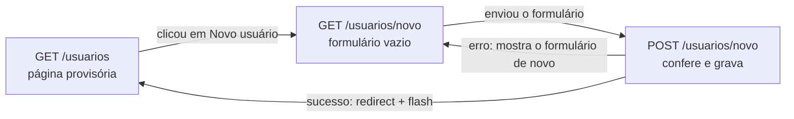

# Capítulo 14 — INSERT relacional de usuário

**Disciplina:** Programação para Internet (ILP951)
**Professor:** Ronan Adriel Zenatti · ronan.zenatti@cps.sp.gov.br
**Fatec Jahu — 2º Semestre/2026**

---

## 🎯 Objetivos do Capítulo

Ao final deste capítulo você deverá ser capaz de:

- Montar um formulário com vários grupos de campos e um `<select>` cujas opções vêm de **outra tabela** (`perfis`)
- Devolver ao formulário o que a pessoa digitou, com um único objeto (`request.form`), em vez de uma variável por campo
- Explicar por que a senha é gravada como **hash** e gerá-lo com `generate_password_hash`
- Conferir no servidor um valor que veio de um `<select>`, convertendo-o com `int()` e perguntando ao banco se ele existe
- Escrever, em `validacoes.py`, uma função por campo para e-mail, senha, celular, CPF, data de nascimento, CEP e estado
- Gravar um campo opcional deixado em branco como `NULL`, e os dados formatados (`000.000.000-00`) como o banco espera
- Impedir e-mail e CPF repetidos com as duas defesas do Capítulo 12: o `SELECT` antes e o erro `1062` depois

O Capítulo 13 fechou o CRUD de `perfis`. Este capítulo começa o de `usuarios`, e a tabela de usuários é a primeira do projeto que **depende de outra**: todo usuário tem um `perfil_id`, uma chave estrangeira para `perfis`. Também é a primeira com dados de gente de verdade (e-mail, CPF, celular, endereço) e com um campo que exige cuidado redobrado, a **senha**. Este capítulo cuida da metade de **criar** (`INSERT`). A lista e o detalhe vêm no Capítulo 15, e a edição e a exclusão, no 16.

## 📦 Ponto de partida

Este capítulo continua do **seu** repositório `sistema-gestao`, como ficou no fim do Capítulo 13: com o CRUD de perfis completo (cadastro, lista, edição e exclusão) e os perfis **Administrador**, **Gerente** e **Usuário** cadastrados. Os Capítulos 12.1 e 13.1 são opcionais: este capítulo parte do código do 13, e não deles.

Se o seu projeto não está funcionando, baixe o código do Capítulo 13 e descompacte. Depois de descompactar, crie o ambiente virtual e o `.env`, como no [Capítulo 11, Tópico 4](Capitulo_11_Projeto_Novo_e_Banco.md#topico-4-o-arquivo-env), importe o `banco.sql` no phpMyAdmin e cadastre os três perfis pelo formulário:

➡️ [Baixar p2_cap_13.zip](../arquivos/p2_cap_13.zip)

```bash
python -m venv venv
venv\Scripts\activate
pip install -r requirements.txt
copy .env.example .env
```

---

## Tópico 1 — O formulário de novo usuário

### Antes de começar

Ligue o **Apache** e o **MySQL** no painel do XAMPP. Abra a pasta `sistema-gestao` no VS Code, o terminal (`Ctrl + '`), ative o ambiente virtual e confira o Git:

```bash
venv\Scripts\activate
git status
```

O `git status` deve dizer `nothing to commit, working tree clean`. Ligue o servidor com `python app.py` e deixe esse terminal rodando durante o capítulo (use um segundo terminal, o ícone **+**, para o Git e para os testes).

### O mapa do recurso

O molde de nomes do Capítulo 12 vale para `usuarios`. Este capítulo constrói as duas primeiras linhas, e o resto vem nos próximos:

| Rota | Métodos | O que faz | Função no `app.py` | Template | Capítulo |
|---|---|---|---|---|---|
| `/usuarios` | GET | Lista os usuários | `lista_usuarios` | `usuarios.html` | 15 (hoje: página provisória) |
| `/usuarios/novo` | GET e POST | GET mostra o formulário, POST confere e grava | `usuario_novo` | `usuario_form.html` | **14** |
| `/usuarios/<int:id_usuario>` | GET | Detalhe de um usuário | `usuario_detalhe` | `usuario_detalhe.html` | 15 |
| `/usuarios/<int:id_usuario>/editar` | GET e POST | Edita o usuário | `usuario_editar` | `usuario_form.html` | 16 |
| `/usuarios/<int:id_usuario>/excluir` | só POST | Exclui o usuário | `usuario_excluir` | (nenhum) | 16 |

O caminho do navegador no cadastro é o mesmo do perfil:



### A rota e o primeiro campo

No `app.py`, acrescente a rota `usuario_novo` **depois** da `perfil_excluir` e antes dos `@app.errorhandler`. Por enquanto ela só mostra o formulário:

```python
@app.route('/usuarios/novo')
def usuario_novo():
    return render_template('usuario_form.html')
```

Crie o `templates/usuario_form.html`, só com o campo do nome e o botão. É o mesmo molde do `perfil_form.html`, e o formulário já leva o token CSRF do Capítulo 12:

```html


Novo usuário — Sistema de Gestão


  <h1 class="h2 mb-4">Novo usuário</h1>

  <div class="row">
    <div class="col-lg-8">
      <div class="card">
        <div class="card-body">

          <form action="{{ url_for('usuario_novo') }}" method="post">
            <input type="hidden" name="csrf_token" value="{{ csrf_token() }}">

            <h2 class="h5 mb-3">Dados principais</h2>

            <div class="mb-3">
              <label for="nome" class="form-label">Nome completo</label>
              <input type="text" class="form-control" id="nome" name="nome" placeholder="Ex.: Ana Beatriz Lima" required minlength="3" maxlength="255">
            </div>

            <div class="d-flex gap-2">
              <button type="submit" class="btn btn-primary">Salvar usuário</button>
            </div>

          </form>

        </div>
      </div>
    </div>
  </div>

```

Salve e abra **http://127.0.0.1:5000/usuarios/novo**. O `maxlength="255"` e o `minlength="3"` combinam com o `VARCHAR(255)` do banco e com a validação que o Tópico 2 escreve. Não há `required` nos campos que o banco aceita vazios: a regra do projeto continua valendo, o que é `NOT NULL` é obrigatório, e o que aceita `NULL` é opcional.

### Os dados de acesso: e-mail e senha

Acrescente, **abaixo** do campo do nome e **acima** dos botões, o e-mail e as duas senhas:

```html
            <div class="mb-3">
              <label for="email" class="form-label">E-mail</label>
              <input type="email" class="form-control" id="email" name="email" placeholder="nome@dominio.com.br" required maxlength="255">
            </div>

            <div class="row">
              <div class="col-md-6 mb-3">
                <label for="senha" class="form-label">Senha</label>
                <input type="password" class="form-control" id="senha" name="senha" required minlength="8" maxlength="128" autocomplete="new-password">
                <div class="form-text">Mínimo de 8 caracteres, com letras e números.</div>
              </div>
              <div class="col-md-6 mb-3">
                <label for="confirmacao" class="form-label">Confirmar a senha</label>
                <input type="password" class="form-control" id="confirmacao" name="confirmacao" required minlength="8" maxlength="128" autocomplete="new-password">
              </div>
            </div>
```

Salve e recarregue. O `type="email"` faz o navegador conferir o formato, e o `type="password"` esconde o que se digita. O `autocomplete="new-password"` pede ao navegador que **não** preencha o campo com uma senha salva de outro site. O `maxlength="128"` é o limite que a validação vai usar.

### O perfil: um `<select>` que vem do banco

Até aqui, as opções de um `<select>` eram escritas por você, em uma lista no Python (a lista de categorias do Capítulo 9). O perfil é diferente: as opções são as **linhas da tabela `perfis`**. Se alguém cadastrar um perfil novo, o formulário o mostra sem que se altere uma linha de código. Na rota, busque os perfis e entregue-os ao template:

```python
@app.route('/usuarios/novo')
def usuario_novo():
    perfis = execute_query('SELECT id_perfil, nome FROM perfis ORDER BY nome', fetch=True)

    return render_template('usuario_form.html', perfis=perfis)
```

No template, **depois** do bloco das senhas, acrescente o `<select>`:

```html
            <div class="mb-4">
              <label for="perfil_id" class="form-label">Perfil</label>
              
                <select class="form-select" id="perfil_id" name="perfil_id" required>
                  <option value="">Selecione...</option>
                  
                    <option value="{{ perfil.id_perfil }}">{{ perfil.nome }}</option>
                  
                </select>
              
                <div class="alert alert-warning mb-0" role="alert">
                  Nenhum perfil cadastrado. <a href="{{ url_for('perfil_novo') }}" class="alert-link">Cadastre um perfil</a> antes de cadastrar usuários.
                </div>
              
            </div>
```

Salve e recarregue. O `<select>` lista **Administrador**, **Gerente** e **Usuário**, em ordem alfabética. O `value` de cada opção é o `id_perfil`, o número que a chave estrangeira guarda, e o texto que aparece é o `nome`. Quem escolhe vê o nome, e o servidor recebe o número. O `` é verdadeiro quando a lista tem itens e falso quando está vazia: sem nenhum perfil cadastrado, o formulário avisa e oferece o caminho para cadastrar um, em vez de mostrar uma lista vazia que ninguém consegue escolher.

### Dados pessoais e endereço

Os dois grupos seguintes são **opcionais**. Acrescente os dados pessoais depois do `<select>`:

```html
            <h2 class="h5 mb-3">Dados pessoais (opcionais)</h2>

            <div class="row">
              <div class="col-md-4 mb-3">
                <label for="celular" class="form-label">Celular</label>
                <input type="tel" class="form-control" id="celular" name="celular" placeholder="(14) 99999-9999" maxlength="20">
              </div>
              <div class="col-md-4 mb-3">
                <label for="data_nascimento" class="form-label">Data de nascimento</label>
                <input type="date" class="form-control" id="data_nascimento" name="data_nascimento">
              </div>
              <div class="col-md-4 mb-4">
                <label for="cpf" class="form-label">CPF</label>
                <input type="text" class="form-control" id="cpf" name="cpf" placeholder="000.000.000-00" maxlength="14">
              </div>
            </div>
```

O `type="date"` abre um calendário e envia a data sempre como `AAAA-MM-DD`, seja qual for o jeito que o navegador a mostre. Agora o endereço. O campo **Estado** é outro `<select>`, e a lista de siglas vai ficar no `validacoes.py`, porque o formulário e a validação usam a **mesma** lista. No topo do `validacoes.py`:

```python
# Siglas dos estados aceitas pelo sistema
UFS = ['AC', 'AL', 'AP', 'AM', 'BA', 'CE', 'DF', 'ES', 'GO', 'MA', 'MT', 'MS', 'MG', 'PA',
       'PB', 'PR', 'PE', 'PI', 'RJ', 'RN', 'RS', 'RO', 'RR', 'SC', 'SP', 'SE', 'TO']
```

No `app.py`, importe a lista junto das funções de perfil (a linha do `validacoes` passa a ter duas importações) e entregue-a ao template:

```python
from validacoes import UFS, validar_nome_perfil, validar_descricao_perfil
```

```python
    return render_template('usuario_form.html', perfis=perfis, ufs=UFS)
```

E, no template, depois dos dados pessoais:

```html
            <h2 class="h5 mb-3">Endereço (opcional)</h2>

            <div class="row">
              <div class="col-md-4 mb-3">
                <label for="cep" class="form-label">CEP</label>
                <input type="text" class="form-control" id="cep" name="cep" placeholder="00000-000" maxlength="9">
              </div>
              <div class="col-md-8 mb-3">
                <label for="endereco" class="form-label">Endereço</label>
                <input type="text" class="form-control" id="endereco" name="endereco" maxlength="255">
              </div>
            </div>

            <div class="row">
              <div class="col-md-4 mb-3">
                <label for="numero" class="form-label">Número</label>
                <input type="text" class="form-control" id="numero" name="numero" maxlength="20">
              </div>
              <div class="col-md-8 mb-3">
                <label for="complemento" class="form-label">Complemento</label>
                <input type="text" class="form-control" id="complemento" name="complemento" maxlength="100">
              </div>
            </div>

            <div class="row">
              <div class="col-md-8 mb-4">
                <label for="cidade" class="form-label">Cidade</label>
                <input type="text" class="form-control" id="cidade" name="cidade" maxlength="100">
              </div>
              <div class="col-md-4 mb-4">
                <label for="estado" class="form-label">Estado</label>
                <select class="form-select" id="estado" name="estado">
                  <option value="">--</option>
                  
                    <option value="{{ uf }}">{{ uf }}</option>
                  
                </select>
              </div>
            </div>
```

Os `maxlength` são os tamanhos das colunas do `banco.sql` do Capítulo 11 (`endereco VARCHAR(255)`, `numero VARCHAR(20)`, `complemento VARCHAR(100)`, `cidade VARCHAR(100)`). Salve e recarregue: o formulário está completo, com quatro grupos.

### Devolver o que a pessoa digitou

No Capítulo 13, o formulário tinha dois campos, e a rota guardava cada um em uma variável (`nome` e `descricao`) para devolvê-los quando houvesse erro. Com treze campos, seriam treze variáveis e um `render_template` com treze argumentos. Há um jeito mais curto: o Flask já guarda **tudo** o que chegou no formulário em `request.form`. A rota entrega o objeto inteiro ao template, com o nome `dados`:

```python
    return render_template('usuario_form.html', dados=request.form, perfis=perfis, ufs=UFS)
```

No primeiro acesso (um `GET`), o `request.form` está **vazio**, e o formulário aparece em branco. Depois de um `POST` com erro, ele contém o que foi enviado, e o template o devolve. Cada campo de texto ganha um `value="{{ dados.nome }}"`, com o nome do próprio campo. No `nome`:

```html
              <input type="text" class="form-control" id="nome" name="nome" placeholder="Ex.: Ana Beatriz Lima" value="{{ dados.nome }}" required minlength="3" maxlength="255">
```

Faça o mesmo, **um por um**, nos campos `email`, `celular`, `data_nascimento`, `cpf`, `cep`, `endereco`, `numero`, `complemento` e `cidade`: acrescente `value="{{ dados.NOME_DO_CAMPO }}"` à tag `<input>`. Os dois campos de **senha não levam** `value`, nunca: uma senha não volta para a tela, nem quando o formulário tem erro (a pessoa digita de novo).

!!! note "Jinja: `dados.nome` quando o campo não existe"
    O `request.form` funciona como um dicionário: `dados.nome` procura a chave `nome`. Quando ela **não existe** (o formulário ainda não foi enviado), o Jinja não dá erro: escreve um texto vazio. Por isso o mesmo `value="{{ dados.nome }}"` serve ao formulário em branco e ao formulário devolvido.

Os dois `<select>` precisam de um tratamento à parte: a opção que a pessoa escolheu deve continuar marcada com `selected`. No perfil, troque a linha da opção por:

```html
                    <option value="{{ perfil.id_perfil }}" selected>{{ perfil.nome }}</option>
```

E, no estado:

```html
                    <option value="{{ uf }}" selected>{{ uf }}</option>
```

!!! note "Jinja: o `|string` na comparação do perfil"
    O `id_perfil` chega do banco como **número** (`2`), e o que veio do formulário é **texto** (`'2'`). Em Python e em Jinja, `'2' == 2` é falso, e a opção nunca seria marcada. O filtro `|string` converte o número em texto antes de comparar. Já a sigla do estado é texto nos dois lados, e não precisa de conversão.

Salve e recarregue. Nada mudou na tela, porque o formulário ainda não foi enviado, e ele só **recebeu** a informação. O efeito aparece no próximo tópico.

### A página provisória `/usuarios`

Falta o caminho até o formulário e o caminho de volta. A lista de usuários só chega no Capítulo 15, mas o botão **Cancelar** e o redirect depois de gravar precisam de um destino. Por enquanto ele é uma página **provisória**, sem consulta ao banco. No `app.py`, acrescente a rota **antes** da `usuario_novo`:

```python
@app.route('/usuarios')
def lista_usuarios():
    return render_template('usuarios.html', titulo='Usuários')
```

Crie o `templates/usuarios.html`:

```html


{{ titulo }} — Sistema de Gestão


  <div class="d-flex justify-content-between align-items-center mb-3">
    <h1 class="h2 mb-0">{{ titulo }}</h1>
    <a href="{{ url_for('usuario_novo') }}" class="btn btn-primary">Novo usuário</a>
  </div>

  <div class="alert alert-info" role="alert">
    A lista de usuários chega no Capítulo 15. Por enquanto, confira os cadastros no phpMyAdmin
    (banco <strong>gestao</strong>, tabela <strong>usuarios</strong>) e no contador da página inicial.
  </div>

```

No `usuario_form.html`, o botão **Cancelar** entra **depois** do botão de salvar, dentro do mesmo `<div class="d-flex gap-2">`:

```html
              <a href="{{ url_for('lista_usuarios') }}" class="btn btn-outline-secondary">Cancelar</a>
```

E o `base.html` ganha o item **Usuários** no menu, **depois** do item Perfis, dentro do `<ul class="navbar-nav ms-auto">`:

```html
          <li class="nav-item">
            <a class="nav-link active" href="{{ url_for('lista_usuarios') }}">Usuários</a>
          </li>
```

Salve e navegue: **Usuários** no menu, **Novo usuário**, o formulário completo, **Cancelar** de volta. Preencha o nome e clique em **Salvar usuário**: a página mostra **Method Not Allowed** (405), porque a rota `usuario_novo` ainda só aceita `GET`. É a deixa para o próximo tópico.

```bash
git add .
git commit -m "Adiciona o formulário de novo usuário e a página provisória de usuários"
git push
```

---

## Tópico 2 — Receber o POST: nome e e-mail

### O que chegou pelo formulário

Troque a linha do `@app.route` para aceitar os dois métodos, e leia os treze campos dentro de um `if` do POST. Por enquanto, a rota só repete **dois** deles em uma faixa azul. A rota completa fica assim:

```python
@app.route('/usuarios/novo', methods=['GET', 'POST'])
def usuario_novo():
    if request.method == 'POST':
        nome = request.form.get('nome', '').strip()
        email = request.form.get('email', '').strip().lower()
        senha = request.form.get('senha', '')
        confirmacao = request.form.get('confirmacao', '')
        celular = request.form.get('celular', '').strip()
        data_nascimento = request.form.get('data_nascimento', '').strip()
        cpf = request.form.get('cpf', '').strip()
        perfil_txt = request.form.get('perfil_id', '')
        cep = request.form.get('cep', '').strip()
        endereco = request.form.get('endereco', '').strip()
        numero = request.form.get('numero', '').strip()
        complemento = request.form.get('complemento', '').strip()
        cidade = request.form.get('cidade', '').strip()
        estado = request.form.get('estado', '')

        flash(f'Recebi o usuário "{nome}" com o e-mail "{email}".', 'info')

    perfis = execute_query('SELECT id_perfil, nome FROM perfis ORDER BY nome', fetch=True)

    return render_template('usuario_form.html', dados=request.form, perfis=perfis, ufs=UFS)
```

Os detalhes que importam:

- **`.strip()`** tira os espaços das pontas. A **senha** é a exceção: ela **não** leva `.strip()`, porque um espaço pode fazer parte dela.
- **`.lower()` no e-mail** deixa tudo em minúsculas. Sem isso, `Ana@Exemplo.com` e `ana@exemplo.com` seriam dois cadastros para a mesma pessoa.
- **`perfil_txt`**: tudo o que chega por `request.form` é **texto**. O perfil, que será número, carrega o sufixo `_txt` até ser convertido (Tópico 4).
- **O `flash` da senha**: a senha nunca entra em mensagem, em `print` nem em log.
- **O `render_template` do final** devolve o formulário no `GET` e também no `POST` com erro. Por isso o `dados=request.form` mantém o que foi digitado.

Salve e envie o formulário com o nome `Ana Beatriz Lima` e o e-mail `ANA@Exemplo.com`. A faixa azul mostra `Recebi o usuário "Ana Beatriz Lima" com o e-mail "ana@exemplo.com".`, o e-mail em minúsculas, e **o formulário continua preenchido** (menos as senhas).

### Validar o nome e o e-mail

Como no Capítulo 12, cada campo ganha uma função em `validacoes.py` que devolve a mensagem de erro ou `None`. A do nome é parecida com a do perfil. Acrescente ao final do `validacoes.py`:

```python
def validar_nome_usuario(nome):
    if nome == '':
        return 'Informe o nome do usuário.'

    if len(nome) < 3:
        return 'O nome deve ter pelo menos 3 caracteres.'

    if len(nome) > 255:
        return 'O nome deve ter no máximo 255 caracteres.'

    return None
```

O e-mail tem mais regras. O `type="email"` do HTML só vale no navegador, e o servidor precisa conferir por conta própria. Sem recursos avançados, a função confere o essencial: um único `@`, um texto antes dele e, depois dele, um domínio com um ponto no meio.

```python
def validar_email(email):
    mensagem = 'Informe um e-mail válido, por exemplo nome@dominio.com.br.'

    if email == '':
        return 'Informe o e-mail.'

    if len(email) > 255:
        return 'O e-mail deve ter no máximo 255 caracteres.'

    if ' ' in email or email.count('@') != 1:
        return mensagem

    partes = email.split('@')
    antes = partes[0]
    depois = partes[1]

    if antes == '' or '.' not in depois:
        return mensagem

    if depois.startswith('.') or depois.endswith('.'):
        return mensagem

    return None
```

!!! note "Python: `count`, `split`, `startswith` e `endswith`"
    São quatro métodos do texto. O `email.count('@')` conta quantas vezes o `@` aparece. O `email.split('@')` **corta** o texto em cada `@` e devolve uma lista com os pedaços: `'ana@exemplo.com'` vira `['ana', 'exemplo.com']`. O `partes[0]` é o primeiro pedaço e o `partes[1]`, o segundo (a contagem de uma lista começa em 0, como no [Capítulo 2.1](Capitulo_02_1_Python_Essencial.md)). O `startswith('.')` e o `endswith('.')` perguntam se o texto começa ou termina com aquele caractere. Repare na variável `mensagem` no topo: a mesma frase é devolvida em vários pontos, e escrevê-la uma vez só evita copiar o texto.

Teste no segundo terminal, com um e-mail bom e três ruins:

```bash
python -c "from validacoes import validar_email; print(validar_email('ana@exemplo.com.br')); print(validar_email('ana')); print(validar_email('ana@exemplo')); print(validar_email('a b@exemplo.com'))"
```

O primeiro imprime `None`, e os outros três imprimem `Informe um e-mail válido, por exemplo nome@dominio.com.br.`. No `app.py`, importe as duas funções, e troque o `flash` provisório do final do `if request.method == 'POST':` por este bloco:

```python
from validacoes import (
    UFS, validar_nome_perfil, validar_descricao_perfil,
    validar_nome_usuario, validar_email,
)
```

```python
        erros = []

        erro = validar_nome_usuario(nome)
        if erro:
            erros.append(erro)

        erro = validar_email(email)
        if erro:
            erros.append(erro)

        if erros:
            for mensagem in erros:
                flash(mensagem, 'danger')
        else:
            flash('Dados válidos. Ainda não gravei no banco.', 'success')
```

!!! note "Python: importar várias funções entre parênteses"
    Quando a lista do `from ... import` fica longa, os parênteses permitem quebrá-la em várias linhas. É o mesmo comando, só mais fácil de ler. A lista vai crescer a cada tópico.

Salve e teste, com o `required` do formulário atrapalhando o mínimo possível (para ver o servidor trabalhar, tire os `required` e o `minlength` pelo `F12`, como no Capítulo 9):

- Nome `ab` e e-mail `ana@exemplo`: duas faixas vermelhas, uma para cada campo, e o formulário mantém o que foi digitado.
- Nome `Ana Beatriz Lima` e e-mail `ana@exemplo.com`: faixa verde `Dados válidos. Ainda não gravei no banco.`

```bash
git add .
git commit -m "Recebe o POST do usuário e valida o nome e o e-mail"
git push
```

---

## Tópico 3 — A senha e o hash

### Por que a senha não pode ser gravada como veio

O banco já tem a coluna `senha VARCHAR(255)`. A tentação é gravar nela o que a pessoa digitou. Pense no que isso significa: quem tiver acesso ao banco (um backup esquecido, uma invasão, um colega curioso com acesso ao phpMyAdmin) lê **todas as senhas**. E como muita gente repete a mesma senha em vários sites, o estrago passa do seu sistema para o e-mail, o banco e as redes sociais dessas pessoas.

| O que está na coluna `senha` | Quem lê o banco enxerga |
|---|---|
| A senha digitada | `Senha123` |
| O **hash** da senha | `scrypt:32768:8:1$a6tybEY3NCOuA8aS$4ae201a98...` |

A solução é guardar um **hash**: o resultado de uma conta matemática de **mão única**, que transforma a senha em uma sequência longa e embaralhada, e que **não tem caminho de volta**. Do hash não se chega à senha. Veja com os próprios olhos, no segundo terminal:

```bash
python -c "from werkzeug.security import generate_password_hash; print(generate_password_hash('Senha123')); print(generate_password_hash('Senha123'))"
```

Aparecem duas linhas, parecidas com a tabela acima. Repare em duas coisas. A primeira: as duas linhas são **diferentes**, embora a senha seja a mesma. A função mistura um texto aleatório, o **sal**, antes de calcular, e por isso duas pessoas com a mesma senha não deixam hashes iguais (quem roubasse o banco não descobriria quem repete a senha). A segunda: o sal fica **dentro** do próprio hash (é o trecho entre os `$`), e isso permite conferir uma senha mais tarde. Teste:

```bash
python -c "from werkzeug.security import generate_password_hash, check_password_hash; h = generate_password_hash('Senha123'); print(check_password_hash(h, 'Senha123')); print(check_password_hash(h, 'senha123'))"
```

Imprime `True` e `False`. O `check_password_hash` refaz a conta com o mesmo sal e compara o resultado: acerta a senha certa e erra até por uma letra maiúscula. É exatamente o que o login faz, no Capítulo 17. O hash tem cerca de 160 caracteres, e é para isso que a coluna é `VARCHAR(255)`: a senha tem 8 a 128 caracteres, mas o que se grava é o hash.

### Validar a senha

A função da senha recebe os **dois** campos, a senha e a confirmação, e confere nesta ordem: tamanho mínimo, tamanho máximo, letras e números, e confirmação igual. Acrescente ao `validacoes.py`:

```python
def validar_senha(senha, confirmacao):
    if len(senha) < 8:
        return 'A senha deve ter pelo menos 8 caracteres.'

    if len(senha) > 128:
        return 'A senha deve ter no máximo 128 caracteres.'

    tem_letra = False
    tem_numero = False
    for caractere in senha:
        if caractere.isalpha():
            tem_letra = True
        if caractere in '0123456789':
            tem_numero = True

    if not tem_letra or not tem_numero:
        return 'A senha deve ter letras e números.'

    if senha != confirmacao:
        return 'A confirmação da senha não confere.'

    return None
```

!!! note "Python: `for` em um texto e `isalpha`"
    O `for` também percorre um **texto**, uma letra por volta: no `for caractere in senha`, a variável `caractere` vale cada símbolo da senha, um de cada vez. O `caractere.isalpha()` pergunta se aquele símbolo é uma letra, e o `caractere in '0123456789'` pergunta se ele é um dos dez dígitos. As duas variáveis (`tem_letra` e `tem_numero`) começam em `False` e viram `True` quando o `for` encontra o que procura.

Teste no segundo terminal:

```bash
python -c "from validacoes import validar_senha; print(validar_senha('abc', 'abc')); print(validar_senha('abcdefgh', 'abcdefgh')); print(validar_senha('Senha123', 'Senha124')); print(validar_senha('Senha123', 'Senha123'))"
```

As três primeiras mensagens são `A senha deve ter pelo menos 8 caracteres.`, `A senha deve ter letras e números.` e `A confirmação da senha não confere.`, e a quarta é `None`. Importe a função no `app.py` (acrescente `validar_senha` à lista do `from validacoes import (...)`) e chame-a **abaixo** da validação do e-mail, antes do `if erros:`:

```python
        erro = validar_senha(senha, confirmacao)
        if erro:
            erros.append(erro)
```

Salve e teste, tirando o `required` e o `minlength` das senhas pelo `F12`:

- Senhas `abc` e `abc`: faixa vermelha de tamanho.
- Senhas `12345678` e `12345678`: faixa vermelha, faltam letras.
- Senhas `Senha123` e `Senha124`: faixa vermelha, a confirmação não confere.
- Senhas `Senha123` e `Senha123`, com nome e e-mail bons: faixa verde. Os campos de senha voltam **vazios**, de propósito.

```bash
git add .
git commit -m "Valida a senha do usuário e a confirmação"
git push
```

---

## Tópico 4 — O perfil e o primeiro INSERT

### Conferir o perfil no servidor

O `<select>` só oferece perfis que existem, então parece que não há o que conferir. Mas o navegador é só a primeira linha de defesa: qualquer pessoa abre o `F12`, troca o `value` de uma opção para `99` e envia. O servidor precisa **conferir** o que chegou, em duas conferências: o valor é um número? E existe um perfil com esse código?

No `app.py`, acrescente a função **acima** da rota `usuario_novo` (ela não tem `@app.route`, é só um pedaço de código que a rota chama):

```python
def conferir_perfil_do_usuario(perfil_txt):
    try:
        id_perfil = int(perfil_txt)
    except ValueError:
        return 'Selecione um perfil.'

    perfil = execute_one(
        'SELECT id_perfil FROM perfis WHERE id_perfil = %s',
        (id_perfil,),
    )
    if perfil is None:
        return 'Selecione um perfil válido.'

    return None
```

O `int(perfil_txt)` converte o texto em número, e falha com `ValueError` se o texto não for um número: tanto o `'abc'` de quem adulterou o formulário quanto o `''` de quem não escolheu nada (a opção "Selecione..."). É o mesmo `try/except ValueError` do [Capítulo 9](Capitulo_09_Validacao_e_Flash.md#topico-4-categoria-preco-e-varios-erros-de-uma-vez). Depois da conversão, o `SELECT` pergunta ao banco se aquele perfil existe. Chame a função na rota, abaixo da validação da senha:

```python
        erro = conferir_perfil_do_usuario(perfil_txt)
        if erro:
            erros.append(erro)
```

Salve e teste. No `F12` (aba **Elements**), troque o `value` de uma opção do `<select>` por `99` e envie com os outros campos bons: `Selecione um perfil válido.` Troque por `abc`: `Selecione um perfil.` Escolha um perfil de verdade, e a faixa verde volta, **com o perfil continuando selecionado** (é o `selected` do Tópico 1 trabalhando).

### O primeiro INSERT

Com nome, e-mail, senha e perfil conferidos, já dá para gravar o usuário. O `INSERT` leva por enquanto só as **quatro colunas obrigatórias**, e o resto fica `NULL` até o Tópico 5. O `app.py` precisa de uma importação nova, para gerar o hash:

```python
from werkzeug.security import generate_password_hash
```

(Coloque-a logo abaixo da linha `from mysql.connector import Error`.) Agora troque o `else` do final do `if erros:` por este:

```python
        else:
            novo_id = execute_insert(
                'INSERT INTO usuarios (nome, email, senha, perfil_id) VALUES (%s, %s, %s, %s)',
                (nome, email, generate_password_hash(senha), int(perfil_txt)),
            )
            flash(f'Usuário "{nome}" cadastrado (código {novo_id}).', 'success')
            return redirect(url_for('lista_usuarios'))
```

Os pontos que importam, na ordem em que acontecem:

1. **`generate_password_hash(senha)`**: no banco entra o hash, e a variável `senha`, com o texto puro, morre dentro da rota. Ela nunca é gravada, nunca é impressa.
2. **`int(perfil_txt)`**: o texto do perfil vira número. A conferência acima já garantiu que a conversão funciona.
3. **As colunas que ficaram de fora** (`celular`, `cpf`, `cep`...) não são mencionadas no `INSERT`: o banco as grava como `NULL`, porque elas aceitam.
4. **O `redirect`** é o PRG do Capítulo 12: depois de gravar, a rota não desenha a página, redireciona para `/usuarios`. A faixa verde `flash` atravessa o redirect e aparece lá.

Salve e cadastre o primeiro usuário: nome `Ana Beatriz Lima`, e-mail `ana@exemplo.com`, senha `Senha123` (nos dois campos), perfil **Administrador**. Você cai na página provisória, com a faixa verde `Usuário "Ana Beatriz Lima" cadastrado (código 1).` (ou outro número). Aperte `F5`: a faixa some e nada é cadastrado de novo. Abra o **Início**: o cartão de usuários mostra **1**.

Abra o **phpMyAdmin**, o banco `gestao`, a tabela `usuarios` e a aba **Procurar**. Confira três coisas:

- A coluna `senha` mostra o **hash** (`scrypt:32768:8:1$...`), e não `Senha123`.
- A coluna `perfil_id` mostra o código do perfil Administrador, e **não** o nome: é a chave estrangeira.
- As colunas `celular`, `cpf`, `data_nascimento`, `cep`, `endereco`, `numero`, `complemento`, `cidade` e `estado` aparecem como `NULL`.

Preencha agora um celular e um CPF quaisquer e cadastre outro usuário (e-mail `ana2@exemplo.com`): o cadastro funciona, mas os dois campos ficam `NULL` no banco. **O formulário os aceita e o servidor ainda os ignora.** O próximo tópico resolve isso.

```bash
git add .
git commit -m "Confere o perfil no servidor e grava o usuário com a senha em hash"
git push
```

---

## Tópico 5 — Os campos opcionais

### A regra dos opcionais

O banco aceita `NULL` em `celular`, `data_nascimento`, `cpf`, `cep`, `endereco`, `numero`, `complemento`, `cidade` e `estado`. A regra do projeto se aplica a todos:

- **Em branco**: o campo é aceito, e o banco recebe `NULL`. Nunca um texto vazio (`''`).
- **Preenchido**: o valor é **validado** como qualquer outro campo, e gravado no formato que o banco espera.

Este tópico acrescenta uma função de validação por campo, na mesma ordem do formulário. As validações entram na rota primeiro, e a gravação, no fim do tópico. Durante o caminho, um valor válido é aceito mas ainda não é gravado (como no tópico anterior).

### Só os dígitos

Celular, CPF e CEP chegam em formatos variados: `(14) 99811-2030`, `14998112030`, `14 99811 2030`. As três validações começam do mesmo ponto: **ficar só com os dígitos**. Acrescente ao `validacoes.py`:

```python
def so_digitos(texto):
    resultado = ''
    for letra in texto:
        if letra in '0123456789':
            resultado = resultado + letra
    return resultado
```

A função percorre o texto letra por letra (o `for` do Tópico 3) e junta, em `resultado`, só as que são dígitos. Teste:

```bash
python -c "from validacoes import so_digitos; print(so_digitos('(14) 99811-2030')); print(so_digitos('529.982.247-25'))"
```

Imprime `14998112030` e `52998224725`.

### Celular

O celular tem DDD e 9 ou 8 dígitos: **10 ou 11 dígitos** no total. A validação confere a quantidade, e uma segunda função devolve o número no formato que será gravado, `(14) 99811-2030`. Acrescente ao `validacoes.py`:

```python
def formatar_celular(celular):
    digitos = so_digitos(celular)

    if len(digitos) == 11:
        return f'({digitos[0:2]}) {digitos[2:7]}-{digitos[7:11]}'

    if len(digitos) == 10:
        return f'({digitos[0:2]}) {digitos[2:6]}-{digitos[6:10]}'

    return ''


def validar_celular(celular):
    if celular == '':
        return None

    digitos = so_digitos(celular)
    if len(digitos) != 10 and len(digitos) != 11:
        return 'Informe o celular com DDD, com 10 ou 11 dígitos.'

    return None
```

!!! note "Python: fatias de texto, `[0:2]`"
    Um texto pode ser **fatiado**: `digitos[0:2]` devolve do primeiro caractere (posição 0) até **antes** da posição 2, ou seja, os dois primeiros. É o mesmo "o último não entra" do `range`. Com `digitos = '14998112030'`: `digitos[0:2]` é `14`, `digitos[2:7]` é `99811` e `digitos[7:11]` é `2030`. O `f'...'` junta as fatias com os parênteses, o espaço e o hífen. Repare que `validar_celular` começa com `if celular == '': return None`: em branco é aceito, porque o campo é opcional.

Teste:

```bash
python -c "from validacoes import formatar_celular, validar_celular; print(formatar_celular('14998112030')); print(formatar_celular('1433334444')); print(validar_celular('123')); print(validar_celular(''))"
```

Imprime `(14) 99811-2030`, `(14) 3333-4444`, a mensagem de erro e `None`.

### CPF

Os dois últimos dígitos de um CPF não são sorteados: são **calculados** a partir dos nove primeiros. Por isso dá para descobrir um CPF digitado errado. A conta de cada dígito é a mesma, mudando só a quantidade de números que entram. Acrescente ao `validacoes.py`:

```python
def formatar_cpf(cpf):
    digitos = so_digitos(cpf)

    if len(digitos) != 11:
        return ''

    return f'{digitos[0:3]}.{digitos[3:6]}.{digitos[6:9]}-{digitos[9:11]}'


def calcular_digito_cpf(digitos, quantidade):
    soma = 0
    for posicao in range(quantidade):
        peso = quantidade + 1 - posicao
        soma = soma + int(digitos[posicao]) * peso

    resto = (soma * 10) % 11
    if resto == 10:
        resto = 0

    return resto
```

Como a função funciona: cada dígito é multiplicado por um **peso** que diminui (para o primeiro dígito verificador, 10, 9, 8... até 2), os produtos são somados, e o resto da divisão da soma (vezes 10) por 11 dá o dígito. O `%` devolve o **resto** da divisão (`23 % 5` é `3`), e o `range(quantidade)` percorre as posições, como no Capítulo 2.1. A função `validar_cpf` usa a `calcular_digito_cpf` duas vezes: com 9 números (para o 10º dígito do CPF) e com 10 números (para o 11º).

```python
def validar_cpf(cpf):
    if cpf == '':
        return None

    digitos = so_digitos(cpf)
    if len(digitos) != 11:
        return 'O CPF deve ter 11 dígitos.'

    if digitos == digitos[0] * 11:
        return 'Informe um CPF válido.'

    if calcular_digito_cpf(digitos, 9) != int(digitos[9]):
        return 'Informe um CPF válido.'

    if calcular_digito_cpf(digitos, 10) != int(digitos[10]):
        return 'Informe um CPF válido.'

    return None
```

A linha `digitos == digitos[0] * 11` barra o CPF de um número repetido (`111.111.111-11`), que passaria na conta mas não existe: `'1' * 11` é o texto `11111111111`. Teste com um CPF de exemplo, válido, e com outros três:

```bash
python -c "from validacoes import validar_cpf; print(validar_cpf('529.982.247-25')); print(validar_cpf('529.982.247-26')); print(validar_cpf('111.111.111-11')); print(validar_cpf('123'))"
```

Imprime `None`, `Informe um CPF válido.`, `Informe um CPF válido.` e `O CPF deve ter 11 dígitos.`. Trocar um único dígito derruba a validação.

!!! warning "Validar o CPF não prova que ele existe"
    A conta dos dígitos só descarta erros de digitação. Saber se aquele CPF pertence mesmo a alguém exigiria consultar um serviço oficial. O sistema aceita qualquer número que **passe na conta**.

### Data de nascimento

O `<input type="date">` envia a data como `AAAA-MM-DD`, por exemplo `1988-03-14`. A conversão usa o `strptime` do [Capítulo 2.1](Capitulo_02_1_Python_Essencial.md), com o modelo `'%Y-%m-%d'`, e o `try/except ValueError` trata uma data impossível (30 de fevereiro). Duas regras de negócio completam: a data não pode estar no futuro, nem ser anterior a 1900. No **topo** do `validacoes.py`, acrescente a importação (antes da lista `UFS`):

```python
from datetime import datetime
```

E, no final do arquivo:

```python
def validar_data_nascimento(texto):
    if texto == '':
        return None

    try:
        data = datetime.strptime(texto, '%Y-%m-%d')
    except ValueError:
        return 'Informe uma data de nascimento válida.'

    if data > datetime.now():
        return 'A data de nascimento não pode estar no futuro.'

    if data.year < 1900:
        return 'A data de nascimento deve ser a partir de 1900.'

    return None
```

O `datetime.now()` é o momento atual, e duas datas podem ser comparadas com `>`, como dois números. Teste:

```bash
python -c "from validacoes import validar_data_nascimento as v; print(v('1988-03-14')); print(v('2026-02-30')); print(v('2999-01-01')); print(v('1899-12-31'))"
```

Imprime `None` e depois as três mensagens (data inválida, no futuro, anterior a 1900).

### CEP, endereço e estado

O CEP tem 8 dígitos e é gravado como `00000-000`. O estado precisa ser uma das siglas da lista `UFS` (o formulário já oferece só essas, mas o servidor confere, como no perfil). Os campos de texto livre (endereço, número, complemento e cidade) só precisam respeitar o tamanho das colunas, e **uma** função, que recebe o limite, serve aos quatro. Acrescente ao `validacoes.py`:

```python
def formatar_cep(cep):
    digitos = so_digitos(cep)

    if len(digitos) != 8:
        return ''

    return f'{digitos[0:5]}-{digitos[5:8]}'


def validar_cep(cep):
    if cep == '':
        return None

    if len(so_digitos(cep)) != 8:
        return 'Informe um CEP com 8 dígitos.'

    return None


def validar_estado(estado):
    if estado == '':
        return None

    if estado not in UFS:
        return 'Selecione um estado válido.'

    return None


def validar_tamanho(valor, rotulo, maximo):
    if len(valor) > maximo:
        return f'O campo {rotulo} deve ter no máximo {maximo} caracteres.'

    return None
```

O `estado not in UFS` é o `not in` do Capítulo 9, aplicado à lista do começo do arquivo. A `validar_tamanho` recebe o texto, o **nome do campo** para a mensagem e o limite: `validar_tamanho(cidade, 'cidade', 100)`.

### Chamar tudo na rota

No `app.py`, a lista do `from validacoes import (...)` passa a ter todas as funções de validação e de formatação:

```python
from validacoes import (
    UFS, validar_nome_perfil, validar_descricao_perfil,
    validar_nome_usuario, validar_email, validar_senha, validar_celular,
    validar_cpf, validar_data_nascimento, validar_cep, validar_estado,
    validar_tamanho, formatar_celular, formatar_cpf, formatar_cep,
)
```

E a rota chama as funções, **depois** da conferência do perfil e antes do `if erros:`, na ordem do formulário:

```python
        erro = validar_celular(celular)
        if erro:
            erros.append(erro)

        erro = validar_cpf(cpf)
        if erro:
            erros.append(erro)

        erro = validar_data_nascimento(data_nascimento)
        if erro:
            erros.append(erro)

        erro = validar_cep(cep)
        if erro:
            erros.append(erro)

        erro = validar_tamanho(endereco, 'endereço', 255)
        if erro:
            erros.append(erro)

        erro = validar_tamanho(numero, 'número', 20)
        if erro:
            erros.append(erro)

        erro = validar_tamanho(complemento, 'complemento', 100)
        if erro:
            erros.append(erro)

        erro = validar_tamanho(cidade, 'cidade', 100)
        if erro:
            erros.append(erro)

        erro = validar_estado(estado)
        if erro:
            erros.append(erro)
```

Salve e teste o servidor com tudo errado de uma vez (tire os atributos do HTML pelo `F12`, como antes): celular `123`, CPF `111.111.111-11`, CEP `12`, uma data no futuro (o calendário aceita) e a cidade com 101 letras. Cada problema aparece em uma faixa vermelha, e o formulário mantém o que foi digitado. Depois envie tudo certo, com o e-mail `teste5@exemplo.com`, CPF `529.982.247-25`, celular `(14) 99811-2030`, data `14/03/1988` e CEP `17201-000`: o cadastro é aceito (e, por enquanto, só os campos obrigatórios são gravados).

```bash
git add .
git commit -m "Valida celular, CPF, data de nascimento, CEP, estado e endereço"
git push
```

### Gravar os opcionais

Falta gravar. Há duas diferenças em relação ao `INSERT` do Tópico 4: o `INSERT` leva as **treze** colunas, e cada opcional vazio precisa virar `NULL`. Como a troca de `''` por `None` se repete em nove campos, ela vira uma função pequena, que **não é uma rota**. No `app.py`, **acima** da `conferir_perfil_do_usuario`:

```python
def vazio_para_none(valor):
    if valor == '':
        return None

    return valor
```

É o mesmo `if descricao == ''` do Capítulo 12, agora escrito uma vez só. Troque o `INSERT` do `else` por este:

```python
        else:
            novo_id = execute_insert(
                'INSERT INTO usuarios (nome, email, senha, celular, data_nascimento, cpf, '
                'perfil_id, cep, endereco, numero, complemento, cidade, estado) '
                'VALUES (%s, %s, %s, %s, %s, %s, %s, %s, %s, %s, %s, %s, %s)',
                (
                    nome,
                    email,
                    generate_password_hash(senha),
                    vazio_para_none(formatar_celular(celular)),
                    vazio_para_none(data_nascimento),
                    vazio_para_none(formatar_cpf(cpf)),
                    int(perfil_txt),
                    vazio_para_none(formatar_cep(cep)),
                    vazio_para_none(endereco),
                    vazio_para_none(numero),
                    vazio_para_none(complemento),
                    vazio_para_none(cidade),
                    vazio_para_none(estado),
                ),
            )
            flash(f'Usuário "{nome}" cadastrado (código {novo_id}).', 'success')
            return redirect(url_for('lista_usuarios'))
```

Quatro detalhes. Os **treze** `%s` correspondem, um a um e na mesma ordem, às treze colunas e aos treze valores da tupla. Os campos formatados passam pelo formatador **e** pelo `vazio_para_none`: o `formatar_cpf('')` devolve `''`, que vira `None`. A data não precisa de conversão: depois de validada, o texto `AAAA-MM-DD` é um formato que o MySQL entende direto. E os textos de uma coluna só (`endereco`, `numero`...) só passam pelo `vazio_para_none`.

Salve e cadastre um usuário **completo**: nome `Bruno Souza`, e-mail `bruno@exemplo.com`, perfil **Gerente**, celular `14998112030`, nascimento `14/03/1988`, CPF `52998224725`, CEP `17201000`, endereço `Rua das Flores`, número `10`, cidade `Jaú`, estado `SP`. No phpMyAdmin, confira que o celular está como `(14) 99811-2030`, o CPF como `529.982.247-25` e o CEP como `17201-000`: o sistema grava no formato certo, mesmo que a pessoa tenha digitado sem pontuação. Cadastre agora outro usuário **só com os obrigatórios** (e-mail `carla@exemplo.com`): as colunas opcionais ficam `NULL`, e não vazias.

```bash
git add .
git commit -m "Grava os campos opcionais do usuário, com NULL quando em branco"
git push
```

---

## Tópico 6 — E-mail e CPF repetidos

### O que o banco faz sozinho

As colunas `email` e `cpf` da tabela `usuarios` são `UNIQUE`: o banco recusa dois usuários com o mesmo e-mail, ou com o mesmo CPF. Veja o que acontece com a rota como ela está. Cadastre de novo um usuário com o e-mail `bruno@exemplo.com`. A página de depuração do Flask aparece com algo assim:

```text
mysql.connector.errors.IntegrityError: 1062 (23000): Duplicate entry 'bruno@exemplo.com' for key 'email'
```

É o mesmo erro `1062` do [Capítulo 12, Tópico 6](Capitulo_12_INSERT_e_SELECT_de_Perfis.md#topico-6-nome-repetido-o-erro-1062): o banco protegeu os dados, mas quem usa o sistema vê uma página técnica. As defesas também são as mesmas: perguntar antes e reconhecer o erro.

### Primeira defesa: perguntar antes

O e-mail tem a sua conferência na validação. Quando o formato está certo, a rota pergunta ao banco se já existe um usuário com esse e-mail. No `app.py`, troque o bloco do e-mail por este, que ganha um `else`:

```python
        erro = validar_email(email)
        if erro:
            erros.append(erro)
        else:
            existente = execute_one(
                'SELECT id_usuario FROM usuarios WHERE email = %s',
                (email,),
            )
            if existente:
                erros.append('Já existe um usuário com este e-mail.')
```

O `else` consulta o banco só quando o e-mail passou no formato, para não gastar uma consulta com um dado que já é inválido. O e-mail foi passado a minúsculas na leitura, e a ordenação do banco (`utf8mb4_unicode_ci`) ignora maiúsculas, então `Bruno@Exemplo.com` também é reconhecido como repetido. O CPF segue o mesmo desenho, com uma diferença: ele é gravado **formatado** (`529.982.247-25`), e é assim que ele precisa ser procurado. Troque o bloco do CPF por este:

```python
        erro = validar_cpf(cpf)
        if erro:
            erros.append(erro)
        else:
            cpf_formatado = formatar_cpf(cpf)
            if cpf_formatado != '':
                existente = execute_one(
                    'SELECT id_usuario FROM usuarios WHERE cpf = %s',
                    (cpf_formatado,),
                )
                if existente:
                    erros.append('Já existe um usuário com este CPF.')
```

O `if cpf_formatado != ''` evita procurar um CPF em branco: o campo é opcional, e vários usuários podem ficar sem CPF (o `UNIQUE` aceita vários `NULL`). O `execute_one` devolve a linha encontrada (que conta como verdadeiro) ou `None`. Salve e teste:

- Cadastre `bruno@exemplo.com` de novo: faixa vermelha `Já existe um usuário com este e-mail.` e o formulário mantém o que foi digitado.
- Teste também `BRUNO@exemplo.com`: a mesma faixa.
- Cadastre um e-mail novo com o CPF `529.982.247-25` (o do Bruno), e depois com `52998224725`, sem pontuação: nos dois, `Já existe um usuário com este CPF.`

### Por que a pergunta não basta

Como no Capítulo 12, passa um intervalo entre o `SELECT` e o `INSERT`. Se duas pessoas cadastrarem o mesmo e-mail no mesmo instante, as duas perguntas respondem "não existe", e o segundo `INSERT` recebe o `1062`. A pergunta dá a **mensagem amigável** quase sempre, e a garantia de verdade é o `UNIQUE` do banco.

### Segunda defesa: reconhecer o erro 1062

O `Error` do conector já está importado no `app.py` desde o Capítulo 12. Troque o `execute_insert` e o que vem depois dele, dentro do `else`, por um `try/except`:

```python
        else:
            try:
                novo_id = execute_insert(
                    'INSERT INTO usuarios (nome, email, senha, celular, data_nascimento, cpf, '
                    'perfil_id, cep, endereco, numero, complemento, cidade, estado) '
                    'VALUES (%s, %s, %s, %s, %s, %s, %s, %s, %s, %s, %s, %s, %s)',
                    (
                        nome,
                        email,
                        generate_password_hash(senha),
                        vazio_para_none(formatar_celular(celular)),
                        vazio_para_none(data_nascimento),
                        vazio_para_none(formatar_cpf(cpf)),
                        int(perfil_txt),
                        vazio_para_none(formatar_cep(cep)),
                        vazio_para_none(endereco),
                        vazio_para_none(numero),
                        vazio_para_none(complemento),
                        vazio_para_none(cidade),
                        vazio_para_none(estado),
                    ),
                )
                flash(f'Usuário "{nome}" cadastrado (código {novo_id}).', 'success')
                return redirect(url_for('lista_usuarios'))
            except Error as erro:
                if erro.errno == 1062:
                    flash('Já existe um usuário com este e-mail ou este CPF.', 'danger')
                else:
                    raise
```

É o desenho do Capítulo 12: o `return redirect(...)` fica **dentro** do `try`, e, quando o banco responde `1062`, o `except` mostra o aviso e a rota cai no `render_template` do final, devolvendo o formulário preenchido. Qualquer **outro** erro do banco é repetido pelo `raise`, e vira a página 500. A mensagem diz "e-mail **ou** CPF" porque o `1062` não diz sozinho qual dos dois repetiu, e separar os dois exigiria ler o texto do erro, o que complicaria o código sem ajudar quem usa o sistema: a primeira defesa, que cobre quase todos os casos, já diz exatamente qual campo é o culpado.

Para ver a barreira final funcionando, desligue por um instante a primeira defesa **do e-mail**: no `SELECT` do e-mail, acrescente uma condição que nunca é verdadeira, trocando `WHERE email = %s` por `WHERE email = %s AND 1 = 0` (o `1 = 0` é sempre falso, então o `SELECT` nunca acha ninguém). Salve e cadastre `bruno@exemplo.com` de novo: a faixa vermelha `Já existe um usuário com este e-mail ou este CPF.` vem do `except`, e não mais do `SELECT`. **Tire** o `AND 1 = 0` e salve.

| Situação | Quem trata | O que a pessoa vê |
|---|---|---|
| Nome, e-mail, senha ou dado opcional inválido | Funções de `validacoes.py` | Faixa vermelha com a regra |
| Perfil adulterado ou inexistente | `int()` e `SELECT` em `conferir_perfil_do_usuario` | Faixa vermelha: "Selecione um perfil válido." |
| E-mail ou CPF já cadastrado (caso comum) | `SELECT` antes do `INSERT` | Faixa vermelha dizendo qual campo repete |
| E-mail ou CPF repetido (cadastro simultâneo) | `UNIQUE` do banco, erro `1062` capturado | Faixa vermelha: "e-mail ou este CPF" |
| Qualquer outro erro do banco | Ninguém na rota (o `raise` repete) | A página 500 |

```bash
git add .
git commit -m "Impede e-mail e CPF repetidos com SELECT e com o erro 1062"
git push
```

---

## Os arquivos completos do capítulo

O `app.py`:

```python
import os

from dotenv import load_dotenv
from flask import Flask, render_template, request, redirect, url_for, flash, abort
from flask_wtf.csrf import CSRFProtect
from mysql.connector import Error
from werkzeug.security import generate_password_hash

from db import execute_query, execute_one, execute_insert
from validacoes import (
    UFS, validar_nome_perfil, validar_descricao_perfil,
    validar_nome_usuario, validar_email, validar_senha, validar_celular,
    validar_cpf, validar_data_nascimento, validar_cep, validar_estado,
    validar_tamanho, formatar_celular, formatar_cpf, formatar_cep,
)

load_dotenv()

app = Flask(__name__)
app.secret_key = os.getenv('SECRET_KEY')

CSRFProtect(app)


@app.route('/')
def index():
    perfis = execute_one('SELECT COUNT(*) AS total FROM perfis')
    usuarios = execute_one('SELECT COUNT(*) AS total FROM usuarios')
    produtos = execute_one('SELECT COUNT(*) AS total FROM produtos')

    return render_template('index.html', titulo='Sistema de Gestão',
                           total_perfis=perfis['total'],
                           total_usuarios=usuarios['total'],
                           total_produtos=produtos['total'])


@app.route('/perfis')
def lista_perfis():
    perfis = execute_query(
        'SELECT id_perfil, nome, descricao, criado_em FROM perfis ORDER BY nome',
        fetch=True,
    )

    return render_template('perfis.html', titulo='Perfis', perfis=perfis)


def conferir_perfil(nome, descricao, id_atual):
    erros = []

    erro = validar_nome_perfil(nome)
    if erro:
        erros.append(erro)

    erro = validar_descricao_perfil(descricao)
    if erro:
        erros.append(erro)

    if not erros:
        existente = execute_one(
            'SELECT id_perfil FROM perfis WHERE nome = %s AND id_perfil <> %s',
            (nome, id_atual),
        )
        if existente:
            erros.append('Já existe um perfil com este nome.')

    return erros


@app.route('/perfis/novo', methods=['GET', 'POST'])
def perfil_novo():
    nome = ''
    descricao = ''

    if request.method == 'POST':
        nome = request.form.get('nome', '').strip()
        descricao = request.form.get('descricao', '').strip()

        erros = conferir_perfil(nome, descricao, 0)

        if erros:
            for mensagem in erros:
                flash(mensagem, 'danger')
        else:
            if descricao == '':
                descricao_gravada = None
            else:
                descricao_gravada = descricao

            try:
                novo_id = execute_insert(
                    'INSERT INTO perfis (nome, descricao) VALUES (%s, %s)',
                    (nome, descricao_gravada),
                )
                flash(f'Perfil "{nome}" cadastrado (código {novo_id}).', 'success')
                return redirect(url_for('lista_perfis'))
            except Error as erro:
                if erro.errno == 1062:
                    flash('Já existe um perfil com este nome.', 'danger')
                else:
                    raise

    return render_template('perfil_form.html', acao='criar', id_perfil=None,
                           nome=nome, descricao=descricao)


@app.route('/perfis/<int:id_perfil>/editar', methods=['GET', 'POST'])
def perfil_editar(id_perfil):
    perfil = execute_one(
        'SELECT id_perfil, nome, descricao FROM perfis WHERE id_perfil = %s',
        (id_perfil,),
    )
    if perfil is None:
        abort(404)

    nome = perfil['nome']
    descricao = perfil['descricao']
    if descricao is None:
        descricao = ''

    if request.method == 'POST':
        nome = request.form.get('nome', '').strip()
        descricao = request.form.get('descricao', '').strip()

        erros = conferir_perfil(nome, descricao, id_perfil)

        if erros:
            for mensagem in erros:
                flash(mensagem, 'danger')
        else:
            if descricao == '':
                descricao_gravada = None
            else:
                descricao_gravada = descricao

            try:
                execute_query(
                    'UPDATE perfis SET nome = %s, descricao = %s WHERE id_perfil = %s',
                    (nome, descricao_gravada, id_perfil),
                )
                flash(f'Perfil "{nome}" atualizado.', 'success')
                return redirect(url_for('lista_perfis'))
            except Error as erro:
                if erro.errno == 1062:
                    flash('Já existe um perfil com este nome.', 'danger')
                else:
                    raise

    return render_template('perfil_form.html', acao='editar', id_perfil=id_perfil,
                           nome=nome, descricao=descricao)


@app.route('/perfis/<int:id_perfil>/excluir', methods=['POST'])
def perfil_excluir(id_perfil):
    perfil = execute_one(
        'SELECT id_perfil, nome FROM perfis WHERE id_perfil = %s',
        (id_perfil,),
    )
    if perfil is None:
        abort(404)

    usuarios = execute_one(
        'SELECT COUNT(*) AS total FROM usuarios WHERE perfil_id = %s',
        (id_perfil,),
    )
    if usuarios['total'] > 0:
        flash(f'O perfil "{perfil["nome"]}" tem {usuarios["total"]} usuário(s) e não pode ser excluído.', 'danger')
        return redirect(url_for('lista_perfis'))

    try:
        execute_query('DELETE FROM perfis WHERE id_perfil = %s', (id_perfil,))
        flash(f'Perfil "{perfil["nome"]}" excluído.', 'success')
    except Error as erro:
        if erro.errno == 1451:
            flash(f'O perfil "{perfil["nome"]}" está em uso e não pode ser excluído.', 'danger')
        else:
            raise

    return redirect(url_for('lista_perfis'))


@app.route('/usuarios')
def lista_usuarios():
    return render_template('usuarios.html', titulo='Usuários')


def vazio_para_none(valor):
    if valor == '':
        return None

    return valor


def conferir_perfil_do_usuario(perfil_txt):
    try:
        id_perfil = int(perfil_txt)
    except ValueError:
        return 'Selecione um perfil.'

    perfil = execute_one(
        'SELECT id_perfil FROM perfis WHERE id_perfil = %s',
        (id_perfil,),
    )
    if perfil is None:
        return 'Selecione um perfil válido.'

    return None


@app.route('/usuarios/novo', methods=['GET', 'POST'])
def usuario_novo():
    if request.method == 'POST':
        nome = request.form.get('nome', '').strip()
        email = request.form.get('email', '').strip().lower()
        senha = request.form.get('senha', '')
        confirmacao = request.form.get('confirmacao', '')
        celular = request.form.get('celular', '').strip()
        data_nascimento = request.form.get('data_nascimento', '').strip()
        cpf = request.form.get('cpf', '').strip()
        perfil_txt = request.form.get('perfil_id', '')
        cep = request.form.get('cep', '').strip()
        endereco = request.form.get('endereco', '').strip()
        numero = request.form.get('numero', '').strip()
        complemento = request.form.get('complemento', '').strip()
        cidade = request.form.get('cidade', '').strip()
        estado = request.form.get('estado', '')

        erros = []

        erro = validar_nome_usuario(nome)
        if erro:
            erros.append(erro)

        erro = validar_email(email)
        if erro:
            erros.append(erro)
        else:
            existente = execute_one(
                'SELECT id_usuario FROM usuarios WHERE email = %s',
                (email,),
            )
            if existente:
                erros.append('Já existe um usuário com este e-mail.')

        erro = validar_senha(senha, confirmacao)
        if erro:
            erros.append(erro)

        erro = conferir_perfil_do_usuario(perfil_txt)
        if erro:
            erros.append(erro)

        erro = validar_celular(celular)
        if erro:
            erros.append(erro)

        erro = validar_cpf(cpf)
        if erro:
            erros.append(erro)
        else:
            cpf_formatado = formatar_cpf(cpf)
            if cpf_formatado != '':
                existente = execute_one(
                    'SELECT id_usuario FROM usuarios WHERE cpf = %s',
                    (cpf_formatado,),
                )
                if existente:
                    erros.append('Já existe um usuário com este CPF.')

        erro = validar_data_nascimento(data_nascimento)
        if erro:
            erros.append(erro)

        erro = validar_cep(cep)
        if erro:
            erros.append(erro)

        erro = validar_tamanho(endereco, 'endereço', 255)
        if erro:
            erros.append(erro)

        erro = validar_tamanho(numero, 'número', 20)
        if erro:
            erros.append(erro)

        erro = validar_tamanho(complemento, 'complemento', 100)
        if erro:
            erros.append(erro)

        erro = validar_tamanho(cidade, 'cidade', 100)
        if erro:
            erros.append(erro)

        erro = validar_estado(estado)
        if erro:
            erros.append(erro)

        if erros:
            for mensagem in erros:
                flash(mensagem, 'danger')
        else:
            try:
                novo_id = execute_insert(
                    'INSERT INTO usuarios (nome, email, senha, celular, data_nascimento, cpf, '
                    'perfil_id, cep, endereco, numero, complemento, cidade, estado) '
                    'VALUES (%s, %s, %s, %s, %s, %s, %s, %s, %s, %s, %s, %s, %s)',
                    (
                        nome,
                        email,
                        generate_password_hash(senha),
                        vazio_para_none(formatar_celular(celular)),
                        vazio_para_none(data_nascimento),
                        vazio_para_none(formatar_cpf(cpf)),
                        int(perfil_txt),
                        vazio_para_none(formatar_cep(cep)),
                        vazio_para_none(endereco),
                        vazio_para_none(numero),
                        vazio_para_none(complemento),
                        vazio_para_none(cidade),
                        vazio_para_none(estado),
                    ),
                )
                flash(f'Usuário "{nome}" cadastrado (código {novo_id}).', 'success')
                return redirect(url_for('lista_usuarios'))
            except Error as erro:
                if erro.errno == 1062:
                    flash('Já existe um usuário com este e-mail ou este CPF.', 'danger')
                else:
                    raise

    perfis = execute_query('SELECT id_perfil, nome FROM perfis ORDER BY nome', fetch=True)

    return render_template('usuario_form.html', dados=request.form, perfis=perfis, ufs=UFS)


@app.errorhandler(404)
def pagina_nao_encontrada(erro):
    return render_template('404.html'), 404


@app.errorhandler(500)
def erro_no_servidor(erro):
    return render_template('500.html'), 500


if __name__ == '__main__':
    app.run(debug=True)
```

O `validacoes.py`:

```python
from datetime import datetime

# Siglas dos estados aceitas pelo sistema
UFS = ['AC', 'AL', 'AP', 'AM', 'BA', 'CE', 'DF', 'ES', 'GO', 'MA', 'MT', 'MS', 'MG', 'PA',
       'PB', 'PR', 'PE', 'PI', 'RJ', 'RN', 'RS', 'RO', 'RR', 'SC', 'SP', 'SE', 'TO']


def validar_nome_perfil(nome):
    if nome == '':
        return 'Informe o nome do perfil.'

    if len(nome) < 3:
        return 'O nome deve ter pelo menos 3 caracteres.'

    if len(nome) > 100:
        return 'O nome deve ter no máximo 100 caracteres.'

    return None


def validar_descricao_perfil(descricao):
    if len(descricao) > 255:
        return 'A descrição deve ter no máximo 255 caracteres.'

    return None


def so_digitos(texto):
    resultado = ''
    for letra in texto:
        if letra in '0123456789':
            resultado = resultado + letra
    return resultado


def validar_nome_usuario(nome):
    if nome == '':
        return 'Informe o nome do usuário.'

    if len(nome) < 3:
        return 'O nome deve ter pelo menos 3 caracteres.'

    if len(nome) > 255:
        return 'O nome deve ter no máximo 255 caracteres.'

    return None


def validar_email(email):
    mensagem = 'Informe um e-mail válido, por exemplo nome@dominio.com.br.'

    if email == '':
        return 'Informe o e-mail.'

    if len(email) > 255:
        return 'O e-mail deve ter no máximo 255 caracteres.'

    if ' ' in email or email.count('@') != 1:
        return mensagem

    partes = email.split('@')
    antes = partes[0]
    depois = partes[1]

    if antes == '' or '.' not in depois:
        return mensagem

    if depois.startswith('.') or depois.endswith('.'):
        return mensagem

    return None


def validar_senha(senha, confirmacao):
    if len(senha) < 8:
        return 'A senha deve ter pelo menos 8 caracteres.'

    if len(senha) > 128:
        return 'A senha deve ter no máximo 128 caracteres.'

    tem_letra = False
    tem_numero = False
    for caractere in senha:
        if caractere.isalpha():
            tem_letra = True
        if caractere in '0123456789':
            tem_numero = True

    if not tem_letra or not tem_numero:
        return 'A senha deve ter letras e números.'

    if senha != confirmacao:
        return 'A confirmação da senha não confere.'

    return None


def formatar_celular(celular):
    digitos = so_digitos(celular)

    if len(digitos) == 11:
        return f'({digitos[0:2]}) {digitos[2:7]}-{digitos[7:11]}'

    if len(digitos) == 10:
        return f'({digitos[0:2]}) {digitos[2:6]}-{digitos[6:10]}'

    return ''


def validar_celular(celular):
    if celular == '':
        return None

    digitos = so_digitos(celular)
    if len(digitos) != 10 and len(digitos) != 11:
        return 'Informe o celular com DDD, com 10 ou 11 dígitos.'

    return None


def formatar_cpf(cpf):
    digitos = so_digitos(cpf)

    if len(digitos) != 11:
        return ''

    return f'{digitos[0:3]}.{digitos[3:6]}.{digitos[6:9]}-{digitos[9:11]}'


def calcular_digito_cpf(digitos, quantidade):
    soma = 0
    for posicao in range(quantidade):
        peso = quantidade + 1 - posicao
        soma = soma + int(digitos[posicao]) * peso

    resto = (soma * 10) % 11
    if resto == 10:
        resto = 0

    return resto


def validar_cpf(cpf):
    if cpf == '':
        return None

    digitos = so_digitos(cpf)
    if len(digitos) != 11:
        return 'O CPF deve ter 11 dígitos.'

    if digitos == digitos[0] * 11:
        return 'Informe um CPF válido.'

    if calcular_digito_cpf(digitos, 9) != int(digitos[9]):
        return 'Informe um CPF válido.'

    if calcular_digito_cpf(digitos, 10) != int(digitos[10]):
        return 'Informe um CPF válido.'

    return None


def validar_data_nascimento(texto):
    if texto == '':
        return None

    try:
        data = datetime.strptime(texto, '%Y-%m-%d')
    except ValueError:
        return 'Informe uma data de nascimento válida.'

    if data > datetime.now():
        return 'A data de nascimento não pode estar no futuro.'

    if data.year < 1900:
        return 'A data de nascimento deve ser a partir de 1900.'

    return None


def formatar_cep(cep):
    digitos = so_digitos(cep)

    if len(digitos) != 8:
        return ''

    return f'{digitos[0:5]}-{digitos[5:8]}'


def validar_cep(cep):
    if cep == '':
        return None

    if len(so_digitos(cep)) != 8:
        return 'Informe um CEP com 8 dígitos.'

    return None


def validar_estado(estado):
    if estado == '':
        return None

    if estado not in UFS:
        return 'Selecione um estado válido.'

    return None


def validar_tamanho(valor, rotulo, maximo):
    if len(valor) > maximo:
        return f'O campo {rotulo} deve ter no máximo {maximo} caracteres.'

    return None
```

O `templates/usuario_form.html`:

```html


Novo usuário — Sistema de Gestão


  <h1 class="h2 mb-4">Novo usuário</h1>

  <div class="row">
    <div class="col-lg-8">
      <div class="card">
        <div class="card-body">

          <form action="{{ url_for('usuario_novo') }}" method="post">
            <input type="hidden" name="csrf_token" value="{{ csrf_token() }}">

            <h2 class="h5 mb-3">Dados principais</h2>

            <div class="mb-3">
              <label for="nome" class="form-label">Nome completo</label>
              <input type="text" class="form-control" id="nome" name="nome" placeholder="Ex.: Ana Beatriz Lima" value="{{ dados.nome }}" required minlength="3" maxlength="255">
            </div>

            <div class="mb-3">
              <label for="email" class="form-label">E-mail</label>
              <input type="email" class="form-control" id="email" name="email" placeholder="nome@dominio.com.br" value="{{ dados.email }}" required maxlength="255">
            </div>

            <div class="row">
              <div class="col-md-6 mb-3">
                <label for="senha" class="form-label">Senha</label>
                <input type="password" class="form-control" id="senha" name="senha" required minlength="8" maxlength="128" autocomplete="new-password">
                <div class="form-text">Mínimo de 8 caracteres, com letras e números.</div>
              </div>
              <div class="col-md-6 mb-3">
                <label for="confirmacao" class="form-label">Confirmar a senha</label>
                <input type="password" class="form-control" id="confirmacao" name="confirmacao" required minlength="8" maxlength="128" autocomplete="new-password">
              </div>
            </div>

            <div class="mb-4">
              <label for="perfil_id" class="form-label">Perfil</label>
              
                <select class="form-select" id="perfil_id" name="perfil_id" required>
                  <option value="">Selecione...</option>
                  
                    <option value="{{ perfil.id_perfil }}" selected>{{ perfil.nome }}</option>
                  
                </select>
              
                <div class="alert alert-warning mb-0" role="alert">
                  Nenhum perfil cadastrado. <a href="{{ url_for('perfil_novo') }}" class="alert-link">Cadastre um perfil</a> antes de cadastrar usuários.
                </div>
              
            </div>

            <h2 class="h5 mb-3">Dados pessoais (opcionais)</h2>

            <div class="row">
              <div class="col-md-4 mb-3">
                <label for="celular" class="form-label">Celular</label>
                <input type="tel" class="form-control" id="celular" name="celular" placeholder="(14) 99999-9999" value="{{ dados.celular }}" maxlength="20">
              </div>
              <div class="col-md-4 mb-3">
                <label for="data_nascimento" class="form-label">Data de nascimento</label>
                <input type="date" class="form-control" id="data_nascimento" name="data_nascimento" value="{{ dados.data_nascimento }}">
              </div>
              <div class="col-md-4 mb-4">
                <label for="cpf" class="form-label">CPF</label>
                <input type="text" class="form-control" id="cpf" name="cpf" placeholder="000.000.000-00" value="{{ dados.cpf }}" maxlength="14">
              </div>
            </div>

            <h2 class="h5 mb-3">Endereço (opcional)</h2>

            <div class="row">
              <div class="col-md-4 mb-3">
                <label for="cep" class="form-label">CEP</label>
                <input type="text" class="form-control" id="cep" name="cep" placeholder="00000-000" value="{{ dados.cep }}" maxlength="9">
              </div>
              <div class="col-md-8 mb-3">
                <label for="endereco" class="form-label">Endereço</label>
                <input type="text" class="form-control" id="endereco" name="endereco" value="{{ dados.endereco }}" maxlength="255">
              </div>
            </div>

            <div class="row">
              <div class="col-md-4 mb-3">
                <label for="numero" class="form-label">Número</label>
                <input type="text" class="form-control" id="numero" name="numero" value="{{ dados.numero }}" maxlength="20">
              </div>
              <div class="col-md-8 mb-3">
                <label for="complemento" class="form-label">Complemento</label>
                <input type="text" class="form-control" id="complemento" name="complemento" value="{{ dados.complemento }}" maxlength="100">
              </div>
            </div>

            <div class="row">
              <div class="col-md-8 mb-4">
                <label for="cidade" class="form-label">Cidade</label>
                <input type="text" class="form-control" id="cidade" name="cidade" value="{{ dados.cidade }}" maxlength="100">
              </div>
              <div class="col-md-4 mb-4">
                <label for="estado" class="form-label">Estado</label>
                <select class="form-select" id="estado" name="estado">
                  <option value="">--</option>
                  
                    <option value="{{ uf }}" selected>{{ uf }}</option>
                  
                </select>
              </div>
            </div>

            <div class="d-flex gap-2">
              <button type="submit" class="btn btn-primary">Salvar usuário</button>
              <a href="{{ url_for('lista_usuarios') }}" class="btn btn-outline-secondary">Cancelar</a>
            </div>

          </form>

        </div>
      </div>
    </div>
  </div>

```

O `templates/usuarios.html`:

```html


{{ titulo }} — Sistema de Gestão


  <div class="d-flex justify-content-between align-items-center mb-3">
    <h1 class="h2 mb-0">{{ titulo }}</h1>
    <a href="{{ url_for('usuario_novo') }}" class="btn btn-primary">Novo usuário</a>
  </div>

  <div class="alert alert-info" role="alert">
    A lista de usuários chega no Capítulo 15. Por enquanto, confira os cadastros no phpMyAdmin
    (banco <strong>gestao</strong>, tabela <strong>usuarios</strong>) e no contador da página inicial.
  </div>

```

A única mudança no `base.html` é o item **Usuários** do menu (Tópico 1). Os demais arquivos (`db.py`, `index.html`, `perfis.html`, `perfil_form.html`, `404.html`, `500.html`, `estilo.css`, `testar_conexao.py`) são os do Capítulo 13.

---

## 📦 Código deste capítulo

Compare com o seu projeto, ou use como ponto de partida do próximo capítulo. O zip tem o `app.py`, o `db.py`, o `validacoes.py`, o `testar_conexao.py`, o `banco.sql`, o `.env.example`, o `.gitignore`, o `requirements.txt`, a pasta `templates` (`base.html`, `index.html`, `perfis.html`, `perfil_form.html`, `usuarios.html`, `usuario_form.html`, `404.html` e `500.html`) e a pasta `static` (`estilo.css`). O ambiente virtual e o `.env` **não** vão no zip: depois de descompactar, crie o ambiente com os três comandos do Capítulo 3 e rode `copy .env.example .env`, trocando os marcadores `SUA_SENHA_AQUI` e `NOME_BANCO_DADOS` como no Capítulo 11. O banco também não vai dentro do zip: importe o `banco.sql` e cadastre os três perfis pelo formulário.

➡️ [Baixar p2_cap_14.zip](../arquivos/p2_cap_14.zip)

---

## 🃏 Flashcards de Revisão

Tente responder mentalmente antes de abrir.

??? question "Por que a senha é gravada como hash, e não como foi digitada?"
    Porque quem tiver acesso ao banco (um backup, uma invasão, um colega) leria todas as senhas, e as pessoas costumam repetir a senha em outros sites. O hash é o resultado de uma conta de **mão única**: dele não se volta à senha. No login, o `check_password_hash` refaz a conta com a senha digitada e compara com o hash guardado.

??? question "Por que duas pessoas com a mesma senha têm hashes diferentes?"
    Porque o `generate_password_hash` mistura um texto aleatório, o **sal**, antes de calcular. O sal fica dentro do próprio hash, e é por isso que a conferência funciona mesmo assim. Quem roubasse o banco não descobriria quem usa a mesma senha.

??? question "Se o `<select>` só oferece perfis que existem, por que o servidor ainda confere o perfil?"
    Porque o navegador é só a primeira linha de defesa: qualquer pessoa pode trocar o `value` de uma opção pelo `F12` e enviar `99` ou `abc`. O servidor converte com `int()` (que falha com `ValueError` se não for número) e pergunta ao banco se o perfil existe. O banco ainda barra um perfil inexistente com a chave estrangeira.

??? question "Por que o campo opcional em branco é gravado como `NULL`, e não como texto vazio?"
    Porque `NULL` é o jeito do banco de dizer "sem valor", e `''` é um valor, que ocupa o campo e confunde buscas e contagens. No Python, o `None` vira `NULL` no `INSERT`, e a função `vazio_para_none` faz essa troca para cada opcional.

??? question "Por que o CPF é procurado já formatado na conferência do CPF repetido?"
    Porque o banco guarda o CPF no formato `000.000.000-00`. Procurar `52998224725` (só dígitos) não acharia o CPF gravado como `529.982.247-25`, e a repetição passaria despercebida até o `UNIQUE` barrar com o `1062`. Formatar antes de procurar faz a primeira defesa funcionar para qualquer jeito de digitar.

??? question "A validação dos dígitos prova que o CPF existe?"
    Não. Ela só confere se os dois dígitos finais batem com a conta feita sobre os nove primeiros, o que descarta erros de digitação. Saber se o CPF pertence a uma pessoa exigiria consultar um serviço oficial.

---

## ✅ Quiz de Fixação

<quiz>
Qual é o principal motivo de gravar o hash da senha, e não a senha digitada?
- [ ] O hash ocupa menos espaço no banco
> Não. O hash tem cerca de 160 caracteres, e é bem maior que a maioria das senhas.
- [ ] O hash permite recuperar a senha esquecida de uma pessoa
> Não. O hash é de mão única, ninguém consegue voltar dele à senha. Quem esquece a senha precisa criar uma nova.
- [x] Quem ler o banco não consegue descobrir as senhas, e o login ainda confere a senha digitada com `check_password_hash`
> Correto. O banco guarda só o resultado da conta, e o `check_password_hash` refaz a conta com a senha digitada para comparar.
- [ ] O MySQL recusa gravar senhas que não estejam em hash
> Não. A coluna é um `VARCHAR` comum, e o banco gravaria qualquer texto. O cuidado é da aplicação.
</quiz>

<quiz>
Alguém troca, pelo `F12`, o `value` de uma opção do `<select>` de perfil para `99` e envia o formulário. O que acontece com a rota deste capítulo?
- [ ] O banco grava o usuário com `perfil_id` 99
> Não. A chave estrangeira recusaria, e antes disso o servidor já conferiu o perfil.
- [x] A função `conferir_perfil_do_usuario` pergunta ao banco, não encontra o perfil e a rota mostra `Selecione um perfil válido.`
> Correto. O servidor converte o valor com `int()` e consulta a tabela `perfis`, em vez de confiar no que o navegador enviou.
- [ ] O Bootstrap impede o envio, porque o `99` não está na lista
> Não. O Bootstrap só cuida do visual. O `F12` altera a página no navegador, e o servidor recebe o `99` como qualquer outro valor.
- [ ] O Flask converte o `99` no primeiro perfil da lista
> Não. O Flask entrega o valor como veio. Quem decide se ele vale é o código da rota.
</quiz>

<quiz>
Quais afirmações sobre os campos opcionais do usuário estão corretas? (selecione todas que se aplicam)
- [x] Em branco, o campo é aceito e gravado como `NULL`
> Correto. É a regra do projeto, aplicada pela função `vazio_para_none`.
- [x] Preenchido, o campo é validado e gravado no formato do banco, como o CPF `000.000.000-00`
> Correto. O celular e o CEP também são reformatados antes do `INSERT`.
- [x] O `UNIQUE` do CPF aceita vários usuários sem CPF, porque `NULL` não conta como repetido
> Correto. Por isso a conferência só procura quando o CPF foi preenchido.
- [ ] Um campo opcional em branco é gravado como um texto vazio (`''`)
> Não. O texto vazio é um valor, e a regra do projeto é gravar `NULL`.
</quiz>

<quiz>
Duas pessoas cadastram o mesmo e-mail no mesmo instante, e as duas conferências com `SELECT` respondem "não existe". O que acontece?
- [ ] Os dois usuários são gravados com o mesmo e-mail
> Não. A coluna `email` é `UNIQUE`, e o banco recusa a duplicata.
- [ ] A rota trava e as duas pessoas ficam esperando
> Não. As duas requisições são independentes, e uma delas simplesmente recebe uma recusa do banco.
- [x] O primeiro `INSERT` grava, e o segundo recebe o erro `1062`, que a rota captura e transforma em uma faixa vermelha
> Correto. A pergunta com `SELECT` dá a mensagem amigável quase sempre, e o `UNIQUE` do banco é a garantia de verdade.
- [ ] O Flask descarta o segundo formulário sem avisar
> Não. O erro do banco sobe até a rota, e é a rota que decide o que mostrar. O Flask não descarta nada em silêncio.
</quiz>

---

## 📝 Resumo

O cadastro de usuário reúne o que os capítulos anteriores ensinaram e acrescenta o que a tabela relacional pede. O `<select>` de perfis vem do banco, e o servidor confere o valor recebido, em vez de confiar no navegador. A senha é gravada como hash, com um sal que o torna único, e nunca volta para a tela. Cada campo tem a sua função de validação em `validacoes.py`, e os opcionais em branco viram `NULL`. O e-mail e o CPF repetidos são barrados pelas duas defesas do Capítulo 12, o `SELECT` antes e o erro `1062` depois. O Capítulo 14.1 acrescenta um botão que preenche o endereço a partir do CEP, e o Capítulo 15 mostra os usuários em uma lista, com o `JOIN` que traz o nome do perfil.

---

## 🔗 Navegação

⬅️ [Capítulo 13 — UPDATE e DELETE de perfis](Capitulo_13_UPDATE_e_DELETE_de_Perfis.md) · ➡️ [Capítulo 14.1 — Consulta de CEP (opcional)](Capitulo_14_1_Consulta_de_CEP.md) · 🔒 Capítulo 15 — em breve.

---

*Fatec Jahu · ILP951 · Prof. Ronan Adriel Zenatti · 2026*
