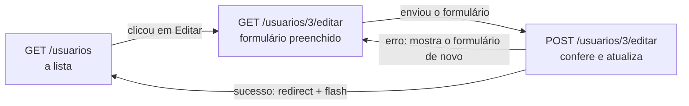

# Capítulo 16 — UPDATE e DELETE de usuário

**Disciplina:** Programação para Internet (ILP951)
**Professor:** Ronan Adriel Zenatti · ronan.zenatti@cps.sp.gov.br
**Fatec Jahu — 2º Semestre/2026**

---

## 🎯 Objetivos do Capítulo

Ao final deste capítulo você deverá ser capaz de:

- Abrir o formulário de usuário já preenchido com os dados do banco, trocando o `None` por texto vazio e o número do perfil por um texto que o `<select>` reconheça
- Reaproveitar o `usuario_form.html` nos dois modos (`'criar'` e `'editar'`) com a variável `acao`
- Mover as conferências do usuário para uma função, usada pelo cadastro e pela edição
- Conferir e-mail e CPF repetidos ignorando o próprio usuário, com `id_usuario <> %s`
- Tornar a senha opcional na edição: em branco mantém o hash atual, preenchida troca
- Montar um `UPDATE` aos poucos, com `+=` no texto do SQL e `append` na lista de valores, sem nunca juntar o que a pessoa digitou ao SQL
- Devolver ao formulário o que foi digitado quando a edição tem erro, e manter o formulário em modo de edição
- Excluir um usuário por `POST`, com o modal de confirmação e a função JavaScript que recebe o código

O Capítulo 12 criou o cadastro de perfis, o 13 completou o recurso com a edição e a exclusão, e os Capítulos 14 e 15 fizeram o cadastro e a lista de usuários. Faltam as duas operações que podem estragar dados: **alterar** (`UPDATE`) e **excluir** (`DELETE`). O desenho é o do Capítulo 13, e o que muda é o tamanho do formulário: um usuário tem 12 campos, uma senha que nunca é mostrada e dois valores únicos (e-mail e CPF). Ao final, o recurso `usuarios` fica completo, com os botões **Editar** e **Excluir** na própria lista, onde já aparecem o perfil de cada usuário e o botão **Ver**.

## 📦 Ponto de partida

Este capítulo continua do **seu** repositório `sistema-gestao`, como ficou no fim do Capítulo 15: com o cadastro de usuários, a lista com o perfil em um badge e a página de detalhe. Os Capítulos 12.1, 13.1 e 14.1 são opcionais: este capítulo parte do código do 15, e não deles.

Se o seu projeto não está funcionando, baixe o código do Capítulo 15 e descompacte. Depois de descompactar, crie o ambiente virtual e o `.env`, como no [Capítulo 11, Tópico 4](Capitulo_11_Projeto_Novo_e_Banco.md#topico-4-o-arquivo-env), importe o `banco.sql` no phpMyAdmin e cadastre os três perfis e os três usuários pelo formulário (a tabela do [Capítulo 15, Tópico 1](Capitulo_15_SELECT_Relacional_de_Usuario.md) diz o que preencher):

➡️ [Baixar p2_cap_15.zip](../arquivos/p2_cap_15.zip)

```bash
python -m venv venv
venv\Scripts\activate
pip install -r requirements.txt
copy .env.example .env
```

---

## Tópico 1 — Editar: o formulário já preenchido

### Antes de começar

Ligue o **Apache** e o **MySQL** no painel do XAMPP. Abra a pasta `sistema-gestao` no VS Code, o terminal (`Ctrl + '`), ative o ambiente virtual e confira o Git:

```bash
venv\Scripts\activate
git status
```

O `git status` deve dizer `nothing to commit, working tree clean`. Ligue o servidor com `python app.py` e deixe esse terminal rodando durante o capítulo (use um segundo terminal, o ícone **+**, para o Git). Abra **http://127.0.0.1:5000/usuarios**: a lista mostra a Ana, o Bruno e a Carla do Capítulo 15.

### O mapa do recurso, agora completo

O Capítulo 15 deixou duas linhas do molde sem construir. Este capítulo as constrói:

| Rota | Métodos | O que faz | Função no `app.py` | Template | Capítulo |
|---|---|---|---|---|---|
| `/usuarios` | GET | Lista os usuários | `lista_usuarios` | `usuarios.html` | 15 |
| `/usuarios/novo` | GET e POST | GET mostra o formulário, POST confere e grava | `usuario_novo` | `usuario_form.html` | 14 |
| `/usuarios/<int:id_usuario>` | GET | Detalhe de um usuário | `usuario_detalhe` | `usuario_detalhe.html` | 15 |
| `/usuarios/<int:id_usuario>/editar` | GET e POST | GET mostra o formulário preenchido, POST confere e atualiza | `usuario_editar` | `usuario_form.html` | **16** |
| `/usuarios/<int:id_usuario>/excluir` | só POST | Exclui o usuário e volta para a lista | `usuario_excluir` | (nenhum) | **16** |

Como no Capítulo 13, o `editar` usa o **mesmo template** do `novo`, e o `excluir` não tem template: ele só faz o que foi pedido e redireciona. O caminho do navegador na edição:



### Buscar o usuário pelo código

O código do usuário vem **no endereço** (`/usuarios/3/editar`), pela variável de rota que você usou no detalhe. No `app.py`, acrescente a rota `usuario_editar` **depois** da `usuario_detalhe` e antes dos `@app.errorhandler`. Por enquanto, ela busca o usuário e entrega o resultado do banco ao formulário:

```python
@app.route('/usuarios/<int:id_usuario>/editar')
def usuario_editar(id_usuario):
    usuario = execute_one(SELECT_USUARIO + ' WHERE u.id_usuario = %s', (id_usuario,))
    if usuario is None:
        abort(404)

    perfis = execute_query('SELECT id_perfil, nome FROM perfis ORDER BY nome', fetch=True)

    return render_template('usuario_form.html', dados=usuario, perfis=perfis, ufs=UFS)
```

É o `usuario_detalhe` do Capítulo 15 com duas diferenças: a rota também busca os perfis, para o `<select>`, e entrega o usuário ao formulário com o nome `dados`, que é como o `usuario_form.html` do Capítulo 14 espera receber os valores. A consulta é a mesma constante, `SELECT_USUARIO`, e continua sem a senha.

Salve. Na lista, descubra o código do **Bruno** (a primeira coluna) e abra, pela barra de endereço, `http://127.0.0.1:5000/usuarios/` + o código + `/editar`. O formulário aparece com o nome, o e-mail, o celular, a data, o CPF e o endereço dele. Mas dois defeitos já aparecem:

- O campo **Perfil** mostra `Selecione...`, e não **Gerente**.
- Abra a edição da **Ana**: os campos que ela não preencheu mostram a palavra **None**.

Os dois têm a mesma raiz. O `usuario_form.html` foi escrito no Capítulo 14 para receber o `request.form`, onde **tudo é texto**: o `<select>` do perfil marca a opção com `dados.perfil_id == perfil.id_perfil|string`, que compara o texto da tela com o número do perfil. Aqui o `perfil_id` do banco é o **número** `2`, e `2` não é igual ao texto `"2"`, então nenhuma opção é marcada. E o `NULL` das colunas opcionais chega como `None`, que o Jinja escreve como a palavra "None" **dentro do campo**: quem clicasse em salvar gravaria esse texto no banco. É o mesmo problema da descrição do perfil no [Capítulo 13](Capitulo_13_UPDATE_e_DELETE_de_Perfis.md).

A saída é entregar ao formulário os mesmos valores que o `request.form` entregaria: tudo como texto, e o `None` como texto vazio. Escreva, no `app.py`, logo **abaixo** da função `vazio_para_none` (que é do Capítulo 14), uma função para essa troca:

```python
def texto_ou_vazio(valor):
    if valor is None:
        return ''

    return str(valor)
```

!!! note "Python: `str()`"
    O `str()` converte um valor em texto: `str(2)` devolve `'2'`, e `str(data)` devolve a data no formato do banco, `'1988-03-14'`, que é exatamente o formato que o campo `type="date"` espera. A função é o contrário da `vazio_para_none`: aquela troca `''` por `None` na hora de **gravar**, e esta troca `None` por `''` na hora de **mostrar**.

Agora a rota monta o dicionário `dados`, um valor de cada vez. Na `usuario_editar`, **entre** o `if usuario is None:` e o `perfis = ...`, acrescente:

```python
    dados = {}
    for chave in usuario:
        dados[chave] = texto_ou_vazio(usuario[chave])
```

E troque `dados=usuario` por `dados=dados` no `render_template`.

!!! note "Python: percorrer um dicionário"
    O `usuario` é um dicionário (uma linha do banco, como no [Capítulo 15](Capitulo_15_SELECT_Relacional_de_Usuario.md)). Um `for` sobre um dicionário percorre as **chaves**: `'id_usuario'`, `'nome'`, `'email'` e assim por diante, uma por volta. A linha `dados[chave] = ...` cria, no dicionário novo, uma entrada com a mesma chave e o valor já convertido. Ao final, `dados` tem as mesmas chaves do `usuario`, todas com texto.

Salve e recarregue as duas edições. O Bruno mostra o perfil **Gerente** selecionado, e a Ana mostra os campos opcionais **vazios**, sem `None`. Abra também `/usuarios/99999/editar`: a página 404, porque não existe usuário com esse código.

### Uma variável para os dois modos: `acao`

O formulário já aparece preenchido, mas ainda diz **Novo usuário**, o botão diz **Salvar usuário** e o `action` aponta para o cadastro. Como no Capítulo 13, o mesmo `usuario_form.html` vai servir aos dois modos, e a variável `acao` (`'criar'` ou `'editar'`) diz em qual deles ele está. Primeiro as rotas entregam a informação. Na `usuario_editar`, o `render_template` do final passa a ser:

```python
    return render_template('usuario_form.html', acao='editar', id_usuario=id_usuario,
                           dados=dados, perfis=perfis, ufs=UFS)
```

E, na `usuario_novo`, o `render_template` do final passa a ser:

```python
    return render_template('usuario_form.html', acao='criar', id_usuario=None,
                           dados=request.form, perfis=perfis, ufs=UFS)
```

Salve e recarregue as duas telas: nada mudou, o template só **recebeu** a informação. Agora ele a usa. No `templates/usuario_form.html`, troque o título da aba e o `<h1>`:

```html
Editar usuárioNovo usuário — Sistema de Gestão
```

```html
  <h1 class="h2 mb-4">Editar usuárioNovo usuário</h1>
```

Salve e compare `/usuarios/novo` com a edição de um usuário: o mesmo arquivo, dois títulos. O `action` é o mais importante: no cadastro aponta para `usuario_novo`, e na edição precisa apontar para `usuario_editar` **com o código do usuário**. No começo do ``, guarde o destino em uma variável (o `` é o do [Capítulo 13](Capitulo_13_UPDATE_e_DELETE_de_Perfis.md)):

```html

  
    
  
    
  
```

E use a variável no formulário:

```html
          <form action="{{ destino }}" method="post">
```

Por último, o texto do botão. Troque o botão de envio por:

```html
              <button type="submit" class="btn btn-primary">Salvar alteraçõesSalvar usuário</button>
```

Salve e confira os dois modos: o cadastro mostra **Salvar usuário**, e a edição mostra **Salvar alterações**.

### A senha na edição é opcional

Olhe o formulário de edição: os campos **Senha** e **Confirmar a senha** estão vazios, e são obrigatórios. Isso é um problema. O banco guarda o **hash** da senha, e o hash não tem como voltar a ser a senha: não há o que mostrar nesses campos, e o sistema também **não deve** mostrá-lo. Quem só quer corrigir o celular de um usuário não pode ser obrigado a digitar uma senha nova. A regra da edição é:

- campos de senha **em branco**: a senha atual é mantida;
- campos de senha **preenchidos**: a senha é trocada, com as mesmas regras do cadastro (8 caracteres ou mais, letras e números, confirmação igual).

No formulário, três coisas mudam conforme o modo: o rótulo, o `required` e a dica embaixo do campo. Troque o primeiro bloco da linha das senhas (o `<div class="col-md-6 mb-3">` da **Senha**) por:

```html
              <div class="col-md-6 mb-3">
                <label for="senha" class="form-label">Nova senhaSenha</label>
                <input type="password" class="form-control" id="senha" name="senha" required minlength="8" maxlength="128" autocomplete="new-password">
                <div class="form-text">
                  Deixe em branco para manter a senha atual.Mínimo de 8 caracteres, com letras e números.
                </div>
              </div>
```

E, no campo **Confirmar a senha**, troque o `required` fixo pelo mesmo `if`, deixando a linha do `<input>` assim:

```html
                <input type="password" class="form-control" id="confirmacao" name="confirmacao" required minlength="8" maxlength="128" autocomplete="new-password">
```

Salve e confira os dois modos. No cadastro, o rótulo é **Senha**, e o navegador não deixa enviar sem preenchê-la. Na edição, o rótulo é **Nova senha**, a dica diz `Deixe em branco para manter a senha atual.`, e o campo aceita ficar vazio. O `minlength="8"` continua nos dois: o navegador só confere o tamanho quando há texto no campo.

### Os caminhos até o formulário

Para chegar à edição sem digitar o endereço, a coluna **Ações** da lista ganha um botão. No `usuarios.html`, dentro da célula de ações, **depois** do link **Ver**:

```html
          <a href="{{ url_for('usuario_editar', id_usuario=usuario.id_usuario) }}" class="btn btn-sm btn-outline-primary">Editar</a>
```

E, no `base.html`, o item **Usuários** do menu precisa continuar aceso durante a edição. Acrescente `'usuario_editar'` à lista do `request.endpoint`:

```html
            <a class="nav-link active" href="{{ url_for('lista_usuarios') }}">Usuários</a>
```

Salve e navegue: **Usuários**, **Editar** em uma linha, o formulário preenchido, **Cancelar** de volta à lista. Agora clique em **Salvar alterações**: a página mostra **Method Not Allowed** (405). O endereço de destino está certo (`/usuarios/3/editar`), mas a rota `usuario_editar` ainda só aceita `GET`. É a deixa para os próximos tópicos, e antes dela vem uma arrumação.

```bash
git add .
git commit -m "Adiciona o formulário de edição de usuário com a variável acao"
git push
```

---

## Tópico 2 — As mesmas conferências, em um lugar só

### A dor: setenta linhas para copiar

O `usuario_novo` do Capítulo 14 lê 14 campos do formulário e depois confere cada um, em cerca de setenta linhas. A edição precisa conferir **os mesmos campos**. Copiar tudo para a `usuario_editar` seria repetir setenta linhas, e, no dia em que uma regra mudar (o tamanho mínimo do nome, por exemplo), você corrigiria uma rota e esqueceria a outra. É o problema que o Capítulo 13 resolveu para o perfil, e a saída é a mesma: mover as conferências para **funções**, e as duas rotas as chamam.

Há três diferenças entre o cadastro e a edição:

| Conferência | No cadastro | Na edição |
|---|---|---|
| E-mail repetido | Nenhum usuário pode ter o e-mail | Nenhum **outro** usuário pode ter o e-mail |
| CPF repetido | Nenhum usuário pode ter o CPF | Nenhum **outro** usuário pode ter o CPF |
| Senha | Obrigatória | Só conferida se for digitada |

Quem abre o Bruno e só corrige o celular envia o e-mail e o CPF **dele**, que já existem no banco, e são dele mesmo. Como no perfil, a função recebe o código do usuário (`id_usuario`), e o `SELECT` passa a ignorá-lo com `id_usuario <> %s`. No cadastro, a rota passa `0`, um código que nenhum usuário tem.

### Primeira função: ler o formulário

As 14 linhas `request.form.get(...)` também seriam repetidas. A primeira função lê o formulário e devolve **um dicionário** com os valores já limpos (com o `strip()` e, no e-mail, o `lower()`). No `app.py`, **acima** da `usuario_novo`, escreva:

```python
def ler_formulario(form):
    campos = {}
    campos['nome'] = form.get('nome', '').strip()
    campos['email'] = form.get('email', '').strip().lower()
    campos['senha'] = form.get('senha', '')
    campos['confirmacao'] = form.get('confirmacao', '')
    campos['celular'] = form.get('celular', '').strip()
    campos['data_nascimento'] = form.get('data_nascimento', '').strip()
    campos['cpf'] = form.get('cpf', '').strip()
    campos['perfil_id'] = form.get('perfil_id', '')
    campos['cep'] = form.get('cep', '').strip()
    campos['endereco'] = form.get('endereco', '').strip()
    campos['numero'] = form.get('numero', '').strip()
    campos['complemento'] = form.get('complemento', '').strip()
    campos['cidade'] = form.get('cidade', '').strip()
    campos['estado'] = form.get('estado', '')

    return campos
```

!!! note "Python: criar e preencher um dicionário"
    O `{}` cria um dicionário vazio, e cada linha `campos['nome'] = ...` acrescenta uma entrada: a chave entre colchetes (`'nome'`) e o valor depois do `=`. Para ler, escreve-se a chave de novo: `campos['nome']`. É o mesmo desenho do dicionário que vem do banco (`usuario['nome']`), só que agora quem o monta é a sua função. O `form` é o parâmetro que recebe o `request.form`: a função funciona com qualquer formulário que se entregue a ela.

A senha e a confirmação **não** levam `strip()`, como no Capítulo 14: espaços fazem parte de uma senha.

### Segunda função: conferir o usuário

A segunda função faz as conferências. Ela recebe o dicionário `campos` e o `id_usuario`, junta as mensagens de erro em uma lista e a devolve, como a `conferir_perfil` do Capítulo 13. Escreva-a **abaixo** da `ler_formulario`, em três pedaços. A função ainda não é chamada por ninguém, então o sistema continua funcionando como antes. Primeiro o nome e o e-mail, onde aparece a primeira diferença:

```python
def conferir_usuario(campos, id_usuario):
    erros = []

    erro = validar_nome_usuario(campos['nome'])
    if erro:
        erros.append(erro)

    erro = validar_email(campos['email'])
    if erro:
        erros.append(erro)
    else:
        existente = execute_one(
            'SELECT id_usuario FROM usuarios WHERE email = %s AND id_usuario <> %s',
            (campos['email'], id_usuario),
        )
        if existente:
            erros.append('Já existe um usuário com este e-mail.')
```

É o código do Capítulo 14, com duas trocas: as variáveis soltas (`nome`, `email`) viram `campos['nome']` e `campos['email']`, e o `SELECT` ganha o `AND id_usuario <> %s`. Agora a segunda diferença, a **senha**. Acrescente ao final da função:

```python
    if id_usuario == 0 or campos['senha'] != '' or campos['confirmacao'] != '':
        erro = validar_senha(campos['senha'], campos['confirmacao'])
        if erro:
            erros.append(erro)
```

A senha é conferida em dois casos: no **cadastro** (`id_usuario == 0`) ou quando **alguma** das duas caixas foi preenchida. Na edição com as duas em branco, a conferência é pulada. Se a pessoa preencher só a confirmação, a conferência roda e acusa o erro, em vez de ignorar o que foi digitado. Por último, o restante das conferências, que é o do Capítulo 14 com as variáveis trocadas por `campos[...]`, e o `SELECT` do CPF com o `<>`:

```python
    erro = conferir_perfil_do_usuario(campos['perfil_id'])
    if erro:
        erros.append(erro)

    erro = validar_celular(campos['celular'])
    if erro:
        erros.append(erro)

    erro = validar_cpf(campos['cpf'])
    if erro:
        erros.append(erro)
    else:
        cpf_formatado = formatar_cpf(campos['cpf'])
        if cpf_formatado != '':
            existente = execute_one(
                'SELECT id_usuario FROM usuarios WHERE cpf = %s AND id_usuario <> %s',
                (cpf_formatado, id_usuario),
            )
            if existente:
                erros.append('Já existe um usuário com este CPF.')

    erro = validar_data_nascimento(campos['data_nascimento'])
    if erro:
        erros.append(erro)

    erro = validar_cep(campos['cep'])
    if erro:
        erros.append(erro)

    erro = validar_tamanho(campos['endereco'], 'endereço', 255)
    if erro:
        erros.append(erro)

    erro = validar_tamanho(campos['numero'], 'número', 20)
    if erro:
        erros.append(erro)

    erro = validar_tamanho(campos['complemento'], 'complemento', 100)
    if erro:
        erros.append(erro)

    erro = validar_tamanho(campos['cidade'], 'cidade', 100)
    if erro:
        erros.append(erro)

    erro = validar_estado(campos['estado'])
    if erro:
        erros.append(erro)

    return erros
```

!!! note "Python: uma função que recebe um dicionário"
    A função usa o dicionário como usaria uma caixa com gavetas: `campos['cpf']` abre a gaveta do CPF. Passar **um** dicionário no lugar de catorze variáveis soltas deixa a chamada curta (`conferir_usuario(campos, 0)`) e evita errar a ordem dos argumentos.

### O cadastro passa a usar as funções

Agora o `usuario_novo` troca as setenta linhas pelas duas chamadas. A rota fica muito menor. **Apague** a rota `usuario_novo` inteira e escreva no lugar:

```python
@app.route('/usuarios/novo', methods=['GET', 'POST'])
def usuario_novo():
    if request.method == 'POST':
        campos = ler_formulario(request.form)

        erros = conferir_usuario(campos, 0)

        if erros:
            for mensagem in erros:
                flash(mensagem, 'danger')
        else:
            try:
                novo_id = execute_insert(
                    'INSERT INTO usuarios (nome, email, senha, celular, data_nascimento, cpf, '
                    'perfil_id, cep, endereco, numero, complemento, cidade, estado) '
                    'VALUES (%s, %s, %s, %s, %s, %s, %s, %s, %s, %s, %s, %s, %s)',
                    (
                        campos['nome'],
                        campos['email'],
                        generate_password_hash(campos['senha']),
                        vazio_para_none(formatar_celular(campos['celular'])),
                        vazio_para_none(campos['data_nascimento']),
                        vazio_para_none(formatar_cpf(campos['cpf'])),
                        int(campos['perfil_id']),
                        vazio_para_none(formatar_cep(campos['cep'])),
                        vazio_para_none(campos['endereco']),
                        vazio_para_none(campos['numero']),
                        vazio_para_none(campos['complemento']),
                        vazio_para_none(campos['cidade']),
                        vazio_para_none(campos['estado']),
                    ),
                )
                flash(f'Usuário "{campos["nome"]}" cadastrado (código {novo_id}).', 'success')
                return redirect(url_for('lista_usuarios'))
            except Error as erro:
                if erro.errno == 1062:
                    flash('Já existe um usuário com este e-mail ou este CPF.', 'danger')
                else:
                    raise

    perfis = execute_query('SELECT id_perfil, nome FROM perfis ORDER BY nome', fetch=True)

    return render_template('usuario_form.html', acao='criar', id_usuario=None,
                           dados=request.form, perfis=perfis, ufs=UFS)
```

O `0` do `conferir_usuario(campos, 0)` é o código do cadastro: nenhum usuário tem o código `0`, então `id_usuario <> 0` não exclui ninguém, e a senha é exigida. O `INSERT` é o do Capítulo 14, só com os valores lidos do dicionário.

**Salve e teste antes de seguir.** Uma reorganização só é segura se o comportamento continua igual, e é mais fácil achar um erro agora do que depois de escrever mais código em cima. Em **Novo usuário**:

1. Tente cadastrar com o e-mail `ana@exemplo.com`: a faixa vermelha `Já existe um usuário com este e-mail.`
2. Tente o CPF `529.982.247-25` (o do Bruno) com outro e-mail: `Já existe um usuário com este CPF.`
3. Tente uma senha de 5 letras: `A senha deve ter pelo menos 8 caracteres.`
4. Cadastre, com o perfil **Usuário**, o **Daniel Teste**, e-mail `daniel@exemplo.com`, senha `Senha123` nos dois campos, e **só** os campos obrigatórios. A lista mostra o Daniel, com a faixa verde.

Tudo deve funcionar como no Capítulo 14. O Daniel é o usuário de teste deste capítulo: ele será editado no próximo tópico e excluído no último, e assim a Ana, o Bruno e a Carla ficam como estão (os próximos capítulos usam os três).

```bash
git add .
git commit -m "Move as conferências do usuário para funções"
git push
```

---

## Tópico 3 — Salvar a edição (UPDATE)

### A rota de edição recebe o POST

Agora a `usuario_editar` aceita o envio. Troque a linha do `@app.route` para aceitar os dois métodos:

```python
@app.route('/usuarios/<int:id_usuario>/editar', methods=['GET', 'POST'])
```

E, **depois** do `for` que monta o dicionário `dados` e **antes** do `perfis = ...`, acrescente o `if` do POST. Por enquanto ele só confere e avisa:

```python
    if request.method == 'POST':
        campos = ler_formulario(request.form)

        erros = conferir_usuario(campos, id_usuario)

        if erros:
            for mensagem in erros:
                flash(mensagem, 'danger')
        else:
            flash('Dados válidos. Ainda não gravei no banco.', 'success')
```

Salve e teste, na edição do **Daniel Teste** (os códigos mudam de computador para computador: abra a lista e clique em **Editar** na linha dele):

- Troque o nome para `Daniel Silva` e salve: faixa verde `Dados válidos. Ainda não gravei no banco.`, e o banco continua igual.
- Envie, sem mudar nada, o próprio e-mail e (se tiver) o próprio CPF: faixa verde. O próprio usuário **não** conta como repetido, por causa do `id_usuario <> %s`.
- Troque o e-mail para `carla@exemplo.com` e o nome para `Daniel Silva`, e salve: faixa vermelha `Já existe um usuário com este e-mail.` Mas olhe o formulário: o nome voltou para `Daniel Teste`, e o e-mail, para o do Daniel. **O que foi digitado se perdeu.**
- Digite `111.444.777-35` no CPF do Daniel e salve (faixa verde). Depois tente o CPF do Bruno, `529.982.247-25`: `Já existe um usuário com este CPF.`
- Digite `abc` só na **Nova senha**: `A senha deve ter pelo menos 8 caracteres.` Digite `Senha1234` em uma caixa e `Outra1234` na outra: `A confirmação da senha não confere.`

O defeito do terceiro item é de quem está no meio de uma edição: a pessoa corrige quatro campos, erra o e-mail e perde tudo. A rota monta o `dados` **antes** do `if request.method == 'POST'`, com os valores do banco, e é ele que o formulário mostra. Quando há erro, o formulário precisa mostrar o que a pessoa **digitou**, que está no `request.form`. No final do `if request.method == 'POST':`, **alinhado com o `if erros:`** (dentro do POST, depois do `else`), acrescente:

```python
        dados = request.form
```

Se a edição der certo, a rota termina no `redirect` e nunca chega a essa linha. Se der erro, o `dados` passa a ser o formulário enviado, o `render_template` do final o entrega, e o formulário volta com o que foi digitado, **ainda em modo de edição** (por causa do `acao='editar'`). Salve e repita o terceiro item: o nome `Daniel Silva` e o e-mail errado continuam nos campos, com a faixa vermelha em cima.

### O UPDATE, com o WHERE que não pode faltar

Os dados chegam conferidos. Falta trocar o aviso provisório pela gravação. Troque o `else:` do `if erros:` (o que tem o `flash('Dados válidos...')`) por este:

```python
        else:
            sql = (
                'UPDATE usuarios SET nome = %s, email = %s, celular = %s, '
                'data_nascimento = %s, cpf = %s, perfil_id = %s, cep = %s, '
                'endereco = %s, numero = %s, complemento = %s, cidade = %s, estado = %s'
            )
            params = [
                campos['nome'],
                campos['email'],
                vazio_para_none(formatar_celular(campos['celular'])),
                vazio_para_none(campos['data_nascimento']),
                vazio_para_none(formatar_cpf(campos['cpf'])),
                int(campos['perfil_id']),
                vazio_para_none(formatar_cep(campos['cep'])),
                vazio_para_none(campos['endereco']),
                vazio_para_none(campos['numero']),
                vazio_para_none(campos['complemento']),
                vazio_para_none(campos['cidade']),
                vazio_para_none(campos['estado']),
            ]

            sql += ' WHERE id_usuario = %s'
            params.append(id_usuario)

            try:
                execute_query(sql, params)
                flash(f'Usuário "{campos["nome"]}" atualizado.', 'success')
                return redirect(url_for('lista_usuarios'))
            except Error as erro:
                if erro.errno == 1062:
                    flash('Já existe um usuário com este e-mail ou este CPF.', 'danger')
                else:
                    raise
```

Neste ponto o `UPDATE` não é mais um texto só: ele é montado em dois lugares, o **texto** do SQL (`sql`) e a **lista dos valores** (`params`, na mesma ordem dos `%s`). Esta forma é necessária no próximo trecho, quando a senha só entrar no comando se for digitada.

!!! note "Python: `+=` e `append`"
    O `sql += ' WHERE id_usuario = %s'` acrescenta um pedaço ao final do texto que já está em `sql` (é o mesmo que `sql = sql + ' WHERE...'`). O `params.append(id_usuario)` acrescenta um item ao final da lista `params`. Os dois pedaços acrescentados andam juntos: um `%s` a mais no texto, um valor a mais na lista.

!!! danger "Só junte ao SQL textos fixos, escritos por você"
    O que vai para dentro do texto do SQL (`sql +=`) são pedaços **fixos**, escritos aqui no código. Tudo o que a pessoa digitou, sem exceção, vai na lista `params`, e o conector troca cada `%s` por um valor com segurança, como no resto do projeto. Colocar o que veio do formulário dentro do texto do SQL (com f-string ou com `+`) é a falha de segurança que o `%s` existe para evitar.

Olhe a última peça do comando: **`WHERE id_usuario = %s`**. Sem o `WHERE`, o `UPDATE` alteraria **todos** os usuários da tabela, todos ficariam com o mesmo nome e o mesmo e-mail. O código vem do **endereço** (`id_usuario`, já convertido em número pelo Flask), e não de um campo do formulário, que a pessoa poderia adulterar. O restante segue o que você já sabe: campo opcional em branco vira `NULL` (o `vazio_para_none`, com o celular, o CPF e o CEP já formatados pelas funções do Capítulo 14), o `try/except` com o `1062` como barreira final, e o PRG com `redirect` e `flash`. Como no [Capítulo 13](Capitulo_13_UPDATE_e_DELETE_de_Perfis.md), a existência do usuário é conferida pelo `SELECT` do começo da rota (que dá o 404), e não pelo `rowcount` do `UPDATE`.

Salve e teste, no **Daniel Silva**:

1. Troque o nome para `Daniel Silva`, preencha o celular `14 99811 2030` e o estado `SP`, e salve. Você volta para a lista, com a faixa verde `Usuário "Daniel Silva" atualizado.` e o nome novo na tabela.
2. Clique em **Ver** na linha dele: o celular aparece formatado, `(14) 99811-2030`, e a **Última alteração** mostra a hora de agora, enquanto o **Cadastrado em** continua o mesmo. O banco cuida disso (`ON UPDATE CURRENT_TIMESTAMP`, do `banco.sql`), sem nenhuma linha de Python.
3. Abra a edição de novo, apague o celular e salve. No detalhe, o celular mostra `—`. No phpMyAdmin (banco `gestao`, tabela `usuarios`, aba **Procurar**), a coluna aparece como `NULL`.
4. Troque o perfil do Daniel para **Gerente** e salve: o badge na lista fica amarelo.
5. Acesse `/usuarios/99999/editar`: a página 404.
6. Confira, na lista, que **só** o Daniel mudou.

### A senha: só entra no comando quando for digitada

Falta a senha. Ainda no phpMyAdmin, na tabela `usuarios` do banco `gestao`, aba **Procurar**, olhe a coluna `senha` da linha do Daniel e guarde o começo e o fim do texto (um hash, algo como `scrypt:32768:8:1$...`). Agora abra a edição do Daniel, digite `NovaSenha456` nas **duas** caixas, salve e confira o phpMyAdmin de novo: o hash **não mudou**. O `UPDATE` ainda não fala da coluna `senha`, e a senha nova foi simplesmente descartada. É o defeito que a montagem em pedaços resolve. Na `usuario_editar`, **antes** das duas linhas `sql += ' WHERE id_usuario = %s'` e `params.append(id_usuario)`, acrescente:

```python
            if campos['senha'] != '':
                sql += ', senha = %s'
                params.append(generate_password_hash(campos['senha']))
```

O `if` só acrescenta a coluna `senha` ao `UPDATE` quando o campo foi preenchido, e, neste caso, o valor que vai para a lista é o **hash** (nunca a senha digitada), com a mesma função do cadastro. Por isso o `WHERE` fica por último: o comando precisa ficar `UPDATE usuarios SET ..., estado = %s, senha = %s WHERE id_usuario = %s`, e o `WHERE` tem de vir depois de tudo o que está no `SET`. Salve e teste:

1. Edite o Daniel com `NovaSenha456` nas duas caixas e salve. No phpMyAdmin, o hash da linha dele é **outro** (o começo e o fim mudaram).
2. Edite de novo, deixe as duas caixas **em branco**, mude só o nome e salve. O hash continua igual ao do item anterior.
3. Digite uma senha nova só em uma caixa, ou diferente nas duas: a faixa vermelha e o formulário de volta, com o resto preenchido.

(Entrar no sistema com a senha nova só vai ser possível no Capítulo 17, o do login. Por ora, o hash diferente no banco é o sinal de que a troca aconteceu.)

### A barreira final: o erro 1062

Entre a conferência do e-mail e o `UPDATE`, outra pessoa pode gravar o mesmo e-mail, e só o `UNIQUE` do banco garante de verdade, como no [Capítulo 12](Capitulo_12_INSERT_e_SELECT_de_Perfis.md). Para ver o `except` funcionando, desligue por um instante a conferência: na `usuario_editar`, troque

```python
        erros = conferir_usuario(campos, id_usuario)
```

por

```python
        erros = []
```

Salve, edite o Daniel, troque o e-mail para `carla@exemplo.com` e salve. A faixa vermelha `Já existe um usuário com este e-mail ou este CPF.` vem agora do `except`, e não mais da conferência. **Devolva** a linha `erros = conferir_usuario(campos, id_usuario)` e salve.

A rota `usuario_editar` completa, para conferir com a sua:

```python
@app.route('/usuarios/<int:id_usuario>/editar', methods=['GET', 'POST'])
def usuario_editar(id_usuario):
    usuario = execute_one(SELECT_USUARIO + ' WHERE u.id_usuario = %s', (id_usuario,))
    if usuario is None:
        abort(404)

    dados = {}
    for chave in usuario:
        dados[chave] = texto_ou_vazio(usuario[chave])

    if request.method == 'POST':
        campos = ler_formulario(request.form)

        erros = conferir_usuario(campos, id_usuario)

        if erros:
            for mensagem in erros:
                flash(mensagem, 'danger')
        else:
            sql = (
                'UPDATE usuarios SET nome = %s, email = %s, celular = %s, '
                'data_nascimento = %s, cpf = %s, perfil_id = %s, cep = %s, '
                'endereco = %s, numero = %s, complemento = %s, cidade = %s, estado = %s'
            )
            params = [
                campos['nome'],
                campos['email'],
                vazio_para_none(formatar_celular(campos['celular'])),
                vazio_para_none(campos['data_nascimento']),
                vazio_para_none(formatar_cpf(campos['cpf'])),
                int(campos['perfil_id']),
                vazio_para_none(formatar_cep(campos['cep'])),
                vazio_para_none(campos['endereco']),
                vazio_para_none(campos['numero']),
                vazio_para_none(campos['complemento']),
                vazio_para_none(campos['cidade']),
                vazio_para_none(campos['estado']),
            ]

            if campos['senha'] != '':
                sql += ', senha = %s'
                params.append(generate_password_hash(campos['senha']))

            sql += ' WHERE id_usuario = %s'
            params.append(id_usuario)

            try:
                execute_query(sql, params)
                flash(f'Usuário "{campos["nome"]}" atualizado.', 'success')
                return redirect(url_for('lista_usuarios'))
            except Error as erro:
                if erro.errno == 1062:
                    flash('Já existe um usuário com este e-mail ou este CPF.', 'danger')
                else:
                    raise

        dados = request.form

    perfis = execute_query('SELECT id_perfil, nome FROM perfis ORDER BY nome', fetch=True)

    return render_template('usuario_form.html', acao='editar', id_usuario=id_usuario,
                           dados=dados, perfis=perfis, ufs=UFS)
```

| Situação | Quem trata | O que a pessoa vê |
|---|---|---|
| Código de usuário que não existe | `SELECT` + `abort(404)` | A página 404 |
| E-mail ou CPF de **outro** usuário | `conferir_usuario` (e o `1062` do `UPDATE`) | Faixa vermelha, e o formulário volta com o que foi digitado |
| E-mail ou CPF do próprio usuário | O `id_usuario <> %s` | Nada: a edição é aceita |
| Senha em branco | O `if campos['senha'] != ''` | A senha atual é mantida |
| Senha preenchida e inválida | `validar_senha` | Faixa vermelha |

```bash
git add .
git commit -m "Grava a edição do usuário com UPDATE e senha opcional"
git push
```

---

## Tópico 4 — Excluir um usuário (DELETE)

### A rota que só aceita POST

O comando é o `DELETE`, com os mesmos cuidados do `UPDATE`:

```sql
DELETE FROM usuarios WHERE id_usuario = 3;
```

Sem o `WHERE`, ele apaga **todos** os usuários, sem perguntar e sem "desfazer", e o código apagado nunca é reaproveitado pelo `AUTO_INCREMENT`. A exclusão também **não pode ser um link**: o `GET` deve só consultar, e robôs de busca, o carregamento antecipado de links e a pré-visualização de mensagens fazem `GET` sozinhos. O [Capítulo 13](Capitulo_13_UPDATE_e_DELETE_de_Perfis.md) explicou isso em detalhe: a rota aceita só `POST`, que só sai de um botão de formulário, com o token CSRF. No `app.py`, acrescente a rota depois da `usuario_editar`:

```python
@app.route('/usuarios/<int:id_usuario>/excluir', methods=['POST'])
def usuario_excluir(id_usuario):
    usuario = execute_one(
        'SELECT id_usuario, nome FROM usuarios WHERE id_usuario = %s',
        (id_usuario,),
    )
    if usuario is None:
        abort(404)

    execute_query('DELETE FROM usuarios WHERE id_usuario = %s', (id_usuario,))
    flash(f'Usuário "{usuario["nome"]}" excluído.', 'success')

    return redirect(url_for('lista_usuarios'))
```

O `SELECT` inicial responde 404 para um código que não existe e traz o **nome**, para a mensagem dizer quem foi excluído. Salve e digite, na barra de endereço, `http://127.0.0.1:5000/usuarios/3/excluir` (com qualquer código): o navegador faz um `GET`, e a resposta é **Method Not Allowed** (405). Nada é excluído.

!!! note "Aqui não há contagem nem erro 1451"
    Excluir um **perfil** (Capítulo 13) exigia contar os usuários antes e capturar o erro `1451`, porque a tabela `usuarios` aponta para `perfis` por uma chave estrangeira. Nenhuma outra tabela aponta para `usuarios`: abra o `banco.sql` e confira. Por isso o `DELETE` do usuário não esbarra em nada e não precisa de `try/except`. Se um dia outra tabela passar a apontar para `usuarios` (pedidos, por exemplo), esta rota ganhará as mesmas duas defesas do perfil.

### O modal de confirmação

O botão da lista não pode excluir com um clique só. O desenho é o do Capítulo 13: **um único modal** do Bootstrap, reaproveitado por todas as linhas, que uma função JavaScript preenche com o usuário clicado. No `usuarios.html`, no final do ``, depois da `</table>`, acrescente o HTML do modal:

```html
  <div class="modal fade" id="modalExcluir" tabindex="-1" aria-labelledby="tituloModalExcluir" aria-hidden="true">
    <div class="modal-dialog modal-dialog-centered">
      <div class="modal-content">
        <div class="modal-header">
          <h2 class="modal-title h5" id="tituloModalExcluir">Excluir usuário</h2>
          <button type="button" class="btn-close" data-bs-dismiss="modal" aria-label="Fechar"></button>
        </div>
        <form id="formExcluir" action="" method="post">
          <input type="hidden" name="csrf_token" value="{{ csrf_token() }}">
          <div class="modal-body">
            <p class="mb-0">Excluir o usuário <strong id="nomeExcluir"></strong>? Esta ação não pode ser desfeita.</p>
          </div>
          <div class="modal-footer">
            <button type="button" class="btn btn-outline-secondary" data-bs-dismiss="modal">Cancelar</button>
            <button type="submit" class="btn btn-danger">Excluir</button>
          </div>
        </form>
      </div>
    </div>
  </div>
```

O **Cancelar** só fecha a janela, e o **Excluir** (`type="submit"`) é o único que envia o `POST`. O `action=""` está vazio de propósito: o endereço depende do usuário clicado, e só será conhecido na hora do clique. Agora o botão que **abre** o modal. Na célula de ações de cada linha, depois do link **Editar**:

```html
          <button type="button" class="btn btn-sm btn-outline-danger" data-bs-toggle="modal" data-bs-target="#modalExcluir" onclick="prepararExclusao({{ usuario.id_usuario }})">Excluir</button>
```

O `data-bs-toggle` e o `data-bs-target` dizem ao Bootstrap "este botão abre o modal `#modalExcluir`", e o `onclick` chama a função, que ainda não existe, passando o código do usuário. Salve, recarregue e clique em **Excluir**: a janela aparece, mas o nome está **vazio**. Clique em **Cancelar**: a janela fecha, e nada é excluído. O modal funciona, e falta preenchê-lo.

### A função que recebe o código

A função precisa achar o **nome** do usuário. Na célula do nome, o texto traz o nome **e** o e-mail em letra pequena, e a função deve ler só o nome. Por isso o nome ganha uma etiqueta própria, um `<span>` com um `id` que inclui o código. Na célula do nome, troque a linha do nome por:

```html
          <span id="nome_usuario_{{ usuario.id_usuario }}">{{ usuario.nome }}</span><br>
```

Para o usuário de código 3, o HTML gerado é `<span id="nome_usuario_3">Daniel Silva</span>`. Por último, a função. O `base.html` já tem o ``. No **final** do `usuarios.html`, **depois** do `` do conteúdo, acrescente:

```html

<script>
  function prepararExclusao(id) {
    const nome = document.getElementById('nome_usuario_' + id).textContent;
    document.getElementById('nomeExcluir').textContent = nome;
    document.getElementById('formExcluir').action = '/usuarios/' + id + '/excluir';
  }
</script>

```

!!! note "JavaScript: as três linhas da função"
    É a mesma função do [Capítulo 13](Capitulo_13_UPDATE_e_DELETE_de_Perfis.md), com outros nomes. A primeira linha acha o `<span>` do nome (`'nome_usuario_' + id` vira `nome_usuario_3`) e lê o texto dele com `.textContent`. A segunda escreve esse nome no `<strong id="nomeExcluir">` da janela. A terceira troca o `action` do formulário por `/usuarios/3/excluir`, o endereço da rota `usuario_excluir`: se um dia você mudar o endereço da rota, mude aqui também. A função recebe só o **código**, e não o nome, porque um nome com aspas quebraria o atributo `onclick`.

Salve, recarregue a lista e clique em **Excluir** na linha do **Daniel Silva**: a janela mostra `Excluir o usuário Daniel Silva?`. Clique em **Cancelar**, depois em **Excluir** na linha de **outro** usuário: o nome muda, porque o mesmo modal foi reaproveitado. Feche e abra o do Daniel de novo e confirme: o Daniel some da lista, com a faixa verde `Usuário "Daniel Silva" excluído.` Confira no phpMyAdmin: a linha dele não está mais na tabela `usuarios`. **Não** exclua a Ana, o Bruno nem a Carla, porque os próximos capítulos usam os três.

Um último teste, o do código que não existe mais. Cadastre um usuário `Teste Duplo` (qualquer e-mail novo e senha `Senha123`), abra a lista em **duas abas** do navegador, exclua o `Teste Duplo` na primeira e, **sem recarregar** a segunda, exclua o mesmo usuário nela. A segunda aba mostra a página 404: o `SELECT` do começo da rota não encontrou o usuário, e o `abort(404)` respondeu, sem tentar apagar nada. O endereço `/usuarios/` + o código dele, aberto no detalhe, também responde 404.

| Situação | Quem trata | O que a pessoa vê |
|---|---|---|
| Endereço da exclusão aberto no navegador (`GET`) | `methods=['POST']` | A página 405, e nada é excluído |
| Clique sem querer em **Excluir** | O modal de confirmação | A janela, com **Cancelar** |
| Usuário que já foi excluído | `SELECT` + `abort(404)` | A página 404 |
| Formulário sem o token CSRF | `CSRFProtect` | O erro 400 |

```bash
git add .
git commit -m "Adiciona a exclusão de usuário por POST com modal de confirmação"
git push
```

---

## Os arquivos completos do capítulo

O `app.py`:

```python
import os

from dotenv import load_dotenv
from flask import Flask, render_template, request, redirect, url_for, flash, abort
from flask_wtf.csrf import CSRFProtect
from mysql.connector import Error
from werkzeug.security import generate_password_hash

from db import execute_query, execute_one, execute_insert
from validacoes import (
    UFS, validar_nome_perfil, validar_descricao_perfil,
    validar_nome_usuario, validar_email, validar_senha, validar_celular,
    validar_cpf, validar_data_nascimento, validar_cep, validar_estado,
    validar_tamanho, formatar_celular, formatar_cpf, formatar_cep,
)

load_dotenv()

app = Flask(__name__)
app.secret_key = os.getenv('SECRET_KEY')

CSRFProtect(app)

# As colunas que as telas de usuário leem. A senha fica de fora de propósito: o que não é
# lido do banco não tem como vazar para a página.
SELECT_USUARIO = (
    'SELECT u.id_usuario, u.nome, u.email, u.celular, u.data_nascimento, u.cpf, '
    'u.perfil_id, u.cep, u.endereco, u.numero, u.complemento, u.cidade, u.estado, '
    'u.criado_em, u.atualizado_em, p.nome AS perfil, p.descricao AS perfil_descricao '
    'FROM usuarios u '
    'JOIN perfis p ON p.id_perfil = u.perfil_id'
)


@app.template_filter('data_br')
def data_br(valor):
    if valor is None:
        return '—'

    return valor.strftime('%d/%m/%Y')


@app.template_filter('data_hora_br')
def data_hora_br(valor):
    if valor is None:
        return '—'

    return valor.strftime('%d/%m/%Y às %H:%M')


@app.template_filter('cpf_oculto')
def cpf_oculto(cpf):
    if cpf is None:
        return '—'

    return '***.' + cpf[4:11] + '-**'


@app.route('/')
def index():
    perfis = execute_one('SELECT COUNT(*) AS total FROM perfis')
    usuarios = execute_one('SELECT COUNT(*) AS total FROM usuarios')
    produtos = execute_one('SELECT COUNT(*) AS total FROM produtos')

    return render_template('index.html', titulo='Sistema de Gestão',
                           total_perfis=perfis['total'],
                           total_usuarios=usuarios['total'],
                           total_produtos=produtos['total'])


@app.route('/perfis')
def lista_perfis():
    perfis = execute_query(
        'SELECT id_perfil, nome, descricao, criado_em FROM perfis ORDER BY nome',
        fetch=True,
    )

    return render_template('perfis.html', titulo='Perfis', perfis=perfis)


def conferir_perfil(nome, descricao, id_perfil):
    erros = []

    erro = validar_nome_perfil(nome)
    if erro:
        erros.append(erro)

    erro = validar_descricao_perfil(descricao)
    if erro:
        erros.append(erro)

    if not erros:
        existente = execute_one(
            'SELECT id_perfil FROM perfis WHERE nome = %s AND id_perfil <> %s',
            (nome, id_perfil),
        )
        if existente:
            erros.append('Já existe um perfil com este nome.')

    return erros


@app.route('/perfis/novo', methods=['GET', 'POST'])
def perfil_novo():
    nome = ''
    descricao = ''

    if request.method == 'POST':
        nome = request.form.get('nome', '').strip()
        descricao = request.form.get('descricao', '').strip()

        erros = conferir_perfil(nome, descricao, 0)

        if erros:
            for mensagem in erros:
                flash(mensagem, 'danger')
        else:
            if descricao == '':
                descricao_gravada = None
            else:
                descricao_gravada = descricao

            try:
                novo_id = execute_insert(
                    'INSERT INTO perfis (nome, descricao) VALUES (%s, %s)',
                    (nome, descricao_gravada),
                )
                flash(f'Perfil "{nome}" cadastrado (código {novo_id}).', 'success')
                return redirect(url_for('lista_perfis'))
            except Error as erro:
                if erro.errno == 1062:
                    flash('Já existe um perfil com este nome.', 'danger')
                else:
                    raise

    return render_template('perfil_form.html', acao='criar', id_perfil=None,
                           nome=nome, descricao=descricao)


@app.route('/perfis/<int:id_perfil>/editar', methods=['GET', 'POST'])
def perfil_editar(id_perfil):
    perfil = execute_one(
        'SELECT id_perfil, nome, descricao FROM perfis WHERE id_perfil = %s',
        (id_perfil,),
    )
    if perfil is None:
        abort(404)

    nome = perfil['nome']
    descricao = perfil['descricao']
    if descricao is None:
        descricao = ''

    if request.method == 'POST':
        nome = request.form.get('nome', '').strip()
        descricao = request.form.get('descricao', '').strip()

        erros = conferir_perfil(nome, descricao, id_perfil)

        if erros:
            for mensagem in erros:
                flash(mensagem, 'danger')
        else:
            if descricao == '':
                descricao_gravada = None
            else:
                descricao_gravada = descricao

            try:
                execute_query(
                    'UPDATE perfis SET nome = %s, descricao = %s WHERE id_perfil = %s',
                    (nome, descricao_gravada, id_perfil),
                )
                flash(f'Perfil "{nome}" atualizado.', 'success')
                return redirect(url_for('lista_perfis'))
            except Error as erro:
                if erro.errno == 1062:
                    flash('Já existe um perfil com este nome.', 'danger')
                else:
                    raise

    return render_template('perfil_form.html', acao='editar', id_perfil=id_perfil,
                           nome=nome, descricao=descricao)


@app.route('/perfis/<int:id_perfil>/excluir', methods=['POST'])
def perfil_excluir(id_perfil):
    perfil = execute_one(
        'SELECT id_perfil, nome FROM perfis WHERE id_perfil = %s',
        (id_perfil,),
    )
    if perfil is None:
        abort(404)

    usuarios = execute_one(
        'SELECT COUNT(*) AS total FROM usuarios WHERE perfil_id = %s',
        (id_perfil,),
    )
    if usuarios['total'] > 0:
        flash(f'O perfil "{perfil["nome"]}" tem {usuarios["total"]} usuário(s) e não pode ser excluído.', 'danger')
        return redirect(url_for('lista_perfis'))

    try:
        execute_query('DELETE FROM perfis WHERE id_perfil = %s', (id_perfil,))
        flash(f'Perfil "{perfil["nome"]}" excluído.', 'success')
    except Error as erro:
        if erro.errno == 1451:
            flash(f'O perfil "{perfil["nome"]}" está em uso e não pode ser excluído.', 'danger')
        else:
            raise

    return redirect(url_for('lista_perfis'))


@app.route('/usuarios')
def lista_usuarios():
    usuarios = execute_query(SELECT_USUARIO + ' ORDER BY u.nome', fetch=True)

    return render_template('usuarios.html', titulo='Usuários', usuarios=usuarios)


def vazio_para_none(valor):
    if valor == '':
        return None

    return valor


def texto_ou_vazio(valor):
    if valor is None:
        return ''

    return str(valor)


def conferir_perfil_do_usuario(perfil_txt):
    try:
        id_perfil = int(perfil_txt)
    except ValueError:
        return 'Selecione um perfil.'

    perfil = execute_one(
        'SELECT id_perfil FROM perfis WHERE id_perfil = %s',
        (id_perfil,),
    )
    if perfil is None:
        return 'Selecione um perfil válido.'

    return None


def ler_formulario(form):
    campos = {}
    campos['nome'] = form.get('nome', '').strip()
    campos['email'] = form.get('email', '').strip().lower()
    campos['senha'] = form.get('senha', '')
    campos['confirmacao'] = form.get('confirmacao', '')
    campos['celular'] = form.get('celular', '').strip()
    campos['data_nascimento'] = form.get('data_nascimento', '').strip()
    campos['cpf'] = form.get('cpf', '').strip()
    campos['perfil_id'] = form.get('perfil_id', '')
    campos['cep'] = form.get('cep', '').strip()
    campos['endereco'] = form.get('endereco', '').strip()
    campos['numero'] = form.get('numero', '').strip()
    campos['complemento'] = form.get('complemento', '').strip()
    campos['cidade'] = form.get('cidade', '').strip()
    campos['estado'] = form.get('estado', '')

    return campos


def conferir_usuario(campos, id_usuario):
    erros = []

    erro = validar_nome_usuario(campos['nome'])
    if erro:
        erros.append(erro)

    erro = validar_email(campos['email'])
    if erro:
        erros.append(erro)
    else:
        existente = execute_one(
            'SELECT id_usuario FROM usuarios WHERE email = %s AND id_usuario <> %s',
            (campos['email'], id_usuario),
        )
        if existente:
            erros.append('Já existe um usuário com este e-mail.')

    if id_usuario == 0 or campos['senha'] != '' or campos['confirmacao'] != '':
        erro = validar_senha(campos['senha'], campos['confirmacao'])
        if erro:
            erros.append(erro)

    erro = conferir_perfil_do_usuario(campos['perfil_id'])
    if erro:
        erros.append(erro)

    erro = validar_celular(campos['celular'])
    if erro:
        erros.append(erro)

    erro = validar_cpf(campos['cpf'])
    if erro:
        erros.append(erro)
    else:
        cpf_formatado = formatar_cpf(campos['cpf'])
        if cpf_formatado != '':
            existente = execute_one(
                'SELECT id_usuario FROM usuarios WHERE cpf = %s AND id_usuario <> %s',
                (cpf_formatado, id_usuario),
            )
            if existente:
                erros.append('Já existe um usuário com este CPF.')

    erro = validar_data_nascimento(campos['data_nascimento'])
    if erro:
        erros.append(erro)

    erro = validar_cep(campos['cep'])
    if erro:
        erros.append(erro)

    erro = validar_tamanho(campos['endereco'], 'endereço', 255)
    if erro:
        erros.append(erro)

    erro = validar_tamanho(campos['numero'], 'número', 20)
    if erro:
        erros.append(erro)

    erro = validar_tamanho(campos['complemento'], 'complemento', 100)
    if erro:
        erros.append(erro)

    erro = validar_tamanho(campos['cidade'], 'cidade', 100)
    if erro:
        erros.append(erro)

    erro = validar_estado(campos['estado'])
    if erro:
        erros.append(erro)

    return erros


@app.route('/usuarios/novo', methods=['GET', 'POST'])
def usuario_novo():
    if request.method == 'POST':
        campos = ler_formulario(request.form)

        erros = conferir_usuario(campos, 0)

        if erros:
            for mensagem in erros:
                flash(mensagem, 'danger')
        else:
            try:
                novo_id = execute_insert(
                    'INSERT INTO usuarios (nome, email, senha, celular, data_nascimento, cpf, '
                    'perfil_id, cep, endereco, numero, complemento, cidade, estado) '
                    'VALUES (%s, %s, %s, %s, %s, %s, %s, %s, %s, %s, %s, %s, %s)',
                    (
                        campos['nome'],
                        campos['email'],
                        generate_password_hash(campos['senha']),
                        vazio_para_none(formatar_celular(campos['celular'])),
                        vazio_para_none(campos['data_nascimento']),
                        vazio_para_none(formatar_cpf(campos['cpf'])),
                        int(campos['perfil_id']),
                        vazio_para_none(formatar_cep(campos['cep'])),
                        vazio_para_none(campos['endereco']),
                        vazio_para_none(campos['numero']),
                        vazio_para_none(campos['complemento']),
                        vazio_para_none(campos['cidade']),
                        vazio_para_none(campos['estado']),
                    ),
                )
                flash(f'Usuário "{campos["nome"]}" cadastrado (código {novo_id}).', 'success')
                return redirect(url_for('lista_usuarios'))
            except Error as erro:
                if erro.errno == 1062:
                    flash('Já existe um usuário com este e-mail ou este CPF.', 'danger')
                else:
                    raise

    perfis = execute_query('SELECT id_perfil, nome FROM perfis ORDER BY nome', fetch=True)

    return render_template('usuario_form.html', acao='criar', id_usuario=None,
                           dados=request.form, perfis=perfis, ufs=UFS)


@app.route('/usuarios/<int:id_usuario>')
def usuario_detalhe(id_usuario):
    usuario = execute_one(SELECT_USUARIO + ' WHERE u.id_usuario = %s', (id_usuario,))
    if usuario is None:
        abort(404)

    return render_template('usuario_detalhe.html', usuario=usuario)


@app.route('/usuarios/<int:id_usuario>/editar', methods=['GET', 'POST'])
def usuario_editar(id_usuario):
    usuario = execute_one(SELECT_USUARIO + ' WHERE u.id_usuario = %s', (id_usuario,))
    if usuario is None:
        abort(404)

    dados = {}
    for chave in usuario:
        dados[chave] = texto_ou_vazio(usuario[chave])

    if request.method == 'POST':
        campos = ler_formulario(request.form)

        erros = conferir_usuario(campos, id_usuario)

        if erros:
            for mensagem in erros:
                flash(mensagem, 'danger')
        else:
            sql = (
                'UPDATE usuarios SET nome = %s, email = %s, celular = %s, '
                'data_nascimento = %s, cpf = %s, perfil_id = %s, cep = %s, '
                'endereco = %s, numero = %s, complemento = %s, cidade = %s, estado = %s'
            )
            params = [
                campos['nome'],
                campos['email'],
                vazio_para_none(formatar_celular(campos['celular'])),
                vazio_para_none(campos['data_nascimento']),
                vazio_para_none(formatar_cpf(campos['cpf'])),
                int(campos['perfil_id']),
                vazio_para_none(formatar_cep(campos['cep'])),
                vazio_para_none(campos['endereco']),
                vazio_para_none(campos['numero']),
                vazio_para_none(campos['complemento']),
                vazio_para_none(campos['cidade']),
                vazio_para_none(campos['estado']),
            ]

            if campos['senha'] != '':
                sql += ', senha = %s'
                params.append(generate_password_hash(campos['senha']))

            sql += ' WHERE id_usuario = %s'
            params.append(id_usuario)

            try:
                execute_query(sql, params)
                flash(f'Usuário "{campos["nome"]}" atualizado.', 'success')
                return redirect(url_for('lista_usuarios'))
            except Error as erro:
                if erro.errno == 1062:
                    flash('Já existe um usuário com este e-mail ou este CPF.', 'danger')
                else:
                    raise

        dados = request.form

    perfis = execute_query('SELECT id_perfil, nome FROM perfis ORDER BY nome', fetch=True)

    return render_template('usuario_form.html', acao='editar', id_usuario=id_usuario,
                           dados=dados, perfis=perfis, ufs=UFS)


@app.route('/usuarios/<int:id_usuario>/excluir', methods=['POST'])
def usuario_excluir(id_usuario):
    usuario = execute_one(
        'SELECT id_usuario, nome FROM usuarios WHERE id_usuario = %s',
        (id_usuario,),
    )
    if usuario is None:
        abort(404)

    execute_query('DELETE FROM usuarios WHERE id_usuario = %s', (id_usuario,))
    flash(f'Usuário "{usuario["nome"]}" excluído.', 'success')

    return redirect(url_for('lista_usuarios'))


@app.errorhandler(404)
def pagina_nao_encontrada(erro):
    return render_template('404.html'), 404


@app.errorhandler(500)
def erro_no_servidor(erro):
    return render_template('500.html'), 500


if __name__ == '__main__':
    app.run(debug=True)
```

O `templates/usuario_form.html`:

```html


Editar usuárioNovo usuário — Sistema de Gestão


  
    
  
    
  

  <h1 class="h2 mb-4">Editar usuárioNovo usuário</h1>

  <div class="row">
    <div class="col-lg-8">
      <div class="card">
        <div class="card-body">

          <form action="{{ destino }}" method="post">
            <input type="hidden" name="csrf_token" value="{{ csrf_token() }}">

            <h2 class="h5 mb-3">Dados principais</h2>

            <div class="mb-3">
              <label for="nome" class="form-label">Nome completo</label>
              <input type="text" class="form-control" id="nome" name="nome" placeholder="Ex.: Ana Beatriz Lima" value="{{ dados.nome }}" required minlength="3" maxlength="255">
            </div>

            <div class="mb-3">
              <label for="email" class="form-label">E-mail</label>
              <input type="email" class="form-control" id="email" name="email" placeholder="nome@dominio.com.br" value="{{ dados.email }}" required maxlength="255">
            </div>

            <div class="row">
              <div class="col-md-6 mb-3">
                <label for="senha" class="form-label">Nova senhaSenha</label>
                <input type="password" class="form-control" id="senha" name="senha" required minlength="8" maxlength="128" autocomplete="new-password">
                <div class="form-text">
                  Deixe em branco para manter a senha atual.Mínimo de 8 caracteres, com letras e números.
                </div>
              </div>
              <div class="col-md-6 mb-3">
                <label for="confirmacao" class="form-label">Confirmar a senha</label>
                <input type="password" class="form-control" id="confirmacao" name="confirmacao" required minlength="8" maxlength="128" autocomplete="new-password">
              </div>
            </div>

            <div class="mb-4">
              <label for="perfil_id" class="form-label">Perfil</label>
              
                <select class="form-select" id="perfil_id" name="perfil_id" required>
                  <option value="">Selecione...</option>
                  
                    <option value="{{ perfil.id_perfil }}" selected>{{ perfil.nome }}</option>
                  
                </select>
              
                <div class="alert alert-warning mb-0" role="alert">
                  Nenhum perfil cadastrado. <a href="{{ url_for('perfil_novo') }}" class="alert-link">Cadastre um perfil</a> antes de cadastrar usuários.
                </div>
              
            </div>

            <h2 class="h5 mb-3">Dados pessoais (opcionais)</h2>

            <div class="row">
              <div class="col-md-4 mb-3">
                <label for="celular" class="form-label">Celular</label>
                <input type="tel" class="form-control" id="celular" name="celular" placeholder="(14) 99999-9999" value="{{ dados.celular }}" maxlength="20">
              </div>
              <div class="col-md-4 mb-3">
                <label for="data_nascimento" class="form-label">Data de nascimento</label>
                <input type="date" class="form-control" id="data_nascimento" name="data_nascimento" value="{{ dados.data_nascimento }}">
              </div>
              <div class="col-md-4 mb-4">
                <label for="cpf" class="form-label">CPF</label>
                <input type="text" class="form-control" id="cpf" name="cpf" placeholder="000.000.000-00" value="{{ dados.cpf }}" maxlength="14">
              </div>
            </div>

            <h2 class="h5 mb-3">Endereço (opcional)</h2>

            <div class="row">
              <div class="col-md-4 mb-3">
                <label for="cep" class="form-label">CEP</label>
                <input type="text" class="form-control" id="cep" name="cep" placeholder="00000-000" value="{{ dados.cep }}" maxlength="9">
              </div>
              <div class="col-md-8 mb-3">
                <label for="endereco" class="form-label">Endereço</label>
                <input type="text" class="form-control" id="endereco" name="endereco" value="{{ dados.endereco }}" maxlength="255">
              </div>
            </div>

            <div class="row">
              <div class="col-md-4 mb-3">
                <label for="numero" class="form-label">Número</label>
                <input type="text" class="form-control" id="numero" name="numero" value="{{ dados.numero }}" maxlength="20">
              </div>
              <div class="col-md-8 mb-3">
                <label for="complemento" class="form-label">Complemento</label>
                <input type="text" class="form-control" id="complemento" name="complemento" value="{{ dados.complemento }}" maxlength="100">
              </div>
            </div>

            <div class="row">
              <div class="col-md-8 mb-4">
                <label for="cidade" class="form-label">Cidade</label>
                <input type="text" class="form-control" id="cidade" name="cidade" value="{{ dados.cidade }}" maxlength="100">
              </div>
              <div class="col-md-4 mb-4">
                <label for="estado" class="form-label">Estado</label>
                <select class="form-select" id="estado" name="estado">
                  <option value="">--</option>
                  
                    <option value="{{ uf }}" selected>{{ uf }}</option>
                  
                </select>
              </div>
            </div>

            <div class="d-flex gap-2">
              <button type="submit" class="btn btn-primary">Salvar alteraçõesSalvar usuário</button>
              <a href="{{ url_for('lista_usuarios') }}" class="btn btn-outline-secondary">Cancelar</a>
            </div>

          </form>

        </div>
      </div>
    </div>
  </div>

```

O `templates/usuarios.html`:

```html


{{ titulo }} — Sistema de Gestão


  <div class="d-flex justify-content-between align-items-center mb-3">
    <h1 class="h2 mb-0">{{ titulo }}</h1>
    <a href="{{ url_for('usuario_novo') }}" class="btn btn-primary">Novo usuário</a>
  </div>

  <table class="table table-striped table-hover">
    <thead class="table-light">
      <tr>
        <th>Código</th>
        <th>Nome</th>
        <th>CPF</th>
        <th>Cidade</th>
        <th>Nascimento</th>
        <th>Perfil</th>
        <th class="text-end">Ações</th>
      </tr>
    </thead>
    <tbody>
      
      <tr>
        <td>{{ usuario.id_usuario }}</td>
        <td>
          <span id="nome_usuario_{{ usuario.id_usuario }}">{{ usuario.nome }}</span><br>
          <small class="text-body-secondary">{{ usuario.email }}</small>
        </td>
        <td>{{ usuario.cpf|cpf_oculto }}</td>
        <td>{{ usuario.cidade|default('—', true) }}/{{ usuario.estado }}</td>
        <td>{{ usuario.data_nascimento|data_br }}</td>
        <td></td>
        <td class="text-end">
          <a href="{{ url_for('usuario_detalhe', id_usuario=usuario.id_usuario) }}" class="btn btn-sm btn-outline-primary">Ver</a>
          <a href="{{ url_for('usuario_editar', id_usuario=usuario.id_usuario) }}" class="btn btn-sm btn-outline-primary">Editar</a>
          <button type="button" class="btn btn-sm btn-outline-danger" data-bs-toggle="modal" data-bs-target="#modalExcluir" onclick="prepararExclusao({{ usuario.id_usuario }})">Excluir</button>
        </td>
      </tr>
      
      <tr>
        <td colspan="7" class="text-center text-body-secondary py-4">Nenhum usuário cadastrado ainda.</td>
      </tr>
      
    </tbody>
  </table>

  <div class="modal fade" id="modalExcluir" tabindex="-1" aria-labelledby="tituloModalExcluir" aria-hidden="true">
    <div class="modal-dialog modal-dialog-centered">
      <div class="modal-content">
        <div class="modal-header">
          <h2 class="modal-title h5" id="tituloModalExcluir">Excluir usuário</h2>
          <button type="button" class="btn-close" data-bs-dismiss="modal" aria-label="Fechar"></button>
        </div>
        <form id="formExcluir" action="" method="post">
          <input type="hidden" name="csrf_token" value="{{ csrf_token() }}">
          <div class="modal-body">
            <p class="mb-0">Excluir o usuário <strong id="nomeExcluir"></strong>? Esta ação não pode ser desfeita.</p>
          </div>
          <div class="modal-footer">
            <button type="button" class="btn btn-outline-secondary" data-bs-dismiss="modal">Cancelar</button>
            <button type="submit" class="btn btn-danger">Excluir</button>
          </div>
        </form>
      </div>
    </div>
  </div>



<script>
  function prepararExclusao(id) {
    const nome = document.getElementById('nome_usuario_' + id).textContent;
    document.getElementById('nomeExcluir').textContent = nome;
    document.getElementById('formExcluir').action = '/usuarios/' + id + '/excluir';
  }
</script>

```

A única mudança no `base.html` é o `'usuario_editar'` na lista do item **Usuários** do menu (Tópico 1). Os demais arquivos (`db.py`, `validacoes.py`, `index.html`, `perfis.html`, `perfil_form.html`, `usuario_detalhe.html`, `_badge_perfil.html`, `404.html`, `500.html`, `estilo.css`, `testar_conexao.py`) são os do Capítulo 15.

---

## 📦 Código deste capítulo

Compare com o seu projeto, ou use como ponto de partida do próximo capítulo. O zip tem o `app.py`, o `db.py`, o `validacoes.py`, o `testar_conexao.py`, o `banco.sql`, o `.env.example`, o `.gitignore`, o `requirements.txt`, a pasta `templates` (`base.html`, `index.html`, `perfis.html`, `perfil_form.html`, `usuarios.html`, `usuario_form.html`, `usuario_detalhe.html`, `_badge_perfil.html`, `404.html` e `500.html`) e a pasta `static` (`estilo.css`). O ambiente virtual e o `.env` **não** vão no zip: depois de descompactar, crie o ambiente com os três comandos do Capítulo 3 e rode `copy .env.example .env`, trocando os marcadores `SUA_SENHA_AQUI` e `NOME_BANCO_DADOS` como no Capítulo 11. O banco também não vai dentro do zip: importe o `banco.sql`, cadastre os três perfis e os três usuários pelo formulário.

➡️ [Baixar p2_cap_16.zip](../arquivos/p2_cap_16.zip)

---

## 🃏 Flashcards de Revisão

Tente responder mentalmente antes de abrir.

??? question "Por que a edição converte o usuário do banco em texto com `texto_ou_vazio` antes de entregá-lo ao formulário?"
    Porque o formulário foi escrito para o `request.form`, onde tudo é texto. O `NULL` do banco chega como `None`, que o Jinja escreve como a palavra "None" dentro do campo (e o clique em salvar gravaria esse texto), e o `perfil_id` chega como número, que não é igual ao texto `"2"` com que o `<select>` compara. A função troca `None` por `''` e converte o resto com `str()`.

??? question "Por que o `SELECT` do e-mail e do CPF repetidos leva `AND id_usuario <> %s`?"
    Porque, ao editar, o usuário já existe com aquele e-mail e aquele CPF. Sem o `<>`, quem corrigisse só o celular do Bruno receberia "Já existe um usuário com este e-mail", barrado por ele mesmo. Com o `<>`, o `SELECT` ignora o registro que está sendo editado. No cadastro, a rota passa `0`, um código que não existe, e a condição não exclui ninguém.

??? question "Como funciona a senha opcional na edição?"
    Os campos de senha em branco significam "manter a atual": a conferência da senha é pulada e a coluna `senha` nem entra no `UPDATE`. Preenchidos, passam por `validar_senha`, e a coluna entra no comando com o **hash** da senha nova (`generate_password_hash`). Nunca se grava a senha digitada, e a senha nunca volta ao formulário.

??? question "Por que montar o `UPDATE` com `sql +=` e `params.append` é seguro?"
    Porque o que se acrescenta ao texto do SQL são pedaços fixos, escritos no código (`', senha = %s'`, `' WHERE id_usuario = %s'`). Tudo o que a pessoa digitou vai na lista `params`, e o conector troca cada `%s` por um valor com segurança. O que nunca se faz é juntar ao texto do SQL o que veio do formulário.

??? question "Por que a rota de edição termina com `dados = request.form` dentro do POST?"
    Porque, quando há erro, a rota não faz `redirect`: ela mostra o formulário de novo. Sem essa linha, ele mostraria os valores do banco, e quem corrigiu quatro campos e errou o e-mail perderia tudo. Com ela, o formulário volta com o que foi digitado, ainda em modo de edição. Quando a edição dá certo, a rota termina no `redirect` e nunca chega a essa linha.

??? question "Por que a exclusão de usuário não conta nada antes nem captura o erro `1451`, como a de perfil?"
    Porque nenhuma outra tabela aponta para `usuarios` por chave estrangeira. O erro `1451` só acontece quando outras linhas dependem da que se quer apagar, como os usuários dependem do perfil. Sem dependentes, o `DELETE` não tem o que recusar. Os cuidados que continuam são os de toda exclusão: só `POST`, `WHERE id_usuario = %s` e o modal de confirmação.

---

## ✅ Quiz de Fixação

<quiz>
Na edição de um usuário, as duas caixas de senha ficam em branco e a pessoa clica em **Salvar alterações**. O que acontece?
- [ ] O navegador não deixa enviar, porque a senha é obrigatória
> Não. Na edição o `required` das caixas de senha não existe (só no cadastro), justamente porque a senha atual não pode ser mostrada.
- [ ] A senha do usuário é apagada e passa a ser vazia
> Não. A coluna `senha` é `NOT NULL`, e a rota nem a inclui no `UPDATE` quando as caixas estão vazias.
- [x] Os outros campos são atualizados, e o hash da senha atual continua o mesmo
> Correto. O `if campos['senha'] != ''` só acrescenta `senha = %s` ao comando quando algo foi digitado.
- [ ] A rota grava o hash de um texto vazio
> Não. O `generate_password_hash` só é chamado dentro do `if`, quando há senha digitada.
</quiz>

<quiz>
Quais afirmações sobre o `UPDATE` montado com `sql +=` e `params.append` estão corretas? (selecione todas que se aplicam)
- [x] Os pedaços acrescentados ao texto do SQL são fixos, escritos no código
> Correto. `', senha = %s'` e `' WHERE id_usuario = %s'` não dependem do que a pessoa digitou.
- [x] Os valores digitados vão na lista `params`, e o conector troca cada `%s` por um valor com segurança
> Correto. É o mesmo princípio de todas as consultas do projeto.
- [x] O `WHERE` é acrescentado por último, depois do pedaço opcional da senha
> Correto. O `WHERE` tem de vir depois de tudo o que está no `SET`; por isso ele não está no primeiro texto.
- [ ] Como a senha vira hash, ela pode ser colocada direto no texto do SQL com uma f-string
> Não. Nenhum valor do formulário vai para o texto do SQL. O hash vai em `params`, como todos os outros valores.
</quiz>

<quiz>
O Bruno corrige só o celular dele e envia o formulário com o próprio e-mail e o próprio CPF. A conferência de repetidos não usa o `id_usuario <> %s`. O que acontece?
- [ ] A edição é aceita, porque o e-mail é dele
> Não. Sem o `<>`, o `SELECT` encontra a linha do próprio Bruno.
- [x] A rota acusa "Já existe um usuário com este e-mail", barrada pelo próprio registro
> Correto. O `id_usuario <> %s` serve para o `SELECT` ignorar o registro que está sendo editado.
- [ ] O banco apaga o registro antigo e cria um novo
> Não. O `UPDATE` não apaga nada, e o banco nem chega a ser consultado para gravar.
- [ ] A página 500 aparece
> Não. É uma conferência da rota, que devolve uma mensagem de erro na lista `erros`.
</quiz>

<quiz>
Por que a rota `usuario_excluir` não conta registros antes do `DELETE` nem trata o erro `1451`, como a `perfil_excluir`?
- [ ] Porque o `DELETE` de usuário ignora as chaves estrangeiras
> Não. O banco sempre respeita as chaves estrangeiras.
- [ ] Porque o erro `1451` só existe no `UPDATE`
> Não. Ele aparece justamente ao tentar excluir uma linha de que outras dependem, como o perfil.
- [x] Porque nenhuma outra tabela aponta para `usuarios`, então não há linhas dependentes que o banco possa recusar
> Correto. O `1451` vem de uma chave estrangeira. Os usuários dependem do perfil, mas nada depende do usuário.
- [ ] Porque a exclusão de usuário é feita por `GET`
> Não. A exclusão aceita só `POST`, pelos mesmos motivos de segurança do perfil.
</quiz>

---

## 📝 Resumo

O recurso `usuarios` ficou completo, com o **Editar** e o **Excluir** na própria lista. A edição reaproveita o `usuario_form.html` com a variável `acao`, e o formulário só abre preenchido porque o `texto_ou_vazio` troca o `None` por texto vazio e o número do perfil por um texto que o `<select>` reconhece. As conferências viraram duas funções, `ler_formulario` e `conferir_usuario`, usadas pelo cadastro e pela edição, e o `id_usuario <> %s` faz o e-mail e o CPF ignorarem o próprio usuário. O `UPDATE` é montado aos poucos: o texto do SQL cresce só com pedaços fixos, os valores vão na lista `params`, e a coluna `senha` entra só quando uma senha nova é digitada, sempre como hash. Quando há erro, o `dados = request.form` devolve o que foi digitado, ainda em modo de edição. A exclusão aceita só `POST` e pede confirmação em um modal preenchido por uma função que recebe o código; como nada depende de `usuarios`, ela não conta registros nem trata o erro `1451`. O Capítulo 17 usa o hash guardado no banco para a pessoa entrar no sistema.

---

## 🔗 Navegação

⬅️ [Capítulo 15 — SELECT relacional de usuário](Capitulo_15_SELECT_Relacional_de_Usuario.md) · ➡️ [Capítulo 17 — Login](Capitulo_17_Login.md)

---

*Fatec Jahu · ILP951 · Prof. Ronan Adriel Zenatti · 2026*
