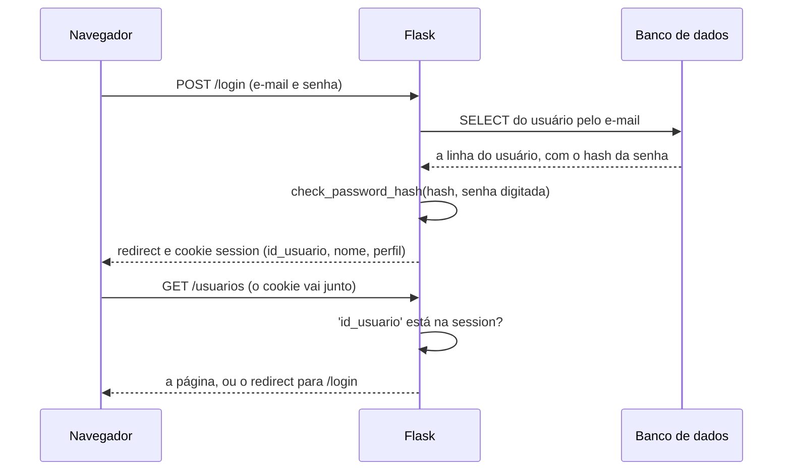

# Capítulo 17 — Login

**Disciplina:** Programação para Internet (ILP951)
**Professor:** Ronan Adriel Zenatti · ronan.zenatti@cps.sp.gov.br
**Fatec Jahu — 2º Semestre/2026**

---

## 🎯 Objetivos do Capítulo

Ao final deste capítulo você deverá ser capaz de:

- Explicar por que o sistema, até o Capítulo 16, trata qualquer visitante como se fosse a mesma pessoa, e o que o login muda
- Conferir uma senha digitada com o hash guardado no banco, usando `check_password_hash`
- Montar uma consulta própria para o login, a única que lê a coluna `senha`
- Dar a mesma mensagem de erro para e-mail inexistente e senha errada, e explicar por quê
- Guardar na `session` quem entrou (`id_usuario`, `nome` e `perfil`), e nunca a senha, limpando a `session` antes
- Sair do sistema por uma rota `POST` e fazer o menu mudar conforme a pessoa esteja logada ou não
- Proteger cada rota com `if 'id_usuario' not in session`, inclusive as que só aceitam `POST`
- Impedir que o usuário logado exclua o próprio usuário

Os Capítulos 12 a 16 construíram o cadastro, a lista, a edição e a exclusão de perfis e de usuários, e as senhas já são gravadas como **hash** desde o Capítulo 14. Falta o sistema **usar** essas senhas: perguntar quem está do outro lado e só deixar entrar quem souber a senha. Ao final, as páginas do sistema só abrem para quem fez login, o menu mostra o nome de quem entrou e um botão **Sair**, e a página de login é a única aberta a qualquer pessoa.

## 📦 Ponto de partida

Este capítulo continua do **seu** repositório `sistema-gestao`, como ficou no fim do Capítulo 16: com o recurso `usuarios` completo e a Ana, o Bruno e a Carla cadastrados com a senha `Senha123`. Os Capítulos 12.1, 13.1 e 14.1 são opcionais: este capítulo parte do código do 16, e não deles.

!!! warning "Os três usuários precisam existir antes do Tópico 5"
    Quando as rotas ficarem protegidas, até o formulário **Novo usuário** exigirá login, e só entra quem já tem um usuário. Se o seu banco não tem a Ana, o Bruno e a Carla, cadastre-os **agora**, pelo formulário (a tabela do [Capítulo 15, Tópico 1](Capitulo_15_SELECT_Relacional_de_Usuario.md) diz o que preencher), todos com a senha `Senha123`. Um usuário inserido à mão no phpMyAdmin não serve: a senha dele não seria um hash.

Se o seu projeto não está funcionando, baixe o código do Capítulo 16 e descompacte. Depois de descompactar, crie o ambiente virtual e o `.env`, como no [Capítulo 11, Tópico 4](Capitulo_11_Projeto_Novo_e_Banco.md#topico-4-o-arquivo-env), importe o `banco.sql` no phpMyAdmin e cadastre os três perfis e os três usuários pelo formulário:

➡️ [Baixar p2_cap_16.zip](../arquivos/p2_cap_16.zip)

```bash
python -m venv venv
venv\Scripts\activate
pip install -r requirements.txt
copy .env.example .env
```

---

## Tópico 1 — O sistema ainda não sabe quem é você

### Antes de começar

Ligue o **Apache** e o **MySQL** no painel do XAMPP. Abra a pasta `sistema-gestao` no VS Code, o terminal (`Ctrl + '`), ative o ambiente virtual e confira o Git:

```bash
venv\Scripts\activate
git status
```

O `git status` deve dizer `nothing to commit, working tree clean`. Ligue o servidor com `python app.py` e deixe esse terminal rodando durante o capítulo (use um segundo terminal, o ícone **+**, para o Git).

### O problema: a página é a mesma para qualquer pessoa

Abra **http://127.0.0.1:5000/usuarios**. A lista aparece, com os botões **Editar** e **Excluir**. Agora abra uma **janela anônima** do navegador (`Ctrl + Shift + N` no Chrome e no Edge) e entre no mesmo endereço: a lista aparece igual, com os mesmos botões. **Não clique em Excluir.**

Nada no sistema distingue a Ana, que cadastrou os usuários, de uma pessoa que só descobriu o endereço. Cada pedido chega ao servidor sozinho, sem dizer quem o fez, e o servidor responde a todos do mesmo jeito. Quem sabe o endereço `/usuarios/3/excluir` e consegue um token CSRF (qualquer formulário do sistema entrega um) apaga o usuário que quiser.

O sistema precisa de duas coisas:

| Pergunta | Nome | Capítulo |
|---|---|---|
| **Quem é você?** A pessoa digita e-mail e senha, e o sistema confere | Autenticação (o **login**) | 17 |
| **O que você pode fazer?** Cada perfil abre só as páginas que lhe cabem | Autorização (as **permissões**) | 17.1, opcional |

Este capítulo resolve a primeira. A peça que lembra quem entrou você já conhece: a `session` do [Capítulo 8](Capitulo_08_Session.md), um cookie assinado que o navegador devolve a cada pedido.

### O caminho do login



O banco **não** guarda a senha, e sim o hash dela (Capítulo 14). Então o login não compara senhas: ele busca o usuário **pelo e-mail** e pede ao Python para conferir a senha digitada contra o hash. Se bater, o código do usuário vai para a `session`, e dali em diante cada pedido traz esse cookie.

### O hash na prática

Antes de escrever o login, veja a conferência funcionando. Com o ambiente virtual ativo, abra o Python no segundo terminal e digite as linhas, uma de cada vez (o `>>>` já aparece; não o digite):

```bash
python
```

```python
>>> from werkzeug.security import generate_password_hash, check_password_hash
>>> hash1 = generate_password_hash('Senha123')
>>> hash2 = generate_password_hash('Senha123')
>>> hash1 == hash2
False
>>> check_password_hash(hash1, 'Senha123')
True
>>> check_password_hash(hash1, 'senha123')
False
>>> exit()
```

Duas senhas iguais geram **hashes diferentes**: a função mistura um valor aleatório (o *sal*) antes de calcular, e o guarda dentro do próprio hash. É por isso que o login não pode gerar um hash da senha digitada e comparar com o do banco: o resultado nunca seria igual. Quem sabe conferir é a `check_password_hash`, que lê o sal dentro do hash guardado, refaz o cálculo com a senha digitada e responde `True` ou `False`. Até uma letra maiúscula a mais dá `False`.

!!! note "Python: a ordem dos argumentos"
    A `check_password_hash(hash, senha)` recebe **primeiro o hash** do banco e depois a senha digitada. Trocar a ordem não dá erro: dá `False`, e o login recusaria todo mundo.

Este tópico não mudou o código, então não há commit.

---

## Tópico 2 — A página de login

### O mapa das rotas novas

| Rota | Métodos | O que faz | Função no `app.py` | Template |
|---|---|---|---|---|
| `/login` | GET e POST | GET mostra o formulário, POST confere e entra | `login` | `login.html` |
| `/logout` | só POST | Sai do sistema e volta para o login | `logout` | (nenhum) |

Neste tópico nasce só o GET do `/login`. No `app.py`, acrescente `login` na linha de importação do Flask, **depois** do `abort`, e escreva a rota logo **acima** da rota `index` (a que começa com `@app.route('/')`):

```python
from flask import Flask, render_template, request, redirect, url_for, flash, abort, session
```

```python
@app.route('/login')
def login():
    return render_template('login.html', email='')
```

O `email=''` é o valor que o campo de e-mail mostrará. Ele existe desde já porque, daqui a pouco, o formulário devolverá o e-mail digitado quando a senha estiver errada, como os formulários dos Capítulos 14 e 16. Falta o template. Crie o arquivo `templates/login.html`:

```html


Entrar — Sistema de Gestão


  <div class="row justify-content-center">
    <div class="col-md-6 col-lg-5">
      <div class="card">
        <div class="card-body p-4">
          <h1 class="h2 mb-4">Entrar</h1>

          <form action="{{ url_for('login') }}" method="post">
            <input type="hidden" name="csrf_token" value="{{ csrf_token() }}">

            <div class="mb-3">
              <label for="email" class="form-label">E-mail</label>
              <input type="email" class="form-control" id="email" name="email" value="{{ email }}" required autofocus autocomplete="username">
            </div>

            <div class="mb-3">
              <label for="senha" class="form-label">Senha</label>
              <input type="password" class="form-control" id="senha" name="senha" required autocomplete="current-password">
            </div>

            <button type="submit" class="btn btn-primary w-100">Entrar</button>
          </form>
        </div>
      </div>
    </div>
  </div>

```

O arquivo herda o `base.html` (Capítulo 6) e usa só peças que você já conhece: um `<form>` com `method="post"`, o campo escondido com o token CSRF (Capítulo 8) e um `value` que devolve o e-mail. Os atributos novos são pequenos:

| Atributo | O que faz |
|---|---|
| `type="email"` | O navegador confere o formato do e-mail antes de enviar |
| `type="password"` | O navegador esconde o que é digitado |
| `autofocus` | O cursor já começa no campo de e-mail |
| `autocomplete="username"` e `"current-password"` | Avisam o navegador e os gerenciadores de senha de qual campo é qual, para oferecerem preencher |

!!! note "O login também precisa do token CSRF"
    Todo formulário `POST` do sistema passa pelo `CSRFProtect`, e o login não é exceção: sem o campo escondido, o envio recebe o erro 400 do Capítulo 8.

Salve e abra **http://127.0.0.1:5000/login**. O formulário aparece, com o menu de sempre em cima. Preencha qualquer e-mail e uma senha, e clique em **Entrar**: a página mostra **Method Not Allowed** (405). O formulário está certo, mas a rota ainda só aceita `GET`. O próximo tópico a ensina a receber o envio.

```bash
git add .
git commit -m "Adiciona a página de login"
git push
```

---

## Tópico 3 — Conferir o e-mail e a senha

### A rota passa a receber o POST

Troque a rota `login` inteira por esta. Ela aceita os dois métodos e, por enquanto, só lê os dois campos e avisa o que recebeu:

```python
@app.route('/login', methods=['GET', 'POST'])
def login():
    email = ''

    if request.method == 'POST':
        email = request.form.get('email', '').strip().lower()
        senha = request.form.get('senha', '')

        flash(f'Recebi o e-mail {email}.', 'info')

    return render_template('login.html', email=email)
```

O e-mail passa por `strip()` e `lower()`, como no cadastro (Capítulo 14): quem digita `ANA@exemplo.com ` com maiúsculas e um espaço no fim precisa entrar do mesmo jeito. A senha **não** leva `strip()`, porque espaços fazem parte de uma senha. Salve, preencha `ANA@Exemplo.com` e qualquer senha, e envie: a faixa azul `Recebi o e-mail ana@exemplo.com.` aparece, e o campo de e-mail continua preenchido. O campo de senha volta vazio, e é assim que deve ser. A variável `senha` ainda não é usada.

### Buscar o usuário pelo e-mail

Troque a linha do `flash(...)` por uma consulta e por um aviso provisório:

```python
        usuario = execute_one(
            'SELECT u.id_usuario, u.nome, u.senha, p.nome AS perfil '
            'FROM usuarios u '
            'JOIN perfis p ON p.id_perfil = u.perfil_id '
            'WHERE u.email = %s',
            (email,),
        )

        if usuario is None:
            flash('E-mail ou senha incorretos.', 'danger')
        else:
            flash('Encontrei o usuário. Ainda não conferi a senha.', 'info')
```

Esta é a **consulta própria do login**, a que o [Capítulo 15](Capitulo_15_SELECT_Relacional_de_Usuario.md) prometeu: é a única do sistema que lê a coluna `senha`, por isso não usa o `SELECT_USUARIO`. Ela traz o código, o nome, o hash e, pelo `JOIN`, o nome do perfil, com o apelido `perfil` (o mesmo cuidado do Capítulo 15, para as duas colunas `nome` não se sobrescreverem). O `WHERE` leva o `%s` e o e-mail na tupla, como em todas as consultas do projeto. A consulta busca **só pelo e-mail**: a senha nunca entra no SQL, porque o banco só tem o hash.

Salve e teste:

- `ninguem@exemplo.com` com qualquer senha: faixa vermelha `E-mail ou senha incorretos.`
- `ana@exemplo.com` com qualquer senha: faixa azul `Encontrei o usuário. Ainda não conferi a senha.` (a senha ainda não é olhada, e é isso que o próximo trecho corrige).

### Conferir a senha

Troque o `if usuario is None ... else ...` provisório por este, e acrescente `check_password_hash` à linha de importação do `werkzeug.security`:

```python
from werkzeug.security import generate_password_hash, check_password_hash
```

```python
        if usuario is not None and check_password_hash(usuario['senha'], senha):
            flash('Senha correta. Ainda não guardei quem entrou.', 'success')
        else:
            flash('E-mail ou senha incorretos.', 'danger')
```

!!! note "Python: o `and` que para no primeiro `False`"
    No `and`, se o primeiro lado já é falso, o Python **nem avalia** o segundo. Se o e-mail não existe, `usuario` é `None`, o primeiro lado (`usuario is not None`) dá `False`, e o `check_password_hash(usuario['senha'], ...)` nunca roda. A ordem importa: invertida, `None['senha']` daria erro. O `else` junta os dois casos de fracasso em uma única mensagem.

!!! tip "Por que a mensagem não diz qual dos dois errou"
    `E-mail ou senha incorretos.` serve para o e-mail que não existe **e** para a senha errada. Se o sistema dissesse "este e-mail não está cadastrado", qualquer pessoa descobriria, testando endereços, quem tem conta no sistema. Com a mensagem única, quem erra fica sem essa pista.

Salve e teste:

- `ana@exemplo.com` com `errada`: faixa vermelha.
- `ninguem@exemplo.com`: a **mesma** faixa vermelha.
- `ana@exemplo.com` com `senha123` (minúscula): faixa vermelha, porque a conferência diferencia maiúsculas.
- `ana@exemplo.com` com `Senha123`: faixa verde `Senha correta. Ainda não guardei quem entrou.`

### Guardar quem entrou

A senha confere, mas o sistema esquece na hora: nada foi guardado. O que lembra a pessoa entre um pedido e outro é a `session`. Troque a rota `login` inteira por esta versão, que também manda para a página inicial quem já está logado:

```python
@app.route('/login', methods=['GET', 'POST'])
def login():
    if 'id_usuario' in session:
        return redirect(url_for('index'))

    email = ''

    if request.method == 'POST':
        email = request.form.get('email', '').strip().lower()
        senha = request.form.get('senha', '')

        usuario = execute_one(
            'SELECT u.id_usuario, u.nome, u.senha, p.nome AS perfil '
            'FROM usuarios u '
            'JOIN perfis p ON p.id_perfil = u.perfil_id '
            'WHERE u.email = %s',
            (email,),
        )

        if usuario is not None and check_password_hash(usuario['senha'], senha):
            session.clear()
            session['id_usuario'] = usuario['id_usuario']
            session['nome'] = usuario['nome']
            session['perfil'] = usuario['perfil']
            flash(f'Você entrou como {usuario["nome"]}.', 'success')
            return redirect(url_for('index'))

        flash('E-mail ou senha incorretos.', 'danger')

    return render_template('login.html', email=email)
```

Três pontos merecem atenção:

- O `'id_usuario' in session` do começo manda para o início quem já fez login e abriu `/login` de novo. Sem ele, a pessoa veria o formulário estando logada.
- A `session` recebe **três** valores: o código, o nome e o perfil. O nome e o perfil serão escritos no menu, e o código identifica a pessoa nas rotas. **A senha, e o hash também, nunca vão para a `session`**: o cookie é assinado, mas qualquer pessoa consegue lê-lo (Capítulo 8).
- Se o login deu certo, a rota termina no `redirect` (o padrão PRG de sempre), e o `flash(...)` de erro, que está depois do `if`, só roda quando o `if` falha.

!!! note "Flask: `session.clear()`"
    O `session.clear()` esvazia a `session` inteira. Ele roda **antes** de gravar o usuário novo, para que nada de uma visita anterior (de outra pessoa que usou o mesmo navegador, por exemplo) sobreviva ao login. O `flash(...)` vem depois dele, senão a própria mensagem seria apagada.

Salve e entre com `ana@exemplo.com` e `Senha123`. A página inicial abre com a faixa verde `Você entrou como Ana Beatriz Lima.` Tente abrir `/login` de novo: você volta para o início.

### Olhando o cookie por dentro

Como no Capítulo 8, abra o `F12`, a aba **Application** (**Aplicativo**), **Cookies**, `http://127.0.0.1:5000`, e clique na linha `session`. Copie o **valor inteiro** do cookie (ele aparece em um painel embaixo da tabela) e, no segundo terminal, decodifique-o, colando o valor no lugar de `COLE_AQUI_O_VALOR_INTEIRO`:

```bash
python -c "import base64, zlib; v = 'COLE_AQUI_O_VALOR_INTEIRO'; d = base64.urlsafe_b64decode(v.split('.')[-3] + '=='); print(zlib.decompress(d) if v.startswith('.') else d)"
```

A resposta é parecida com esta:

```
b'{"id_usuario":1,"nome":"Ana Beatriz Lima","perfil":"Administrador"}'
```

!!! note "Python: os pedaços do cookie"
    O valor do cookie tem três pedaços separados por ponto, e o conteúdo é o primeiro. O `[-3]` conta a partir do fim, e por isso funciona também quando o valor começa com um ponto. Esse ponto no começo significa que o Flask **comprimiu** o conteúdo antes de gravar, e o comando descomprime (`zlib`). Um `á` na resposta é o `á` escrito em forma de código: `Usuário` é `Usuário`.

Está lá o que o login guardou: o código, o nome e o perfil. A senha não está, e não há como obtê-la dali. É também por isso que a `session` guarda só o **código**: ele identifica a pessoa, e os dados que mudam (como o e-mail) ficam no banco, onde há uma única cópia.

```bash
git add .
git commit -m "Confere e-mail e senha e guarda o usuário na session"
git push
```

---

## Tópico 4 — Sair e o menu que muda

### A rota de logout

Sair é esvaziar a `session`. No `app.py`, acrescente a rota logo **depois** da `login`:

```python
@app.route('/logout', methods=['POST'])
def logout():
    session.clear()
    flash('Você saiu do sistema.', 'success')

    return redirect(url_for('login'))
```

A rota aceita só `POST`, pelo mesmo motivo da exclusão (Capítulo 13): ela **altera** o estado do sistema, e um link comum é um `GET`, que robôs e pré-visualizações de página disparam sozinhos. Aqui o `flash` vem depois do `session.clear()`, para a mensagem sobreviver e aparecer na página de login. Salve e digite `http://127.0.0.1:5000/logout` na barra de endereço: **Method Not Allowed** (405), e você continua logado.

### O botão Sair

Como a saída é um `POST`, o botão é um formulário, com o token CSRF. No `templates/base.html`, **dentro** do `<ul class="navbar-nav ms-auto">`, depois do último `</li>`, acrescente:

```html
          <li class="nav-item">
            <form action="{{ url_for('logout') }}" method="post">
              <input type="hidden" name="csrf_token" value="{{ csrf_token() }}">
              <button type="submit" class="btn btn-sm btn-outline-light">Sair</button>
            </form>
          </li>
```

Salve, recarregue e clique em **Sair**: você cai em `/login`, com a faixa verde `Você saiu do sistema.` Entre de novo com a Ana. O menu, porém, é o mesmo para todos: o botão **Sair** aparece até para quem não entrou. É o que o próximo trecho corrige.

### O menu depende de quem está logado

O menu precisa de dois desenhos: para quem está logado, as páginas do sistema, o nome e o **Sair**; para quem não está, só o **Entrar**. O Jinja enxerga a `session` direto, sem ninguém entregá-la ao template (você usou `session.pop` no `base.html` do Capítulo 8). Troque **todo** o `<ul class="navbar-nav ms-auto">` do `base.html` (do `<ul` ao `</ul>`) por:

```html
        <ul class="navbar-nav ms-auto align-items-lg-center">
          
          <li class="nav-item">
            <a class="nav-link active" href="{{ url_for('index') }}">Início</a>
          </li>
          <li class="nav-item">
            <a class="nav-link active" href="{{ url_for('lista_perfis') }}">Perfis</a>
          </li>
          <li class="nav-item">
            <a class="nav-link active" href="{{ url_for('lista_usuarios') }}">Usuários</a>
          </li>
          <li class="nav-item">
            <span class="navbar-text ms-lg-3 me-lg-3">{{ session['nome'] }} · {{ session['perfil'] }}</span>
          </li>
          <li class="nav-item">
            <form action="{{ url_for('logout') }}" method="post">
              <input type="hidden" name="csrf_token" value="{{ csrf_token() }}">
              <button type="submit" class="btn btn-sm btn-outline-light">Sair</button>
            </form>
          </li>
          
          <li class="nav-item">
            <a class="nav-link active" href="{{ url_for('login') }}">Entrar</a>
          </li>
          
        </ul>
```

O `if 'id_usuario' in session` é o mesmo teste que o Python faz na rota, escrito em Jinja. O `session['nome']` e o `session['perfil']` vêm do que o login gravou. O `align-items-lg-center` só alinha o nome e o botão com os links. Salve e confira os dois desenhos:

- Logado como Ana: **Início · Perfis · Usuários · Ana Beatriz Lima · Administrador · Sair**.
- Clique em **Sair**: o menu passa a mostrar só **Entrar**.
- Entre de novo e, no `F12`, na aba **Application**, dê dois cliques no valor do cookie `session` e troque uma letra do **primeiro pedaço**. Recarregue: o menu volta a mostrar **Entrar**. O Flask recalculou a assinatura, não bateu, e ele descartou o cookie, como no Capítulo 8. Ninguém consegue se fazer passar por outra pessoa trocando o `id_usuario` no cookie, porque não conhece a `secret_key`.

Agora, o defeito que sobrou. Saia do sistema e digite, na barra de endereço, `http://127.0.0.1:5000/usuarios`. A lista **abre**, com todos os botões. O menu escondeu o caminho, mas a rota continua aberta a quem souber o endereço. É o assunto do último tópico.

```bash
git add .
git commit -m "Adiciona o logout e o menu que muda conforme o login"
git push
```

---

## Tópico 5 — Proteger as rotas

### Uma rota por vez

Esconder o link não protege nada: quem digita o endereço chega do mesmo jeito. A proteção precisa estar **dentro da rota**. A regra é simples: se a `session` não tem o `id_usuario`, a pessoa não entrou, e a rota manda para o login em vez de fazer o que foi pedido. Comece pela `lista_usuarios`. Acrescente, como **primeiras linhas** da função (antes do `SELECT`):

```python
@app.route('/usuarios')
def lista_usuarios():
    if 'id_usuario' not in session:
        flash('Entre para continuar.', 'warning')
        return redirect(url_for('login'))

    usuarios = execute_query(SELECT_USUARIO + ' ORDER BY u.nome', fetch=True)

    return render_template('usuarios.html', titulo='Usuários', usuarios=usuarios)
```

O `return redirect(...)` encerra a função: o `SELECT` e o `render_template` abaixo nem chegam a rodar para quem não entrou. A conferência vem **antes** de qualquer consulta, para o banco não ser consultado em nome de um desconhecido.

Salve e teste, com o servidor ligado:

1. Logado como Ana: `/usuarios` abre normalmente.
2. Clique em **Sair** e digite `/usuarios` de novo: você é levado a `/login`, com a faixa amarela `Entre para continuar.`

### As outras nove rotas

Agora o contrário. Fora do sistema, digite `http://127.0.0.1:5000/perfis`, depois `/usuarios/novo` e, por fim, `/`. As três **abrem**: só a `lista_usuarios` foi protegida. O sistema tem dez rotas que exigem login, e é preciso o mesmo `if` nas outras nove. Acrescente as **mesmas três linhas**, como primeiras linhas da função, em cada uma destas:

| Rota | Função |
|---|---|
| `/` | `index` |
| `/perfis` | `lista_perfis` |
| `/perfis/novo` | `perfil_novo` |
| `/perfis/<int:id_perfil>/editar` | `perfil_editar` |
| `/perfis/<int:id_perfil>/excluir` | `perfil_excluir` |
| `/usuarios/novo` | `usuario_novo` |
| `/usuarios/<int:id_usuario>` | `usuario_detalhe` |
| `/usuarios/<int:id_usuario>/editar` | `usuario_editar` |
| `/usuarios/<int:id_usuario>/excluir` | `usuario_excluir` |

```python
    if 'id_usuario' not in session:
        flash('Entre para continuar.', 'warning')
        return redirect(url_for('login'))
```

Por exemplo, a `perfil_editar` fica assim no começo:

```python
@app.route('/perfis/<int:id_perfil>/editar', methods=['GET', 'POST'])
def perfil_editar(id_perfil):
    if 'id_usuario' not in session:
        flash('Entre para continuar.', 'warning')
        return redirect(url_for('login'))

    perfil = execute_one(
        'SELECT id_perfil, nome, descricao FROM perfis WHERE id_perfil = %s',
        (id_perfil,),
    )
```

Não esqueça as duas rotas que **só aceitam `POST`**, `perfil_excluir` e `usuario_excluir`. Elas não têm página, e por isso é fácil pensar que ninguém chega até elas. Mas o `POST` pode ser enviado sem passar pelo navegador, e o token CSRF só mostra que o formulário veio do sistema, e **não** que a pessoa fez login (o formulário de login entrega um token a qualquer visitante). Só o `if` impede a exclusão. A rota `login` e a rota `logout` ficam **de fora**: a primeira precisa estar aberta para alguém poder entrar, e a segunda só esvazia a `session`.

Salve e confira, **sem** estar logado:

- `/`, `/perfis`, `/perfis/novo`, `/perfis/1/editar`, `/usuarios`, `/usuarios/novo`, `/usuarios/1` e `/usuarios/1/editar`: todas levam a `/login`, com a faixa amarela.
- `/login` continua aberta, e `/qualquer-coisa` continua dando a página 404.

Agora entre como Ana e percorra o sistema: tudo funciona como no Capítulo 16. A única diferença é que o sistema agora sabe quem está pedindo.

!!! info "A dor de repetir"
    As mesmas três linhas aparecem **dez vezes**. Se um dia a mensagem mudar, ou se o aviso passar a levar a pessoa de volta à página que ela queria, são dez lugares para lembrar de corrigir (e basta esquecer **um** para abrir uma brecha). O Capítulo 17.1, opcional, troca essas linhas por um decorador, e acrescenta o controle por perfil. O sistema já está seguro sem ele.

### Excluir o próprio usuário

Falta um cuidado que só existe agora que o sistema sabe quem está logado. Entre como Ana, abra `/usuarios` e imagine clicar em **Excluir** na linha **dela mesma**: o usuário seria apagado do banco com a `session` ainda dizendo que ele está logado. No `usuario_excluir`, logo **depois** do `if` do login e **antes** do `SELECT`, acrescente:

```python
    if id_usuario == session['id_usuario']:
        flash('Você não pode excluir o seu próprio usuário.', 'danger')
        return redirect(url_for('lista_usuarios'))
```

O `id_usuario` do endereço é um número (o Flask o converteu por causa do `<int:id_usuario>`), e o da `session` também, então a comparação funciona. Salve, entre como Ana e clique em **Excluir** na linha dela, e depois em **Excluir** no modal: a faixa vermelha `Você não pode excluir o seu próprio usuário.` aparece, e a Ana continua na lista. Cadastre o **Daniel Teste** (e-mail `daniel@exemplo.com`, perfil **Usuário**, senha `Senha123`) e exclua-o: esse funciona, porque é outro usuário.

| Situação | Quem trata | O que a pessoa vê |
|---|---|---|
| Qualquer rota do sistema, sem login | O `if 'id_usuario' not in session` | O login, com a faixa amarela |
| `POST` de exclusão enviado sem login | O mesmo `if`, antes de qualquer consulta | O login, e nada é excluído |
| Cookie `session` adulterado | A assinatura do Flask | A `session` vazia, e o login |
| E-mail ou senha errados | O `login` | A faixa vermelha única, e o e-mail mantido |
| Usuário logado clica em Excluir nele mesmo | O `if id_usuario == session['id_usuario']` | A faixa vermelha |

!!! warning "O que este login ainda não faz"
    - **A sessão dura até o navegador fechar.** Não há "lembrar de mim": o cookie não tem data de validade, e some quando o navegador é fechado.
    - **Um usuário excluído continua logado.** Se a Ana excluir o Bruno enquanto o Bruno está com o sistema aberto, o cookie dele continua valendo até ele sair ou fechar o navegador. Um sistema real confere, a cada pedido, se o usuário ainda existe.
    - **Não há limite de tentativas.** Alguém pode testar senhas sem parar. Sistemas reais bloqueiam o acesso depois de algumas falhas seguidas.
    - **A senha viaja pela rede como o formulário a enviou.** Em `127.0.0.1`, na sua máquina, isso não é problema. Um sistema publicado só deve aceitar o login por `https`, em que a conexão é criptografada.

```bash
git add .
git commit -m "Protege as rotas com login e impede a exclusão do próprio usuário"
git push
```

---

## Os arquivos completos do capítulo

O `app.py`:

```python
import os

from dotenv import load_dotenv
from flask import Flask, render_template, request, redirect, url_for, flash, abort, session
from flask_wtf.csrf import CSRFProtect
from mysql.connector import Error
from werkzeug.security import generate_password_hash, check_password_hash

from db import execute_query, execute_one, execute_insert
from validacoes import (
    UFS, validar_nome_perfil, validar_descricao_perfil,
    validar_nome_usuario, validar_email, validar_senha, validar_celular,
    validar_cpf, validar_data_nascimento, validar_cep, validar_estado,
    validar_tamanho, formatar_celular, formatar_cpf, formatar_cep,
)

load_dotenv()

app = Flask(__name__)
app.secret_key = os.getenv('SECRET_KEY')

CSRFProtect(app)

# As colunas que as telas de usuário leem. A senha fica de fora de propósito: o que não é
# lido do banco não tem como vazar para a página.
SELECT_USUARIO = (
    'SELECT u.id_usuario, u.nome, u.email, u.celular, u.data_nascimento, u.cpf, '
    'u.perfil_id, u.cep, u.endereco, u.numero, u.complemento, u.cidade, u.estado, '
    'u.criado_em, u.atualizado_em, p.nome AS perfil, p.descricao AS perfil_descricao '
    'FROM usuarios u '
    'JOIN perfis p ON p.id_perfil = u.perfil_id'
)


@app.template_filter('data_br')
def data_br(valor):
    if valor is None:
        return '—'

    return valor.strftime('%d/%m/%Y')


@app.template_filter('data_hora_br')
def data_hora_br(valor):
    if valor is None:
        return '—'

    return valor.strftime('%d/%m/%Y às %H:%M')


@app.template_filter('cpf_oculto')
def cpf_oculto(cpf):
    if cpf is None:
        return '—'

    return '***.' + cpf[4:11] + '-**'


@app.route('/login', methods=['GET', 'POST'])
def login():
    if 'id_usuario' in session:
        return redirect(url_for('index'))

    email = ''

    if request.method == 'POST':
        email = request.form.get('email', '').strip().lower()
        senha = request.form.get('senha', '')

        usuario = execute_one(
            'SELECT u.id_usuario, u.nome, u.senha, p.nome AS perfil '
            'FROM usuarios u '
            'JOIN perfis p ON p.id_perfil = u.perfil_id '
            'WHERE u.email = %s',
            (email,),
        )

        if usuario is not None and check_password_hash(usuario['senha'], senha):
            session.clear()
            session['id_usuario'] = usuario['id_usuario']
            session['nome'] = usuario['nome']
            session['perfil'] = usuario['perfil']
            flash(f'Você entrou como {usuario["nome"]}.', 'success')
            return redirect(url_for('index'))

        flash('E-mail ou senha incorretos.', 'danger')

    return render_template('login.html', email=email)


@app.route('/logout', methods=['POST'])
def logout():
    session.clear()
    flash('Você saiu do sistema.', 'success')

    return redirect(url_for('login'))


@app.route('/')
def index():
    if 'id_usuario' not in session:
        flash('Entre para continuar.', 'warning')
        return redirect(url_for('login'))

    perfis = execute_one('SELECT COUNT(*) AS total FROM perfis')
    usuarios = execute_one('SELECT COUNT(*) AS total FROM usuarios')
    produtos = execute_one('SELECT COUNT(*) AS total FROM produtos')

    return render_template('index.html', titulo='Sistema de Gestão',
                           total_perfis=perfis['total'],
                           total_usuarios=usuarios['total'],
                           total_produtos=produtos['total'])


@app.route('/perfis')
def lista_perfis():
    if 'id_usuario' not in session:
        flash('Entre para continuar.', 'warning')
        return redirect(url_for('login'))

    perfis = execute_query(
        'SELECT id_perfil, nome, descricao, criado_em FROM perfis ORDER BY nome',
        fetch=True,
    )

    return render_template('perfis.html', titulo='Perfis', perfis=perfis)


def conferir_perfil(nome, descricao, id_perfil):
    erros = []

    erro = validar_nome_perfil(nome)
    if erro:
        erros.append(erro)

    erro = validar_descricao_perfil(descricao)
    if erro:
        erros.append(erro)

    if not erros:
        existente = execute_one(
            'SELECT id_perfil FROM perfis WHERE nome = %s AND id_perfil <> %s',
            (nome, id_perfil),
        )
        if existente:
            erros.append('Já existe um perfil com este nome.')

    return erros


@app.route('/perfis/novo', methods=['GET', 'POST'])
def perfil_novo():
    if 'id_usuario' not in session:
        flash('Entre para continuar.', 'warning')
        return redirect(url_for('login'))

    nome = ''
    descricao = ''

    if request.method == 'POST':
        nome = request.form.get('nome', '').strip()
        descricao = request.form.get('descricao', '').strip()

        erros = conferir_perfil(nome, descricao, 0)

        if erros:
            for mensagem in erros:
                flash(mensagem, 'danger')
        else:
            if descricao == '':
                descricao_gravada = None
            else:
                descricao_gravada = descricao

            try:
                novo_id = execute_insert(
                    'INSERT INTO perfis (nome, descricao) VALUES (%s, %s)',
                    (nome, descricao_gravada),
                )
                flash(f'Perfil "{nome}" cadastrado (código {novo_id}).', 'success')
                return redirect(url_for('lista_perfis'))
            except Error as erro:
                if erro.errno == 1062:
                    flash('Já existe um perfil com este nome.', 'danger')
                else:
                    raise

    return render_template('perfil_form.html', acao='criar', id_perfil=None,
                           nome=nome, descricao=descricao)


@app.route('/perfis/<int:id_perfil>/editar', methods=['GET', 'POST'])
def perfil_editar(id_perfil):
    if 'id_usuario' not in session:
        flash('Entre para continuar.', 'warning')
        return redirect(url_for('login'))

    perfil = execute_one(
        'SELECT id_perfil, nome, descricao FROM perfis WHERE id_perfil = %s',
        (id_perfil,),
    )
    if perfil is None:
        abort(404)

    nome = perfil['nome']
    descricao = perfil['descricao']
    if descricao is None:
        descricao = ''

    if request.method == 'POST':
        nome = request.form.get('nome', '').strip()
        descricao = request.form.get('descricao', '').strip()

        erros = conferir_perfil(nome, descricao, id_perfil)

        if erros:
            for mensagem in erros:
                flash(mensagem, 'danger')
        else:
            if descricao == '':
                descricao_gravada = None
            else:
                descricao_gravada = descricao

            try:
                execute_query(
                    'UPDATE perfis SET nome = %s, descricao = %s WHERE id_perfil = %s',
                    (nome, descricao_gravada, id_perfil),
                )
                flash(f'Perfil "{nome}" atualizado.', 'success')
                return redirect(url_for('lista_perfis'))
            except Error as erro:
                if erro.errno == 1062:
                    flash('Já existe um perfil com este nome.', 'danger')
                else:
                    raise

    return render_template('perfil_form.html', acao='editar', id_perfil=id_perfil,
                           nome=nome, descricao=descricao)


@app.route('/perfis/<int:id_perfil>/excluir', methods=['POST'])
def perfil_excluir(id_perfil):
    if 'id_usuario' not in session:
        flash('Entre para continuar.', 'warning')
        return redirect(url_for('login'))

    perfil = execute_one(
        'SELECT id_perfil, nome FROM perfis WHERE id_perfil = %s',
        (id_perfil,),
    )
    if perfil is None:
        abort(404)

    usuarios = execute_one(
        'SELECT COUNT(*) AS total FROM usuarios WHERE perfil_id = %s',
        (id_perfil,),
    )
    if usuarios['total'] > 0:
        flash(f'O perfil "{perfil["nome"]}" tem {usuarios["total"]} usuário(s) e não pode ser excluído.', 'danger')
        return redirect(url_for('lista_perfis'))

    try:
        execute_query('DELETE FROM perfis WHERE id_perfil = %s', (id_perfil,))
        flash(f'Perfil "{perfil["nome"]}" excluído.', 'success')
    except Error as erro:
        if erro.errno == 1451:
            flash(f'O perfil "{perfil["nome"]}" está em uso e não pode ser excluído.', 'danger')
        else:
            raise

    return redirect(url_for('lista_perfis'))


@app.route('/usuarios')
def lista_usuarios():
    if 'id_usuario' not in session:
        flash('Entre para continuar.', 'warning')
        return redirect(url_for('login'))

    usuarios = execute_query(SELECT_USUARIO + ' ORDER BY u.nome', fetch=True)

    return render_template('usuarios.html', titulo='Usuários', usuarios=usuarios)


def vazio_para_none(valor):
    if valor == '':
        return None

    return valor


def texto_ou_vazio(valor):
    if valor is None:
        return ''

    return str(valor)


def conferir_perfil_do_usuario(perfil_txt):
    try:
        id_perfil = int(perfil_txt)
    except ValueError:
        return 'Selecione um perfil.'

    perfil = execute_one(
        'SELECT id_perfil FROM perfis WHERE id_perfil = %s',
        (id_perfil,),
    )
    if perfil is None:
        return 'Selecione um perfil válido.'

    return None


def ler_formulario(form):
    campos = {}
    campos['nome'] = form.get('nome', '').strip()
    campos['email'] = form.get('email', '').strip().lower()
    campos['senha'] = form.get('senha', '')
    campos['confirmacao'] = form.get('confirmacao', '')
    campos['celular'] = form.get('celular', '').strip()
    campos['data_nascimento'] = form.get('data_nascimento', '').strip()
    campos['cpf'] = form.get('cpf', '').strip()
    campos['perfil_id'] = form.get('perfil_id', '')
    campos['cep'] = form.get('cep', '').strip()
    campos['endereco'] = form.get('endereco', '').strip()
    campos['numero'] = form.get('numero', '').strip()
    campos['complemento'] = form.get('complemento', '').strip()
    campos['cidade'] = form.get('cidade', '').strip()
    campos['estado'] = form.get('estado', '')

    return campos


def conferir_usuario(campos, id_usuario):
    erros = []

    erro = validar_nome_usuario(campos['nome'])
    if erro:
        erros.append(erro)

    erro = validar_email(campos['email'])
    if erro:
        erros.append(erro)
    else:
        existente = execute_one(
            'SELECT id_usuario FROM usuarios WHERE email = %s AND id_usuario <> %s',
            (campos['email'], id_usuario),
        )
        if existente:
            erros.append('Já existe um usuário com este e-mail.')

    if id_usuario == 0 or campos['senha'] != '' or campos['confirmacao'] != '':
        erro = validar_senha(campos['senha'], campos['confirmacao'])
        if erro:
            erros.append(erro)

    erro = conferir_perfil_do_usuario(campos['perfil_id'])
    if erro:
        erros.append(erro)

    erro = validar_celular(campos['celular'])
    if erro:
        erros.append(erro)

    erro = validar_cpf(campos['cpf'])
    if erro:
        erros.append(erro)
    else:
        cpf_formatado = formatar_cpf(campos['cpf'])
        if cpf_formatado != '':
            existente = execute_one(
                'SELECT id_usuario FROM usuarios WHERE cpf = %s AND id_usuario <> %s',
                (cpf_formatado, id_usuario),
            )
            if existente:
                erros.append('Já existe um usuário com este CPF.')

    erro = validar_data_nascimento(campos['data_nascimento'])
    if erro:
        erros.append(erro)

    erro = validar_cep(campos['cep'])
    if erro:
        erros.append(erro)

    erro = validar_tamanho(campos['endereco'], 'endereço', 255)
    if erro:
        erros.append(erro)

    erro = validar_tamanho(campos['numero'], 'número', 20)
    if erro:
        erros.append(erro)

    erro = validar_tamanho(campos['complemento'], 'complemento', 100)
    if erro:
        erros.append(erro)

    erro = validar_tamanho(campos['cidade'], 'cidade', 100)
    if erro:
        erros.append(erro)

    erro = validar_estado(campos['estado'])
    if erro:
        erros.append(erro)

    return erros


@app.route('/usuarios/novo', methods=['GET', 'POST'])
def usuario_novo():
    if 'id_usuario' not in session:
        flash('Entre para continuar.', 'warning')
        return redirect(url_for('login'))

    if request.method == 'POST':
        campos = ler_formulario(request.form)

        erros = conferir_usuario(campos, 0)

        if erros:
            for mensagem in erros:
                flash(mensagem, 'danger')
        else:
            try:
                novo_id = execute_insert(
                    'INSERT INTO usuarios (nome, email, senha, celular, data_nascimento, cpf, '
                    'perfil_id, cep, endereco, numero, complemento, cidade, estado) '
                    'VALUES (%s, %s, %s, %s, %s, %s, %s, %s, %s, %s, %s, %s, %s)',
                    (
                        campos['nome'],
                        campos['email'],
                        generate_password_hash(campos['senha']),
                        vazio_para_none(formatar_celular(campos['celular'])),
                        vazio_para_none(campos['data_nascimento']),
                        vazio_para_none(formatar_cpf(campos['cpf'])),
                        int(campos['perfil_id']),
                        vazio_para_none(formatar_cep(campos['cep'])),
                        vazio_para_none(campos['endereco']),
                        vazio_para_none(campos['numero']),
                        vazio_para_none(campos['complemento']),
                        vazio_para_none(campos['cidade']),
                        vazio_para_none(campos['estado']),
                    ),
                )
                flash(f'Usuário "{campos["nome"]}" cadastrado (código {novo_id}).', 'success')
                return redirect(url_for('lista_usuarios'))
            except Error as erro:
                if erro.errno == 1062:
                    flash('Já existe um usuário com este e-mail ou este CPF.', 'danger')
                else:
                    raise

    perfis = execute_query('SELECT id_perfil, nome FROM perfis ORDER BY nome', fetch=True)

    return render_template('usuario_form.html', acao='criar', id_usuario=None,
                           dados=request.form, perfis=perfis, ufs=UFS)


@app.route('/usuarios/<int:id_usuario>')
def usuario_detalhe(id_usuario):
    if 'id_usuario' not in session:
        flash('Entre para continuar.', 'warning')
        return redirect(url_for('login'))

    usuario = execute_one(SELECT_USUARIO + ' WHERE u.id_usuario = %s', (id_usuario,))
    if usuario is None:
        abort(404)

    return render_template('usuario_detalhe.html', usuario=usuario)


@app.route('/usuarios/<int:id_usuario>/editar', methods=['GET', 'POST'])
def usuario_editar(id_usuario):
    if 'id_usuario' not in session:
        flash('Entre para continuar.', 'warning')
        return redirect(url_for('login'))

    usuario = execute_one(SELECT_USUARIO + ' WHERE u.id_usuario = %s', (id_usuario,))
    if usuario is None:
        abort(404)

    dados = {}
    for chave in usuario:
        dados[chave] = texto_ou_vazio(usuario[chave])

    if request.method == 'POST':
        campos = ler_formulario(request.form)

        erros = conferir_usuario(campos, id_usuario)

        if erros:
            for mensagem in erros:
                flash(mensagem, 'danger')
        else:
            sql = (
                'UPDATE usuarios SET nome = %s, email = %s, celular = %s, '
                'data_nascimento = %s, cpf = %s, perfil_id = %s, cep = %s, '
                'endereco = %s, numero = %s, complemento = %s, cidade = %s, estado = %s'
            )
            params = [
                campos['nome'],
                campos['email'],
                vazio_para_none(formatar_celular(campos['celular'])),
                vazio_para_none(campos['data_nascimento']),
                vazio_para_none(formatar_cpf(campos['cpf'])),
                int(campos['perfil_id']),
                vazio_para_none(formatar_cep(campos['cep'])),
                vazio_para_none(campos['endereco']),
                vazio_para_none(campos['numero']),
                vazio_para_none(campos['complemento']),
                vazio_para_none(campos['cidade']),
                vazio_para_none(campos['estado']),
            ]

            if campos['senha'] != '':
                sql += ', senha = %s'
                params.append(generate_password_hash(campos['senha']))

            sql += ' WHERE id_usuario = %s'
            params.append(id_usuario)

            try:
                execute_query(sql, params)
                flash(f'Usuário "{campos["nome"]}" atualizado.', 'success')
                return redirect(url_for('lista_usuarios'))
            except Error as erro:
                if erro.errno == 1062:
                    flash('Já existe um usuário com este e-mail ou este CPF.', 'danger')
                else:
                    raise

        dados = request.form

    perfis = execute_query('SELECT id_perfil, nome FROM perfis ORDER BY nome', fetch=True)

    return render_template('usuario_form.html', acao='editar', id_usuario=id_usuario,
                           dados=dados, perfis=perfis, ufs=UFS)


@app.route('/usuarios/<int:id_usuario>/excluir', methods=['POST'])
def usuario_excluir(id_usuario):
    if 'id_usuario' not in session:
        flash('Entre para continuar.', 'warning')
        return redirect(url_for('login'))

    if id_usuario == session['id_usuario']:
        flash('Você não pode excluir o seu próprio usuário.', 'danger')
        return redirect(url_for('lista_usuarios'))

    usuario = execute_one(
        'SELECT id_usuario, nome FROM usuarios WHERE id_usuario = %s',
        (id_usuario,),
    )
    if usuario is None:
        abort(404)

    execute_query('DELETE FROM usuarios WHERE id_usuario = %s', (id_usuario,))
    flash(f'Usuário "{usuario["nome"]}" excluído.', 'success')

    return redirect(url_for('lista_usuarios'))


@app.errorhandler(404)
def pagina_nao_encontrada(erro):
    return render_template('404.html'), 404


@app.errorhandler(500)
def erro_no_servidor(erro):
    return render_template('500.html'), 500


if __name__ == '__main__':
    app.run(debug=True)
```

O `templates/login.html` é o do Tópico 2, sem alterações. O `templates/base.html`:

```html
<!DOCTYPE html>
<html lang="pt-BR">
<head>
  <meta charset="UTF-8">
  <meta name="viewport" content="width=device-width, initial-scale=1.0">
  <title>Sistema de Gestão</title>
  <link href="https://cdn.jsdelivr.net/npm/bootstrap@5.3.8/dist/css/bootstrap.min.css" rel="stylesheet">
  <link rel="stylesheet" href="{{ url_for('static', filename='estilo.css') }}">
</head>
<body>

  <nav class="navbar navbar-expand-lg" data-bs-theme="dark">
    <div class="container">
      <a class="navbar-brand" href="{{ url_for('index') }}">Sistema de Gestão</a>
      <button class="navbar-toggler" type="button" data-bs-toggle="collapse"
              data-bs-target="#menu" aria-controls="menu" aria-expanded="false"
              aria-label="Abrir o menu">
        <span class="navbar-toggler-icon"></span>
      </button>
      <div class="collapse navbar-collapse" id="menu">
        <ul class="navbar-nav ms-auto align-items-lg-center">
          
          <li class="nav-item">
            <a class="nav-link active" href="{{ url_for('index') }}">Início</a>
          </li>
          <li class="nav-item">
            <a class="nav-link active" href="{{ url_for('lista_perfis') }}">Perfis</a>
          </li>
          <li class="nav-item">
            <a class="nav-link active" href="{{ url_for('lista_usuarios') }}">Usuários</a>
          </li>
          <li class="nav-item">
            <span class="navbar-text ms-lg-3 me-lg-3">{{ session['nome'] }} · {{ session['perfil'] }}</span>
          </li>
          <li class="nav-item">
            <form action="{{ url_for('logout') }}" method="post">
              <input type="hidden" name="csrf_token" value="{{ csrf_token() }}">
              <button type="submit" class="btn btn-sm btn-outline-light">Sair</button>
            </form>
          </li>
          
          <li class="nav-item">
            <a class="nav-link active" href="{{ url_for('login') }}">Entrar</a>
          </li>
          
        </ul>
      </div>
    </div>
  </nav>

  <main class="container my-4">
    
    <div class="alert alert-{{ tipo }} alert-dismissible fade show" role="alert">
      {{ mensagem }}
      <button type="button" class="btn-close" data-bs-dismiss="alert" aria-label="Fechar"></button>
    </div>
    

    
  </main>

  <footer class="text-center text-body-secondary py-3">
    <p class="mb-0">Sistema de Gestão · Fatec Jahu · ILP951 · 2026</p>
  </footer>

  <script src="https://cdn.jsdelivr.net/npm/bootstrap@5.3.8/dist/js/bootstrap.bundle.min.js"></script>
  

</body>
</html>
```

Os demais arquivos (`db.py`, `validacoes.py`, `index.html`, `perfis.html`, `perfil_form.html`, `usuarios.html`, `usuario_form.html`, `usuario_detalhe.html`, `_badge_perfil.html`, `404.html`, `500.html`, `estilo.css`, `testar_conexao.py`) são os do Capítulo 16.

---

## 📦 Código deste capítulo

Compare com o seu projeto, ou use como ponto de partida do próximo capítulo. O zip tem o `app.py`, o `db.py`, o `validacoes.py`, o `testar_conexao.py`, o `banco.sql`, o `.env.example`, o `.gitignore`, o `requirements.txt`, a pasta `templates` (`base.html`, `login.html`, `index.html`, `perfis.html`, `perfil_form.html`, `usuarios.html`, `usuario_form.html`, `usuario_detalhe.html`, `_badge_perfil.html`, `404.html` e `500.html`) e a pasta `static` (`estilo.css`). O ambiente virtual e o `.env` **não** vão no zip: depois de descompactar, crie o ambiente com os três comandos do Capítulo 3 e rode `copy .env.example .env`, trocando os marcadores `SUA_SENHA_AQUI` e `NOME_BANCO_DADOS` como no Capítulo 11. O banco também não vai dentro do zip: importe o `banco.sql` e cadastre os três perfis e os três usuários. Como o zip já traz as rotas protegidas, o formulário **Novo usuário** exige login, e, com o banco vazio, ninguém consegue entrar. Se esse for o seu caso, comece pelo zip do Capítulo 16, que ainda não tem login, cadastre os usuários nele e só depois use este.

➡️ [Baixar p2_cap_17.zip](../arquivos/p2_cap_17.zip)

---

## 🃏 Flashcards de Revisão

Tente responder mentalmente antes de abrir.

??? question "Como o login confere a senha, se o banco só guarda o hash?"
    O `SELECT` busca o usuário **só pelo e-mail** e traz o hash. Depois, o Python chama `check_password_hash(hash_do_banco, senha_digitada)`, que lê o sal dentro do hash, refaz o cálculo com a senha digitada e devolve `True` ou `False`. Gerar um novo hash da senha digitada e comparar com o do banco nunca daria igual, porque cada hash leva um sal aleatório.

??? question "Por que o login responde a mesma mensagem para e-mail inexistente e para senha errada?"
    Porque uma mensagem específica ("este e-mail não está cadastrado") revelaria, a quem testa endereços, quem tem conta no sistema. Com `E-mail ou senha incorretos.` para os dois casos, quem erra não ganha nenhuma pista.

??? question "O que o login grava na `session`, e por que nunca a senha?"
    Grava o `id_usuario`, o `nome` e o `perfil`. O cookie da `session` é assinado, mas **não** é criptografado: qualquer pessoa consegue ler o conteúdo. A senha (e o hash) não pode ficar em um lugar que o navegador e o usuário enxergam. O código do usuário basta para identificá-lo.

??? question "Para que serve o `session.clear()` antes de gravar o usuário no login?"
    Para que nada de uma visita anterior (de outra pessoa que usou o mesmo navegador) sobreviva ao login. A `session` começa vazia e recebe só os três valores do usuário que acabou de entrar. No logout, o `session.clear()` é o que faz a pessoa sair.

??? question "Por que o logout é uma rota `POST`, com botão de formulário e token CSRF?"
    Porque sair altera o estado do sistema, e um link comum faz um `GET`, que robôs e pré-visualizações disparam sozinhos. Pelo mesmo motivo da exclusão (Capítulo 13), a rota aceita só `POST`, e o botão é um `<form>` com o campo escondido do token.

??? question "Por que esconder o item do menu não protege uma página?"
    Porque quem digita o endereço na barra chega do mesmo jeito. A proteção precisa estar **dentro da rota**: o `if 'id_usuario' not in session` no começo de cada função. Isso vale até para as rotas que só aceitam `POST`, já que o `POST` pode ser enviado sem passar pelo navegador, e o token CSRF não mostra que a pessoa fez login.

---

## ✅ Quiz de Fixação

<quiz>
Quais afirmações sobre a conferência da senha no login estão corretas? (selecione todas que se aplicam)
- [x] O `SELECT` busca o usuário pelo e-mail, e o Python confere a senha com `check_password_hash`
> Correto. O banco só tem o hash, então a senha nunca entra no `WHERE`.
- [x] A ordem é `check_password_hash(hash_do_banco, senha_digitada)`
> Correto. O hash vem primeiro. Trocar a ordem não dá erro, mas recusa todo mundo.
- [ ] O login gera o hash da senha digitada e compara com o hash do banco usando `==`
> Não. Cada hash leva um sal aleatório, então dois hashes da mesma senha nunca são iguais.
- [x] Se o e-mail não existe, o `check_password_hash` nem chega a rodar, por causa do `usuario is not None and ...`
> Correto. No `and`, se o primeiro lado é falso, o segundo não é avaliado, e `None['senha']` não chega a ser executado.
</quiz>

<quiz>
Por que a mensagem de falha do login é `E-mail ou senha incorretos.`, igual para os dois casos?
- [ ] Porque o Flask não consegue distinguir os dois casos
> Não. O código distingue (`usuario is None` ou `check_password_hash` falso). A escolha é de segurança.
- [ ] Para o formulário ocupar menos espaço
> Não. O motivo não é de layout.
- [x] Para quem testa endereços não descobrir quais e-mails têm conta no sistema
> Correto. Uma mensagem específica para o e-mail inexistente entregaria a lista de quem está cadastrado.
- [ ] Porque o `CSRFProtect` exige mensagens genéricas
> Não. O `CSRFProtect` cuida do token dos formulários, e não do texto das mensagens.
</quiz>

<quiz>
O que o login guarda na `session`?
- [ ] O e-mail e a senha digitados, para conferir a cada pedido
> Não. A senha nunca fica na `session`, e a conferência acontece uma só vez, no login.
- [ ] O hash da senha, que é seguro
> Não. O cookie é assinado, mas pode ser lido por qualquer pessoa, e o hash também não deve sair do banco.
- [x] O `id_usuario`, o `nome` e o `perfil`
> Correto. O código identifica a pessoa, e o nome e o perfil aparecem no menu.
- [ ] Nada, porque o Flask lembra o IP da pessoa
> Não. O Flask não identifica ninguém por IP. Quem lembra é o cookie `session`.
</quiz>

<quiz>
O menu mostra só **Entrar** para quem não fez login. Uma pessoa sem login digita `/usuarios` na barra de endereço, e a rota `lista_usuarios` **não** tem o `if 'id_usuario' not in session`. O que acontece?
- [ ] O Flask percebe que o link não está no menu e responde 404
> Não. O Flask não relaciona o menu com as rotas.
- [x] A lista abre normalmente, com os botões
> Correto. O menu é só um conjunto de links. Quem protege a página é o `if` dentro da rota.
- [ ] O navegador pede o login sozinho
> Não. O navegador só pede login em um mecanismo diferente, que este sistema não usa.
- [ ] O `CSRFProtect` bloqueia o acesso
> Não. O `CSRFProtect` só confere o token dos pedidos `POST`.
</quiz>

<quiz>
Por que a rota `/logout` aceita só `POST`?
- [ ] Porque o `GET` não consegue esvaziar a `session`
> Não. Tecnicamente funcionaria. A escolha é de segurança.
- [x] Porque sair altera o estado do sistema, e o `GET` deve só consultar: robôs e pré-visualizações de página fazem `GET` sozinhos
> Correto. Com um link, um robô ou uma imagem em outro site poderiam deslogar a pessoa sem ela perceber.
- [ ] Porque o `POST` apaga o cookie do navegador, e o `GET` não
> Não. Quem esvazia a `session` é o `session.clear()`, nos dois métodos.
- [ ] Porque o `POST` é mais rápido
> Não. A velocidade não entra na decisão.
</quiz>

---

## 📝 Resumo

O sistema só passou a distinguir uma pessoa de outra quando ganhou o login. O `SELECT` próprio do login busca o usuário **pelo e-mail** e é o único que lê o hash da senha; a conferência fica com o `check_password_hash`, e a mesma mensagem de erro serve ao e-mail inexistente e à senha errada. Quem entra tem o `id_usuario`, o `nome` e o `perfil` gravados na `session`, depois de um `session.clear()`, e o cookie assinado os devolve a cada pedido (a senha não entra no cookie, que qualquer pessoa consegue ler). O logout é uma rota `POST` que esvazia a `session`, e o menu muda conforme o `'id_usuario' in session`. Esconder o menu não protege nada, então cada uma das dez rotas começa com o `if 'id_usuario' not in session`, até as que só aceitam `POST`, e o usuário logado não consegue excluir o próprio usuário. A repetição desse `if` e o controle do que cada perfil pode fazer ficam para o Capítulo 17.1 (opcional); o Capítulo 18 continua do código deste capítulo, com o cadastro de produtos.

---

## 🔗 Navegação

⬅️ [Capítulo 16 — UPDATE e DELETE de usuário](Capitulo_16_UPDATE_e_DELETE_de_Usuario.md) · 🔒 Capítulo 17.1 (opcional) — em breve · 🔒 Capítulo 18 — em breve.

---

*Fatec Jahu · ILP951 · Prof. Ronan Adriel Zenatti · 2026*
