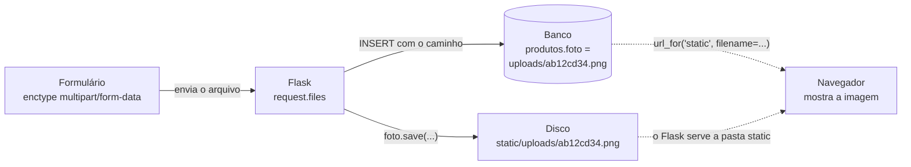

# Capítulo 18.1 — INSERT de produtos (opcional)

**Disciplina:** Programação para Internet (ILP951)
**Professor:** Ronan Adriel Zenatti · ronan.zenatti@cps.sp.gov.br
**Fatec Jahu — 2º Semestre/2026**

---

## 🎯 Objetivos do Capítulo

Ao final deste capítulo você deverá ser capaz de:

- Ler as colunas de `produtos` e decidir como cada uma aparece no formulário
- Converter e validar o preço com `Decimal` no formato brasileiro (`1.234,56`), e explicar por que o `float` não serve para dinheiro
- Montar um formulário com `textarea`, `select`, `checkbox` e campo de arquivo, e ler o `checkbox` no servidor
- Gravar um produto com `INSERT`, com os campos opcionais vazios virando `NULL`
- Receber um upload com `request.files`, conferir a extensão com `secure_filename`, limitar o tamanho com `MAX_CONTENT_LENGTH` e gravar o arquivo em disco, guardando só o caminho no banco

Este capítulo é **opcional**: o Capítulo 18 constrói o CRUD inteiro de produtos em um só arquivo, e este percorre só o **cadastro**: a tabela, o formulário, a validação, o `INSERT` e a foto, em um arquivo menor e com o seu próprio zip. O Capítulo 19 parte do zip do Capítulo 18, e não deste. Ao final, o sistema cadastra produtos com preço em reais e foto, e a lista de produtos ainda é uma página provisória.

## 📦 Ponto de partida

Este capítulo continua do **seu** repositório `sistema-gestao`, como ficou no fim do Capítulo 17, com o login funcionando e a Ana, o Bruno e a Carla cadastrados com a senha `Senha123`. O Capítulo 17.1 é opcional e este capítulo não parte dele.

!!! warning "Os três usuários precisam existir"
    Todas as rotas do sistema exigem login desde o Capítulo 17, e só entra quem já tem um usuário. Se o seu banco não tem a Ana, o Bruno e a Carla, o zip não resolve: comece pelo zip do Capítulo 16, que ainda não tem login, cadastre os três usuários pelo formulário (a tabela do [Capítulo 15, Tópico 1](Capitulo_15_SELECT_Relacional_de_Usuario.md) diz o que preencher, todos com a senha `Senha123`) e só depois use o código do Capítulo 17.

Se o seu projeto não está funcionando, baixe o código de Capítulo 17 e descompacte. Depois de descompactar, crie o ambiente virtual e o `.env`, como no [Capítulo 11, Tópico 4](Capitulo_11_Projeto_Novo_e_Banco.md#topico-4-o-arquivo-env), e importe o `banco.sql` no phpMyAdmin:

➡️ [Baixar p2_cap_17.zip](../arquivos/p2_cap_17.zip)

```bash
python -m venv venv
venv\Scripts\activate
pip install -r requirements.txt
copy .env.example .env
```

---

## Tópico 1 — A tabela `produtos` e a página provisória

### Antes de começar

Ligue o **Apache** e o **MySQL** no painel do XAMPP. Abra a pasta `sistema-gestao` no VS Code, o terminal (`Ctrl + '`), ative o ambiente virtual e confira o Git:

```bash
venv\Scripts\activate
git status
```

O `git status` deve dizer `nothing to commit, working tree clean`. Ligue o servidor com `python app.py` e deixe esse terminal rodando durante o capítulo (use um segundo terminal, o ícone **+**, para o Git). Abra **http://127.0.0.1:5000**, entre com a Ana (`ana@exemplo.com`, senha `Senha123`) e olhe o cartão **produtos** do dashboard: ele mostra **0**, porque nenhum produto foi cadastrado.

### A tabela `produtos`

A tabela já existe desde o `banco.sql` do Capítulo 11, vazia. No phpMyAdmin, abra o banco `gestao`, clique em `produtos` e depois em **Estrutura**. Estas são as colunas, e o que cada uma pede do formulário:

```sql
CREATE TABLE IF NOT EXISTS produtos (
    id_produto    BIGINT UNSIGNED AUTO_INCREMENT PRIMARY KEY,
    nome          VARCHAR(255) NOT NULL,
    descricao     TEXT,
    categoria     VARCHAR(100),
    preco         DECIMAL(10,2) NOT NULL,
    estoque       INT UNSIGNED NOT NULL DEFAULT 0,
    foto          VARCHAR(255),
    ativo         TINYINT(1) NOT NULL DEFAULT 1,
    criado_em     TIMESTAMP DEFAULT CURRENT_TIMESTAMP,
    atualizado_em TIMESTAMP DEFAULT CURRENT_TIMESTAMP ON UPDATE CURRENT_TIMESTAMP
);
```

| Coluna | Tipo | No formulário |
|---|---|---|
| `nome` | `VARCHAR(255) NOT NULL` | Obrigatório, de 3 a 255 caracteres |
| `descricao` | `TEXT` | Opcional, em uma área de texto (`<textarea>`) |
| `categoria` | `VARCHAR(100)` | Opcional, escolhida em uma lista |
| `preco` | `DECIMAL(10,2) NOT NULL` | Obrigatório, até `99.999.999,99` |
| `estoque` | `INT UNSIGNED NOT NULL` | Obrigatório, número inteiro de 0 para cima |
| `foto` | `VARCHAR(255)` | Opcional, e **não guarda a imagem**: guarda o caminho de um arquivo gravado em disco |
| `ativo` | `TINYINT(1) NOT NULL` | Um interruptor: `1` é ativo, `0` é inativo |

Três delas são novidade em relação a `usuarios`:

- **`DECIMAL(10,2)`** guarda um número com 10 dígitos no total e 2 depois da vírgula, **exatos**. É o tipo certo para dinheiro. Os números com casas decimais do Python comuns (`float`) erram nas contas, e adiante você verá o erro acontecendo.
- **`foto`** é um texto curto, como `uploads/ab12cd34.png`. A imagem em si fica numa pasta do projeto, e o banco só sabe o endereço dela. Guardar imagens dentro do banco deixaria cada `SELECT` pesado.
- **`ativo`** é um `TINYINT(1)`: o MySQL não tem o tipo "verdadeiro ou falso", e usa o número `1` ou `0`.

As colunas `criado_em` e `atualizado_em` o próprio MySQL preenche, e o formulário nunca as toca.

### O mapa do recurso

Como em `perfis` e `usuarios`, o recurso `produtos` segue o mesmo molde de nomes. Este é o mapa do que será construído:

| Rota | Métodos | O que faz | Função no `app.py` | Template |
|---|---|---|---|---|
| `/produtos` | GET | Lista os produtos | `lista_produtos` | `produtos/produtos_lista.html` |
| `/produtos/novo` | GET e POST | GET mostra o formulário, POST confere e grava | `produto_novo` | `produtos/produto_form.html` |
| `/produtos/<int:id_produto>/editar` | GET e POST | GET mostra o formulário preenchido, POST confere e atualiza | `produto_editar` | `produtos/produto_form.html` |
| `/produtos/<int:id_produto>/excluir` | só POST | Exclui o produto e volta para a lista | `produto_excluir` | (nenhum) |

Não há página de detalhe: a lista já mostra o que importa de cada produto, e os botões **Editar** e **Excluir** ficam nela mesma, na linha do produto.

### A página provisória `/produtos`

Antes do formulário, o sistema precisa de um lugar para onde voltar depois de gravar e de um destino para o botão **Cancelar**. A lista de verdade fica para depois; por enquanto, a rota `/produtos` mostra uma página provisória, **sem consulta ao banco**. No `app.py`, acrescente a rota **depois** da `usuario_excluir` e **antes** dos `@app.errorhandler`:

```python
@app.route('/produtos')
def lista_produtos():
    if 'id_usuario' not in session:
        flash('Entre para continuar.', 'warning')
        return redirect(url_for('login'))

    return render_template('produtos/produtos_lista.html', titulo='Produtos')
```

O `if` do começo é o mesmo das outras rotas desde o [Capítulo 17](Capitulo_17_Login.md): quem não fez login vai para a tela de entrada. Crie a pasta `templates/produtos` e, dentro dela, o `produtos_lista.html`:

```html


{{ titulo }} — Sistema de Gestão


  <h1 class="h2 mb-3">{{ titulo }}</h1>

  <div class="alert alert-info" role="alert">
    A lista de produtos chega mais adiante. Por enquanto, confira os cadastros no phpMyAdmin
    (banco <strong>gestao</strong>, tabela <strong>produtos</strong>) e no contador do dashboard.
  </div>

```

Agora o menu. No `templates/layout/base_menu.html`, acrescente o menu suspenso **Produtos** **depois** do menu Usuários, dentro do primeiro `<ul class="navbar-nav me-auto">` (o `<ul>` do **Home**):

```html
          <li class="nav-item dropdown">
            <a class="nav-link dropdown-toggle active" href="#" role="button" data-bs-toggle="dropdown" aria-expanded="false">Produtos</a>
            <ul class="dropdown-menu">
              <li><a class="dropdown-item" href="{{ url_for('lista_produtos') }}">Listar Produtos</a></li>
            </ul>
          </li>
```

A lista `['lista_produtos', 'produto_novo', 'produto_editar']` faz o menu ficar destacado em qualquer uma das telas do recurso, inclusive nas que ainda vão ser construídas. Salve, recarregue e use **Produtos > Listar Produtos**: a página provisória aparece, com o menu destacado. Saia do sistema (**Sair**) e digite `http://127.0.0.1:5000/produtos` na barra de endereço: você volta para a tela de entrada, com a faixa `Entre para continuar.` Entre de novo antes de seguir.

Para registrar este ponto no Git:

```bash
git add .
git commit -m "Adiciona a página provisória de produtos e o item no menu"
git push
```

## Tópico 2 — O formulário de produto

### A lista de categorias

O formulário terá uma lista para escolher a categoria, e o servidor, mais adiante, vai conferir se o valor que chegou está nessa lista. As duas pontas precisam da **mesma** lista, e por isso ela fica em um lugar só: o `validacoes.py`. Abra o `validacoes.py` e acrescente, logo **abaixo** da lista `UFS`:

```python
# Categorias de produto aceitas pelo sistema: o formulário e a validação leem a mesma lista
CATEGORIAS = ['Informática', 'Periféricos', 'Áudio', 'Acessórios', 'Outros']
```

No `app.py`, importe a lista junto com a `UFS` (a primeira linha do `from validacoes import (...)`):

```python
from validacoes import (
    UFS, CATEGORIAS, validar_nome_perfil, validar_descricao_perfil,
```

Se você quiser outras categorias, é só trocar os nomes da lista: o formulário muda sozinho.

### A rota do formulário

A rota `produto_novo` começa só com o `GET`: mostrar o formulário. No `app.py`, acrescente-a **depois** da `lista_produtos`:

```python
@app.route('/produtos/novo')
def produto_novo():
    if 'id_usuario' not in session:
        flash('Entre para continuar.', 'warning')
        return redirect(url_for('login'))

    dados = {'estoque': '0', 'ativo': '1'}

    return render_template('produtos/produto_form.html', dados=dados, categorias=CATEGORIAS)
```

O `dados` é um **dicionário** com os valores que o formulário mostra ao abrir: o estoque começa em `0` e o produto começa ativo (`'1'`). Os valores são textos porque, mais adiante, quando a página voltar com erros, o `dados` será o `request.form`, onde tudo é texto, e o formulário não precisa saber de qual dos dois veio. Os campos que não estão no dicionário (`nome`, `preco`...) aparecem **vazios** no HTML: o Jinja escreve uma chave que não existe como um texto vazio.

### O formulário, um campo por vez

Crie o `templates/produtos/produto_form.html` só com o esqueleto e o campo do nome:

```html


Novo produto — Sistema de Gestão


  <h1 class="h2 mb-4">Novo produto</h1>

  <div class="row">
    <div class="col-lg-8">
      <div class="card">
        <div class="card-body">

          <form action="{{ url_for('produto_novo') }}" method="post">
            <input type="hidden" name="csrf_token" value="{{ csrf_token() }}">

            <div class="mb-3">
              <label for="nome" class="form-label">Nome do produto</label>
              <input type="text" class="form-control" id="nome" name="nome" placeholder="Ex.: Mouse sem fio" value="{{ dados.nome }}" required minlength="3" maxlength="255">
            </div>

            <div class="d-flex gap-2">
              <button type="submit" class="btn btn-primary">Salvar produto</button>
              <a href="{{ url_for('lista_produtos') }}" class="btn btn-outline-secondary">Cancelar</a>
            </div>

          </form>

        </div>
      </div>
    </div>
  </div>

```

Antes de testar, o `produtos_lista.html` precisa do botão que leva ao formulário. Troque a linha do título por um cabeçalho com o título e o botão:

```html
  <div class="d-flex justify-content-between align-items-center mb-3">
    <h1 class="h2 mb-0">{{ titulo }}</h1>
    <a href="{{ url_for('produto_novo') }}" class="btn btn-primary">Novo produto</a>
  </div>
```

Salve e recarregue **Produtos**: o botão **Novo produto** abre o formulário, com o campo **Nome**. O `required`, o `minlength` e o `maxlength` são os atributos do HTML5 que o navegador confere antes de enviar. O `value="{{ dados.nome }}"` ainda aparece vazio, e vai servir para devolver o que a pessoa digitou. O `csrf_token` é o campo escondido que a proteção `CSRFProtect` exige em todo formulário `POST`, como desde o Capítulo 8.

O menu também precisa do caminho até o formulário, e agora a rota `produto_novo` existe. No `base_menu.html`, acrescente o segundo link do menu **Produtos**, logo depois do **Listar Produtos**:

```html
              <li><a class="dropdown-item" href="{{ url_for('produto_novo') }}">Cadastrar Produto</a></li>
```

Salve e confira **Produtos > Cadastrar Produto**.

Agora a **descrição**. É opcional (a coluna aceita `NULL`), então fica sem `required`, e como o texto pode ter várias linhas, usa `<textarea>`. Acrescente **depois** do bloco do nome:

```html
            <div class="mb-3">
              <label for="descricao" class="form-label">Descrição (opcional)</label>
              <textarea class="form-control" id="descricao" name="descricao" rows="3" maxlength="2000">{{ dados.descricao }}</textarea>
            </div>
```

Salve e recarregue. Diferente do `<input>`, o `<textarea>` não tem o atributo `value`: o texto inicial vai **entre** a tag de abertura e a de fechamento, sem espaços nem quebras de linha extras, porque tudo o que estiver ali aparece dentro da caixa.

Em seguida, uma linha com três campos: preço, estoque e categoria. Comece pelo preço. Acrescente **depois** da descrição:

```html
            <div class="row">
              <div class="col-md-4 mb-3">
                <label for="preco" class="form-label">Preço</label>
                <div class="input-group">
                  <span class="input-group-text">R$</span>
                  <input type="text" inputmode="decimal" class="form-control" id="preco" name="preco" placeholder="0,00" value="{{ dados.preco }}" required pattern="([0-9]{1,3}(\.[0-9]{3})+|[0-9]+)(,[0-9]{1,2})?" title="Use vírgula nos centavos, por exemplo 1.234,56">
                </div>
              </div>
            </div>
```

Por que `type="text"` e não `type="number"`? O campo numérico do navegador trabalha com o **ponto** como separador decimal e recusa a vírgula, e no Brasil se escreve `1.234,56`. Com `type="text"`, a pessoa digita do jeito brasileiro, e o servidor converte. O `inputmode="decimal"` pede ao celular o teclado numérico, e o `pattern` é uma regra de formato: aceita `1234`, `1234,5`, `1234,56` e `1.234,56`, e recusa `1234.56`. O texto do `title` aparece quando o navegador recusa o valor. Salve, recarregue e teste: digite `abc` e clique em **Salvar produto** (o navegador recusa, com a mensagem do `title`).

O **estoque** é um número inteiro, e aí o `type="number"` serve. Acrescente **dentro** do `<div class="row">`, depois do bloco do preço:

```html
              <div class="col-md-4 mb-3">
                <label for="estoque" class="form-label">Estoque</label>
                <input type="number" class="form-control" id="estoque" name="estoque" value="{{ dados.estoque }}" required min="0" max="1000000" step="1">
              </div>
```

Salve e recarregue: o estoque já abre com `0`, o valor do dicionário `dados`. O `min`, o `max` e o `step="1"` fazem o navegador recusar negativos, números muito grandes e decimais.

Por último, a **categoria**, uma lista de opções montada pelo `for` do Jinja a partir de `CATEGORIAS`. Acrescente **dentro** do `<div class="row">`, depois do bloco do estoque:

```html
              <div class="col-md-4 mb-3">
                <label for="categoria" class="form-label">Categoria (opcional)</label>
                <select class="form-select" id="categoria" name="categoria">
                  <option value="">Sem categoria</option>
                  
                    <option value="{{ categoria }}" selected>{{ categoria }}</option>
                  
                </select>
              </div>
```

A primeira opção tem `value=""` (nenhuma categoria), e o `selected` marca a opção que a pessoa já tinha escolhido quando o formulário voltar com erros. Salve e recarregue: a lista mostra **Sem categoria** e as cinco categorias.

O último campo é o interruptor **ativo**. Acrescente **depois** do `</div>` que fecha a linha (`row`) e **antes** do `<div class="d-flex gap-2">` dos botões:

```html
            <div class="form-check form-switch mb-4">
              <input class="form-check-input" type="checkbox" role="switch" id="ativo" name="ativo" value="1" checked>
              <label class="form-check-label" for="ativo">Produto ativo</label>
            </div>
```

Um `checkbox` tem uma particularidade: marcado, ele envia `ativo=1` (o `value`); **desmarcado, não envia nada**, nem `ativo=0`. Por isso, mais adiante, o servidor vai tratar "não veio" como "inativo". O `checked` deixa o interruptor ligado quando o produto começa ativo. Salve, recarregue e confira os seis campos: nome, descrição, preço, estoque, categoria e o interruptor.

Preencha o nome e clique em **Salvar produto**. A página mostra **Method Not Allowed** (405), porque a rota `produto_novo` só aceita `GET`. É a deixa para o próximo tópico.

Para registrar este ponto no Git:

```bash
git add .
git commit -m "Adiciona o formulário de novo produto"
git push
```

## Tópico 3 — Conferir os campos, com `Decimal` para o preço

### O navegador não basta

Os atributos `required`, `pattern`, `min` e `max` são uma conveniência: avisam a pessoa antes de enviar. Mas quem controla o que chega ao servidor não é o navegador. Um `POST` pode ser enviado por outro programa, ou com os atributos apagados pelo painel de desenvolvimento (`F12`). Por isso, como nos capítulos anteriores, **o servidor confere tudo de novo**, e a validação que vale é a do Python.

Cada campo ganha a sua função de validação, que devolve a **mensagem de erro** ou `None` quando está tudo certo. As funções ficam no `validacoes.py`. Duas delas são simples, e a do preço é a novidade do capítulo.

### O nome e a categoria

Abra o `validacoes.py` e acrescente no **final** do arquivo:

```python
def validar_nome_produto(nome):
    if nome == '':
        return 'Informe o nome do produto.'

    if len(nome) < 3:
        return 'O nome deve ter pelo menos 3 caracteres.'

    if len(nome) > 255:
        return 'O nome deve ter no máximo 255 caracteres.'

    return None


def validar_categoria(categoria):
    if categoria == '':
        return None

    if categoria not in CATEGORIAS:
        return 'Selecione uma categoria válida.'

    return None
```

A `validar_nome_produto` é a `validar_nome_usuario` com outro texto. A `validar_categoria` aceita o texto vazio (a categoria é opcional, e a coluna aceita `NULL`), mas recusa um nome que **não está na lista**: quem monta um `POST` à mão poderia mandar `Categoria Inventada`, e o `<select>` do navegador não impediria. Teste no terminal, com o ambiente virtual ativo:

```bash
python -c "from validacoes import validar_nome_produto, validar_categoria; print(validar_nome_produto('Mouse')); print(validar_nome_produto('ab')); print(validar_categoria('Áudio')); print(validar_categoria('Inventada'))"
```

Os quatro resultados: `None`, `O nome deve ter pelo menos 3 caracteres.`, `None` e `Selecione uma categoria válida.`

### O estoque

O estoque é um inteiro de 0 para cima. Como o `usuarios` já tinha a função `so_digitos` (ela devolve só os dígitos de um texto), a validação fica curta. Acrescente no **final** do `validacoes.py`, e a constante do limite logo **abaixo** da lista `CATEGORIAS`:

```python
# Limite da coluna estoque
ESTOQUE_MAXIMO = 1000000
```

```python
def validar_estoque(texto):
    if texto == '':
        return 'Informe o estoque.'

    if so_digitos(texto) != texto:
        return 'O estoque deve ser um número inteiro, sem sinal nem vírgula.'

    if int(texto) > ESTOQUE_MAXIMO:
        return 'O estoque máximo é 1.000.000.'

    return None
```

A segunda verificação compara o texto com ele mesmo **só com os dígitos**: se for diferente, havia algo que não era dígito (`-3`, `2,5`, `abc`). Só depois disso o `int(texto)` é seguro. Teste:

```bash
python -c "from validacoes import validar_estoque; print(validar_estoque('12')); print(validar_estoque('-3')); print(validar_estoque('2,5')); print(validar_estoque('5000000'))"
```

### O preço: por que não `float`

O preço é o campo delicado. Tudo o que chega do formulário é texto, e o texto `1.234,56` precisa virar um **número exato**. A primeira ideia seria o `float`. Veja o problema no terminal do Python (abra com `python`, e saia com `exit()`):

```python
>>> 0.1 + 0.2
0.30000000000000004
```

O `float` guarda uma **aproximação** do número, em binário, e as contas acumulam erros de centavos. Para dinheiro, o Python tem o `Decimal`:

```python
>>> from decimal import Decimal
>>> Decimal('0.1') + Decimal('0.2')
Decimal('0.3')
```

!!! note "Python: `Decimal`"
    O `Decimal` guarda o número **exato**, dígito por dígito, como o `DECIMAL` do MySQL. Ele é criado a partir de um **texto** (`Decimal('0.1')`), e não de um `float`: `Decimal(0.1)` já carregaria o erro do `float`. O conector do MySQL entende o `Decimal` e o grava na coluna `DECIMAL` sem perder um centavo, e é isso que ele devolve nos `SELECT`.

O `Decimal` só entende o ponto como separador decimal: `Decimal('1234.56')` funciona, e `Decimal('1.234,56')` dá erro. Vamos escrever a função que traduz o formato brasileiro. Comece pela ideia mais simples: tirar os pontos de milhar e trocar a vírgula por ponto. Importe o `Decimal` na **primeira linha** do `validacoes.py` (junto do `datetime`):

```python
from decimal import Decimal
```

E acrescente no **final** do arquivo:

```python
def converter_preco(texto):
    return Decimal(texto.replace('.', '').replace(',', '.'))
```

Teste:

```bash
python -c "from validacoes import converter_preco; print(converter_preco('1.234,56')); print(converter_preco('1234,56')); print(converter_preco('1234.56'))"
```

Os dois primeiros acertam (`1234.56`). O terceiro devolve `123456`: quem digitou `1234.56` (com ponto, do jeito americano) teria o produto gravado com um preço **cem vezes maior**, sem nenhum aviso. E um texto como `abc` faria o `Decimal` parar o programa com um erro. A função precisa ser mais rigorosa: aceitar só os formatos brasileiros e devolver `None` para o resto. Troque a função inteira por esta:

```python
def converter_preco(texto):
    # Aceita 1234,56 e 1.234,56. Devolve um Decimal, ou None se o texto não for um preço.
    partes = texto.split(',')
    if len(partes) > 2:
        return None

    centavos = ''
    if len(partes) == 2:
        centavos = partes[1]
        if len(centavos) == 0 or len(centavos) > 2 or so_digitos(centavos) != centavos:
            return None

    grupos = partes[0].split('.')
    numero = ''
    for posicao in range(len(grupos)):
        grupo = grupos[posicao]
        if grupo == '' or so_digitos(grupo) != grupo:
            return None
        if len(grupos) > 1 and posicao == 0 and len(grupo) > 3:
            return None
        if posicao > 0 and len(grupo) != 3:
            return None
        numero = numero + grupo

    if centavos != '':
        numero = numero + '.' + centavos

    return Decimal(numero)
```

Leia a função em três blocos:

1. **A vírgula separa os centavos.** `texto.split(',')` quebra o texto nela. Mais de uma vírgula não é preço. Se há uma, o que vem depois dela (`centavos`) precisa ter de 1 a 2 dígitos.
2. **O ponto separa os milhares.** A parte antes da vírgula é quebrada nos pontos (`'1.234'` vira `['1', '234']`). O primeiro grupo tem de 1 a 3 dígitos **quando há mais de um grupo**, e todos os outros têm **exatamente 3** (`1.234` está certo, `12.34` não). É isso que faz o `1234.56` falhar: o primeiro grupo (`1234`) é grande demais para ter outro depois dele.
3. **Os pedaços são juntados.** O `numero` vai recebendo os grupos, depois o `.` e os centavos, e só no fim vira `Decimal`, quando o texto já é seguro.

!!! note "Python: `split`, `range` e `len`"
    O `texto.split(',')` quebra o texto em uma **lista** de pedaços, cortando em cada vírgula: `'1.234,56'.split(',')` devolve `['1.234', '56']`. O `len(...)` conta quantos itens a lista tem (ou quantos caracteres tem um texto). O `range(len(grupos))` produz os números `0, 1, 2...` até o último item, e o `for posicao in range(...)` repete o bloco uma vez para cada posição, o que permite saber **qual** é o grupo (`grupos[posicao]`) e se ele é o primeiro (`posicao == 0`). O `is None` confere se um valor é o `None`, e a função devolve `None` para dizer "isto não é um preço".

Teste vários valores de uma vez:

```bash
python -c "from validacoes import converter_preco as c; print(c('1.234,56'), c('1234,5'), c('25'), c('1.234'), c('1234.56'), c('12.34'), c('abc'), c('5,'), c('-5'))"
```

O resultado é `1234.56 1234.5 25 1234 None None None None None`. Agora a função de validação do preço, que usa a conversão e confere os limites da coluna. Acrescente a constante **abaixo** do `ESTOQUE_MAXIMO`:

```python
# Limite da coluna preco, que é DECIMAL(10,2)
PRECO_MAXIMO = Decimal('99999999.99')
```

E a função, no **final** do arquivo:

```python
def validar_preco(texto):
    if texto == '':
        return 'Informe o preço.'

    preco = converter_preco(texto)
    if preco is None:
        return 'Informe o preço no formato 1.234,56.'

    if preco <= 0:
        return 'O preço deve ser maior que zero.'

    if preco > PRECO_MAXIMO:
        return 'O preço máximo é 99.999.999,99.'

    return None
```

O `DECIMAL(10,2)` comporta 8 dígitos antes da vírgula e 2 depois: o maior preço possível é `99999999.99`. Um preço maior que isso faria o MySQL recusar o `INSERT`, e a validação avisa a pessoa antes. Teste:

```bash
python -c "from validacoes import validar_preco as v; print(v('1.234,56')); print(v('')); print(v('0')); print(v('1234.56')); print(v('100.000.000,00'))"
```

### O app.py passa a conferir

No `app.py`, importe as funções novas (acrescente ao final do `from validacoes import (...)`):

```python
    validar_nome_produto, validar_categoria, validar_preco, validar_estoque,
```

Com um campo por função, falta juntar tudo. Duas funções ajudam a rota: uma lê os campos do formulário, e a outra confere todos e devolve a lista de erros. Acrescente no `app.py`, **depois** da `lista_produtos` e **antes** da `produto_novo`:

```python
def ler_formulario_produto(form):
    campos = {}
    campos['nome'] = form.get('nome', '').strip()
    campos['descricao'] = form.get('descricao', '').strip()
    campos['preco'] = form.get('preco', '').strip()
    campos['estoque'] = form.get('estoque', '').strip()
    campos['categoria'] = form.get('categoria', '')

    if form.get('ativo') == '1':
        campos['ativo'] = 1
    else:
        campos['ativo'] = 0

    return campos


def conferir_produto(campos):
    erros = []

    erro = validar_nome_produto(campos['nome'])
    if erro:
        erros.append(erro)

    erro = validar_tamanho(campos['descricao'], 'descrição', 2000)
    if erro:
        erros.append(erro)

    erro = validar_preco(campos['preco'])
    if erro:
        erros.append(erro)

    erro = validar_estoque(campos['estoque'])
    if erro:
        erros.append(erro)

    erro = validar_categoria(campos['categoria'])
    if erro:
        erros.append(erro)

    return erros
```

!!! note "Python: o `.get` com valor padrão"
    O `form.get('nome', '')` pede o campo `nome` do formulário e, se ele não veio, devolve o texto vazio, em vez de parar o programa. O `.strip()` tira os espaços das pontas. O `ativo` é o caso especial do `checkbox`: marcado, chega `'1'`; desmarcado, o campo **nem chega**, e o `form.get('ativo')` devolve `None`. O `if` transforma isso nos números `1` e `0`, que a coluna `ativo` guarda. A `validar_tamanho` é a função do Capítulo 14, que confere o limite de caracteres (a descrição é um `TEXT`, e o limite de 2000 é do sistema).

Agora a `produto_novo` passa a aceitar o `POST`. Troque a rota inteira por esta versão (ainda sem gravar nada):

```python
@app.route('/produtos/novo', methods=['GET', 'POST'])
def produto_novo():
    if 'id_usuario' not in session:
        flash('Entre para continuar.', 'warning')
        return redirect(url_for('login'))

    dados = {'estoque': '0', 'ativo': '1'}

    if request.method == 'POST':
        campos = ler_formulario_produto(request.form)

        erros = conferir_produto(campos)

        if erros:
            for mensagem in erros:
                flash(mensagem, 'danger')
        else:
            flash('Os dados estão corretos. A gravação vem no próximo tópico.', 'info')

        dados = request.form

    return render_template('produtos/produto_form.html', dados=dados, categorias=CATEGORIAS)
```

O `methods=['GET', 'POST']` libera o envio do formulário. O `dados = request.form` do final faz o formulário voltar com **o que a pessoa digitou**, tanto quando há erros quanto agora, na mensagem provisória. Salve e teste. Para o navegador deixar passar os valores inválidos, o `pattern` e o `required` atrapalham; use o painel de desenvolvimento (`F12`, aba **Elementos**) para apagar o `pattern` do preço e o `required`, ou envie o formulário errado de propósito:

| O que digitar | Mensagem esperada |
|---|---|
| Nome vazio, preço vazio, estoque vazio | `Informe o nome do produto.` · `Informe o preço.` · `Informe o estoque.` (as três juntas) |
| Preço `1234.56` | `Informe o preço no formato 1.234,56.` |
| Preço `0` | `O preço deve ser maior que zero.` |
| Estoque `-3` | `O estoque deve ser um número inteiro, sem sinal nem vírgula.` |
| Tudo certo (`Mouse`, `89,90`, `10`) | `Os dados estão corretos...` |

Em todos os casos o formulário volta com o nome, o preço e o estoque que você digitou. Nada é gravado ainda.

```bash
git add .
git commit -m "Adiciona a validação dos campos de produto, com Decimal para o preço"
git push
```

## Tópico 4 — Gravar o produto (INSERT)

### O comando INSERT

Com os dados conferidos, falta gravar. O comando é o `INSERT`, com um `%s` para cada valor:

```sql
INSERT INTO produtos (nome, descricao, categoria, preco, estoque, foto, ativo)
VALUES (%s, %s, %s, %s, %s, %s, %s);
```

Os `%s` são **marcadores**: o conector coloca os valores no lugar, já protegidos, e é isso que impede a injeção de SQL. O SQL nunca é montado com `f-string`, como em todos os capítulos desde o 12. As colunas `id_produto`, `criado_em` e `atualizado_em` ficam de fora: o MySQL as preenche sozinho.

Antes de escrever a rota, três valores pedem cuidado:

| Coluna | O que o formulário entrega | O que vai para o banco |
|---|---|---|
| `descricao`, `categoria` | Texto vazio quando a pessoa não preenche | `NULL`, e não `''` (a regra: o que aceita `NULL` é opcional, e opcional vazio vira `NULL`) |
| `preco` | Texto como `1.234,56` | O `Decimal` que a `converter_preco` devolve |
| `estoque` | Texto como `12` | O número inteiro, com `int()` |
| `foto` | (o upload vem no próximo tópico) | `None` por enquanto |

A função `vazio_para_none` já está no `app.py` (ela veio do Capítulo 14): devolve `None` quando recebe o texto vazio e devolve o próprio texto nos demais casos. Se o seu `app.py` não a tem, ela é esta:

```python
def vazio_para_none(valor):
    if valor == '':
        return None

    return valor
```

### A rota grava

No `app.py`, importe a `converter_preco`. O final do `from validacoes import (...)` fica assim:

```python
    validar_nome_produto, validar_categoria, validar_preco, validar_estoque,
    converter_preco,
)
```

Agora troque o `else` da `produto_novo`, que tinha a mensagem provisória, pelo `INSERT`. A rota inteira fica assim:

```python
@app.route('/produtos/novo', methods=['GET', 'POST'])
def produto_novo():
    if 'id_usuario' not in session:
        flash('Entre para continuar.', 'warning')
        return redirect(url_for('login'))

    dados = {'estoque': '0', 'ativo': '1'}

    if request.method == 'POST':
        campos = ler_formulario_produto(request.form)

        erros = conferir_produto(campos)

        if erros:
            for mensagem in erros:
                flash(mensagem, 'danger')
        else:
            novo_id = execute_insert(
                'INSERT INTO produtos (nome, descricao, categoria, preco, estoque, foto, ativo) '
                'VALUES (%s, %s, %s, %s, %s, %s, %s)',
                (
                    campos['nome'],
                    vazio_para_none(campos['descricao']),
                    vazio_para_none(campos['categoria']),
                    converter_preco(campos['preco']),
                    int(campos['estoque']),
                    None,
                    campos['ativo'],
                ),
            )
            flash(f'Produto "{campos["nome"]}" cadastrado (código {novo_id}).', 'success')
            return redirect(url_for('lista_produtos'))

        dados = request.form

    return render_template('produtos/produto_form.html', dados=dados, categorias=CATEGORIAS)
```

A `execute_insert` (a função do `db.py`) executa o comando e devolve o **código** que o `AUTO_INCREMENT` gerou. O `redirect` depois de gravar é o padrão PRG (*Post/Redirect/Get*): a resposta do `POST` não é uma página, e sim um redirecionamento para a lista. Por isso, apertar `F5` depois não envia o formulário de novo, e o produto não é cadastrado em dobro.

O `None` no lugar da `foto` vira `NULL` no banco. Ele sai no próximo tópico.

### Cadastrar os produtos

Salve e cadastre estes quatro produtos pelo formulário. Eles também serão usados nos próximos tópicos, e os valores foram escolhidos para ter um produto com estoque alto, baixo e zerado, um inativo e um sem categoria:

| Nome | Descrição | Preço | Estoque | Categoria | Ativo |
|---|---|---|---|---|---|
| Notebook Gamer | Tela de 15,6 polegadas, 16 GB de memória | `3.499,90` | `12` | Informática | sim |
| Teclado Mecânico | (vazia) | `129,90` | `3` | Periféricos | sim |
| Fone de Ouvido | Sem fio, com cancelamento de ruído | `249` | `40` | Áudio | sim |
| Cabo HDMI 2m | (vazia) | `25,00` | `0` | Sem categoria | **não** (desmarque o interruptor) |

Depois de cada **Salvar produto**, você cai na página provisória, com a faixa verde `Produto "Notebook Gamer" cadastrado (código 1).` (ou outro número). Aperte `F5`: a faixa some e nada é cadastrado de novo. Abra o **Home**: o cartão de produtos mostra **4**.

Abra o phpMyAdmin, banco `gestao`, tabela `produtos`, aba **Visualizar**, e confira:

- o preço do notebook foi gravado como `3499.90` (sem o ponto de milhar e com ponto decimal, que é como o MySQL escreve);
- o preço do fone, digitado `249`, ficou `249.00`;
- as descrições vazias aparecem como `NULL`, em itálico, e não como um campo em branco;
- o cabo HDMI tem `ativo` igual a `0`, e os outros três, `1`;
- a coluna `foto` é `NULL` nos quatro;
- `criado_em` e `atualizado_em` têm a data e a hora, preenchidas pelo MySQL.

Teste também os erros do tópico anterior (preço `1234.56`, estoque `-3`...) e confirme que a mensagem aparece, o formulário volta com o que foi digitado e nenhum produto novo entra na tabela.

```bash
git add .
git commit -m "Adiciona o INSERT de produto com preço Decimal e opcionais vazios como NULL"
git push
```

## Tópico 5 — A foto do produto (upload)

### Onde a foto fica guardada

Uma foto é um arquivo grande, e o banco não é o lugar para guardá-la (cada `SELECT` da lista carregaria todas as imagens). O caminho clássico é outro: o **arquivo** vai para uma pasta do projeto, e o **banco** guarda só o caminho dele, um texto curto na coluna `foto`.



A pasta escolhida é `static/uploads/`. O Flask já serve tudo o que está em `static/` pelo endereço `/static/...`, o mesmo caminho do `estilo.css`, e por isso uma foto gravada em `static/uploads/ab12cd34.png` abre em `http://127.0.0.1:5000/static/uploads/ab12cd34.png`.

### O campo de arquivo

Um formulário comum envia **textos**. Para enviar um arquivo, o formulário precisa de duas mudanças. Primeiro, o atributo `enctype="multipart/form-data"` na tag `<form>`, que muda a forma como o navegador empacota o envio (sem ele, só o *nome* do arquivo seguiria, e nunca o conteúdo). No `produto_form.html`, troque a abertura do formulário:

```html
          <form action="{{ url_for('produto_novo') }}" method="post" enctype="multipart/form-data">
```

Segundo, o campo `<input type="file">`. Acrescente **depois** do `</div>` que fecha a linha (`row`) e **antes** do interruptor `ativo`:

```html
            <div class="mb-3">
              <label for="foto" class="form-label">Foto (opcional)</label>
              <input type="file" class="form-control" id="foto" name="foto" accept=".jpg,.jpeg,.png,.webp">
              <div class="form-text">Arquivo jpg, jpeg, png ou webp, com até 2 MB.</div>
            </div>
```

O `accept` faz a janela de escolha de arquivos mostrar só os formatos aceitos, mas, como o `pattern` do preço, é uma conveniência: o servidor confere de novo. Salve e recarregue o formulário: o campo aparece com o botão **Escolher arquivo**.

### Receber o arquivo no servidor

Os arquivos não chegam no `request.form`, e sim no `request.files`. No `app.py`, acrescente a função `ler_foto` **depois** da `ler_formulario_produto`:

```python
def ler_foto(arquivos):
    foto = arquivos.get('foto')

    if foto is None or foto.filename == '':
        return None

    return foto
```

Quando a pessoa não escolhe nenhum arquivo, o navegador envia o campo mesmo assim, com o nome do arquivo **vazio**. A função trata os dois casos (campo ausente e nome vazio) devolvendo `None`, que significa "sem foto"; com foto, devolve o objeto do arquivo, que tem o `.filename` (o nome que a pessoa tinha no computador) e o `.save()`.

### O nome do arquivo e a extensão

O nome do arquivo vem do computador de quem enviou, e **não é de confiança**: pode ter espaços, acentos e até caminhos (`../../app.py`), um truque para gravar um arquivo fora da pasta certa. O Werkzeug (a biblioteca por baixo do Flask) tem a função `secure_filename` para limpar o nome. Veja o que ela faz, no terminal:

```bash
python -c "from werkzeug.utils import secure_filename as s; print(s('../../app.py')); print(s('Foto da Ação.PNG'))"
```

O resultado é `app.py` e `Foto_da_Acao.PNG`: as barras sumiram, e os espaços e os acentos foram trocados. No `app.py`, importe-a (com os outros imports do `werkzeug`) e crie a função que extrai a **extensão**, `jpg`, `png`...:

```python
from werkzeug.utils import secure_filename
```

```python
def extensao_da_foto(nome_arquivo):
    nome_seguro = secure_filename(nome_arquivo)

    if '.' not in nome_seguro:
        return ''

    return nome_seguro.rsplit('.', 1)[1].lower()
```

!!! note "Python: `rsplit` e o `[1]`"
    O `'foto.final.PNG'.rsplit('.', 1)` quebra o texto no **último** ponto e devolve a lista `['foto.final', 'PNG']`. O `[1]` pega o segundo item (a lista começa em `0`), e o `.lower()` troca para minúsculas, para `PNG` e `png` valerem o mesmo. Um nome sem ponto não tem extensão, e a função devolve o texto vazio.

Agora a validação da extensão. No `validacoes.py`, acrescente a lista abaixo da `PRECO_MAXIMO`:

```python
# Extensões aceitas para a foto do produto
EXTENSOES_FOTO = ['jpg', 'jpeg', 'png', 'webp']
```

E a função, no **final** do arquivo:

```python
def validar_extensao_foto(extensao):
    if extensao not in EXTENSOES_FOTO:
        return 'A foto deve ser um arquivo jpg, jpeg, png ou webp.'

    return None
```

De volta ao `app.py`, importe a função nova (a última linha do import fica `converter_preco, validar_extensao_foto,`) e passe a `conferir_produto` a receber a foto. Troque a primeira linha da função e acrescente o bloco antes do `return erros`:

```python
def conferir_produto(campos, foto):
```

```python
    if foto is not None:
        erro = validar_extensao_foto(extensao_da_foto(foto.filename))
        if erro:
            erros.append(erro)

    return erros
```

### Gravar o arquivo no disco

Falta o `salvar_foto`. Um arquivo gravado com o **nome original** teria dois problemas: dois produtos com a foto `foto.png` se sobrescreveriam, e o nome ainda seria um dado da pessoa. A solução é dar a cada foto um nome novo e único, que o Python sorteia com o módulo `uuid`. No topo do `app.py`, acrescente `import uuid` abaixo do `import os`:

```python
import os
import uuid
```

!!! note "Python: `uuid`"
    O `uuid.uuid4().hex` gera um texto aleatório de 32 letras e números, como `ab12cd34ef56...`, com chance praticamente nula de repetir. O nome da foto passa a ser esse texto + `.` + a extensão.

Depois do `CSRFProtect(app)`, defina a pasta e o limite de tamanho:

```python
# As fotos dos produtos ficam em static/uploads. O Flask recusa (erro 413) pedidos com mais de 2 MB.
PASTA_UPLOADS = os.path.join(app.root_path, 'static', 'uploads')
app.config['MAX_CONTENT_LENGTH'] = 2 * 1024 * 1024

os.makedirs(PASTA_UPLOADS, exist_ok=True)
```

O `app.root_path` é a pasta do projeto, e o `os.path.join` junta os pedaços com a barra certa para o sistema. O `os.makedirs(..., exist_ok=True)` cria a pasta `static/uploads` se ela ainda não existir, e não reclama quando já existe. E a função, **depois** da `extensao_da_foto`:

```python
def salvar_foto(foto):
    nome_arquivo = uuid.uuid4().hex + '.' + extensao_da_foto(foto.filename)
    foto.save(os.path.join(PASTA_UPLOADS, nome_arquivo))

    return 'uploads/' + nome_arquivo
```

O `foto.save` grava o arquivo na pasta. A função devolve o **caminho relativo à pasta `static`**, `uploads/ab12cd34.png`, que é o texto que vai para a coluna `foto` do banco.

### O limite de tamanho

O `MAX_CONTENT_LENGTH` que você definiu faz o Flask recusar, com o erro **413** (*Payload Too Large*), qualquer pedido com mais de 2 MB, antes mesmo de a rota rodar. Sem uma página para esse erro, a pessoa veria um texto seco do Flask. No `app.py`, acrescente o tratamento **antes** do `@app.errorhandler(500)`:

```python
@app.errorhandler(413)
def arquivo_grande_demais(erro):
    return render_template('413.html'), 413
```

E crie o `templates/413.html`, no mesmo molde do `404.html` e do `500.html`:

```html


Arquivo grande demais — Sistema de Gestão


  <div class="text-center py-5">
    <h1 class="display-1">413</h1>
    <p class="lead">O arquivo enviado é grande demais. A foto pode ter até 2 MB.</p>
    <a href="{{ url_for('lista_produtos') }}" class="btn btn-primary">Voltar para os produtos</a>
  </div>

```

### A rota usa a foto

Por fim, a `produto_novo` lê a foto, passa-a à conferência e grava o caminho. As mudanças, na rota inteira:

```python
@app.route('/produtos/novo', methods=['GET', 'POST'])
def produto_novo():
    if 'id_usuario' not in session:
        flash('Entre para continuar.', 'warning')
        return redirect(url_for('login'))

    dados = {'estoque': '0', 'ativo': '1'}

    if request.method == 'POST':
        campos = ler_formulario_produto(request.form)
        foto = ler_foto(request.files)

        erros = conferir_produto(campos, foto)

        if erros:
            for mensagem in erros:
                flash(mensagem, 'danger')
        else:
            caminho_foto = None
            if foto is not None:
                caminho_foto = salvar_foto(foto)

            novo_id = execute_insert(
                'INSERT INTO produtos (nome, descricao, categoria, preco, estoque, foto, ativo) '
                'VALUES (%s, %s, %s, %s, %s, %s, %s)',
                (
                    campos['nome'],
                    vazio_para_none(campos['descricao']),
                    vazio_para_none(campos['categoria']),
                    converter_preco(campos['preco']),
                    int(campos['estoque']),
                    caminho_foto,
                    campos['ativo'],
                ),
            )
            flash(f'Produto "{campos["nome"]}" cadastrado (código {novo_id}).', 'success')
            return redirect(url_for('lista_produtos'))

        dados = request.form

    return render_template('produtos/produto_form.html', dados=dados, categorias=CATEGORIAS)
```

A foto só é gravada em disco **depois** de os dados passarem na conferência: um formulário com erro não deixa arquivo sobrando na pasta.

!!! warning "Se o `INSERT` falhasse, a foto ficaria sem dono"
    A foto é salva antes do `INSERT`. Se o MySQL recusasse o comando, o arquivo ficaria na pasta, sem nenhum produto apontando para ele. Como a tabela `produtos` não tem coluna `UNIQUE`, esse caso é raro, e este projeto de sala não trata dele.

### Testar o upload

Salve e teste, na ordem:

1. Cadastre o **Mouse sem fio** (preço `89,90`, estoque `10`, categoria **Periféricos**) **com uma foto** `.jpg` ou `.png` do seu computador. A faixa verde confirma o cadastro.
2. Abra a pasta `static/uploads` no VS Code: o arquivo está lá, com um nome de 32 letras e números.
3. No phpMyAdmin, a coluna `foto` desse produto mostra `uploads/` + o nome do arquivo.
4. Abra no navegador `http://127.0.0.1:5000/static/uploads/` + o nome do arquivo: a imagem aparece. É o Flask servindo a pasta `static`.
5. Tente cadastrar outro produto com um arquivo `.pdf` ou `.txt` no campo da foto: o formulário volta com `A foto deve ser um arquivo jpg, jpeg, png ou webp.`, e nada é gravado em `static/uploads`. O navegador **não devolve o arquivo** escolhido (por segurança, nenhum site pode preencher um campo de arquivo sozinho): escolha a foto de novo antes de reenviar.
6. Tente enviar uma imagem de mais de 2 MB: aparece a página **413**.

Há um último cuidado. As fotos são dados de quem usa o sistema, e **não** devem ir para o GitHub. Rode `git status`: a foto aparece como arquivo novo para o Git. O `.gitignore` resolve, e a pasta `static/uploads` precisa continuar existindo no repositório (para quem clonar o projeto), o que se faz com um arquivo vazio dentro dela. Acrescente ao **final** do `.gitignore`:

```
# Fotos enviadas pelo sistema: ficam só no computador (a pasta continua no Git por causa do .gitkeep)
static/uploads/*
!static/uploads/.gitkeep
```

E crie o arquivo vazio que mantém a pasta no Git: no VS Code, clique com o botão direito na pasta `static/uploads`, escolha **Novo Arquivo**, digite `.gitkeep` e aperte `Enter`, sem escrever nada dentro dele.

O `static/uploads/*` ignora tudo o que estiver na pasta, e a linha `!static/uploads/.gitkeep` abre uma exceção para o arquivo vazio. Rode `git status` de novo: as fotos sumiram da lista, e só o `.gitignore` e o `.gitkeep` aparecem.

```bash
git add .
git commit -m "Adiciona o upload da foto do produto, gravada em disco"
git push
```

---

## Os arquivos completos do capítulo

O `app.py`:

```python
import os
import uuid

from dotenv import load_dotenv
from flask import Flask, render_template, request, redirect, url_for, flash, abort, session
from flask_wtf.csrf import CSRFProtect
from mysql.connector import Error
from werkzeug.security import generate_password_hash, check_password_hash
from werkzeug.utils import secure_filename

from db import execute_query, execute_one, execute_insert
from validacoes import (
    UFS, CATEGORIAS, validar_nome_perfil, validar_descricao_perfil,
    validar_nome_usuario, validar_email, validar_senha, validar_celular,
    validar_cpf, validar_data_nascimento, validar_cep, validar_estado,
    validar_tamanho, formatar_celular, formatar_cpf, formatar_cep,
    validar_nome_produto, validar_categoria, validar_preco, validar_estoque,
    converter_preco, validar_extensao_foto,
)

load_dotenv()

app = Flask(__name__)
app.secret_key = os.getenv('SECRET_KEY')

CSRFProtect(app)

# As fotos dos produtos ficam em static/uploads. O Flask recusa (erro 413) pedidos com mais de 2 MB.
PASTA_UPLOADS = os.path.join(app.root_path, 'static', 'uploads')
app.config['MAX_CONTENT_LENGTH'] = 2 * 1024 * 1024

os.makedirs(PASTA_UPLOADS, exist_ok=True)

# As colunas que as telas de usuário leem. A senha fica de fora de propósito: o que não é
# lido do banco não tem como vazar para a página.
SELECT_USUARIO = (
    'SELECT u.id_usuario, u.nome, u.email, u.celular, u.data_nascimento, u.cpf, '
    'u.perfil_id, u.cep, u.endereco, u.numero, u.complemento, u.cidade, u.estado, '
    'u.criado_em, u.atualizado_em, p.nome AS perfil, p.descricao AS perfil_descricao '
    'FROM usuarios u '
    'JOIN perfis p ON p.id_perfil = u.perfil_id'
)


@app.template_filter('data_br')
def data_br(valor):
    if valor is None:
        return '—'

    return valor.strftime('%d/%m/%Y')


@app.template_filter('data_hora_br')
def data_hora_br(valor):
    if valor is None:
        return '—'

    return valor.strftime('%d/%m/%Y às %H:%M')


@app.template_filter('cpf_oculto')
def cpf_oculto(cpf):
    if cpf is None:
        return '—'

    return '***.' + cpf[4:11] + '-**'


@app.route('/')
def index():
    return redirect(url_for('login'))


@app.route('/login', methods=['GET', 'POST'])
def login():
    if 'id_usuario' in session:
        return redirect(url_for('dashboard'))

    email = ''

    if request.method == 'POST':
        email = request.form.get('email', '').strip().lower()
        senha = request.form.get('senha', '')

        usuario = execute_one(
            'SELECT u.id_usuario, u.nome, u.senha, p.nome AS perfil '
            'FROM usuarios u '
            'JOIN perfis p ON p.id_perfil = u.perfil_id '
            'WHERE u.email = %s',
            (email,),
        )

        if usuario is not None and check_password_hash(usuario['senha'], senha):
            session.clear()
            session['id_usuario'] = usuario['id_usuario']
            session['nome'] = usuario['nome']
            session['perfil'] = usuario['perfil']
            flash(f'Você entrou como {usuario["nome"]}.', 'success')
            return redirect(url_for('dashboard'))

        flash('E-mail ou senha incorretos.', 'danger')

    return render_template('login.html', email=email)


@app.route('/logout', methods=['POST'])
def logout():
    session.clear()
    flash('Você saiu do sistema.', 'success')

    return redirect(url_for('login'))


@app.route('/dashboard')
def dashboard():
    if 'id_usuario' not in session:
        flash('Entre para continuar.', 'warning')
        return redirect(url_for('login'))

    perfis = execute_one('SELECT COUNT(*) AS total FROM perfis')
    usuarios = execute_one('SELECT COUNT(*) AS total FROM usuarios')
    produtos = execute_one('SELECT COUNT(*) AS total FROM produtos')

    return render_template('dashboard.html', titulo='Sistema de Gestão',
                           total_perfis=perfis['total'],
                           total_usuarios=usuarios['total'],
                           total_produtos=produtos['total'])


@app.route('/perfis')
def lista_perfis():
    if 'id_usuario' not in session:
        flash('Entre para continuar.', 'warning')
        return redirect(url_for('login'))

    perfis = execute_query(
        'SELECT id_perfil, nome, descricao, criado_em FROM perfis ORDER BY nome',
        fetch=True,
    )

    return render_template('perfis/perfis_lista.html', titulo='Perfis', perfis=perfis)


def conferir_perfil(nome, descricao, id_perfil):
    erros = []

    erro = validar_nome_perfil(nome)
    if erro:
        erros.append(erro)

    erro = validar_descricao_perfil(descricao)
    if erro:
        erros.append(erro)

    if not erros:
        existente = execute_one(
            'SELECT id_perfil FROM perfis WHERE nome = %s AND id_perfil <> %s',
            (nome, id_perfil),
        )
        if existente:
            erros.append('Já existe um perfil com este nome.')

    return erros


@app.route('/perfis/novo', methods=['GET', 'POST'])
def perfil_novo():
    if 'id_usuario' not in session:
        flash('Entre para continuar.', 'warning')
        return redirect(url_for('login'))

    nome = ''
    descricao = ''

    if request.method == 'POST':
        nome = request.form.get('nome', '').strip()
        descricao = request.form.get('descricao', '').strip()

        erros = conferir_perfil(nome, descricao, 0)

        if erros:
            for mensagem in erros:
                flash(mensagem, 'danger')
        else:
            if descricao == '':
                descricao_gravada = None
            else:
                descricao_gravada = descricao

            try:
                novo_id = execute_insert(
                    'INSERT INTO perfis (nome, descricao) VALUES (%s, %s)',
                    (nome, descricao_gravada),
                )
                flash(f'Perfil "{nome}" cadastrado (código {novo_id}).', 'success')
                return redirect(url_for('lista_perfis'))
            except Error as erro:
                if erro.errno == 1062:
                    flash('Já existe um perfil com este nome.', 'danger')
                else:
                    raise

    return render_template('perfis/perfil_form.html', acao='criar', id_perfil=None,
                           nome=nome, descricao=descricao)


@app.route('/perfis/<int:id_perfil>/editar', methods=['GET', 'POST'])
def perfil_editar(id_perfil):
    if 'id_usuario' not in session:
        flash('Entre para continuar.', 'warning')
        return redirect(url_for('login'))

    perfil = execute_one(
        'SELECT id_perfil, nome, descricao FROM perfis WHERE id_perfil = %s',
        (id_perfil,),
    )
    if perfil is None:
        abort(404)

    nome = perfil['nome']
    descricao = perfil['descricao']
    if descricao is None:
        descricao = ''

    if request.method == 'POST':
        nome = request.form.get('nome', '').strip()
        descricao = request.form.get('descricao', '').strip()

        erros = conferir_perfil(nome, descricao, id_perfil)

        if erros:
            for mensagem in erros:
                flash(mensagem, 'danger')
        else:
            if descricao == '':
                descricao_gravada = None
            else:
                descricao_gravada = descricao

            try:
                execute_query(
                    'UPDATE perfis SET nome = %s, descricao = %s WHERE id_perfil = %s',
                    (nome, descricao_gravada, id_perfil),
                )
                flash(f'Perfil "{nome}" atualizado.', 'success')
                return redirect(url_for('lista_perfis'))
            except Error as erro:
                if erro.errno == 1062:
                    flash('Já existe um perfil com este nome.', 'danger')
                else:
                    raise

    return render_template('perfis/perfil_form.html', acao='editar', id_perfil=id_perfil,
                           nome=nome, descricao=descricao)


@app.route('/perfis/<int:id_perfil>/excluir', methods=['POST'])
def perfil_excluir(id_perfil):
    if 'id_usuario' not in session:
        flash('Entre para continuar.', 'warning')
        return redirect(url_for('login'))

    perfil = execute_one(
        'SELECT id_perfil, nome FROM perfis WHERE id_perfil = %s',
        (id_perfil,),
    )
    if perfil is None:
        abort(404)

    usuarios = execute_one(
        'SELECT COUNT(*) AS total FROM usuarios WHERE perfil_id = %s',
        (id_perfil,),
    )
    if usuarios['total'] > 0:
        flash(f'O perfil "{perfil["nome"]}" tem {usuarios["total"]} usuário(s) e não pode ser excluído.', 'danger')
        return redirect(url_for('lista_perfis'))

    try:
        execute_query('DELETE FROM perfis WHERE id_perfil = %s', (id_perfil,))
        flash(f'Perfil "{perfil["nome"]}" excluído.', 'success')
    except Error as erro:
        if erro.errno == 1451:
            flash(f'O perfil "{perfil["nome"]}" está em uso e não pode ser excluído.', 'danger')
        else:
            raise

    return redirect(url_for('lista_perfis'))


@app.route('/usuarios')
def lista_usuarios():
    if 'id_usuario' not in session:
        flash('Entre para continuar.', 'warning')
        return redirect(url_for('login'))

    usuarios = execute_query(SELECT_USUARIO + ' ORDER BY u.nome', fetch=True)

    return render_template('usuarios/usuarios_lista.html', titulo='Usuários', usuarios=usuarios)


def vazio_para_none(valor):
    if valor == '':
        return None

    return valor


def texto_ou_vazio(valor):
    if valor is None:
        return ''

    return str(valor)


def conferir_perfil_do_usuario(perfil_txt):
    try:
        id_perfil = int(perfil_txt)
    except ValueError:
        return 'Selecione um perfil.'

    perfil = execute_one(
        'SELECT id_perfil FROM perfis WHERE id_perfil = %s',
        (id_perfil,),
    )
    if perfil is None:
        return 'Selecione um perfil válido.'

    return None


def ler_formulario(form):
    campos = {}
    campos['nome'] = form.get('nome', '').strip()
    campos['email'] = form.get('email', '').strip().lower()
    campos['senha'] = form.get('senha', '')
    campos['confirmacao'] = form.get('confirmacao', '')
    campos['celular'] = form.get('celular', '').strip()
    campos['data_nascimento'] = form.get('data_nascimento', '').strip()
    campos['cpf'] = form.get('cpf', '').strip()
    campos['perfil_id'] = form.get('perfil_id', '')
    campos['cep'] = form.get('cep', '').strip()
    campos['endereco'] = form.get('endereco', '').strip()
    campos['numero'] = form.get('numero', '').strip()
    campos['complemento'] = form.get('complemento', '').strip()
    campos['cidade'] = form.get('cidade', '').strip()
    campos['estado'] = form.get('estado', '')

    return campos


def conferir_usuario(campos, id_usuario):
    erros = []

    erro = validar_nome_usuario(campos['nome'])
    if erro:
        erros.append(erro)

    erro = validar_email(campos['email'])
    if erro:
        erros.append(erro)
    else:
        existente = execute_one(
            'SELECT id_usuario FROM usuarios WHERE email = %s AND id_usuario <> %s',
            (campos['email'], id_usuario),
        )
        if existente:
            erros.append('Já existe um usuário com este e-mail.')

    if id_usuario == 0 or campos['senha'] != '' or campos['confirmacao'] != '':
        erro = validar_senha(campos['senha'], campos['confirmacao'])
        if erro:
            erros.append(erro)

    erro = conferir_perfil_do_usuario(campos['perfil_id'])
    if erro:
        erros.append(erro)

    erro = validar_celular(campos['celular'])
    if erro:
        erros.append(erro)

    erro = validar_cpf(campos['cpf'])
    if erro:
        erros.append(erro)
    else:
        cpf_formatado = formatar_cpf(campos['cpf'])
        if cpf_formatado != '':
            existente = execute_one(
                'SELECT id_usuario FROM usuarios WHERE cpf = %s AND id_usuario <> %s',
                (cpf_formatado, id_usuario),
            )
            if existente:
                erros.append('Já existe um usuário com este CPF.')

    erro = validar_data_nascimento(campos['data_nascimento'])
    if erro:
        erros.append(erro)

    erro = validar_cep(campos['cep'])
    if erro:
        erros.append(erro)

    erro = validar_tamanho(campos['endereco'], 'endereço', 255)
    if erro:
        erros.append(erro)

    erro = validar_tamanho(campos['numero'], 'número', 20)
    if erro:
        erros.append(erro)

    erro = validar_tamanho(campos['complemento'], 'complemento', 100)
    if erro:
        erros.append(erro)

    erro = validar_tamanho(campos['cidade'], 'cidade', 100)
    if erro:
        erros.append(erro)

    erro = validar_estado(campos['estado'])
    if erro:
        erros.append(erro)

    return erros


@app.route('/usuarios/novo', methods=['GET', 'POST'])
def usuario_novo():
    if 'id_usuario' not in session:
        flash('Entre para continuar.', 'warning')
        return redirect(url_for('login'))

    if request.method == 'POST':
        campos = ler_formulario(request.form)

        erros = conferir_usuario(campos, 0)

        if erros:
            for mensagem in erros:
                flash(mensagem, 'danger')
        else:
            try:
                novo_id = execute_insert(
                    'INSERT INTO usuarios (nome, email, senha, celular, data_nascimento, cpf, '
                    'perfil_id, cep, endereco, numero, complemento, cidade, estado) '
                    'VALUES (%s, %s, %s, %s, %s, %s, %s, %s, %s, %s, %s, %s, %s)',
                    (
                        campos['nome'],
                        campos['email'],
                        generate_password_hash(campos['senha']),
                        vazio_para_none(formatar_celular(campos['celular'])),
                        vazio_para_none(campos['data_nascimento']),
                        vazio_para_none(formatar_cpf(campos['cpf'])),
                        int(campos['perfil_id']),
                        vazio_para_none(formatar_cep(campos['cep'])),
                        vazio_para_none(campos['endereco']),
                        vazio_para_none(campos['numero']),
                        vazio_para_none(campos['complemento']),
                        vazio_para_none(campos['cidade']),
                        vazio_para_none(campos['estado']),
                    ),
                )
                flash(f'Usuário "{campos["nome"]}" cadastrado (código {novo_id}).', 'success')
                return redirect(url_for('lista_usuarios'))
            except Error as erro:
                if erro.errno == 1062:
                    flash('Já existe um usuário com este e-mail ou este CPF.', 'danger')
                else:
                    raise

    perfis = execute_query('SELECT id_perfil, nome FROM perfis ORDER BY nome', fetch=True)

    return render_template('usuarios/usuario_form.html', acao='criar', id_usuario=None,
                           dados=request.form, perfis=perfis, ufs=UFS)


@app.route('/usuarios/<int:id_usuario>')
def usuario_detalhe(id_usuario):
    if 'id_usuario' not in session:
        flash('Entre para continuar.', 'warning')
        return redirect(url_for('login'))

    usuario = execute_one(SELECT_USUARIO + ' WHERE u.id_usuario = %s', (id_usuario,))
    if usuario is None:
        abort(404)

    return render_template('usuarios/usuario_detalhe.html', usuario=usuario)


@app.route('/usuarios/<int:id_usuario>/editar', methods=['GET', 'POST'])
def usuario_editar(id_usuario):
    if 'id_usuario' not in session:
        flash('Entre para continuar.', 'warning')
        return redirect(url_for('login'))

    usuario = execute_one(SELECT_USUARIO + ' WHERE u.id_usuario = %s', (id_usuario,))
    if usuario is None:
        abort(404)

    dados = {}
    for chave in usuario:
        dados[chave] = texto_ou_vazio(usuario[chave])

    if request.method == 'POST':
        campos = ler_formulario(request.form)

        erros = conferir_usuario(campos, id_usuario)

        if erros:
            for mensagem in erros:
                flash(mensagem, 'danger')
        else:
            sql = (
                'UPDATE usuarios SET nome = %s, email = %s, celular = %s, '
                'data_nascimento = %s, cpf = %s, perfil_id = %s, cep = %s, '
                'endereco = %s, numero = %s, complemento = %s, cidade = %s, estado = %s'
            )
            params = [
                campos['nome'],
                campos['email'],
                vazio_para_none(formatar_celular(campos['celular'])),
                vazio_para_none(campos['data_nascimento']),
                vazio_para_none(formatar_cpf(campos['cpf'])),
                int(campos['perfil_id']),
                vazio_para_none(formatar_cep(campos['cep'])),
                vazio_para_none(campos['endereco']),
                vazio_para_none(campos['numero']),
                vazio_para_none(campos['complemento']),
                vazio_para_none(campos['cidade']),
                vazio_para_none(campos['estado']),
            ]

            if campos['senha'] != '':
                sql += ', senha = %s'
                params.append(generate_password_hash(campos['senha']))

            sql += ' WHERE id_usuario = %s'
            params.append(id_usuario)

            try:
                execute_query(sql, params)
                flash(f'Usuário "{campos["nome"]}" atualizado.', 'success')
                return redirect(url_for('lista_usuarios'))
            except Error as erro:
                if erro.errno == 1062:
                    flash('Já existe um usuário com este e-mail ou este CPF.', 'danger')
                else:
                    raise

        dados = request.form

    perfis = execute_query('SELECT id_perfil, nome FROM perfis ORDER BY nome', fetch=True)

    return render_template('usuarios/usuario_form.html', acao='editar', id_usuario=id_usuario,
                           dados=dados, perfis=perfis, ufs=UFS)


@app.route('/usuarios/<int:id_usuario>/excluir', methods=['POST'])
def usuario_excluir(id_usuario):
    if 'id_usuario' not in session:
        flash('Entre para continuar.', 'warning')
        return redirect(url_for('login'))

    if id_usuario == session['id_usuario']:
        flash('Você não pode excluir o seu próprio usuário.', 'danger')
        return redirect(url_for('lista_usuarios'))

    usuario = execute_one(
        'SELECT id_usuario, nome FROM usuarios WHERE id_usuario = %s',
        (id_usuario,),
    )
    if usuario is None:
        abort(404)

    execute_query('DELETE FROM usuarios WHERE id_usuario = %s', (id_usuario,))
    flash(f'Usuário "{usuario["nome"]}" excluído.', 'success')

    return redirect(url_for('lista_usuarios'))


@app.route('/produtos')
def lista_produtos():
    if 'id_usuario' not in session:
        flash('Entre para continuar.', 'warning')
        return redirect(url_for('login'))

    return render_template('produtos/produtos_lista.html', titulo='Produtos')


def ler_formulario_produto(form):
    campos = {}
    campos['nome'] = form.get('nome', '').strip()
    campos['descricao'] = form.get('descricao', '').strip()
    campos['preco'] = form.get('preco', '').strip()
    campos['estoque'] = form.get('estoque', '').strip()
    campos['categoria'] = form.get('categoria', '')

    if form.get('ativo') == '1':
        campos['ativo'] = 1
    else:
        campos['ativo'] = 0

    return campos


def ler_foto(arquivos):
    foto = arquivos.get('foto')

    if foto is None or foto.filename == '':
        return None

    return foto


def extensao_da_foto(nome_arquivo):
    nome_seguro = secure_filename(nome_arquivo)

    if '.' not in nome_seguro:
        return ''

    return nome_seguro.rsplit('.', 1)[1].lower()


def salvar_foto(foto):
    nome_arquivo = uuid.uuid4().hex + '.' + extensao_da_foto(foto.filename)
    foto.save(os.path.join(PASTA_UPLOADS, nome_arquivo))

    return 'uploads/' + nome_arquivo


def conferir_produto(campos, foto):
    erros = []

    erro = validar_nome_produto(campos['nome'])
    if erro:
        erros.append(erro)

    erro = validar_tamanho(campos['descricao'], 'descrição', 2000)
    if erro:
        erros.append(erro)

    erro = validar_preco(campos['preco'])
    if erro:
        erros.append(erro)

    erro = validar_estoque(campos['estoque'])
    if erro:
        erros.append(erro)

    erro = validar_categoria(campos['categoria'])
    if erro:
        erros.append(erro)

    if foto is not None:
        erro = validar_extensao_foto(extensao_da_foto(foto.filename))
        if erro:
            erros.append(erro)

    return erros


@app.route('/produtos/novo', methods=['GET', 'POST'])
def produto_novo():
    if 'id_usuario' not in session:
        flash('Entre para continuar.', 'warning')
        return redirect(url_for('login'))

    dados = {'estoque': '0', 'ativo': '1'}

    if request.method == 'POST':
        campos = ler_formulario_produto(request.form)
        foto = ler_foto(request.files)

        erros = conferir_produto(campos, foto)

        if erros:
            for mensagem in erros:
                flash(mensagem, 'danger')
        else:
            caminho_foto = None
            if foto is not None:
                caminho_foto = salvar_foto(foto)

            novo_id = execute_insert(
                'INSERT INTO produtos (nome, descricao, categoria, preco, estoque, foto, ativo) '
                'VALUES (%s, %s, %s, %s, %s, %s, %s)',
                (
                    campos['nome'],
                    vazio_para_none(campos['descricao']),
                    vazio_para_none(campos['categoria']),
                    converter_preco(campos['preco']),
                    int(campos['estoque']),
                    caminho_foto,
                    campos['ativo'],
                ),
            )
            flash(f'Produto "{campos["nome"]}" cadastrado (código {novo_id}).', 'success')
            return redirect(url_for('lista_produtos'))

        dados = request.form

    return render_template('produtos/produto_form.html', dados=dados, categorias=CATEGORIAS)


@app.errorhandler(404)
def pagina_nao_encontrada(erro):
    return render_template('404.html'), 404


@app.errorhandler(413)
def arquivo_grande_demais(erro):
    return render_template('413.html'), 413


@app.errorhandler(500)
def erro_no_servidor(erro):
    return render_template('500.html'), 500


if __name__ == '__main__':
    app.run(debug=True)
```

O `validacoes.py`:

```python
from datetime import datetime
from decimal import Decimal

# Siglas dos estados aceitas pelo sistema
UFS = ['AC', 'AL', 'AP', 'AM', 'BA', 'CE', 'DF', 'ES', 'GO', 'MA', 'MT', 'MS', 'MG', 'PA',
       'PB', 'PR', 'PE', 'PI', 'RJ', 'RN', 'RS', 'RO', 'RR', 'SC', 'SP', 'SE', 'TO']

# Categorias de produto aceitas pelo sistema: o formulário e a validação leem a mesma lista
CATEGORIAS = ['Informática', 'Periféricos', 'Áudio', 'Acessórios', 'Outros']

# Limite da coluna estoque
ESTOQUE_MAXIMO = 1000000

# Limite da coluna preco, que é DECIMAL(10,2)
PRECO_MAXIMO = Decimal('99999999.99')

# Extensões aceitas para a foto do produto
EXTENSOES_FOTO = ['jpg', 'jpeg', 'png', 'webp']


def validar_nome_perfil(nome):
    if nome == '':
        return 'Informe o nome do perfil.'

    if len(nome) < 3:
        return 'O nome deve ter pelo menos 3 caracteres.'

    if len(nome) > 100:
        return 'O nome deve ter no máximo 100 caracteres.'

    return None


def validar_descricao_perfil(descricao):
    if len(descricao) > 255:
        return 'A descrição deve ter no máximo 255 caracteres.'

    return None


def so_digitos(texto):
    resultado = ''
    for letra in texto:
        if letra in '0123456789':
            resultado = resultado + letra
    return resultado


def validar_nome_usuario(nome):
    if nome == '':
        return 'Informe o nome do usuário.'

    if len(nome) < 3:
        return 'O nome deve ter pelo menos 3 caracteres.'

    if len(nome) > 255:
        return 'O nome deve ter no máximo 255 caracteres.'

    return None


def validar_email(email):
    mensagem = 'Informe um e-mail válido, por exemplo nome@dominio.com.br.'

    if email == '':
        return 'Informe o e-mail.'

    if len(email) > 255:
        return 'O e-mail deve ter no máximo 255 caracteres.'

    if ' ' in email or email.count('@') != 1:
        return mensagem

    partes = email.split('@')
    antes = partes[0]
    depois = partes[1]

    if antes == '' or '.' not in depois:
        return mensagem

    if depois.startswith('.') or depois.endswith('.'):
        return mensagem

    return None


def validar_senha(senha, confirmacao):
    if len(senha) < 8:
        return 'A senha deve ter pelo menos 8 caracteres.'

    if len(senha) > 128:
        return 'A senha deve ter no máximo 128 caracteres.'

    tem_letra = False
    tem_numero = False
    for caractere in senha:
        if caractere.isalpha():
            tem_letra = True
        if caractere in '0123456789':
            tem_numero = True

    if not tem_letra or not tem_numero:
        return 'A senha deve ter letras e números.'

    if senha != confirmacao:
        return 'A confirmação da senha não confere.'

    return None


def formatar_celular(celular):
    digitos = so_digitos(celular)

    if len(digitos) == 11:
        return f'({digitos[0:2]}) {digitos[2:7]}-{digitos[7:11]}'

    if len(digitos) == 10:
        return f'({digitos[0:2]}) {digitos[2:6]}-{digitos[6:10]}'

    return ''


def validar_celular(celular):
    if celular == '':
        return None

    digitos = so_digitos(celular)
    if len(digitos) != 10 and len(digitos) != 11:
        return 'Informe o celular com DDD, com 10 ou 11 dígitos.'

    return None


def formatar_cpf(cpf):
    digitos = so_digitos(cpf)

    if len(digitos) != 11:
        return ''

    return f'{digitos[0:3]}.{digitos[3:6]}.{digitos[6:9]}-{digitos[9:11]}'


def calcular_digito_cpf(digitos, quantidade):
    soma = 0
    for posicao in range(quantidade):
        peso = quantidade + 1 - posicao
        soma = soma + int(digitos[posicao]) * peso

    resto = (soma * 10) % 11
    if resto == 10:
        resto = 0

    return resto


def validar_cpf(cpf):
    if cpf == '':
        return None

    digitos = so_digitos(cpf)
    if len(digitos) != 11:
        return 'O CPF deve ter 11 dígitos.'

    if digitos == digitos[0] * 11:
        return 'Informe um CPF válido.'

    if calcular_digito_cpf(digitos, 9) != int(digitos[9]):
        return 'Informe um CPF válido.'

    if calcular_digito_cpf(digitos, 10) != int(digitos[10]):
        return 'Informe um CPF válido.'

    return None


def validar_data_nascimento(texto):
    if texto == '':
        return None

    try:
        data = datetime.strptime(texto, '%Y-%m-%d')
    except ValueError:
        return 'Informe uma data de nascimento válida.'

    if data > datetime.now():
        return 'A data de nascimento não pode estar no futuro.'

    if data.year < 1900:
        return 'A data de nascimento deve ser a partir de 1900.'

    return None


def formatar_cep(cep):
    digitos = so_digitos(cep)

    if len(digitos) != 8:
        return ''

    return f'{digitos[0:5]}-{digitos[5:8]}'


def validar_cep(cep):
    if cep == '':
        return None

    if len(so_digitos(cep)) != 8:
        return 'Informe um CEP com 8 dígitos.'

    return None


def validar_estado(estado):
    if estado == '':
        return None

    if estado not in UFS:
        return 'Selecione um estado válido.'

    return None


def validar_tamanho(valor, rotulo, maximo):
    if len(valor) > maximo:
        return f'O campo {rotulo} deve ter no máximo {maximo} caracteres.'

    return None


def validar_nome_produto(nome):
    if nome == '':
        return 'Informe o nome do produto.'

    if len(nome) < 3:
        return 'O nome deve ter pelo menos 3 caracteres.'

    if len(nome) > 255:
        return 'O nome deve ter no máximo 255 caracteres.'

    return None


def validar_categoria(categoria):
    if categoria == '':
        return None

    if categoria not in CATEGORIAS:
        return 'Selecione uma categoria válida.'

    return None


def validar_estoque(texto):
    if texto == '':
        return 'Informe o estoque.'

    if so_digitos(texto) != texto:
        return 'O estoque deve ser um número inteiro, sem sinal nem vírgula.'

    if int(texto) > ESTOQUE_MAXIMO:
        return 'O estoque máximo é 1.000.000.'

    return None


def converter_preco(texto):
    # Aceita 1234,56 e 1.234,56. Devolve um Decimal, ou None se o texto não for um preço.
    partes = texto.split(',')
    if len(partes) > 2:
        return None

    centavos = ''
    if len(partes) == 2:
        centavos = partes[1]
        if len(centavos) == 0 or len(centavos) > 2 or so_digitos(centavos) != centavos:
            return None

    grupos = partes[0].split('.')
    numero = ''
    for posicao in range(len(grupos)):
        grupo = grupos[posicao]
        if grupo == '' or so_digitos(grupo) != grupo:
            return None
        if len(grupos) > 1 and posicao == 0 and len(grupo) > 3:
            return None
        if posicao > 0 and len(grupo) != 3:
            return None
        numero = numero + grupo

    if centavos != '':
        numero = numero + '.' + centavos

    return Decimal(numero)


def validar_preco(texto):
    if texto == '':
        return 'Informe o preço.'

    preco = converter_preco(texto)
    if preco is None:
        return 'Informe o preço no formato 1.234,56.'

    if preco <= 0:
        return 'O preço deve ser maior que zero.'

    if preco > PRECO_MAXIMO:
        return 'O preço máximo é 99.999.999,99.'

    return None


def validar_extensao_foto(extensao):
    if extensao not in EXTENSOES_FOTO:
        return 'A foto deve ser um arquivo jpg, jpeg, png ou webp.'

    return None
```

O `templates/layout/base_menu.html`, com o menu **Produtos**:

```html
<!DOCTYPE html>
<html lang="pt-BR">
<head>
  <meta charset="UTF-8">
  <meta name="viewport" content="width=device-width, initial-scale=1.0">
  <title>Sistema de Gestão</title>
  <link href="https://cdn.jsdelivr.net/npm/bootstrap@5.3.8/dist/css/bootstrap.min.css" rel="stylesheet">
  <link rel="stylesheet" href="{{ url_for('static', filename='estilo.css') }}">
</head>
<body>

  <nav class="navbar navbar-expand-lg" data-bs-theme="dark">
    <div class="container">
      <a class="navbar-brand" href="{{ url_for('dashboard') }}">Sistema de Gestão</a>
      <button class="navbar-toggler" type="button" data-bs-toggle="collapse"
              data-bs-target="#menu" aria-controls="menu" aria-expanded="false"
              aria-label="Abrir o menu">
        <span class="navbar-toggler-icon"></span>
      </button>
      <div class="collapse navbar-collapse" id="menu">
        <ul class="navbar-nav me-auto">
          <li class="nav-item">
            <a class="nav-link active" href="{{ url_for('dashboard') }}">Home</a>
          </li>
          <li class="nav-item dropdown">
            <a class="nav-link dropdown-toggle active" href="#" role="button" data-bs-toggle="dropdown" aria-expanded="false">Perfis</a>
            <ul class="dropdown-menu">
              <li><a class="dropdown-item" href="{{ url_for('lista_perfis') }}">Listar Perfis</a></li>
              <li><a class="dropdown-item" href="{{ url_for('perfil_novo') }}">Cadastrar Perfil</a></li>
            </ul>
          </li>
          <li class="nav-item dropdown">
            <a class="nav-link dropdown-toggle active" href="#" role="button" data-bs-toggle="dropdown" aria-expanded="false">Usuários</a>
            <ul class="dropdown-menu">
              <li><a class="dropdown-item" href="{{ url_for('lista_usuarios') }}">Listar Usuários</a></li>
              <li><a class="dropdown-item" href="{{ url_for('usuario_novo') }}">Cadastrar Usuário</a></li>
            </ul>
          </li>
          <li class="nav-item dropdown">
            <a class="nav-link dropdown-toggle active" href="#" role="button" data-bs-toggle="dropdown" aria-expanded="false">Produtos</a>
            <ul class="dropdown-menu">
              <li><a class="dropdown-item" href="{{ url_for('lista_produtos') }}">Listar Produtos</a></li>
              <li><a class="dropdown-item" href="{{ url_for('produto_novo') }}">Cadastrar Produto</a></li>
            </ul>
          </li>
        </ul>
        <ul class="navbar-nav align-items-lg-center">
          <li class="nav-item">
            <span class="navbar-text ms-lg-3 me-lg-3">{{ session['nome'] }} · {{ session['perfil'] }}</span>
          </li>
          <li class="nav-item">
            <form action="{{ url_for('logout') }}" method="post">
              <input type="hidden" name="csrf_token" value="{{ csrf_token() }}">
              <button type="submit" class="btn btn-sm btn-outline-light">Sair</button>
            </form>
          </li>
        </ul>
      </div>
    </div>
  </nav>

  <main class="container my-4">
    
    <div class="alert alert-{{ tipo }} alert-dismissible fade show" role="alert">
      {{ mensagem }}
      <button type="button" class="btn-close" data-bs-dismiss="alert" aria-label="Fechar"></button>
    </div>
    

    
  </main>

  <footer class="text-center text-body-secondary py-3">
    <p class="mb-0">Sistema de Gestão · Fatec Jahu · ILP951 · 2026</p>
  </footer>

  <script src="https://cdn.jsdelivr.net/npm/bootstrap@5.3.8/dist/js/bootstrap.bundle.min.js"></script>
  

</body>
</html>
```

O `templates/produtos/produtos_lista.html` (a página provisória):

```html


{{ titulo }} — Sistema de Gestão


  <div class="d-flex justify-content-between align-items-center mb-3">
    <h1 class="h2 mb-0">{{ titulo }}</h1>
    <a href="{{ url_for('produto_novo') }}" class="btn btn-primary">Novo produto</a>
  </div>

  <div class="alert alert-info" role="alert">
    A lista de produtos chega mais adiante. Por enquanto, confira os cadastros no phpMyAdmin
    (banco <strong>gestao</strong>, tabela <strong>produtos</strong>) e no contador do dashboard.
  </div>

```

O `templates/produtos/produto_form.html`:

```html


Novo produto — Sistema de Gestão


  <h1 class="h2 mb-4">Novo produto</h1>

  <div class="row">
    <div class="col-lg-8">
      <div class="card">
        <div class="card-body">

          <form action="{{ url_for('produto_novo') }}" method="post" enctype="multipart/form-data">
            <input type="hidden" name="csrf_token" value="{{ csrf_token() }}">

            <div class="mb-3">
              <label for="nome" class="form-label">Nome do produto</label>
              <input type="text" class="form-control" id="nome" name="nome" placeholder="Ex.: Mouse sem fio" value="{{ dados.nome }}" required minlength="3" maxlength="255">
            </div>

            <div class="mb-3">
              <label for="descricao" class="form-label">Descrição (opcional)</label>
              <textarea class="form-control" id="descricao" name="descricao" rows="3" maxlength="2000">{{ dados.descricao }}</textarea>
            </div>

            <div class="row">
              <div class="col-md-4 mb-3">
                <label for="preco" class="form-label">Preço</label>
                <div class="input-group">
                  <span class="input-group-text">R$</span>
                  <input type="text" inputmode="decimal" class="form-control" id="preco" name="preco" placeholder="0,00" value="{{ dados.preco }}" required pattern="([0-9]{1,3}(\.[0-9]{3})+|[0-9]+)(,[0-9]{1,2})?" title="Use vírgula nos centavos, por exemplo 1.234,56">
                </div>
              </div>
              <div class="col-md-4 mb-3">
                <label for="estoque" class="form-label">Estoque</label>
                <input type="number" class="form-control" id="estoque" name="estoque" value="{{ dados.estoque }}" required min="0" max="1000000" step="1">
              </div>
              <div class="col-md-4 mb-3">
                <label for="categoria" class="form-label">Categoria (opcional)</label>
                <select class="form-select" id="categoria" name="categoria">
                  <option value="">Sem categoria</option>
                  
                    <option value="{{ categoria }}" selected>{{ categoria }}</option>
                  
                </select>
              </div>
            </div>

            <div class="mb-3">
              <label for="foto" class="form-label">Foto (opcional)</label>
              <input type="file" class="form-control" id="foto" name="foto" accept=".jpg,.jpeg,.png,.webp">
              <div class="form-text">Arquivo jpg, jpeg, png ou webp, com até 2 MB.</div>
            </div>

            <div class="form-check form-switch mb-4">
              <input class="form-check-input" type="checkbox" role="switch" id="ativo" name="ativo" value="1" checked>
              <label class="form-check-label" for="ativo">Produto ativo</label>
            </div>

            <div class="d-flex gap-2">
              <button type="submit" class="btn btn-primary">Salvar produto</button>
              <a href="{{ url_for('lista_produtos') }}" class="btn btn-outline-secondary">Cancelar</a>
            </div>

          </form>

        </div>
      </div>
    </div>
  </div>

```

O `templates/413.html`:

```html


Arquivo grande demais — Sistema de Gestão


  <div class="text-center py-5">
    <h1 class="display-1">413</h1>
    <p class="lead">O arquivo enviado é grande demais. A foto pode ter até 2 MB.</p>
    <a href="{{ url_for('lista_produtos') }}" class="btn btn-primary">Voltar para os produtos</a>
  </div>

```

O `.gitignore`, com a pasta das fotos:

```
# Ambiente virtual: pode ser recriado a qualquer momento com o requirements.txt
venv/

# Arquivos temporários que o Python cria sozinho
__pycache__/
*.pyc

# Segredos: senha do banco e secret_key. Nunca vão para o GitHub (o modelo é o .env.example)
.env

# Configurações locais do VS Code
.vscode/

# Arquivos que o sistema operacional cria sozinho
Thumbs.db
.DS_Store

# Fotos enviadas pelo sistema: ficam só no computador (a pasta continua no Git por causa do .gitkeep)
static/uploads/*
!static/uploads/.gitkeep
```

Os demais arquivos (`db.py`, `testar_conexao.py`, `base_limpo.html`, `login.html`, `dashboard.html`, `perfis_lista.html`, `perfil_form.html`, `usuarios_lista.html`, `usuario_form.html`, `usuario_detalhe.html`, `_badge_perfil.html`, `404.html`, `500.html`, `estilo.css`, `banco.sql`, `.env.example` e `requirements.txt`) são os do Capítulo 17.

---

## 📦 Código deste capítulo

Compare com o seu projeto, ou use como ponto de partida do Capítulo 18.2. O zip tem o `app.py`, o `db.py`, o `validacoes.py`, o `testar_conexao.py`, o `banco.sql`, o `.env.example`, o `.gitignore`, o `requirements.txt`, a pasta `templates` (com o `produtos/produtos_lista.html` provisório, o `produtos/produto_form.html` e o `413.html`) e a pasta `static` (`estilo.css` e a pasta `uploads`, vazia). O ambiente virtual e o `.env` **não** vão no zip: depois de descompactar, crie o ambiente com os comandos acima e rode `copy .env.example .env`, trocando os marcadores `SUA_SENHA_AQUI` e `NOME_BANCO_DADOS` como no [Capítulo 11](Capitulo_11_Projeto_Novo_e_Banco.md#topico-4-o-arquivo-env). O banco também não vai dentro do zip: importe o `banco.sql` no phpMyAdmin e cadastre os três perfis e os três usuários pelo formulário. As fotos enviadas também não: a pasta `static/uploads` vem vazia, só com o `.gitkeep`.

➡️ [Baixar p2_cap_18_1.zip](../arquivos/p2_cap_18_1.zip)

---

## 🃏 Flashcards de Revisão

Tente responder mentalmente antes de abrir.

??? question "Por que o preço é um `Decimal`, e não um `float`?"
    Porque o `float` guarda uma aproximação em binário e erra nas casas decimais (`0.1 + 0.2` dá `0.30000000000000004`). O `Decimal` guarda o número exato, como a coluna `DECIMAL` do MySQL, e é criado a partir de um **texto** (`Decimal('0.1')`), nunca de um `float`.

??? question "Por que o campo do preço é `type="text"`, e não `type="number"`?"
    Porque o campo numérico do navegador só aceita o ponto como separador decimal, e no Brasil se digita `1.234,56`. Com `type="text"`, a pessoa digita do jeito brasileiro, o `pattern` confere o formato no navegador, e a `converter_preco` traduz para `Decimal` no servidor.

??? question "O que o navegador envia quando o interruptor **ativo** (um `checkbox`) está desmarcado?"
    Nada: um `checkbox` desmarcado **não envia o campo**, nem com o valor zero. Por isso o servidor trata "não veio" como inativo: `form.get('ativo') == '1'` dá `1`, e qualquer outra coisa dá `0`.

??? question "Por que o banco guarda o caminho da foto, e não a imagem?"
    Porque a imagem é um arquivo grande, e guardá-la no banco deixaria cada `SELECT` da lista pesado. O arquivo vai para a pasta `static/uploads`, e a coluna `foto` guarda um texto curto como `uploads/ab12cd34.png`, que o `url_for('static', filename=...)` transforma em endereço.

??? question "Para que serve o `secure_filename`, e por que a foto é gravada com um nome sorteado?"
    O `secure_filename` limpa o nome que vem do computador de quem enviou (tira barras, espaços e acentos), e o nome não é de confiança: pode tentar gravar fora da pasta certa. A foto é gravada com um nome sorteado (`uuid`) para duas fotos chamadas `foto.png` não se sobrescreverem.

---

## 📝 Resumo

O cadastro de produto trouxe três ideias novas. O preço é um `Decimal`, convertido do formato brasileiro por uma função rigorosa que devolve `None` para o que não é um preço, e conferido contra o limite do `DECIMAL(10,2)`. O interruptor **ativo** é um `checkbox`, que só chega ao servidor quando marcado. E a foto é um arquivo: vai para `static/uploads` com um nome sorteado e a extensão conferida depois do `secure_filename`, o banco guarda só o caminho, e o `MAX_CONTENT_LENGTH` recusa pedidos com mais de 2 MB com a página 413. O servidor confere tudo de novo, mesmo com os atributos do navegador. A lista de produtos de verdade vem no Capítulo 18.2.

---

## 🔗 Navegação

⬅️ [Capítulo 18 — CRUD de produtos](Capitulo_18_CRUD_de_Produtos.md) · ➡️ [Capítulo 18.2 — SELECT de produtos (opcional)](Capitulo_18_2_SELECT_de_Produtos.md) · ➡️ [Capítulo 19 — Relatórios](Capitulo_19_Relatorios.md)

---

*Fatec Jahu · ILP951 · Prof. Ronan Adriel Zenatti · 2026*
