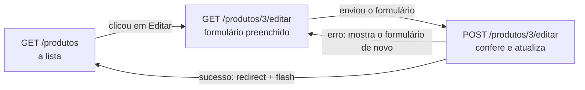

# Capítulo 18.3 — UPDATE de produtos (opcional)

**Disciplina:** Programação para Internet (ILP951)
**Professor:** Ronan Adriel Zenatti · ronan.zenatti@cps.sp.gov.br
**Fatec Jahu — 2º Semestre/2026**

---

## 🎯 Objetivos do Capítulo

Ao final deste capítulo você deverá ser capaz de:

- Buscar um produto pelo código que vem no endereço e devolver 404 quando ele não existe
- Preencher o formulário com os valores do banco, convertendo `None` em texto vazio e o preço em `3.499,90`
- Reaproveitar o mesmo formulário para criar e para editar, com a variável `acao`
- Montar um `UPDATE` por partes, porque a foto é opcional na edição
- Trocar ou remover a foto e apagar o arquivo antigo do disco depois de o banco aceitar a alteração

Este capítulo é **opcional**: o Capítulo 18 constrói o CRUD inteiro de produtos em um só arquivo, e este percorre só a **edição**: a rota `produto_editar`, o formulário preenchido, o `UPDATE` e a troca ou remoção da foto, em um arquivo menor e com o seu próprio zip. O Capítulo 19 parte do zip do Capítulo 18, e não deste. Ao final, a lista ganha o botão **Editar**.

## 📦 Ponto de partida

Este capítulo continua do **seu** repositório `sistema-gestao`, como ficou no fim do Capítulo 18.2 (ou do Tópico 6 do Capítulo 18): com o cadastro e a lista de produtos funcionando.

Se o seu projeto não está funcionando, baixe o código de Capítulo 18.2 e descompacte. Depois de descompactar, crie o ambiente virtual e o `.env`, como no [Capítulo 11, Tópico 4](Capitulo_11_Projeto_Novo_e_Banco.md#topico-4-o-arquivo-env), e importe o `banco.sql` no phpMyAdmin:

➡️ [Baixar p2_cap_18_2.zip](../arquivos/p2_cap_18_2.zip)

```bash
python -m venv venv
venv\Scripts\activate
pip install -r requirements.txt
copy .env.example .env
```

---

## Tópico 1 — Editar um produto (UPDATE)

### Antes de começar

Ligue o **Apache** e o **MySQL** no painel do XAMPP. Abra a pasta `sistema-gestao` no VS Code, o terminal (`Ctrl + '`), ative o ambiente virtual e confira o Git:

```bash
venv\Scripts\activate
git status
```

O `git status` deve dizer `nothing to commit, working tree clean`. Ligue o servidor com `python app.py` e deixe esse terminal rodando durante o capítulo (use um segundo terminal, o ícone **+**, para o Git). Abra **http://127.0.0.1:5000**, entre com a Ana (`ana@exemplo.com`, senha `Senha123`) e abra **Produtos** no menu: a lista, com os produtos, a miniatura e os selos de estoque, mas ainda sem botões de ação.

Para a lista ter o que mostrar, cadastre estes quatro produtos pelo formulário **Novo produto** (se você já os cadastrou, pule esta parte), e **um quinto, com foto**: o `Mouse sem fio`, preço `89,90`, estoque `10`, categoria **Periféricos**, com uma imagem `.jpg` ou `.png` qualquer do seu computador. Os valores foram escolhidos para ter um produto com estoque alto, baixo e zerado, um inativo e um sem categoria:

| Nome | Descrição | Preço | Estoque | Categoria | Ativo |
|---|---|---|---|---|---|
| Notebook Gamer | Tela de 15,6 polegadas, 16 GB de memória | `3.499,90` | `12` | Informática | sim |
| Teclado Mecânico | (vazia) | `129,90` | `3` | Periféricos | sim |
| Fone de Ouvido | Sem fio, com cancelamento de ruído | `249` | `40` | Áudio | sim |
| Cabo HDMI 2m | (vazia) | `25,00` | `0` | Sem categoria | **não** (desmarque o interruptor) |

### O comando UPDATE

Editar é gravar de novo um produto que já existe. O comando é o `UPDATE`:

```sql
UPDATE produtos
SET nome = %s, descricao = %s, categoria = %s, preco = %s, estoque = %s, ativo = %s
WHERE id_produto = %s;
```

O `WHERE id_produto = %s` é obrigatório: sem ele, o `UPDATE` altera **todas** as linhas da tabela, sem perguntar e sem "desfazer". A rota de edição é a mesma ideia da `produto_novo` com duas diferenças: ela precisa **buscar o produto** pelo código que vem no endereço (`/produtos/3/editar`) e **preencher o formulário** com os valores dele. E o formulário é o mesmo, o `produto_form.html`, que passa a servir para criar e para editar.

O caminho do navegador na edição:



### Buscar o produto pelo código

No `app.py`, acrescente a rota `produto_editar` **depois** da `produto_novo` e antes dos `@app.errorhandler`. Por enquanto, ela busca o produto e entrega o resultado do banco ao formulário:

```python
@app.route('/produtos/<int:id_produto>/editar')
def produto_editar(id_produto):
    if 'id_usuario' not in session:
        flash('Entre para continuar.', 'warning')
        return redirect(url_for('login'))

    produto = execute_one(SELECT_PRODUTO + ' WHERE id_produto = %s', (id_produto,))
    if produto is None:
        abort(404)

    return render_template('produto_form.html', dados=produto, categorias=CATEGORIAS)
```

O `<int:id_produto>` é a variável de rota: o Flask pega o número do endereço e o entrega à função, com o mesmo nome. O `execute_one` devolve **um** produto (um dicionário) ou `None`, e o `abort(404)` mostra a página 404 quando o código não existe. Salve e abra, pela barra de endereço, `http://127.0.0.1:5000/produtos/` + o código do Notebook (a primeira coluna da lista) + `/editar`. O formulário aparece com o nome, o preço e o estoque, mas com três defeitos:

- O **preço** aparece como `3499.90`, e não `3.499,90`.
- O **interruptor** aparece desligado, mesmo para um produto ativo.
- Abra a edição do **Teclado Mecânico**: o campo da descrição mostra a palavra **None**. Quem clicasse em salvar gravaria esse texto no banco.

Os três têm a mesma raiz: o formulário foi escrito para receber valores **em texto**, como os do `request.form`. O `ativo` do banco é o **número** `1`, e o `dados.ativo == '1'` do formulário compara com o **texto** `'1'`, então nunca é verdadeiro. O `NULL` chega como `None`, que o Jinja escreve como a palavra "None" dentro do campo. E o preço chega como `Decimal`.

### Entregar ao formulário os mesmos valores do `request.form`

A saída é montar um dicionário `dados` com tudo como texto, e o `None` como texto vazio. Para isso, o `app.py` já tem a função `texto_ou_vazio` (do Capítulo 16). Se o seu não tiver, acrescente-a **abaixo** da `vazio_para_none`:

```python
def texto_ou_vazio(valor):
    if valor is None:
        return ''

    return str(valor)
```

!!! note "Python: `str()`"
    O `str()` converte um valor em texto: `str(1)` devolve `'1'`, e `str(3499.90)` devolve `'3499.90'`. A função é o contrário da `vazio_para_none`: aquela troca `''` por `None` na hora de **gravar**, e esta troca `None` por `''` na hora de **mostrar**.

O preço precisa de mais um ajuste: ele deve aparecer como `3.499,90`, o formato que o campo e o `pattern` esperam. O `formatar_numero` (o mesmo que o filtro `moeda` usa, sem o `R$`) resolve. Se o seu `app.py` ainda não o tem, ele é este, e fica depois do filtro `cpf_oculto`:

```python
def formatar_numero(valor):
    # 1234.5 vira '1.234,50': o Python escreve 1,234.50, e as trocas acertam a pontuação
    texto = f'{valor:,.2f}'
    texto = texto.replace(',', 'X').replace('.', ',').replace('X', '.')

    return texto
```

Agora a rota monta o dicionário, um valor de cada vez. Na `produto_editar`, **entre** o `if produto is None:` e o `return`, acrescente:

```python
    dados = {}
    for chave in produto:
        dados[chave] = texto_ou_vazio(produto[chave])
    dados['preco'] = formatar_numero(produto['preco'])
```

E no `return`, troque `dados=produto` por `dados=dados`:

```python
    return render_template('produto_form.html', dados=dados, categorias=CATEGORIAS)
```

O `for chave in produto` percorre as **chaves** do dicionário (`nome`, `preco`, `ativo`...), e `dados[chave] = ...` copia cada valor, já convertido em texto. A última linha corrige o preço. Salve, recarregue a edição do Notebook e do Teclado: o preço é `3.499,90`, o interruptor está ligado, e a descrição do teclado está **vazia**.

### O formulário serve para criar e para editar

O mesmo template precisa saber em qual dos dois modos está, para trocar o título, o botão e o **destino** do formulário (`action`). A solução é uma variável `acao`, que a rota entrega com o valor `'criar'` ou `'editar'`. No `produto_form.html`, troque o começo do arquivo, até a abertura do `<form>`, por:

```html


Editar produtoNovo produto — Sistema de Gestão


  
    
  
    
  

  <h1 class="h2 mb-4">Editar produtoNovo produto</h1>

  <div class="row">
    <div class="col-lg-8">
      <div class="card">
        <div class="card-body">

          <form action="{{ destino }}" method="post" enctype="multipart/form-data">
```

O `` guarda o endereço em uma variável do template. E o texto do botão de salvar:

```html
              <button type="submit" class="btn btn-primary">Salvar alteraçõesSalvar produto</button>
```

Agora a rota entrega `acao`, `id_produto` e a foto atual (para o formulário mostrar a foto que o produto já tem). Na `produto_editar`, o `return` fica:

```python
    return render_template('produto_form.html', acao='editar', id_produto=id_produto, dados=dados,
                           categorias=CATEGORIAS, foto_atual=produto['foto'])
```

E na `produto_novo`, o `return` passa as mesmas variáveis, com valores vazios:

```python
    return render_template('produto_form.html', acao='criar', id_produto=None, dados=dados,
                           categorias=CATEGORIAS, foto_atual=None)
```

Na edição, o formulário mostra a foto atual e oferece uma caixa para removê-la. Troque o bloco do campo **Foto** do formulário por:

```html
            <div class="mb-3">
              <label for="foto" class="form-label">Trocar a foto (opcional)Foto (opcional)</label>
              
                <div class="d-flex align-items-center gap-3 mb-2">
                  
                  <div class="form-check mb-0">
                    <input class="form-check-input" type="checkbox" id="remover_foto" name="remover_foto" value="1">
                    <label class="form-check-label" for="remover_foto">Remover a foto atual</label>
                  </div>
                </div>
              
              <input type="file" class="form-control" id="foto" name="foto" accept=".jpg,.jpeg,.png,.webp">
              <div class="form-text">Arquivo jpg, jpeg, png ou webp, com até 2 MB.</div>
            </div>
```

O bloco `` só aparece quando o produto tem foto. Para o botão **Editar** chegar ao formulário, acrescente a coluna **Ações** na lista. No `produtos.html`, acrescente o cabeçalho depois de **Situação** (e acerte o `colspan` da linha da lista vazia para `7`):

```html
        <th class="text-end">Ações</th>
```

E a célula, depois da célula da situação:

```html
        <td class="text-end">
          <a href="{{ url_for('produto_editar', id_produto=produto.id_produto) }}" class="btn btn-sm btn-outline-primary">Editar</a>
        </td>
```

Note o nome do argumento do `url_for`: `id_produto=produto.id_produto`, o mesmo nome da variável de rota e da coluna. Salve e recarregue a lista: cada linha tem o botão **Editar**. Clique no do Notebook: o título é **Editar produto**, o botão é **Salvar alterações**, os campos vêm preenchidos, e, no produto que tem foto, a miniatura aparece com a caixa **Remover a foto atual**. O botão **Salvar alterações** ainda mostra **Method Not Allowed**: falta o `POST`.

### Salvar a edição

A rota passa a aceitar o `POST`. Algumas peças já existem prontas: ler o formulário, ler a foto e conferir. Antes, falta ensinar o formulário a ler a caixa **Remover a foto atual**. Em `ler_formulario_produto`, acrescente **antes** do `return campos`:

```python
    if form.get('remover_foto') == '1':
        campos['remover_foto'] = True
    else:
        campos['remover_foto'] = False
```

Troque a primeira linha da rota e o final dela. Primeiro o `methods`:

```python
@app.route('/produtos/<int:id_produto>/editar', methods=['GET', 'POST'])
```

E, entre a montagem do `dados` e o `return`, o tratamento do `POST`. Comece **sem mexer na foto**, só com o `UPDATE` dos campos:

```python
    if request.method == 'POST':
        campos = ler_formulario_produto(request.form)
        foto = ler_foto(request.files)

        erros = conferir_produto(campos, foto)

        if erros:
            for mensagem in erros:
                flash(mensagem, 'danger')
        else:
            execute_query(
                'UPDATE produtos SET nome = %s, descricao = %s, categoria = %s, '
                'preco = %s, estoque = %s, ativo = %s WHERE id_produto = %s',
                (
                    campos['nome'],
                    vazio_para_none(campos['descricao']),
                    vazio_para_none(campos['categoria']),
                    converter_preco(campos['preco']),
                    int(campos['estoque']),
                    campos['ativo'],
                    id_produto,
                ),
            )
            flash(f'Produto "{campos["nome"]}" atualizado.', 'success')
            return redirect(url_for('lista_produtos'))

        dados = request.form
```

O `dados = request.form` do final faz o formulário voltar com o digitado quando há erros, e sobrepõe o `dados` montado a partir do banco. Salve e teste: edite o preço do Teclado Mecânico para `139,90` e o estoque para `8`. A lista mostra `R$ 139,90` e o selo de **Em estoque (8)**. Edite de novo, apague o nome e salve: a mensagem de erro aparece, o formulário volta com o que você digitou, e o banco **não** foi alterado.

### A foto na edição

A foto é opcional na edição também, e há três situações:

| O que a pessoa fez no formulário | O que o `UPDATE` faz com a coluna `foto` |
|---|---|
| Escolheu um arquivo novo | Grava o caminho do arquivo novo e **apaga o arquivo antigo** do disco |
| Marcou **Remover a foto atual** | Grava `NULL` e **apaga o arquivo antigo** do disco |
| Não mexeu na foto | **Não toca** na coluna `foto` |

A terceira linha é a que complica: o `UPDATE` fixo de cima sempre incluiria `foto = %s`, e, sem foto nova, teria de gravar o caminho antigo de volta. É mais simples montar o comando **por partes**: a base do `UPDATE` é fixa, e o pedaço `, foto = %s` só entra quando a foto muda. Primeiro, a função que apaga o arquivo do disco. Acrescente no `app.py`, **depois** da `salvar_foto`:

```python
def apagar_foto(caminho):
    if caminho is None:
        return

    arquivo = os.path.join(app.root_path, 'static', caminho)
    if os.path.exists(arquivo):
        os.remove(arquivo)
```

A função recebe o caminho gravado no banco (`uploads/ab12cd34.png`), junta com a pasta `static` e remove o arquivo, se ele existir. O `if caminho is None: return` cobre o produto que nunca teve foto. Agora troque o `execute_query` do `else` da `produto_editar` por este bloco:

```python
            sql = (
                'UPDATE produtos SET nome = %s, descricao = %s, categoria = %s, '
                'preco = %s, estoque = %s, ativo = %s'
            )
            params = [
                campos['nome'],
                vazio_para_none(campos['descricao']),
                vazio_para_none(campos['categoria']),
                converter_preco(campos['preco']),
                int(campos['estoque']),
                campos['ativo'],
            ]

            trocou_foto = False
            if foto is not None:
                sql += ', foto = %s'
                params.append(salvar_foto(foto))
                trocou_foto = True
            elif campos['remover_foto']:
                sql += ', foto = %s'
                params.append(None)
                trocou_foto = True

            sql += ' WHERE id_produto = %s'
            params.append(id_produto)

            execute_query(sql, params)

            if trocou_foto:
                apagar_foto(produto['foto'])
```

!!! note "Python: montar o SQL por partes"
    O `sql` é um texto, e o `sql += ', foto = %s'` **acrescenta** um pedaço ao final dele. O `params` é uma **lista** de valores, e o `params.append(valor)` acrescenta um item ao final. Os dois crescem juntos, e cada `%s` no texto tem o seu valor na lista, na mesma ordem. O SQL continua sem receber nenhum dado da pessoa dentro do texto: os pedaços acrescentados são fixos, e os valores só entram pela lista. Se uma foto nova e a caixa **Remover** vierem juntas, vale a foto nova (o `if` vem antes do `elif`).

O arquivo antigo só é apagado **depois** do `execute_query`, pelo `apagar_foto(produto['foto'])`: se o `UPDATE` falhasse, a foto antiga continuaria no lugar. O `produto['foto']` é o valor que o `SELECT` do começo da rota trouxe, antes da alteração.

### Testar a edição

Salve e confira, nesta ordem:

| Teste | O que deve acontecer |
|---|---|
| Editar o nome do produto que tem foto, sem mexer na foto | O nome muda, a miniatura continua, e o arquivo continua na pasta `static/uploads` |
| Escolher uma foto nova no mesmo produto | A miniatura muda, e o arquivo antigo **some** da pasta (só o novo fica) |
| Marcar **Remover a foto atual** e salvar | Aparece o quadrado "sem foto", e a pasta fica sem o arquivo |
| Enviar um `.gif` ou um `.pdf` como foto | A mensagem da extensão aparece, e a foto atual continua |
| Apagar o preço e salvar | `Informe o preço.`, com os outros campos mantidos |
| Digitar o código `9999` no endereço, `/produtos/9999/editar` | A página 404 |
| Desmarcar o interruptor **Produto ativo** e salvar | A lista mostra **Inativo** |
| Esvaziar a descrição e salvar | No phpMyAdmin, a coluna `descricao` mostra `NULL` |

Para registrar:

```bash
git add .
git commit -m "Adiciona a edição de produto com troca e remoção de foto"
git push
```

---

## Os arquivos completos do capítulo

O `app.py`:

```python
import os
import uuid

from dotenv import load_dotenv
from flask import Flask, render_template, request, redirect, url_for, flash, abort, session
from flask_wtf.csrf import CSRFProtect
from mysql.connector import Error
from werkzeug.security import generate_password_hash, check_password_hash
from werkzeug.utils import secure_filename

from db import execute_query, execute_one, execute_insert
from validacoes import (
    UFS, CATEGORIAS, validar_nome_perfil, validar_descricao_perfil,
    validar_nome_usuario, validar_email, validar_senha, validar_celular,
    validar_cpf, validar_data_nascimento, validar_cep, validar_estado,
    validar_tamanho, formatar_celular, formatar_cpf, formatar_cep,
    validar_nome_produto, validar_categoria, validar_preco, validar_estoque,
    converter_preco, validar_extensao_foto,
)

load_dotenv()

app = Flask(__name__)
app.secret_key = os.getenv('SECRET_KEY')

CSRFProtect(app)

# As fotos dos produtos ficam em static/uploads. O Flask recusa (erro 413) pedidos com mais de 2 MB.
PASTA_UPLOADS = os.path.join(app.root_path, 'static', 'uploads')
app.config['MAX_CONTENT_LENGTH'] = 2 * 1024 * 1024

os.makedirs(PASTA_UPLOADS, exist_ok=True)

# As colunas que as telas de usuário leem. A senha fica de fora de propósito: o que não é
# lido do banco não tem como vazar para a página.
SELECT_USUARIO = (
    'SELECT u.id_usuario, u.nome, u.email, u.celular, u.data_nascimento, u.cpf, '
    'u.perfil_id, u.cep, u.endereco, u.numero, u.complemento, u.cidade, u.estado, '
    'u.criado_em, u.atualizado_em, p.nome AS perfil, p.descricao AS perfil_descricao '
    'FROM usuarios u '
    'JOIN perfis p ON p.id_perfil = u.perfil_id'
)

# As colunas que as telas de produto leem
SELECT_PRODUTO = (
    'SELECT id_produto, nome, descricao, categoria, preco, estoque, foto, ativo, '
    'criado_em, atualizado_em '
    'FROM produtos'
)


@app.template_filter('data_br')
def data_br(valor):
    if valor is None:
        return '—'

    return valor.strftime('%d/%m/%Y')


@app.template_filter('data_hora_br')
def data_hora_br(valor):
    if valor is None:
        return '—'

    return valor.strftime('%d/%m/%Y às %H:%M')


@app.template_filter('cpf_oculto')
def cpf_oculto(cpf):
    if cpf is None:
        return '—'

    return '***.' + cpf[4:11] + '-**'


def formatar_numero(valor):
    # 1234.5 vira '1.234,50': o Python escreve 1,234.50, e as trocas acertam a pontuação
    texto = f'{valor:,.2f}'
    texto = texto.replace(',', 'X').replace('.', ',').replace('X', '.')

    return texto


@app.template_filter('moeda')
def moeda(valor):
    return 'R$ ' + formatar_numero(valor)


@app.route('/login', methods=['GET', 'POST'])
def login():
    if 'id_usuario' in session:
        return redirect(url_for('index'))

    email = ''

    if request.method == 'POST':
        email = request.form.get('email', '').strip().lower()
        senha = request.form.get('senha', '')

        usuario = execute_one(
            'SELECT u.id_usuario, u.nome, u.senha, p.nome AS perfil '
            'FROM usuarios u '
            'JOIN perfis p ON p.id_perfil = u.perfil_id '
            'WHERE u.email = %s',
            (email,),
        )

        if usuario is not None and check_password_hash(usuario['senha'], senha):
            session.clear()
            session['id_usuario'] = usuario['id_usuario']
            session['nome'] = usuario['nome']
            session['perfil'] = usuario['perfil']
            flash(f'Você entrou como {usuario["nome"]}.', 'success')
            return redirect(url_for('index'))

        flash('E-mail ou senha incorretos.', 'danger')

    return render_template('login.html', email=email)


@app.route('/logout', methods=['POST'])
def logout():
    session.clear()
    flash('Você saiu do sistema.', 'success')

    return redirect(url_for('login'))


@app.route('/')
def index():
    if 'id_usuario' not in session:
        flash('Entre para continuar.', 'warning')
        return redirect(url_for('login'))

    perfis = execute_one('SELECT COUNT(*) AS total FROM perfis')
    usuarios = execute_one('SELECT COUNT(*) AS total FROM usuarios')
    produtos = execute_one('SELECT COUNT(*) AS total FROM produtos')

    return render_template('index.html', titulo='Sistema de Gestão',
                           total_perfis=perfis['total'],
                           total_usuarios=usuarios['total'],
                           total_produtos=produtos['total'])


@app.route('/perfis')
def lista_perfis():
    if 'id_usuario' not in session:
        flash('Entre para continuar.', 'warning')
        return redirect(url_for('login'))

    perfis = execute_query(
        'SELECT id_perfil, nome, descricao, criado_em FROM perfis ORDER BY nome',
        fetch=True,
    )

    return render_template('perfis.html', titulo='Perfis', perfis=perfis)


def conferir_perfil(nome, descricao, id_perfil):
    erros = []

    erro = validar_nome_perfil(nome)
    if erro:
        erros.append(erro)

    erro = validar_descricao_perfil(descricao)
    if erro:
        erros.append(erro)

    if not erros:
        existente = execute_one(
            'SELECT id_perfil FROM perfis WHERE nome = %s AND id_perfil <> %s',
            (nome, id_perfil),
        )
        if existente:
            erros.append('Já existe um perfil com este nome.')

    return erros


@app.route('/perfis/novo', methods=['GET', 'POST'])
def perfil_novo():
    if 'id_usuario' not in session:
        flash('Entre para continuar.', 'warning')
        return redirect(url_for('login'))

    nome = ''
    descricao = ''

    if request.method == 'POST':
        nome = request.form.get('nome', '').strip()
        descricao = request.form.get('descricao', '').strip()

        erros = conferir_perfil(nome, descricao, 0)

        if erros:
            for mensagem in erros:
                flash(mensagem, 'danger')
        else:
            if descricao == '':
                descricao_gravada = None
            else:
                descricao_gravada = descricao

            try:
                novo_id = execute_insert(
                    'INSERT INTO perfis (nome, descricao) VALUES (%s, %s)',
                    (nome, descricao_gravada),
                )
                flash(f'Perfil "{nome}" cadastrado (código {novo_id}).', 'success')
                return redirect(url_for('lista_perfis'))
            except Error as erro:
                if erro.errno == 1062:
                    flash('Já existe um perfil com este nome.', 'danger')
                else:
                    raise

    return render_template('perfil_form.html', acao='criar', id_perfil=None,
                           nome=nome, descricao=descricao)


@app.route('/perfis/<int:id_perfil>/editar', methods=['GET', 'POST'])
def perfil_editar(id_perfil):
    if 'id_usuario' not in session:
        flash('Entre para continuar.', 'warning')
        return redirect(url_for('login'))

    perfil = execute_one(
        'SELECT id_perfil, nome, descricao FROM perfis WHERE id_perfil = %s',
        (id_perfil,),
    )
    if perfil is None:
        abort(404)

    nome = perfil['nome']
    descricao = perfil['descricao']
    if descricao is None:
        descricao = ''

    if request.method == 'POST':
        nome = request.form.get('nome', '').strip()
        descricao = request.form.get('descricao', '').strip()

        erros = conferir_perfil(nome, descricao, id_perfil)

        if erros:
            for mensagem in erros:
                flash(mensagem, 'danger')
        else:
            if descricao == '':
                descricao_gravada = None
            else:
                descricao_gravada = descricao

            try:
                execute_query(
                    'UPDATE perfis SET nome = %s, descricao = %s WHERE id_perfil = %s',
                    (nome, descricao_gravada, id_perfil),
                )
                flash(f'Perfil "{nome}" atualizado.', 'success')
                return redirect(url_for('lista_perfis'))
            except Error as erro:
                if erro.errno == 1062:
                    flash('Já existe um perfil com este nome.', 'danger')
                else:
                    raise

    return render_template('perfil_form.html', acao='editar', id_perfil=id_perfil,
                           nome=nome, descricao=descricao)


@app.route('/perfis/<int:id_perfil>/excluir', methods=['POST'])
def perfil_excluir(id_perfil):
    if 'id_usuario' not in session:
        flash('Entre para continuar.', 'warning')
        return redirect(url_for('login'))

    perfil = execute_one(
        'SELECT id_perfil, nome FROM perfis WHERE id_perfil = %s',
        (id_perfil,),
    )
    if perfil is None:
        abort(404)

    usuarios = execute_one(
        'SELECT COUNT(*) AS total FROM usuarios WHERE perfil_id = %s',
        (id_perfil,),
    )
    if usuarios['total'] > 0:
        flash(f'O perfil "{perfil["nome"]}" tem {usuarios["total"]} usuário(s) e não pode ser excluído.', 'danger')
        return redirect(url_for('lista_perfis'))

    try:
        execute_query('DELETE FROM perfis WHERE id_perfil = %s', (id_perfil,))
        flash(f'Perfil "{perfil["nome"]}" excluído.', 'success')
    except Error as erro:
        if erro.errno == 1451:
            flash(f'O perfil "{perfil["nome"]}" está em uso e não pode ser excluído.', 'danger')
        else:
            raise

    return redirect(url_for('lista_perfis'))


@app.route('/usuarios')
def lista_usuarios():
    if 'id_usuario' not in session:
        flash('Entre para continuar.', 'warning')
        return redirect(url_for('login'))

    usuarios = execute_query(SELECT_USUARIO + ' ORDER BY u.nome', fetch=True)

    return render_template('usuarios.html', titulo='Usuários', usuarios=usuarios)


def vazio_para_none(valor):
    if valor == '':
        return None

    return valor


def texto_ou_vazio(valor):
    if valor is None:
        return ''

    return str(valor)


def conferir_perfil_do_usuario(perfil_txt):
    try:
        id_perfil = int(perfil_txt)
    except ValueError:
        return 'Selecione um perfil.'

    perfil = execute_one(
        'SELECT id_perfil FROM perfis WHERE id_perfil = %s',
        (id_perfil,),
    )
    if perfil is None:
        return 'Selecione um perfil válido.'

    return None


def ler_formulario(form):
    campos = {}
    campos['nome'] = form.get('nome', '').strip()
    campos['email'] = form.get('email', '').strip().lower()
    campos['senha'] = form.get('senha', '')
    campos['confirmacao'] = form.get('confirmacao', '')
    campos['celular'] = form.get('celular', '').strip()
    campos['data_nascimento'] = form.get('data_nascimento', '').strip()
    campos['cpf'] = form.get('cpf', '').strip()
    campos['perfil_id'] = form.get('perfil_id', '')
    campos['cep'] = form.get('cep', '').strip()
    campos['endereco'] = form.get('endereco', '').strip()
    campos['numero'] = form.get('numero', '').strip()
    campos['complemento'] = form.get('complemento', '').strip()
    campos['cidade'] = form.get('cidade', '').strip()
    campos['estado'] = form.get('estado', '')

    return campos


def conferir_usuario(campos, id_usuario):
    erros = []

    erro = validar_nome_usuario(campos['nome'])
    if erro:
        erros.append(erro)

    erro = validar_email(campos['email'])
    if erro:
        erros.append(erro)
    else:
        existente = execute_one(
            'SELECT id_usuario FROM usuarios WHERE email = %s AND id_usuario <> %s',
            (campos['email'], id_usuario),
        )
        if existente:
            erros.append('Já existe um usuário com este e-mail.')

    if id_usuario == 0 or campos['senha'] != '' or campos['confirmacao'] != '':
        erro = validar_senha(campos['senha'], campos['confirmacao'])
        if erro:
            erros.append(erro)

    erro = conferir_perfil_do_usuario(campos['perfil_id'])
    if erro:
        erros.append(erro)

    erro = validar_celular(campos['celular'])
    if erro:
        erros.append(erro)

    erro = validar_cpf(campos['cpf'])
    if erro:
        erros.append(erro)
    else:
        cpf_formatado = formatar_cpf(campos['cpf'])
        if cpf_formatado != '':
            existente = execute_one(
                'SELECT id_usuario FROM usuarios WHERE cpf = %s AND id_usuario <> %s',
                (cpf_formatado, id_usuario),
            )
            if existente:
                erros.append('Já existe um usuário com este CPF.')

    erro = validar_data_nascimento(campos['data_nascimento'])
    if erro:
        erros.append(erro)

    erro = validar_cep(campos['cep'])
    if erro:
        erros.append(erro)

    erro = validar_tamanho(campos['endereco'], 'endereço', 255)
    if erro:
        erros.append(erro)

    erro = validar_tamanho(campos['numero'], 'número', 20)
    if erro:
        erros.append(erro)

    erro = validar_tamanho(campos['complemento'], 'complemento', 100)
    if erro:
        erros.append(erro)

    erro = validar_tamanho(campos['cidade'], 'cidade', 100)
    if erro:
        erros.append(erro)

    erro = validar_estado(campos['estado'])
    if erro:
        erros.append(erro)

    return erros


@app.route('/usuarios/novo', methods=['GET', 'POST'])
def usuario_novo():
    if 'id_usuario' not in session:
        flash('Entre para continuar.', 'warning')
        return redirect(url_for('login'))

    if request.method == 'POST':
        campos = ler_formulario(request.form)

        erros = conferir_usuario(campos, 0)

        if erros:
            for mensagem in erros:
                flash(mensagem, 'danger')
        else:
            try:
                novo_id = execute_insert(
                    'INSERT INTO usuarios (nome, email, senha, celular, data_nascimento, cpf, '
                    'perfil_id, cep, endereco, numero, complemento, cidade, estado) '
                    'VALUES (%s, %s, %s, %s, %s, %s, %s, %s, %s, %s, %s, %s, %s)',
                    (
                        campos['nome'],
                        campos['email'],
                        generate_password_hash(campos['senha']),
                        vazio_para_none(formatar_celular(campos['celular'])),
                        vazio_para_none(campos['data_nascimento']),
                        vazio_para_none(formatar_cpf(campos['cpf'])),
                        int(campos['perfil_id']),
                        vazio_para_none(formatar_cep(campos['cep'])),
                        vazio_para_none(campos['endereco']),
                        vazio_para_none(campos['numero']),
                        vazio_para_none(campos['complemento']),
                        vazio_para_none(campos['cidade']),
                        vazio_para_none(campos['estado']),
                    ),
                )
                flash(f'Usuário "{campos["nome"]}" cadastrado (código {novo_id}).', 'success')
                return redirect(url_for('lista_usuarios'))
            except Error as erro:
                if erro.errno == 1062:
                    flash('Já existe um usuário com este e-mail ou este CPF.', 'danger')
                else:
                    raise

    perfis = execute_query('SELECT id_perfil, nome FROM perfis ORDER BY nome', fetch=True)

    return render_template('usuario_form.html', acao='criar', id_usuario=None,
                           dados=request.form, perfis=perfis, ufs=UFS)


@app.route('/usuarios/<int:id_usuario>')
def usuario_detalhe(id_usuario):
    if 'id_usuario' not in session:
        flash('Entre para continuar.', 'warning')
        return redirect(url_for('login'))

    usuario = execute_one(SELECT_USUARIO + ' WHERE u.id_usuario = %s', (id_usuario,))
    if usuario is None:
        abort(404)

    return render_template('usuario_detalhe.html', usuario=usuario)


@app.route('/usuarios/<int:id_usuario>/editar', methods=['GET', 'POST'])
def usuario_editar(id_usuario):
    if 'id_usuario' not in session:
        flash('Entre para continuar.', 'warning')
        return redirect(url_for('login'))

    usuario = execute_one(SELECT_USUARIO + ' WHERE u.id_usuario = %s', (id_usuario,))
    if usuario is None:
        abort(404)

    dados = {}
    for chave in usuario:
        dados[chave] = texto_ou_vazio(usuario[chave])

    if request.method == 'POST':
        campos = ler_formulario(request.form)

        erros = conferir_usuario(campos, id_usuario)

        if erros:
            for mensagem in erros:
                flash(mensagem, 'danger')
        else:
            sql = (
                'UPDATE usuarios SET nome = %s, email = %s, celular = %s, '
                'data_nascimento = %s, cpf = %s, perfil_id = %s, cep = %s, '
                'endereco = %s, numero = %s, complemento = %s, cidade = %s, estado = %s'
            )
            params = [
                campos['nome'],
                campos['email'],
                vazio_para_none(formatar_celular(campos['celular'])),
                vazio_para_none(campos['data_nascimento']),
                vazio_para_none(formatar_cpf(campos['cpf'])),
                int(campos['perfil_id']),
                vazio_para_none(formatar_cep(campos['cep'])),
                vazio_para_none(campos['endereco']),
                vazio_para_none(campos['numero']),
                vazio_para_none(campos['complemento']),
                vazio_para_none(campos['cidade']),
                vazio_para_none(campos['estado']),
            ]

            if campos['senha'] != '':
                sql += ', senha = %s'
                params.append(generate_password_hash(campos['senha']))

            sql += ' WHERE id_usuario = %s'
            params.append(id_usuario)

            try:
                execute_query(sql, params)
                flash(f'Usuário "{campos["nome"]}" atualizado.', 'success')
                return redirect(url_for('lista_usuarios'))
            except Error as erro:
                if erro.errno == 1062:
                    flash('Já existe um usuário com este e-mail ou este CPF.', 'danger')
                else:
                    raise

        dados = request.form

    perfis = execute_query('SELECT id_perfil, nome FROM perfis ORDER BY nome', fetch=True)

    return render_template('usuario_form.html', acao='editar', id_usuario=id_usuario,
                           dados=dados, perfis=perfis, ufs=UFS)


@app.route('/usuarios/<int:id_usuario>/excluir', methods=['POST'])
def usuario_excluir(id_usuario):
    if 'id_usuario' not in session:
        flash('Entre para continuar.', 'warning')
        return redirect(url_for('login'))

    if id_usuario == session['id_usuario']:
        flash('Você não pode excluir o seu próprio usuário.', 'danger')
        return redirect(url_for('lista_usuarios'))

    usuario = execute_one(
        'SELECT id_usuario, nome FROM usuarios WHERE id_usuario = %s',
        (id_usuario,),
    )
    if usuario is None:
        abort(404)

    execute_query('DELETE FROM usuarios WHERE id_usuario = %s', (id_usuario,))
    flash(f'Usuário "{usuario["nome"]}" excluído.', 'success')

    return redirect(url_for('lista_usuarios'))


@app.route('/produtos')
def lista_produtos():
    if 'id_usuario' not in session:
        flash('Entre para continuar.', 'warning')
        return redirect(url_for('login'))

    produtos = execute_query(SELECT_PRODUTO + ' ORDER BY nome', fetch=True)

    return render_template('produtos.html', titulo='Produtos', produtos=produtos)


def ler_formulario_produto(form):
    campos = {}
    campos['nome'] = form.get('nome', '').strip()
    campos['descricao'] = form.get('descricao', '').strip()
    campos['preco'] = form.get('preco', '').strip()
    campos['estoque'] = form.get('estoque', '').strip()
    campos['categoria'] = form.get('categoria', '')

    if form.get('ativo') == '1':
        campos['ativo'] = 1
    else:
        campos['ativo'] = 0

    if form.get('remover_foto') == '1':
        campos['remover_foto'] = True
    else:
        campos['remover_foto'] = False

    return campos


def ler_foto(arquivos):
    foto = arquivos.get('foto')

    if foto is None or foto.filename == '':
        return None

    return foto


def extensao_da_foto(nome_arquivo):
    nome_seguro = secure_filename(nome_arquivo)

    if '.' not in nome_seguro:
        return ''

    return nome_seguro.rsplit('.', 1)[1].lower()


def salvar_foto(foto):
    nome_arquivo = uuid.uuid4().hex + '.' + extensao_da_foto(foto.filename)
    foto.save(os.path.join(PASTA_UPLOADS, nome_arquivo))

    return 'uploads/' + nome_arquivo


def apagar_foto(caminho):
    if caminho is None:
        return

    arquivo = os.path.join(app.root_path, 'static', caminho)
    if os.path.exists(arquivo):
        os.remove(arquivo)


def conferir_produto(campos, foto):
    erros = []

    erro = validar_nome_produto(campos['nome'])
    if erro:
        erros.append(erro)

    erro = validar_tamanho(campos['descricao'], 'descrição', 2000)
    if erro:
        erros.append(erro)

    erro = validar_preco(campos['preco'])
    if erro:
        erros.append(erro)

    erro = validar_estoque(campos['estoque'])
    if erro:
        erros.append(erro)

    erro = validar_categoria(campos['categoria'])
    if erro:
        erros.append(erro)

    if foto is not None:
        erro = validar_extensao_foto(extensao_da_foto(foto.filename))
        if erro:
            erros.append(erro)

    return erros


@app.route('/produtos/novo', methods=['GET', 'POST'])
def produto_novo():
    if 'id_usuario' not in session:
        flash('Entre para continuar.', 'warning')
        return redirect(url_for('login'))

    dados = {'estoque': '0', 'ativo': '1'}

    if request.method == 'POST':
        campos = ler_formulario_produto(request.form)
        foto = ler_foto(request.files)

        erros = conferir_produto(campos, foto)

        if erros:
            for mensagem in erros:
                flash(mensagem, 'danger')
        else:
            caminho_foto = None
            if foto is not None:
                caminho_foto = salvar_foto(foto)

            novo_id = execute_insert(
                'INSERT INTO produtos (nome, descricao, categoria, preco, estoque, foto, ativo) '
                'VALUES (%s, %s, %s, %s, %s, %s, %s)',
                (
                    campos['nome'],
                    vazio_para_none(campos['descricao']),
                    vazio_para_none(campos['categoria']),
                    converter_preco(campos['preco']),
                    int(campos['estoque']),
                    caminho_foto,
                    campos['ativo'],
                ),
            )
            flash(f'Produto "{campos["nome"]}" cadastrado (código {novo_id}).', 'success')
            return redirect(url_for('lista_produtos'))

        dados = request.form

    return render_template('produto_form.html', acao='criar', id_produto=None, dados=dados,
                           categorias=CATEGORIAS, foto_atual=None)


@app.route('/produtos/<int:id_produto>/editar', methods=['GET', 'POST'])
def produto_editar(id_produto):
    if 'id_usuario' not in session:
        flash('Entre para continuar.', 'warning')
        return redirect(url_for('login'))

    produto = execute_one(SELECT_PRODUTO + ' WHERE id_produto = %s', (id_produto,))
    if produto is None:
        abort(404)

    dados = {}
    for chave in produto:
        dados[chave] = texto_ou_vazio(produto[chave])
    dados['preco'] = formatar_numero(produto['preco'])

    if request.method == 'POST':
        campos = ler_formulario_produto(request.form)
        foto = ler_foto(request.files)

        erros = conferir_produto(campos, foto)

        if erros:
            for mensagem in erros:
                flash(mensagem, 'danger')
        else:
            sql = (
                'UPDATE produtos SET nome = %s, descricao = %s, categoria = %s, '
                'preco = %s, estoque = %s, ativo = %s'
            )
            params = [
                campos['nome'],
                vazio_para_none(campos['descricao']),
                vazio_para_none(campos['categoria']),
                converter_preco(campos['preco']),
                int(campos['estoque']),
                campos['ativo'],
            ]

            trocou_foto = False
            if foto is not None:
                sql += ', foto = %s'
                params.append(salvar_foto(foto))
                trocou_foto = True
            elif campos['remover_foto']:
                sql += ', foto = %s'
                params.append(None)
                trocou_foto = True

            sql += ' WHERE id_produto = %s'
            params.append(id_produto)

            execute_query(sql, params)

            if trocou_foto:
                apagar_foto(produto['foto'])

            flash(f'Produto "{campos["nome"]}" atualizado.', 'success')
            return redirect(url_for('lista_produtos'))

        dados = request.form

    return render_template('produto_form.html', acao='editar', id_produto=id_produto, dados=dados,
                           categorias=CATEGORIAS, foto_atual=produto['foto'])


@app.errorhandler(404)
def pagina_nao_encontrada(erro):
    return render_template('404.html'), 404


@app.errorhandler(413)
def arquivo_grande_demais(erro):
    return render_template('413.html'), 413


@app.errorhandler(500)
def erro_no_servidor(erro):
    return render_template('500.html'), 500


if __name__ == '__main__':
    app.run(debug=True)
```

O `templates/produto_form.html`, que agora serve para criar e para editar:

```html


Editar produtoNovo produto — Sistema de Gestão


  
    
  
    
  

  <h1 class="h2 mb-4">Editar produtoNovo produto</h1>

  <div class="row">
    <div class="col-lg-8">
      <div class="card">
        <div class="card-body">

          <form action="{{ destino }}" method="post" enctype="multipart/form-data">
            <input type="hidden" name="csrf_token" value="{{ csrf_token() }}">

            <div class="mb-3">
              <label for="nome" class="form-label">Nome do produto</label>
              <input type="text" class="form-control" id="nome" name="nome" placeholder="Ex.: Mouse sem fio" value="{{ dados.nome }}" required minlength="3" maxlength="255">
            </div>

            <div class="mb-3">
              <label for="descricao" class="form-label">Descrição (opcional)</label>
              <textarea class="form-control" id="descricao" name="descricao" rows="3" maxlength="2000">{{ dados.descricao }}</textarea>
            </div>

            <div class="row">
              <div class="col-md-4 mb-3">
                <label for="preco" class="form-label">Preço</label>
                <div class="input-group">
                  <span class="input-group-text">R$</span>
                  <input type="text" inputmode="decimal" class="form-control" id="preco" name="preco" placeholder="0,00" value="{{ dados.preco }}" required pattern="([0-9]{1,3}(\.[0-9]{3})+|[0-9]+)(,[0-9]{1,2})?" title="Use vírgula nos centavos, por exemplo 1.234,56">
                </div>
              </div>
              <div class="col-md-4 mb-3">
                <label for="estoque" class="form-label">Estoque</label>
                <input type="number" class="form-control" id="estoque" name="estoque" value="{{ dados.estoque }}" required min="0" max="1000000" step="1">
              </div>
              <div class="col-md-4 mb-3">
                <label for="categoria" class="form-label">Categoria (opcional)</label>
                <select class="form-select" id="categoria" name="categoria">
                  <option value="">Sem categoria</option>
                  
                    <option value="{{ categoria }}" selected>{{ categoria }}</option>
                  
                </select>
              </div>
            </div>

            <div class="mb-3">
              <label for="foto" class="form-label">Trocar a foto (opcional)Foto (opcional)</label>
              
                <div class="d-flex align-items-center gap-3 mb-2">
                  
                  <div class="form-check mb-0">
                    <input class="form-check-input" type="checkbox" id="remover_foto" name="remover_foto" value="1">
                    <label class="form-check-label" for="remover_foto">Remover a foto atual</label>
                  </div>
                </div>
              
              <input type="file" class="form-control" id="foto" name="foto" accept=".jpg,.jpeg,.png,.webp">
              <div class="form-text">Arquivo jpg, jpeg, png ou webp, com até 2 MB.</div>
            </div>

            <div class="form-check form-switch mb-4">
              <input class="form-check-input" type="checkbox" role="switch" id="ativo" name="ativo" value="1" checked>
              <label class="form-check-label" for="ativo">Produto ativo</label>
            </div>

            <div class="d-flex gap-2">
              <button type="submit" class="btn btn-primary">Salvar alteraçõesSalvar produto</button>
              <a href="{{ url_for('lista_produtos') }}" class="btn btn-outline-secondary">Cancelar</a>
            </div>

          </form>

        </div>
      </div>
    </div>
  </div>

```

O `templates/produtos.html`, com a coluna **Ações**:

```html


{{ titulo }} — Sistema de Gestão


  <div class="d-flex justify-content-between align-items-center mb-3">
    <h1 class="h2 mb-0">{{ titulo }}</h1>
    <a href="{{ url_for('produto_novo') }}" class="btn btn-primary">Novo produto</a>
  </div>

  <table class="table table-striped table-hover align-middle">
    <thead class="table-light">
      <tr>
        <th>Foto</th>
        <th>Código</th>
        <th>Nome</th>
        <th>Preço</th>
        <th>Estoque</th>
        <th>Situação</th>
        <th class="text-end">Ações</th>
      </tr>
    </thead>
    <tbody>
      
      <tr>
        <td>
          
            
          
            <span class="foto-produto foto-vazia">sem foto</span>
          
        </td>
        <td>{{ produto.id_produto }}</td>
        <td>
          <span id="nome_produto_{{ produto.id_produto }}">{{ produto.nome }}</span><br>
          <small class="text-body-secondary">{{ produto.categoria|default('Sem categoria', true) }}</small>
        </td>
        <td>{{ produto.preco|moeda }}</td>
        <td>
          
            <span class="badge text-bg-danger">Sem estoque</span>
          
            <span class="badge text-bg-warning">Estoque baixo ({{ produto.estoque }})</span>
          
            <span class="badge text-bg-success">Em estoque ({{ produto.estoque }})</span>
          
        </td>
        <td>
          
            <span class="badge text-bg-primary">Ativo</span>
          
            <span class="badge text-bg-secondary">Inativo</span>
          
        </td>
        <td class="text-end">
          <a href="{{ url_for('produto_editar', id_produto=produto.id_produto) }}" class="btn btn-sm btn-outline-primary">Editar</a>
        </td>
      </tr>
      
      <tr>
        <td colspan="7" class="text-center text-body-secondary py-4">Nenhum produto cadastrado ainda.</td>
      </tr>
      
    </tbody>
  </table>

```

Os demais arquivos (`validacoes.py`, `db.py`, `base.html`, `413.html`, `estilo.css` e os outros) são os do Capítulo 18.2.

---

## 📦 Código deste capítulo

Compare com o seu projeto, ou use como ponto de partida do Capítulo 18.4. O zip tem todos os arquivos do projeto, com o `app.py`, o `produto_form.html` e o `produtos.html` atualizados, e a pasta `static/uploads` vazia. O ambiente virtual e o `.env` **não** vão no zip: depois de descompactar, crie o ambiente com os comandos acima e rode `copy .env.example .env`, trocando os marcadores `SUA_SENHA_AQUI` e `NOME_BANCO_DADOS` como no [Capítulo 11](Capitulo_11_Projeto_Novo_e_Banco.md#topico-4-o-arquivo-env). O banco também não vai dentro do zip: importe o `banco.sql` no phpMyAdmin e cadastre os três perfis e os três usuários pelo formulário. As fotos enviadas também não: a pasta `static/uploads` vem vazia, só com o `.gitkeep`.

➡️ [Baixar p2_cap_18_3.zip](../arquivos/p2_cap_18_3.zip)

---

## 🃏 Flashcards de Revisão

Tente responder mentalmente antes de abrir.

??? question "Por que o formulário de edição mostrava a palavra `None` e o interruptor desligado, antes da `texto_ou_vazio`?"
    Porque o formulário foi escrito para os valores em **texto** do `request.form`. O `NULL` do banco chega como `None`, que o Jinja escreve como a palavra "None"; e o `ativo` chega como o número `1`, que nunca é igual ao texto `'1'` do `dados.ativo == '1'`. A solução é montar o `dados` com tudo em texto e o `None` como texto vazio.

??? question "Por que o `UPDATE` da edição é montado por partes (`sql +=` e `params.append`)?"
    Porque a coluna `foto` só entra no comando quando a foto muda (arquivo novo ou remoção). Sem mudança, o `UPDATE` nem toca nela. Os pedaços acrescentados ao SQL são fixos, e os valores só entram pela lista de parâmetros, então o comando continua protegido.

??? question "Por que o arquivo antigo só é apagado depois do `execute_query`?"
    Porque, se o banco recusasse o `UPDATE`, a foto antiga ainda seria a foto do produto, e já teria sido apagada. Apagando depois, a ordem protege o produto: primeiro o banco aceita, depois o arquivo antigo sai.

??? question "Por que o `WHERE id_produto = %s` do `UPDATE` não pode faltar?"
    Porque sem ele o `UPDATE` altera todas as linhas da tabela, sem perguntar e sem desfazer. Com ele, só o produto do endereço é alterado.

---

## 📝 Resumo

A edição reaproveita o formulário do cadastro, que passou a receber a variável `acao` para trocar título, botão e destino. A rota busca o produto pelo código do endereço (404 se não existir) e monta o `dados` com tudo em texto: o `None` vira vazio, e o preço volta ao formato `3.499,90`. O `POST` repete a mesma conferência do cadastro e monta o `UPDATE` por partes, porque a foto é opcional: arquivo novo ou a caixa **Remover** acrescentam a coluna `foto` ao comando, e só então o arquivo antigo é apagado do disco, depois de o banco aceitar a alteração. O `WHERE` garante que só o produto do endereço muda. A exclusão chega no Capítulo 18.4.

---

## 🔗 Navegação

⬅️ [Capítulo 18.2 — SELECT de produtos](Capitulo_18_2_SELECT_de_Produtos.md) · 🔒 Capítulo 18.4 — em breve · [Capítulo 18 — CRUD de produtos](Capitulo_18_CRUD_de_Produtos.md) · 🔒 Capítulo 19 — em breve.

---

*Fatec Jahu · ILP951 · Prof. Ronan Adriel Zenatti · 2026*
