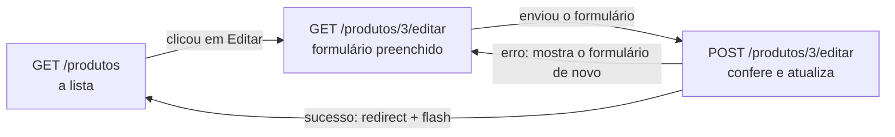

# Capítulo 18.3 — UPDATE de produtos (opcional)

**Disciplina:** Programação para Internet (ILP951)
**Professor:** Ronan Adriel Zenatti · ronan.zenatti@cps.sp.gov.br
**Fatec Jahu — 2º Semestre/2026**

---

## 🎯 Objetivos do Capítulo

Ao final deste capítulo você deverá ser capaz de:

- Buscar um produto pelo código que vem no endereço e devolver 404 quando ele não existe
- Preencher o formulário com os valores do banco, convertendo `None` em texto vazio e o preço em `3.499,90`
- Reaproveitar o mesmo formulário para criar e para editar, com a variável `acao`
- Montar um `UPDATE` por partes, porque a foto é opcional na edição
- Trocar ou remover a foto e apagar o arquivo antigo do disco depois de o banco aceitar a alteração

Este capítulo é **opcional**: o Capítulo 18 constrói o CRUD inteiro de produtos em um só arquivo, e este percorre só a **edição**: a rota `produto_editar`, o formulário preenchido, o `UPDATE` e a troca ou remoção da foto, em um arquivo menor e com o seu próprio zip. O Capítulo 19 parte do zip do Capítulo 18, e não deste. Ao final, a lista ganha o botão **Editar**.

## 📦 Ponto de partida

Este capítulo continua do **seu** repositório `sistema-gestao`, como ficou no fim do Capítulo 18.2 (ou do Tópico 6 do Capítulo 18): com o cadastro e a lista de produtos funcionando.

Se o seu projeto não está funcionando, baixe o código de Capítulo 18.2 e descompacte. Depois de descompactar, crie o ambiente virtual e o `.env`, como no [Capítulo 11, Tópico 4](Capitulo_11_Projeto_Novo_e_Banco.md#topico-4-o-arquivo-env), e importe o `banco.sql` no phpMyAdmin:

➡️ [Baixar p2_cap_18_2.zip](../arquivos/p2_cap_18_2.zip)

```bash
python -m venv venv
venv\Scripts\activate
pip install -r requirements.txt
copy .env.example .env
```

---

## Tópico 1 — Editar um produto (UPDATE)

### Antes de começar

Ligue o **Apache** e o **MySQL** no painel do XAMPP. Abra a pasta `sistema-gestao` no VS Code, o terminal (`Ctrl + '`), ative o ambiente virtual e confira o Git:

```bash
venv\Scripts\activate
git status
```

O `git status` deve dizer `nothing to commit, working tree clean`. Ligue o servidor com `python app.py` e deixe esse terminal rodando durante o capítulo (use um segundo terminal, o ícone **+**, para o Git). Abra **http://127.0.0.1:5000**, entre com a Ana (`ana@exemplo.com`, senha `Senha123`) e abra **Produtos** no menu: a lista, com os produtos, a miniatura e os selos de estoque, mas ainda sem botões de ação.

Para a lista ter o que mostrar, cadastre estes quatro produtos pelo formulário **Novo produto** (se você já os cadastrou, pule esta parte), e **um quinto, com foto**: o `Mouse sem fio`, preço `89,90`, estoque `10`, categoria **Periféricos**, com uma imagem `.jpg` ou `.png` qualquer do seu computador. Os valores foram escolhidos para ter um produto com estoque alto, baixo e zerado, um inativo e um sem categoria:

| Nome | Descrição | Preço | Estoque | Categoria | Ativo |
|---|---|---|---|---|---|
| Notebook Gamer | Tela de 15,6 polegadas, 16 GB de memória | `3.499,90` | `12` | Informática | sim |
| Teclado Mecânico | (vazia) | `129,90` | `3` | Periféricos | sim |
| Fone de Ouvido | Sem fio, com cancelamento de ruído | `249` | `40` | Áudio | sim |
| Cabo HDMI 2m | (vazia) | `25,00` | `0` | Sem categoria | **não** (desmarque o interruptor) |

### O comando UPDATE

Editar é gravar de novo um produto que já existe. O comando é o `UPDATE`:

```sql
UPDATE produtos
SET nome = %s, descricao = %s, categoria = %s, preco = %s, estoque = %s, ativo = %s
WHERE id_produto = %s;
```

O `WHERE id_produto = %s` é obrigatório: sem ele, o `UPDATE` altera **todas** as linhas da tabela, sem perguntar e sem "desfazer". A rota de edição é a mesma ideia da `inserir_produto` com duas diferenças: ela precisa **buscar o produto** pelo código que vem no endereço (`/produtos/3/editar`) e **preencher o formulário** com os valores dele. E o formulário é o mesmo, o `produto_form.html`, que passa a servir para criar e para editar. O caminho do navegador na edição:



### A foto na edição

A foto é opcional na edição também, e há três situações:

| O que a pessoa fez no formulário | O que o `UPDATE` faz com a coluna `foto` |
|---|---|
| Escolheu um arquivo novo | Grava o caminho do arquivo novo e **apaga o arquivo antigo** do disco |
| Marcou **Remover a foto atual** | Grava `NULL` e **apaga o arquivo antigo** do disco |
| Não mexeu na foto | **Não toca** na coluna `foto` |

A terceira linha é a que complica: um `UPDATE` fixo sempre incluiria `foto = %s`, e, sem foto nova, teria de gravar o caminho antigo de volta. É mais simples montar o comando **por partes**, como o `UPDATE` de usuário do Capítulo 16 fazia com a senha: a base do `UPDATE` é fixa, e o pedaço `, foto = %s` só entra quando a foto muda.

Primeiro, a função que apaga o arquivo do disco. Acrescente na seção **PRODUTOS** do `app.py`, **depois** da `salvar_foto`:

```python
def apagar_foto(caminho):
    # Remove do disco a foto gravada no banco (se o produto não tem foto, não faz nada)
    if caminho is None:
        return

    arquivo = os.path.join(app.root_path, 'static', caminho)
    if os.path.exists(arquivo):
        os.remove(arquivo)
```

A função recebe o caminho gravado no banco (`uploads/ab12cd34.png`), junta com a pasta `static` e remove o arquivo, se ele existir. O `if caminho is None: return` cobre o produto que nunca teve foto: o `return` sozinho encerra a função sem devolver nada.

### A rota de edição

Acrescente a rota `produto_editar` **depois** da `inserir_produto`. O `abort` já está importado desde o Capítulo 13:

```python
@app.route('/produtos/<int:id_produto>/editar', methods=['GET', 'POST'])
def produto_editar(id_produto):
    if 'id_usuario' not in session:
        flash('Entre para continuar.', 'warning')
        return redirect(url_for('login'))

    produto = execute_one(SELECT_PRODUTO + ' WHERE id_produto = %s', (id_produto,))

    if produto is None:
        abort(404)

    # No GET, o formulário começa com a linha do banco; o preço vai no formato 1.234,56
    dados = produto
    dados['preco'] = formatar_numero(produto['preco'])

    if request.method == 'POST':
        dados = {
            'nome': request.form.get('nome', '').strip(),
            'descricao': request.form.get('descricao', '').strip() or None,
            'preco': request.form.get('preco', '').strip(),
            'estoque': request.form.get('estoque', '').strip(),
            'categoria': request.form.get('categoria', '') or None,
        }

        # O checkbox desmarcado não é enviado: "não veio" quer dizer inativo
        if request.form.get('ativo') == '1':
            dados['ativo'] = 1
        else:
            dados['ativo'] = 0

        # Sem arquivo escolhido, o campo chega com o nome vazio
        foto = request.files.get('foto')
        if foto is not None and foto.filename == '':
            foto = None

        erros = validar_produto(dados, foto)

        if erros:
            for mensagem in erros:
                flash(mensagem, 'danger')
        else:
            # O UPDATE é montado em partes: a coluna foto só entra quando a foto muda
            sql = (
                'UPDATE produtos SET nome = %s, descricao = %s, categoria = %s, '
                'preco = %s, estoque = %s, ativo = %s'
            )
            params = [
                dados['nome'],
                dados['descricao'],
                dados['categoria'],
                converter_preco(dados['preco']),
                int(dados['estoque']),
                dados['ativo'],
            ]

            trocou_foto = False
            if foto is not None:
                sql += ', foto = %s'
                params.append(salvar_foto(foto))
                trocou_foto = True
            elif request.form.get('remover_foto') == '1':
                sql += ', foto = %s'
                params.append(None)
                trocou_foto = True

            sql += ' WHERE id_produto = %s'
            params.append(id_produto)

            execute_query(sql, params)

            # O arquivo antigo só sai do disco depois de o UPDATE dar certo
            if trocou_foto:
                apagar_foto(produto['foto'])

            flash(f'Produto "{dados["nome"]}" atualizado.', 'success')
            return redirect(url_for('listar_produtos'))

    return render_template('produtos/produto_form.html', acao='editar', id_produto=id_produto, dados=dados,
                           categorias=CATEGORIAS, foto_atual=produto['foto'])
```

Parte por parte:

**Buscar o produto.** O `<int:id_produto>` é a variável de rota: o Flask pega o número do endereço e o entrega à função, com o mesmo nome. O `execute_one` devolve **um** produto (um dicionário) ou `None`, e o `abort(404)` mostra a página 404 quando o código não existe.

**`dados = produto`.** No GET, o dicionário do formulário **é a própria linha do banco**, como na edição de usuário: as chaves do `SELECT_PRODUTO` têm os nomes dos campos do formulário. A descrição `NULL` chega como `None`, e o `or ''` do `<textarea>` a mostra vazia; o `ativo` chega como o número `1` ou `0`, e o `` do formulário já compara com número. Só o **preço** precisa de ajuste: ele chega como `Decimal` (`3499.90`), e o campo e o `pattern` esperam `3.499,90`. A `formatar_numero` da lista resolve, sem o `R$`.

**O POST** coleta o formulário exatamente como a `inserir_produto` (copie o bloco de lá) e chama a mesma `validar_produto`.

**O `UPDATE` por partes.** O `sql` é um texto, e o `sql += ', foto = %s'` **acrescenta** um pedaço ao final dele; o `params` é uma **lista** de valores, e o `params.append(valor)` acrescenta um item. Os dois crescem juntos, e cada `%s` no texto tem o seu valor na lista, na mesma ordem. Os pedaços acrescentados ao texto são fixos, escritos no código: o que a pessoa digitou só entra pela lista. Se uma foto nova e a caixa **Remover** vierem juntas, vale a foto nova (o `if` vem antes do `elif`). O `WHERE` entra por último, depois de tudo o que está no `SET`.

**A foto antiga.** O arquivo antigo só é apagado **depois** do `execute_query`: se o `UPDATE` falhasse, a foto antiga continuaria no lugar. O `produto['foto']` é o valor que o `SELECT` do começo da rota trouxe, antes da alteração.

**O `render_template`** entrega `acao='editar'`, o `id_produto` (para o formulário montar o endereço de envio) e a `foto_atual`, para o formulário mostrar a foto que o produto já tem.

### O formulário nos dois modos

A rota de cadastro também passa a informar o modo. Na `inserir_produto`, troque a última linha:

```python
    return render_template('produtos/produto_form.html', dados=dados, categorias=CATEGORIAS)
```

por:

```python
    return render_template('produtos/produto_form.html', acao='criar', id_produto=None, dados=dados,
                           categorias=CATEGORIAS, foto_atual=None)
```

Agora o template. As mudanças estão em cinco pontos espalhados pelo arquivo, então troque o `templates/produtos/produto_form.html` **inteiro** por esta versão:

```html


{{ 'Editar produto' if acao == 'editar' else 'Novo produto' }} — Sistema de Gestão


  
    
  
    
  

  <h1 class="h2 mb-4">{{ 'Editar produto' if acao == 'editar' else 'Novo produto' }}</h1>

  <div class="row justify-content-center">
    <div class="col-lg-8">
      <div class="card">
        <div class="card-body">

          <form action="{{ destino }}" method="post" enctype="multipart/form-data">
            <input type="hidden" name="csrf_token" value="{{ csrf_token() }}">

            <div class="mb-3">
              <label for="nome" class="form-label">Nome do produto</label>
              <input type="text" class="form-control" id="nome" name="nome" placeholder="Ex.: Mouse sem fio" value="{{ dados.nome }}" required minlength="3" maxlength="255">
            </div>

            <div class="mb-3">
              <label for="descricao" class="form-label">Descrição (opcional)</label>
              <textarea class="form-control" id="descricao" name="descricao" rows="3" maxlength="2000">{{ dados.descricao or '' }}</textarea>
            </div>

            <div class="row">
              <div class="col-md-4 mb-3">
                <label for="preco" class="form-label">Preço</label>
                <div class="input-group">
                  <span class="input-group-text">R$</span>
                  <input type="text" inputmode="decimal" class="form-control" id="preco" name="preco" placeholder="0,00" value="{{ dados.preco }}" required pattern="([0-9]{1,3}(\.[0-9]{3})+|[0-9]+)(,[0-9]{1,2})?" title="Use vírgula nos centavos, por exemplo 1.234,56">
                </div>
              </div>
              <div class="col-md-4 mb-3">
                <label for="estoque" class="form-label">Estoque</label>
                <input type="number" class="form-control" id="estoque" name="estoque" value="{{ dados.estoque }}" required min="0" max="1000000" step="1">
              </div>
              <div class="col-md-4 mb-3">
                <label for="categoria" class="form-label">Categoria (opcional)</label>
                <select class="form-select" id="categoria" name="categoria">
                  <option value="">Sem categoria</option>
                  
                    <option value="{{ categoria }}" selected>{{ categoria }}</option>
                  
                </select>
              </div>
            </div>

            <div class="mb-3">
              <label for="foto" class="form-label">{{ 'Trocar a foto (opcional)' if foto_atual else 'Foto (opcional)' }}</label>
              
                <div class="d-flex align-items-center gap-3 mb-2">
                  
                  <div class="form-check mb-0">
                    <input class="form-check-input" type="checkbox" id="remover_foto" name="remover_foto" value="1">
                    <label class="form-check-label" for="remover_foto">Remover a foto atual</label>
                  </div>
                </div>
              
              <input type="file" class="form-control" id="foto" name="foto" accept=".jpg,.jpeg,.png,.webp">
              <div class="form-text">Arquivo jpg, jpeg, png ou webp, com até 2 MB.</div>
            </div>

            <div class="form-check form-switch mb-4">
              <input class="form-check-input" type="checkbox" role="switch" id="ativo" name="ativo" value="1" checked>
              <label class="form-check-label" for="ativo">Produto ativo</label>
            </div>

            <div class="d-flex justify-content-between gap-2">
              <a href="{{ url_for('listar_produtos') }}" class="btn btn-outline-secondary">Cancelar</a>
              <button type="submit" class="btn btn-primary">{{ 'Salvar alterações' if acao == 'editar' else 'Salvar produto' }}</button>
            </div>

          </form>

        </div>
      </div>
    </div>
  </div>

```

O que mudou em relação ao formulário do cadastro:

1. **O título da aba, o `<h1>` e o botão de enviar** usam o `if` em uma linha (`{{ 'Editar produto' if acao == 'editar' else 'Novo produto' }}`), como os formulários de perfil e de usuário.
2. **O destino** é escolhido no começo do bloco `conteudo`, com o ``, e usado no `<form action="{{ destino }}">`.
3. **A foto**: o rótulo vira **Trocar a foto (opcional)** quando o produto já tem foto, e o bloco `` mostra a miniatura atual (com a classe `foto-produto` da lista) e a caixa **Remover a foto atual**, que a rota lê como `remover_foto`. No cadastro, a `foto_atual` é `None`, e o bloco não aparece.

### Os caminhos até a edição

O botão amarelo existe na lista desde a construção dela, com o `href="#"`. No `produtos_lista.html`, troque, na célula de ações, a linha do botão de editar:

```html
<a href="#" class="btn btn-sm btn-warning" title="Editar"><i class="bi bi-pencil-square"></i></a>
```

por:

```html
<a href="{{ url_for('produto_editar', id_produto=produto.id_produto) }}" class="btn btn-sm btn-warning" title="Editar"><i class="bi bi-pencil-square"></i></a>
```

Note o nome do argumento do `url_for`: `id_produto=produto.id_produto`, o mesmo nome da variável de rota e da coluna. O menu **Produtos** já fica destacado na edição: o `'produto_editar'` está na lista do `request.endpoint` desde que o menu foi criado.

### Testar a edição

Salve e confira, nesta ordem, sempre entrando pelo botão amarelo da lista:

| Teste | O que deve acontecer |
|---|---|
| Abrir a edição do Notebook | Título **Editar produto**, preço `3.499,90`, interruptor ligado, botão **Salvar alterações** |
| Abrir a edição do Teclado Mecânico | A descrição vem **vazia**, e não com a palavra `None` |
| Editar o preço do Teclado para `139,90` e o estoque para `8` | A lista mostra `R$ 139,90` e o selo **Em estoque (8)** |
| Editar o nome do Mouse (que tem foto), sem mexer na foto | O nome muda, a miniatura continua, e o arquivo continua na pasta `static/uploads` |
| Escolher uma foto nova no Mouse | A miniatura muda, e o arquivo antigo **some** da pasta (só o novo fica) |
| Marcar **Remover a foto atual** e salvar | Aparece o quadrado "sem foto", e a pasta fica sem o arquivo |
| Enviar um `.gif` ou um `.pdf` como foto | A mensagem da extensão aparece, e a foto atual continua |
| Apagar o preço e salvar | `Informe o preço.`, com os outros campos mantidos, ainda em modo de edição |
| Digitar o código `9999` no endereço, `/produtos/9999/editar` | A página 404 |
| Desmarcar o interruptor **Produto ativo** e salvar | A lista mostra **Inativo** |
| Esvaziar a descrição e salvar | No phpMyAdmin, a coluna `descricao` mostra `NULL` |

```bash
git add .
git commit -m "Adiciona a edição de produto com troca e remoção de foto"
git push
```

---

## Os arquivos completos do capítulo

O `app.py`:

```python
import os
import uuid

from dotenv import load_dotenv
from flask import Flask, abort, flash, redirect, render_template, request, session, url_for
from flask_wtf.csrf import CSRFProtect
from mysql.connector import Error
from werkzeug.security import check_password_hash, generate_password_hash

from db import execute_insert, execute_one, execute_query
from validacoes.validacoes_perfil import validar_perfil
from validacoes.validacoes_produto import CATEGORIAS, converter_preco, extensao_da_foto, validar_produto
from validacoes.validacoes_usuario import UFS, formatar_cep, formatar_celular, formatar_cpf, validar_usuario

load_dotenv()

app = Flask(__name__)
app.secret_key = os.getenv('SECRET_KEY')

# Liga a proteção CSRF: todo formulário POST do sistema vai precisar do token
CSRFProtect(app)

# As fotos dos produtos ficam em static/uploads. O Flask recusa (erro 413) pedidos com mais de 2 MB.
PASTA_UPLOADS = os.path.join(app.root_path, 'static', 'uploads')
app.config['MAX_CONTENT_LENGTH'] = 2 * 1024 * 1024

os.makedirs(PASTA_UPLOADS, exist_ok=True)

# As colunas que as telas de usuário leem. A senha fica de fora de propósito: o que não é
# lido do banco não tem como vazar para a página.
SELECT_USUARIO = (
    'SELECT u.id_usuario, u.nome, u.email, u.celular, u.data_nascimento, u.cpf, '
    'u.perfil_id, u.cep, u.endereco, u.numero, u.complemento, u.cidade, u.estado, '
    'u.criado_em, u.atualizado_em, p.nome AS perfil, p.descricao AS perfil_descricao '
    'FROM usuarios u '
    'JOIN perfis p ON p.id_perfil = u.perfil_id'
)

# As colunas que as telas de produto leem
SELECT_PRODUTO = (
    'SELECT id_produto, nome, descricao, categoria, preco, estoque, foto, ativo, '
    'criado_em, atualizado_em '
    'FROM produtos'
)


# ==============================================================================
# FILTROS DO JINJA
# ==============================================================================

@app.template_filter('data_br')
def data_br(valor):
    # date ou datetime vira 14/03/1988; um campo vazio vira um traço
    if valor is None:
        return '—'

    return valor.strftime('%d/%m/%Y')


@app.template_filter('data_hora_br')
def data_hora_br(valor):
    if valor is None:
        return '—'

    return valor.strftime('%d/%m/%Y às %H:%M')


@app.template_filter('cpf_oculto')
def cpf_oculto(cpf):
    # 529.982.247-25 vira ***.982.247-**: a lista mostra só o meio do CPF
    if cpf is None:
        return '—'

    return '***.' + cpf[4:11] + '-**'


def formatar_numero(valor):
    # 1234.5 vira '1.234,50': o Python escreve 1,234.50, e as trocas acertam a pontuação
    texto = f'{valor:,.2f}'
    texto = texto.replace(',', 'X').replace('.', ',').replace('X', '.')

    return texto


@app.template_filter('moeda')
def moeda(valor):
    return 'R$ ' + formatar_numero(valor)


# ==============================================================================
# PÁGINAS PRINCIPAIS
# ==============================================================================

@app.route('/')
def index():
    # A raiz não mostra nada: só leva para a tela de login
    return redirect(url_for('login'))


@app.route('/login', methods=['GET', 'POST'])
def login():
    # Quem já entrou não precisa ver a tela de login
    if 'id_usuario' in session:
        return redirect(url_for('dashboard'))

    email = ''

    if request.method == 'POST':
        email = request.form.get('email', '').strip().lower()
        senha = request.form.get('senha', '')

        # Só o login lê a coluna senha (o hash)
        usuario = execute_one(
            'SELECT u.id_usuario, u.nome, u.senha, p.nome AS perfil '
            'FROM usuarios u '
            'JOIN perfis p ON p.id_perfil = u.perfil_id '
            'WHERE u.email = %s',
            (email,),
        )

        if usuario is not None and check_password_hash(usuario['senha'], senha):
            # Guarda na session quem entrou (o cookie assinado pela secret_key)
            session.clear()
            session['id_usuario'] = usuario['id_usuario']
            session['nome'] = usuario['nome']
            session['perfil'] = usuario['perfil']
            flash(f'Você entrou como {usuario["nome"]}.', 'success')
            return redirect(url_for('dashboard'))

        # A mesma mensagem para e-mail inexistente e senha errada
        flash('E-mail ou senha incorretos.', 'danger')

    return render_template('login.html', email=email)


@app.route('/logout', methods=['POST'])
def logout():
    session.clear()
    flash('Você saiu do sistema.', 'success')

    return redirect(url_for('login'))


@app.route('/dashboard')
def dashboard():
    if 'id_usuario' not in session:
        flash('Entre para continuar.', 'warning')
        return redirect(url_for('login'))

    # Conta as linhas de cada tabela para os cartões da Home
    perfis = execute_one('SELECT COUNT(*) AS total FROM perfis')
    usuarios = execute_one('SELECT COUNT(*) AS total FROM usuarios')
    produtos = execute_one('SELECT COUNT(*) AS total FROM produtos')

    return render_template('dashboard.html', titulo='Sistema de Gestão',
                           total_perfis=perfis['total'],
                           total_usuarios=usuarios['total'],
                           total_produtos=produtos['total'])


# ==============================================================================
# PERFIS
# ==============================================================================

@app.route('/perfis')
def listar_perfis():
    if 'id_usuario' not in session:
        flash('Entre para continuar.', 'warning')
        return redirect(url_for('login'))

    # Busca a lista de perfis na tabela do banco
    perfis = execute_query(
        'SELECT id_perfil, nome, descricao, criado_em FROM perfis ORDER BY nome',
        fetch=True,
    )

    return render_template('perfis/perfis_lista.html', titulo='Perfis', perfis=perfis)


@app.route('/perfis/inserir', methods=['GET', 'POST'])
def inserir_perfil():
    if 'id_usuario' not in session:
        flash('Entre para continuar.', 'warning')
        return redirect(url_for('login'))

    # Inicializa variáveis para cada campo do formulário
    nome = ''
    descricao = ''

    # Executado apenas no envio do formulário (POST)
    if request.method == 'POST':
        # 1. Coleta os dados do formulário
        nome = request.form.get('nome', '').strip()

        # 'or None' garante que string vazia vire None (gravado como NULL no MySQL)
        descricao = request.form.get('descricao', '').strip() or None

        # -------------------------------------------------------------------------
        # 2. Validação dos campos
        erros = validar_perfil(nome, descricao)

        # 3. Se houver erros, exibe as mensagens
        if erros:
            for mensagem in erros:
                flash(mensagem, 'danger')

        # -------------------------------------------------------------------------
        # 4. Se não houver erros, tenta salvar no banco
        else:
            try:
                novo_id = execute_insert(
                    'INSERT INTO perfis (nome, descricao) VALUES (%s, %s)',
                    (nome, descricao),
                )

                flash(f'Perfil "{nome}" cadastrado (código {novo_id}).', 'success')
                return redirect(url_for('listar_perfis'))

            # Trata concorrência (duplicidade no momento do insert)
            except Error as erro:
                if erro.errno == 1062:
                    flash('Já existe um perfil com este nome.', 'danger')
                else:
                    # Com o raise: Se o MySQL cair, o cabo de rede desconectar ou houver um erro de
                    # sintaxe no SQL, o Python interrompe a execução imediatamente e mostra o
                    # Traceback com o erro real no console/log.
                    raise

    # Exibe a tela em caso de GET ou se houver erros (de validação ou de nome repetido)
    return render_template('perfis/perfil_form.html', acao='criar', id_perfil=None,
                           nome=nome, descricao=descricao)


@app.route('/perfis/<int:id_perfil>/editar', methods=['GET', 'POST'])
def perfil_editar(id_perfil):
    if 'id_usuario' not in session:
        flash('Entre para continuar.', 'warning')
        return redirect(url_for('login'))

    # Busca o perfil pelo código que veio no endereço
    perfil = execute_one(
        'SELECT id_perfil, nome, descricao FROM perfis WHERE id_perfil = %s',
        (id_perfil,),
    )

    # Código que não existe: mostra a página 404
    if perfil is None:
        abort(404)

    # O formulário começa com os valores que estão no banco
    nome = perfil['nome']
    descricao = perfil['descricao']

    # Executado apenas no envio do formulário (POST)
    if request.method == 'POST':
        # 1. Coleta os dados do formulário
        nome = request.form.get('nome', '').strip()

        # 'or None' garante que string vazia vire None (gravado como NULL no MySQL)
        descricao = request.form.get('descricao', '').strip() or None

        # -------------------------------------------------------------------------
        # 2. Validação dos campos (o id_perfil faz o próprio perfil não contar como repetido)
        erros = validar_perfil(nome, descricao, id_perfil)

        # 3. Se houver erros, exibe as mensagens
        if erros:
            for mensagem in erros:
                flash(mensagem, 'danger')

        # -------------------------------------------------------------------------
        # 4. Se não houver erros, tenta salvar no banco
        else:
            try:
                # O WHERE garante que só este perfil seja alterado
                execute_query(
                    'UPDATE perfis SET nome = %s, descricao = %s WHERE id_perfil = %s',
                    (nome, descricao, id_perfil),
                )

                flash(f'Perfil "{nome}" atualizado.', 'success')
                return redirect(url_for('listar_perfis'))

            # Trata concorrência (duplicidade no momento do update)
            except Error as erro:
                if erro.errno == 1062:
                    flash('Já existe um perfil com este nome.', 'danger')
                else:
                    raise

    # Exibe a tela em caso de GET ou se houver erros (de validação ou de nome repetido)
    return render_template('perfis/perfil_form.html', acao='editar', id_perfil=id_perfil,
                           nome=nome, descricao=descricao)


@app.route('/perfis/<int:id_perfil>/excluir', methods=['POST'])
def perfil_excluir(id_perfil):
    if 'id_usuario' not in session:
        flash('Entre para continuar.', 'warning')
        return redirect(url_for('login'))

    # Busca o perfil: confirma que ele existe e traz o nome para a mensagem
    perfil = execute_one(
        'SELECT id_perfil, nome FROM perfis WHERE id_perfil = %s',
        (id_perfil,),
    )

    # Código que não existe: mostra a página 404
    if perfil is None:
        abort(404)

    # Conta os usuários do perfil: um perfil em uso não pode ser excluído
    usuarios = execute_one(
        'SELECT COUNT(*) AS total FROM usuarios WHERE perfil_id = %s',
        (id_perfil,),
    )

    if usuarios['total'] > 0:
        flash(f'O perfil "{perfil["nome"]}" tem {usuarios["total"]} usuário(s) e não pode ser excluído.', 'danger')
        return redirect(url_for('listar_perfis'))

    try:
        # O WHERE garante que só este perfil seja excluído
        execute_query('DELETE FROM perfis WHERE id_perfil = %s', (id_perfil,))
        flash(f'Perfil "{perfil["nome"]}" excluído.', 'success')

    # Trata concorrência (um usuário cadastrado no perfil entre a contagem e o DELETE)
    except Error as erro:
        if erro.errno == 1451:
            flash(f'O perfil "{perfil["nome"]}" está em uso e não pode ser excluído.', 'danger')
        else:
            raise

    return redirect(url_for('listar_perfis'))


# ==============================================================================
# USUÁRIOS
# ==============================================================================

@app.route('/usuarios')
def listar_usuarios():
    if 'id_usuario' not in session:
        flash('Entre para continuar.', 'warning')
        return redirect(url_for('login'))

    # O SELECT_USUARIO já traz o nome do perfil, pelo JOIN
    usuarios = execute_query(SELECT_USUARIO + ' ORDER BY u.nome', fetch=True)

    return render_template('usuarios/usuarios_lista.html', titulo='Usuários', usuarios=usuarios)


@app.route('/usuarios/inserir', methods=['GET', 'POST'])
def inserir_usuario():
    if 'id_usuario' not in session:
        flash('Entre para continuar.', 'warning')
        return redirect(url_for('login'))

    # Com muitos campos, o formulário inteiro fica em um dicionário (vazio no GET)
    dados = {}

    if request.method == 'POST':
        # 1. Coleta os dados do formulário (os opcionais com 'or None')
        dados = {
            'nome': request.form.get('nome', '').strip(),
            'email': request.form.get('email', '').strip().lower(),
            'senha': request.form.get('senha', ''),  # a senha não leva strip: espaço pode fazer parte dela
            'confirmacao': request.form.get('confirmacao', ''),
            'perfil_id': request.form.get('perfil_id', ''),
            'celular': request.form.get('celular', '').strip() or None,
            'data_nascimento': request.form.get('data_nascimento', '').strip() or None,
            'cpf': request.form.get('cpf', '').strip() or None,
            'cep': request.form.get('cep', '').strip() or None,
            'endereco': request.form.get('endereco', '').strip() or None,
            'numero': request.form.get('numero', '').strip() or None,
            'complemento': request.form.get('complemento', '').strip() or None,
            'cidade': request.form.get('cidade', '').strip() or None,
            'estado': request.form.get('estado', '') or None,
        }

        # 2. A validação recebe o dicionário inteiro
        erros = validar_usuario(dados)

        if erros:
            for mensagem in erros:
                flash(mensagem, 'danger')
        else:
            try:
                novo_id = execute_insert(
                    'INSERT INTO usuarios (nome, email, senha, celular, data_nascimento, cpf, '
                    'perfil_id, cep, endereco, numero, complemento, cidade, estado) '
                    'VALUES (%s, %s, %s, %s, %s, %s, %s, %s, %s, %s, %s, %s, %s)',
                    (
                        dados['nome'],
                        dados['email'],
                        generate_password_hash(dados['senha']),  # grava o hash, nunca a senha
                        formatar_celular(dados['celular']),      # celular, CPF e CEP vão formatados
                        dados['data_nascimento'],
                        formatar_cpf(dados['cpf']),
                        dados['perfil_id'],
                        formatar_cep(dados['cep']),
                        dados['endereco'],
                        dados['numero'],
                        dados['complemento'],
                        dados['cidade'],
                        dados['estado'],
                    ),
                )

                flash(f'Usuário "{dados["nome"]}" cadastrado (código {novo_id}).', 'success')
                return redirect(url_for('listar_usuarios'))

            # Duas colunas UNIQUE: o 1062 pode ser do e-mail ou do CPF
            except Error as erro:
                if erro.errno == 1062:
                    flash('Já existe um usuário com este e-mail ou este CPF.', 'danger')
                else:
                    raise

    # As opções do <select> de perfil vêm da tabela perfis
    perfis = execute_query('SELECT id_perfil, nome FROM perfis ORDER BY nome', fetch=True)

    return render_template('usuarios/usuario_form.html', acao='criar', id_usuario=None,
                           dados=dados, perfis=perfis, ufs=UFS)


@app.route('/usuarios/<int:id_usuario>')
def usuario_detalhe(id_usuario):
    if 'id_usuario' not in session:
        flash('Entre para continuar.', 'warning')
        return redirect(url_for('login'))

    usuario = execute_one(SELECT_USUARIO + ' WHERE u.id_usuario = %s', (id_usuario,))

    if usuario is None:
        abort(404)

    return render_template('usuarios/usuario_detalhe.html', usuario=usuario)


@app.route('/usuarios/<int:id_usuario>/editar', methods=['GET', 'POST'])
def usuario_editar(id_usuario):
    if 'id_usuario' not in session:
        flash('Entre para continuar.', 'warning')
        return redirect(url_for('login'))

    usuario = execute_one(SELECT_USUARIO + ' WHERE u.id_usuario = %s', (id_usuario,))

    if usuario is None:
        abort(404)

    # No GET, o formulário começa com a linha que veio do banco
    dados = usuario

    if request.method == 'POST':
        dados = {
            'nome': request.form.get('nome', '').strip(),
            'email': request.form.get('email', '').strip().lower(),
            'senha': request.form.get('senha', ''),
            'confirmacao': request.form.get('confirmacao', ''),
            'perfil_id': request.form.get('perfil_id', ''),
            'celular': request.form.get('celular', '').strip() or None,
            'data_nascimento': request.form.get('data_nascimento', '').strip() or None,
            'cpf': request.form.get('cpf', '').strip() or None,
            'cep': request.form.get('cep', '').strip() or None,
            'endereco': request.form.get('endereco', '').strip() or None,
            'numero': request.form.get('numero', '').strip() or None,
            'complemento': request.form.get('complemento', '').strip() or None,
            'cidade': request.form.get('cidade', '').strip() or None,
            'estado': request.form.get('estado', '') or None,
        }

        # O id_usuario faz o próprio usuário não contar como repetido e torna a senha opcional
        erros = validar_usuario(dados, id_usuario)

        if erros:
            for mensagem in erros:
                flash(mensagem, 'danger')
        else:
            # O UPDATE é montado em partes: a senha só entra se uma nova foi digitada
            sql = (
                'UPDATE usuarios SET nome = %s, email = %s, celular = %s, '
                'data_nascimento = %s, cpf = %s, perfil_id = %s, cep = %s, '
                'endereco = %s, numero = %s, complemento = %s, cidade = %s, estado = %s'
            )
            params = [
                dados['nome'],
                dados['email'],
                formatar_celular(dados['celular']),
                dados['data_nascimento'],
                formatar_cpf(dados['cpf']),
                dados['perfil_id'],
                formatar_cep(dados['cep']),
                dados['endereco'],
                dados['numero'],
                dados['complemento'],
                dados['cidade'],
                dados['estado'],
            ]

            if dados['senha']:
                sql += ', senha = %s'
                params.append(generate_password_hash(dados['senha']))

            sql += ' WHERE id_usuario = %s'
            params.append(id_usuario)

            try:
                execute_query(sql, params)

                flash(f'Usuário "{dados["nome"]}" atualizado.', 'success')
                return redirect(url_for('listar_usuarios'))

            except Error as erro:
                if erro.errno == 1062:
                    flash('Já existe um usuário com este e-mail ou este CPF.', 'danger')
                else:
                    raise

    perfis = execute_query('SELECT id_perfil, nome FROM perfis ORDER BY nome', fetch=True)

    return render_template('usuarios/usuario_form.html', acao='editar', id_usuario=id_usuario,
                           dados=dados, perfis=perfis, ufs=UFS)


@app.route('/usuarios/<int:id_usuario>/excluir', methods=['POST'])
def usuario_excluir(id_usuario):
    if 'id_usuario' not in session:
        flash('Entre para continuar.', 'warning')
        return redirect(url_for('login'))

    # Quem está logado não pode excluir a si mesmo
    if id_usuario == session['id_usuario']:
        flash('Você não pode excluir o seu próprio usuário.', 'danger')
        return redirect(url_for('listar_usuarios'))

    usuario = execute_one(
        'SELECT id_usuario, nome FROM usuarios WHERE id_usuario = %s',
        (id_usuario,),
    )

    if usuario is None:
        abort(404)

    # Nenhuma tabela depende de usuarios: não há contagem nem erro 1451
    execute_query('DELETE FROM usuarios WHERE id_usuario = %s', (id_usuario,))
    flash(f'Usuário "{usuario["nome"]}" excluído.', 'success')

    return redirect(url_for('listar_usuarios'))


# ==============================================================================
# PRODUTOS
# ==============================================================================

@app.route('/produtos')
def listar_produtos():
    if 'id_usuario' not in session:
        flash('Entre para continuar.', 'warning')
        return redirect(url_for('login'))

    produtos = execute_query(SELECT_PRODUTO + ' ORDER BY nome', fetch=True)

    return render_template('produtos/produtos_lista.html', titulo='Produtos', produtos=produtos)


def salvar_foto(foto):
    # O arquivo ganha um nome novo e único; o banco guarda o caminho relativo à pasta static
    nome_arquivo = uuid.uuid4().hex + '.' + extensao_da_foto(foto.filename)
    foto.save(os.path.join(PASTA_UPLOADS, nome_arquivo))

    return 'uploads/' + nome_arquivo


def apagar_foto(caminho):
    # Remove do disco a foto gravada no banco (se o produto não tem foto, não faz nada)
    if caminho is None:
        return

    arquivo = os.path.join(app.root_path, 'static', caminho)
    if os.path.exists(arquivo):
        os.remove(arquivo)


@app.route('/produtos/inserir', methods=['GET', 'POST'])
def inserir_produto():
    if 'id_usuario' not in session:
        flash('Entre para continuar.', 'warning')
        return redirect(url_for('login'))

    # No GET, o formulário abre com o estoque em 0 e o produto ativo
    dados = {'estoque': 0, 'ativo': 1}

    if request.method == 'POST':
        dados = {
            'nome': request.form.get('nome', '').strip(),
            'descricao': request.form.get('descricao', '').strip() or None,
            'preco': request.form.get('preco', '').strip(),
            'estoque': request.form.get('estoque', '').strip(),
            'categoria': request.form.get('categoria', '') or None,
        }

        # O checkbox desmarcado não é enviado: "não veio" quer dizer inativo
        if request.form.get('ativo') == '1':
            dados['ativo'] = 1
        else:
            dados['ativo'] = 0

        # Sem arquivo escolhido, o campo chega com o nome vazio
        foto = request.files.get('foto')
        if foto is not None and foto.filename == '':
            foto = None

        erros = validar_produto(dados, foto)

        if erros:
            for mensagem in erros:
                flash(mensagem, 'danger')
        else:
            # A foto só vai para o disco depois de os dados passarem na validação
            caminho_foto = None
            if foto is not None:
                caminho_foto = salvar_foto(foto)

            novo_id = execute_insert(
                'INSERT INTO produtos (nome, descricao, categoria, preco, estoque, foto, ativo) '
                'VALUES (%s, %s, %s, %s, %s, %s, %s)',
                (
                    dados['nome'],
                    dados['descricao'],
                    dados['categoria'],
                    converter_preco(dados['preco']),  # '1.234,56' vira Decimal('1234.56')
                    int(dados['estoque']),
                    caminho_foto,
                    dados['ativo'],
                ),
            )

            flash(f'Produto "{dados["nome"]}" cadastrado (código {novo_id}).', 'success')
            return redirect(url_for('listar_produtos'))

    return render_template('produtos/produto_form.html', acao='criar', id_produto=None, dados=dados,
                           categorias=CATEGORIAS, foto_atual=None)


@app.route('/produtos/<int:id_produto>/editar', methods=['GET', 'POST'])
def produto_editar(id_produto):
    if 'id_usuario' not in session:
        flash('Entre para continuar.', 'warning')
        return redirect(url_for('login'))

    produto = execute_one(SELECT_PRODUTO + ' WHERE id_produto = %s', (id_produto,))

    if produto is None:
        abort(404)

    # No GET, o formulário começa com a linha do banco; o preço vai no formato 1.234,56
    dados = produto
    dados['preco'] = formatar_numero(produto['preco'])

    if request.method == 'POST':
        dados = {
            'nome': request.form.get('nome', '').strip(),
            'descricao': request.form.get('descricao', '').strip() or None,
            'preco': request.form.get('preco', '').strip(),
            'estoque': request.form.get('estoque', '').strip(),
            'categoria': request.form.get('categoria', '') or None,
        }

        # O checkbox desmarcado não é enviado: "não veio" quer dizer inativo
        if request.form.get('ativo') == '1':
            dados['ativo'] = 1
        else:
            dados['ativo'] = 0

        # Sem arquivo escolhido, o campo chega com o nome vazio
        foto = request.files.get('foto')
        if foto is not None and foto.filename == '':
            foto = None

        erros = validar_produto(dados, foto)

        if erros:
            for mensagem in erros:
                flash(mensagem, 'danger')
        else:
            # O UPDATE é montado em partes: a coluna foto só entra quando a foto muda
            sql = (
                'UPDATE produtos SET nome = %s, descricao = %s, categoria = %s, '
                'preco = %s, estoque = %s, ativo = %s'
            )
            params = [
                dados['nome'],
                dados['descricao'],
                dados['categoria'],
                converter_preco(dados['preco']),
                int(dados['estoque']),
                dados['ativo'],
            ]

            trocou_foto = False
            if foto is not None:
                sql += ', foto = %s'
                params.append(salvar_foto(foto))
                trocou_foto = True
            elif request.form.get('remover_foto') == '1':
                sql += ', foto = %s'
                params.append(None)
                trocou_foto = True

            sql += ' WHERE id_produto = %s'
            params.append(id_produto)

            execute_query(sql, params)

            # O arquivo antigo só sai do disco depois de o UPDATE dar certo
            if trocou_foto:
                apagar_foto(produto['foto'])

            flash(f'Produto "{dados["nome"]}" atualizado.', 'success')
            return redirect(url_for('listar_produtos'))

    return render_template('produtos/produto_form.html', acao='editar', id_produto=id_produto, dados=dados,
                           categorias=CATEGORIAS, foto_atual=produto['foto'])


# ==============================================================================
# TELAS DE ERROS
# ==============================================================================

@app.errorhandler(404)
def pagina_nao_encontrada(erro):
    return render_template('404.html'), 404


@app.errorhandler(413)
def arquivo_grande_demais(erro):
    return render_template('413.html'), 413


@app.errorhandler(500)
def erro_no_servidor(erro):
    return render_template('500.html'), 500


if __name__ == '__main__':
    app.run(debug=True)
```

O `templates/produtos/produto_form.html`, que agora serve para criar e para editar:

```html


{{ 'Editar produto' if acao == 'editar' else 'Novo produto' }} — Sistema de Gestão


  
    
  
    
  

  <h1 class="h2 mb-4">{{ 'Editar produto' if acao == 'editar' else 'Novo produto' }}</h1>

  <div class="row justify-content-center">
    <div class="col-lg-8">
      <div class="card">
        <div class="card-body">

          <form action="{{ destino }}" method="post" enctype="multipart/form-data">
            <input type="hidden" name="csrf_token" value="{{ csrf_token() }}">

            <div class="mb-3">
              <label for="nome" class="form-label">Nome do produto</label>
              <input type="text" class="form-control" id="nome" name="nome" placeholder="Ex.: Mouse sem fio" value="{{ dados.nome }}" required minlength="3" maxlength="255">
            </div>

            <div class="mb-3">
              <label for="descricao" class="form-label">Descrição (opcional)</label>
              <textarea class="form-control" id="descricao" name="descricao" rows="3" maxlength="2000">{{ dados.descricao or '' }}</textarea>
            </div>

            <div class="row">
              <div class="col-md-4 mb-3">
                <label for="preco" class="form-label">Preço</label>
                <div class="input-group">
                  <span class="input-group-text">R$</span>
                  <input type="text" inputmode="decimal" class="form-control" id="preco" name="preco" placeholder="0,00" value="{{ dados.preco }}" required pattern="([0-9]{1,3}(\.[0-9]{3})+|[0-9]+)(,[0-9]{1,2})?" title="Use vírgula nos centavos, por exemplo 1.234,56">
                </div>
              </div>
              <div class="col-md-4 mb-3">
                <label for="estoque" class="form-label">Estoque</label>
                <input type="number" class="form-control" id="estoque" name="estoque" value="{{ dados.estoque }}" required min="0" max="1000000" step="1">
              </div>
              <div class="col-md-4 mb-3">
                <label for="categoria" class="form-label">Categoria (opcional)</label>
                <select class="form-select" id="categoria" name="categoria">
                  <option value="">Sem categoria</option>
                  
                    <option value="{{ categoria }}" selected>{{ categoria }}</option>
                  
                </select>
              </div>
            </div>

            <div class="mb-3">
              <label for="foto" class="form-label">{{ 'Trocar a foto (opcional)' if foto_atual else 'Foto (opcional)' }}</label>
              
                <div class="d-flex align-items-center gap-3 mb-2">
                  
                  <div class="form-check mb-0">
                    <input class="form-check-input" type="checkbox" id="remover_foto" name="remover_foto" value="1">
                    <label class="form-check-label" for="remover_foto">Remover a foto atual</label>
                  </div>
                </div>
              
              <input type="file" class="form-control" id="foto" name="foto" accept=".jpg,.jpeg,.png,.webp">
              <div class="form-text">Arquivo jpg, jpeg, png ou webp, com até 2 MB.</div>
            </div>

            <div class="form-check form-switch mb-4">
              <input class="form-check-input" type="checkbox" role="switch" id="ativo" name="ativo" value="1" checked>
              <label class="form-check-label" for="ativo">Produto ativo</label>
            </div>

            <div class="d-flex justify-content-between gap-2">
              <a href="{{ url_for('listar_produtos') }}" class="btn btn-outline-secondary">Cancelar</a>
              <button type="submit" class="btn btn-primary">{{ 'Salvar alterações' if acao == 'editar' else 'Salvar produto' }}</button>
            </div>

          </form>

        </div>
      </div>
    </div>
  </div>

```

O `templates/produtos/produtos_lista.html`, com a coluna **Ações**:

```html


{{ titulo }} — Sistema de Gestão


  <div class="d-flex justify-content-between align-items-center mb-3">
    <h1 class="h2 mb-0">{{ titulo }}</h1>
    <a href="{{ url_for('inserir_produto') }}" class="btn btn-primary">Novo produto</a>
  </div>

  <table class="table table-striped table-hover align-middle">
    <thead class="table-light">
      <tr>
        <th>Foto</th>
        <th>Código</th>
        <th>Nome</th>
        <th>Preço</th>
        <th>Estoque</th>
        <th>Situação</th>
        <th class="text-end">Ações</th>
      </tr>
    </thead>
    <tbody>
      
      <tr>
        <td>
          
            
          
            <span class="foto-produto foto-vazia">sem foto</span>
          
        </td>
        <td>{{ produto.id_produto }}</td>
        <td>
          {{ produto.nome }}<br>
          <small class="text-body-secondary">{{ produto.categoria if produto.categoria else 'Sem categoria' }}</small>
        </td>
        <td>{{ produto.preco|moeda }}</td>
        <td>
          
            <span class="badge text-bg-danger">Sem estoque</span>
          
            <span class="badge text-bg-warning">Estoque baixo ({{ produto.estoque }})</span>
          
            <span class="badge text-bg-success">Em estoque ({{ produto.estoque }})</span>
          
        </td>
        <td>
          
            <span class="badge text-bg-primary">Ativo</span>
          
            <span class="badge text-bg-secondary">Inativo</span>
          
        </td>
        <td class="text-end text-nowrap">
          <a href="{{ url_for('produto_editar', id_produto=produto.id_produto) }}" class="btn btn-sm btn-warning" title="Editar"><i class="bi bi-pencil-square"></i></a>
          <button type="button" class="btn btn-sm btn-danger" title="Excluir"><i class="bi bi-trash"></i></button>
        </td>
      </tr>
      
      <tr>
        <td colspan="7" class="text-center text-body-secondary py-4">Nenhum produto cadastrado ainda.</td>
      </tr>
      
    </tbody>
  </table>

```

Os demais arquivos (a pasta `validacoes`, o `db.py`, os layouts, `413.html`, `estilo.css` e os outros) são os do Capítulo 18.2.

---

## 📦 Código deste capítulo

Compare com o seu projeto, ou use como ponto de partida do Capítulo 18.4. O zip tem todos os arquivos do projeto, com o `app.py`, o `produto_form.html` e o `produtos_lista.html` atualizados, e a pasta `static/uploads` vazia. O ambiente virtual e o `.env` **não** vão no zip: depois de descompactar, crie o ambiente com os comandos acima e rode `copy .env.example .env`, trocando os marcadores `SUA_SENHA_AQUI` e `NOME_BANCO_DADOS` como no [Capítulo 11](Capitulo_11_Projeto_Novo_e_Banco.md#topico-4-o-arquivo-env). O banco também não vai dentro do zip: importe o `banco.sql` no phpMyAdmin e cadastre os três perfis e os três usuários pelo formulário. As fotos enviadas também não: a pasta `static/uploads` vem vazia, só com o `.gitkeep`.

➡️ [Baixar p2_cap_18_3.zip](../arquivos/p2_cap_18_3.zip)

---

## 🃏 Flashcards de Revisão

Tente responder mentalmente antes de abrir.

??? question "Por que a linha do banco pode ir direto para o formulário de edição, como `dados`?"
    Porque o formulário já foi escrito para isso: a descrição `NULL` chega como `None`, e o `or ''` do `<textarea>` a mostra vazia (sem ele, apareceria a palavra "None"); o `ativo` chega como o número `1` ou `0`, e o `` compara com número. Só o preço precisa de ajuste, com a `formatar_numero`, porque chega como `Decimal` e o campo espera `3.499,90`.

??? question "Por que o `UPDATE` da edição é montado por partes (`sql +=` e `params.append`)?"
    Porque a coluna `foto` só entra no comando quando a foto muda (arquivo novo ou remoção). Sem mudança, o `UPDATE` nem toca nela. Os pedaços acrescentados ao SQL são fixos, e os valores só entram pela lista de parâmetros, então o comando continua protegido.

??? question "Por que o arquivo antigo só é apagado depois do `execute_query`?"
    Porque, se o banco recusasse o `UPDATE`, a foto antiga ainda seria a foto do produto, e já teria sido apagada. Apagando depois, a ordem protege o produto: primeiro o banco aceita, depois o arquivo antigo sai.

??? question "Por que o `WHERE id_produto = %s` do `UPDATE` não pode faltar?"
    Porque sem ele o `UPDATE` altera todas as linhas da tabela, sem perguntar e sem desfazer. Com ele, só o produto do endereço é alterado.

---

## 📝 Resumo

A edição reaproveita o formulário do cadastro, que passou a receber a variável `acao` para trocar título, botão e destino. A rota busca o produto pelo código do endereço (404 se não existir) e entrega a própria linha do banco ao formulário como `dados`, com o preço de volta ao formato `3.499,90` (o `or ''` do formulário cuida do `None`). O `POST` repete a mesma conferência do cadastro e monta o `UPDATE` por partes, porque a foto é opcional: arquivo novo ou a caixa **Remover** acrescentam a coluna `foto` ao comando, e só então o arquivo antigo é apagado do disco, depois de o banco aceitar a alteração. O `WHERE` garante que só o produto do endereço muda. A exclusão chega no Capítulo 18.4.

---

## 🔗 Navegação

⬅️ [Capítulo 18.2 — SELECT de produtos](Capitulo_18_2_SELECT_de_Produtos.md) · ➡️ [Capítulo 18.4 — DELETE de produtos (opcional)](Capitulo_18_4_DELETE_de_Produtos.md) · [Capítulo 18 — CRUD de produtos](Capitulo_18_CRUD_de_Produtos.md) · ➡️ [Capítulo 19 — Relatórios](Capitulo_19_Relatorios.md)

---

*Fatec Jahu · ILP951 · Prof. Ronan Adriel Zenatti · 2026*
