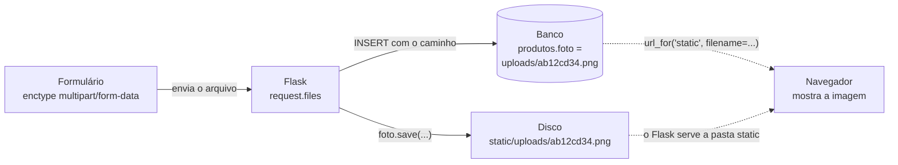
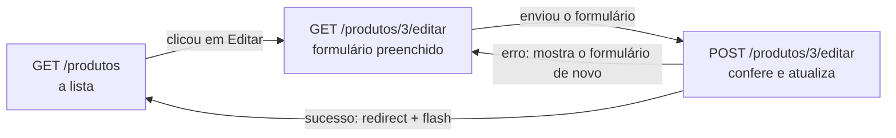

# Capítulo 18 — CRUD de produtos

**Disciplina:** Programação para Internet (ILP951)
**Professor:** Ronan Adriel Zenatti · ronan.zenatti@cps.sp.gov.br
**Fatec Jahu — 2º Semestre/2026**

---

## 🎯 Objetivos do Capítulo

Ao final deste capítulo você deverá ser capaz de:

- Ler as colunas de `produtos` (`DECIMAL`, `TEXT`, `TINYINT(1)` e um caminho de arquivo) e decidir como cada uma aparece no formulário
- Converter e validar o preço com `Decimal` no formato brasileiro (`1.234,56`), e explicar por que o `float` não serve para dinheiro
- Montar um formulário com `textarea`, `select`, `checkbox` e campo de arquivo, e ler o `checkbox` no servidor (ele só é enviado quando marcado)
- Receber um upload com `request.files`, conferir a extensão com `secure_filename`, limitar o tamanho com `MAX_CONTENT_LENGTH` e gravar o arquivo em disco, guardando só o caminho no banco
- Criar um filtro Jinja próprio (`moeda`) e colorir selos por faixa de estoque
- Editar um produto com um `UPDATE` montado por partes (a foto é opcional) e apagar o arquivo antigo
- Excluir um produto com `DELETE` por `POST` e modal de confirmação, apagando também a foto do disco

Os Capítulos 12 a 17 construíram perfis e usuários, e o sistema já exige login. Falta o terceiro recurso, o **produto**, que traz o que os outros não tinham: dinheiro, que não pode errar um centavo; um estoque; uma escolha de lista; um interruptor de ativo e inativo; e uma **foto**, que é um arquivo. Este capítulo constrói o CRUD completo (`INSERT`, `SELECT`, `UPDATE` e `DELETE`) em um só arquivo, tópico a tópico, e explica cada peça de novo, sem depender de leitura anterior. Ao final, o sistema cadastra, lista, edita e exclui produtos, com preço em reais e foto.

Os Capítulos 18.1 a 18.4 são **opcionais**: percorrem o mesmo caminho em arquivos menores (o cadastro, a lista, a edição e a exclusão, cada um com o seu zip), para quem prefere estudar em etapas. O Capítulo 19 parte do código **deste** capítulo.

## 📦 Ponto de partida

Este capítulo continua do **seu** repositório `sistema-gestao`, como ficou no fim do Capítulo 17: com o login funcionando e a Ana, o Bruno e a Carla cadastrados com a senha `Senha123`. Os Capítulos 12.1, 13.1, 14.1 e 17.1 são opcionais: este capítulo parte do código do 17, e não deles.

!!! warning "Os três usuários precisam existir"
    Todas as rotas do sistema exigem login desde o Capítulo 17, e só entra quem já tem um usuário. Se o seu banco não tem a Ana, o Bruno e a Carla, o zip não resolve: comece pelo zip do Capítulo 16, que ainda não tem login, cadastre os três usuários pelo formulário (a tabela do [Capítulo 15, Tópico 1](Capitulo_15_SELECT_Relacional_de_Usuario.md) diz o que preencher, todos com a senha `Senha123`) e só depois use o código do Capítulo 17.

Se o seu projeto não está funcionando, baixe o código de Capítulo 17 e descompacte. Depois de descompactar, crie o ambiente virtual e o `.env`, como no [Capítulo 11, Tópico 4](Capitulo_11_Projeto_Novo_e_Banco.md#topico-4-o-arquivo-env), e importe o `banco.sql` no phpMyAdmin:

➡️ [Baixar p2_cap_17.zip](../arquivos/p2_cap_17.zip)

```bash
python -m venv venv
venv\Scripts\activate
pip install -r requirements.txt
copy .env.example .env
```

---

## Tópico 1 — A tabela `produtos` e a página provisória

### Antes de começar

Ligue o **Apache** e o **MySQL** no painel do XAMPP. Abra a pasta `sistema-gestao` no VS Code, o terminal (`Ctrl + '`), ative o ambiente virtual e confira o Git:

```bash
venv\Scripts\activate
git status
```

O `git status` deve dizer `nothing to commit, working tree clean`. Ligue o servidor com `python app.py` e deixe esse terminal rodando durante o capítulo (use um segundo terminal, o ícone **+**, para o Git). Abra **http://127.0.0.1:5000**, entre com a Ana (`ana@exemplo.com`, senha `Senha123`) e olhe o cartão **produtos** do dashboard: ele mostra **0**, porque nenhum produto foi cadastrado.

### A tabela `produtos`

A tabela já existe desde o `banco.sql` do Capítulo 11, vazia. No phpMyAdmin, abra o banco `gestao`, clique em `produtos` e depois em **Estrutura**. Estas são as colunas, e o que cada uma pede do formulário:

```sql
CREATE TABLE IF NOT EXISTS produtos (
    id_produto    BIGINT UNSIGNED AUTO_INCREMENT PRIMARY KEY,
    nome          VARCHAR(255) NOT NULL,
    descricao     TEXT,
    categoria     VARCHAR(100),
    preco         DECIMAL(10,2) NOT NULL,
    estoque       INT UNSIGNED NOT NULL DEFAULT 0,
    foto          VARCHAR(255),
    ativo         TINYINT(1) NOT NULL DEFAULT 1,
    criado_em     TIMESTAMP DEFAULT CURRENT_TIMESTAMP,
    atualizado_em TIMESTAMP DEFAULT CURRENT_TIMESTAMP ON UPDATE CURRENT_TIMESTAMP
);
```

| Coluna | Tipo | No formulário |
|---|---|---|
| `nome` | `VARCHAR(255) NOT NULL` | Obrigatório, de 3 a 255 caracteres |
| `descricao` | `TEXT` | Opcional, em uma área de texto (`<textarea>`) |
| `categoria` | `VARCHAR(100)` | Opcional, escolhida em uma lista |
| `preco` | `DECIMAL(10,2) NOT NULL` | Obrigatório, até `99.999.999,99` |
| `estoque` | `INT UNSIGNED NOT NULL` | Obrigatório, número inteiro de 0 para cima |
| `foto` | `VARCHAR(255)` | Opcional, e **não guarda a imagem**: guarda o caminho de um arquivo gravado em disco |
| `ativo` | `TINYINT(1) NOT NULL` | Um interruptor: `1` é ativo, `0` é inativo |

Três delas são novidade em relação a `usuarios`:

- **`DECIMAL(10,2)`** guarda um número com 10 dígitos no total e 2 depois da vírgula, **exatos**. É o tipo certo para dinheiro. Os números com casas decimais do Python comuns (`float`) erram nas contas, como você vai ver nas validações.
- **`foto`** é um texto curto, como `uploads/ab12cd34.png`. A imagem em si fica numa pasta do projeto, e o banco só sabe o endereço dela. Guardar imagens dentro do banco deixaria cada `SELECT` pesado.
- **`ativo`** é um `TINYINT(1)`: o MySQL não tem o tipo "verdadeiro ou falso", e usa o número `1` ou `0`.

As colunas `criado_em` e `atualizado_em` o próprio MySQL preenche, e o formulário nunca as toca.

### O mapa do recurso

Como em `perfis` e `usuarios`, o recurso `produtos` segue o mesmo molde de nomes. Este é o mapa do que será construído:

| Rota | Métodos | O que faz | Função no `app.py` | Template |
|---|---|---|---|---|
| `/produtos` | GET | Lista os produtos | `listar_produtos` | `produtos/produtos_lista.html` |
| `/produtos/inserir` | GET e POST | GET mostra o formulário, POST confere e grava | `inserir_produto` | `produtos/produto_form.html` |
| `/produtos/<int:id_produto>/editar` | GET e POST | GET mostra o formulário preenchido, POST confere e atualiza | `editar_produto` | `produtos/produto_form.html` |
| `/produtos/<int:id_produto>/excluir` | só POST | Exclui o produto e volta para a lista | `excluir_produto` | (nenhum) |

Não há página de detalhe: a lista já mostra o que importa de cada produto, e os botões de editar e excluir ficam nela mesma, na linha do produto.

### A página provisória `/produtos`

Antes do formulário, o sistema precisa de um lugar para onde voltar depois de gravar e de um destino para o botão **Cancelar**. A lista de verdade fica para depois do cadastro; por enquanto, a rota `/produtos` mostra uma página provisória, **sem consulta ao banco**. No `app.py`, crie uma seção nova, **PRODUTOS**, depois da seção **USUÁRIOS** e antes da seção das telas de erros, com a rota:

```python
# ==============================================================================
# PRODUTOS
# ==============================================================================

@app.route('/produtos')
def listar_produtos():
    if 'id_usuario' not in session:
        flash('Entre para continuar.', 'warning')
        return redirect(url_for('login'))

    # Página provisória: a lista com SELECT vem depois do cadastro
    return render_template('produtos/produtos_lista.html', titulo='Produtos')
```

O `if` do começo é o mesmo das outras rotas desde o [Capítulo 17](Capitulo_17_Login.md#topico-5-proteger-as-rotas): quem não fez login vai para a tela de entrada. Crie a pasta `templates/produtos` e, dentro dela, o `produtos_lista.html`, só com o título e o aviso:

```html


{{ titulo }} — Sistema de Gestão


  <h1 class="h2 mb-3">{{ titulo }}</h1>

  <div class="alert alert-info" role="alert">
    A lista de produtos chega mais adiante. Por enquanto, confira os cadastros no phpMyAdmin
    (banco <strong>gestao</strong>, tabela <strong>produtos</strong>) e no contador do dashboard.
  </div>

```

Agora o menu. No `templates/layout/base_menu.html`, acrescente o menu suspenso **Produtos** **depois** do menu Usuários, dentro do primeiro `<ul class="navbar-nav me-auto">`. Procure o `</li>` que fecha o bloco do menu **Usuários** (logo depois do link **Cadastrar Usuário** e do `</ul>`) e acrescente, abaixo dele:

```html
<li class="nav-item dropdown">
  <a class="nav-link dropdown-toggle active" href="#" role="button" data-bs-toggle="dropdown" aria-expanded="false">Produtos</a>
  <ul class="dropdown-menu">
    <li><a class="dropdown-item" href="{{ url_for('listar_produtos') }}">Listar Produtos</a></li>
  </ul>
</li>
```

A lista `['listar_produtos', 'inserir_produto', 'editar_produto']` faz o menu ficar destacado em qualquer uma das telas do recurso, inclusive nas que ainda vão ser construídas: o `request.endpoint in [...]` só compara nomes, e não depende de as rotas existirem. Salve, recarregue e use **Produtos > Listar Produtos**: a página provisória aparece, com o menu destacado. Saia do sistema (**Sair**) e digite `http://127.0.0.1:5000/produtos` na barra de endereço: você volta para a tela de entrada, com a faixa `Entre para continuar.` Entre de novo antes de seguir.

```bash
git add .
git commit -m "Adiciona a página provisória de produtos e o item no menu"
git push
```

---

## Tópico 2 — O formulário de produto

### A lista de categorias

O formulário terá uma lista para escolher a categoria, e o servidor vai conferir se o valor que chegou está nessa lista. As duas pontas precisam da **mesma** lista, e por isso ela fica no arquivo de validações dos produtos, que nasce agora, como o `validacoes_usuario.py` nasceu com a lista `UFS`. Crie, dentro da pasta `validacoes`, o arquivo `validacoes_produto.py`, por enquanto só com a lista:

```python
# Categorias de produto aceitas pelo sistema: o formulário e a validação leem a mesma lista
CATEGORIAS = ['Informática', 'Periféricos', 'Áudio', 'Acessórios', 'Outros']
```

Se você quiser outras categorias, é só trocar os nomes da lista: o formulário muda sozinho. No `app.py`, importe a lista, logo abaixo da importação do `validacoes_perfil`:

```python
from validacoes.validacoes_produto import CATEGORIAS
```

### A rota do formulário

Na seção **PRODUTOS** do `app.py`, acrescente a rota `inserir_produto` **depois** da `listar_produtos`. Por enquanto ela só mostra o formulário:

```python
@app.route('/produtos/inserir', methods=['GET', 'POST'])
def inserir_produto():
    if 'id_usuario' not in session:
        flash('Entre para continuar.', 'warning')
        return redirect(url_for('login'))

    # No GET, o formulário abre com o estoque em 0 e o produto ativo
    dados = {'estoque': 0, 'ativo': 1}

    return render_template('produtos/produto_form.html', dados=dados, categorias=CATEGORIAS)
```

O `dados` é o mesmo dicionário do formulário de usuários (Capítulo 14), agora com dois valores iniciais: o estoque começa em `0` e o produto começa ativo (`1`). Os campos que não estão no dicionário (`nome`, `preco`...) aparecem **vazios** no HTML: o Jinja escreve uma chave que não existe como um texto vazio.

### O formulário

Crie o `templates/produtos/produto_form.html`. É o mesmo molde dos outros formulários (cartão centralizado, token CSRF, Cancelar à esquerda e Salvar à direita), com campos de tipos novos:

```html


Novo produto — Sistema de Gestão


  <h1 class="h2 mb-4">Novo produto</h1>

  <div class="row justify-content-center">
    <div class="col-lg-8">
      <div class="card">
        <div class="card-body">

          <form action="{{ url_for('inserir_produto') }}" method="post" enctype="multipart/form-data">
            <input type="hidden" name="csrf_token" value="{{ csrf_token() }}">

            <div class="mb-3">
              <label for="nome" class="form-label">Nome do produto</label>
              <input type="text" class="form-control" id="nome" name="nome" placeholder="Ex.: Mouse sem fio" value="{{ dados.nome }}" required minlength="3" maxlength="255">
            </div>

            <div class="mb-3">
              <label for="descricao" class="form-label">Descrição (opcional)</label>
              <textarea class="form-control" id="descricao" name="descricao" rows="3" maxlength="2000">{{ dados.descricao or '' }}</textarea>
            </div>

            <div class="row">
              <div class="col-md-4 mb-3">
                <label for="preco" class="form-label">Preço</label>
                <div class="input-group">
                  <span class="input-group-text">R$</span>
                  <input type="text" inputmode="decimal" class="form-control" id="preco" name="preco" placeholder="0,00" value="{{ dados.preco }}" required pattern="([0-9]{1,3}(\.[0-9]{3})+|[0-9]+)(,[0-9]{1,2})?" title="Use vírgula nos centavos, por exemplo 1.234,56">
                </div>
              </div>
              <div class="col-md-4 mb-3">
                <label for="estoque" class="form-label">Estoque</label>
                <input type="number" class="form-control" id="estoque" name="estoque" value="{{ dados.estoque }}" required min="0" max="1000000" step="1">
              </div>
              <div class="col-md-4 mb-3">
                <label for="categoria" class="form-label">Categoria (opcional)</label>
                <select class="form-select" id="categoria" name="categoria">
                  <option value="">Sem categoria</option>
                  
                    <option value="{{ categoria }}" selected>{{ categoria }}</option>
                  
                </select>
              </div>
            </div>

            <div class="mb-3">
              <label for="foto" class="form-label">Foto (opcional)</label>
              <input type="file" class="form-control" id="foto" name="foto" accept=".jpg,.jpeg,.png,.webp">
              <div class="form-text">Arquivo jpg, jpeg, png ou webp, com até 2 MB.</div>
            </div>

            <div class="form-check form-switch mb-4">
              <input class="form-check-input" type="checkbox" role="switch" id="ativo" name="ativo" value="1" checked>
              <label class="form-check-label" for="ativo">Produto ativo</label>
            </div>

            <div class="d-flex justify-content-between gap-2">
              <a href="{{ url_for('listar_produtos') }}" class="btn btn-outline-secondary">Cancelar</a>
              <button type="submit" class="btn btn-primary">Salvar produto</button>
            </div>

          </form>

        </div>
      </div>
    </div>
  </div>

```

Campo por campo:

- **O nome** é obrigatório, com os limites da coluna (`minlength`, `maxlength`), e o `value` devolve o que a pessoa digitou quando o formulário voltar com erro.
- **A descrição** é opcional (a coluna aceita `NULL`), então fica sem `required`, e como o texto pode ter várias linhas, usa `<textarea>`. Diferente do `<input>`, o `<textarea>` não tem o atributo `value`: o texto inicial vai **entre** a tag de abertura e a de fechamento, sem espaços nem quebras de linha extras, porque tudo o que estiver ali aparece dentro da caixa. Como todo opcional, leva o `or ''`.
- **O preço** é `type="text"`, e não `type="number"`: o campo numérico do navegador trabalha com o **ponto** como separador decimal e recusa a vírgula, e no Brasil se escreve `1.234,56`. Com `type="text"`, a pessoa digita do jeito brasileiro, e o servidor converte. O `inputmode="decimal"` pede ao celular o teclado numérico, e o `pattern` é uma regra de formato: aceita `1234`, `1234,5`, `1234,56` e `1.234,56`, e recusa `1234.56`. O texto do `title` aparece quando o navegador recusa o valor.
- **O estoque** é um número inteiro, e aí o `type="number"` serve: o `min`, o `max` e o `step="1"` fazem o navegador recusar negativos, números muito grandes e decimais.
- **A categoria** é um `<select>` montado pelo `for` a partir da lista `categorias`. A primeira opção tem `value=""` (nenhuma categoria), e o `selected` marca a opção escolhida quando o formulário voltar com erros.
- **A foto** é um campo de arquivo (`type="file"`). Para enviar um arquivo, o `<form>` precisa do atributo `enctype="multipart/form-data"`, que muda a forma como o navegador empacota o envio: sem ele, só o *nome* do arquivo seguiria, e nunca o conteúdo. O `accept` faz a janela de escolha de arquivos mostrar só os formatos aceitos, mas, como o `pattern` do preço, é uma conveniência: o servidor confere de novo. Como o arquivo é recebido e gravado é o assunto do Tópico 4.
- **O interruptor ativo** é um `checkbox` com o visual de chave (`form-switch`). Ele tem uma particularidade: marcado, envia `ativo=1` (o `value`); **desmarcado, não envia nada**, nem `ativo=0`. Por isso o servidor vai tratar "não veio" como "inativo". O `checked` deixa o interruptor ligado quando o produto começa ativo.

Abra **http://127.0.0.1:5000/produtos/inserir** e confira os sete campos: o estoque já abre com `0` e o interruptor ligado. Digite `abc` no preço e clique em **Salvar produto**: o navegador recusa, com a mensagem do `title`.

### Os caminhos até o formulário

**Na lista provisória.** No `produtos_lista.html`, troque a linha do título:

```html
<h1 class="h2 mb-3">{{ titulo }}</h1>
```

por um cabeçalho com o título e o botão **Novo produto**:

```html
<div class="d-flex justify-content-between align-items-center mb-3">
  <h1 class="h2 mb-0">{{ titulo }}</h1>
  <a href="{{ url_for('inserir_produto') }}" class="btn btn-primary">Novo produto</a>
</div>
```

**No menu.** No `base_menu.html`, dentro do `<ul class="dropdown-menu">` do menu **Produtos**, acrescente o segundo link, logo **depois** do **Listar Produtos** (o destaque do menu já inclui o `inserir_produto` desde o Tópico 1):

```html
<li><a class="dropdown-item" href="{{ url_for('inserir_produto') }}">Cadastrar Produto</a></li>
```

Salve e confira os dois caminhos: **Produtos > Cadastrar Produto** e o botão **Novo produto** da página provisória. Preencha o nome e clique em **Salvar produto**: a página recarrega com os valores iniciais, porque a rota ainda ignora o POST.

```bash
git add .
git commit -m "Adiciona o formulário de novo produto"
git push
```

---

## Tópico 3 — As validações do produto, com `Decimal` para o preço

### O navegador não basta

Os atributos `required`, `pattern`, `min` e `max` são uma conveniência: avisam a pessoa antes de enviar. Mas quem controla o que chega ao servidor não é o navegador. Um `POST` pode ser enviado por outro programa, ou com os atributos apagados pelo painel de desenvolvimento (`F12`). Por isso, como nos capítulos anteriores, **o servidor confere tudo de novo**, e a validação que vale é a do Python. Ela fica toda no `validacoes_produto.py`, no molde do de usuários: uma função por campo, que devolve a mensagem de erro ou `None`, e uma função principal, `validar_produto`, que junta as mensagens em uma lista.

### O preço: por que não `float`

Antes do arquivo, o campo delicado. Tudo o que chega do formulário é texto, e o texto `1.234,56` precisa virar um **número exato**. A primeira ideia seria o `float`. Veja o problema no terminal do Python (abra com `python`, e saia com `exit()`):

```python
>>> 0.1 + 0.2
0.30000000000000004
```

O `float` guarda uma **aproximação** do número, em binário, e as contas acumulam erros de centavos. Para dinheiro, o Python tem o `Decimal`:

```python
>>> from decimal import Decimal
>>> Decimal('0.1') + Decimal('0.2')
Decimal('0.3')
```

!!! note "Python: `Decimal`"
    O `Decimal` guarda o número **exato**, dígito por dígito, como o `DECIMAL` do MySQL. Ele é criado a partir de um **texto** (`Decimal('0.1')`), e não de um `float`: `Decimal(0.1)` já carregaria o erro do `float`. O conector do MySQL entende o `Decimal` e o grava na coluna `DECIMAL` sem perder um centavo, e é isso que ele devolve nos `SELECT`.

O `Decimal` só entende o ponto como separador decimal: `Decimal('1234.56')` funciona, e `Decimal('1.234,56')` dá erro. A tradução parece simples: tirar os pontos de milhar e trocar a vírgula por ponto, `texto.replace('.', '').replace(',', '.')`. Mas ela esconde um erro grave: quem digitasse `1234.56` (com ponto, do jeito americano) teria os pontos apagados e o produto gravado como `123456`, um preço **cem vezes maior**, sem nenhum aviso. E um texto como `abc` faria o `Decimal` parar o programa com um erro. A conversão precisa ser rigorosa: aceitar **só** os formatos brasileiros e devolver `None` para o resto. É a função `converter_preco` do arquivo.

### O arquivo completo

Troque o conteúdo do `validacoes/validacoes_produto.py` pelo arquivo completo (a lista `CATEGORIAS` continua no topo):

```python
from decimal import Decimal

from werkzeug.utils import secure_filename

# Categorias de produto aceitas pelo sistema: o formulário e a validação leem a mesma lista
CATEGORIAS = ['Informática', 'Periféricos', 'Áudio', 'Acessórios', 'Outros']

# Limite da coluna estoque
ESTOQUE_MAXIMO = 1000000

# Limite da coluna preco, que é DECIMAL(10,2)
PRECO_MAXIMO = Decimal('99999999.99')

# Extensões aceitas para a foto do produto
EXTENSOES_FOTO = ['jpg', 'jpeg', 'png', 'webp']


# ==============================================================================
# FUNÇÕES DE APOIO
# ==============================================================================

def so_digitos(texto):
    resultado = ''
    for letra in texto:
        if letra in '0123456789':
            resultado = resultado + letra
    return resultado


def converter_preco(texto):
    # Aceita 1234,56 e 1.234,56. Devolve um Decimal, ou None se o texto não for um preço.
    partes = texto.split(',')
    if len(partes) > 2:
        return None

    centavos = ''
    if len(partes) == 2:
        centavos = partes[1]
        if len(centavos) == 0 or len(centavos) > 2 or so_digitos(centavos) != centavos:
            return None

    grupos = partes[0].split('.')
    numero = ''
    for posicao in range(len(grupos)):
        grupo = grupos[posicao]
        if grupo == '' or so_digitos(grupo) != grupo:
            return None
        if len(grupos) > 1 and posicao == 0 and len(grupo) > 3:
            return None
        if posicao > 0 and len(grupo) != 3:
            return None
        numero = numero + grupo

    if centavos != '':
        numero = numero + '.' + centavos

    return Decimal(numero)


def extensao_da_foto(nome_arquivo):
    # 'Foto da Ação.PNG' vira 'png'; um nome sem ponto não tem extensão
    nome_seguro = secure_filename(nome_arquivo)

    if '.' not in nome_seguro:
        return ''

    return nome_seguro.rsplit('.', 1)[1].lower()


# ==============================================================================
# UMA FUNÇÃO POR CAMPO: cada uma devolve a mensagem de erro ou None
# ==============================================================================

# ================ VALIDAÇÕES PARA O CAMPO nome =====================
def validar_nome(nome):
    if not nome:
        return 'Informe o nome do produto.'

    if len(nome) < 3:
        return 'O nome deve ter pelo menos 3 caracteres.'

    if len(nome) > 255:
        return 'O nome deve ter no máximo 255 caracteres.'

    return None


# ================ VALIDAÇÕES PARA O CAMPO descricao (opcional) =====================
def validar_descricao(descricao):
    # A coluna é TEXT; o limite de 2000 caracteres é uma regra do sistema
    if descricao and len(descricao) > 2000:
        return 'A descrição deve ter no máximo 2000 caracteres.'

    return None


# ================ VALIDAÇÕES PARA O CAMPO preco =====================
def validar_preco(texto):
    if not texto:
        return 'Informe o preço.'

    preco = converter_preco(texto)
    if preco is None:
        return 'Informe o preço no formato 1.234,56.'

    if preco <= 0:
        return 'O preço deve ser maior que zero.'

    if preco > PRECO_MAXIMO:
        return 'O preço máximo é 99.999.999,99.'

    return None


# ================ VALIDAÇÕES PARA O CAMPO estoque =====================
def validar_estoque(texto):
    if not texto:
        return 'Informe o estoque.'

    if so_digitos(texto) != texto:
        return 'O estoque deve ser um número inteiro, sem sinal nem vírgula.'

    if int(texto) > ESTOQUE_MAXIMO:
        return 'O estoque máximo é 1.000.000.'

    return None


# ================ VALIDAÇÕES PARA O CAMPO categoria (opcional) =====================
def validar_categoria(categoria):
    if not categoria:
        return None

    if categoria not in CATEGORIAS:
        return 'Selecione uma categoria válida.'

    return None


# ================ VALIDAÇÕES PARA A foto (opcional) =====================
def validar_foto(foto):
    if foto is None:
        return None

    if extensao_da_foto(foto.filename) not in EXTENSOES_FOTO:
        return 'A foto deve ser um arquivo jpg, jpeg, png ou webp.'

    return None


# ==============================================================================
# FUNÇÃO PRINCIPAL: recebe o dicionário com o formulário e a foto, e devolve a lista de erros
# ==============================================================================

def validar_produto(dados, foto):
    erros = []

    erro = validar_nome(dados['nome'])
    if erro:
        erros.append(erro)

    erro = validar_descricao(dados['descricao'])
    if erro:
        erros.append(erro)

    erro = validar_preco(dados['preco'])
    if erro:
        erros.append(erro)

    erro = validar_estoque(dados['estoque'])
    if erro:
        erros.append(erro)

    erro = validar_categoria(dados['categoria'])
    if erro:
        erros.append(erro)

    erro = validar_foto(foto)
    if erro:
        erros.append(erro)

    return erros
```

Parte por parte.

**As constantes do topo** guardam os limites das colunas e as listas que o formulário e a validação compartilham. O `DECIMAL(10,2)` comporta 8 dígitos antes da vírgula e 2 depois: o maior preço possível é `99999999.99`, e um preço maior faria o MySQL recusar o `INSERT`. A validação avisa a pessoa antes.

**A `so_digitos`** é a mesma do arquivo de usuários (Capítulo 14): devolve só os dígitos de um texto. Cada arquivo de validação tem as suas funções de apoio, para não depender do outro.

**A `converter_preco`**, em três blocos:

1. **A vírgula separa os centavos.** `texto.split(',')` quebra o texto nela. Mais de uma vírgula não é preço. Se há uma, o que vem depois dela (`centavos`) precisa ter de 1 a 2 dígitos.
2. **O ponto separa os milhares.** A parte antes da vírgula é quebrada nos pontos (`'1.234'` vira `['1', '234']`). O primeiro grupo tem de 1 a 3 dígitos **quando há mais de um grupo**, e todos os outros têm **exatamente 3** (`1.234` está certo, `12.34` não). É isso que faz o `1234.56` falhar: o primeiro grupo (`1234`) é grande demais para ter outro depois dele.
3. **Os pedaços são juntados.** O `numero` vai recebendo os grupos, depois o `.` e os centavos, e só no fim vira `Decimal`, quando o texto já é seguro.

!!! note "Python: `split`, `range` e `len`"
    O `texto.split(',')` quebra o texto em uma **lista** de pedaços, cortando em cada vírgula: `'1.234,56'.split(',')` devolve `['1.234', '56']`. O `len(...)` conta quantos itens a lista tem (ou quantos caracteres tem um texto). O `range(len(grupos))` produz os números `0, 1, 2...` até o último item, e o `for posicao in range(...)` repete o bloco uma vez para cada posição, o que permite saber **qual** é o grupo (`grupos[posicao]`) e se ele é o primeiro (`posicao == 0`). A função devolve `None` para dizer "isto não é um preço".

**A `extensao_da_foto`.** O nome do arquivo vem do computador de quem enviou, e **não é de confiança**: pode ter espaços, acentos e até caminhos (`../../app.py`), um truque para gravar um arquivo fora da pasta certa. O Werkzeug (a biblioteca por baixo do Flask, já instalada com ele) tem a função `secure_filename`, que limpa o nome: `../../app.py` vira `app.py`, e `Foto da Ação.PNG` vira `Foto_da_Acao.PNG`. Depois de limpo, o nome é cortado no último ponto para sobrar a **extensão**, em minúsculas.

!!! note "Python: `rsplit` e o `[1]`"
    O `'foto.final.PNG'.rsplit('.', 1)` quebra o texto no **último** ponto e devolve a lista `['foto.final', 'PNG']`. O `[1]` pega o segundo item (a lista começa em `0`), e o `.lower()` troca para minúsculas, para `PNG` e `png` valerem o mesmo. Um nome sem ponto não tem extensão, e a função devolve o texto vazio.

**As funções dos campos** têm a forma que você já conhece:

- **O nome** é a `validar_nome` dos usuários, com outro texto.
- **A descrição** só confere o tamanho quando existe (o `if descricao and ...` da descrição do perfil). A coluna é `TEXT`, e o limite de 2000 é uma regra do sistema.
- **O preço** usa a `converter_preco` e confere os limites. Repare na ordem: primeiro "veio vazio?", depois "é um preço?", e só então as comparações com `0` e com o máximo, que precisam de um número.
- **O estoque** compara o texto com ele mesmo **só com os dígitos**: se for diferente, havia algo que não era dígito (`-3`, `2,5`, `abc`). Só depois disso o `int(texto)` é seguro.
- **A categoria** aceita o vazio (é opcional), mas recusa um nome que **não está na lista**: quem monta um `POST` à mão poderia mandar `Categoria Inventada`, e o `<select>` do navegador não impediria.
- **A foto** é opcional: sem arquivo, a rota entrega `None`, e não há o que conferir. Com arquivo, a extensão precisa estar na lista `EXTENSOES_FOTO`.

**A função principal** recebe o dicionário do formulário **e** a foto, que não chega pelo `request.form`, e sim por outro caminho (Tópico 4), e chama as funções na ordem do formulário.

### Testando as funções

No segundo terminal, com o `venv` ativo e na pasta do projeto:

```bash
python -c "from validacoes.validacoes_produto import converter_preco as c; print(c('1.234,56'), c('1234,5'), c('25'), c('1.234'), c('1234.56'), c('12.34'), c('abc'), c('5,'), c('-5'))"
python -c "from validacoes.validacoes_produto import validar_preco as v; print(v('1.234,56')); print(v('')); print(v('0')); print(v('1234.56')); print(v('100.000.000,00'))"
python -c "from validacoes.validacoes_produto import validar_estoque as v; print(v('12')); print(v('-3')); print(v('2,5')); print(v('5000000'))"
python -c "from validacoes.validacoes_produto import extensao_da_foto as e; print(e('Foto da Ação.PNG')); print(e('../../app.py')); print(e('sem_ponto'))"
```

O que deve aparecer:

1. `1234.56 1234.5 25 1234 None None None None None`: os quatro formatos brasileiros viram número, e o resto vira `None`.
2. `None` e depois as mensagens de vazio, de maior que zero, de formato e de máximo.
3. `None` e depois as mensagens de inteiro (duas vezes) e de máximo.
4. `png`, `py` e uma linha vazia.

```bash
git add .
git commit -m "Cria o arquivo de validações de produto, com Decimal para o preço"
git push
```

---

## Tópico 4 — A foto: onde e como ela é gravada

### Onde a foto fica guardada

Uma foto é um arquivo grande, e o banco não é o lugar para guardá-la (cada `SELECT` da lista carregaria todas as imagens). O caminho clássico é outro: o **arquivo** vai para uma pasta do projeto, e o **banco** guarda só o caminho dele, um texto curto na coluna `foto`.



A pasta escolhida é `static/uploads/`. O Flask já serve tudo o que está em `static/` pelo endereço `/static/...`, o mesmo caminho do `estilo.css`, e por isso uma foto gravada em `static/uploads/ab12cd34.png` abre em `http://127.0.0.1:5000/static/uploads/ab12cd34.png`.

### A pasta e o limite de tamanho

No `app.py`, logo depois do `CSRFProtect(app)`, defina a pasta e o limite de tamanho:

```python
# As fotos dos produtos ficam em static/uploads. O Flask recusa (erro 413) pedidos com mais de 2 MB.
PASTA_UPLOADS = os.path.join(app.root_path, 'static', 'uploads')
app.config['MAX_CONTENT_LENGTH'] = 2 * 1024 * 1024

os.makedirs(PASTA_UPLOADS, exist_ok=True)
```

O `app.root_path` é a pasta do projeto, e o `os.path.join` junta os pedaços com a barra certa para o sistema. O `os.makedirs(..., exist_ok=True)` cria a pasta `static/uploads` se ela ainda não existir, e não reclama quando já existe. O `MAX_CONTENT_LENGTH` faz o Flask recusar, com o erro **413** (*Payload Too Large*), qualquer pedido com mais de 2 MB, antes mesmo de a rota rodar (`2 * 1024 * 1024` são os bytes de 2 MB). Sem uma página para esse erro, a pessoa veria um texto seco do Flask. Na seção **TELAS DE ERROS**, acrescente o tratamento **antes** do `@app.errorhandler(500)`:

```python
@app.errorhandler(413)
def arquivo_grande_demais(erro):
    return render_template('413.html'), 413
```

E crie o `templates/413.html`, no mesmo molde do `404.html` e do `500.html`:

```html


Arquivo grande demais — Sistema de Gestão


  <div class="text-center py-5">
    <h1 class="display-1">413</h1>
    <p class="lead">O arquivo enviado é grande demais. A foto pode ter até 2 MB.</p>
    <a href="{{ url_for('listar_produtos') }}" class="btn btn-primary">Voltar para os produtos</a>
  </div>

```

### Gravar o arquivo no disco

Um arquivo gravado com o **nome original** teria dois problemas: dois produtos com a foto `foto.png` se sobrescreveriam, e o nome ainda seria um dado da pessoa. A solução é dar a cada foto um nome novo e único, que o Python sorteia com o módulo `uuid`. No topo do `app.py`, acrescente `import uuid` abaixo do `import os`:

```python
import os
import uuid
```

!!! note "Python: `uuid`"
    O `uuid.uuid4().hex` gera um texto aleatório de 32 letras e números, como `ab12cd34ef56...`, com chance praticamente nula de repetir. O nome da foto passa a ser esse texto + `.` + a extensão.

Troque a importação do `validacoes_produto` para trazer também a função da extensão (a principal e a do preço entram junto, para a rota do próximo tópico):

```python
from validacoes.validacoes_produto import CATEGORIAS, converter_preco, extensao_da_foto, validar_produto
```

E acrescente, na seção **PRODUTOS**, **depois** da `listar_produtos`, a função que grava a foto:

```python
def salvar_foto(foto):
    # O arquivo ganha um nome novo e único; o banco guarda o caminho relativo à pasta static
    nome_arquivo = uuid.uuid4().hex + '.' + extensao_da_foto(foto.filename)
    foto.save(os.path.join(PASTA_UPLOADS, nome_arquivo))

    return 'uploads/' + nome_arquivo
```

Ela não tem `@app.route`: não é uma rota, é um pedaço de código que a rota de cadastro (e, depois, a de edição) chama. O `foto` que ela recebe é o objeto do arquivo enviado, que tem o `.filename` (o nome que a pessoa tinha no computador) e o `.save()`, que grava o arquivo na pasta. A função devolve o **caminho relativo à pasta `static`**, `uploads/ab12cd34.png`, que é o texto que vai para a coluna `foto` do banco.

### As fotos não vão para o GitHub

As fotos são dados de quem usa o sistema, e **não** devem ir para o GitHub. A pasta `static/uploads`, porém, precisa continuar existindo no repositório (para quem clonar o projeto), o que se faz com um arquivo vazio dentro dela. Acrescente ao **final** do `.gitignore`:

```
# Fotos enviadas pelo sistema: ficam só no computador (a pasta continua no Git por causa do .gitkeep)
static/uploads/*
!static/uploads/.gitkeep
```

Salve o `app.py` e o servidor reinicia: a pasta `static/uploads` aparece no VS Code. Crie o arquivo vazio que a mantém no Git: clique com o botão direito na pasta `static/uploads`, escolha **Novo Arquivo**, digite `.gitkeep` e aperte `Enter`, sem escrever nada dentro dele. O `static/uploads/*` ignora tudo o que estiver na pasta, e a linha `!static/uploads/.gitkeep` abre uma exceção para o arquivo vazio.

```bash
git add .
git commit -m "Prepara a pasta das fotos, o limite de 2 MB e a página 413"
git push
```

---

## Tópico 5 — Gravar o produto (INSERT)

### A rota completa

Com o formulário, as validações e a gravação da foto prontos, a rota `inserir_produto` passa a tratar o POST. Troque-a inteira por esta:

```python
@app.route('/produtos/inserir', methods=['GET', 'POST'])
def inserir_produto():
    if 'id_usuario' not in session:
        flash('Entre para continuar.', 'warning')
        return redirect(url_for('login'))

    # No GET, o formulário abre com o estoque em 0 e o produto ativo
    dados = {'estoque': 0, 'ativo': 1}

    if request.method == 'POST':
        dados = {
            'nome': request.form.get('nome', '').strip(),
            'descricao': request.form.get('descricao', '').strip() or None,
            'preco': request.form.get('preco', '').strip(),
            'estoque': request.form.get('estoque', '').strip(),
            'categoria': request.form.get('categoria', '') or None,
        }

        # O checkbox desmarcado não é enviado: "não veio" quer dizer inativo
        if request.form.get('ativo') == '1':
            dados['ativo'] = 1
        else:
            dados['ativo'] = 0

        # Sem arquivo escolhido, o campo chega com o nome vazio
        foto = request.files.get('foto')
        if foto is not None and foto.filename == '':
            foto = None

        erros = validar_produto(dados, foto)

        if erros:
            for mensagem in erros:
                flash(mensagem, 'danger')
        else:
            # A foto só vai para o disco depois de os dados passarem na validação
            caminho_foto = None
            if foto is not None:
                caminho_foto = salvar_foto(foto)

            novo_id = execute_insert(
                'INSERT INTO produtos (nome, descricao, categoria, preco, estoque, foto, ativo) '
                'VALUES (%s, %s, %s, %s, %s, %s, %s)',
                (
                    dados['nome'],
                    dados['descricao'],
                    dados['categoria'],
                    converter_preco(dados['preco']),  # '1.234,56' vira Decimal('1234.56')
                    int(dados['estoque']),
                    caminho_foto,
                    dados['ativo'],
                ),
            )

            flash(f'Produto "{dados["nome"]}" cadastrado (código {novo_id}).', 'success')
            return redirect(url_for('listar_produtos'))

    return render_template('produtos/produto_form.html', dados=dados, categorias=CATEGORIAS)
```

O roteiro é o de sempre: coletar, validar, mostrar os erros ou gravar. Os comentários marcam o que é próprio do produto.

**Coletar.** O dicionário `dados` é o do formulário, como o dos usuários: a descrição e a categoria, opcionais, ganham o `or None` (vazias, são gravadas como `NULL`). O preço e o estoque continuam texto: a validação confere o formato, e a conversão só acontece na hora de gravar. Dois campos fogem do dicionário:

- **O `ativo`**: marcado, chega `'1'`; desmarcado, o campo **nem chega**, e o `request.form.get('ativo')` devolve `None`. O `if` transforma isso nos números `1` e `0`, que a coluna `ativo` guarda.
- **A foto**: os arquivos não chegam no `request.form`, e sim no `request.files`. Quando a pessoa não escolhe nenhum arquivo, o navegador envia o campo mesmo assim, com o nome do arquivo **vazio**, e o `if` transforma esse caso em `None`, que significa "sem foto".

**Validar.** A `validar_produto` recebe o dicionário e a foto.

**Gravar.** A foto só é gravada em disco **depois** de os dados passarem na validação: um formulário com erro não deixa arquivo sobrando na pasta. O `INSERT` tem um `%s` para cada valor, e as colunas `id_produto`, `criado_em` e `atualizado_em` ficam de fora: o MySQL as preenche sozinho. Três valores pedem cuidado:

| Coluna | O que o formulário entrega | O que vai para o banco |
|---|---|---|
| `descricao`, `categoria` | Texto vazio quando a pessoa não preenche | `NULL`, pelo `or None` da coleta |
| `preco` | Texto como `1.234,56` | O `Decimal` que a `converter_preco` devolve |
| `estoque` | Texto como `12` | O número inteiro, com `int()` |
| `foto` | Um arquivo, ou nenhum | O caminho que a `salvar_foto` devolve, ou `None` |

A `execute_insert` executa o comando e devolve o **código** que o `AUTO_INCREMENT` gerou, e o `redirect` é o PRG de sempre. Aqui não há `try/except`: a tabela `produtos` não tem coluna `UNIQUE`, então não há o erro `1062` a tratar.

!!! warning "Se o `INSERT` falhasse, a foto ficaria sem dono"
    A foto é salva antes do `INSERT`. Se o MySQL recusasse o comando, o arquivo ficaria na pasta, sem nenhum produto apontando para ele. Como a tabela `produtos` não tem coluna `UNIQUE`, esse caso é raro, e este projeto de sala não trata dele.

### Cadastrar os produtos

Salve e cadastre estes quatro produtos pelo formulário. Eles serão usados até o fim do projeto, e os valores foram escolhidos para ter um produto com estoque alto, baixo e zerado, um inativo e um sem categoria:

| Nome | Descrição | Preço | Estoque | Categoria | Ativo |
|---|---|---|---|---|---|
| Notebook Gamer | Tela de 15,6 polegadas, 16 GB de memória | `3.499,90` | `12` | Informática | sim |
| Teclado Mecânico | (vazia) | `129,90` | `3` | Periféricos | sim |
| Fone de Ouvido | Sem fio, com cancelamento de ruído | `249` | `40` | Áudio | sim |
| Cabo HDMI 2m | (vazia) | `25,00` | `0` | Sem categoria | **não** (desmarque o interruptor) |

Depois de cada **Salvar produto**, você cai na página provisória, com a faixa verde `Produto "Notebook Gamer" cadastrado (código 1).` (ou outro número). Aperte `F5`: a faixa some e nada é cadastrado de novo. Abra o **Home**: o cartão de produtos mostra **4**.

Abra o phpMyAdmin, banco `gestao`, tabela `produtos`, aba **Procurar**, e confira:

- o preço do notebook foi gravado como `3499.90` (sem o ponto de milhar e com ponto decimal, que é como o MySQL escreve);
- o preço do fone, digitado `249`, ficou `249.00`;
- as descrições vazias aparecem como `NULL`, em itálico, e não como um campo em branco;
- o cabo HDMI tem `ativo` igual a `0`, e os outros três, `1`;
- a coluna `foto` é `NULL` nos quatro;
- `criado_em` e `atualizado_em` têm a data e a hora, preenchidas pelo MySQL.

### Testar as validações e o upload

Salve e teste, na ordem. Para o navegador deixar passar os valores inválidos, apague o `pattern` do preço e os `required` pelo painel de desenvolvimento (`F12`, aba **Elements**):

1. **Erros juntos**: nome vazio, preço vazio e estoque vazio. Aparecem as três faixas (`Informe o nome do produto.` · `Informe o preço.` · `Informe o estoque.`), e o formulário volta com o que foi digitado.
2. **Formatos**: preço `1234.56` (`Informe o preço no formato 1.234,56.`), preço `0` (`O preço deve ser maior que zero.`), estoque `-3` (`O estoque deve ser um número inteiro, sem sinal nem vírgula.`). Nenhum produto novo entra na tabela.
3. **Com foto**: cadastre o **Mouse sem fio** (preço `89,90`, estoque `10`, categoria **Periféricos**) com uma foto `.jpg` ou `.png` do seu computador. Abra a pasta `static/uploads` no VS Code: o arquivo está lá, com um nome de 32 letras e números. No phpMyAdmin, a coluna `foto` desse produto mostra `uploads/` + o nome do arquivo. Abra no navegador `http://127.0.0.1:5000/static/uploads/` + o nome do arquivo: a imagem aparece. É o Flask servindo a pasta `static`.
4. **Extensão errada**: tente cadastrar outro produto com um arquivo `.pdf` ou `.txt` no campo da foto: o formulário volta com `A foto deve ser um arquivo jpg, jpeg, png ou webp.`, e nada é gravado em `static/uploads`. O navegador **não devolve o arquivo** escolhido (por segurança, nenhum site pode preencher um campo de arquivo sozinho): escolha a foto de novo antes de reenviar.
5. **Arquivo grande**: tente enviar uma imagem de mais de 2 MB: aparece a página **413**.

Rode `git status`: a foto do mouse **não** aparece, por causa do `.gitignore`.

```bash
git add .
git commit -m "Adiciona o INSERT de produto, com preço Decimal, opcionais NULL e foto em disco"
git push
```

---

## Tópico 6 — A lista de produtos (SELECT)

### A consulta

A lista precisa ler as colunas da tabela. Como no recurso `usuarios`, as colunas ficam em uma constante no topo do `app.py`, para que a lista e a edição leiam sempre as mesmas. Acrescente **depois** da constante `SELECT_USUARIO`:

```python
# As colunas que as telas de produto leem
SELECT_PRODUTO = (
    'SELECT id_produto, nome, descricao, categoria, preco, estoque, foto, ativo, '
    'criado_em, atualizado_em '
    'FROM produtos'
)
```

A constante termina no `FROM produtos`, sem `WHERE` nem `ORDER BY`: quem usa a constante completa o comando. Agora troque a rota `listar_produtos` para ler o banco:

```python
@app.route('/produtos')
def listar_produtos():
    if 'id_usuario' not in session:
        flash('Entre para continuar.', 'warning')
        return redirect(url_for('login'))

    produtos = execute_query(SELECT_PRODUTO + ' ORDER BY nome', fetch=True)

    return render_template('produtos/produtos_lista.html', titulo='Produtos', produtos=produtos)
```

O `execute_query(..., fetch=True)` devolve uma **lista de dicionários**, um por produto, ordenada por nome.

### O filtro `moeda`

O preço chega como `Decimal`, e o Jinja o escreveria como `3499.90`: com ponto decimal e sem milhar, e não do jeito brasileiro de ler dinheiro. Como as datas do Capítulo 15, o preço ganha um **filtro próprio**. Na seção **FILTROS DO JINJA** do `app.py`, acrescente, **depois** do filtro `cpf_oculto`:

```python
def formatar_numero(valor):
    # 1234.5 vira '1.234,50': o Python escreve 1,234.50, e as trocas acertam a pontuação
    texto = f'{valor:,.2f}'
    texto = texto.replace(',', 'X').replace('.', ',').replace('X', '.')

    return texto


@app.template_filter('moeda')
def moeda(valor):
    return 'R$ ' + formatar_numero(valor)
```

!!! note "Python: `f'{valor:,.2f}'`"
    Dentro de uma `f-string`, o que vem depois dos dois-pontos é a formatação: `.2f` pede 2 casas decimais, e a vírgula pede separador de milhar. Só que o Python escreve no padrão americano, `3,499.90`. As trocas acertam: a vírgula vira `X` (um marcador provisório), o ponto vira vírgula, e o `X` vira ponto, dando `3.499,90`. Se trocasse direto uma vírgula por ponto e depois o ponto por vírgula, os dois se atropelariam.

São duas funções: a `formatar_numero` escreve o número no formato brasileiro, **sem** o `R$`, e o filtro `moeda` acrescenta o `R$`. Elas ficam separadas de propósito: a edição vai usar a `formatar_numero` no campo de preço do formulário, onde o `R$` já está na tela.

### A tabela, com todas as colunas

Troque o `produtos_lista.html` **inteiro** por esta versão (o aviso provisório sai, e a tabela entra no lugar):

```html


{{ titulo }} — Sistema de Gestão


  <div class="d-flex justify-content-between align-items-center mb-3">
    <h1 class="h2 mb-0">{{ titulo }}</h1>
    <a href="{{ url_for('inserir_produto') }}" class="btn btn-primary">Novo produto</a>
  </div>

  <table class="table table-striped table-hover align-middle">
    <thead class="table-light">
      <tr>
        <th>Foto</th>
        <th>Código</th>
        <th>Nome</th>
        <th>Preço</th>
        <th>Estoque</th>
        <th>Situação</th>
        <th class="text-end">Ações</th>
      </tr>
    </thead>
    <tbody>
      
      <tr>
        <td>
          
            
          
            <span class="foto-produto foto-vazia">sem foto</span>
          
        </td>
        <td>{{ produto.id_produto }}</td>
        <td>
          {{ produto.nome }}<br>
          <small class="text-body-secondary">{{ produto.categoria if produto.categoria else 'Sem categoria' }}</small>
        </td>
        <td>{{ produto.preco|moeda }}</td>
        <td>
          
            <span class="badge text-bg-danger">Sem estoque</span>
          
            <span class="badge text-bg-warning">Estoque baixo ({{ produto.estoque }})</span>
          
            <span class="badge text-bg-success">Em estoque ({{ produto.estoque }})</span>
          
        </td>
        <td>
          
            <span class="badge text-bg-primary">Ativo</span>
          
            <span class="badge text-bg-secondary">Inativo</span>
          
        </td>
        <td class="text-end text-nowrap">
          <a href="#" class="btn btn-sm btn-warning" title="Editar"><i class="bi bi-pencil-square"></i></a>
          <button type="button" class="btn btn-sm btn-danger" title="Excluir"><i class="bi bi-trash"></i></button>
        </td>
      </tr>
      
      <tr>
        <td colspan="7" class="text-center text-body-secondary py-4">Nenhum produto cadastrado ainda.</td>
      </tr>
      
    </tbody>
  </table>

```

É o molde das listas de perfis e de usuários: o `for` repete a linha `<tr>` para cada produto, e o `` do próprio `for` mostra a mensagem quando a lista está vazia. Coluna por coluna:

- **Foto**: a coluna `foto` guarda `uploads/ab12cd34.png`, e o `url_for('static', filename=produto.foto)` monta o endereço `/static/uploads/ab12cd34.png`. Quando a coluna é `NULL`, o `if` cai no `else`, que desenha um quadrado cinza com o texto "sem foto". O `alt` descreve a imagem para quem usa leitor de tela.
- **Nome**, com a categoria em letra pequena embaixo, como o e-mail na lista de usuários. A categoria pode ser `NULL`, e o `if` em uma linha escreve `Sem categoria` no lugar.
- **Preço**, com o filtro `moeda`.
- **Estoque**: um estoque de 3 unidades e um de 300 não deveriam ter a mesma aparência. A célula usa o `if / elif / else` do Capítulo 5 para escolher a **cor** de um selo (*badge*): vermelho sem estoque, amarelo abaixo de 5, verde do resto.
- **Situação**: a coluna `ativo` chega como `1` ou `0`, e para o Jinja o `0` é falso.
- **Ações**: o botão **amarelo** de editar e o **vermelho** de excluir, como nas outras listas. Eles ainda **não fazem nada**: ganham as rotas na edição e na exclusão.

As duas classes da foto (`foto-produto` e `foto-vazia`) são regras de CSS próprias. Acrescente no **final** do `static/estilo.css`:

```css
/* Foto do produto na lista: quadrado de 56 px, com o recorte centralizado */
.foto-produto {
  width: 56px;
  height: 56px;
  object-fit: cover;
  border-radius: 0.375rem;
}

/* Quadrado cinza para o produto sem foto */
.foto-vazia {
  display: flex;
  align-items: center;
  justify-content: center;
  background-color: #e9ecef;
  color: #6c757d;
  font-size: 0.7rem;
  text-align: center;
}
```

O `object-fit: cover` recorta a imagem no centro para ela preencher o quadrado, sem esticar. Salve e recarregue **Produtos** (`Ctrl + F5`, para o navegador buscar o CSS novo):

| O que conferir | Onde |
|---|---|
| Preço no formato `R$ 3.499,90` | Coluna **Preço** |
| Três cores de estoque (verde no Notebook e no Fone, amarelo no Teclado, vermelho no Cabo) | Coluna **Estoque** |
| `Ativo` e `Inativo` (o Cabo HDMI) | Coluna **Situação** |
| `Sem categoria` no Cabo HDMI | Embaixo do nome |
| Miniatura no Mouse e quadrado "sem foto" nos outros | Primeira coluna |
| A lista ordenada pelo nome | Linhas |

```bash
git add .
git commit -m "Adiciona a lista de produtos com filtro moeda, selos de estoque e miniatura"
git push
```

---

## Tópico 7 — Editar um produto (UPDATE)

### O comando UPDATE

Editar é gravar de novo um produto que já existe. O comando é o `UPDATE`:

```sql
UPDATE produtos
SET nome = %s, descricao = %s, categoria = %s, preco = %s, estoque = %s, ativo = %s
WHERE id_produto = %s;
```

O `WHERE id_produto = %s` é obrigatório: sem ele, o `UPDATE` altera **todas** as linhas da tabela, sem perguntar e sem "desfazer". A rota de edição é a mesma ideia da `inserir_produto` com duas diferenças: ela precisa **buscar o produto** pelo código que vem no endereço (`/produtos/3/editar`) e **preencher o formulário** com os valores dele. E o formulário é o mesmo, o `produto_form.html`, que passa a servir para criar e para editar. O caminho do navegador na edição:



### A foto na edição

A foto é opcional na edição também, e há três situações:

| O que a pessoa fez no formulário | O que o `UPDATE` faz com a coluna `foto` |
|---|---|
| Escolheu um arquivo novo | Grava o caminho do arquivo novo e **apaga o arquivo antigo** do disco |
| Marcou **Remover a foto atual** | Grava `NULL` e **apaga o arquivo antigo** do disco |
| Não mexeu na foto | **Não toca** na coluna `foto` |

A terceira linha é a que complica: um `UPDATE` fixo sempre incluiria `foto = %s`, e, sem foto nova, teria de gravar o caminho antigo de volta. É mais simples montar o comando **por partes**, como o `UPDATE` de usuário do Capítulo 16 fazia com a senha: a base do `UPDATE` é fixa, e o pedaço `, foto = %s` só entra quando a foto muda.

Primeiro, a função que apaga o arquivo do disco. Acrescente na seção **PRODUTOS** do `app.py`, **depois** da `salvar_foto`:

```python
def apagar_foto(caminho):
    # Remove do disco a foto gravada no banco (se o produto não tem foto, não faz nada)
    if caminho is None:
        return

    arquivo = os.path.join(app.root_path, 'static', caminho)
    if os.path.exists(arquivo):
        os.remove(arquivo)
```

A função recebe o caminho gravado no banco (`uploads/ab12cd34.png`), junta com a pasta `static` e remove o arquivo, se ele existir. O `if caminho is None: return` cobre o produto que nunca teve foto: o `return` sozinho encerra a função sem devolver nada.

### A rota de edição

Acrescente a rota `editar_produto` **depois** da `inserir_produto`. O `abort` já está importado desde o Capítulo 13:

```python
@app.route('/produtos/<int:id_produto>/editar', methods=['GET', 'POST'])
def editar_produto(id_produto):
    if 'id_usuario' not in session:
        flash('Entre para continuar.', 'warning')
        return redirect(url_for('login'))

    produto = execute_one(SELECT_PRODUTO + ' WHERE id_produto = %s', (id_produto,))

    if produto is None:
        abort(404)

    # No GET, o formulário começa com a linha do banco; o preço vai no formato 1.234,56
    dados = produto
    dados['preco'] = formatar_numero(produto['preco'])

    if request.method == 'POST':
        dados = {
            'nome': request.form.get('nome', '').strip(),
            'descricao': request.form.get('descricao', '').strip() or None,
            'preco': request.form.get('preco', '').strip(),
            'estoque': request.form.get('estoque', '').strip(),
            'categoria': request.form.get('categoria', '') or None,
        }

        # O checkbox desmarcado não é enviado: "não veio" quer dizer inativo
        if request.form.get('ativo') == '1':
            dados['ativo'] = 1
        else:
            dados['ativo'] = 0

        # Sem arquivo escolhido, o campo chega com o nome vazio
        foto = request.files.get('foto')
        if foto is not None and foto.filename == '':
            foto = None

        erros = validar_produto(dados, foto)

        if erros:
            for mensagem in erros:
                flash(mensagem, 'danger')
        else:
            # O UPDATE é montado em partes: a coluna foto só entra quando a foto muda
            sql = (
                'UPDATE produtos SET '
                '    nome = %s, '
                '    descricao = %s, '
                '    categoria = %s, '
                '    preco = %s, '
                '    estoque = %s, '
                '    ativo = %s'
            )
            params = [
                dados['nome'],
                dados['descricao'],
                dados['categoria'],
                converter_preco(dados['preco']),
                int(dados['estoque']),
                dados['ativo'],
            ]

            trocou_foto = False
            if foto is not None:
                sql += ', foto = %s'
                params.append(salvar_foto(foto))
                trocou_foto = True
            elif request.form.get('remover_foto') == '1':
                sql += ', foto = %s'
                params.append(None)
                trocou_foto = True

            sql += ' WHERE id_produto = %s'
            params.append(id_produto)

            execute_query(sql, params)

            # O arquivo antigo só sai do disco depois de o UPDATE dar certo
            if trocou_foto:
                apagar_foto(produto['foto'])

            flash(f'Produto "{dados["nome"]}" atualizado.', 'success')
            return redirect(url_for('listar_produtos'))

    return render_template('produtos/produto_form.html', acao='editar', id_produto=id_produto, dados=dados,
                           categorias=CATEGORIAS, foto_atual=produto['foto'])
```

Parte por parte:

**Buscar o produto.** O `<int:id_produto>` é a variável de rota: o Flask pega o número do endereço e o entrega à função, com o mesmo nome. O `execute_one` devolve **um** produto (um dicionário) ou `None`, e o `abort(404)` mostra a página 404 quando o código não existe.

**`dados = produto`.** No GET, o dicionário do formulário **é a própria linha do banco**, como na edição de usuário: as chaves do `SELECT_PRODUTO` têm os nomes dos campos do formulário. A descrição `NULL` chega como `None`, e o `or ''` do `<textarea>` a mostra vazia; o `ativo` chega como o número `1` ou `0`, e o `` do formulário já compara com número. Só o **preço** precisa de ajuste: ele chega como `Decimal` (`3499.90`), e o campo e o `pattern` esperam `3.499,90`. A `formatar_numero` da lista resolve, sem o `R$`.

**O POST** coleta o formulário exatamente como a `inserir_produto` (copie o bloco de lá) e chama a mesma `validar_produto`.

**O `UPDATE` por partes.** O `sql` é um texto, e o `sql += ', foto = %s'` **acrescenta** um pedaço ao final dele; o `params` é uma **lista** de valores, e o `params.append(valor)` acrescenta um item. Os dois crescem juntos, e cada `%s` no texto tem o seu valor na lista, na mesma ordem. Os pedaços acrescentados ao texto são fixos, escritos no código: o que a pessoa digitou só entra pela lista. Se uma foto nova e a caixa **Remover** vierem juntas, vale a foto nova (o `if` vem antes do `elif`). O `WHERE` entra por último, depois de tudo o que está no `SET`.

**A foto antiga.** O arquivo antigo só é apagado **depois** do `execute_query`: se o `UPDATE` falhasse, a foto antiga continuaria no lugar. O `produto['foto']` é o valor que o `SELECT` do começo da rota trouxe, antes da alteração.

**O `render_template`** entrega `acao='editar'`, o `id_produto` (para o formulário montar o endereço de envio) e a `foto_atual`, para o formulário mostrar a foto que o produto já tem.

### O formulário nos dois modos

A rota de cadastro também passa a informar o modo. Na `inserir_produto`, troque a última linha:

```python
    return render_template('produtos/produto_form.html', dados=dados, categorias=CATEGORIAS)
```

por:

```python
    return render_template('produtos/produto_form.html', acao='criar', id_produto=None, dados=dados,
                           categorias=CATEGORIAS, foto_atual=None)
```

Agora o template. As mudanças estão em cinco pontos espalhados pelo arquivo, então troque o `templates/produtos/produto_form.html` **inteiro** por esta versão:

```html


{{ 'Editar produto' if acao == 'editar' else 'Novo produto' }} — Sistema de Gestão


  
    
  
    
  

  <h1 class="h2 mb-4">{{ 'Editar produto' if acao == 'editar' else 'Novo produto' }}</h1>

  <div class="row justify-content-center">
    <div class="col-lg-8">
      <div class="card">
        <div class="card-body">

          <form action="{{ destino }}" method="post" enctype="multipart/form-data">
            <input type="hidden" name="csrf_token" value="{{ csrf_token() }}">

            <div class="mb-3">
              <label for="nome" class="form-label">Nome do produto</label>
              <input type="text" class="form-control" id="nome" name="nome" placeholder="Ex.: Mouse sem fio" value="{{ dados.nome }}" required minlength="3" maxlength="255">
            </div>

            <div class="mb-3">
              <label for="descricao" class="form-label">Descrição (opcional)</label>
              <textarea class="form-control" id="descricao" name="descricao" rows="3" maxlength="2000">{{ dados.descricao or '' }}</textarea>
            </div>

            <div class="row">
              <div class="col-md-4 mb-3">
                <label for="preco" class="form-label">Preço</label>
                <div class="input-group">
                  <span class="input-group-text">R$</span>
                  <input type="text" inputmode="decimal" class="form-control" id="preco" name="preco" placeholder="0,00" value="{{ dados.preco }}" required pattern="([0-9]{1,3}(\.[0-9]{3})+|[0-9]+)(,[0-9]{1,2})?" title="Use vírgula nos centavos, por exemplo 1.234,56">
                </div>
              </div>
              <div class="col-md-4 mb-3">
                <label for="estoque" class="form-label">Estoque</label>
                <input type="number" class="form-control" id="estoque" name="estoque" value="{{ dados.estoque }}" required min="0" max="1000000" step="1">
              </div>
              <div class="col-md-4 mb-3">
                <label for="categoria" class="form-label">Categoria (opcional)</label>
                <select class="form-select" id="categoria" name="categoria">
                  <option value="">Sem categoria</option>
                  
                    <option value="{{ categoria }}" selected>{{ categoria }}</option>
                  
                </select>
              </div>
            </div>

            <div class="mb-3">
              <label for="foto" class="form-label">{{ 'Trocar a foto (opcional)' if foto_atual else 'Foto (opcional)' }}</label>
              
                <div class="d-flex align-items-center gap-3 mb-2">
                  
                  <div class="form-check mb-0">
                    <input class="form-check-input" type="checkbox" id="remover_foto" name="remover_foto" value="1">
                    <label class="form-check-label" for="remover_foto">Remover a foto atual</label>
                  </div>
                </div>
              
              <input type="file" class="form-control" id="foto" name="foto" accept=".jpg,.jpeg,.png,.webp">
              <div class="form-text">Arquivo jpg, jpeg, png ou webp, com até 2 MB.</div>
            </div>

            <div class="form-check form-switch mb-4">
              <input class="form-check-input" type="checkbox" role="switch" id="ativo" name="ativo" value="1" checked>
              <label class="form-check-label" for="ativo">Produto ativo</label>
            </div>

            <div class="d-flex justify-content-between gap-2">
              <a href="{{ url_for('listar_produtos') }}" class="btn btn-outline-secondary">Cancelar</a>
              <button type="submit" class="btn btn-primary">{{ 'Salvar alterações' if acao == 'editar' else 'Salvar produto' }}</button>
            </div>

          </form>

        </div>
      </div>
    </div>
  </div>

```

O que mudou em relação ao formulário do cadastro:

1. **O título da aba, o `<h1>` e o botão de enviar** usam o `if` em uma linha (`{{ 'Editar produto' if acao == 'editar' else 'Novo produto' }}`), como os formulários de perfil e de usuário.
2. **O destino** é escolhido no começo do bloco `conteudo`, com o ``, e usado no `<form action="{{ destino }}">`.
3. **A foto**: o rótulo vira **Trocar a foto (opcional)** quando o produto já tem foto, e o bloco `` mostra a miniatura atual (com a classe `foto-produto` da lista) e a caixa **Remover a foto atual**, que a rota lê como `remover_foto`. No cadastro, a `foto_atual` é `None`, e o bloco não aparece.

### Os caminhos até a edição

O botão amarelo existe na lista desde a construção dela, com o `href="#"`. No `produtos_lista.html`, troque, na célula de ações, a linha do botão de editar:

```html
<a href="#" class="btn btn-sm btn-warning" title="Editar"><i class="bi bi-pencil-square"></i></a>
```

por:

```html
<a href="{{ url_for('editar_produto', id_produto=produto.id_produto) }}" class="btn btn-sm btn-warning" title="Editar"><i class="bi bi-pencil-square"></i></a>
```

Note o nome do argumento do `url_for`: `id_produto=produto.id_produto`, o mesmo nome da variável de rota e da coluna. O menu **Produtos** já fica destacado na edição: o `'editar_produto'` está na lista do `request.endpoint` desde que o menu foi criado.

### Testar a edição

Salve e confira, nesta ordem, sempre entrando pelo botão amarelo da lista:

| Teste | O que deve acontecer |
|---|---|
| Abrir a edição do Notebook | Título **Editar produto**, preço `3.499,90`, interruptor ligado, botão **Salvar alterações** |
| Abrir a edição do Teclado Mecânico | A descrição vem **vazia**, e não com a palavra `None` |
| Editar o preço do Teclado para `139,90` e o estoque para `8` | A lista mostra `R$ 139,90` e o selo **Em estoque (8)** |
| Editar o nome do Mouse (que tem foto), sem mexer na foto | O nome muda, a miniatura continua, e o arquivo continua na pasta `static/uploads` |
| Escolher uma foto nova no Mouse | A miniatura muda, e o arquivo antigo **some** da pasta (só o novo fica) |
| Marcar **Remover a foto atual** e salvar | Aparece o quadrado "sem foto", e a pasta fica sem o arquivo |
| Enviar um `.gif` ou um `.pdf` como foto | A mensagem da extensão aparece, e a foto atual continua |
| Apagar o preço e salvar | `Informe o preço.`, com os outros campos mantidos, ainda em modo de edição |
| Digitar o código `9999` no endereço, `/produtos/9999/editar` | A página 404 |
| Desmarcar o interruptor **Produto ativo** e salvar | A lista mostra **Inativo** |
| Esvaziar a descrição e salvar | No phpMyAdmin, a coluna `descricao` mostra `NULL` |

```bash
git add .
git commit -m "Adiciona a edição de produto com troca e remoção de foto"
git push
```

---

## Tópico 8 — Excluir um produto (DELETE)

### A rota que só aceita POST

O comando é o `DELETE`, com os mesmos cuidados do `UPDATE`:

```sql
DELETE FROM produtos WHERE id_produto = 3;
```

Sem o `WHERE`, ele apaga **todos** os produtos, sem perguntar e sem "desfazer", e o código apagado nunca é reaproveitado pelo `AUTO_INCREMENT`. A exclusão também **não pode ser um link**: o `GET` deve só consultar, e robôs de busca, o carregamento antecipado de links e a pré-visualização de mensagens fazem `GET` sozinhos, e um link de exclusão seria seguido por eles. A rota aceita só `POST`, que só sai de um botão de formulário, com o token CSRF.

Para o produto, há um detalhe a mais: a foto é um **arquivo em disco**, e o `DELETE` só apaga a linha do banco. Se o arquivo ficasse na pasta, sobraria sem dono. A rota apaga as duas coisas, com a `apagar_foto` da edição. No `app.py`, acrescente a rota **depois** da `editar_produto`:

```python
@app.route('/produtos/<int:id_produto>/excluir', methods=['POST'])
def excluir_produto(id_produto):
    if 'id_usuario' not in session:
        flash('Entre para continuar.', 'warning')
        return redirect(url_for('login'))

    produto = execute_one(
        'SELECT id_produto, nome, foto FROM produtos WHERE id_produto = %s',
        (id_produto,),
    )

    if produto is None:
        abort(404)

    # Nenhuma tabela depende de produtos: não há contagem nem erro 1451
    execute_query('DELETE FROM produtos WHERE id_produto = %s', (id_produto,))

    # A foto é um arquivo em disco: sai junto com a linha do banco
    apagar_foto(produto['foto'])
    flash(f'Produto "{produto["nome"]}" excluído.', 'success')

    return redirect(url_for('listar_produtos'))
```

O `SELECT` inicial responde 404 para um código que não existe, e traz o **nome** (para a mensagem dizer quem foi excluído) e o **caminho da foto** (para o arquivo ser apagado). O arquivo é apagado **depois** do `DELETE`: se o banco recusasse o comando, a foto continuaria no lugar. Salve e digite, na barra de endereço, `http://127.0.0.1:5000/produtos/1/excluir` (com qualquer código): o navegador faz um `GET`, e a resposta é **Method Not Allowed** (405). Nada é excluído.

!!! note "Aqui não há contagem nem erro 1451"
    Excluir um **perfil** exigia contar os usuários antes e capturar o erro `1451`, porque a tabela `usuarios` aponta para `perfis` por uma chave estrangeira. Nenhuma outra tabela aponta para `produtos`: abra o `banco.sql` e confira. Por isso o `DELETE` do produto não esbarra em nada e não precisa de `try/except`. Se um dia outra tabela passar a apontar para `produtos` (itens de pedido, por exemplo), esta rota ganhará as mesmas defesas do perfil.

### O modal e a função

O botão vermelho da lista não pode excluir com um clique só. O desenho é **um único modal** do Bootstrap, reaproveitado por todas as linhas, que uma função JavaScript preenche com o produto clicado, como nas listas de perfis e de usuários. São quatro alterações no `produtos_lista.html`.

**Primeira: o modal.** No final do ``, depois da `</table>` e antes do ``, acrescente:

```html
<div class="modal fade" id="modalExcluir" tabindex="-1" aria-labelledby="tituloModalExcluir" aria-hidden="true">
  <div class="modal-dialog modal-dialog-centered">
    <div class="modal-content">
      <div class="modal-header">
        <h2 class="modal-title h5" id="tituloModalExcluir">Excluir produto</h2>
        <button type="button" class="btn-close" data-bs-dismiss="modal" aria-label="Fechar"></button>
      </div>
      <form id="formExcluir" action="" method="post">
        <input type="hidden" name="csrf_token" value="{{ csrf_token() }}">
        <div class="modal-body">
          <p class="mb-0">Excluir o produto <strong id="nomeExcluir"></strong>? Esta ação não pode ser desfeita.</p>
        </div>
        <div class="modal-footer">
          <button type="button" class="btn btn-outline-secondary" data-bs-dismiss="modal">Cancelar</button>
          <button type="submit" class="btn btn-danger">Excluir</button>
        </div>
      </form>
    </div>
  </div>
</div>
```

O **Cancelar** só fecha a janela, e o **Excluir** (`type="submit"`) é o único que envia o `POST`. O `action=""` está vazio de propósito: o endereço depende do produto clicado.

**Segunda: um `id` no nome.** A célula do nome traz o nome **e** a categoria em letra pequena, e a função deve ler só o nome. Na célula do nome, troque a linha:

```html
{{ produto.nome }}<br>
```

por:

```html
<span id="nome_produto_{{ produto.id_produto }}">{{ produto.nome }}</span><br>
```

Para o produto de código 3, o HTML gerado é `<span id="nome_produto_3">Teclado Mecânico</span>`.

**Terceira: o botão vermelho abre o modal e chama a função.** Na célula de ações, troque a linha do botão de excluir:

```html
<button type="button" class="btn btn-sm btn-danger" title="Excluir"><i class="bi bi-trash"></i></button>
```

por:

```html
<button type="button" class="btn btn-sm btn-danger" title="Excluir" data-bs-toggle="modal" data-bs-target="#modalExcluir" onclick="prepararExclusao({{ produto.id_produto }})"><i class="bi bi-trash"></i></button>
```

**Quarta: a função.** No **final** do `produtos_lista.html`, **depois** do `` do conteúdo, acrescente:

```html

<script>
  function prepararExclusao(id) {
    const nome = document.getElementById('nome_produto_' + id).textContent;
    document.getElementById('nomeExcluir').textContent = nome;
    document.getElementById('formExcluir').action = '/produtos/' + id + '/excluir';
  }
</script>

```

!!! note "JavaScript: as três linhas da função"
    A primeira linha acha o `<span>` do nome (`'nome_produto_' + id` vira `nome_produto_3`) e lê o texto dele com `.textContent`. A segunda escreve esse nome no `<strong id="nomeExcluir">` da janela. A terceira troca o `action` do formulário por `/produtos/3/excluir`, o endereço da rota `excluir_produto`: se um dia você mudar o endereço da rota, mude aqui também. A função recebe só o **código**, e não o nome, porque um nome com aspas quebraria o atributo `onclick`.

### Testar a exclusão

Salve, recarregue a lista e clique no botão vermelho do **Teclado Mecânico**: a janela mostra `Excluir o produto Teclado Mecânico?`. Clique em **Cancelar**, depois no botão vermelho de **outro** produto: o nome muda, porque o mesmo modal foi reaproveitado. Cancele.

Cadastre um produto de teste **com foto**, chamado `Produto Descartável`, e confira que o arquivo apareceu em `static/uploads`. Abra o modal dele, confirme, e observe:

- o produto some da lista, com a faixa verde `Produto "Produto Descartável" excluído.`;
- no phpMyAdmin, a linha não está mais na tabela `produtos`;
- na pasta `static/uploads`, o arquivo da foto **também sumiu**.

Um último teste, o do código que não existe mais. Cadastre outro `Produto Descartável`, abra a lista em **duas abas** do navegador, exclua o produto na primeira e, **sem recarregar** a segunda, exclua o mesmo produto nela. A segunda aba mostra a página 404: o `SELECT` do começo da rota não encontrou o produto, e o `abort(404)` respondeu, sem tentar apagar nada.

| Situação | Quem trata | O que a pessoa vê |
|---|---|---|
| Endereço da exclusão aberto no navegador (`GET`) | `methods=['POST']` | A página 405, e nada é excluído |
| Clique sem querer no botão vermelho | O modal de confirmação | A janela, com **Cancelar** |
| Produto que já foi excluído | `SELECT` + `abort(404)` | A página 404 |
| Formulário sem o token CSRF | `CSRFProtect` | O erro 400 |
| Quem não fez login | O `if 'id_usuario' not in session` | A tela de entrada |

```bash
git add .
git commit -m "Adiciona a exclusão de produto por POST com modal e remoção da foto"
git push
```

---

## Os arquivos completos do capítulo

O `app.py`:

```python
import os
import uuid

from dotenv import load_dotenv
from flask import Flask, abort, flash, redirect, render_template, request, session, url_for
from flask_wtf.csrf import CSRFProtect
from mysql.connector import Error
from werkzeug.security import check_password_hash, generate_password_hash

from db import execute_insert, execute_one, execute_query
from validacoes.validacoes_perfil import validar_perfil
from validacoes.validacoes_produto import CATEGORIAS, converter_preco, extensao_da_foto, validar_produto
from validacoes.validacoes_usuario import UFS, formatar_cep, formatar_celular, formatar_cpf, validar_usuario

load_dotenv()

app = Flask(__name__)
app.secret_key = os.getenv('SECRET_KEY')

# Liga a proteção CSRF: todo formulário POST do sistema vai precisar do token
CSRFProtect(app)

# As fotos dos produtos ficam em static/uploads. O Flask recusa (erro 413) pedidos com mais de 2 MB.
PASTA_UPLOADS = os.path.join(app.root_path, 'static', 'uploads')
app.config['MAX_CONTENT_LENGTH'] = 2 * 1024 * 1024

os.makedirs(PASTA_UPLOADS, exist_ok=True)

# As colunas que as telas de usuário leem. A senha fica de fora de propósito: o que não é
# lido do banco não tem como vazar para a página.
SELECT_USUARIO = (
    'SELECT u.id_usuario, u.nome, u.email, u.celular, u.data_nascimento, u.cpf, '
    'u.perfil_id, u.cep, u.endereco, u.numero, u.complemento, u.cidade, u.estado, '
    'u.criado_em, u.atualizado_em, p.nome AS perfil, p.descricao AS perfil_descricao '
    'FROM usuarios u '
    'JOIN perfis p ON p.id_perfil = u.perfil_id'
)

# As colunas que as telas de produto leem
SELECT_PRODUTO = (
    'SELECT id_produto, nome, descricao, categoria, preco, estoque, foto, ativo, '
    'criado_em, atualizado_em '
    'FROM produtos'
)


# ==============================================================================
# FILTROS DO JINJA
# ==============================================================================

@app.template_filter('data_br')
def data_br(valor):
    # date ou datetime vira 14/03/1988; um campo vazio vira um traço
    if valor is None:
        return '—'

    return valor.strftime('%d/%m/%Y')


@app.template_filter('data_hora_br')
def data_hora_br(valor):
    if valor is None:
        return '—'

    return valor.strftime('%d/%m/%Y às %H:%M')


@app.template_filter('cpf_oculto')
def cpf_oculto(cpf):
    # 529.982.247-25 vira ***.982.247-**: a lista mostra só o meio do CPF
    if cpf is None:
        return '—'

    return '***.' + cpf[4:11] + '-**'


def formatar_numero(valor):
    # 1234.5 vira '1.234,50': o Python escreve 1,234.50, e as trocas acertam a pontuação
    texto = f'{valor:,.2f}'
    texto = texto.replace(',', 'X').replace('.', ',').replace('X', '.')

    return texto


@app.template_filter('moeda')
def moeda(valor):
    return 'R$ ' + formatar_numero(valor)


# ==============================================================================
# PÁGINAS PRINCIPAIS
# ==============================================================================

@app.route('/')
def index():
    # A raiz não mostra nada: só leva para a tela de login
    return redirect(url_for('login'))


@app.route('/login', methods=['GET', 'POST'])
def login():
    # Quem já entrou não precisa ver a tela de login
    if 'id_usuario' in session:
        return redirect(url_for('dashboard'))

    email = ''

    if request.method == 'POST':
        email = request.form.get('email', '').strip().lower()
        senha = request.form.get('senha', '')

        # Só o login lê a coluna senha (o hash)
        usuario = execute_one(
            'SELECT u.id_usuario, u.nome, u.senha, p.nome AS perfil '
            'FROM usuarios u '
            'JOIN perfis p ON p.id_perfil = u.perfil_id '
            'WHERE u.email = %s',
            (email,),
        )

        if usuario is not None and check_password_hash(usuario['senha'], senha):
            # Guarda na session quem entrou (o cookie assinado pela secret_key)
            session.clear()
            session['id_usuario'] = usuario['id_usuario']
            session['nome'] = usuario['nome']
            session['perfil'] = usuario['perfil']
            flash(f'Você entrou como {usuario["nome"]}.', 'success')
            return redirect(url_for('dashboard'))

        # A mesma mensagem para e-mail inexistente e senha errada
        flash('E-mail ou senha incorretos.', 'danger')

    return render_template('login.html', email=email)


@app.route('/logout', methods=['POST'])
def logout():
    session.clear()
    flash('Você saiu do sistema.', 'success')

    return redirect(url_for('login'))


@app.route('/dashboard')
def dashboard():
    if 'id_usuario' not in session:
        flash('Entre para continuar.', 'warning')
        return redirect(url_for('login'))

    # Conta as linhas de cada tabela para os cartões da Home
    perfis = execute_one('SELECT COUNT(*) AS total FROM perfis')
    usuarios = execute_one('SELECT COUNT(*) AS total FROM usuarios')
    produtos = execute_one('SELECT COUNT(*) AS total FROM produtos')

    return render_template('dashboard.html', titulo='Sistema de Gestão',
                           total_perfis=perfis['total'],
                           total_usuarios=usuarios['total'],
                           total_produtos=produtos['total'])


# ==============================================================================
# PERFIS
# ==============================================================================

@app.route('/perfis')
def listar_perfis():
    if 'id_usuario' not in session:
        flash('Entre para continuar.', 'warning')
        return redirect(url_for('login'))

    # Busca a lista de perfis na tabela do banco
    perfis = execute_query(
        'SELECT id_perfil, nome, descricao, criado_em FROM perfis ORDER BY nome',
        fetch=True,
    )

    return render_template('perfis/perfis_lista.html', titulo='Perfis', perfis=perfis)


@app.route('/perfis/inserir', methods=['GET', 'POST'])
def inserir_perfil():
    if 'id_usuario' not in session:
        flash('Entre para continuar.', 'warning')
        return redirect(url_for('login'))

    # Inicializa variáveis para cada campo do formulário
    nome = ''
    descricao = ''

    # Executado apenas no envio do formulário (POST)
    if request.method == 'POST':
        # 1. Coleta os dados do formulário
        nome = request.form.get('nome', '').strip()

        # 'or None' garante que string vazia vire None (gravado como NULL no MySQL)
        descricao = request.form.get('descricao', '').strip() or None

        # -------------------------------------------------------------------------
        # 2. Validação dos campos
        erros = validar_perfil(nome, descricao)

        # 3. Se houver erros, exibe as mensagens
        if erros:
            for mensagem in erros:
                flash(mensagem, 'danger')

        # -------------------------------------------------------------------------
        # 4. Se não houver erros, tenta salvar no banco
        else:
            try:
                novo_id = execute_insert(
                    'INSERT INTO perfis (nome, descricao) VALUES (%s, %s)',
                    (nome, descricao),
                )

                flash(f'Perfil "{nome}" cadastrado (código {novo_id}).', 'success')
                return redirect(url_for('listar_perfis'))

            # Trata concorrência (duplicidade no momento do insert)
            except Error as erro:
                if erro.errno == 1062:
                    flash('Já existe um perfil com este nome.', 'danger')
                else:
                    # Com o raise: Se o MySQL cair, o cabo de rede desconectar ou houver um erro de
                    # sintaxe no SQL, o Python interrompe a execução imediatamente e mostra o
                    # Traceback com o erro real no console/log.
                    raise

    # Exibe a tela em caso de GET ou se houver erros (de validação ou de nome repetido)
    return render_template('perfis/perfil_form.html', acao='criar', id_perfil=None,
                           nome=nome, descricao=descricao)


@app.route('/perfis/<int:id_perfil>/editar', methods=['GET', 'POST'])
def editar_perfil(id_perfil):
    if 'id_usuario' not in session:
        flash('Entre para continuar.', 'warning')
        return redirect(url_for('login'))

    # Busca o perfil pelo código que veio no endereço
    perfil = execute_one(
        'SELECT id_perfil, nome, descricao FROM perfis WHERE id_perfil = %s',
        (id_perfil,),
    )

    # Código que não existe: mostra a página 404
    if perfil is None:
        abort(404)

    # O formulário começa com os valores que estão no banco
    nome = perfil['nome']
    descricao = perfil['descricao']

    # Executado apenas no envio do formulário (POST)
    if request.method == 'POST':
        # 1. Coleta os dados do formulário
        nome = request.form.get('nome', '').strip()
        descricao = request.form.get('descricao', '').strip() or None

        # -------------------------------------------------------------------------
        # 2. Validação dos campos (o id_perfil faz o próprio perfil não contar como repetido)
        erros = validar_perfil(nome, descricao, id_perfil)

        # 3. Se houver erros, exibe as mensagens
        if erros:
            for mensagem in erros:
                flash(mensagem, 'danger')

        # -------------------------------------------------------------------------
        # 4. Se não houver erros, tenta salvar no banco
        else:
            try:
                # O WHERE garante que só este perfil seja alterado
                execute_query(
                    'UPDATE perfis SET '
                    '    nome = %s, '
                    '    descricao = %s '
                    'WHERE id_perfil = %s',
                    (nome, descricao, id_perfil),
                )

                flash(f'Perfil "{nome}" atualizado.', 'success')
                return redirect(url_for('listar_perfis'))

            # Trata concorrência (duplicidade no momento do update)
            except Error as erro:
                if erro.errno == 1062:
                    flash('Já existe um perfil com este nome.', 'danger')
                else:
                    raise

    # Exibe a tela em caso de GET ou se houver erros (de validação ou de nome repetido)
    return render_template('perfis/perfil_form.html', acao='editar', id_perfil=id_perfil,
                           nome=nome, descricao=descricao)


@app.route('/perfis/<int:id_perfil>/excluir', methods=['POST'])
def excluir_perfil(id_perfil):
    if 'id_usuario' not in session:
        flash('Entre para continuar.', 'warning')
        return redirect(url_for('login'))

    # Busca o perfil: confirma que ele existe e traz o nome para a mensagem
    perfil = execute_one(
        'SELECT id_perfil, nome FROM perfis WHERE id_perfil = %s',
        (id_perfil,),
    )

    # Código que não existe: mostra a página 404
    if perfil is None:
        abort(404)

    # Conta os usuários do perfil: um perfil em uso não pode ser excluído
    usuarios = execute_one(
        'SELECT COUNT(*) AS total FROM usuarios WHERE perfil_id = %s',
        (id_perfil,),
    )

    if usuarios['total'] > 0:
        flash(f'O perfil "{perfil["nome"]}" tem {usuarios["total"]} usuário(s) e não pode ser excluído.', 'danger')
        return redirect(url_for('listar_perfis'))

    try:
        # O WHERE garante que só este perfil seja excluído
        execute_query('DELETE FROM perfis WHERE id_perfil = %s', (id_perfil,))
        flash(f'Perfil "{perfil["nome"]}" excluído.', 'success')

    # Trata concorrência (um usuário cadastrado no perfil entre a contagem e o DELETE)
    except Error as erro:
        if erro.errno == 1451:
            flash(f'O perfil "{perfil["nome"]}" está em uso e não pode ser excluído.', 'danger')
        else:
            raise

    return redirect(url_for('listar_perfis'))


# ==============================================================================
# USUÁRIOS
# ==============================================================================

@app.route('/usuarios')
def listar_usuarios():
    if 'id_usuario' not in session:
        flash('Entre para continuar.', 'warning')
        return redirect(url_for('login'))

    # O SELECT_USUARIO já traz o nome do perfil, pelo JOIN
    usuarios = execute_query(SELECT_USUARIO + ' ORDER BY u.nome', fetch=True)

    return render_template('usuarios/usuarios_lista.html', titulo='Usuários', usuarios=usuarios)


@app.route('/usuarios/inserir', methods=['GET', 'POST'])
def inserir_usuario():
    if 'id_usuario' not in session:
        flash('Entre para continuar.', 'warning')
        return redirect(url_for('login'))

    # Com muitos campos, o formulário inteiro fica em um dicionário (vazio no GET)
    dados = {}

    if request.method == 'POST':
        # 1. Coleta os dados do formulário (os opcionais com 'or None')
        dados = {
            'nome': request.form.get('nome', '').strip(),
            'email': request.form.get('email', '').strip().lower(),
            'senha': request.form.get('senha', ''),  # a senha não leva strip: espaço pode fazer parte dela
            'confirmacao': request.form.get('confirmacao', ''),
            'perfil_id': request.form.get('perfil_id', ''),
            'celular': request.form.get('celular', '').strip() or None,
            'data_nascimento': request.form.get('data_nascimento', '').strip() or None,
            'cpf': request.form.get('cpf', '').strip() or None,
            'cep': request.form.get('cep', '').strip() or None,
            'endereco': request.form.get('endereco', '').strip() or None,
            'numero': request.form.get('numero', '').strip() or None,
            'complemento': request.form.get('complemento', '').strip() or None,
            'cidade': request.form.get('cidade', '').strip() or None,
            'estado': request.form.get('estado', '') or None,
        }

        # 2. A validação recebe o dicionário inteiro
        erros = validar_usuario(dados)

        if erros:
            for mensagem in erros:
                flash(mensagem, 'danger')
        else:
            try:
                novo_id = execute_insert(
                    'INSERT INTO usuarios (nome, email, senha, celular, data_nascimento, cpf, '
                    'perfil_id, cep, endereco, numero, complemento, cidade, estado) '
                    'VALUES (%s, %s, %s, %s, %s, %s, %s, %s, %s, %s, %s, %s, %s)',
                    (
                        dados['nome'],
                        dados['email'],
                        generate_password_hash(dados['senha']),  # grava o hash, nunca a senha
                        formatar_celular(dados['celular']),      # celular, CPF e CEP vão formatados
                        dados['data_nascimento'],
                        formatar_cpf(dados['cpf']),
                        dados['perfil_id'],
                        formatar_cep(dados['cep']),
                        dados['endereco'],
                        dados['numero'],
                        dados['complemento'],
                        dados['cidade'],
                        dados['estado'],
                    ),
                )

                flash(f'Usuário "{dados["nome"]}" cadastrado (código {novo_id}).', 'success')
                return redirect(url_for('listar_usuarios'))

            # Duas colunas UNIQUE: o 1062 pode ser do e-mail ou do CPF
            except Error as erro:
                if erro.errno == 1062:
                    flash('Já existe um usuário com este e-mail ou este CPF.', 'danger')
                else:
                    raise

    # As opções do <select> de perfil vêm da tabela perfis
    perfis = execute_query('SELECT id_perfil, nome FROM perfis ORDER BY nome', fetch=True)

    return render_template('usuarios/usuario_form.html', acao='criar', id_usuario=None,
                           dados=dados, perfis=perfis, ufs=UFS)


@app.route('/usuarios/<int:id_usuario>')
def detalhar_usuario(id_usuario):
    if 'id_usuario' not in session:
        flash('Entre para continuar.', 'warning')
        return redirect(url_for('login'))

    usuario = execute_one(SELECT_USUARIO + ' WHERE u.id_usuario = %s', (id_usuario,))

    if usuario is None:
        abort(404)

    return render_template('usuarios/usuario_detalhe.html', usuario=usuario)


@app.route('/usuarios/<int:id_usuario>/editar', methods=['GET', 'POST'])
def editar_usuario(id_usuario):
    if 'id_usuario' not in session:
        flash('Entre para continuar.', 'warning')
        return redirect(url_for('login'))

    usuario = execute_one(SELECT_USUARIO + ' WHERE u.id_usuario = %s', (id_usuario,))

    if usuario is None:
        abort(404)

    # No GET, o formulário começa com a linha que veio do banco
    dados = usuario

    if request.method == 'POST':
        dados = {
            'nome': request.form.get('nome', '').strip(),
            'email': request.form.get('email', '').strip().lower(),
            'senha': request.form.get('senha', ''),
            'confirmacao': request.form.get('confirmacao', ''),
            'perfil_id': request.form.get('perfil_id', ''),
            'celular': request.form.get('celular', '').strip() or None,
            'data_nascimento': request.form.get('data_nascimento', '').strip() or None,
            'cpf': request.form.get('cpf', '').strip() or None,
            'cep': request.form.get('cep', '').strip() or None,
            'endereco': request.form.get('endereco', '').strip() or None,
            'numero': request.form.get('numero', '').strip() or None,
            'complemento': request.form.get('complemento', '').strip() or None,
            'cidade': request.form.get('cidade', '').strip() or None,
            'estado': request.form.get('estado', '') or None,
        }

        # O id_usuario faz o próprio usuário não contar como repetido e torna a senha opcional
        erros = validar_usuario(dados, id_usuario)

        if erros:
            for mensagem in erros:
                flash(mensagem, 'danger')
        else:
            # O UPDATE é montado em partes: a senha só entra se uma nova foi digitada
            sql = (
                'UPDATE usuarios SET '
                '    nome = %s, '
                '    email = %s, '
                '    celular = %s, '
                '    data_nascimento = %s, '
                '    cpf = %s, '
                '    perfil_id = %s, '
                '    cep = %s, '
                '    endereco = %s, '
                '    numero = %s, '
                '    complemento = %s, '
                '    cidade = %s, '
                '    estado = %s'
            )
            params = [
                dados['nome'],
                dados['email'],
                formatar_celular(dados['celular']),
                dados['data_nascimento'],
                formatar_cpf(dados['cpf']),
                dados['perfil_id'],
                formatar_cep(dados['cep']),
                dados['endereco'],
                dados['numero'],
                dados['complemento'],
                dados['cidade'],
                dados['estado'],
            ]

            if dados['senha']:
                sql += ', senha = %s'
                params.append(generate_password_hash(dados['senha']))

            sql += ' WHERE id_usuario = %s'
            params.append(id_usuario)

            try:
                execute_query(sql, params)

                flash(f'Usuário "{dados["nome"]}" atualizado.', 'success')
                return redirect(url_for('listar_usuarios'))

            except Error as erro:
                if erro.errno == 1062:
                    flash('Já existe um usuário com este e-mail ou este CPF.', 'danger')
                else:
                    raise

    perfis = execute_query('SELECT id_perfil, nome FROM perfis ORDER BY nome', fetch=True)

    return render_template('usuarios/usuario_form.html', acao='editar', id_usuario=id_usuario,
                           dados=dados, perfis=perfis, ufs=UFS)


@app.route('/usuarios/<int:id_usuario>/excluir', methods=['POST'])
def excluir_usuario(id_usuario):
    if 'id_usuario' not in session:
        flash('Entre para continuar.', 'warning')
        return redirect(url_for('login'))

    # Quem está logado não pode excluir a si mesmo
    if id_usuario == session['id_usuario']:
        flash('Você não pode excluir o seu próprio usuário.', 'danger')
        return redirect(url_for('listar_usuarios'))

    usuario = execute_one(
        'SELECT id_usuario, nome FROM usuarios WHERE id_usuario = %s',
        (id_usuario,),
    )

    if usuario is None:
        abort(404)

    # Nenhuma tabela depende de usuarios: não há contagem nem erro 1451
    execute_query('DELETE FROM usuarios WHERE id_usuario = %s', (id_usuario,))
    flash(f'Usuário "{usuario["nome"]}" excluído.', 'success')

    return redirect(url_for('listar_usuarios'))


# ==============================================================================
# PRODUTOS
# ==============================================================================

@app.route('/produtos')
def listar_produtos():
    if 'id_usuario' not in session:
        flash('Entre para continuar.', 'warning')
        return redirect(url_for('login'))

    produtos = execute_query(SELECT_PRODUTO + ' ORDER BY nome', fetch=True)

    return render_template('produtos/produtos_lista.html', titulo='Produtos', produtos=produtos)


def salvar_foto(foto):
    # O arquivo ganha um nome novo e único; o banco guarda o caminho relativo à pasta static
    nome_arquivo = uuid.uuid4().hex + '.' + extensao_da_foto(foto.filename)
    foto.save(os.path.join(PASTA_UPLOADS, nome_arquivo))

    return 'uploads/' + nome_arquivo


def apagar_foto(caminho):
    # Remove do disco a foto gravada no banco (se o produto não tem foto, não faz nada)
    if caminho is None:
        return

    arquivo = os.path.join(app.root_path, 'static', caminho)
    if os.path.exists(arquivo):
        os.remove(arquivo)


@app.route('/produtos/inserir', methods=['GET', 'POST'])
def inserir_produto():
    if 'id_usuario' not in session:
        flash('Entre para continuar.', 'warning')
        return redirect(url_for('login'))

    # No GET, o formulário abre com o estoque em 0 e o produto ativo
    dados = {'estoque': 0, 'ativo': 1}

    if request.method == 'POST':
        dados = {
            'nome': request.form.get('nome', '').strip(),
            'descricao': request.form.get('descricao', '').strip() or None,
            'preco': request.form.get('preco', '').strip(),
            'estoque': request.form.get('estoque', '').strip(),
            'categoria': request.form.get('categoria', '') or None,
        }

        # O checkbox desmarcado não é enviado: "não veio" quer dizer inativo
        if request.form.get('ativo') == '1':
            dados['ativo'] = 1
        else:
            dados['ativo'] = 0

        # Sem arquivo escolhido, o campo chega com o nome vazio
        foto = request.files.get('foto')
        if foto is not None and foto.filename == '':
            foto = None

        erros = validar_produto(dados, foto)

        if erros:
            for mensagem in erros:
                flash(mensagem, 'danger')
        else:
            # A foto só vai para o disco depois de os dados passarem na validação
            caminho_foto = None
            if foto is not None:
                caminho_foto = salvar_foto(foto)

            novo_id = execute_insert(
                'INSERT INTO produtos (nome, descricao, categoria, preco, estoque, foto, ativo) '
                'VALUES (%s, %s, %s, %s, %s, %s, %s)',
                (
                    dados['nome'],
                    dados['descricao'],
                    dados['categoria'],
                    converter_preco(dados['preco']),  # '1.234,56' vira Decimal('1234.56')
                    int(dados['estoque']),
                    caminho_foto,
                    dados['ativo'],
                ),
            )

            flash(f'Produto "{dados["nome"]}" cadastrado (código {novo_id}).', 'success')
            return redirect(url_for('listar_produtos'))

    return render_template('produtos/produto_form.html', acao='criar', id_produto=None, dados=dados,
                           categorias=CATEGORIAS, foto_atual=None)


@app.route('/produtos/<int:id_produto>/editar', methods=['GET', 'POST'])
def editar_produto(id_produto):
    if 'id_usuario' not in session:
        flash('Entre para continuar.', 'warning')
        return redirect(url_for('login'))

    produto = execute_one(SELECT_PRODUTO + ' WHERE id_produto = %s', (id_produto,))

    if produto is None:
        abort(404)

    # No GET, o formulário começa com a linha do banco; o preço vai no formato 1.234,56
    dados = produto
    dados['preco'] = formatar_numero(produto['preco'])

    if request.method == 'POST':
        dados = {
            'nome': request.form.get('nome', '').strip(),
            'descricao': request.form.get('descricao', '').strip() or None,
            'preco': request.form.get('preco', '').strip(),
            'estoque': request.form.get('estoque', '').strip(),
            'categoria': request.form.get('categoria', '') or None,
        }

        # O checkbox desmarcado não é enviado: "não veio" quer dizer inativo
        if request.form.get('ativo') == '1':
            dados['ativo'] = 1
        else:
            dados['ativo'] = 0

        # Sem arquivo escolhido, o campo chega com o nome vazio
        foto = request.files.get('foto')
        if foto is not None and foto.filename == '':
            foto = None

        erros = validar_produto(dados, foto)

        if erros:
            for mensagem in erros:
                flash(mensagem, 'danger')
        else:
            # O UPDATE é montado em partes: a coluna foto só entra quando a foto muda
            sql = (
                'UPDATE produtos SET '
                '    nome = %s, '
                '    descricao = %s, '
                '    categoria = %s, '
                '    preco = %s, '
                '    estoque = %s, '
                '    ativo = %s'
            )
            params = [
                dados['nome'],
                dados['descricao'],
                dados['categoria'],
                converter_preco(dados['preco']),
                int(dados['estoque']),
                dados['ativo'],
            ]

            trocou_foto = False
            if foto is not None:
                sql += ', foto = %s'
                params.append(salvar_foto(foto))
                trocou_foto = True
            elif request.form.get('remover_foto') == '1':
                sql += ', foto = %s'
                params.append(None)
                trocou_foto = True

            sql += ' WHERE id_produto = %s'
            params.append(id_produto)

            execute_query(sql, params)

            # O arquivo antigo só sai do disco depois de o UPDATE dar certo
            if trocou_foto:
                apagar_foto(produto['foto'])

            flash(f'Produto "{dados["nome"]}" atualizado.', 'success')
            return redirect(url_for('listar_produtos'))

    return render_template('produtos/produto_form.html', acao='editar', id_produto=id_produto, dados=dados,
                           categorias=CATEGORIAS, foto_atual=produto['foto'])


@app.route('/produtos/<int:id_produto>/excluir', methods=['POST'])
def excluir_produto(id_produto):
    if 'id_usuario' not in session:
        flash('Entre para continuar.', 'warning')
        return redirect(url_for('login'))

    produto = execute_one(
        'SELECT id_produto, nome, foto FROM produtos WHERE id_produto = %s',
        (id_produto,),
    )

    if produto is None:
        abort(404)

    # Nenhuma tabela depende de produtos: não há contagem nem erro 1451
    execute_query('DELETE FROM produtos WHERE id_produto = %s', (id_produto,))

    # A foto é um arquivo em disco: sai junto com a linha do banco
    apagar_foto(produto['foto'])
    flash(f'Produto "{produto["nome"]}" excluído.', 'success')

    return redirect(url_for('listar_produtos'))


# ==============================================================================
# TELAS DE ERROS
# ==============================================================================

@app.errorhandler(404)
def pagina_nao_encontrada(erro):
    return render_template('404.html'), 404


@app.errorhandler(413)
def arquivo_grande_demais(erro):
    return render_template('413.html'), 413


@app.errorhandler(500)
def erro_no_servidor(erro):
    return render_template('500.html'), 500


if __name__ == '__main__':
    app.run(debug=True)
```

O `validacoes/validacoes_produto.py`:

```python
from decimal import Decimal

from werkzeug.utils import secure_filename

# Categorias de produto aceitas pelo sistema: o formulário e a validação leem a mesma lista
CATEGORIAS = ['Informática', 'Periféricos', 'Áudio', 'Acessórios', 'Outros']

# Limite da coluna estoque
ESTOQUE_MAXIMO = 1000000

# Limite da coluna preco, que é DECIMAL(10,2)
PRECO_MAXIMO = Decimal('99999999.99')

# Extensões aceitas para a foto do produto
EXTENSOES_FOTO = ['jpg', 'jpeg', 'png', 'webp']


# ==============================================================================
# FUNÇÕES DE APOIO
# ==============================================================================

def so_digitos(texto):
    resultado = ''
    for letra in texto:
        if letra in '0123456789':
            resultado = resultado + letra
    return resultado


def converter_preco(texto):
    # Aceita 1234,56 e 1.234,56. Devolve um Decimal, ou None se o texto não for um preço.
    partes = texto.split(',')
    if len(partes) > 2:
        return None

    centavos = ''
    if len(partes) == 2:
        centavos = partes[1]
        if len(centavos) == 0 or len(centavos) > 2 or so_digitos(centavos) != centavos:
            return None

    grupos = partes[0].split('.')
    numero = ''
    for posicao in range(len(grupos)):
        grupo = grupos[posicao]
        if grupo == '' or so_digitos(grupo) != grupo:
            return None
        if len(grupos) > 1 and posicao == 0 and len(grupo) > 3:
            return None
        if posicao > 0 and len(grupo) != 3:
            return None
        numero = numero + grupo

    if centavos != '':
        numero = numero + '.' + centavos

    return Decimal(numero)


def extensao_da_foto(nome_arquivo):
    # 'Foto da Ação.PNG' vira 'png'; um nome sem ponto não tem extensão
    nome_seguro = secure_filename(nome_arquivo)

    if '.' not in nome_seguro:
        return ''

    return nome_seguro.rsplit('.', 1)[1].lower()


# ==============================================================================
# UMA FUNÇÃO POR CAMPO: cada uma devolve a mensagem de erro ou None
# ==============================================================================

# ================ VALIDAÇÕES PARA O CAMPO nome =====================
def validar_nome(nome):
    if not nome:
        return 'Informe o nome do produto.'

    if len(nome) < 3:
        return 'O nome deve ter pelo menos 3 caracteres.'

    if len(nome) > 255:
        return 'O nome deve ter no máximo 255 caracteres.'

    return None


# ================ VALIDAÇÕES PARA O CAMPO descricao (opcional) =====================
def validar_descricao(descricao):
    # A coluna é TEXT; o limite de 2000 caracteres é uma regra do sistema
    if descricao and len(descricao) > 2000:
        return 'A descrição deve ter no máximo 2000 caracteres.'

    return None


# ================ VALIDAÇÕES PARA O CAMPO preco =====================
def validar_preco(texto):
    if not texto:
        return 'Informe o preço.'

    preco = converter_preco(texto)
    if preco is None:
        return 'Informe o preço no formato 1.234,56.'

    if preco <= 0:
        return 'O preço deve ser maior que zero.'

    if preco > PRECO_MAXIMO:
        return 'O preço máximo é 99.999.999,99.'

    return None


# ================ VALIDAÇÕES PARA O CAMPO estoque =====================
def validar_estoque(texto):
    if not texto:
        return 'Informe o estoque.'

    if so_digitos(texto) != texto:
        return 'O estoque deve ser um número inteiro, sem sinal nem vírgula.'

    if int(texto) > ESTOQUE_MAXIMO:
        return 'O estoque máximo é 1.000.000.'

    return None


# ================ VALIDAÇÕES PARA O CAMPO categoria (opcional) =====================
def validar_categoria(categoria):
    if not categoria:
        return None

    if categoria not in CATEGORIAS:
        return 'Selecione uma categoria válida.'

    return None


# ================ VALIDAÇÕES PARA A foto (opcional) =====================
def validar_foto(foto):
    if foto is None:
        return None

    if extensao_da_foto(foto.filename) not in EXTENSOES_FOTO:
        return 'A foto deve ser um arquivo jpg, jpeg, png ou webp.'

    return None


# ==============================================================================
# FUNÇÃO PRINCIPAL: recebe o dicionário com o formulário e a foto, e devolve a lista de erros
# ==============================================================================

def validar_produto(dados, foto):
    erros = []

    erro = validar_nome(dados['nome'])
    if erro:
        erros.append(erro)

    erro = validar_descricao(dados['descricao'])
    if erro:
        erros.append(erro)

    erro = validar_preco(dados['preco'])
    if erro:
        erros.append(erro)

    erro = validar_estoque(dados['estoque'])
    if erro:
        erros.append(erro)

    erro = validar_categoria(dados['categoria'])
    if erro:
        erros.append(erro)

    erro = validar_foto(foto)
    if erro:
        erros.append(erro)

    return erros
```

O `templates/layout/base_menu.html`, com o menu **Produtos**:

```html
<!DOCTYPE html>
<html lang="pt-BR">
<head>
  <meta charset="UTF-8">
  <meta name="viewport" content="width=device-width, initial-scale=1.0">
  <title>Sistema de Gestão</title>
  <link href="https://cdn.jsdelivr.net/npm/bootstrap@5.3.8/dist/css/bootstrap.min.css" rel="stylesheet">
  <link href="https://cdn.jsdelivr.net/npm/bootstrap-icons@1.13.1/font/bootstrap-icons.min.css" rel="stylesheet">
  <link rel="stylesheet" href="{{ url_for('static', filename='estilo.css') }}">
</head>
<body>

  <nav class="navbar navbar-expand-lg" data-bs-theme="dark">
    <div class="container">
      <a class="navbar-brand" href="{{ url_for('dashboard') }}">Sistema de Gestão</a>
      <button class="navbar-toggler" type="button" data-bs-toggle="collapse"
              data-bs-target="#menu" aria-controls="menu" aria-expanded="false"
              aria-label="Abrir o menu">
        <span class="navbar-toggler-icon"></span>
      </button>
      <div class="collapse navbar-collapse" id="menu">
        <ul class="navbar-nav me-auto">
          <li class="nav-item">
            <a class="nav-link active" href="{{ url_for('dashboard') }}">Home</a>
          </li>
          <li class="nav-item dropdown">
            <a class="nav-link dropdown-toggle active" href="#" role="button" data-bs-toggle="dropdown" aria-expanded="false">Perfis</a>
            <ul class="dropdown-menu">
              <li><a class="dropdown-item" href="{{ url_for('listar_perfis') }}">Listar Perfis</a></li>
              <li><a class="dropdown-item" href="{{ url_for('inserir_perfil') }}">Cadastrar Perfil</a></li>
            </ul>
          </li>
          <li class="nav-item dropdown">
            <a class="nav-link dropdown-toggle active" href="#" role="button" data-bs-toggle="dropdown" aria-expanded="false">Usuários</a>
            <ul class="dropdown-menu">
              <li><a class="dropdown-item" href="{{ url_for('listar_usuarios') }}">Listar Usuários</a></li>
              <li><a class="dropdown-item" href="{{ url_for('inserir_usuario') }}">Cadastrar Usuário</a></li>
            </ul>
          </li>
          <li class="nav-item dropdown">
            <a class="nav-link dropdown-toggle active" href="#" role="button" data-bs-toggle="dropdown" aria-expanded="false">Produtos</a>
            <ul class="dropdown-menu">
              <li><a class="dropdown-item" href="{{ url_for('listar_produtos') }}">Listar Produtos</a></li>
              <li><a class="dropdown-item" href="{{ url_for('inserir_produto') }}">Cadastrar Produto</a></li>
            </ul>
          </li>
        </ul>
        <ul class="navbar-nav align-items-lg-center">
          <li class="nav-item">
            <span class="navbar-text ms-lg-3 me-lg-3">{{ session['nome'] }} · {{ session['perfil'] }}</span>
          </li>
          <li class="nav-item">
            <form action="{{ url_for('logout') }}" method="post">
              <input type="hidden" name="csrf_token" value="{{ csrf_token() }}">
              <button type="submit" class="btn btn-sm btn-outline-light">Sair</button>
            </form>
          </li>
        </ul>
      </div>
    </div>
  </nav>

  <main class="container my-4">
    
    <div class="alert alert-{{ tipo }} alert-dismissible fade show" role="alert">
      {{ mensagem }}
      <button type="button" class="btn-close" data-bs-dismiss="alert" aria-label="Fechar"></button>
    </div>
    

    
  </main>

  <footer class="text-center text-body-secondary py-3">
    <p class="mb-0">Sistema de Gestão · Fatec Jahu · ILP951 · 2026</p>
  </footer>

  <script src="https://cdn.jsdelivr.net/npm/bootstrap@5.3.8/dist/js/bootstrap.bundle.min.js"></script>
  

</body>
</html>
```

O `templates/produtos/produtos_lista.html`:

```html


{{ titulo }} — Sistema de Gestão


  <div class="d-flex justify-content-between align-items-center mb-3">
    <h1 class="h2 mb-0">{{ titulo }}</h1>
    <a href="{{ url_for('inserir_produto') }}" class="btn btn-primary">Novo produto</a>
  </div>

  <table class="table table-striped table-hover align-middle">
    <thead class="table-light">
      <tr>
        <th>Foto</th>
        <th>Código</th>
        <th>Nome</th>
        <th>Preço</th>
        <th>Estoque</th>
        <th>Situação</th>
        <th class="text-end">Ações</th>
      </tr>
    </thead>
    <tbody>
      
      <tr>
        <td>
          
            
          
            <span class="foto-produto foto-vazia">sem foto</span>
          
        </td>
        <td>{{ produto.id_produto }}</td>
        <td>
          <span id="nome_produto_{{ produto.id_produto }}">{{ produto.nome }}</span><br>
          <small class="text-body-secondary">{{ produto.categoria if produto.categoria else 'Sem categoria' }}</small>
        </td>
        <td>{{ produto.preco|moeda }}</td>
        <td>
          
            <span class="badge text-bg-danger">Sem estoque</span>
          
            <span class="badge text-bg-warning">Estoque baixo ({{ produto.estoque }})</span>
          
            <span class="badge text-bg-success">Em estoque ({{ produto.estoque }})</span>
          
        </td>
        <td>
          
            <span class="badge text-bg-primary">Ativo</span>
          
            <span class="badge text-bg-secondary">Inativo</span>
          
        </td>
        <td class="text-end text-nowrap">
          <a href="{{ url_for('editar_produto', id_produto=produto.id_produto) }}" class="btn btn-sm btn-warning" title="Editar"><i class="bi bi-pencil-square"></i></a>
          <button type="button" class="btn btn-sm btn-danger" title="Excluir" data-bs-toggle="modal" data-bs-target="#modalExcluir" onclick="prepararExclusao({{ produto.id_produto }})"><i class="bi bi-trash"></i></button>
        </td>
      </tr>
      
      <tr>
        <td colspan="7" class="text-center text-body-secondary py-4">Nenhum produto cadastrado ainda.</td>
      </tr>
      
    </tbody>
  </table>

  <div class="modal fade" id="modalExcluir" tabindex="-1" aria-labelledby="tituloModalExcluir" aria-hidden="true">
    <div class="modal-dialog modal-dialog-centered">
      <div class="modal-content">
        <div class="modal-header">
          <h2 class="modal-title h5" id="tituloModalExcluir">Excluir produto</h2>
          <button type="button" class="btn-close" data-bs-dismiss="modal" aria-label="Fechar"></button>
        </div>
        <form id="formExcluir" action="" method="post">
          <input type="hidden" name="csrf_token" value="{{ csrf_token() }}">
          <div class="modal-body">
            <p class="mb-0">Excluir o produto <strong id="nomeExcluir"></strong>? Esta ação não pode ser desfeita.</p>
          </div>
          <div class="modal-footer">
            <button type="button" class="btn btn-outline-secondary" data-bs-dismiss="modal">Cancelar</button>
            <button type="submit" class="btn btn-danger">Excluir</button>
          </div>
        </form>
      </div>
    </div>
  </div>



<script>
  function prepararExclusao(id) {
    const nome = document.getElementById('nome_produto_' + id).textContent;
    document.getElementById('nomeExcluir').textContent = nome;
    document.getElementById('formExcluir').action = '/produtos/' + id + '/excluir';
  }
</script>

```

O `templates/produtos/produto_form.html`:

```html


{{ 'Editar produto' if acao == 'editar' else 'Novo produto' }} — Sistema de Gestão


  
    
  
    
  

  <h1 class="h2 mb-4">{{ 'Editar produto' if acao == 'editar' else 'Novo produto' }}</h1>

  <div class="row justify-content-center">
    <div class="col-lg-8">
      <div class="card">
        <div class="card-body">

          <form action="{{ destino }}" method="post" enctype="multipart/form-data">
            <input type="hidden" name="csrf_token" value="{{ csrf_token() }}">

            <div class="mb-3">
              <label for="nome" class="form-label">Nome do produto</label>
              <input type="text" class="form-control" id="nome" name="nome" placeholder="Ex.: Mouse sem fio" value="{{ dados.nome }}" required minlength="3" maxlength="255">
            </div>

            <div class="mb-3">
              <label for="descricao" class="form-label">Descrição (opcional)</label>
              <textarea class="form-control" id="descricao" name="descricao" rows="3" maxlength="2000">{{ dados.descricao or '' }}</textarea>
            </div>

            <div class="row">
              <div class="col-md-4 mb-3">
                <label for="preco" class="form-label">Preço</label>
                <div class="input-group">
                  <span class="input-group-text">R$</span>
                  <input type="text" inputmode="decimal" class="form-control" id="preco" name="preco" placeholder="0,00" value="{{ dados.preco }}" required pattern="([0-9]{1,3}(\.[0-9]{3})+|[0-9]+)(,[0-9]{1,2})?" title="Use vírgula nos centavos, por exemplo 1.234,56">
                </div>
              </div>
              <div class="col-md-4 mb-3">
                <label for="estoque" class="form-label">Estoque</label>
                <input type="number" class="form-control" id="estoque" name="estoque" value="{{ dados.estoque }}" required min="0" max="1000000" step="1">
              </div>
              <div class="col-md-4 mb-3">
                <label for="categoria" class="form-label">Categoria (opcional)</label>
                <select class="form-select" id="categoria" name="categoria">
                  <option value="">Sem categoria</option>
                  
                    <option value="{{ categoria }}" selected>{{ categoria }}</option>
                  
                </select>
              </div>
            </div>

            <div class="mb-3">
              <label for="foto" class="form-label">{{ 'Trocar a foto (opcional)' if foto_atual else 'Foto (opcional)' }}</label>
              
                <div class="d-flex align-items-center gap-3 mb-2">
                  
                  <div class="form-check mb-0">
                    <input class="form-check-input" type="checkbox" id="remover_foto" name="remover_foto" value="1">
                    <label class="form-check-label" for="remover_foto">Remover a foto atual</label>
                  </div>
                </div>
              
              <input type="file" class="form-control" id="foto" name="foto" accept=".jpg,.jpeg,.png,.webp">
              <div class="form-text">Arquivo jpg, jpeg, png ou webp, com até 2 MB.</div>
            </div>

            <div class="form-check form-switch mb-4">
              <input class="form-check-input" type="checkbox" role="switch" id="ativo" name="ativo" value="1" checked>
              <label class="form-check-label" for="ativo">Produto ativo</label>
            </div>

            <div class="d-flex justify-content-between gap-2">
              <a href="{{ url_for('listar_produtos') }}" class="btn btn-outline-secondary">Cancelar</a>
              <button type="submit" class="btn btn-primary">{{ 'Salvar alterações' if acao == 'editar' else 'Salvar produto' }}</button>
            </div>

          </form>

        </div>
      </div>
    </div>
  </div>

```

O `templates/413.html`:

```html


Arquivo grande demais — Sistema de Gestão


  <div class="text-center py-5">
    <h1 class="display-1">413</h1>
    <p class="lead">O arquivo enviado é grande demais. A foto pode ter até 2 MB.</p>
    <a href="{{ url_for('listar_produtos') }}" class="btn btn-primary">Voltar para os produtos</a>
  </div>

```

O `static/estilo.css`:

```css
/* Regras próprias do sistema. O resto do visual vem do Bootstrap. */

body {
  background-color: #f4f6f8;
}

/* Cor da barra de navegação */
.navbar {
  background-color: #1f4e79;
}

/* Foto do produto na lista: quadrado de 56 px, com o recorte centralizado */
.foto-produto {
  width: 56px;
  height: 56px;
  object-fit: cover;
  border-radius: 0.375rem;
}

/* Quadrado cinza para o produto sem foto */
.foto-vazia {
  display: flex;
  align-items: center;
  justify-content: center;
  background-color: #e9ecef;
  color: #6c757d;
  font-size: 0.7rem;
  text-align: center;
}
```

O `.gitignore`, com a pasta das fotos:

```
# Ambiente virtual: pode ser recriado a qualquer momento com o requirements.txt
venv/

# Arquivos temporários que o Python cria sozinho
__pycache__/
*.pyc

# Segredos: senha do banco e secret_key. Nunca vão para o GitHub (o modelo é o .env.example)
.env

# Configurações locais do VS Code
.vscode/

# Arquivos que o sistema operacional cria sozinho
Thumbs.db
.DS_Store

# Fotos enviadas pelo sistema: ficam só no computador (a pasta continua no Git por causa do .gitkeep)
static/uploads/*
!static/uploads/.gitkeep
```

Os demais arquivos (`db.py`, `testar_conexao.py`, `base_limpa.html`, `login.html`, `dashboard.html`, `perfis_lista.html`, `perfil_form.html`, `usuarios_lista.html`, `usuario_form.html`, `usuario_detalhe.html`, `_badge_perfil.html`, `404.html`, `500.html`, `banco.sql`, `.env.example` e `requirements.txt`) são os do Capítulo 17. O `requirements.txt` não muda: o upload usa só o que o Flask já traz, e o `Decimal` e o `uuid` vêm com o Python.

---

## 📦 Código deste capítulo

Compare com o seu projeto, ou use como ponto de partida do próximo capítulo. O zip tem o `app.py`, o `db.py`, a pasta `validacoes` (com o novo `validacoes_produto.py`), o `testar_conexao.py`, o `banco.sql`, o `.env.example`, o `.gitignore`, o `requirements.txt`, a pasta `templates` (com o `produtos/produtos_lista.html`, o `produtos/produto_form.html` e o `413.html` novos) e a pasta `static` (`estilo.css` e a pasta `uploads`, vazia). O ambiente virtual e o `.env` **não** vão no zip: depois de descompactar, crie o ambiente com os comandos acima e rode `copy .env.example .env`, trocando os marcadores `SUA_SENHA_AQUI` e `NOME_BANCO_DADOS` como no [Capítulo 11](Capitulo_11_Projeto_Novo_e_Banco.md#topico-4-o-arquivo-env). O banco também não vai dentro do zip: importe o `banco.sql` no phpMyAdmin e cadastre os três perfis e os três usuários pelo formulário. As fotos enviadas também não: a pasta `static/uploads` vem vazia, só com o `.gitkeep`.

➡️ [Baixar p2_cap_18.zip](../arquivos/p2_cap_18.zip)

---

## 🃏 Flashcards de Revisão

Tente responder mentalmente antes de abrir.

??? question "Por que o preço é um `Decimal`, e não um `float`?"
    Porque o `float` guarda uma aproximação em binário e erra nas casas decimais (`0.1 + 0.2` dá `0.30000000000000004`). O `Decimal` guarda o número exato, como a coluna `DECIMAL` do MySQL, e é criado a partir de um **texto** (`Decimal('0.1')`), nunca de um `float`.

??? question "Por que o campo do preço é `type="text"`, e não `type="number"`?"
    Porque o campo numérico do navegador só aceita o ponto como separador decimal, e no Brasil se digita `1.234,56`. Com `type="text"`, a pessoa digita do jeito brasileiro, o `pattern` confere o formato no navegador, e a `converter_preco` traduz para `Decimal` no servidor.

??? question "O que o navegador envia quando o interruptor **ativo** (um `checkbox`) está desmarcado?"
    Nada: um `checkbox` desmarcado **não envia o campo**, nem com o valor zero. Por isso o servidor trata "não veio" como inativo: `form.get('ativo') == '1'` dá `1`, e qualquer outra coisa dá `0`.

??? question "Por que o banco guarda o caminho da foto, e não a imagem?"
    Porque a imagem é um arquivo grande, e guardá-la no banco deixaria cada `SELECT` da lista pesado. O arquivo vai para a pasta `static/uploads`, e a coluna `foto` guarda um texto curto como `uploads/ab12cd34.png`, que o `url_for('static', filename=...)` transforma em endereço.

??? question "Para que serve o `secure_filename`, e por que a foto é gravada com um nome sorteado?"
    O `secure_filename` limpa o nome que vem do computador de quem enviou (tira barras, espaços e acentos), e o nome não é de confiança: pode tentar gravar fora da pasta certa. A foto é gravada com um nome sorteado (`uuid`) para duas fotos chamadas `foto.png` não se sobrescreverem.

??? question "Por que a edição monta o `UPDATE` por partes, e por que o arquivo antigo só é apagado depois dele?"
    Porque a coluna `foto` só entra no comando quando a foto muda (arquivo novo ou remoção); sem mudança, o `UPDATE` nem toca nela. O arquivo antigo é apagado **depois** do `UPDATE` para que, se o banco recusasse o comando, a foto antiga continuasse no lugar.

---

## ✅ Quiz de Fixação

<quiz>
Quais afirmações sobre o preço do produto estão corretas? (selecione todas que se aplicam)
- [x] O `Decimal` guarda o número exato, e por isso é o tipo adequado para dinheiro
> Correto. O `float` é uma aproximação em binário e acumula erros de centavos.
- [x] `converter_preco('1234.56')` devolve `None`, porque o ponto só é aceito como separador de milhar
> Correto. Sem essa regra, `1234.56` viraria `123456`, um preço cem vezes maior, sem nenhum aviso.
- [ ] O `type="number"` é a melhor escolha, porque o navegador já impede letras
> Não. O campo numérico recusa a vírgula, e no Brasil o preço se digita com ela. O campo de texto com `pattern` resolve, e o servidor converte.
- [x] O servidor confere o preço de novo, mesmo com o `pattern` no navegador
> Correto. O navegador é só uma conveniência: um `POST` pode ser enviado sem passar pelo formulário.
</quiz>

<quiz>
A pessoa desmarca o interruptor **Produto ativo** e clica em **Salvar produto**. O que o navegador envia sobre o campo `ativo`?
- [ ] `ativo=0`
> Não. Um `checkbox` desmarcado não envia valor nenhum, nem zero.
- [ ] `ativo=` (vazio)
> Não. O campo simplesmente não faz parte do envio.
- [x] Nada: o campo `ativo` não vem no `request.form`
> Correto. Por isso o servidor usa `form.get('ativo') == '1'`: se o campo não veio, o produto fica inativo (`0`).
- [ ] `ativo=false`
> Não. O HTML não envia valores lógicos, e um `checkbox` desmarcado não envia nada.
</quiz>

<quiz>
O que é preciso para um formulário HTML enviar um arquivo para o Flask?
- [ ] Só o `<input type="file">`; o resto é automático
> Não. Sem o `enctype` correto, o navegador envia apenas o nome do arquivo, e o conteúdo nunca chega.
- [x] O atributo `enctype="multipart/form-data"` no `<form>` e o `<input type="file">`; no servidor, o arquivo chega em `request.files`
> Correto. O `multipart/form-data` muda a forma como o navegador empacota o envio, e os arquivos não aparecem no `request.form`.
- [ ] Trocar o `method` do formulário para `GET`
> Não. Arquivos só podem seguir no corpo do pedido, que o `GET` não tem. O envio continua sendo `POST`.
- [ ] Guardar o arquivo na `session`
> Não. A `session` é um cookie pequeno e legível, e não serve para arquivos.
</quiz>

<quiz>
Quais cuidados o sistema toma com a foto que a pessoa envia? (selecione todas que se aplicam)
- [x] Confere a extensão em uma lista (`jpg`, `jpeg`, `png`, `webp`), depois de limpar o nome com `secure_filename`
> Correto. O nome vem do computador de quem enviou e não é de confiança.
- [x] Grava o arquivo com um nome sorteado (`uuid`), para não sobrescrever outra foto nem usar o nome original
> Correto. Duas fotos chamadas `foto.png` não se sobrescrevem.
- [x] Limita o pedido a 2 MB com `MAX_CONTENT_LENGTH`, e uma foto maior mostra a página 413
> Correto. O Flask recusa o pedido antes mesmo de a rota rodar.
- [ ] Grava os bytes da imagem na coluna `foto`
> Não. A coluna `foto` guarda só o caminho (`uploads/ab12cd34.png`); o arquivo fica em `static/uploads`.
</quiz>

<quiz>
A rota de exclusão faz o `DELETE` e também chama `apagar_foto(produto['foto'])`. Por quê?
- [ ] Porque o MySQL não consegue apagar linhas que têm `foto`
> Não. O `DELETE` funciona normalmente; o que ele não alcança é o arquivo.
- [x] Porque o `DELETE` apaga a linha do banco, mas não o arquivo em disco, que ficaria na pasta sem nenhum produto apontando para ele
> Correto. A foto é um arquivo fora do banco, e a rota precisa apagar as duas coisas.
- [ ] Porque o navegador exige
> Não. O navegador não participa disso: a exclusão do arquivo acontece no servidor.
- [ ] Porque o `AUTO_INCREMENT` reaproveitaria o nome da foto
> Não. O nome da foto é um texto sorteado (`uuid`), e não tem relação com o código do produto.
</quiz>

---

## 📝 Resumo

Um produto trouxe campos novos: o preço é um `Decimal` (exato, convertido do formato brasileiro `1.234,56` por uma função rigorosa e conferido contra o limite do `DECIMAL(10,2)`), o estoque é um inteiro, a categoria vem de uma lista fixa, o interruptor **ativo** é um `checkbox` que só chega ao servidor quando marcado, e a foto é um arquivo. O arquivo vai para `static/uploads`, com um nome sorteado e a extensão conferida depois do `secure_filename`, e o banco guarda só o caminho; o `MAX_CONTENT_LENGTH` recusa pedidos grandes com a página 413. A lista usa um filtro próprio (`moeda`), selos coloridos por faixa de estoque e a miniatura da foto. A edição reaproveita o formulário, devolve ao `Decimal` o formato brasileiro e monta o `UPDATE` por partes, porque a foto é opcional, apagando o arquivo antigo depois de o banco aceitar. A exclusão aceita só `POST`, pede confirmação em um modal e apaga a linha **e** o arquivo. Os Capítulos 18.1 a 18.4 (opcionais) percorrem esse mesmo caminho em arquivos menores, e o Capítulo 19 parte do código deste capítulo, para montar os relatórios.

---

## 🔗 Navegação

⬅️ [Capítulo 17 — Login](Capitulo_17_Login.md) · ➡️ [Capítulo 18.1 — INSERT de produtos (opcional)](Capitulo_18_1_INSERT_de_Produtos.md) · ➡️ [Capítulo 19 — Relatórios](Capitulo_19_Relatorios.md)

---

*Fatec Jahu · ILP951 · Prof. Ronan Adriel Zenatti · 2026*
